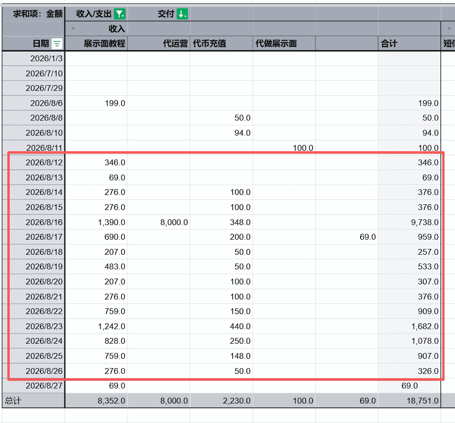
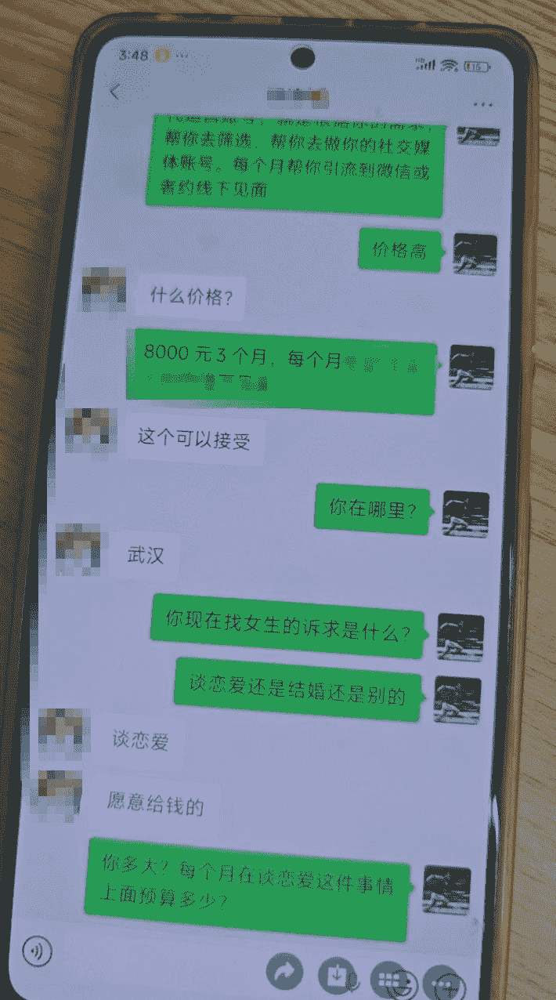
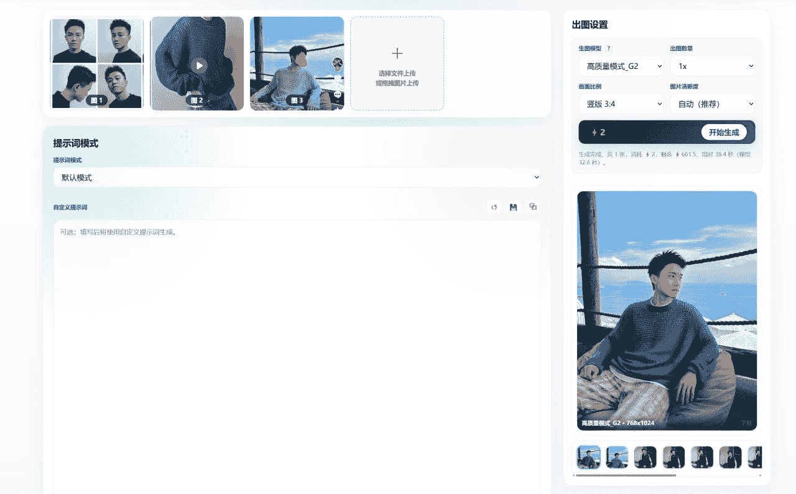
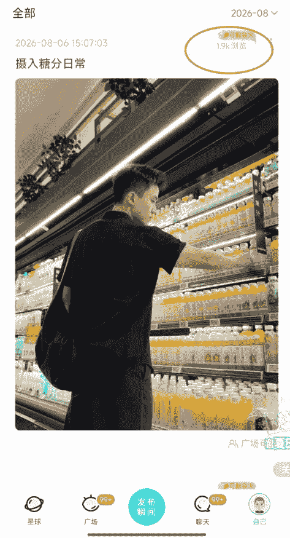
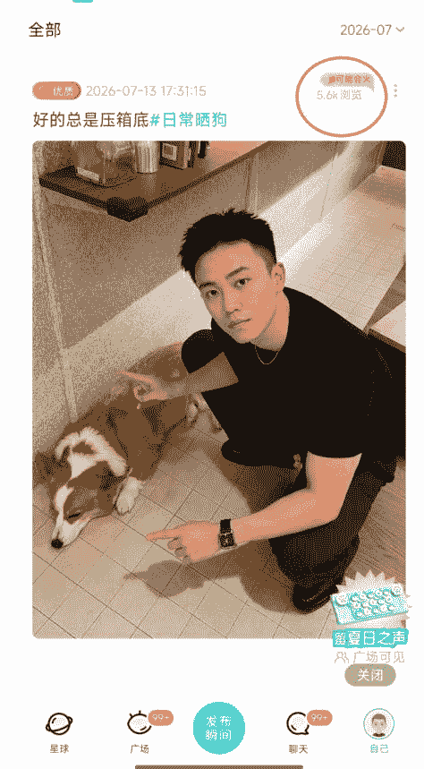
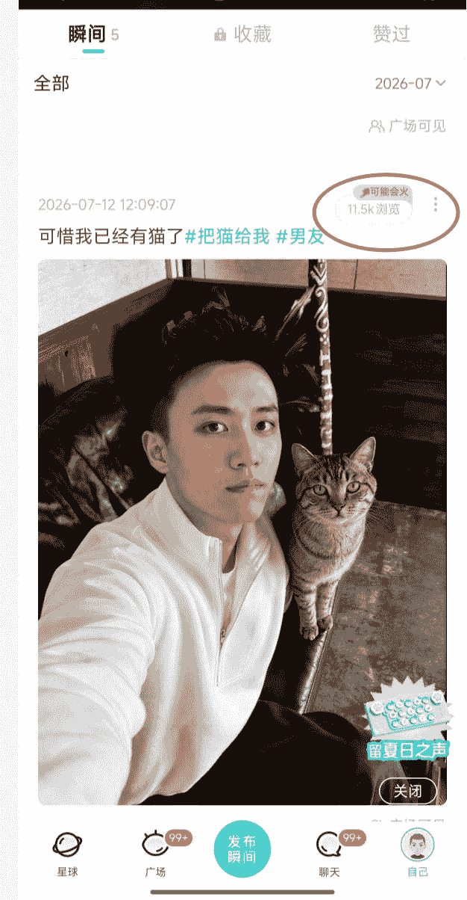
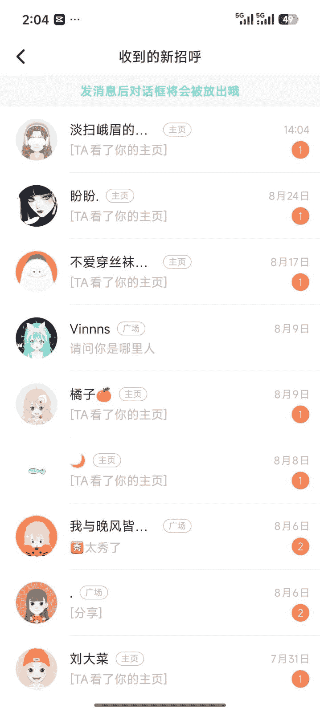
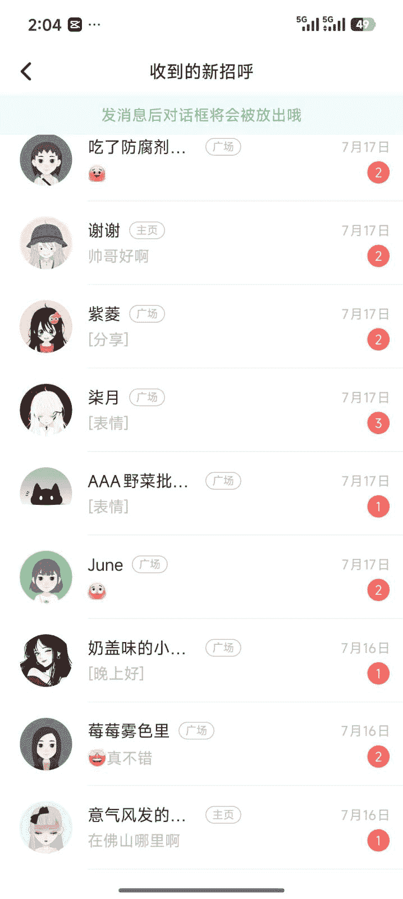
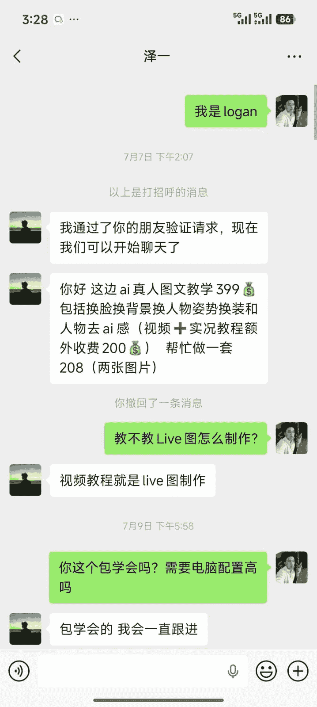
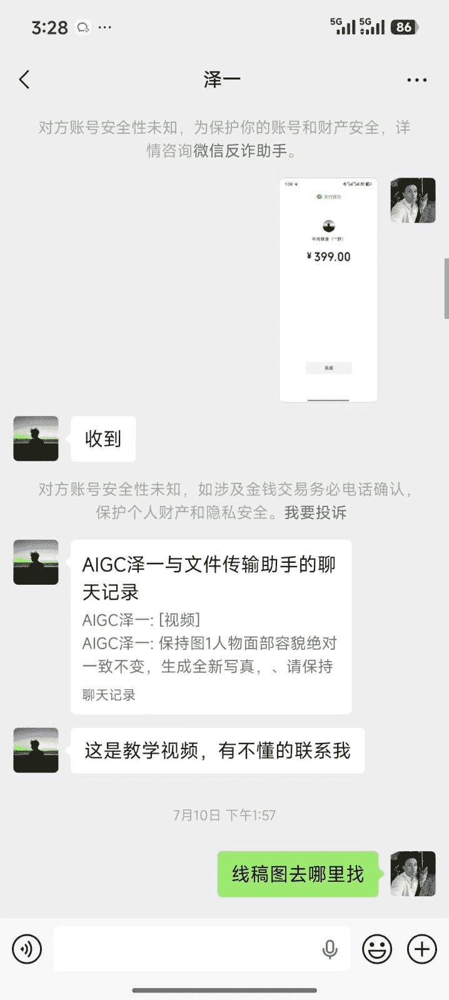

# 周变现近 2 万：我只是想在交友软件上多匹配几个女生，结果做出了一个 AI 工具

大家好，我是 龙哥。

最近两周，我做了一个叫「AI 展示面大师」的小项目，累计收入接近 2 万元。

其中包括 100 多笔 69 元的产品购买、部分用户后续充值，以及一笔 8,000 元的代运营服务单。

这件事最值得分享的，并不是“我用 AI 写了个网页，两周赚了两万”。

真正重要的是，我完整走了一遍从需求发现、产品制作、定价、获客到交付的 AI 变现流程。

而这一切的起点，只是一个很普通的个人需求：我想让自己在交友软件上获得更多匹配。

## 01 我做的到底是什么？

「AI 展示面大师」针对的是一类非常具体的用户：

想谈恋爱，但身边异性资源不多；平时不太拍照；手机相册里找不出几张适合放在交友软件上的照片的男生。

很多人并不是条件差，也不是不想展示自己，而是不会拍照。

相册里可能有工作截图、旅游随手拍、吃饭照片和模糊自拍。真正需要放到 Soul、牵手、青藤、抖音、小红书或者朋友圈时，却发现没有几张拿得出手的生活照。

但在交友软件上，陌生人认识你的第一步，通常不是聊天，而是先看头像和主页照片。

照片拍得不好，别人可能根本不会继续了解你。

所以，“展示面”其实就是别人还没认识你之前，通过你的照片、朋友圈和社交主页，对你形成的初步印象。

过去，解决这个问题往往要靠线下约拍：

租豪车、跑车或高级酒店，再请摄影师拍摄一天，最后从大量照片里挑出几张能用的。

这种方式当然有市场，但问题也很明显：

- 价格高；

- 流程重；

- 用户需要到线下；

- 拍摄和后期都要投入大量时间；

- 很容易拍出炫富、刻意、缺乏生活感的照片。

如今，单纯的“暴发户式展示”早就不太吃香了。

AI 给我的机会，是把这套很重的服务拆轻。

用户只需要上传一张自己的脸部照片，再上传一张喜欢的穿搭、场景或风格参考图，然后输入简单描述，就能生成一张更有氛围感的社交照片。

它不是把普通人变成明星，也不是改变五官、伪造身份，而是在尽量保留本人特征的前提下，优化穿搭、光线、环境和整体审美。

对于不擅长拍照、不知道该如何呈现自己的用户来说，这已经足够有价值。

## 02 从自己的问题开始，不等于只能做自己用过的产品

很多人听到“从自身需求出发”，会误以为必须做一个自己亲身经历过的项目。

其实并不是。

亲身经历的价值，在于你对问题有更具体的感受：

你知道用户通常在哪个场景遇到它，知道他们不会怎样描述需求，也知道哪些功能看起来厉害，实际使用时却没人愿意点击。

先成为问题的使用者，再尝试做解决方案，判断通常会更准确。

但个人感受只能用来发现方向，不能直接证明市场存在。

真正动手前，还要继续验证：

- 有没有其他人也在解决这个问题？

- 有没有用户已经为它付过钱？

- 现有方案为什么贵？

- 用户最嫌麻烦的步骤是什么？

- 现在的服务到底卡在哪里？

自己的经历负责提供灵感，真实市场负责给出答案。

## 03 我先花 399 元体验了一次同行服务

确认需求确实存在后，我没有马上开始开发，而是先花 399 元买了一份同行产品。

对方的交付主要是聊天记录合集，以及一个功能很复杂的 AIGC 平台链接，使用的是 RunningHub。399 元不包含后续生成图片所需的 token，用户还要额外充值。

这个模式能够卖出去，说明它确实满足了一部分人的需求。

但我体验之后，马上发现它不是我想做的方向。

因为用户真正想解决的事情很简单：

> 我没有几张适合放在交友软件上的照片，能不能快速帮我生成几张？

可他买完之后，面对的却是一系列新任务：

- 研究平台怎么用；

- 找到正确的入口；

- 学习上传什么图片；

- 购买 token；

- 处理生成失败；

- 解决人物不像自己；

- 不断尝试不同提示词。

这并不是真正解决问题，只是把原来的困难转移到了用户身上。

于是，我重新做了产品减法。

我不做一个“大而全”的 AI 平台，只单独解决“生成社交展示照片”这一件事。

产品最终被压缩成一个网页工具：

1. 用户上传自己的照片；

2. 选择喜欢的参考风格；

3. 点击生成；

4. 新用户可以先免费体验一次；

5. 想继续使用，再购买生成次数。

我给自己设置的判断标准很简单：

用户付费后，能不能在几分钟内完成第一次生成？

生成结束后，他是否清楚下一步该做什么？

如果答案是否定的，说明产品还不够简单。

很多 AI 创业者容易陷入一个误区：觉得自己能接入很多模型、拥有很多功能，就应该把产品做得足够复杂。

但新手用户不是来参观你接了多少模型的。

他只关心一个结果：能不能尽快解决眼前的问题。

## 04 从 199 元改成 69 元，核心不是低价竞争

一开始，我并没有直接卖工具，而是采用了同行的方式，卖教程，定价 199 元。

我在抖音发布关于 AI 展示面的内容，也陆续有人来咨询。

从表面看，这是个积极信号，至少说明内容击中了部分人的需求。

但真正到了付款环节，转化却非常低。

十几个甚至二十个咨询，可能都没有一笔成交。

后来我意识到，问题不只是价格。

对于一个想改善社交展示的年轻男生来说，199 元确实不算低；更麻烦的是，买到教程之后，他仍然要自行学习、操作和承担失败成本。

他买到的不是一组展示照片，而是一串任务：

- 看教程；

- 研究平台；

- 购买 token；

- 调整提示词；

- 反复生成；

- 判断哪张比较好；

- 担心最终效果不像自己。

用户真正思考的是：

> 我花 199 元之后，能不能确定拿到我想要的照片？

如果这个答案不明确，价格再低也会影响决策。

所以我把前端产品调整成 69 元。

69 元对应的交付包括：

- 一个微信资料合集；

- 一套视频教程；

- 图片上传和参考图选择说明；

- 工具使用入口；

- 新用户一次免费生成体验。

后续需要继续生成时，最低充值 50 元，大约可以使用 50 次，平均每次生成成本约 1 元。

有人可能会问：从 199 元降到 69 元，不就是单纯用低价换成交量吗？

并不是。

如果我只是把用户导向别人的公共平台，后续 token 消费与我无关，那么 69 元确实很难成为一个健康的生意。

因为一次性收入有限，用户后续也不属于我的产品体系。

但现在工具是自己的，用户后续充值仍然会留在产品中。

因此，69 元只是用户进入产品的第一道门槛，并不是收入的全部。

收入结构大致分成两部分：

- 首次购买：降低用户尝试成本；

- 后续充值：形成持续收入。

改价之后，转化明显提升。

此前二十个咨询未必能成交一单，调整后，基本三个咨询里可以成交一个，转化率达到 30% 以上。

这让我重新认识了定价。

很多人定价时，会优先考虑：

- 自己花了多少时间；

- 产品用了多强的模型；

- 有多少个功能；

- 同行卖多少钱。

这些都重要，但还不够。

更关键的问题是：

> 用户付款之后，距离他想要的结果还有多远？

如果用户付完钱，仍然要学习大量流程、承担多次试错，即使产品卖得便宜，也未必容易成交。

而当你帮用户砍掉复杂步骤，让他更快看到结果，价格往往更容易被接受。

当然，这个项目本身的市场天花板并不算高，哈哈。

## 05 两周近 2 万，收入到底来自哪里？

这两周接近 2 万元的收入，主要由三部分组成。

### 第一部分：69 元产品销售

一共卖出了 100 多单。

### 第二部分：用户后续充值

大约三分之一的购买用户会继续充值，单次充值通常在 50 元左右。

这个比例也说明了一件事：

确实有人愿意为这个需求付费，但不是所有购买入门产品的人，都会持续使用。

### 第三部分：8,000 元代运营服务

有一位用户进一步提出，希望我帮他运营抖音账号，并把主动联系过来的女生微信推给他。

这已经不是简单的工具生意，而是一项更重的脱单服务。

当时我也犹豫过。

我需要先判断三件事：

- 我能不能完成这项服务？

- 我愿不愿意接？

- 接下之后，会不会把自己拖进长期、繁琐的交付？

最后我还是接了第一单。

价格是 8,000 元，服务周期三个月。这个价格并不算高，我更想借此把完整流程跑一遍。

如果后续验证成功，还可以继续探索高净值客户、月度服务、标准化交付，以及用 Agent 辅助执行等方向。

但这 8,000 元并不是用来证明“高客单有多厉害”的。

它反而让我更清楚地看到了低客单工具和高客单服务之间的区别。

69 元工具，主要由用户自行操作，交付相对轻。

高价服务则完全不同。用户期待的是结果、定制、沟通和持续反馈。收入虽然更高，但时间、精力和情绪成本也会同步上升。

所以，不能只看客单价。

还要把交付成本算进去。

我过去做过一些交付较重的项目，因此现在判断一个项目时，会优先考虑：

> 它会不会把我拖进不断沟通、反复修改和长期解释的循环？

如果客户需求高度定制，预期又不清晰，还需要持续处理情绪和反馈，那么这笔钱未必值得赚。

真正的成本，不只是银行到账的金额。

你的时间、注意力、情绪、精力和项目可复制性，都应该被计算进去。

这也是我没有选择人工代做展示面的原因。

市场上确实有人提供人工代做，一张照片可能收费 100 到 200 元，三张甚至可以卖到 600 元。

但我自己免费帮用户做过几次，很快就发现，这件事远没有想象中轻松。

AI 生图很少能做到一次成功，通常需要多次生成，再从大量结果中筛选。

你觉得某张照片不错，客户却可能觉得“不像自己”。

客户还会提出各种要求：

- 换一个场景；

- 改一下衣服；

- 表情不自然；

- 人物不像本人；

- 氛围不对；

- 再生成几张看看。

最后，一项看似简单的代做服务，很容易演变成大量沟通和反复修改。

越想让客户满意，交付就越重。

所以我更愿意把精力放在自助工具上。

工具同样会有客服、故障和优化工作，但用户至少能够自己参与生成、自己选择结果、自己控制使用次数。

你不是把客户变成等待交付的人，而是让他具备自行获得结果的能力。

这才决定了项目有没有机会扩大。

## 06 真正差点让我放弃的，不是开发，而是承接流量

如果问我这段时间最崩溃的时刻是什么，答案不是写网页，也不是调接口。

过去我做内容和引流，通常一个账号不行就换另一个，所以一开始并没有认真考虑私域承接的容量问题。

在我看来，内容爆了、用户主动咨询，当然是好事。

但后来我才明白：

内容爆，只能说明获客环节有效。

它不代表你有能力稳定地接住这些用户。

由于之前没有做过这种私域引流业务，我只能临时研究企业微信、卡片承接和其他方式。

后来因为操作不当、发送过多等问题，账号出现降权甚至“吞卡”。

所谓吞卡，就是你以为信息已经发出去了，但对方不一定能收到；或者用户刚刚被内容吸引过来，承接流程却突然中断。

前面的内容、流量和咨询，就这样被浪费掉了。

那次之后，我才真正意识到：

> 项目不是“能获客”就结束了，而是一条完整的业务链路。

内容是入口，后面还有：

- 用户承接；

- 支付；

- 产品交付；

- 复购；

- 售后；

- 账号安全；

- 平台规则。

任何一个环节承受不了流量，前面做得再好，也可能瞬间断掉。

后来我和一位做出过大结果的朋友交流，他给了我一个很直接的判断：

69 元的低客单产品，没有必要强行把所有用户都拉进私域。

我非常认同。

低客单用户更适合短路径：

看内容，进入网站或小程序，直接付款，马上使用。

用户不需要添加个人微信，我也不需要人工处理每一笔订单。

私域当然有价值，但更适合高客单、需要深度沟通和复杂决策的客户。

如果连 69 元产品都要求人工承接，就等于把一个轻交付项目，主动做成了重人工业务。

所以，我现在正在把「AI 展示面大师」逐步转成小程序。

过去已经支付过 69 元的用户，不再重复缴纳入门费用，后续可以直接充值使用；同时，我也会提供一些补充权益，例如在一定周期内赠送部分生成次数。

高客单用户，则可以通过小程序或网站里的联系方式与我沟通。

而不是让所有用户都先添加我的私人微信。

接下来，我还会继续测试蓝 V、付费投放，以及更符合平台规则的企业化获客方式。

不过平台规则一直在变化，具体操作前必须查看当下官方政策。

不要把绕过风控、批量导流到个人微信当成能力。

真正能长期运行的项目，应该是在规则允许的范围内，稳定重复执行。

而不是短时间内把大量用户导进一个随时可能出问题的账号。

## 07 这次项目给我的四个启发

### 第一，寻找已经有人在用笨办法解决的问题

不要一开始就问：

> AI 现在能做什么？

更应该问：

> 人们正在为什么付钱？

> 哪些事情他们明知道麻烦、昂贵、低效，却仍然不得不做？

展示面过去依靠线下约拍，价格高、流程重，但需求真实存在。

AI 的机会，不是凭空制造需求，而是把原本沉重的流程变轻。

### 第二，购买同行产品，是为了看清真实交付

我花钱体验同行，不是为了照搬他的产品，而是想知道：

- 用户付款后具体拿到了什么；

- 哪些步骤仍然需要自己完成；

- 哪些地方最容易卡住；

- 用户为什么愿意买；

- 用户为什么可能不再继续。

公开内容只能让你看到产品的表面。

真正的交付过程，才会暴露业务结构。

### 第三，AI 编程更适合用来验证，而不是一开始就造完整产品

第一版产品不需要足够漂亮，也不需要功能齐全。

只要跑通一条最小链路就够了：

有人看见内容，有人愿意付款，有人能够完成第一次生成。

我没有优先开发“监控优秀展示面、一键复刻”等复杂功能，就是因为它们会让产品变重，却不能证明用户是否真的愿意使用。

### 第四，获客、承接和交付必须一开始就一起设计

内容爆了，只能说明入口有吸引力。

它并不等于业务已经成立。

以后，我会让低客单用户更多通过网站或小程序完成购买和使用；高客单用户再进入人工沟通。

项目只有在规则范围内，能够稳定重复运行，才值得继续投入。

至于用户价值，也不能简单用“没人退款”来证明。

更完整的验证应该是：

- 用户愿意购买；

- 用户真正完成生成；

- 用户愿意继续充值；

- 用户把照片用于真实社交场景；

- 用户感受到展示效果确实改善。

同时，展示面工具只能帮助用户更好地呈现自己。

它不能承诺一定脱单，也不应该被用来伪造身份或欺骗他人。

## 08 写给那些会用 AI，却还没赚到第一笔钱的人

我想，这篇文章真正适合的读者，是这样一群人：

你已经接触过不少 AI 工具，知道它可以写文案、做图片、写代码、整理表格、搭建自动化流程。

你也看过很多“一个人做产品”的案例，每次看完都觉得机会巨大。

但轮到自己真正开始时，却还是会停在原地：

- 不知道应该做什么；

- 担心没有技术能力；

- 不会获客；

- 不懂产品；

- 不会定价；

- 不知道如何交付；

- 害怕没人愿意付钱。

这很正常。

很多时候，你缺的不是 AI 工具，而是一个具体的业务场景。

没有真实场景，AI 只会让你收集更多工具、提示词和案例，同时变得越来越焦虑。

你会不断学习，却始终没有一个问题需要你今天解决。

我的建议是，不要先去搜索“现在最赚钱的 AI 项目”。

先看看自己的生活和身边的人：

- 最近有没有什么事情让你反复觉得麻烦？

- 有没有哪个行业一直在用低效方式做重复劳动？

- 有没有一种服务，明明又贵又慢，用户却仍然愿意购买？

- 有没有一套你亲自做过、知道其中痛点的流程？

- 有没有一类人正在为某个问题持续花钱？

把这些问题写下来。

然后找几个人聊聊，看看同行怎么做，甚至花钱买一次现有服务，亲自体验完整交付。

如果确认需求真实存在，就不要在岸上研究半年。

用 AI 做出一个最小版本。

它不需要漂亮，不需要功能完整，也不需要一开始就拥有品牌、团队和商业计划书。

它只需要让一个真实用户完成一次关键动作，并得到一个看得见的结果。

做出来以后，发布一条内容，找十个真实用户交流，观察他们：

- 哪一步停住了；

- 为什么愿意付钱；

- 为什么不愿意继续使用；

- 哪个环节最让他们困惑；

- 哪个结果真正让他们满意。

你会在这个过程中自然学会很多能力：

怎样描述需求，怎样让 AI 帮你写代码，怎样搭页面，怎样定价，怎样做内容，怎样设计交付，以及如何面对真实用户的反馈。

这些东西，光靠观看案例是学不会的。

一定要放进一个真实项目里，边做边学。

这次做“展示面大师”，两周到手将近两万。先说清楚，这不等于项目已经很稳，也不是复制就能复刻同款收益。它只是我实打实走了一遍闭环：从自身痛点出发→验证市场真实需求→用 AI 编程搭出可用工具→调价→收钱→被售后和交付问题直接上课。

这条路磕磕绊绊，不算完美。

但它是我亲手跑通的真实路径。

而亲手跑通一次，比把十篇“AI 赚钱项目”收藏在文件夹里要有用得多。

如果你现在还没锁定方向，别等大风口。先找一个能让你沉下手练的小需求就够了。体量不用大，起量也不用猛。关键是三件事能同时成立：你愿意持续打磨它、有人愿意为这个结果买单、AI 能真正在流程里替你减负。

找到后，就开干。

让 AI 先在你的具体业务里打工，你再在具体业务里学会变现逻辑。

写下这篇复盘，是想给还在找 AI 项目切口的你一点参考。

也给自己一个提醒：以后做事，少点对功能的迷恋，多点对用户、对交易链路、对交付质量的敬畏。

我是 Logan，现在在广州佛山交界的金沙洲。聊 AI 编程变现、对落地场景感兴趣的伙伴欢迎来喝杯茶，聊需求、聊场景，帮更多人拿到 AI 赚来的第一笔钱。

感谢阅读，感谢赚钱。

——分割线——

看完 SOP，很多人会觉得自己懂了。可真到上手，90% 会卡在第一步就动不了。

工具和教程是最容易被取代的壁垒，真正拉开差距的是“立刻执行”和“圈层信息差”。

我们只拆商业闭环，只压 AI 效率，不聊概念。内部已沉淀 1000+ 真正跑通的套利实战案例。

👉 查看圈子数字资产全貌与加入门槛：

