# 器 | 从学业到投资，一站式效率工具箱

✊️🆚🗡

练拳的拼不过持刀的，持刀的拼不过端枪的——这就是“器”的加持。

器的本质是提效：提效=提升效果 × 提升速度。

🚀🚀🚀

# 零｜开篇说明 📢 PREFACE

* * *

我是龙哥。创业这16年里，我一直有“收藏工具”的嗜好，也攒下过不少名单。要不要公开，其实犹豫了很久。

犹豫的原因有两个：早期收录的很多链接时效性有限，有些站早就关闭或失效；再加上当时最热门的内容创作和 AI 类工具，我还没有系统整理进去。

后来换个思路：这正好是一次机会，可以靠它倒逼自己把旧库彻底梳理一遍。于是我花了近一周时间，清掉已停服和过时的内容，再加入一批新发现的工具，免费分享出来。

这份工具库我会长期维护更新。大家发现错误或失效链接，欢迎留言或私信，我收到后会及时删改。若觉得内容有帮助，也请点赞支持一下。

想进一步认识我，可以查看我的个人说明页。

整理逻辑按两条主轴展开：一条是职业路径，一条是实际场景。

职业路径分为四段：求学、在职、创业（或副业）、投资。每个阶段对工具的期待显然不同——求学期重在知识沉淀，在职期重在执行提速，创业期重在资源整合，投资期则要信息与判断。

脱离场景讲工具没有意义。工具是用来解决具体问题的，而且多数工具都身兼数职，不同功能对应不同使用场景。所以在阶段之下，我再按需求/场景做了一级细分。

做分类只是为了“找得快、用得准”，没必要纠结某个工具放哪一类，只要遇到问题时，能想到用哪把“刀”就够了。

就条目本身，目前主要列出名称、简介、链接和配图；后续我会继续补上使用场景、实战案例和方法论，值得蹲一波。

最后强调一点：工具在精不在多。我是在做筛选，不是做聚合目录；后面也会持续删除失效、难用或过时的条目。

工具旁的标记（该工作仍在推进中）：

👍 → 个人推荐

🕸 → 需🪜

💰 → 付费

🔤 → 纯英文站

提醒：若飞书内直接点击链接无法打开，特别是境外网站，建议复制链接到浏览器地址栏访问。

# 壹｜求学充电 🎓 STUDY PHASE

* * *

## 一、加速知识摄入

### 1. 搜书 / 文档下载

#### 外文资源

**Zlibrary** 👍🕸

免费线上图书馆，目前藏书 1200 万册以上、文章 8400 万篇以上，学科覆盖文学、历史、科学等；支持约 28 种语言，包括中文。绝大多数资源免注册即可直接下载，也支持按标题、作者、ISBN 等条件筛选，体验相当流畅。缺点是访问需要🪜。

入口：

```text
https://z-lib.id/
https://it.1lib.sk/
https://es.1lib.sk/
https://1lib.sk/
```

**安娜的档案** 👍🕸

非营利、开源的综合检索工具，把 Z-Library、Library Genesis、Sci-Hub 等知名库整合到一起，可在同一入口查找书籍、论文、漫画、杂志。收录电子书总量超过 40 万册；中英文内容均支持免登录下载，不限制数量。访问同样需要🪜。

入口：

```text
https://zh.annas-archive.se/
https://zh.annas-archive.org/
```

#### 中文资源

**鸠摩搜索** 👍

专注电子书/文档检索的垂直搜索引擎，整合自淘宝、豆瓣、百度文库、百度网盘等多个来源，可以快速找到论文资料、古籍，还能比较不同商城价格。

入口：https://www.jiumodiary.com/

**文献小镇**

国内外文献“合并搜索”入口，内置多个 SCI-HUB、Google 镜像站，并接入知网、百度文库等大型文库存量，还提供多个备用地址，总能找到能用的那个。

入口：www.sci-hub.ac.cn

**PDF 书籍下载**

城通网盘整理好的 PDF 电子书仓库，适合电脑端阅读。以下是两种分类入口：

```text
按中图法分类：https://n459.com/dir/4105743-11334675-d9559b
按拼音分类（密码：576196）：https://url36.ctfile.com/d/4204636-30731937-3f352e
```

#### 网盘检索

百度网盘：

- 学霸盘：https://www.xuebapan.com/

- 熊猫搜盘：https://www.sopandas.cn/

- 兄弟盘：https://xiongdipan.com/

- 热盘搜：http://www.repanso.com/

阿里云盘：

- up云搜（不限速，资源齐全）：https://www.upyunso.com/

- 猫狸盘搜：https://www.alipansou.com/

其他：

- 趣盘搜（夸克网盘）：https://pan.funletu.com/#/

- 迅极搜（迅雷网盘）：https://xunjiso.com/

- PanSearch（多平台网盘聚合，广告较多但免费）：https://www.pansearch.me/

### 2. 高质量知识输入

**微信读书** 💰👍

我目前的主力阅读 App，已购连续包年会员（168元/年）。书库足够全，想读的多数能找到；没有的书也能自行导入。支持多种电子书格式，还可以听有声书，伴睡很合适。

入口：https://weread.qq.com/

**知识星球** 💰👍

当前唯一在用的知识付费渠道，主要看互联网创业情报与 AI 技能相关内容。付费加入优质星球，哪怕拿到的只是二手资讯，也往往有信息差价值。

入口：

**飞书·飞行社** 👍

我用飞书做知识管理，而飞书内的“飞行社”板块汇集了大量官方和第三方产出的高质量知识库、模板、课程，非常值得翻一翻。


**秘塔AI·今天学点啥** 👍

一个能把任意网页/文档变成结构化课程的智能学习工具。把 PDF、Word、行业报告、论文等链接丢进去，就能得到“讲解+动画+测试”的完整体验；10分钟内消化一个知识点，特别适合职场人和创业者快速补技能。

几个突出亮点：

- 极速转化：任意网页/链接约 1 分钟生成带动态 PPT、动画与真人讲解的定制课程，支持中英双语和 20 多种人格化讲解风格（从“暴躁老哥”到“爱因斯坦”）；

- 互动闭环：学习时随时提问、即时答疑；课后自动生成测试题并解析，形成“学-练-测”闭环，知识留存率更高。

入口：https://metaso.cn/study

**Zread.ai** 👍

专门用来解读 GitHub 开源项目的 AI 工具。把项目链接贴进去，几分钟就能生成一份中文指南；也支持解读 AI 开源大模型、分析私有仓库，适合做项目交接与技术沉淀。首页下方的“探索本周热门仓库”能快速看到每周最火的开源项目，且指南已经生成好。

入口：https://zread.ai/

### 3. 在线课程

**网易公开课**

面向公众免费开放的在线课堂，全球名校、教育机构和可汗学院的课程都能找到，内容覆盖人文、社会、艺术、科学、金融等领域。

入口：https://open.163.com/

**TED** 👍🔤

非营利组织，专注传播值得传播的想法。演讲覆盖科技、设计、商业、教育等方向，是跨领域获取灵感的稳定来源。

入口：https://www.ted.com/

## 二、专项技能突破

### 开发与工程能力

我本科读计算机，平时会留意编程类书籍。进入 AI 时代以后，懂一点计算机基础，对理解 AI、用好 AI 会有实实在在的帮助。

- 免费的编程中文书籍索引（GitHub）：https://github.com/tianyuan881214/free-programming-books-zh_CN

- 自学计算机科学指南（GitHub）：https://github.com/izackwu/TeachYourselfCS-CN/blob/master/TeachYourselfCS-CN.md

- 免费计算机书籍汇总（GitHub）：https://github.com/ruanyf/free-books/blob/master/README.md

- 搬书匠（计算机图书专门站）：http://www.banshujiang.cn/

### 商业软实力

**心情**

主攻心理学入门与个人成长。无论给别人打工还是自己当老板，能看懂人、读懂人，都是非常关键的软技能。

入口：http://www.ixinqing.com/

### AI 充电区

#### AI 入门

- **UDACITY** 🔤：英文课程库，从入门到进阶都覆盖，打开速度略慢，可配翻译插件使用。

https://www.udacity.com/school/artificial-intelligence

- **Google AI** 🕸：Google 官方 AI 学习平台，英文，需🪜。

https://ai.google/

- **Coursera**：大型开放课程平台，人工智能力量雄厚，机器学习的课非常多。

https://www.coursera.org/courses?query=artificial%20intelligence

- **Elements of AI** 🔤：MinnaLearn 与赫尔辛基大学合作的免费在线课程，目标是把 AI 是什么、能做什么、不能做什么讲清楚，并带人开始上手。英文。

https://www.elementsofai.com/

- **阿里云·人工智能学习路线**：完整学习地图，共 5 大阶段、30 门课程、424 个课时。第一、二阶段完全免费，后三阶段 9.9 元/门。

https://developer.aliyun.com/learning/roadmap/ai

- **AI 大学堂**：科大讯飞推出的免费 AI 课堂。

https://www.aidaxue.com/

- **ShowMeAI**：中文 AI 学习社区与资料库。

https://www.showmeai.tech/?ref=ai-bot.cn

- **pp飞桨 AI Studio**：百度发起的 AI 学习与训练社区，全中文。

https://aistudio.baidu.com/overview

#### 原理研究

- **Machine Learning Mastery** 🔤：从零到高阶的机器学习教程集，英文。

https://machinelearningmastery.com/start-here/

- **Kaggle** 🔤：机器学习与数据科学的交流/竞赛社区，英文。

https://www.kaggle.com/

- **Microsoft | Open Source** 🔤：微软推出的开源机器学习课程，免费，英文。

https://opensource.microsoft.com/

- **fast.ai** 🔤：免费开放的深度学习资源站，英文。

https://www.fast.ai/

- **动手学深度学习**：高质量中文深度学习教材与配套课程。

https://zh.d2l.ai/

- **Brilliant** 🔤：交互式神经网络入门课，全英文。

https://brilliant.org/courses/intro-neural-networks/

#### 提示词工程

- **提示工程指南**：开源开放的中文提示工程资料。

https://www.promptingguide.ai/zh

- **Learning Prompt**：免费提示词教程，已包含 ChatGPT 和 Midjourney 内容，支持中文。

https://learningprompt.wiki/zh-Hans/

#### AI 编程与框架

- **Scikit-learn** 🔤：Python 机器学习库。

https://scikit-learn.org/stable/index.html

- **NumPy** 🔤：Python 科学计算的基础包。

https://numpy.org/

- **NLTK** 🔤：Python 自然语言处理工具包。

https://www.nltk.org/

- **华为昇思 MindSpore**：华为开源的深度学习框架。

https://www.mindspore.cn/

#### AI 情报站

##### 资讯层（看动态、追热点）

- **TechURLs**：科技新闻“全集站”，把 Hacker News、Reddit/tech 等海外信息源全部聚合在一起，还支持用“AI”“大模型”这类关键词筛选。想蹲第一手海外 AI 资讯又不想🪜，来这就对了。

https://techurls.com/

- **机器之心**：中文 AI 圈的资深媒体，既翻译海外优质内容，也输出原创深度分析，技术解读与行业报告都很扎实。

https://www.jiqizhixin.com/

##### 分析层（深度洞察）

- **A16Z（Andreessen Horowitz）**：硅谷顶级风投的 AI 观察专栏，内容覆盖技术趋势、创业生态，甚至 AI + Web3 这种前沿交叉组合。适合想拥有“投资人视角”的读者持续跟读。

https://a16z.com/ai/

- **Sequoia Capital**：全球一流风投的行业透视报告，内容包含 AI 技术演进、商业化路径与投资逻辑，还会拿自己投过的公司做案例拆解，含金量很高。

https://www.sequoiacap.com/article/tag/ai/

##### 实用层（找工具、找落地）

- **Toolify.ai**：AI 工具领域的“大众点评”，实时更新各产品的流量、收入等排行榜，新冒头的 AI 应用基本都能在这里找到。

https://www.toolify.ai/zh/

- **AIBase**：AI 界“瑞士军刀”，新闻、工具榜、开源项目通通都有，还能在中文和英文之间自由切换。

https://www.aibase.com/zh

- **Product Hunt**：全球新品的首发展示场，每天更新最新潮的 AI 应用与 SaaS 工具。从开发框架到终端产品应有尽有，还能看到第一手用户真实评价，适合验证 idea 和挖掘潜力项目。

https://www.producthunt.com/

- **GitHub Topics/Trending**：程序员追踪 AI 开源热点的最前线。关注 #ai、#ml 标签，有机会刷到 Stable Diffusion 这类神级项目；可以直接看源码、提 issue，甚至参与共建，大量论文复现代码也都在这里首发。

https://github.com/topics/ai

https://github.com/topics/ml

https://github.com/trending

小贴士：

* 产品经理想快人一步掌握行业动向，日常刷 Toolify.ai 与 Product Hunt 效率高；

* 开发者若深耕 GitHub 开源阵地，能把重复造轮子的功夫节约到极限；

* 投资人寻找下一枚 AI 独角兽，这几类社区值得长期跟踪。

### 3.5.4 系统知识层

面向想要把 AI 学透的大学生、科研人员、工程技术人员，提供体系化进阶与学术型资料。

（1）🌈通往AGI之路

一帮 AI 行业从业者合力维护的开放型知识库，从零基础到进阶的工具清单、案例拆解、实战笔记全覆盖。

推荐理由：入门者能找到上路路径，资深玩家也能淘到干货～

网址：

https://www.waytoagi.com/zh


（2）arXiv（AI 相关领域）

AI 学术论文的首发阵地，机器学习、NLP、计算机视觉等方向的新成果多半先在此露面。

推荐理由：做研究的刚需！配合 Papers With Code，能直接对照论文复现代码～

网址：https://arxiv.org/list/cs.AI/recent

（3）Papers With Code

把前沿论文、参考实现和数据集合在一起的站点，一键直达 GitHub。

推荐理由：告别只看论文干着急😂，覆盖 CV、NLP、强化学习等全系分支，实验结果可横向比对，省去重复造轮子的时间！

网址：https://paperswithcode.com/

（4）李宏毅《生成式AI导论2024》

台大李宏毅教授主讲的生成式 AI 全景课程，从 Diffusion 原理到 Sora 的技术拆解都讲得很透。

课程亮点：数学推导、代码演示、产业案例三合一，比如拆解 Midjourney 的实现思路；全程中文，英语吃力也能跟上；模块化设计，可按需跳着学。

适合谁：想吃透生成式 AI 的开发者/产品经理。

课程地址：

YouTube频道：https://www.youtube.com/@HungyiLeeNTU

B站：https://www.bilibili.com/video/BV1BJ4m1e7g8/?vd_source=fd7d12daecd42528100b362cd938823c

（5）吴恩达《Generative AI for Everyone》

吴恩达为非技术人群打造的 6 小时入门快课。

学完能做什么？看懂 ChatGPT 在企业的落地方式，用 AI 机会评估矩阵做业务诊断，避开生成式 AI 的常见坑比如合规风险……

推荐理由：时间紧？这门课就是一份浓缩的 AI 入门包！

课程地址：

课程官网：https://www.deeplearning.ai/courses/generative-ai-for-everyone/

Coursera：https://www.coursera.org/learn/generative-ai-for-everyone

学习路线建议：

* 小白先从吴恩达入手，建立全局观；

* 工程师重点攻克李宏毅，夯实技术细节；

* 研究者锁定 arXiv + Papers With Code，保持前沿；所有人都可以去 AGI 之路补齐短板。

## 三、📖高效知识管理

### 1.碎片知识收集处理

（1）Get笔记👍️

得到推出的免费 AI 语音转文字小工具，识别精准，能把语音快速转为文字并润色。界面简洁好上手，支持录音、文本保存与时间轴回溯，适用于工作记录、学习笔记、个人备忘，随时捕捉灵感，提升记录效率。完全免费，无次数限制。

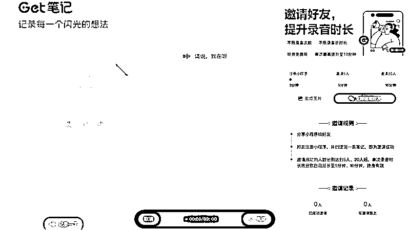

（2）NotebookLM🕸️

谷歌推出的一款 AI 笔记整理应用，基于大语言模型帮助用户吸收与管理信息。可上传文档、链接、文本，自动生成摘要、问答、创意灵感。最新功能可把上传内容转化为对话式播客，由一男一女两名虚拟主播进行对谈，提供全新信息消费体验。

网址：https://notebooklm.google/

参考：或许自媒体大号和素人之间的差距，就差这么一个 AI 笔记神器！

### 2.知识库/体系管理

（1）飞书-知识库👍️

字节跳动推出的企业级协作管理平台，集合即时沟通、在线文档、云存储、视频会议、项目管理、审批流等能力，目标是提升团队协作与知识沉淀效率，也是我目前知识管理的首选。

推荐理由：

* 一体化覆盖：从日常沟通到深度协作再到知识沉淀，全流程打通，避免多工具割裂。

* 知识管理高效：知识库支持层级分类、标签管理、全局检索，文档支持 @ 提及、评论互动，实现上下文关联沉淀。

* 创新功能提效：如“飞书妙记”可将会议录音自动转写并生成摘要，节省整理时间；多维表格让非技术人员也能搭建轻量级业务系统。

* 适配多规模团队：免费版已能满足中小团队，企业版提供更强安全管控与定制服务。

* 持续迭代与生态扩展：依托字节技术资源更新快，并可集成第三方应用如薪酬计算、CRM 等。


国际版 Lark：https://www.larksuite.com


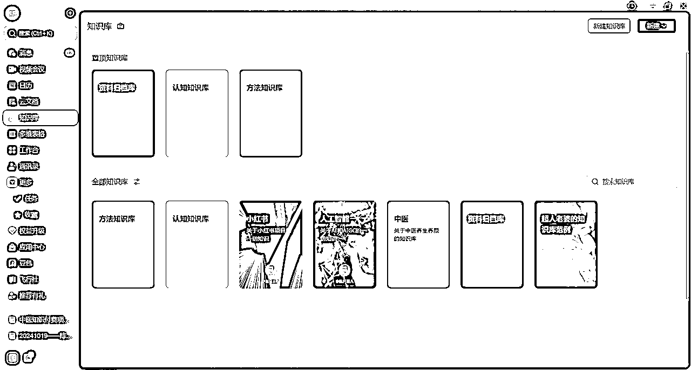

（2）印象笔记 Evernote

全球知名的个人与团队知识管理工具，擅长信息收集、整理、存储与检索，帮助用户把碎片信息沉淀为可检索体系。飞书出现前我主要用它，现在更偏向飞书。

推荐理由：

* 个人知识沉淀的标杆：适合长期积累碎片信息，形成可检索体系。

* 信息抓取无缝：网页剪藏、微信文章保存、邮件转发到笔记，解决信息分散的痛点。

* 组织方式灵活：标签与笔记本交叉管理，既能严谨分类也能动态调整。

* 核心能力持续迭代：思维导图整合、OCR 升级，并可联动微信、钉钉、Google Drive 等。

* 人群覆盖广：学生、研究者、职场人士均可通过模板与自定义适配不同场景。

* 免费版可用：个人免费版支持基础同步与剪藏，高级版提供更大空间与 PDF 标注。

官网中国版：https://www.yinxiang.com

国际版 Evernote：https://www.evernote.com

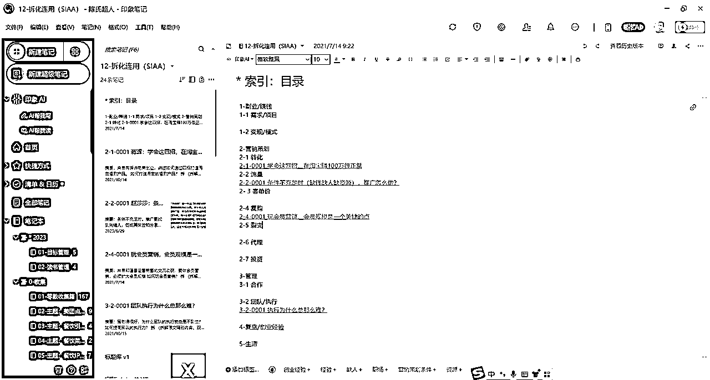

（3）Notion

一款高度灵活的集成协作工具，融合笔记、数据库、任务管理、知识库、项目管理，可为个人与团队搭建定制化工作空间，被称为 All-in-One 生产力平台。未来我想用它搭建付费知识库。

推荐理由：

* 一体化终极方案：可替代 Trello、Confluence、Airtable 等，降低工具切换成本，统一工作流。

* 高度自由可扩展：从个人日记到企业级知识库皆可模块化实现，开发者友好，支持 API 与自定义集成。

* 知识互联复用：数据库关联让信息不再孤立，例如任务库联动客户库自动生成看板，全局检索与页面链接便于跨模块定位。

* 零成本起步，学习资料丰富：免费版满足基础需求，官方教程、社区模板与第三方课程大幅降低门槛。

* 跨平台无缝：全平台覆盖，实时同步，支持离线编辑，适合分布式团队与远程办公。

官网：https://www.notion.so

（4）腾讯AI智能工作台 ima.copilot，简称IMA

腾讯发布的 AI 原生工作台，以个人知识库 + AI 搜读写为核心，整合全网信源、本地文件管理与大模型能力，覆盖学术研究、职场办公、教育管理等场景，定位用户的第二大脑。

推荐理由：

* 一站式解决痛点：把微信文章、会议记录等碎片信息统一入库，通过 AI 关联检索，避免多工具切换。

* 场景适配深：教师可上传学生档案生成个性化评语；职场人可快速分析财报、合同，效率提升数倍。

* 门槛低性能强：无需自建大模型，直接使用腾讯提供的满血服务。

* 体验细节优化：支持截图提问、文内实时翻译、插图生成，写作时可精准局部修改如替换案例或调整字数。

* 生态扩展潜力：未来计划支持 Excel/PPT 解析、多设备同步如 AR 眼镜，并开放 API 与第三方集成。

官网：https://ima.qq.com

开发者社区介绍：腾讯云开发者社区

（5）腾讯元器

基于腾讯混元大模型的一站式 AI 智能体开发平台，特色是零代码/低代码可视化开发，整合插件扩展、知识库管理、工作流编排三大能力，可快速构建企业级智能客服、个人创意机器人等应用。

推荐理由：

* 智能体可自动接入公众号历史文章知识库；

* 支持一键发布到 QQ、微信客服、小程序等腾讯渠道，并提供 API 接口便于嵌入自有应用，实现广泛触达。

官网：https://yuanqi.tencent.com/

1.适用场景与推荐组合

* 内容创作者 自媒体/文案：首选腾讯IMA，AI 写作模板如小红书/朋友圈文案 + 全网信源检索 + 文档智能分析，快速产出优质内容。

* 电商/社群运营者：首选飞书，整合沟通群聊/机器人通知 + 多维表格订单管理/用户画像 + 知识库 SOP 沉淀。

* 教育/咨询从业者：首选Notion，搭建课程库/学员档案数据库 + 关联知识图谱。

* 独立开发者/设计师：首选Notion，项目管理看板视图 + 资源库设计素材/代码片段 + 嵌入式原型 Figma/GitHub。

* 企业级 AI 应用开发者：首选腾讯元器，AI 智能体开发客服/营销机器人 + 多源数据接口 CRM/ERP 对接 + 微信生态一键部署，实现业务自动化升级。

2.避坑指南

* 不要盲目追求 All-in-One：Notion 虽强，过度定制会浪费时间，副业初期建议用现成模板而非自建系统。

* 警惕功能冗余：飞书适合高频内部协作团队，若仅需文档共享，腾讯文档 + IMA 组合更轻。

* AI 工具需结合场景验证：IMA 的文档分析在法律/财务领域仍需人工复核，用于市场报告摘要、作文批改等场景可靠性较高。

* 数据迁移成本：印象笔记导出格式受限，若未来可能迁移，优先选支持 Markdown 导出的 Notion 或飞书。

3.总结建议

* 极致性价比方案：腾讯IMA + 飞书云文档

* 企业级 AI 中枢方案：腾讯元器 × Notion × 飞书

* 深度知识管理方案：Notion + 印象笔记

* 新手友好方案：直接使用腾讯IMA，覆盖信息收集、AI 加工到分发全链路

* 单人轻量化：优先选 AI 加持的免费工具如 IMA

* AI 驱动型小团队：飞书 + 腾讯元器 + IMA

* 长期主义者：选择数据可迁移、生态开放的工具如 Notion，避免被单一平台绑定

# 贰 | 打工阶段 💻 WORKING PHASE

* * *

## 一、⏱️效率工具

### 1.提升工作效率

#### 1.1 工作环境/氛围搭建

（1） Quicker👍️

个人自动化神器，通过自定义快捷键与宏把重复性任务自动化，提升效率。支持 Windows 与 macOS，是我最喜欢的效率工具之一。用上后桌面如下，Quicker 窗口只有呼出时才出现。

网址：https://getquicker.net/

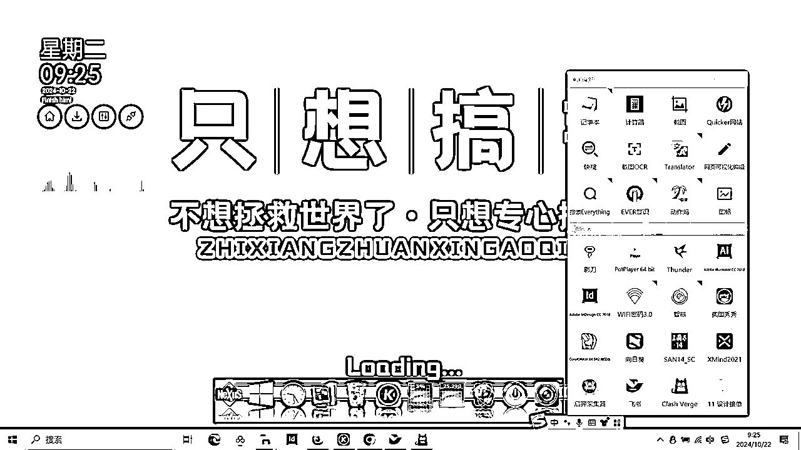

（2）Alloy Timer

随开即用的番茄工作法计时器。

网址：https://alloyteam.github.io/AlloyTimer/

（3）Infinity 标签👍️

浏览器插件，可轻松添加、管理和访问网站，也是我最爱的插件之一。

网址：https://www.infinitytab.com/zh/

（4）Xmind👍️

全功能思维导图与头脑风暴软件，用于辅助思考、整理思路、制作导图，我日常高频使用，免费版基本够用。

网址：https://xmind.cn/

（5）Workrave

免费程序，帮助预防与恢复重复性劳损 RSI，会监控键盘鼠标使用情况并提醒微休息、休息，可限制每日电脑使用时长。

网址：https://workrave.org/

#### 1.2 时间/目标/任务管理

（1）habitica

把现实生活习惯游戏化的工具，将任务、习惯、待办变成需要打败的小怪，生活中表现越好游戏角色越强，犯错则退步。

网址：https://habitica.com/static/home

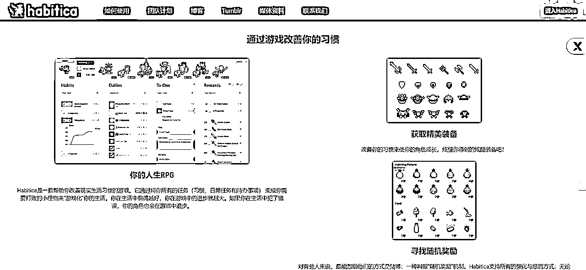

（2）时光序👍️

集多功能于一体的效率管理 App，功能丰富实用，我一直在使用，之前买的终身 VIP 约 99 元。

* 任务与日程管理：支持待办清单、提醒，采用四象限法则帮助优先处理关键任务，提供日/周/月视图。

* 习惯养成与目标追踪：自定义习惯打卡并生成统计图表，支持长期目标拆解。

* 效率工具集成：番茄钟、倒数日、备忘录。

* 生活实用功能：生理期记录、记账、课程表等。

网址：https://www.shiguangxu.com/home

（3）DaysMatter 倒数日

专注记录重要日子的工具 App，通过倒计时/正数计时管理纪念日、截止日期、节日等。免费用户事件数量有限，更分类与自定义背景需 Pro 会员约 30 元/年。

网址：https://app.ipad.ly/idays

（4）Timely🔤

AI 时间管理追踪软件。

网址：https://timelyapp.com/

（5）计次郎

苹果手机 App，简洁好用的打卡计数器，可统计某件事已完成几次或还剩几次。

网址：https://apps.apple.com/cn/app/%E8%AE%A1%E6%AC%A1%E9%83%8E-%E5%88%86%E4%BA%AB%E8%AE%B0%E5%BD%95%E6%AF%8F%E4%B8%80%E6%AC%A1/id1598602354?platform=iphone

#### 1.3 传统办公辅助

##### 1.3.1 文件处理

（1）万彩办公大师

免费办公工具超级套装，内置 60 多款绿色组件，无广告无插件，覆盖 PDF 工具集、文档音视频图片转换、OCR、屏幕录制、图片处理、文件处理等，无需安装即开即用。

网址：https://www.wofficebox.com/

(2) Convertio👍️

在线万能文件转换工具，支持 300 多种格式、超过 25600 种转换方式，无需下载安装，功能强悍。

网址：https://convertio.co/zh/

(3) Everything

超快文件搜索神器。

网址：https://www.voidtools.com/zh-cn/

（4）楼月微信聊天记录导出恢复助手👍️

强力微信内容保存工具，可恢复误删聊天记录、导出 HTML 格式、在电脑查看文字与语音内容、支持苹果与安卓手机。

网址：http://louyue.org/weixin.htm

##### 1.3.2 远程办公

（1）红手指云手机

基于云端虚拟化的手机模拟器，主打 24 小时在线托管、多账号管理、应用挂机运行，适合手游玩家、社交营销等。

* 适用场景：手游挂机刷资源、短视频/直播账号养号、微信/QQ 多开。

* 可同时运行多个虚拟设备，每个设备独立 IP，需付费。

* 支持脚本录制与自动化任务。

* 基础版约 30 元/月，高级版约 60 元/月

网址：https://www.gc.com.cn/

（2）向日葵

贝锐科技开发的跨平台远程控制工具，支持 Windows、macOS、Linux、Android、iOS，适用于远程办公、技术协助、设备运维。

免费版：基础远程控制、1 对 1 连接、300KB/s 带宽，日常办公够用但帧率受限。搭配“开机棒”硬件可远程开机。

网址：https://sunlogin.oray.com/

##### 1.3.3 办公自动化

（1）影刀

真正吃掉职场时间的，常常不是难题本身，而是反复的机械动作。这里按使用场景整理了一批提效工具，覆盖流程替代、智能写作、会议整理、求职背调与数据复盘，建议先收藏再慢慢试用。

## 一、可交给程序处理的重复事务

**影刀 RPA**：能同时在电脑、手机和网页环境里执行有固定规则的重复任务，例如用 AI 批量生产文章、定时发布短视频、每日同步销售数据。它需要一点学习成本，官方文档要花时间看；不想自学的话，也能在二手交易平台找人代搭，谈妥需求和预算即可。入口：yingdao.com

## 二、智能辅助工具合集

### 思考与创作助手

- **DeepSeek**：深度求索的 V3 模型采用 MoE 架构，总参数规模达 6850 亿，在不少公开评测中表现突出，部分测试甚至不输 GPT-4o 等头部专有模型；写代码能力尤其亮眼，能自动生成可用代码片段；同时坚持开放源代码，给开发者留下更自由的实验空间。入口：deepseek.com

- **天工AI**：昆仑万维开发的智能问答产品，通过大规模训练和语义分析理解用户想找什么，检索速度快、结果准确；处理高难度任务时也稳，还能按需定制专属服务模块。入口：tiangong.cn

- **秘塔AI搜索**：主打语义理解式检索，反馈极快，页面极少广告；能把分散信息整理成知识图谱和内容摘要，也支持生成多种语言的文本，适合出海团队使用。入口：metaso.cn

- **Monica**：聚合式助手，一个会员账号就能使用 OpenAI o1、GPT-4o、Claude 3.5、Gemini 1.5 等主流模型，兼顾聊天、查询、写作和编程；提供浏览器扩展、手机端和桌面端，综合订阅成本更低，还能降低因 IP 受限引起的账号风险。入口：monica.im

- **Cherry Studio**：适合愿意折腾的玩家，客户端完全本地化、代码开放，可直接调用各家模型 API，省去多标签页跳转；还支持挂载本地资料库。按调用量付费而非订阅，需要自己申请平台接口。入口：cherry-ai.com

### 翻译工具

- **Immersive Translate**：一款安装在浏览器里的扩展组件，可免费把外文网页、PDF、EPUB、视频字幕转成双语对照，翻译引擎可切换到 DeepL、Gemini 等。入口：immersivetranslate.com

- **DeepL**：德国创业团队打造的翻译服务，基于大规模神经模型，译文质量在业内评价很高；擅长保留语境、专业术语和细微语气差异，支持的语言范围仍在扩大。入口：deepl.com/translator

### 表格数据处理

- **Formularizer**：用大白话描述想要的运算效果，它会自动翻译成可用的 Excel 公式。入口：formularizer.com

- **FormX.ai**：自动从表格、文档中抽取关键字段，整理成结构化数据。入口：formx.ai

- **ChatExcel**：北京大学团队做的对话式表格工具，直接聊天就能完成数据操作。入口：chatexcel.com

- **Ajelix**：面向 Excel 和 Google Sheets 的智能处理工具，可把原始数据快速转换成可视化图表。入口：ajelix.com

### 演示文稿

- **SlidesAI**：输入一个主题，即可生成整套幻灯片，覆盖百种语言场景。入口：slidesai.io

- **Gammas**：用一句需求描述就能生成演示文稿、网页或文档，模板选择多，支持插入图片、视频和外链网页，界面支持中英德等多种语言。入口：gamma.app

- **Tome**：偏故事化表达的演示工具，适合商业提案，输入想法后可自动补齐标题、结构和配图。入口：tome.app

- **auxi**：PPT 扩展组件，用来辅助撰写幻灯片文案。入口：auxi.ai

- **美图设计室 LivePPT**：美图旗下的演示生成产品，输入主题或文本即可得到 16 至 30 页内容，页数可选，支持导出 PPT、PNG、JPG、PDF。入口：designkit.com/ppt

- **ChatPPT**：必优的中文演示工具，可用短句或上传文件启动生成，自动搭好结构并补充素材；其模板库适配商业方案、年终总结、课堂教学、学术答辩等场景，内置图笏模型还能做整页排版和局部细节优化。入口：chat-ppt.com

### 会议记录

- **讯飞会议**：适合会议场景，实时显示字幕和翻译，结束后自动产出纪要。入口：meeting.iflyrec.com

- **麦耳会记**：会议助手，集合语音转文字、字幕同传、智能摘要。入口：work.duiopen.com

- **通义浏览器插件**：开会时实时转写和翻译，会后自动汇总议题、发言人要点与待办事项，并可一键分享给同事。入口：tingwu.aliyun.com


### 流程编排

- **Make**：可视化流程搭建平台，拖拽即可连接不同应用，提供数百种连接器，还能对数据进行过滤、排序和格式转换。入口：make.com

- **Zapier**：海外老牌集成服务，只需要描述要自动完成的事，AI 会自动生成执行流程并构建 Zap。入口：zapier.com

- **n8n**：代码开放的流程引擎，通过节点拖拽在不同服务之间完成联动，可对接 200 多个服务（如 Google Drive、Slack 及常见数据存储），免费下载，使用门槛不高。入口：n8n.io

### 协同与白板

- **boardmix**：国产云端协作白板，把生成式 AI、脑图、流程图示、演示文档、笔记和看板整合在一起，覆盖从灵感收集到演示分享的完整链路，也能直接录制教学视频。入口：boardmix.cn

- **Pixso**：面向 UI/UX 设计团队的协作工具，可以统一设计风格、减少多软件切换，并强化企业数据资产安全；同样支持白板演示和操作录屏。入口：pixso.cn

### 其他小工具

- **百度网盘云一朵**：网盘内的智能问答助手，可根据文件内容回答问题、提炼主旨；适合翻出网盘里存了很久的课程资料做二次利用。入口：pan.baidu.com

- **Umi-OCR**：源代码开放且不收费的离线 OCR 工具，支持截屏批量识别、PDF 转换、去除水印和页眉、生成/扫描 QR 码，内置多国语言模型；下载可能需要特殊网络环境。入口：github.com/hiroi-sora/Umi-OCR

## 三、发现新工具的渠道

- **小众软件**：分享免费、轻巧、有意思的软件，覆盖面很广，就是广告略多。入口：appinn.com

- **Product Hunt**：海外新品首发社区，适合追踪全球新应用。入口：producthunt.com

- **软仓**：专业软件资源库，涵盖 Adobe、CAD、视觉设计、3D 建模、影视动画、建筑设计、机械、电子电气等领域。入口：ruancang.net

- **423Down**：PC 和 Android 平台实用工具下载站。入口：423down.com

- **马可菠萝**：苹果电脑专用软件下载站。入口：macbl.com

## 四、求职辅助

### 简历制作

- **五百丁简历**：在线完成简历创建与排版。入口：500d.me

- **牛客-知页简历**：在线简历工具，配合校招场景使用很顺手。入口：zhiyeapp.com

- **极简 polebrief**：主打极简风格的简历制作页。入口：polebrief.com

- **职徒简历**：引入大模型优化行文表达的智能简历工具。入口：52cv.com

### 简历投递

- **电商人才网**：专注于电商行业的招聘平台。入口：dianshangren.cn

- **拉勾招聘**：互联网与数字化岗位集中地。入口：lagou.com

- **数英**：广告、营销与自媒体方向的职位信息较多。入口：digitaling.com/jobs

- **SocialBeta 独角招聘**：广告与数字营销领域的垂直招聘站。入口：socialbeta.com/job

- **广告门招聘**：同样面向营销传播行业。入口：adquan.com/jobs

### 公司背景核查

- **风鸟**：输入公司名，可查看工商登记、主要人员、法律诉讼、风险记录和客户线索；新注册用户送五年 SVIP，等于长期免费。核查建议：先看注册和实缴资本、成立时间，再查风险、诉讼和法人变更频率，最后看招聘结构——若只招业务岗而不招技术岗，需要多留个心眼。入口：riskbird.com

- **爱站 Whois**：只知道网站域名、不知道背后主体时，用 Whois 反查注册信息，通常能顺藤摸瓜找到对应公司。入口：aizhan.com（Whois 查询）

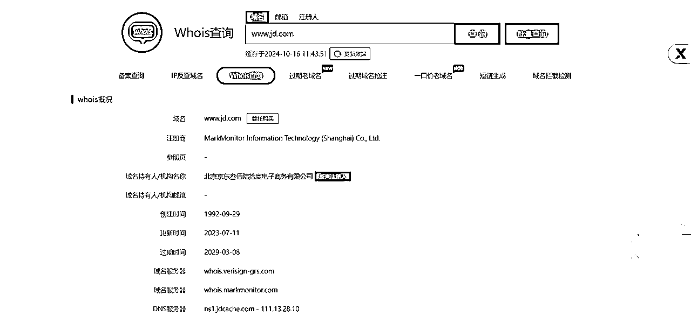

- **国家企业信用信息公示系统**：官方查询渠道，可看违规处罚、经营异常名录和严重违法失信名单。入口：gsxt.gov.cn

- **全国法院被执行人信息查询**：输入企业信用代码，可查是否涉及法院执行案件。入口：zxgk.court.gov.cn

## 五、执行与数据复盘

### 指标管理模板

- **印象笔记**：自带的模板库有不少工作计划和绩效指标样板，按需取用即可。

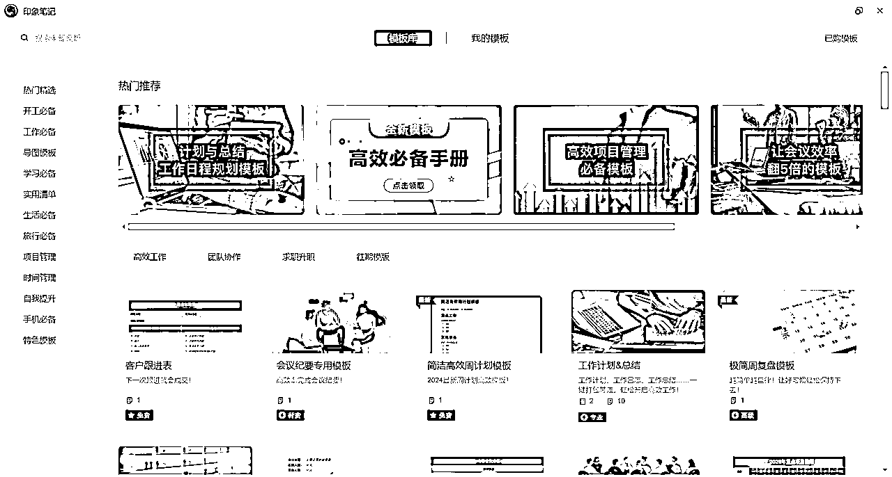

- **飞书**：文档模板同样提供工作计划和绩效指标方案，复制后就能用。

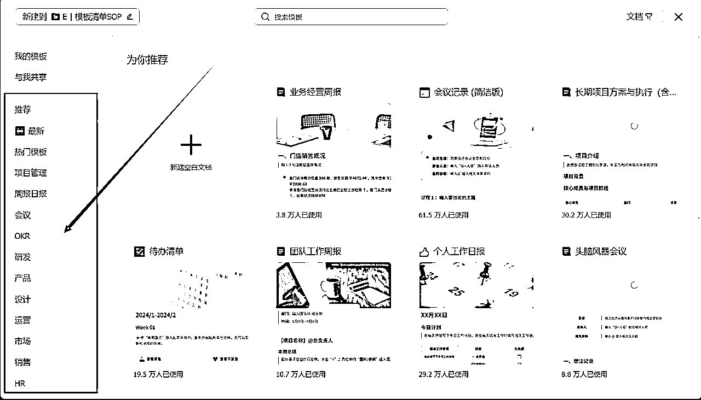

### 产品与行业数据

- **5118 热词挖掘**：通过关键词热度判断产品走势，需要使用付费版本。入口：yx.5118.com

- **淘宝商机发现**：在淘宝生态内寻找新品机会，需先登录淘宝账号。入口：taobao.com（搜索“淘商机”）

- **CBNData（第一财经商业数据中心）**：在站内搜索行业名，重点看“看点”和“报告”两个栏目，能快速抓住热点和最新分析。入口：cbndata.com

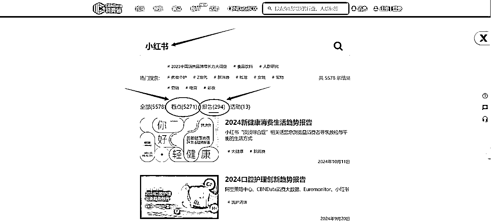

- **IT 桔子**：搜索行业名后，按左侧导航逐项查看，适合研究创投趋势和赛道格局。入口：itjuzi.com

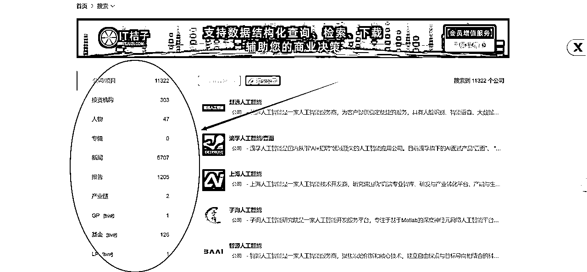

- **百度新闻**：直接搜行业名，能看到同行的最新动作和行业稿。入口：baidu.com 的新闻频道（news.baidu.com）

### 热点追踪

- **新浪微热点**：热点事件热度走势与分析工具。入口：wrd.cn

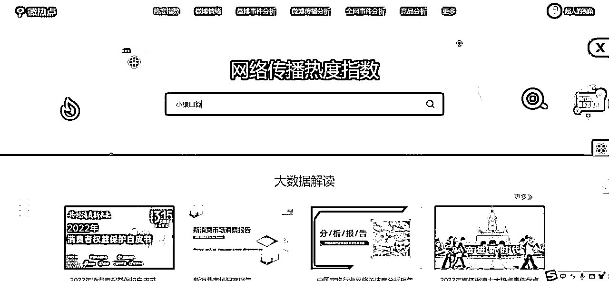

- **微博热搜榜**：查看全网实时的热门话题排序。入口：weibo.com 的热搜频道

- **百度热搜**：看搜索热词排行。入口：baidu.com 的热搜页

### 平台排名

- **艾瑞移动指数**：手机应用下载/使用排行数据。入口：iresearch.com.cn（进入指数频道）

- **Sensor Tower**：海外应用市场监测工具，访问需使用代理。入口：sensortower.com

- **TalkingData 观象台**：移动应用行为数据与排行。入口：talkingdata.com（进入观象台）

- **七麦数据**：可查国内外 App 榜单，建议优先看付费类排名，参考价值更高。入口：qimai.cn

- **Toolify.ai**：收录海外最新 AI 产品与扩展工具，可按收藏热度浏览。入口：toolify.ai

- **站长之家排行**：查看网站、APP 等榜单数据。入口：chinaz.com（榜单频道）

- **5118 百度排名内参**：用于查看关键词在百度搜索结果中的排名波动。入口：5118.com（百度排名数据页）

### 电商与销售数据

- **站长之家电商网站排行榜**：看电商平台排名。入口：chinaz.com 的电商分类榜单

- **IT 桔子电商零售**：按电商零售标签筛选相关公司。入口：itjuzi.com 的电商零售筛选页

- **生意参谋**：淘宝商家常用后台，提供周报、流量来源、商品/店铺分析、推广效果、页面表现等数据。入口：淘宝卖家后台

工具不在多，关键是让它们覆盖自己的真实工作流。把重复劳动交给程序，把精力留给判断和创造。

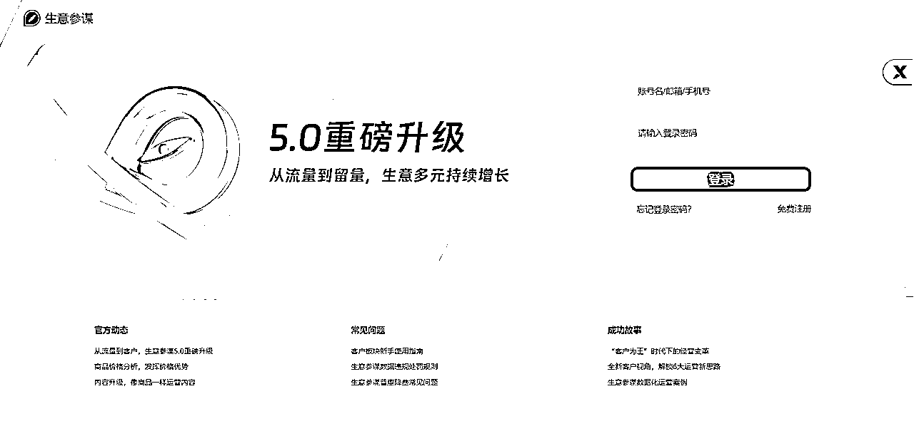

### 3.KPI 运营

( 1) A5

新媒体资产交易与服务平台，业务覆盖账号、商标、站点交易，以及自媒体代运营等。其中增粉板块通过线下硬件场景做导流，例如共享充电宝、免流WIFI、支付关注、抓娃娃机、体脂秤、共享纸巾、裂变任务、自动售货机等。

网址：

https://www.a5.cn/

https://xmt.a5.cn/diy/zengfenfuwu.html

（2）流量精灵

以PC端为主的产品，正向用途是网站SEO与排名优化，负向用途则常被拿来刷量，需按积分付费。

网址：http://www.ipjingling.com/

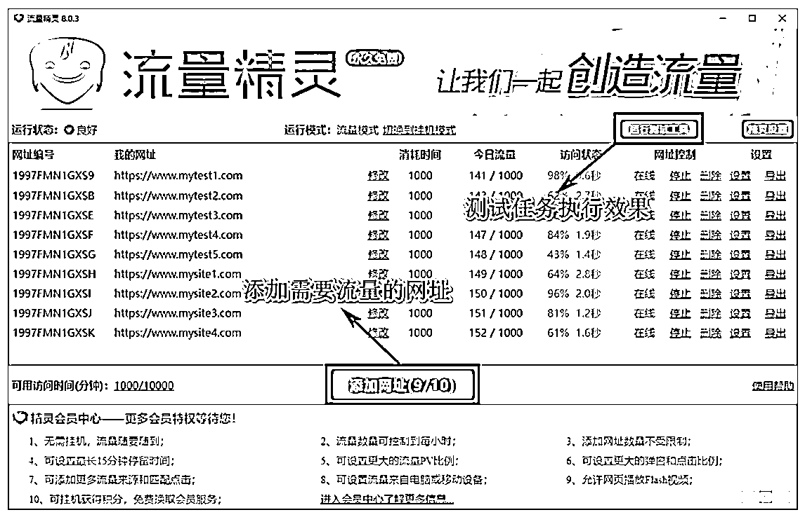

（3）七七数据

面向自媒体及电商APP提供数据注入服务，采用充值模式。提示：建议小额多次充值，该类型站点风控与跑路风险较高。

网址：http://hufenge.cn/

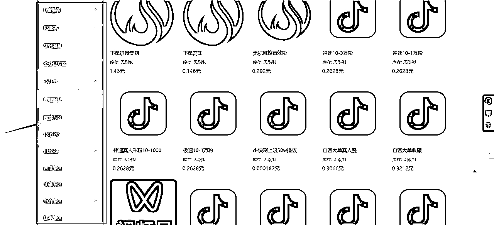

（4）短信宝

提供短信通道服务。

网址：https://www.smsbao.com/

（5）智连代理

供给IP地址代理，包含动态IP方案。

网址：https://www.zhiliandaili.com/

（6）松松软文👍️

实现全网软文分发并配合SEO做品牌背书与信息占位。

网址：https://ruanwen.lusongsong.com/

（7）友来多

企业/事业单位专用的短信群发入口，不对个人开放。

网址：https://www.youlaiduo.com/

（8）传播易

广告资源交易市场，适合预算充裕的品牌做声量覆盖，也常用于提案素材收集。

网址：https://www.chuanboyi.com/

# 叁 | 创业/副业阶段 💵 ENTREPRENEURIAL PHASE

* * *

## 一、⛏商机挖掘工具

### 1.选品挖品

（1）选单网

网址：https://www.xuandan.com/

（2）蝉妈妈-商品库

网址：https://www.chanmama.com/promotionRank/?keyword=&has_jx_commission=0

（3）易撰-热销商品榜单

网址：https://zmt.yizhuan5.com/work.html#9-2

（4）壁虎看看-热销商品榜

网址：https://www.bihukankan.com/carrierList/commodity

（5）品牌网

可概览各行业品牌矩阵，也能通过品牌关键词检索品牌信息，对选品判断有参考价值。

网址：https://www.chinapp.com/

（6）造点新货（原淘宝众筹）

观察市场上正在孵化的新品，判断其满足的需求点，能否自研或找平替。

网址：https://izhongchou.taobao.com/index.htm

（7）好单库

网址：https://www.haodanku.com/

### 2.需求挖掘

（1）5118👍️

*   需求图谱

基于关键词展开长尾、高频、问答类需求挖掘，部分功能可免费体验

网址：https://www.5118.com/naotu

*   树桩规划图

以关键词为起点层层拆解细分需求，需VIP权限。

网址：https://plan.5118.com/

*   关键词挖掘

提取长尾词、关联词、搜索下拉词等，关键词本身即需求的体现。

网址：https://www.5118.com/ci

（2）百度贴吧-全部贴吧分类

贴吧是挖掘小众文化需求的宝库，缺乏灵感时可从分类目录入手。

网址：https://tieba.baidu.com/f/index/forumclass

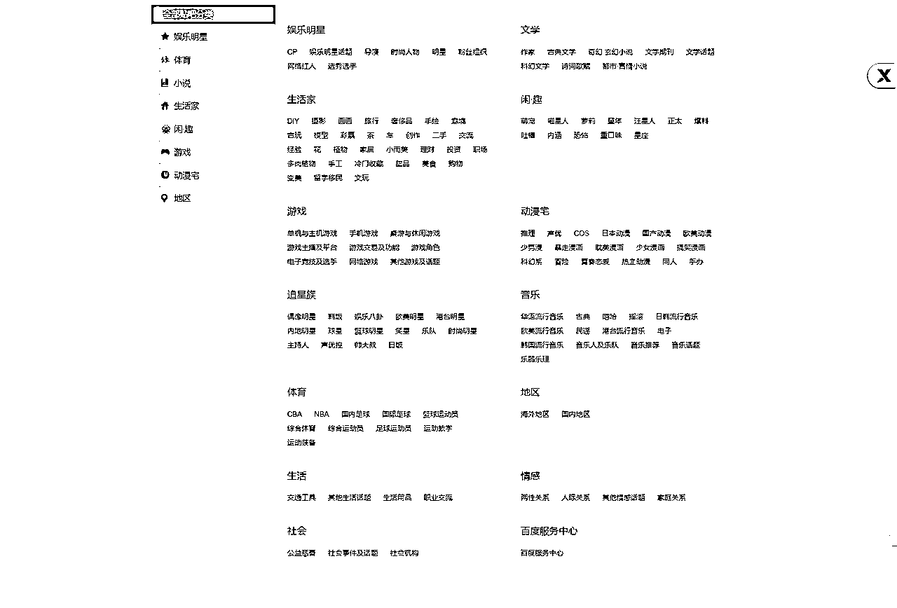

### 3.行业洞察

#### 3.1 行业全局

（1）IT 桔子👍️

*   行业图谱

一览各行业整体架构及细分赛道分布。

网址：https://www.itjuzi.com/atlas

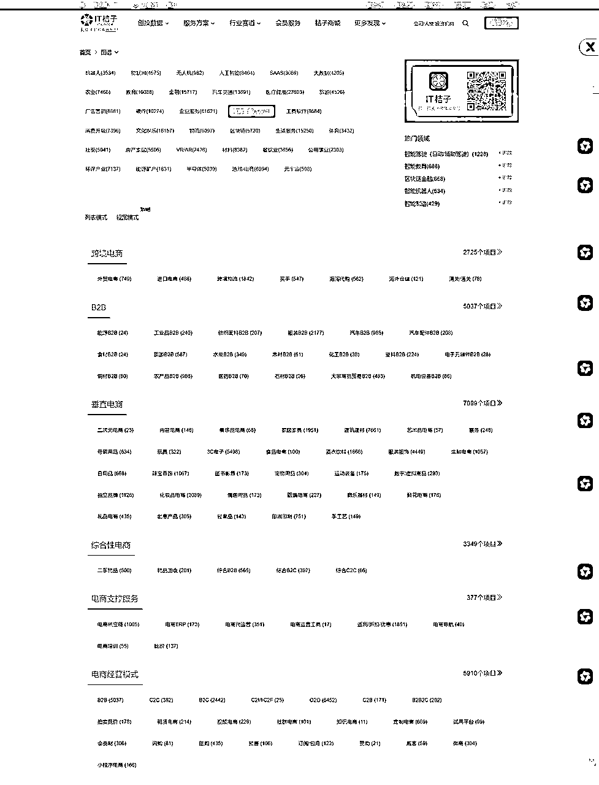

*   公司项目

掌握行业内新老创业主体，洞悉新公司融资逻辑。通常能拿到种子轮的项目都具备一定壁垒。

网址：https://www.itjuzi.com/company

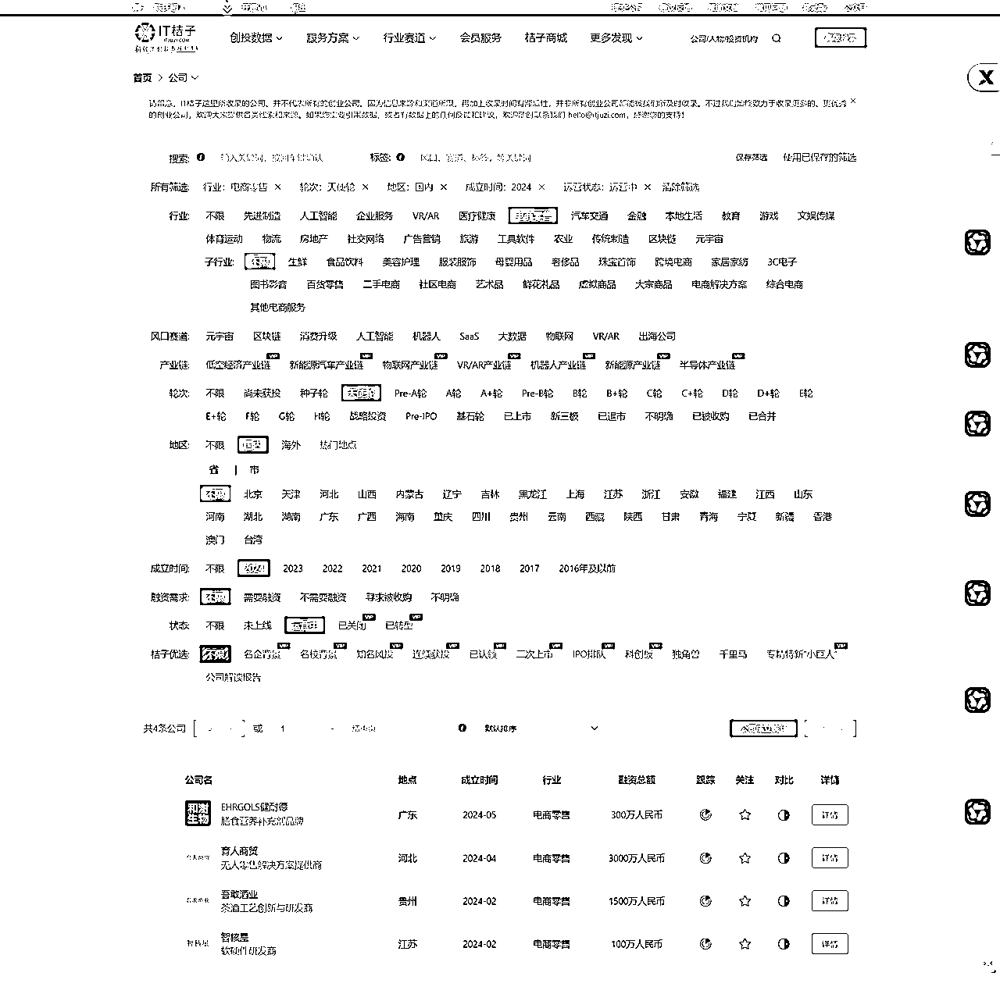

（2）百度营销观星盘

解析不同行业的受众特征与画像。

网址：https://cdp.baidu.com/static/login

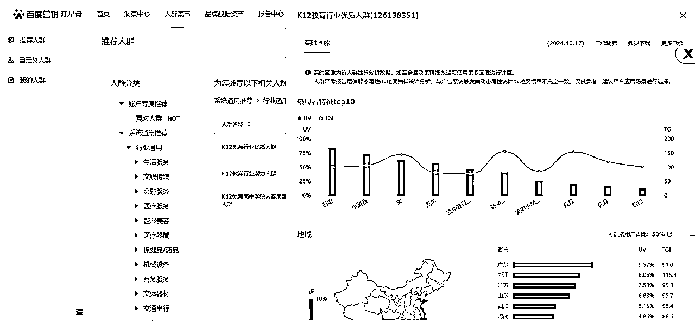

（3）百度指数

输入关键词即可查看产品/行业/热点的趋势走向、需求结构与人群画像。

地址：https://index.baidu.com/v2/index.html#/

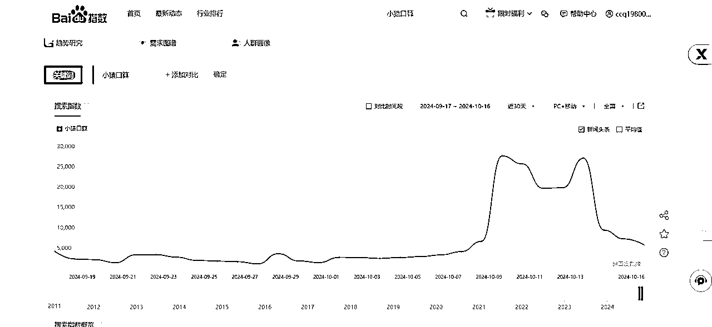

（4）硅谷动力-排行频道

收录各领域最新榜单，便于快速定位头部玩家。

网址：http://www.enet.com.cn/tag/ranklist

（5）中商情报网

提供销量、企业、品牌等多维度排行数据。

网址：https://top.askci.com/

#### 3.2 行业报告

（1）艾媒网-报告

以互联网领域研究为主。

网址：https://www.iimedia.cn/c1081

（2）IT 桔子-行业报告

网址：https://www.itjuzi.com/report

（3）报告查一查

网址：https://report.seedsufe.com/

（4）前沿知识库

网址：https://wk.askci.com/

（5）CBNData 消费站-报告

网址：https://www.cbndata.com/report

（6）万方数据

综合学术资源检索平台，汇聚期刊、学位、会议、科技报告、专利、标准等十余类资源，覆盖数亿篇文献，可用于市场需求研判与商业模式创新。

网址：https://www.wanfangdata.com.cn/

（7）行行查

垂直行业研究数据库，聚合海量细分赛道报告，支持关键词检索，覆盖大消费、节能环保、传媒娱乐、信息科技、地产金融、生命健康、先进制造等，附赠产业链图谱，部分内容可限量免费下载。

网址：https://www.hanghangcha.com/

（8）腾讯调研云

由腾讯联合数十家调研机构共建的分析平台，2022年11月起免费开放，旨在提升调研协同效率。

网址：https://research.tencent.com/

#### 3.3 行业洞察

（1）阿里研究院

聚焦数字经济、消费演进与新技术应用，关注5G场景、Z世代消费、国潮盲盒、AIoT等议题，输出成熟度评估与前瞻判断。

网址：http://www.aliresearch.com/

（2）腾讯研究院

深耕AI与企业数字化转型，研究生成式AI在业务流程中的融合、行业垂直大模型、多智能体协同等主题，强调技术与组织变革协同。

网址：https://www.tisi.org/

（3）36氪研究院

覆盖人工智能、区块链、即时零售、酒水等新经济板块，提供研究报告、投融资解读与政策分析，兼顾直播电商、县域旅游等新兴业态。

网址：https://36kr.com/academe

（4）Mob研究院

以消费行为与市场趋势为核心，通过大数据描绘用户画像、文旅升级路径、现制茶饮竞争态势等，为品牌提供营销运营建议。

网址：https://www.mob.com/mobdata/report

提示：阿里、腾讯偏重技术与消费大势，36氪、Mob更聚焦新经济与消费市场，均以数据驱动输出战略参考。

### 4.国家数据

（1）国家统计局-数据

官方权威的经济社会统计口径，涵盖人口、GDP、CPI、财政、能源、工资等，支持月度/季度/年度及可视化。

网址：https://www.stats.gov.cn/sj/

（2）国家数据

统计局旗下数据门户，提供同口径国民经济指标。

网址：https://data.stats.gov.cn/

（3）中国政府网

发布权威政策、解读、政务新闻及便民查询入口。

网址：https://www.gov.cn/index.htm

（4）中华全国商业信息中心

前身关联商业部系统，拥有零售、奶粉、服饰、皮包等流通市场数据库，数据回溯至1949年。

网址：https://www.cncic.org/

（5）中国互联网信息中心（CNNIC）

1997年经国务院批准成立的基础资源管理机构，定期发布互联网发展报告，如2025年1月的第55次报告。

网址：https://www.cnnic.net.cn/

（6）中国经济信息网

国家信息中心于1996年12月上线的经济信息站点，覆盖宏观、行业、区域、国际全景。

网址：https://www.cei.cn/

（7）中国报告大厅

提供国内外市场研究、行业研究、可行性研究、商业计划书、数据年鉴等服务。

网址：https://www.chinabgao.com/

### 5.海外数据

（1）世界银行

覆盖200+国家自1960年以来的GDP、人口、外债、贫困率等指标。

网址：https://data.worldbank.org/

（2）世界数据图册（Knoema）​

提供宏观、人口、能源等全球数据，支持地图可视与时序分析。

网址：https://cn.knoema.com/atlas

（3）新华财经

汇集30+国家宏观、金融市场行情及行业研究，含汇率与大宗商品价格。

网址：https://www.cnfin.com

（4）中国一带一路网

聚焦沿线国家政策法规、投资项目、贸易数据及人文资讯，多语言支持。

网址：https://www.yidaiyilu.gov.cn/

（5）Statista

涵盖80,000+主题的统计信息，市场趋势、用户行为、社交媒体分析均可导出。

网址：https://www.statista.com/

（6）CEIC

收录200+国家宏观、行业、金融数据，含GDP、通胀、FDI等，支持时序分析与预测。

网址：https://www.ceicdata.com

（7）OECD

发布36个成员国及部分非成员国的经济、教育、环境、科技等报告，含IEA数据。

网址：https://www.oecd-ilibrary.org/

（8）GSMA

聚焦全球移动通信，涉及5G应用、数字经济规模、移动互联网行为，覆盖100+国家。

网址：https://www.gsma.com/

## 二、💰融资工具

### 1.商业计划书（BP）

（1）疯狂 BP👍️

提供结构化撰写框架与大量范文，曾用于多份获认可的甲方BP交付。

网址：https://www.nutsbp.com/

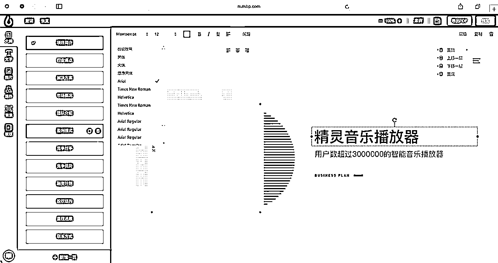

（2）百度文库

检索“商业计划书”可获得参考模板，若需付费下载可借助TB、PDD渠道。

网址：https://wenku.baidu.com/

### 2.找投融资人/机构

（1）IT 桔子

*   创投人物

网址：https://www.itjuzi.com/person

*   投资机构

网址：https://www.itjuzi.com/investfirm

## 三、🈺运营工具

### 1.工作外包

（1）八戒财税

公司注册与财务记账外包。

网址：https://cs.zbj.com/business

（2）51 社保

员工社保公积金代办。

网址：https://www.51shebao.com/

（3）淘宝服务市场

淘宝店铺运营外包。

网址：https://fuwu.taobao.com/

（4）米画师

第三方画师接单平台，适配广告插画外包。

网址：https://www.mihuashi.com/

（5）法天使

合同制作代办。

网址：https://www.fatianshi.cn/

（6）新片场-快活

视频制作外包。

网址：https://hire.xinpianchang.com/

（7）钙网

免费在线LOGO设计与灵感获取工具。

网址：https://www.uugai.com/

（8）快转网

公司、商标等资产交易平台，无需从零注册可直接收购。

网址：https://www.51kuaizhuan.com/

（9）快法务

提供法律代办与律师电话/面谈咨询。

网址：http://www.kuaifawu.com/

### 2.电商运营

#### 2.1 运营

（1）甩手网👍️

跨平台多店铺管理软件，统一操控淘宝、拼多多、微店、京东等主流平台，解决开店、上架、打单等痛点。

网址：http://www.shuaishou.com/

( 2) fiverr

可委托海外模特拍摄产品图/视频，增强国际背书，约100元/分钟，需🪜。

网址：https://www.fiverr.com/

（3）外贸基地

国内跨境电商推广与工具供应商。

网址：https://www.yinwenseo.com/

（4）润物粉丝网

为INS、Tiktok、Facebook等平台提供涨粉服务，适合电商背书。

网址：https://www.runwulink.com/

（5）店透视

淘宝店铺数据分析插件，帮助卖家挖掘竞品引流词与搜索词。

网址：https://www.diantoushi.com/help.html

（6）1688 采购助手

1688浏览器插件，支持以图搜货、交易走势查看、素材一键下载、订单消息追踪。

网址：https://air.1688.com/kapp/assets-group/haobangshou/PluginInstall

（7）易歪歪

多平台聊天快捷回复工具，兼容Chrome、QQ、微信、千牛、拼多多、抖店等。免费版覆盖基础需求；Pro版48元/年，含云端同步、批量操作、自定义热键、多关键词检索。

网址：https://www.eyy250.com/index.html

#### 2.2 货源

（1）阿里巴巴 1688👍️：https://www.1688.com/

（2）马可波罗：http://china.makepolo.com

（3）中国制造网：https://cn.made-in-china.com

（4）赛门国际：http://www.sm160.com

（5）物友网：https://www.56ye.net

（6）第一枪：http://www.d17.cc

（7）一比多：http://www.ebdoor.com/

（8）通淘供应链（进口标品）：http://www.tomtop.com.cn

（9）superbuy（进口潮品）：http://www.superbuy.com

（10）购够网（日本海淘）：http://www.gougoujp.com

（11）义乌购（低价货源）👍️：http://www.yiwugo.com

（12）53 货源网（野路子货）：http://www.53shop.com

（13）爱买网（日本货源）：https://www.imaijp.com

（14）乐淘（日本代购）：http://www.letao-cn.com

#### 2.3 造品

（1）翼狐网

3D 建模学习平台。

网址：https://www.yiihuu.com/

（2）魔猴

数字化制造云平台，涵盖3D打印、CNC加工、激光切割、小批量注塑等。

网址：https://www.mohou.com/yundayin/yundayin.html

（3）3D 模型下载

3D打印模型与自媒体运营工具合集

本清单整理了一批实用资源，涵盖3D打印模型获取、内容创作、视频制作、海外YouTube运营等方向，均为亲测好用的平台和工具。

模型获取渠道：

- 中国 3D 打印往：https://www.3ddayin.net/soft/

- 魔猴：http://www.mohou.com/models

- 打印派：http://www.dayinpai.com/model/list

- 打印啦：https://www.dayin.la/make/index.html

- Enjoying3D：https://www.enjoying3d.com/list.php

- 爱给：https://www.aigei.com/3d/print/

### 3. 内容创作与账号运营

#### 3.1 通用创作工具

##### 3.1.1 选题与热点

1. 哔哩哔哩热门榜单

链接：https://www.bilibili.com/v/popular/all

说明：看B站全站热门内容，找选题灵感很方便。

2. Tophub（今日热榜）

链接：https://tophub.today/

说明：把各大平台热点聚合在一起，偶尔会无法访问。

3. Exploding Topics

链接：https://explodingtopics.com/

说明：专门挖掘新兴趋势，提前发现各行业即将爆发的热点，帮品牌方和投资者抢占先机。

4. NewsNow

链接：https://www.7tyq.com/

说明：覆盖全球财经、科技等领域，热点资讯分钟级刷新。

5. 讯飞绘文·选题中心

链接：https://turbodesk.xfyun.cn/client-pro/topic

说明：AI自动抓取行业动态并生成选题方案，解决选题难问题，创作效率明显提升。大模型能力让选题更贴合行业需求，支持内容生产全流程。

推荐理由：作为智能创作平台核心模块，既能实时追踪热点，又能深度匹配行业，适合企业多平台运营。

##### 3.1.2 写作辅助

1. 文案狗·谐音工具

链接：http://www.wenangou.com/xieyin.html

说明：输入单个字，就能找到同音字的成语、诗词、俗语。

2. 深言达意

链接：https://www.shenyandayi.com/

说明：输入词或词组查找例句，还能搜到《人民日报》、“学习强国”等权威来源的公文例句，也收录了不少优质对偶句和排比句。

3. 汉语反向词典

链接：https://wantwords.net/

说明：根据描述反查词语的AI工具，输入一句话就能得到语义相近的词。

##### 3.1.3 图片与设计

1. Google AutoDraw

链接：https://www.autodraw.com/

说明：随手涂鸦也能变成像样插画，简单易用，但需要🪜。

2. 淘宝服务市场·字体

链接：https://fuwu.taobao.com/ser/list.htm?searchType=service&firstCategory=57030001&secondCategory=205779207&sort=default_sort&sortDesc=true&pageSize=30&currentPage=1&tracelog=category

说明：比正版商用字体便宜得多。

3. 360查字体

链接：https://fonts.safe.360.cn/

说明：不确定字体是否有版权，先来查一查。

4. 字体100

链接：https://www.100font.com/

说明：专注收集免费可商用字体的站点。

5. 图帮主·菜谱DIY设计

链接：https://www.tubangzhu.com/shzt/caipu

说明：专门做菜谱在线设计的垂直平台。

6. 图帮主·台历DIY设计

链接：https://www.tubangzhu.com/shzt/taili

说明：垂直的台历在线DIY工具，适合做台历产品或赠品。

7. 图标获取器

链接：https://geticon.online/

说明：作图时需要的软件/平台图标，可提取网页图标，也可按APP名称搜索获取。

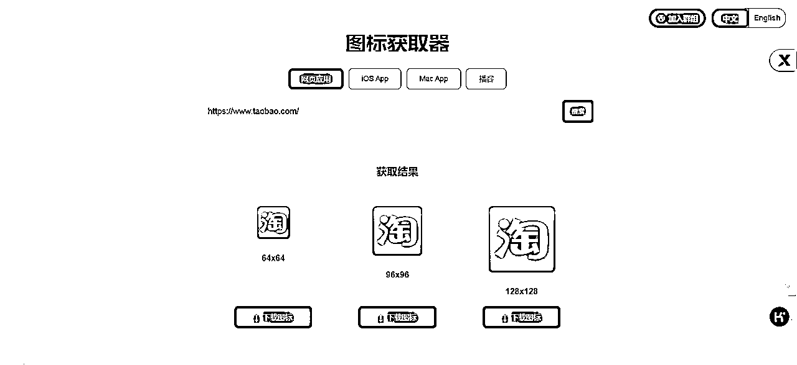

##### 3.1.4 视频与动画制作

1. 万彩动画大师

链接：https://www.animiz.cn/

说明：一款动画制作软件。

2. 来画

链接：https://www.laihua.com/animation

说明：用类似做PPT的交互方式制作动画，在线就能完成。

3. 录咖

链接：https://reccloud.cn/

说明：在线录屏+剪辑平台。

4. Cursorful

链接：https://cursorful.com/

说明：Chrome浏览器录屏插件，特色是自动缩放，免费版够用。

5. Screen Studio

链接：https://screen.studio/

说明：录屏时根据操作自动生成背景，鼠标动画很丝滑，可切换背景、横竖屏，还能智能放大重点。年费约70美元，想省钱可以去淘宝/闲鱼找共享账号。

6. ScreenToGif

链接：https://www.screentogif.com/

说明：GIF录制+编辑利器，完全免费。

7. OBS

链接：https://obsproject.com/

说明：电脑端录屏工具，默认不能截屏；录出来不清晰可搜“OBS高清录制教程”调设置。

8. 镝数图表

链接：https://dycharts.com/

说明：输入数据快速产出图表，集成AIGC，能交互图表、数据报告、PPT、视频、大屏等。

9. 33台词

链接：https://33.agilestudio.cn/

说明：检索台词并定位影片时间点。可提取多语言字幕，辅助学习；支持收藏台词、分享到社交媒体、设铃声/壁纸，手机版还有每日随机台词推送。网页版功能较新（2025年），客户端信息多为2023-2024年。

##### 3.1.5 运营辅助与效率

1. Google Trends

链接：https://trends.google.com/trends/

说明：谷歌官方的免费搜索趋势分析，实时看全球或指定区域的搜索热度，了解话题、产品、服务的关注度变化，适合做趋势发现、市场预测、SEO优化，界面简洁。

2. 蚁小二

链接：https://www.yixiaoer.cn/

说明：跨平台多账号管理工具，私信、评论统一处理，一个后台管所有新媒体账号。

3. 版权规避提醒

字体版权：像隐藏地雷，看不见但踩中很惨；图片版权：像定时炸弹，可能让人倾家荡产；文字版权：坑很多，稍不小心就被割韭菜。内容创作者要高度重视。

4. 比特浏览器

链接：https://www.bitbrowser.cn/

说明：指纹浏览器，可多开窗口、多登账号，每个窗口模拟独立电脑信息和IP，环境完全隔离，防关联封号，适合矩阵化运营。

指纹浏览器相关攻略：

5. SnapAny

链接：https://snapany.com/zh

说明：万能在线下载工具，支持1000+平台，可下载视频和图片。

6. 临时邮箱

链接：

- https://linshiyou.com/

- https://www.moakt.com/zh/inbox

- https://email10min.com/zh

说明：用于注册验证的临时邮箱服务。

7. Billfish

链接：https://www.billfish.cn/

说明：素材管理工具，可管理图片、视频、音频、文档、字体、源文件等，素材量再大也不卡，支持多种预览方式，适合搭建本地素材库。

#### 3.2 海外：YouTube 运营

##### 3.2.1 垂直赛道选择

1. Tubefilter

链接：https://www.tubefilter.com/

说明：关注网络内容创造者与数字视频行业，提供YouTube最新动态、算法变化、政策解读等，可借鉴成功案例，入局前建议先浏览。

2. TASTYEDITS

链接：https://www.tastyedits.com/most-profitable-youtube-niches/

说明：根据CPM列出YouTube最赚钱的15个细分领域，在线赚钱、数字营销、个人财务排前三。赛道选择影响受众和品牌合作，盈利能力还受变现方式、观众参与度、内容质量、视频长度等影响。

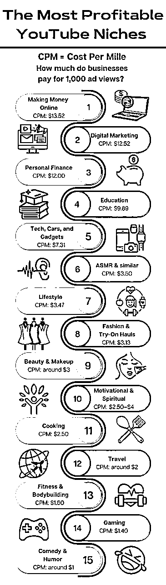

##### 3.2.2 爆款选题挖掘

1. Piped

链接：https://piped.kavin.rocks/trending

说明：开源第三方YouTube客户端，无广告查看热门趋势。可快速浏览当前热点、找灵感，研究同领域爆款的标题、标签和内容策略，支持中文菜单和地区设置。

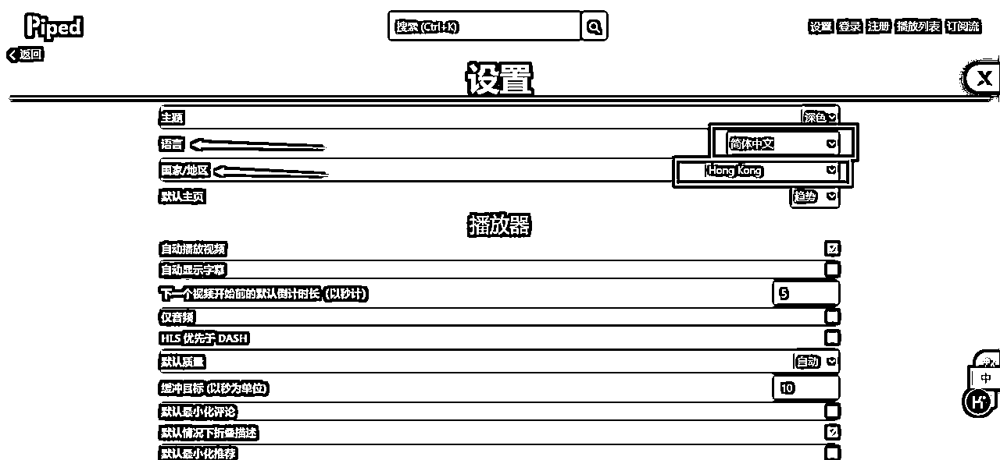

2. YewTube Trending

链接：https://yewtu.be/feed/trending?type=Default&region=US

说明：同样是开源隐私友好的YouTube客户端，Trending页面可看热门视频，无广告。

3. Exploding Topics 的 YouTube 搜索关键词页

链接：https://explodingtopics.com/blog/top-youtube-searches

说明：这个页面收录最新、最热门的YouTube搜索词，创作者可据此把握观众兴趣、优化SEO、创作热门内容。

##### 3.2.3 对标频道挖掘

1. FindAChannel

链接：https://www.findachannel.net/

说明：可浏览和搜索超19.8万个YouTube频道，查看订阅数、视频发布量、总播放量等，还有频道收益预估和SEO工具，帮评估商业潜力。

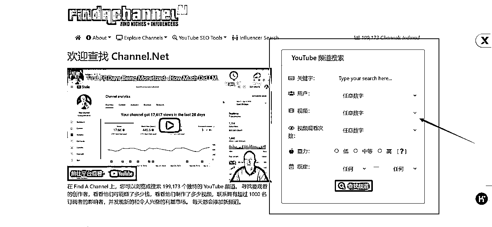

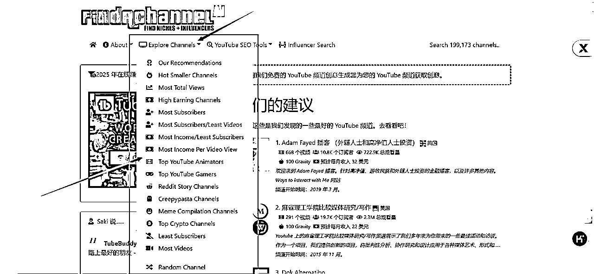

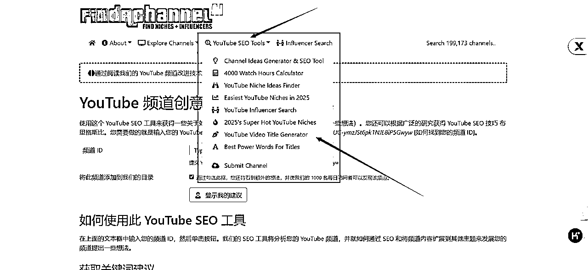

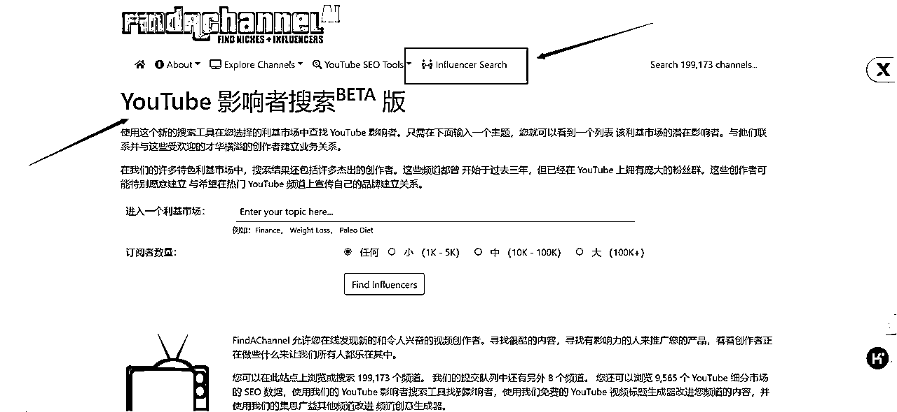

2. SimilarChannels

链接：https://similarchannels.com/

说明：输入一个频道，自动推荐内容相似的频道。

3. Favoree

链接：https://www.favoree.io/

说明：用主题、类型、情绪、评分、平均视频长度等过滤器发现频道，还可评分评论，帮他人找优质内容。

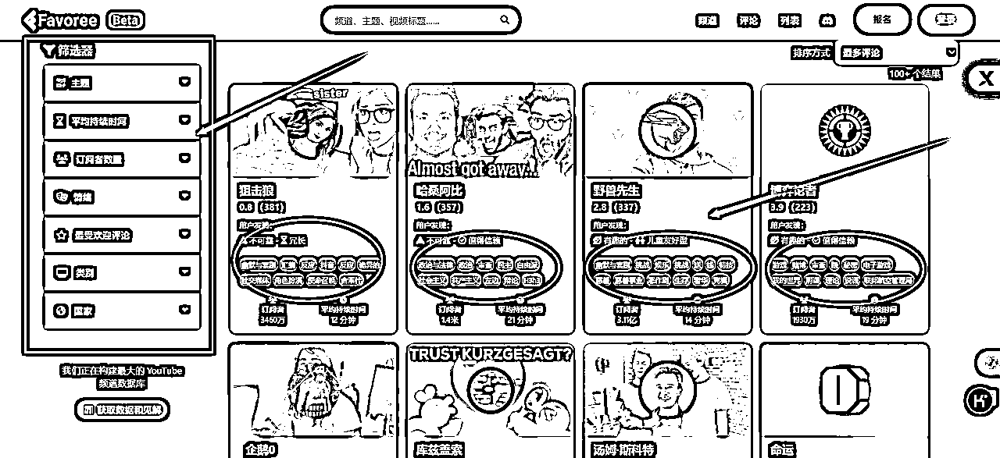

##### 3.2.4 关键词挖掘与SEO

1. TubeBuddy

链接：https://www.tubebuddy.com/

说明：付费的YouTube浏览器插件，提供关键词研究、标题描述优化、标签管理、A/B测试等，集成AI分析视频表现，还能批量更新、发布时间建议、竞品分析。

2. Keyword Tool

链接：https://keywordtool.io/

说明：利用Google自动补全生成关键词，免费版每词最多750个建议，免注册，支持192个Google域名、83种语言，也可研究YouTube、Bing、Amazon等平台关键词。

##### 3.2.5 频道数据分析

1. ViewStats

链接：https://www.viewstats.com/

说明：专注YouTube频道数据，可追踪观看量、订阅增长、视频表现等，通过可视化趋势判断增长机会，优化内容策略。

2. YouTube Studio

链接：https://studio.youtube.com/

说明：YouTube官方管理后台，可上传、编辑、管理视频，实时监控播放、点赞、评论等数据，并具备观众分析能力。

3. Social Blade

链接：https://socialblade.com/

说明：专业社媒数据分析，覆盖YouTube、Instagram、Twitter等，提供粉丝数、观看次数、互动率、收入估算等。

4. YTLarge

链接：https://ytlarge.com/

说明：提供多款免费YouTube运营工具：货币化检查器、频道ID查找器、数据查看器、头像下载、标签提取、影子禁言检测、收入计算等。

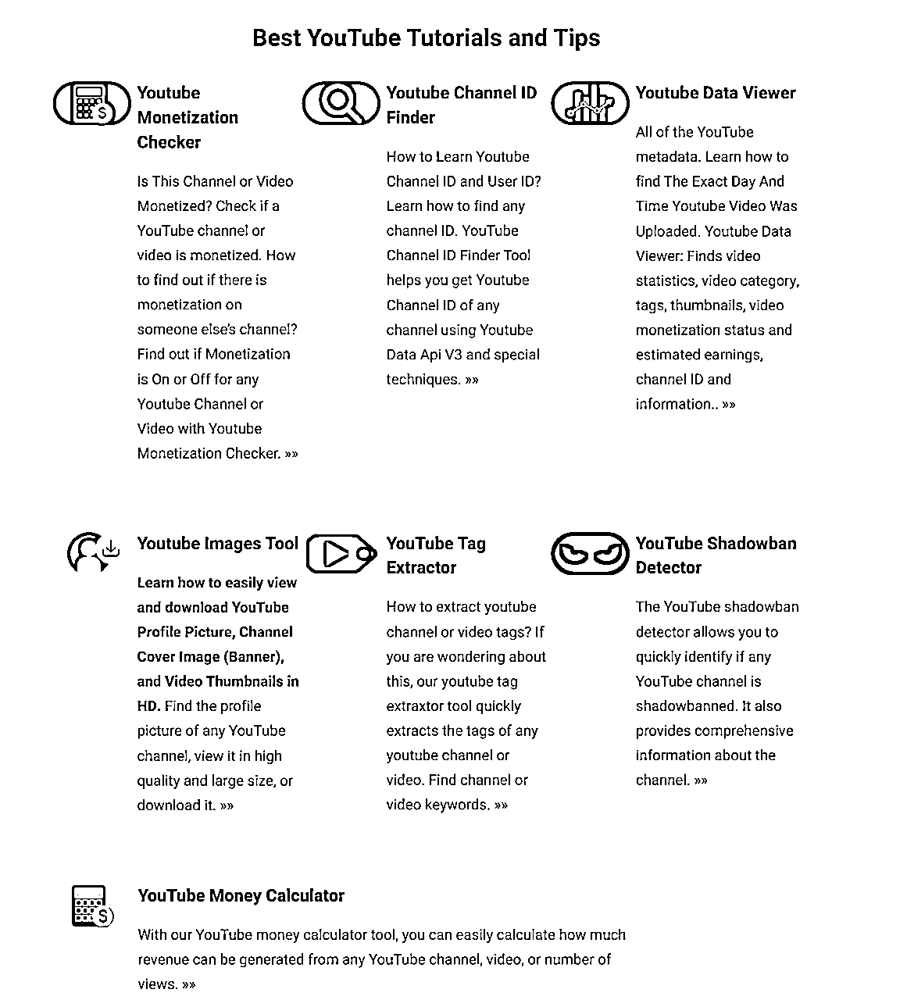

5. Lenos

链接：https://www.lenostube.com/en/

说明：YouTube运营服务网站，有免费工具，也有付费涨粉、刷数据、刷评论、快速开通变现、SEO优化等。

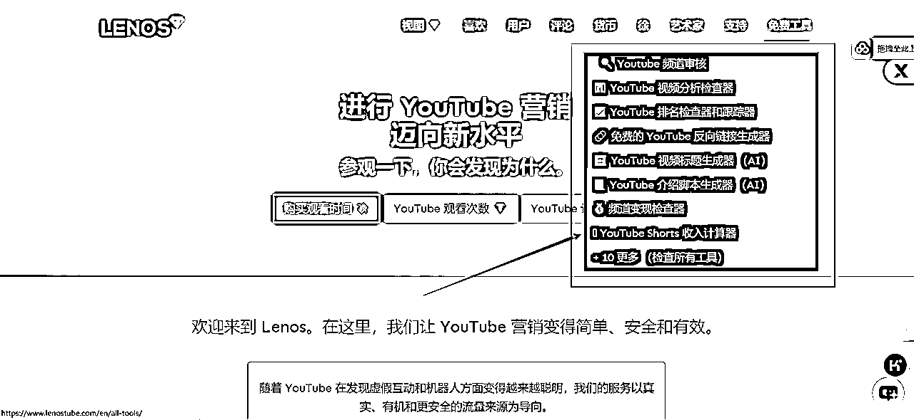

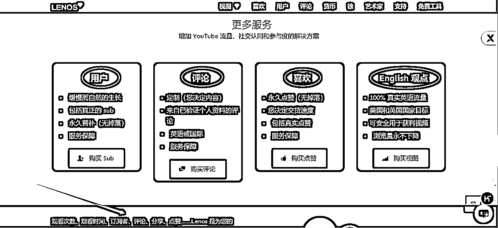

##### 3.2.6 对标内容下载

1. Y2mate

链接：https://www.y2mate.com/zh-cn841

说明：免费在线下载，支持YouTube、Facebook、Vimeo、Youku等平台，可转MP3/MP4，粘贴链接即可下载，速度快、无限制、免注册。

2. DOWNSUB

做内容、做运营，手边有几款顺手的产品能省不少事。这份清单把资源下载、智能创作和内容收费几个环节常用的工具做了个梳理，按需取用即可。

一、下载与资源获取

DownSub

一个无需付费的字幕抓取 Web 应用，能从 YouTube、VIU、Viki、Vlive 等站点直接获取字幕，SRT、TXT、VTT 这些格式都能导出。

访问地址：https://downsub.com/

Loader.to

在线格式转换服务，可以把 YouTube 视频转成各种格式，MP3 音频的提取尤其方便。

访问地址：https://zh.loader.to/1/

noTube

一个免费在线下载器，可以从 YouTube、Dailymotion、TikTok、X 等网站拉取视频，之后按需转码。

访问地址：https://notube.net/en/youtube-app-53

轻抖

能在多个常见站点完成内容提取、文案抓取、数据查询、直播片段截取和话术整理，能力相当全面。不过它采用付费订阅制，最短三个月起，想省点钱可以去淘宝、拼多多找找其他购买渠道。

访问地址：https://www.qingdou.vip/pctool/work-benches

Cobalt

一个很顺手的免费下载站，能获取视频、音频、图片或 GIF，覆盖小红书、B站、YouTube、Reddit、TikTok 等国内外站点。页面干净无广告，需要使用代理。

访问地址：https://cobalt.tools/

二、智能工具体系

2.1 选型建议（创业者向）

- 主力生产力：ChatGPT / Claude 3.5 Sonnet。能力全面，写代码很稳，适合做技术判断。

- 中文和合规场景：豆包、通义千问。对中文理解到位，合规表现稳定。

- 预算有限：DeepSeek。开源、透明，成本友好。

2.2 AI 文案生成

海外热门的 AI 文案产品：

国内热门的 AI 文案产品：

新手友好选择：

- 文心一言：适合写中文内容，生活类账号尤其好用。

- ChatGPT：创意丰富、国际感强，但需要代理。

- Kimi：后起之秀，理解中文很出色，长篇内容特别合适。

- Claude：逻辑能力突出，适合学术风格，同样需要代理。

使用建议：

- 想选题时，用 ChatGPT 做发散思考。

- 列结构时，让 Claude 帮忙梳理逻辑。

- 写初稿时，由文心一言或 Kimi 完成。

- 打磨文字时，再用 ChatGPT 优化表达。

2.2.1 写作辅助与查重

StudyCorgi

StudyCorgi 推出的检查服务，能判断文章是否由 ChatGPT 生成。

访问地址：https://studycorgi.com/free-writing-tools/chat-gpt-detector/

CreatiBI

一个综合型内容设计与协作产品，把灵感收集、脚本写作、在线审片、数据洞察整合在一起，还支持图片反向搜索、爆款追踪和智能推荐。团队协作和任务分配同样清晰可见。

访问地址：https://creatibi.cn/zh-CN

Sketch

封面样式的设计和管理应用，使用方式与 Keynote/PPT 相近。各种封面的版式都可以保存下来，之后换图改字就能快速出图，效率颇高。

访问地址：https://www.sketch.com/

文皮皮

文字分析和原创度检测产品，依托自研河图引擎，比较词句和语气风格，辅助判断是否存在抄袭风险。

访问地址：http://www.wenpipi.com/

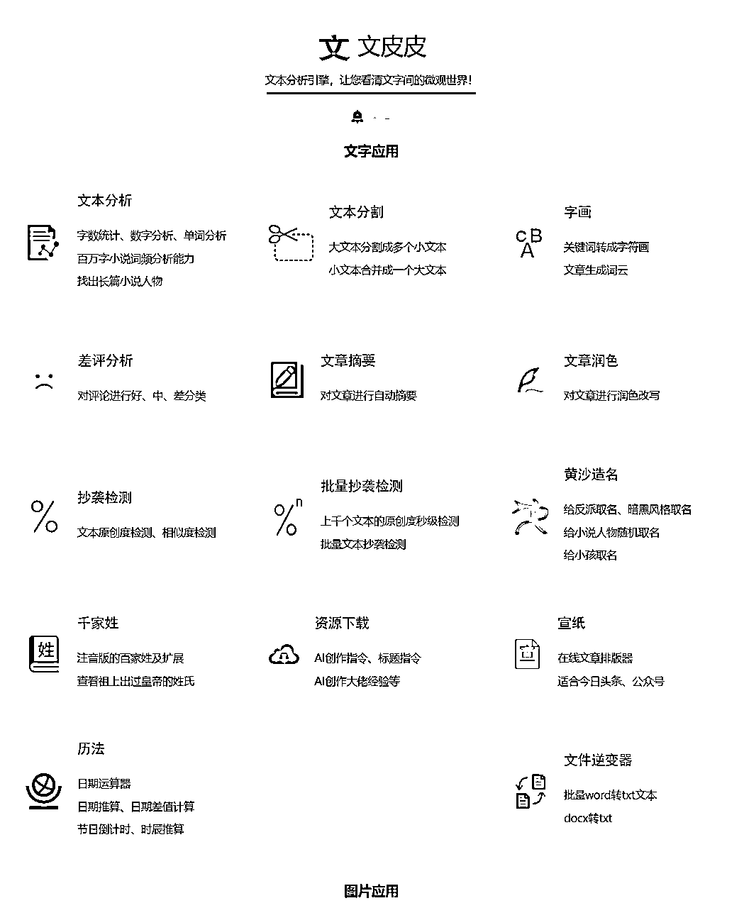

2.3 AI 作图 / 图像生成

海外比较热门的三款 AI 作图产品：

国内常用的 AI 作图产品：

2.4 AI 影像 / 视频动画

海外热门的 AI 影像应用：

国内热门的 AI 影像应用：

2.5 声音与配音工具

Fish audio

现在很多 AI 合成声音都显得很假，Fish audio 的优势在于音色和音调曲线可以手动调整，每天有免费额度。它的发声自然度在我用过的同类产品里相当突出，内置多种网红音色，朗读速度和大小声都能细调，能把 AI 稿子读得像真人表达。

访问地址：https://fish.audio/zh-CN/

海螺语音（海外版）

海螺 AI 的海外版本目前可以免费用，效果不错，能克隆自己的声音，也可以模拟他人声音。用 Gmail 账户登录，在主页依次进入 Audio → Voice，点击创建声音克隆，上传几秒清晰样本，再回到文本转语音页，输入文案并选用刚才的模型，点生成即可。

访问地址：https://www.minimax.io/audio

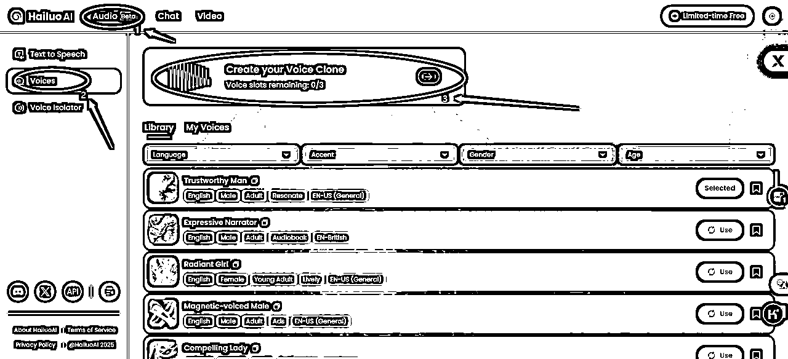

团子AI

面向音频的智能处理应用，主要能力包括：

- 伴奏和人声分离：上传任意歌曲，就能拆出两条音轨。

- 乐器提取：单独把某种乐器声抽出来、删掉或分离出去。

- 无损变调：用 AI 改变歌曲音调，不损伤音质。

- 混响/回声去除：去掉混响和回声，同时保留原始音轨。

实际用法：比如想找某博主视频里的配乐，但音乐识别因为噪声太大识别不了。可先把视频保存下来，用剪映分离音频，再上传到团子AI净化声音，最后去识别，命中率会明显提高。

访问地址：https://tuanziai.com/

扣子空间（AI 播客生成）

扣子空间的 AI 播客能力，结合了自然语言处理和多种内容感知技术，能让文字快速变成拟人化音频。用户只需提供文章链接或一段指令（例如“根据XX生成X分钟双人播客”），AI 就会自动分析内容，产出有人味儿的对话音频，包含语气停顿和情绪变化，同时生成带字幕的播放页面。

访问地址：https://space.coze.cn/

参考：文章/视频秒变真人播客？扣子空间这波新功能怎么用？

NotebookLM（AI 播客生成）

NotebookLM 基于多媒体理解技术，能把上传的 PDF 或链接内容转换成沉浸式对话音频。系统会自动生成一男一女两个虚拟主持人，像好友闲聊那样去探讨材料，支持提问、互动并引用原文。目前已能生成中文节目，但普通话的自然度不如扣子空间。

访问地址：https://notebooklm.google

2.6 编码助手与开发部署

2.6.1 开发环境

bolt

一个零配置的 AI 编码环境，打开网站就能用，所有开发工作都可以在云端完成，最后也能直接发布上线。

访问地址：https://bolt.new/

Cursor

AI 原生的编码工具，能智能完成代码、修复错误并提供个性化建议，让开发效率明显提升。

访问地址：https://www.cursor.com/

Windsurf

一个免费、能力全面的 AI 编码环境，亮点是 AI Flows 和 Cascade 这两项特色机制，很懂前后代码语境，能协助补完代码，也兼容多套系统。

访问地址：https://codeium.com/windsurf

GitHub Copilot

由 OpenAI 和 GitHub 联合打造的编程辅助服务，利用大模型技术理解开发者输入，快速产出可用代码，提升编码速度和准确率。

访问地址：https://github.com/features/copilot

三款编程助手横向对比：

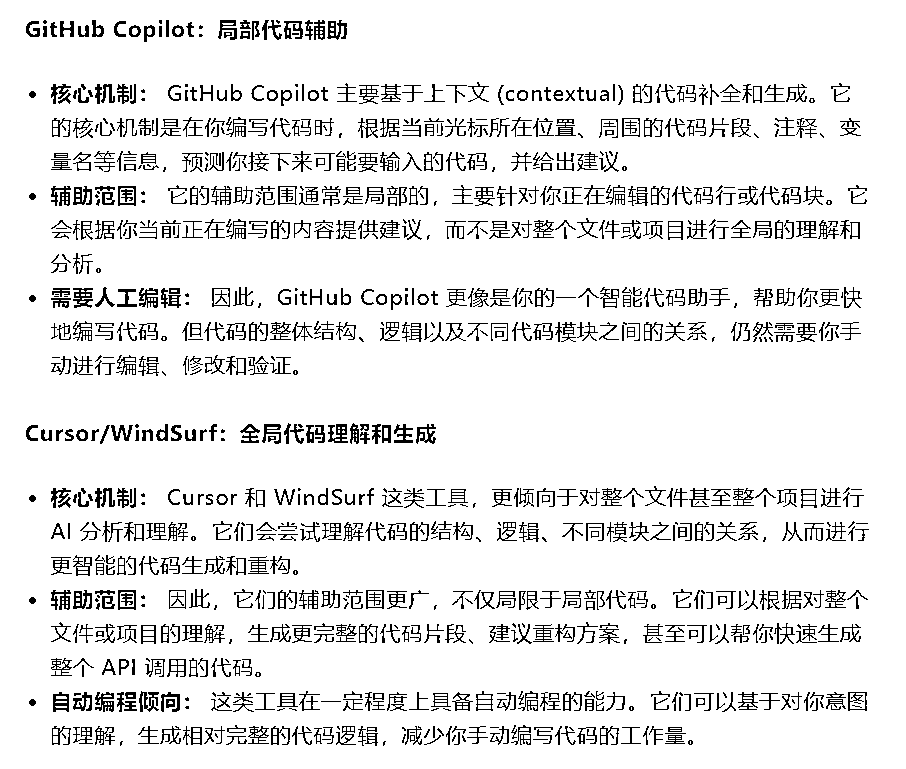

Coze扣子

字节跳动出品的低门槛应用搭建服务，可理解为字节版 GPTs。即使没有编程经验，也能快速做出会话助手、Agent 和插件，并发布到 Discord、WhatsApp、Twitter、飞书、微信公众号、豆包等渠道。Coze 上已有大量现成 Agent，覆盖图文、影音等方向，目前无需付费。

访问地址：https://www.coze.cn/

2.6.2 源码托管

GitHub

全球最大的源码托管协作社区，支持版本记录、审查代码、多人协作和项目规划，是开发者几乎绕不开的基础设施。

访问地址：https://github.com/

2.6.3 应用上线

Zion

不写代码的开发服务，用直观的界面和现成模块，让没有技术背景的人也能快速搭好并上线产品，降低了建站门槛。

访问地址：https://www.functorz.com/

Vercel

面向静态页面的托管产品，能直接关联 GitHub，省去手动发布，并利用世界各地节点加快访问速度，保证可靠运行。

访问地址：https://vercel.com/

Netlify

另一个静态网页托管产品，自动化流程配合全球网络节点，让网站的打包、校验、上线和维护都很顺手。

访问地址：https://www.netlify.com/

2.7 Prompt 资源集

ClickPrompt

给写 Prompt 的人准备的辅助产品，可惜项目维护已停滞，GitHub 最后更新时间停留在 2023 年 3 月。

访问地址：https://www.clickprompt.org/zh-CN/

Visual Prompt Builder

通过图形界面挑选和组合 Prompt，一目了然。

访问地址：https://tools.saxifrage.xyz/prompt

AI Short

一套开源、易用的现成指令集合，专为对话式 AI 设计。

访问地址：https://www.aishort.top/

Generrafed

面向 DALL-E 2 的作图指令库。

访问地址：https://generrated.com/

Public Prompts

优质 Prompt 合集，值得收藏。

访问地址：https://publicprompts.art/

Prompt Hero

可以检索 SD、Midjourney 等模型的 Prompt。

访问地址：https://prompthero.com/

PromptBase

一个 Prompt 交易市场，可买卖现成 Prompt。

访问地址：https://promptbase.com/

2.8 AI Agent 智能代理

2.8.1 面向普通用户

Monica（新手友好）

最易上手的免费 Agent 产品之一，可以编写 Prompt，也能搭建和调用个人知识空间。

推荐原因：没有技术门槛，就能让 AI 接管重复性工作。

访问地址：https://monica.cn/home/chat/Monica/monica

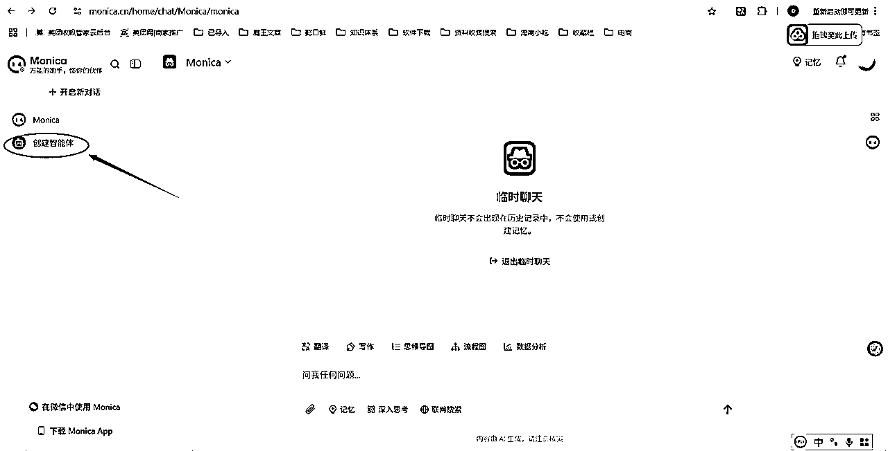

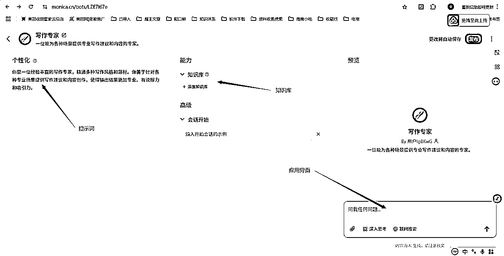

智谱清言 Agent（进阶）

相比 Monica，智谱清言提供更多高级自定义能力，包括页面样式、对话设定、插件扩展、预约执行、知识空间管理以及输出随机度调节等。适合对 Agent 运行机制有概念的人，能给出专业水准的中文回答。

访问地址：https://chatglm.cn/main/alltoolsdetail?lang=zh

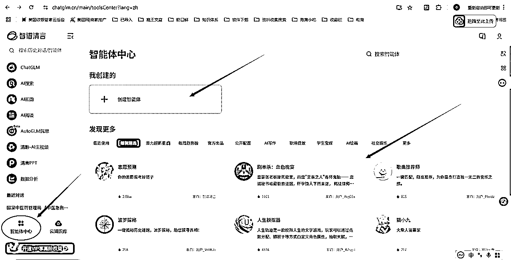

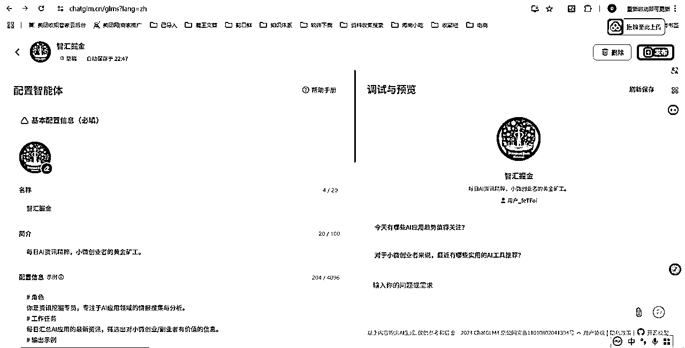

Coze Agent（高阶）

字节跳动的低门槛 Agent 搭建服务，能设计出带有记忆、规划、工具使用和多步对话能力的复杂 Agent。每日 500 资源点可用于免费套餐，个人基本够用。

推荐原因：不写代码也能做出各种实用的智能产品，并能发布到抖音、飞书等渠道，让更多人使用。

访问地址：https://www.coze.cn/home

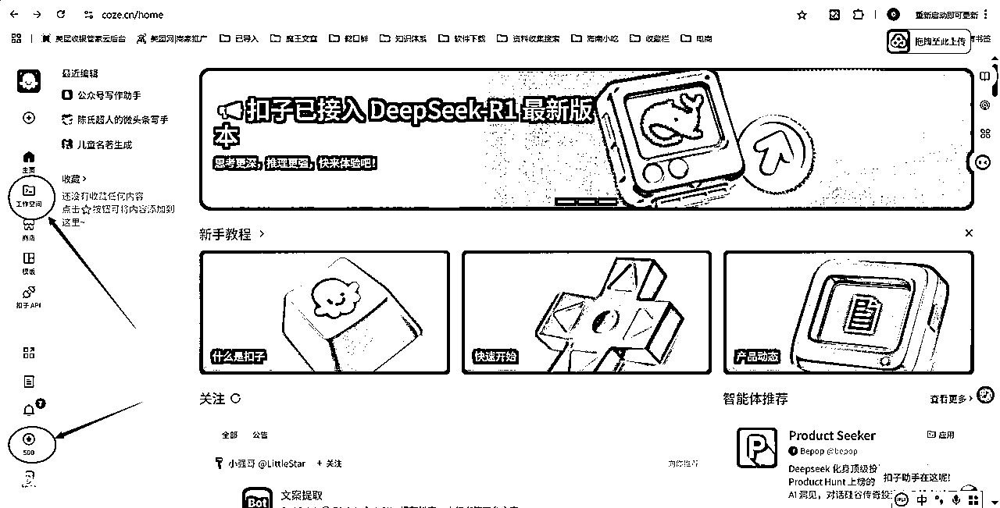

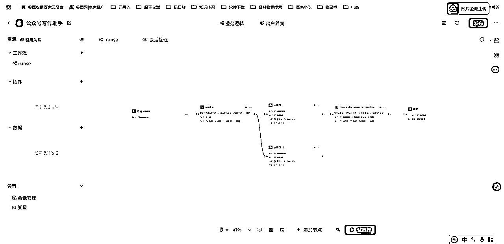

简单概括三者的区别：

Monica 帮你执行 → 智谱清言 按你的策略执行 → Coze 让你创造新的执行者

2.8.2 面向高阶玩家

Flowith

以画布为核心界面的 AI Agent 产品，采用节点交互，适合并行推进多个想法。底层兼容多种大模型（如 GPT-4、Claude 3）以及图像生成技术（Midjourney、SDXL），用户可以在不会用完的画布上自由连线，建立自己的知识网络。

访问地址：https://flowith.net/

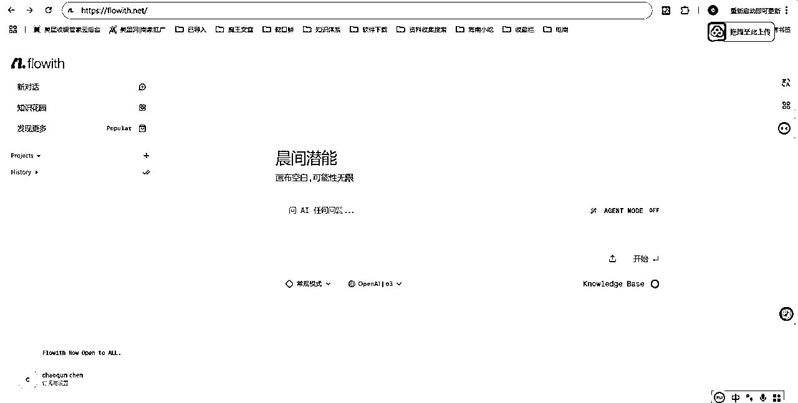

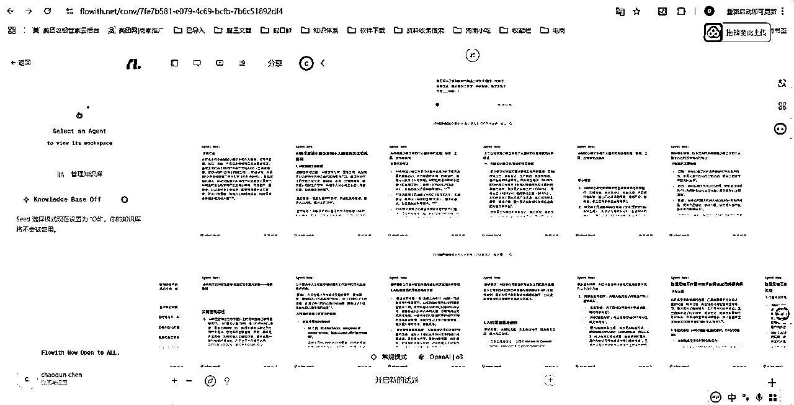

Skywork

昆仑万维打造的“天工”高级 Agent，基于 AI Agent 体系与 deep research 技术，可一次生成文档、PPT、表格、网页、播客、影像等多种内容。产品包含 5 个专业 Agent 与 1 个通用 Agent，能进一步确认需求、追溯信息出处、建立个人资料库。它曾在 GAIA 评测中拿下榜首，超过 OpenAI 的 Deep Research 与 Manus。

访问地址：

国内：https://www.tiangong.cn/

国际：https://skywork.ai

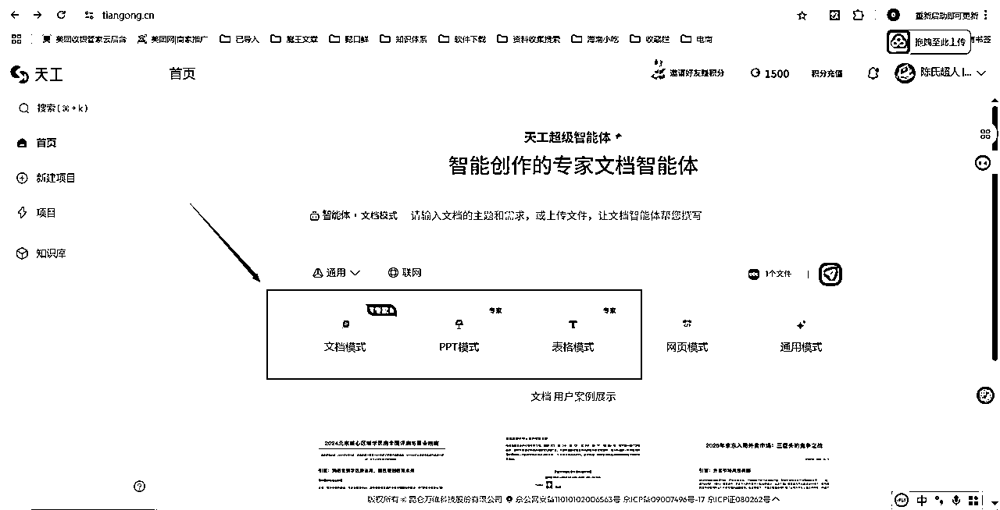

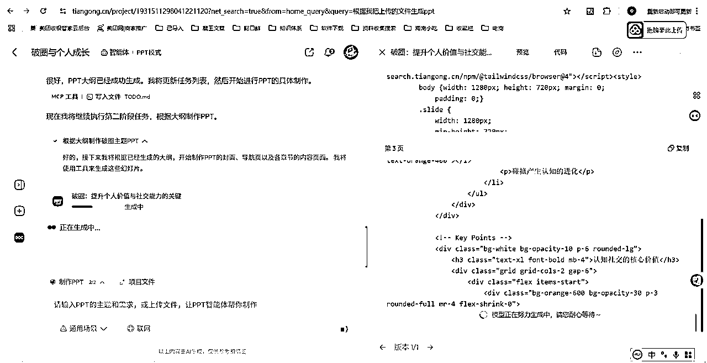

Lovart

LiblibAI 给设计师做的设计型 Agent，能力接近资深设计师，交出的方案有水准。用户用文字指令就可以改版式、配色和画面结构，能覆盖从概念拆解到成果交付的整个流程，一次最多生成 40 张落地设计图。目前需要用邀请码注册。

访问地址：https://www.lovart.ai/


2.9 其他 AI 服务

银河录像局

可以买或租海外热门平台的账号，比如 Spotify、Netflix、ChatGPT 等。

访问地址：https://nf.video/

三、内容收费与社群运营

知识星球

做社群很好用，文字、图片、文档、影音资料都能留存，既能做会员专区，也能做公开讨论区，适合持续运营。

访问地址：

小报童

面向长期写作者的付费订阅服务，编辑界面干净，支持买断与订阅，不依赖算法分发。

访问地址：https://xiaobot.net/home.html

爆款同行参考：

FlowUs

一个多功能协作产品，既能创作和管理内容，也能通过模板和付费内容获得收入。内容生产者可以设置付费权限，也可以分享模板获得回报。

访问地址：https://flowus.cn/product

面包多

一个卖数字产品的地方，可以卖课、卖文、卖画、卖软件、卖电子书、卖音乐和解答服务等，比较强调原创权和交易保障。

访问地址：https://mbd.pub/

1咖啡

很轻的赞赏小组件，可嵌入内容站点，读者通过“买咖啡”来支持作者。

访问地址：https://1kafei.com/

爱赞助

让读者按月赞助作者的付费服务，支持微信自动续费。

访问地址：https://www.azz.net/

小红圈


访问地址：https://www.red-ring.cn/

荔枝微课

内容售卖和课程分发服务，比较有特点的是语音课，适合喜欢“听内容”的人。

访问地址：https://www.lizhiweike.com/

小鹅通

这份资源清单把三件事打包在一起：靠内容赚到报酬的渠道、帮品牌扩大声量的工具站，以及从入门到实操的理财工具箱。以下入口均省略了 https://，复制到浏览器打开即可。

**01 内容变现的地盘**

做内容、卖课程、经营社群的人，可以挑这些平台扎根：

- 小鹅通：内容生意的一站式操作台，文章、录音、录播视频、会员体系、集训项目都能放，收款和传播也串在一条线上。入口：xiaoe-tech.com

- 知乎：中文问答大本营，写回答的人可以通过付费提问、盐选频道、商务合作取得回报。入口：zhihu.com

- 喜马拉雅：声音内容的聚集地，通勤、做家务时都能听；收入主要来自会员订阅、广告收益共享和直播时观众送的礼物。入口：ximalaya.com

- 得到：擅长把书拆成精华解读，也请各领域专家开讲；靠订阅和电子书出售赚钱。入口：dedao.cn

- 沪江网校：线上课程平台，覆盖语言、职场技能等方向，通过课程售卖、会员和广告获得收入。入口：class.hujiang.com

- 网易云课堂：课程门类偏职业和兴趣，卖课和收费直播是主要收益来源。入口：study.163.com

- 蜻蜓FM：电台节目和有声读物为主，创作者可以靠收费声音内容、广告收益共享、直播收礼物赚钱。入口：qtfm.cn

- 豆瓣时间：豆瓣体系里的付费内容板块，发布者可以推出系列栏目或课程，用户选择整期订阅或单篇购买。入口：m.douban.com/time

- 短书：侧重内容售卖和渠道分发，能把栏目、课程挂出去卖，也能发动更多人帮忙分销。入口：duanshu.com

- 千聊：直播间里的知识分享社区，讲师靠收费直播、课程售卖和观众送的电子礼物获得收益，但课程质量参差，购买前最好仔细看评价。入口：pc.qlchat.com

- 课堂街：面向在线培训机构的站点，支持上架收费课程、开设直播课，并与平台按比例分成。入口：ketangjie.com

- 海豚知道：把付费内容做成短视频，画面直观、易于传播，从公域获取用户更有优势，适合想被更多人看见的内容生产者。入口：sem.htknow.com

**02 找实用站点的入口合集**

国内常用的资源集合：

- 卖家导航：电商人专属的网站大全。入口：maijia800.com

- 考拉导航：新媒体人常用的工具和参考站点都收在里面。入口：kaolamedia.com

- 优设导航：设计师收藏夹，配色、字体、灵感都找得到。入口：hao.uisdc.com

- addog：这个站点把创意案例和推广资源聚在一起，广告圈用得比较多。入口：addog.vip

- AI-Bot：中文站，收纳了上千个 AI 应用，按类目排列好。入口：ai-bot.cn

- 创造狮导航：产品、设计、开发几个方向都能用到。入口：chuangzaoshi.com

- 沙雕导航网：专门收录好玩有趣的网站。入口：shadiao.pro

海外常用的资源集合：

- Product Hunt：世界各地的新产品、新应用首发地。入口：producthunt.com

- Future Tools：把 AI 应用按场景收纳在一起。入口：futuretools.io

- TAAFT（全称 There's An AI For That）：根据需求查找可用的 AI 应用。入口：theresanaiforthat.com

- AlternativeTo：想找某款软件的同类替代，来这搜就对了。入口：alternativeto.net

**03 传播与增长工具箱**

常用插件：

- 有赞应用市场：店铺类插件很齐全，历史口碑偏向易用和安全。入口：yingyong.youzan.com

- 微擎应用市场：第三方插件集合地，价格略高，但想得到的运营功能基本都有。入口：s.w7.cc

- 有娱：抽奖、小游戏等互动工具，适合活动暖场。入口：youyu.weijuju.com

- 大智软件：把私域增长需要的模块合在一个后台，包括鱼塘GPT智能客服、多平台客服汇总、点赞投票红包、模板消息群发、SCRM（客户关系管理）等，方便搭建流量池并做裂变。入口：dzsaas.cn

- 易采客：从美团、地图平台抓取实体商户联系方式，对本地业务、地推和企业服务很有用。入口：yicaike.cn

服务与资源：

- 媒介匣：大量乙方服务商资源集中在这里，既可以采购，也能当作外包供应商列表。入口：meijiexia.cn

- 掌上大学：专门覆盖校园市场的全渠道销售网络。入口：zsdx.cn

- 异业邦：帮不同行业做跨行业合作的撮合平台。入口：yiyebang.com

- 数英网的文章区：跨界合作案例和行业资讯比较集中，适合借鉴参考。入口：digitaling.com（站内搜“跨界”）

- NoxInfluencer：面向海外 KOL 合作的对接平台，聚合 YouTube 等多平台的创作者资源，可以搜索、筛选、联系合适的红人，配套数据功能辅助投放决策。入口：cn.noxinfluencer.com

**04 理财从认知到实操**

先补认知：

- 耶鲁《金融市场》视频课：诺奖得主 Robert Shiller 主讲，讲市场运行规律，也讲投资者非理性行为如何影响市场。入口：oyc.yale.edu/economics/econ-252

- 伯克希尔·哈撒韦掌门人（世人常称其为股神）历年写给股东的公开信：1957 到 2025 年完整收录，能看出一套投资思路几十年间的变化，有中译本。入口：berkshirehathaway.com/letters

- Investopedia：全球规模领先的金融教育站点，查术语、学知识、看市场动向都行，适合从零开始搭体系。入口：investopedia.com

- Kavout KScore：输入中文问题就能解读财务报告，比如“宁德时代现金流风险”。入口：kavout.com

- Investopedia 虚拟盘：带 AI 陪练，会提示频繁买卖这类操作毛病。入口：investopedia.com/simulator

看数据：

- 万得（Wind）：国内头部的金融数据供应商，行情覆盖股票、债券、基金、期货等，财务分析和宏观指标都做得深，适合专业使用者。入口：wind.com.cn

- TradingView：全球用户量靠前的图表社区，股票和加密资产都能做技术分析，还提供 AI 趋势预判，自己的分析思路也可以公开分享。入口：tradingview.com

做研究：

- Morningstar：给基金做评价的老牌机构，过往回报、风险等级、持仓细节都有，适合筛长线资产。入口：morningstar.com

- 雪球：中文投资社区，财务报告、研究报告和投资者讨论都在一个页面里，也能自己建组合跑历史数据。入口：xueqiu.com

下单执行：

- Interactive Brokers：支持 120 多个市场的跨国券商，提供机构常用级别的 API，换汇手续费也低。入口：interactivebrokers.com

资金分配：

- 且慢：国内做基金组合调度的服务方，主张把钱分成四份：日常周转、稳健理财、长期投资和保险保障，减少反复择时。入口：qieman.com

风险控制：

- Portfolio Visualizer：免费检验组合的历史数据，能做多种资产波动和极端行情模拟，也能看到历史上最深的一次下跌幅度。入口：portfoliovisualizer.com

这份合集从内容、传播到财富管理都覆盖到了，建议先收藏，再一项项研究。


🤝交个朋友，未来或许不止是朋友🤝

