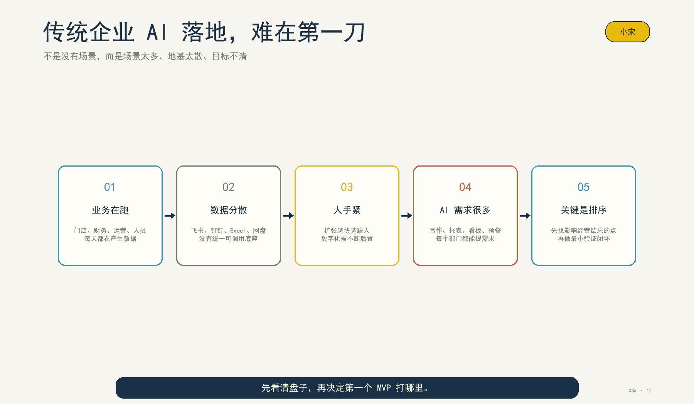
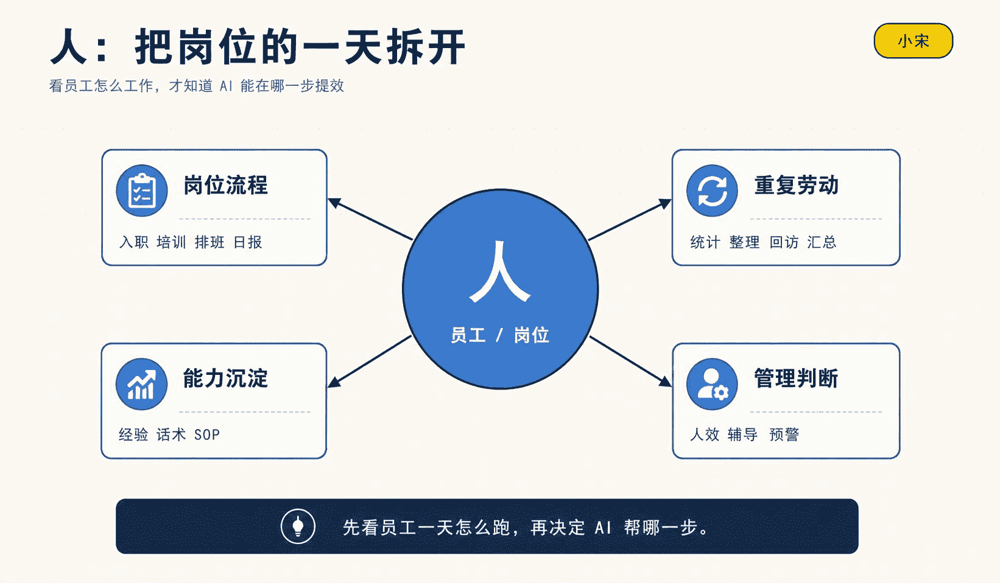
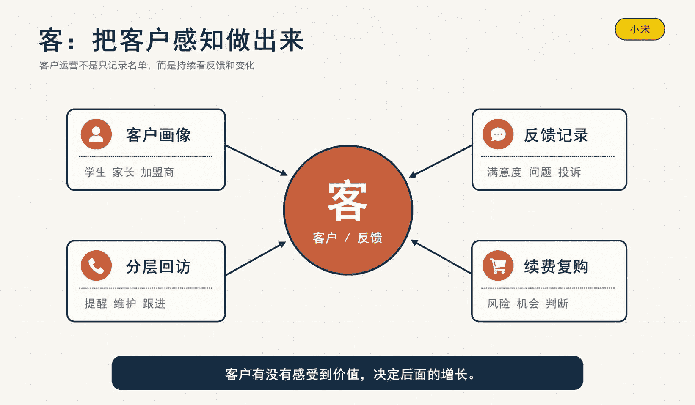

# 在传统中小企业做 AI，最难的从来不是写代码

260724 副业 SC 精华

## 写在前面

最近，社群里频繁讨论如何把 AI 能力带进实体企业。我也借这个机会，把自己在一家传统中小企业参与相关项目的经历重新梳理一遍。

这不是一份标准答案，更像是一份现场记录：怎样进入企业、如何认识业务、怎样从大量需求中找到突破口，以及如何用一个小而明确的成果，慢慢取得团队的认可。

这段经历让我确认了几件事：

- 进入企业后，先观察经营结构，不要急于开发；

- 先把双方对“价值”的理解说清楚；

- 基础信息没有整理好时，别急着谈高级智能应用；

- 业务全貌理顺后，先挑最值得处理的 P0；

- 用一个范围可控、能实际运行的 MVP，证明事情确实有用。

我是龙哥，目前从事 AI 企业服务。

- 1. 程序员出身，后端开发工程师，赚钱 1 年圈友。

- 2. 目前主要做 AI 工作流、多 Agent + Skill 内容知识库、n8n 工作流。

- 3. 一篇 CSDN 技术文章 43w+ 浏览。

- 4. 3 篇赚钱精华帖。

- 5. 《赚钱 AI 宝典》共创者。

- 6. 运营公众号「小宋 AI 自动化」。

## 一、我进入的是怎样的一家公司

我们做的是连锁加盟代运营，全国有一百多家门店。

这类业务的复杂，往往不是门店数量简单增加，而是管理半径被无限拉长：不同城市、不同门店、不同负责人，都在持续产生数据。可这些信息并没有沉淀到同一套体系里。

飞书多维表里有记录，钉钉里有记录，员工电脑上各自保存着 Excel，网盘中还留着许多年代久远、用途不明的文件。

这正是许多传统企业的日常状态：

业务在持续运转，信息也在持续累积，但没有形成一套统一、可检索、可复用的基础设施。

我进场后，最明显的三个问题是：

1. 人手有限；

2. 信息管理基础薄弱；

3. 业务仍在扩张。

它们之间还会互相放大。

门店越多，管理工作越重；人员越紧张，越顾不上整理资料和规范流程；基础工作一再推迟，后来就会变成智能应用最难绕过去的障碍。

因此，传统企业的问题通常并不是“没有 AI 使用机会”，而是可改造的地方太多。真正困难的是：哪些应该现在处理，哪些可以放到后面。

## 二、正式开始前，先确认两类信息

进入企业做 AI 项目，技术能力只是入场券。真正影响推进速度的，还包括沟通能力、业务理解和对组织关系的判断。

尤其是 To B 项目，你不是单纯交付一个软件，而是在一个真实的经营系统里寻找位置。

我花了两周才摸清楚下面两件事。现在回头看，这些问题本应在第一周解决。

### 1. 企业内部有没有技术团队

这个问题会直接决定你的工作方式。

如果企业原本就有技术部门，那么你通常不是系统建设的唯一负责人。权限、数据归属、系统维护和技术方向，往往已经有人负责。

此时你的工作更接近协作、培训、方案设计或局部优化。流程可能更成熟，但能够自主决定的空间也会相应减少。

如果公司没有技术团队，情况则完全不同。

你需要自己摸清数据从哪里来、流程如何流转、工具如何连接，前期会承担更多琐碎工作，但也拥有较大的主动权。

我面对的正是后一种情况。对于这种企业，比较现实的起点是：

先处理那些重复频繁、规则清楚、容易衡量的工作，把能交给程序执行的部分交出去，把可以持续采集的信息留下来。

因为对很多传统企业管理者而言，AI 的价值并不体现在概念有多先进，而在于员工是否少做了一些机械劳动。

“Agent”“大模型”“智能决策”这些词，未必能让对方立刻形成判断；但如果每天固定占用两小时的工作被缩短到十分钟，价值就非常直观了。

### 2. 你由谁引荐，最终向谁交付

不同角色对 AI 的期待，可能完全不同。

老板关注经营方向，副总关心协同效率，业务负责人关心具体执行，技术负责人关心系统稳定性。大家说的“做好”，未必是同一件事。

所以，进场后要尽快确认：

- 谁把你带进来？

- 谁愿意为你提供支持？

- 哪些资源可以调用？

- 最后由谁判断是否达标？

- 对方真正希望你解决的是什么？

To B 项目最先要完成的，不是搭系统，而是统一目标、资源边界和验收方式。

否则你可能持续产出，却始终无法证明这些工作是否符合预期。

我在前两周吃过亏。最开始只是埋头推进，后来才发现，管理层当前最需要的并不是一份宏观的智能化蓝图，而是一个能立即使用、能够节省人力的改善结果。

所以，进入一家新公司后，前 5 到 7 天最好把这个问题问清楚：

对方现在优先期待的是效率提升，还是长期规划与智能升级？

这会直接影响你第一个月的工作排序。

## 三、企业升级有先后：先把底层秩序建起来

我通常用三个层次来判断企业当前适合做什么。

### 第一层：信息线上化

把纸面记录、个人表格、聊天内容、网盘文件和人工台账，逐步放进统一的线上环境。

重点不在于工具看起来多高级，而在于信息能够被找到、被更新、被调用。

### 第二层：流程自动运行

当信息已经具备统一存放的位置后，再把固定规则下的重复动作交给系统处理。

例如：

- 定时收集数据；

- 汇总日报；

- 归纳异常；

- 推送提醒；

- 生成固定格式的报表。

这一层通常最容易让业务人员感受到变化，因为它直接减少等待、复制和重复录入。

### 第三层：智能分析与辅助判断

前面的基础稳定后，才适合进一步做趋势分析、经营预警、知识问答、预测建议和决策辅助。

这个顺序很重要：

信息没有统一，流程就难以稳定；

流程不稳定，模型得到的输入就不可靠；

输入质量不高，输出再“聪明”也很难落地。

现实中，管理者常常一开口就想要“智能规划”或“让 AI 帮忙判断”。但实际盘点后会发现，企业连口径统一的数据都没有，信息分散在各种表格、聊天工具和个人文件中。

此时直接做高级应用，很容易变成演示效果不错、实际使用困难的项目。

更可行的做法是：

在方向上回应对方对智能化的期待，在执行上先把数据和流程整理好。

不过，仅仅知道这条顺序仍然不够。企业里永远有很多事情，接下来还要回答：当前最该处理哪一件？

## 四、找项目，不要从工具出发，要从经营问题出发

很多人进入企业后，会先问：“哪些地方可以用 AI？”

这个问题很容易带来一长串需求。

写材料、整理表格、生成报告、客服回复、会议记录、数据分析、内部问答，几乎每个部门都能提出使用场景。但“可以使用”不等于“值得优先投入”。

更有价值的问题是：

> 目前哪一个业务障碍，正在最明显地拖累经营结果？

我通常按以下路径推进。

### 第一步：分别和关键岗位交流

只听老板的描述不够，只听某个部门的说法也不够。

管理层看到的是目标，一线人员知道真实操作，中层往往最清楚交接与协同中的卡顿。

交流时，我会重点了解：

- 谁承担最终结果；

- 谁负责实际执行；

- 哪些数据由谁填写；

- 谁在做事后检查；

- 哪些任务每天重复；

- 哪个节点最容易出错或停滞。

### 第二步：把口头信息整理成可分析的记录

访谈不能停留在聊天记录里。

可以为每个业务环节建立统一字段，例如：

- 环节名称；

- 执行角色；

- 当前做法；

- 需要哪些信息；

- 主要阻碍；

- 是否存在机械重复；

- 对经营指标的影响；

- 是否具备接入 AI 的条件；

- 预估投入与优先级；

- 可尝试的最小方案。

这样一来，原本分散在不同员工脑中的经验，就能转化成可对照、可排序的资料。

### 第三步：让 AI 协助绘制业务全景

当访谈材料被整理后，再让 AI 参与归纳，而不是一开始就让它凭空设计方案。

可以让它协助回答：

- 企业有哪些主要流程？

- 每条流程由哪些步骤组成？

- 每一步现在如何完成？

- 哪些地方反复耗费人工？

- 哪里存在信息断层？

- 哪些环节依赖少数资深员工？

- 哪些节点最接近收入、成本、交付或客户留存？

当这些关系被呈现出来后，原本混杂在一起的问题，会逐渐显出层次。

### 第四步：筛选最适合先做的事项

并非所有痛点都适合立即改造。我的筛选标准主要有四条：

1. 是否直接关系到经营表现；

2. 是否已经有可用的历史记录；

3. 是否能在较小范围内完成试验；

4. 是否能让使用者在短期内感受到变化。

满足条件越多，越值得进入首轮尝试。

### 用公众号内容业务举例

以我的公众号为例，表面上最容易想到的改善方向，是提高写作效率：帮忙起标题、修改开头、润色正文、制作配图。

但如果把公众号看成一项完整的内容业务，流程其实包括：

选方向、找材料、搭结构、写初稿、处理标题和开场、排版发布、观察反馈、总结规律，再进入下一次选题。

如此一来，重点就不再是“能不能快速写完”，而是：

- 选题是否符合受众需求；

- 标题有没有点击吸引力；

- 开场能否降低退出率；

- 内容组织是否清楚；

- 题材是否与账号积累相匹配；

- 发布后的数据有没有回流到下一次判断中。

所以，公众号知识库不应只是文章仓库，更应该成为内容业务的资料底盘。

其中可以保存：

- 过去做过哪些主题；

- 不同文章属于什么类型；

- 标题采用了什么切入角度；

- 开头使用了什么表达方式；

- 阅读、点赞、评论表现如何；

- 哪些内容超出预期；

- 哪些内容反响偏弱；

- 可能影响结果的原因是什么。

有了这些积累，AI 才能进一步协助完成更靠前的判断：

1. 识别新主题属于哪类内容；

2. 找出历史上相近题材的表现；

3. 判断它更依赖情绪、案例、方法还是经验；

4. 给出大致的反馈区间；

5. 指出风险更可能出现在主题、标题、开场还是结构；

6. 提供针对性的调整方向。

这时，AI 承担的已经不只是文字生产，而是参与内容决策。

### 我真正想测试的 MVP

我并不急着测试“AI 能不能独立写出一篇文章”。

更想先确认的是：

> 它能否结合公众号已有资料，判断某个主题是否值得投入，以及这篇内容最应该优先修改什么。

这个范围很小，却直接关系到方向。

主题判断错了，后面即使写作速度提升、排版更漂亮，也只是提高了低价值内容的生产效率。

因此，在内容业务里，最先值得做的，可能不是写稿助手，而是内容选题与表现判断工具。

这也是我对 To B AI 项目的一个重要理解：

先梳理业务，再沉淀信息；先找到影响结果的核心节点，再围绕这个节点设计最小方案；先让团队看到局部收益，再谈更大的系统。

### 从调研到试验，可以归纳为六个动作

1. 和关键岗位交流，获取一手信息；

2. 把交流结果整理成统一资料；

3. 还原完整流程，标记堵点；

4. 依据经营影响、数据条件和实施难度排序；

5. 锁定最值得优先处理的 P0；

6. 设计一个小范围 MVP，验证它是否真的有帮助。

这几个动作，正好连接了两套常用框架：

- “人、财、物、客、事”帮助我们确定从哪些业务面观察；

- “信息线上化、流程自动运行、智能分析”帮助我们判断改造深度；

- 流程梳理、价值排序、P0 与 MVP，则帮助我们决定先做哪一处。

## 五、需求太多时，用“人、财、物、客、事”展开

刚进入企业时，我也会被各种临时需求牵着走：

财务要数据，业务要报表，管理层想做规划，部门之间还不断提出新的工具需求。

后来我借用了圈友孟虎提出的分类方式，把企业问题先放进五个抽屉：

- 人：员工与岗位；

- 财：资金、收入、成本和结算；

- 物：企业生产、交付或销售的内容与产品；

- 客：客户及其服务过程；

- 事：行政、协同与日常事务。

下面用教培机构举例。

### 人：围绕员工的工作过程

教培机构里的关键角色，通常包括教师、教务、班主任和销售顾问。

以教师为例，他的工作可能包括入职学习、备课、排课、授课、布置练习、批改作业、分析学习情况、向家长反馈、进行阶段回顾。

逐项拆开后，很多具体机会就会出现：

- 依据机构内部资料辅助形成教案和课堂框架；

- 把课堂录音转成文字，检查授课内容是否覆盖教学目标；

- 参考学生过往表现，设计差异化练习；

- 在班主任联系家长前，准备学生近况与沟通重点。

重点不在于笼统宣称“帮助老师提效”，而是把工作过程拆成颗粒度更小的环节，逐一观察哪里有重复、哪里有记录、哪里有机会减少人工投入。

### 财：围绕收入与结算过程

教培机构的财务工作，除了收款，还会涉及订单、合同、发票、流水、凭证、课时消耗、退款、续费和分成。

可优先处理的往往是具体问题：

- 订单信息与合同内容能否相互核对；

- 已消耗课时与收入是否能够对应；

- 哪些学生接近续费时间；

- 哪些订单存在退款风险；

- 班级收入、课时消耗和教师成本是否失衡。

只有先把这些信息整理清楚，后续经营分析才有可靠基础。

### 物：围绕课程与教学资源

教培机构交付的产品，可能是课程、教材、题库、教案、录播课、直播课或训练营。

这里的“物”，重点不在实物库存，而在内容资产有没有被妥善管理。

例如：

- 课程资料是否集中存放；

- 优质教师的教案是否留下；

- 授课结构与讲解方式能否复用；

- 题库是否按照知识点、难度、错误情况和适用人群标记。

这些资料积累到一定程度，就能从个人经验变成组织资产。AI 的价值也不只是批量生成题目，而是帮助机构把分散内容整理成可调用、可传承的体系。

### 客：围绕学生和家长的服务体验

教培机构表面服务的是学生，真正参与决策和付款的通常是家长。

因此，不能只看学生是否到课，还要观察：

- 学习状态有没有变化；

- 家长是否看得见这种变化；

- 教师有没有及时说明；

- 班主任是否持续跟进；

- 哪些家庭存在续费隐患。

在这一环节，AI 可以辅助生成阶段性学习反馈、归纳一段时间内的变化、提醒回访时的重点，并根据学习表现提供下一步建议。

这些能力看上去不如“智能规划”那么耀眼，却更贴近续费。家长是否继续购买，往往取决于他能否明确感受到孩子确实获得了改善。

### 事：围绕每天的运营动作

机构每天还有大量细碎工作：

排班、调课、请假、作业回收、课堂记录、家长联系、日报汇总、课程提醒。

单看每一项都不复杂，但它们会持续占用员工时间，因此很适合拿来做早期试点。

例如：

- 发送排课与课程提醒；

- 汇总作业提交情况；

- 形成课后记录；

- 汇集教师日报；

- 留存家长沟通纪要。

这类改造的优势，是效果容易被使用者察觉：少复制一次、少填一遍、少做一次人工汇总，团队就能感受到变化。

所以，企业需求并不是凭空从工具清单里挑出来的，而是应该从真实工作链条中逐步拆出来。

最后再回到优先级判断：

- 它是否靠近经营目标；

- 现阶段是否有可利用的信息；

- 能否缩小范围进行试验；

- 结果能否被使用者快速感知。

比如一家教培机构当前最严重的问题，是家长无法判断课程是否有效，那么首个项目未必应该从备课助手开始。

更值得尝试的方向，可能是：

课堂内容记录、教学目标核对、阶段学习反馈，以及家长沟通提要。

这样能够把课前、授课过程和课后服务连接起来：教师减少整理时间，班主任更容易完成高质量沟通，家长也更清楚孩子的学习变化，机构则开始积累真正有价值的教学资料。

这就是 To B AI 项目的关键：

不要先从“我能做什么工具”出发，而要先确认“企业正在为哪个问题付出代价”。当问题找准后，工具只是解决方案的一部分。

别急着先做一个智能体，先把业务拆成能落地的小闭环，找一个真实可验证的点切进去。

## 六、横五纵三，搭一张能用的作战地图

人财物客事用来管横向覆盖：

主要在哪个业务面找突破口？

但每个业务面能推进到哪一层，又是另一回事。

把前面的进阶尺度接到这里：

任何一条业务线，先看它处于数字化、自动化还是智能化的阶段。

横向五条线：

人、财、物、客、事。

纵向三层：

数字化、自动化、智能化。两轴交叉，就变成一张对照表。

这就是我进入一家公司后真正会用的企业 AI 落地作战地图。

| 业务面 | 数字化 | 自动化 | 智能化 |

| 人（员工） | 岗位流程、培训资料、工作记录上线 | 重复任务自动处理、人效数据自动汇总 | 人才预测、能力画像 |

| 财（钱） | 合同、订单、发票、流水、凭证统一沉淀 | 对账、课消、结算自动核算 | 经营预测、风险预警 |

| 物（产品/内容） | 产品、课程、题库、知识库结构化 | 内容生成、题库标注、资料调用自动化 | 经营辅助判断 |

| 客（客户） | 客户数据、反馈、消费记录沉淀 | 回访提醒、客户分层、报告生成 | 续费预测、复购预测 |

| 事（流程） | SOP、审批、日报、会议纪要沉淀 | 日报周报、流程提醒、任务流转自动化 | 异常预警、智能周报 |

表填完后，做实的地方、空白的地方、下一步该打哪里，一目了然。

从过往项目看，最先发力的大多是「物」和「人」。

物，也就是业务数据、经营数据、内容资产、门店数据。

人，也就是一线执行、区域管理、岗位经验、人效管理。

「事」也很适合先做，见效快、回本快。

「客」更偏向增长，但对数据沉淀和跨部门协同要求更高。

这张图把全盘照清楚了。以后再进任何公司都不慌。

先用五字把业务过一遍，再用三阶给每个点标深度，最后结合地图与P0判定第一刀落在哪。

这就是基本打法。

## 七、框架要能翻译成老板和一线都听得懂的话

这套东西我既自用，也讲给老板和团队听。

只是面对不同行业，表达要换一套词。

跟零售、连锁、餐饮、电商的老板聊，我不会再说「人财物客事」，而是换成他们常说的「人货场」。

人，线下是进店客流，线上是流量与用户。

货，是卖什么、供应链、选品、产品结构。

场，实体看门店选址，线上看商铺、直播间、平台。

同一套思路，用他惯用的词，当场就能接上。

这就说明了：To B AI 服务的核心，不是把自己的方法论硬塞给客户，而是把方法论转译成客户能听懂、能用的业务语言。框架固定，场景流动。

能否把话说到老板和一线都懂，直接决定了落地与否。

还有一把更细的尺子，模型推荐的，还在消化中：

制造业质量管理的「5M1E」：人、机、料、法、环、测。乍听跟开咖啡店无关，但连锁的本质不就是把一家店当产线复制上百遍吗？所以照样能用。

比如选址这件事，原本是说不清的一团活。用5M1E一照，就能拆成可操作的点：

人：谁判断、谁执行、谁复盘。

法：流程、规则、红线、标准。

环：外部环境、商圈、人流、竞品。

测：打分、测算、数据、反馈。

一团问题，就变成了几个能接入 AI 的切口。

我现在两把尺子交替用：

人财物客事，负责扫盘。

5M1E，负责细拆。

一粗一细，够用。

事情不是变少，而是终于有了归处。

## 八、落地最难的是边界、协同与预期管理

方法说起来顺，实操会遇到大量现场问题。这些不是坑，是 To B AI 服务必须处理的组织现场。

其一，角色边界要提前讲清。

开头没说透，后续修电脑、装软件、下 WPS、装 CAD 的请求都可能找上来。对非技术同事来说，IT、数字化、自动化、AI、数据系统之间的界线很模糊。

这事不能靠别人理解，要主动反复说明：

我做数字化、自动化、智能化和流程优化。

我不做日常 IT 支持。

装软件、修电脑这类事请走 IT 或行政流程。

说清边界不是为了推诿，而是保护主线不被杂事冲散。

其二，汇报线与验收人要先理顺。

老板直招自主权大，但配合关系要早对齐。

从项目看，就是内部决策链：

谁拍板、谁出资源、谁定优先级、谁最终验收。

越早确认，后面越省力。

To B 项目失败，很多时候不是工具做不出来，而是组织链路没对齐。

其三，必须沉到一线。

起初在办公室问需求，对方说的和我理解的常不一致。

后来才明白：

老板懂方向，不一定懂一线每一步怎么走。

一线懂细节，不一定懂老板真正要什么。

中层懂管理压力，不一定懂数据怎么沉淀。

最有效的做法很朴素：搬个凳子坐到工位边，看一天到底在干什么。

怎么打开系统、怎么导数、哪里重复、哪里靠经验、哪里易出错。

这些开会问不出来。

其四，预期要提前拉平。

老板可能觉得 AI 能包打天下。

但第一阶段交付的可能只是个小自动化、一个看板、一个预警、一个日报工具。

若没提前说清阶段目标，就会觉得「就这？」

我现在会开场就讲明白：

第一步先补数字化。

第二步做自动化提效。

第三步再做智能化判断。

每一步交付什么、解决什么、为何现在只能做到这里，都要说清。

其五，一个人扛不住，要找外援。

中小企业 AI 落地是从零到一的事，技术、沟通、业务、管理、培训、交付都要碰。

一个人能跑通首个案例，但难长期规模化。

所以要尽早拆出去，让 AI 承接一部分，让伙伴承接一部分，自己抓方向、前段与交付质量。这是目前最想补的一课。

## 九、真正决定落地的几件事

做下来后我越来越觉得：

增长不是靠单点多漂亮，而是靠整条流程串起来。

单点人人可学，工具人人可买。真正的壁垒，是能否从业务地图里找到关键问题，再把数据、流程、工具、人和组织协同串成完整闭环。

归纳下来，我现在最认这几条。

其一，技术相对简单。

真正卡住人的，往往是沟通、对齐和组织。

模型不行可以换、调、迭代。

但客户对 AI 的认知不一致，老板、一线、中层各有判断，没有标准答案，要一遍遍磨。

其二，先做能跑的小 demo，别只讲 PPT。

需求进来后，我常会先用即梦、ChatGPT 或 Codex 快速做一张图、一个页面、一个小系统，反问：你要的是这个吗？

沟通效率会高很多。

尤其面对中高层，一个能看见的东西，比十页 PPT 更有说服力。

其三，用结果换信任。

对一线员工尤其如此。别讲概念，直接给能用的东西。他今天用上了，明天省时间了，信任自然来。

其四，花小钱办大事，别一上来就上重系统。

传统企业做 AI，第一步不必买很重的系统。

飞书 CLI、ChatGPT、豆包、OpenCloud、Hermes、Minimax，很多轻量工具先跑起来就够了。

先花几十块、几百块把一个小闭环跑通，比一开始就规划大系统更现实。

其五，进门第一天，先找一个有分量的人背书。

让他介绍出去：「这是咱们公司的 AI 同事，后面流程提效、数据自动化相关的事情，可以找他一起看。」

有了这个身份，后续沟通阻力会小很多。

其六，沟通是最复杂的一环。

代码错了能调，模型差了能换，人这关没有标准答案。

要同时跟三方对齐：老板要的方向、一线干活的实情、中间业务的卡点。

而且每个人对 AI 的认知会随项目推进不断变化，沟通贯穿全程。

对老板尤其要注意：尽量不要直接说「做不了」。

可以说：「我回去研究一下，先搞个小 demo 看看。」、「这个方向可以试，但可能要先补数据。」、「我们先做一个最小闭环，验证一下值不值得继续投入。」

对方听到的会是推进，而不是拒绝。

其七，顺序不能跳。

数字化、自动化、智能化，老老实实一步步来。这句话看起来普通，却是传统企业 AI 落地最重要的一句话。

其八，知识蒸馏是长期价值点。

单独说一个方向：知识蒸馏。

把老师傅脑子里那些说不清但很准的经验搬进 AI。

我的做法是，每个岗位问五类问题：流程、知识、经验、踩坑、失败必死点。

然后拿 A 的回答去问 B，拿 B 的回答去问 C，最后提炼多个人答案的交集。那往往就是岗位最核心的经验。

短期不显眼，长期非常值钱，因为它解决了企业经验沉淀的问题。

## 十、往后怎么打

这套打法，我不想只用在一家公司，但也不急着往外跑。眼前这个项目至少值得认真做一年。

先把真实业务啃透，再看哪些能沉淀、能复制。走远路，要从近处开始。往后我要咬住垂直：

这回不打算再单打独斗。能让 AI 干的交给 AI，重活拆给靠谱伙伴一起做，按分润结算，我自己抓方向、前端与交付质量。一个人的上限是一家公司，搭起一支小队，才能接得住更多老板。

这条路我很看好。多数传统行业、中小企业对 AI 的依赖还很低，空间很大。尤其是没有技术团队的传统中小企业，恰恰是 AI 服务最好的合作伙伴。它们不缺业务、不缺场景、不缺真实问题。缺的是一个长期把业务、数据和技术接起来的人。一旦真正进入流程，双方合作会越来越深。

## 十一、写在最后：这篇写给谁

写到这里，我觉得这篇是写给三种人。

第一种，准备进企业做 AI 落地的人。

你大概率会和我一样，一开始面对一堆杂事，不知道从哪下手。

把这张地图拿走：人财物客事 × 数字化、自动化、智能化。

再加上这条流程：业务地图 → 优先级判断 → P0 问题 → MVP 验证。

进门第一周就照着填。别先埋头干活，先看人、看决策链、看老板真正要什么、看业务里最关键的问题在哪。目标越清楚，动作越不容易跑偏。

第二种，已经在企业里、一个人扛 AI 的人。

上要对齐老板、下要理解一线，技术、沟通、管理、交付全都要自己来，我太懂了。

我想说：真正卡你的从来不只是模型，而是组织和沟通。

这件事没有标准解，但你可以有方法论、有地图、有优先级、有 MVP、有小队。别一个人闷头扛，趁早找伙伴，趁早把流程拆出来，趁早让 AI 和团队一起分担。

第三种，不小心看到这里的老板。

如果你边看边觉得“这说的不就是我公司嘛——数据散得到处都是、扩张太快没人管数字化、嘴上想要个智能的、底下连数字化都没做完”，那我得提醒你一句：你现在最该花钱的，不是再买一个“智能工具”，而是先把“数字化这个地基”补上。顺序一跳，钱全打水漂——这是我拿真金白银换来的。

————分割线————

看完这篇 SOP，你觉得你懂了。但 90% 的人一到实操就会卡在第一步。

工具和教程只是最低级的壁垒，真正的壁垒是“立刻动手”和“圈层信息差”。

我们不聊虚的，只做商业闭环的拆解与 AI 效率的压榨。系统内已沉淀 1000+ 跑通的套利实战局。

👉 查阅圈子完整数字资产与上车门槛：

