# 实体老板别再瞎折腾了！AI+付费投流才是真正的王炸

最近有个小小的突破让我特别激动：只花了500块投流，加上私信自动回复，把客户顺滑地引进微信，三天就加了130多个精准客户，转化还特别好。我爸乐得连元宵节都不过了，大年初十就开车回厂里张罗开工了。

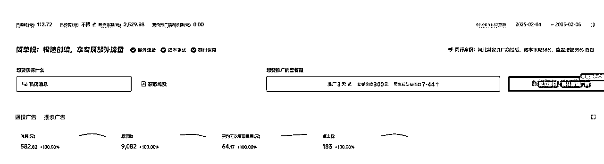

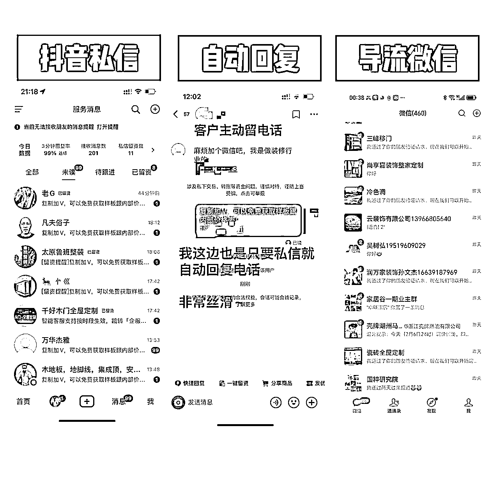

但说实话，这个结果来得并不容易。在这之前，我在搞流量这件事上踩了太多的坑。

## 01 开局：天崩开局，工厂规模一缩再缩

这三年，能想到的玩法我几乎试了个遍：阿里巴巴、抖店、直播、小红书矩阵、找KOL合作、私域团购、截流……前前后后砸了十几万，全都是真金白银换来的教训。

从阿里巴巴到抖店，从快手到小红书，只要听说哪里有流量，我就一头扎进去。

结果如何？

一万平的工厂缩到5000平，再缩到3000平。嘴上说着省钱，实际上把最值钱的时间全烧在了没意义的事情上。

回头看，我特别想问当年的自己：花了那么多功夫，搭了那么多精力，结果为什么这么惨淡？

答案其实不复杂：我一直在找捷径，幻想着不用费力就能躺赢。结果反而绕了更大的弯子。

倒也不能全怪方法不行，更多是我没找到适合自己产品的那条路。如果不一个个去试错踩坑，也不会有现在这份清晰的认知。

今天就把这三年在引流上摔过的跤，以及最后摸索出的那个真正适合我产品的路子，完完整整分享给你。

## 02 困局：被“免费流量”四个字套牢的日子

说要紧的话，先聊聊我那会儿有多“抠门”。

一心想搞免费流量，我几乎把市面上的路子都试了个遍：

▫️ 阿里巴巴，纯纯亏钱。花了9800入驻，加上注册公司、代理记账乱七八糟的开销，钱交完之后就是上架商品。所谓的“扶持”全是要充钱的，动不动就喊你交个29800升级。当时生意好做，人也飘了，听忽悠就开了店。客户质量真心一般，还白搭了一个客服天天守着接待。好在后来没续费了。

▫️ 小红书这边，我一个人同时养着10个号，每天要发二三十篇笔记。为了抄爆款，翻了一百多个同行账号，看他们的文案结构、拍照角度，连字号都不放过。忙是真忙，效果嘛——不能说一点没有，但也就那样。实测下来，写个两百篇能爆个两三篇就算运气不错了。我做的又是小众类目，能有些水花已经不错，但想要放大突破，天花板很低。

▫️ 抖音上开了两个店，天天发剪辑视频，有段时间还咬牙直播，每天两小时，坚持了一个月出头，卖了三千多块。然后因为发货慢了被平台扣了两百多块钱——回想起来真是哭笑不得。还专门找人去对接那些大V家装博主，小红书上同样操作，结果呢？开口就是20%佣金还嫌少，加上坑位费，动不动还要免费送产品。我的客单价基本在500到5000之间，按这个玩法搞下去，亏到怀疑人生。

▫️ 还有私域团购、截流……市面上你能找到的主流玩法和课程，我基本都上过手。当然，我没有做出来的原因大概率不是玩法本身不行，它们确实不适合我的品类。别因为我的经历就否定这些路数，很多人在这些方向上赚得盆满钵满。

以上这些，表面看着没花钱，但算算时间成本，早比直接花钱买流量贵多了。

更要命的是，效果极不稳定。

我亲身经历过：去年618，在小红书发了一条新品笔记，颜色和款式都是新的，一下涨了5000多粉。我以为掌握了财富密码，接下来一个月用同样方式发了30多条笔记，结果全沉了。最惨的连20个赞都没过。

流量忽高忽低，对工厂来说就是一场灾难：

- 订单多了，产能跟不上，客户抱怨

- 订单少了，工人闲着没事干，工资还得照发

- 原料备货更是头疼，备多了怕积压，备少了怕断供

讽刺的是，付费投放的道理我早就知道。

我之前写过一篇讲抖音获客的文章，当时学的做法是做IP然后投抖+，1块钱涨1个粉丝，确实划算。我也试过，还攒了好几百个B端客户。但那会儿我内心对“花钱买流量”这件事是有抵触的。

总觉得：

- 免费的东西才是好的

- 手上的钱应该留住多囤点货

- 反正有的是时间，多研究研究总能找到不花钱的路子

就带着这种格局太小的想法，我把大把时间耗在了：

- 研究各种“黑科技”：什么矩阵工具、自动回复、一键获客、电话号码采集……

- 买各种课，专门挑那种宣传“不用动脑、有手就行”的，比如“一部手机在家躺赚”……

- 我还学过打粉技术。自然流我是真的整不明白，抄都抄不会，这个得怪自己笨。截流靠纯手工，效率慢得让人崩溃，而且引来的客户信任度也不高，不适合我。

这边忙着研究各种花活玩得不亦乐乎，那边却在悄悄浪费最宝贵的东西：时间、精力，还有原本能更快做大做强的机会。

## 03 转折：一个意外发现 + AI的大爆发

真正的转机，藏在一个特别偶然的发现里。

我能有那么多时间瞎折腾，估计也是因为主业还算稳当，太闲了。

某天我注意到，小红书上最爆的那3篇笔记，之所以能一直稳定带来询单，其实是因为这三年我一直给它们开着聚光投放。虽然预算不大，一天就100来块，但流量非常稳。淘宝那边我同样在万相台持续投着，ROI基本能稳住5到8倍，效果极佳。

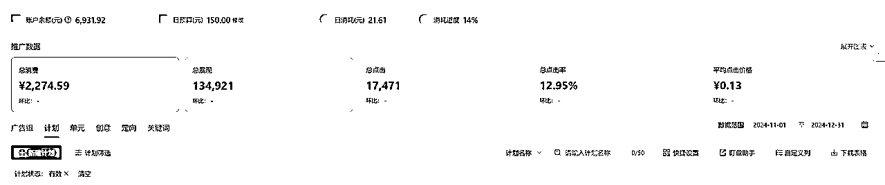

这个发现让我彻底想通了。既然付费渠道这么稳，那之前为什么要把时间和精力全砸在那些所谓的“免费”方法上？

2024年下半年，事情变得更有意思了。

当时生完娃在家坐月子，无聊到发慌。看到龙哥盟里几位老哥的帖子，就跟着做了抖音半无人直播。

最离谱的是——原本打算用它给工厂直播卖货来着（你看，我还是没跳出那个惯性思维，又想着“无脑挂机”“省事躺赚”这些词对我这种懒人的致命吸引力），结果自家产品没卖多少，倒靠卖别人的货搞了十几万佣金。这真是，五味杂陈，哭笑不得哈哈哈哈……

这个项目我还写了篇万字复盘，想看的话可以翻翻我的历史文章。

后来AI开始大爆发，圈里的大佬们都在反复强调机会的重要性。我也跟着去看各种AI相关的帖子，从自己最实际的需求出发，慢慢学了起来。

比如先摸清市面上有哪些好用的模型：DeepSeek、GPT、Claude、谷歌Gemini、秘塔、豆包、Kimi、智谱……基本上都上手试过。还有即梦、海螺、Midjourney等工具。

也学了不少新词：工作流、知识库、API、智能体、提示词……

每一次都是从零开始。我的学习习惯是，先从自己的真实业务需求出发。

比如学提示词是为了写小红书文案。跟不同的大模型对话，是为了让它们写出我想要的文字。

如果你只是做二创改写，用Kimi或豆包就够了，又快又不卡。但要做到原创，我目前测下来最靠谱的组合是Claude+DeepSeek，两个模型互相配合，效果无敌。

所有学过的技能，都不会白费。AI在后面帮我解决了大量内容和投放上的难题，比如：

- 如何用AI选对适合自己的投放平台和方式

- 如何用AI找到对标同行

- 如何用AI写出高转化钩子、高转化短视频素材和脚本

等等……

## 04 怎么找准适合自己产品的那条引流路

真正让我正视抖音的，是12月那会儿。我爸老跟我说，有个渠道一直有客户加他，而且加过来的基本都能成交。我去仔细一看，发现这些客户全是从抖音企业号来的——因为那边留的，恰好是他的联系电话。

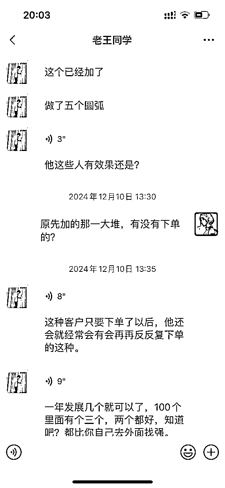

这个意外发现，让我下定决心系统学一遍各大平台的投流玩法。说实话，以前总觉得投流这玩意儿贼烧钱，现在想想，我可真是天真他妈给天真开门，天真到家了。

那问题来了：投放真就是有钱就能干的事儿吗？

说句实话，我以前投放极随意。视频就用剪映批量混剪，文案想到哪写到哪，连同行的调研都懒得做。现在回头看，真是业余到不能再业余。当时愣头青一样冲上去干，三分钟刷新一下，500块就没了，连怎么没的都不知道。就这么稀里糊涂被劝退了。

这次我是实打实付费去系统学的。光抖音Ad这个课程的笔记我就整理了2万多字。别被这么多字吓到，其实不管是抖音还是小红书还是视频号，现在的投放系统都智能得很，技术层面没那么多复杂操作。核心还是得看项目本身行不行。

关键是要找到靠谱的人和团队，跟着真正拿到结果的人学。不然里面细节太多了，一个不注意就会亏钱。我因为交过很多学费，已经算是个专业老韭菜了，能分辨哪些是坑。但也劝大家：千万别盲目把这个当成救命稻草。实体老板一直是收割的重灾区，切记。

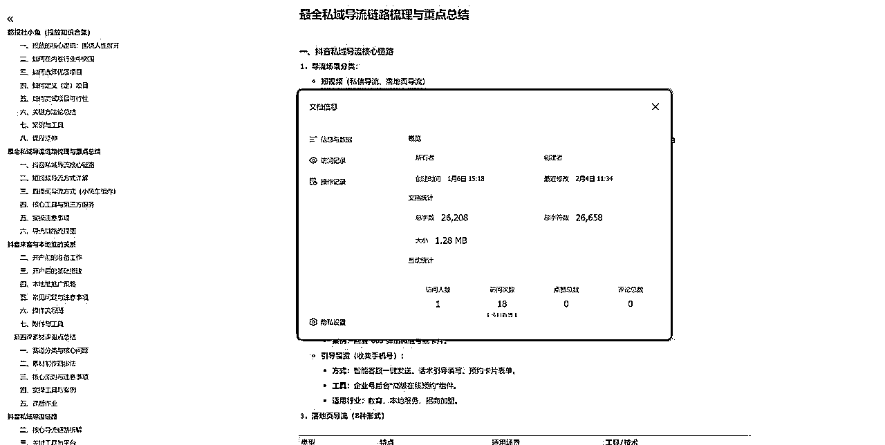

很多人觉得投放的核心是技术，非要在上面玩出花来。但我做投放的时候，大部分时候都是直接通投，连定向都懒得设。

为什么？

因为真正的功夫根本不在技术上。

那在哪？

- 在研究项目本身

- 在研究整个竞争环境

- 在研究怎么把素材打磨好

现在的抖音，已经不是2018年的那个抖音了。你的客户在看到你的广告之前，已经被同类广告轰炸过无数遍了。他们还会选择你，就是因为你跟别人不一样——可能是项目有差异，可能是模式有区别，也可能是素材做得让人眼前一亮。

有些传统老板总觉得投放就应该非常精准，好像平台里藏着一批从没见过广告的“小白兔”，等着你举着镰刀去收割。

这怎么可能？

抖音上的用户，尤其是你的目标客户，早就被同类广告轮番洗过脑子了。你能赢，原因特别简单粗暴：

- 你的模式比同行更强

- 你的项目比同行更硬

- 你的素材比别人做得更好

就这三样，简单直白。

你的产品和别人一样、模式无差别、素材还是对着人家抄的（而且抄得还不如人家），那你告诉我，客户凭什么选你？

所以，第一步不是急着去抄别人，而是先找出同行素材里的那些核心痛点。

注意，我不是让你别参考同行，而是别整段照搬。先把同行文案的痛点扒透，再结合自身业务特点，把痛点巧妙地缝合进去，同时根据产品特性设计好钩子，引导用户主动来加你。

然后你说：你说得轻松，道理我都懂——可我还是不知道怎么下手啊？

咱们传统行业老板的通病就是，一门心思搞产品研发，但互联网思维不够，运营和文案的人手也不足，自己上手就更没戏了。很多方法明明知道方向，却只能干瞪眼。

可是，现在AI不是出来了吗？你等于白捡了一个不需要发工资的顶级助理。再加上年后DeepSeek火得不行，网上一大堆免费教程教你怎么写文案、怎么分析产品、怎么跟AI高效对话。

就拿我最近在用的打法来说：

想写广告文案的时候，让AI先帮我拆解同行的爆款素材，分析人家用了哪些关键词，文案是咋搭结构的。

比如我最近发现很多同行都在用“工厂直发”这种词，但实际效果很一般。让AI一分析，发现“免费打样、准时交付”这类承诺词明显更打动人。

做素材策划时，我让AI帮我把同行的文案逻辑理清楚，分析核心痛点、情感触发点、转化要素这些层面，找出真正能撬动客户下单的点。

但必须说清楚，AI只是工具。它不懂你的行业，也不了解你的客户到底要什么。最核心的判断还得靠你自己：理解客户痛点、打造差异化优势、做好服务保障。

系统学了投放之后我才彻底明白，真正的投放是从人性出发来做的。你的项目、你的素材、你的投放策略，全部要围绕用户的真实痛点来设计，而不是自我感动。

尤其是咱们这种传统实体行业。如果客单价基本都在1000以上，又想做私域，同时产品和销售团队都是现成的，投放也都合规——这种情况下，与其天天研究那些所谓的“免费流量”，不如踏踏实实做付费投放，把精准客户直接买回来，岂不是更香？

这一连串成功的尝试，让我想明白了几件事：

1. 稳定的获客渠道，比追求一时爆量重要得多

2. 系统性学习，永远胜于东拼西凑的碎片信息

3. 与其把时间耗在研究“免费”方法上，不如集中火力把投放的ROI做上去

## 05 手把手教你搞投放

我把自己的投放路径整理出来供大家参考。切记，不同行业玩法差异很大。这里只是让大家明白：投放没有想象中那么复杂，也不需要想象中那么烧钱。

做投放之前，先想清楚你是要做toB还是toC。

因为我的产品同时支持B端和零售，所以目前的策略是：抖音投B端引流私域，小红书直接对C端卖货。我的品类比较小众，还没有到需要全平台放量的阶段，现在的流量已经足够覆盖整个工厂的产能。

就拿抖音投小B端来举例子。B端指的是那些有实体门店的老板，比如建材、装修、地板这些行业。这类客户一旦下单，复购是长期的。我前期积累的B端客户，两年多了还在持续下单，所以值得往私域里引。

关于抖音怎么开企业号（蓝V）、直营户/代理户的区别是什么，麻烦自己搜一下，这里不展开了。

下面直接放我的投流计划和步骤：

**第一步**，登录巨量百应后台，网址如下：

https://ad.oceanengine.com/promotion/promote-manage/project?aadvid=1764587411635207&filter_st=%25222025-02-01%2522&filter_et=%25222025-02-13%2522

**第二步**，点“新建项目”，进去编辑项目。细节提示：如果目标是投账号后台的私信，就一定要选“单投放载体：抖音私信页（原抖音主页）”，别选橙子落地页——除非你的行业确实需要投落地页。

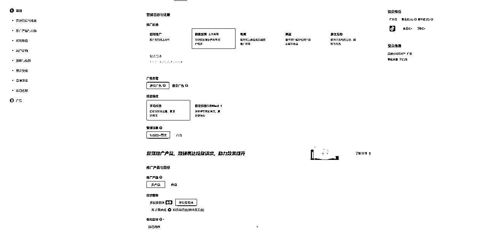

**第三步**，用户定向这边，除非你的产品指向性极强，比如你做的就是只有年轻人喜欢的二次元动漫，年龄大的不会感兴趣，那可以卡一下年龄。反之，老年产品同理。

常规产品一般只要勾选24-49岁的人群。地域限制很强的话就卡地域。比如我的产品全国可发货，所以地域上直接去掉台湾、香港、澳门就行。如果你的产品只能在杭州卖，那行政区域就选杭州。想更细分的话，按商圈投周围几公里都行。

前期测试我都建“最大化计划”，先跑3天，尽量不去做太多限制（具体根据自己经验和产品特性来，以下都以我的产品举例）。

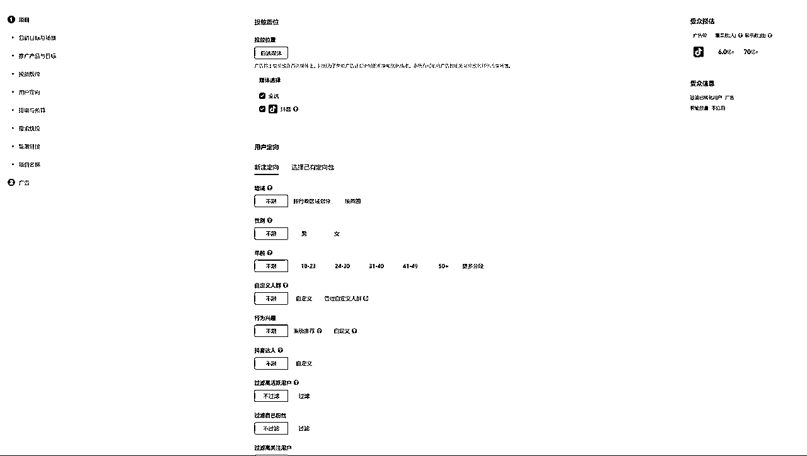

**第四步**，选“最大化转化”。预算有限的话可以填个2000或3000，看你想在前测阶段投入多少。这是整个项目的预算，填多少自己说了算。关键词选跟自己业务强相关的即可。出价系数选1:1——最大化转化计划不用填，后面建稳定成本计划时再填。

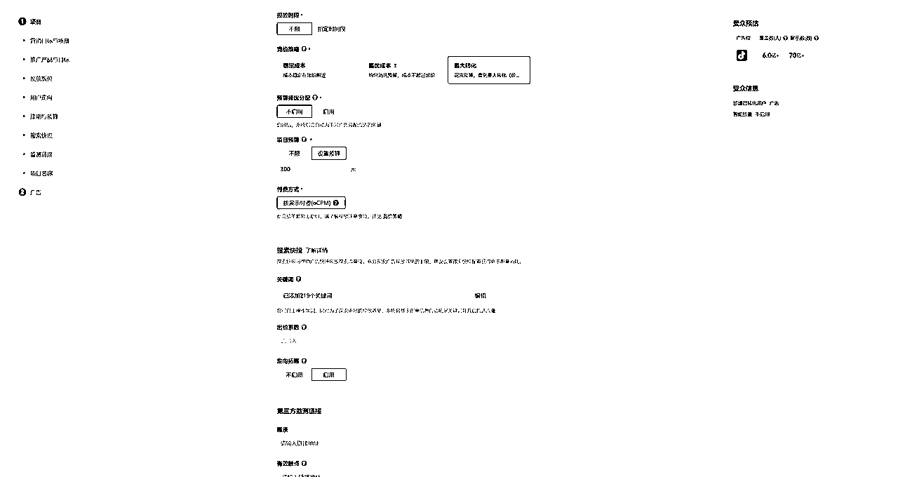

**第五步**，保存后新建广告，把你剪辑好的视频素材传上去。抖音的即创平台先审文案和视频。如果对宣传文案和画面没把握，可以先跑一遍审核再正式发布。

文案素材可以抄同行的，或者让AI帮你分析后写出来。其他内容按系统默认引导填就行。

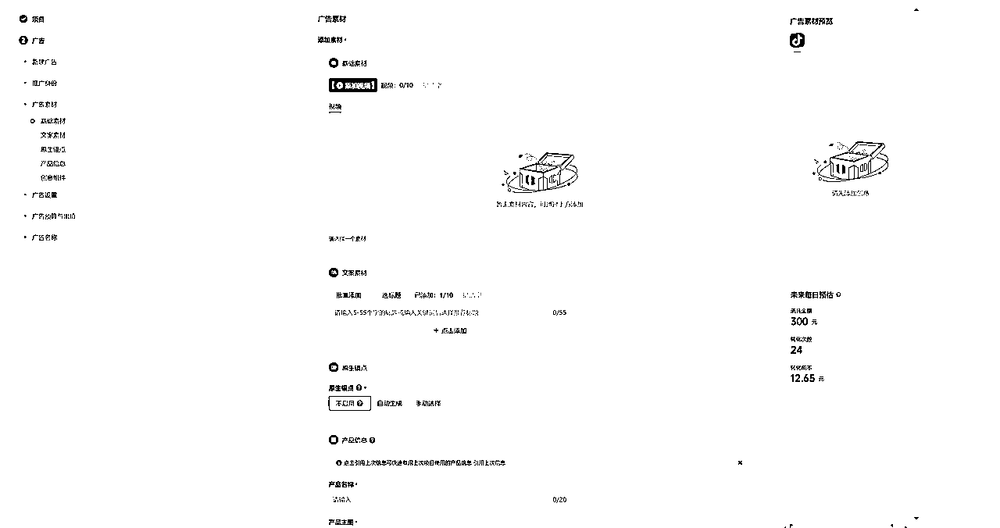

**第六步**，设置每日预算——最低是300，真正卡预算在这里。所以前面在项目里尽量多放点备用金，因为有时候要建好几条计划，分别测不同的素材。保存关闭后，计划就正式启动了。

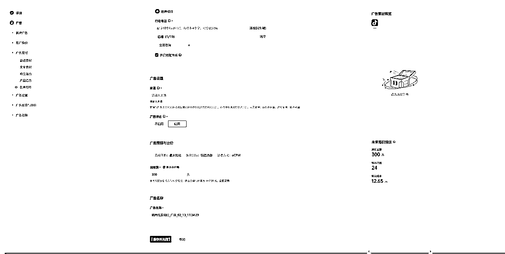

注意：计划一开启，一定要定时盯着。别跑去做别的事，等回来发现预算几分钟就飞光了。当然，计划建好后会出现各种状况：钱花不出去、瞬间烧爆、有点击没转化、点击成本高得离谱……

这些都要根据数据去分析和调整。我也就略懂皮毛，还在学习中，欢迎有经验的大佬多指点。

如果你是传统行业老板，手头刚好有抖音号，可以小成本试一下。现在抖音新出的抖+也能直接投私信，100块起投，门槛更低了。花几百块搏一搏，真的比病急乱投医强太多。

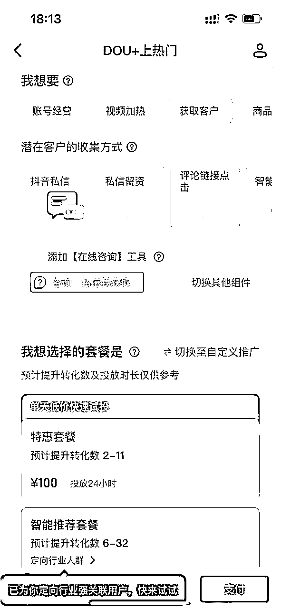

## 06 给传统行业老板几句掏心窝的话

折腾了整整三年，特别想对同样在做实体的老板们说几句心里话。

我自己交了很多学费，各种课程报了不少，知识付费累计差不多十几万。但最后得出的结论却极其简单：如果你的项目合规，对自己的产品和服务有信心，来客户就能转化，那干脆去抖音或小红书花个600块开个企业号，直接投流，合规地把客户导进私域。

真的不用再像我一样去研究那些花里胡哨的骚操作。矩阵号、截流、蹭热度、黑科技……听上去很诱人，但最后全都在烧你的时间和精力。

现在平台的投放工具已经很成熟了。只要产品和服务过硬，安心做付费投放就好。我知道很多老板看到投放费用会心疼，但听我一句，这钱花得值。至少比你去交各种试错的“学费”要划算得多。

记住：稳定的获客渠道、可持续的增长，才是实体企业最需要的东西。所有野路子、所谓捷径，最后都会让你付出更大的代价。

这就是我花十几万学费、三年时间换来的经验。希望能帮你少踩几个坑。

**感谢耐心看到这里的你，彩蛋时间到：**

这篇文章其实是我和AI一起写的。我用的大模型是Claude。以前写这种长文，磨磨蹭蹭可能要一星期。但现在有了AI辅助，把需求通过提示词输入进去，来回对话几轮，整篇文章的框架很快就出来了，前后也就花了一下午的时间。

大家可以仔细看下我和AI的对话过程——我自己从头写是完全没有思路的，脑子里一团乱麻。

但AI会根据我给出的提示词和零散信息，不断追问我一些关键问题，逼着我去理清思路、选好表达的重点。整个过程就像在和一位朋友聊天，讲完了让AI帮忙汇总整理，文章的骨架就出来了。真！的！太！省！心！了！

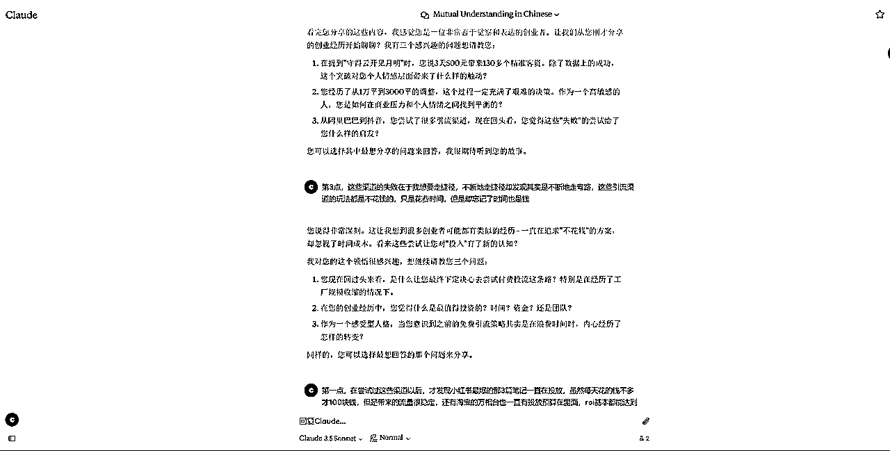

这就是经过好几轮对话之后，AI给我的文章框架。请把“AI牛逼”打在公屏上，哈哈。

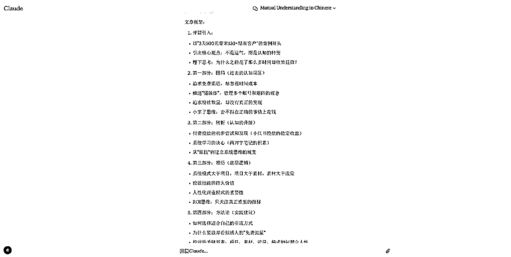

后面有机会，我再继续分享更多在实际业务里非常实用的提示词！