# 实操分享 可复制 2024 半年纯利润破25w 这个项目功不可没------ai＋简历优化私域交付
最近很多朋友在问：2024年还有没有那种普通人能上手、不需要太多前期投入、还能稳定产出利润的副业？我把自己正在跑通的一个项目拿出来聊聊——用AI工具做简历定制与优化，在闲鱼接单，私域完成交付。
先介绍一下背景：我是00后，坐标天津，做独立项目已经四年了。从一个普通小城做题家，到现在靠项目月入六位数，光今年上半年净利润就超过25万。今天拆解的这个简历业务，是我整个基本盘里重要的一环，步骤全部可复制，希望能给大家带来一些新思路。AI的介入不仅提升了效率，也帮我们拓宽了视野——很多赚钱的可能性，是在工具升级之后才被看见的。
先理解这个业务的本质：简历，本质上是求职者向招聘方展示自己核心竞争力的“个人说明书”。在教育背景、工作经历、技能亮点之外，更重要的是呈现职业潜力。现在就业市场竞争激烈，加上招聘端越来越依赖AI自动筛简历，很多人意识到，一份经过专业优化的简历，直接影响能不能进入面试环节。简历代做的核心，就是帮客户解决“如何脱颖而出”这个痛点，本质上是用专业能力换报酬。
简历优化师能提供的价值包括：重新梳理和润色经历、突出成就；用专业模板提升视觉专业度；在简历里埋入关键词提高机筛通过率；根据岗位方向给出个性化调整建议；甚至扩展帮写求职信、推荐信等相关文书。
市场端的需求一直在涨。2024年应届毕业生人数达到1179万，比去年多出72万，再创历史新高。人越多，竞争越卷，尤其在热门行业和一线城市，毕业生为了争取面试机会，越来越愿意为简历优化付费。这个服务的价值在于个性化指导和专业修改，正好切中他们“简历不够亮眼”的核心焦虑。
市场价格方面，目前主流客单价区间在20到400元不等，取决于客户的背景复杂度和服务深度。基础服务包括简历制作、修改、润色，进阶的可以加上介绍信、面试辅导等。这个项目有几大优势：完全个性化定制，按客户学历、经历、求职方向量身打造；交付速度很快，通常24小时内完成，切中求职者“着急用”的痛点；如果能提供HR视角的专业指导，客户简历通过率和面试率都会明显提升。
接下来说实操。在启动之前，先提个醒：用ChatGPT辅助写简历确实能大幅提效，但前提是你自己得懂简历的基本功。这里有十条核心心法，建议收藏：第一，表述要具体；第二，尽量用数据说话；第三，每一条经历开头用强动词；第四，突出结果和影响而不是罗列职责；第五，针对不同岗位定制不同版本；第六，想想招聘方在找什么；第七，提示词和内容都要简洁；第八，不能造假，所有信息必须真实；第九，用行业内的专业术语；第十，一定要找信任的人或专业人士帮你把关。
落地路径是这样的：闲鱼作为接单主阵地。闲鱼是阿里旗下的二手交易平台，用户量大、社区黏性高，操作门槛低，个人创业者开店几乎零成本。而且闲鱼活跃用户中年轻人和学生占了大头，正好是简历服务的目标客户群。平台自带沟通工具和交易保障，算法也会帮你匹配流量，对新手来说非常友好。
实操第一步，下载闲鱼App，用淘宝授权登录。这里有个细节：刚开始不要急着改任何资料，先刷页面、看功能、熟悉后台，避免触发违规。第二步，发布产品。标题只要不违规就行，重点去看同行里面高曝光、高浏览、高评论的链接，直接参考模仿，效率最高。
接单之后，关键是沟通。你需要快速收集客户信息，有几个核心问题必须问清：第一，客户身份——应届毕业生、职场老手，还是海外留学生？第二，经验情况——几年工作经验，几段工作经历？第三，求职方向——有明确目标岗位，还是海投？第四，重点需求——希望突出工作经历、项目经验还是技能特长？第五，有无特殊要求——比如排版风格、用词偏好等。
报价方面，没有固定标准，靠沟通经验灵活判断。如果感觉客户预算充足、对质量要求高，可以适当报高；反之就报低，稳住单量。常用价位有29、39、49、59、66、99、128等不同档位。可以分三档来定位：普通简历29到69元，适合初级岗位或预算有限的客户，做基础格式和内容优化；高质量版本69到99元，适合中高级岗位客户，全面优化内容、突出优势和成就，配套专业排版；如果客户有特殊需求或想要个性化设计，就上99到199元档位，深度定制内容、格式、视觉设计，还能提供多版本和修改建议。
制作流程其实不复杂。先确认简历大框架，收集整理客户信息，一般是用WPS简历助手和客户逐项确认。客户基本信息直接找客户要，像自我评价这类内容，就可以交给GPT来生成，根据客户身份来量身发挥。实际操作中，把客户信息一句一句录入简历助手，就像填问卷一样，最后一键生成。如果内容不满意，就让GPT继续优化，提示词可以参考这样的写法：“这是我的简历，职位会由直接经理审核，我担心目前版本不足以清楚传达我的价值，请重写，展示我为何是合适人选，以及我将如何融入团队。”排版不满意，就用简历助手一键换模板。说实话，大约80%的单子都能按照这套标准流程走完。
不过用AI制作简历，有几个坑必须注意：
第一，ChatGPT会在不同板块之间重复内容。它不懂自我审阅，可能在不同段落来回说相似的话，所以必须人工仔细核查，多检查两遍，避免车轱辘话。
第二，它容易1:1照抄职位描述。很多人拿职位描述去让AI优化，结果AI原封不动复制回来。但HR想看的是你的故事逻辑，是你能在新环境中复制过去成功的能力。所以一定要调整输出文本，让它以最符合你专业形象的方式讲出来，也可以让它多生成几个版本从中选优。
第三，AI会美化甚至编造成就。特别是工作经历空窗期比较久的时候，ChatGPT可能自己脑补内容。这一点必须警惕，简历上的信息必须真实，谎言只能用更多谎言去圆，一旦被戳穿就全盘皆输。所以所有信息都要确保真实，并对AI输出逐一审核。
第四，AI的语言用词容易重复，而且它并不真正理解你的工作如何影响业务、你的成就在什么背景下产生。简历里很多小细节反而比正文更容易抓住面试官的眼球，但AI遇到搞不懂的地方只会反复要求你修改口令，不会自动帮你拿捏专业表达的微妙之处。所以用细节体现专业度，复杂的专业表述尽量自己把关，别完全甩给AI。
最后分享一些常用的提示词逻辑，大家可以直接套用：职业目标向——“根据我的职业目标优化简历内容”；行业定制向——“请根据IT行业标准优化我的简历内容和格式”；成就导向改写——“将我的工作职责描述改为成就导向的描述”。分模块优化的话：工作经历——“详细描述我的工作经历，突出每个职位的成就和责任，尤其是提升销售额和客户满意度方面的结果”；教育背景——“详细描述教育背景，突出与职位相关的课程和项目”；技能板块——“优化技能部分，覆盖所有与目标岗位相关的技能”。
这个项目胜在门槛低、链路短、可复制、现金流稳定。用AI提效，用闲鱼获客，用服务赚差价。如果你正在寻找一个入局容易、天花板不低的副业方向，简历优化绝对值得认真考虑。
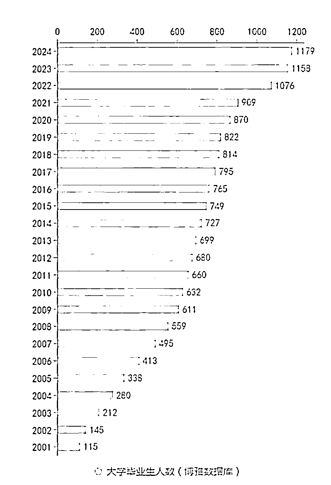
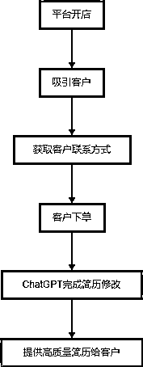
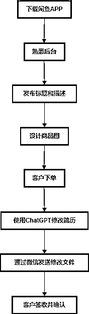
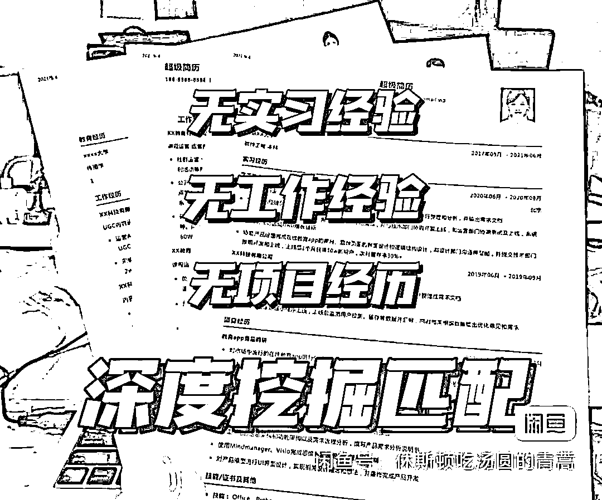
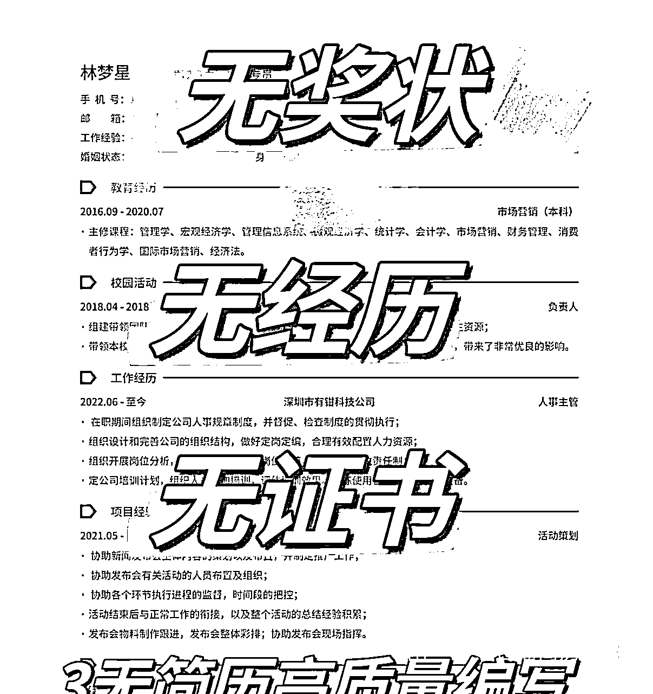
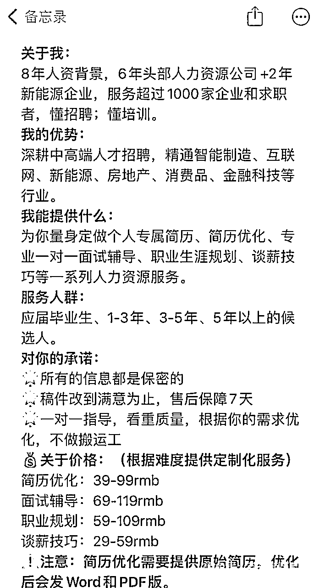
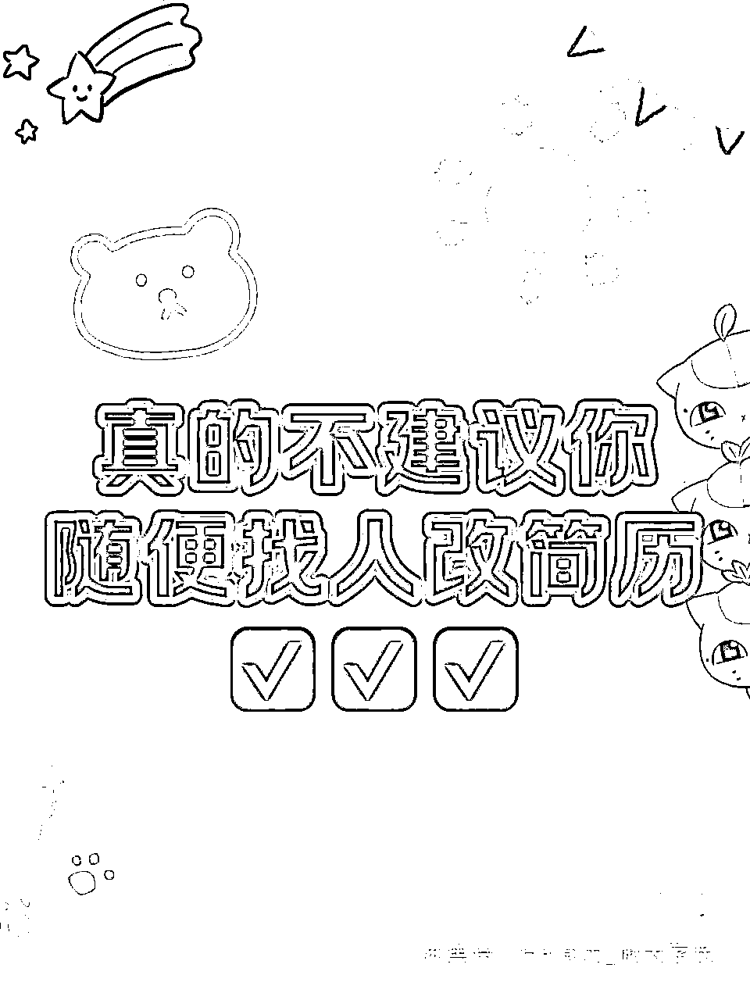
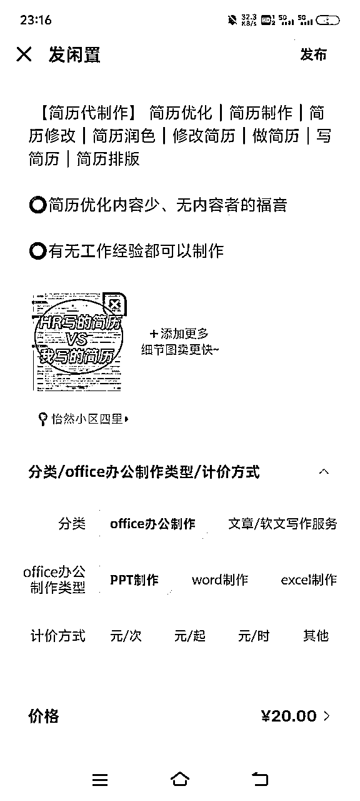
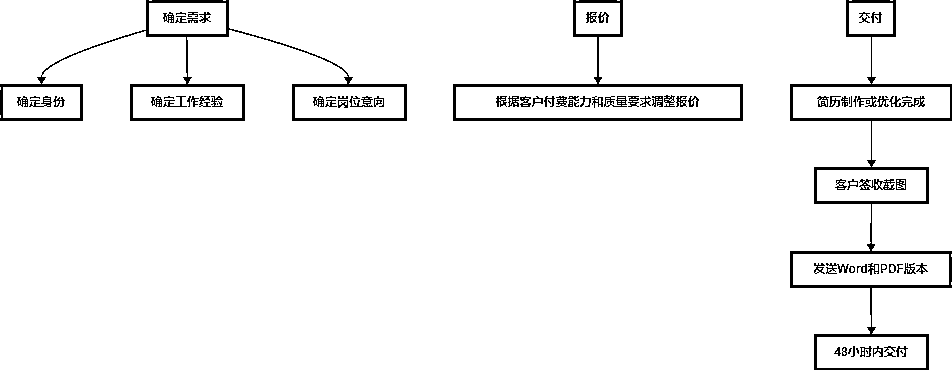

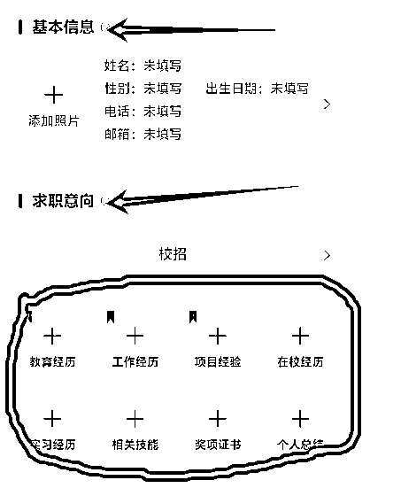
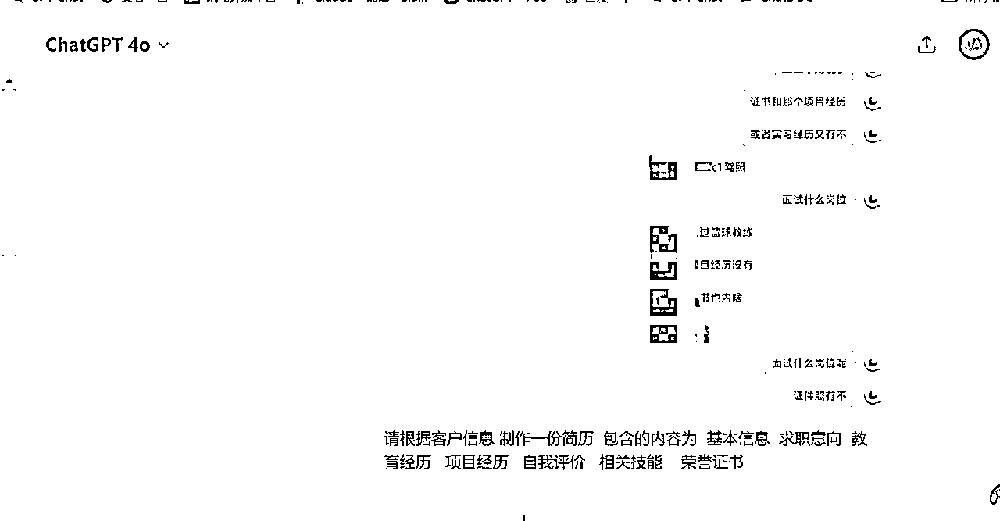
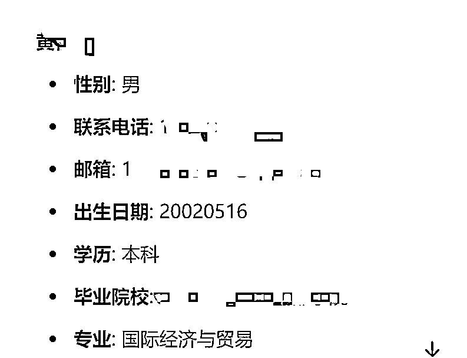
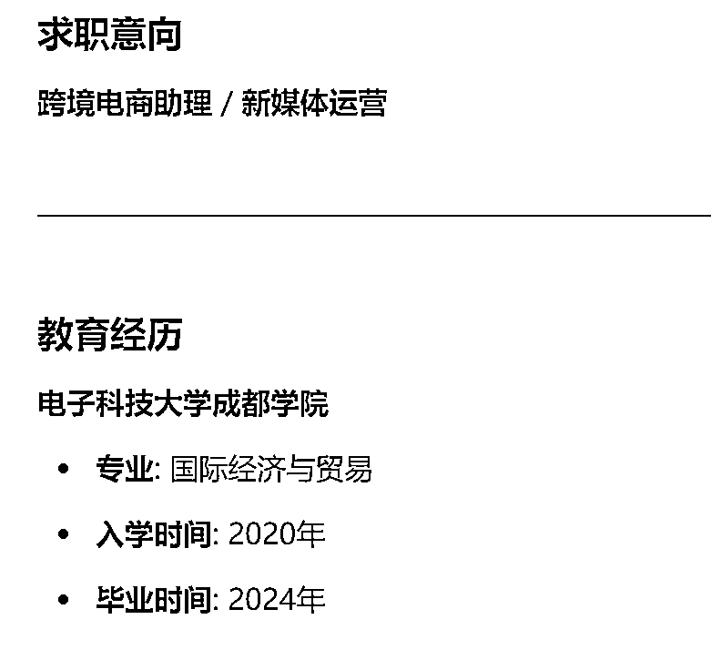
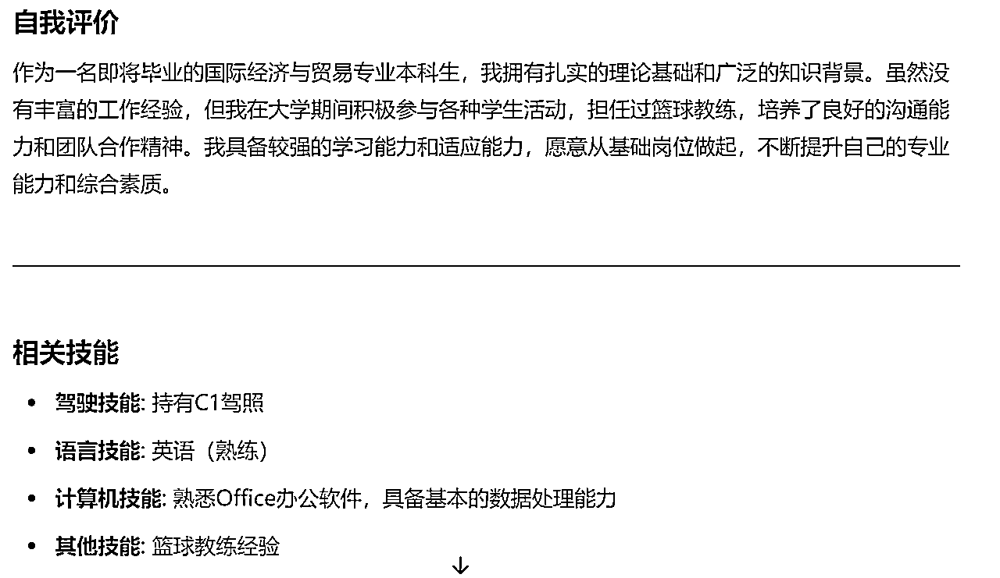
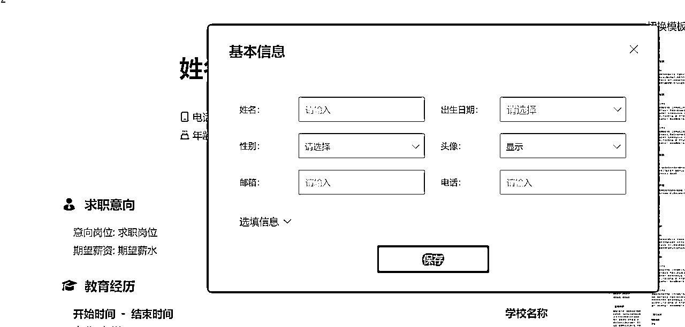
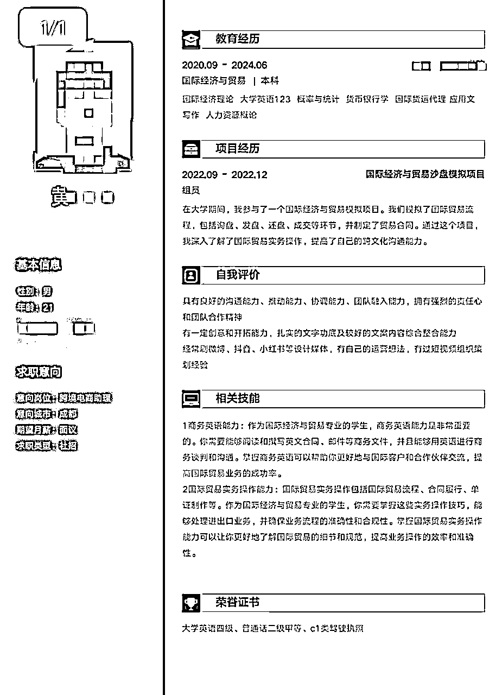
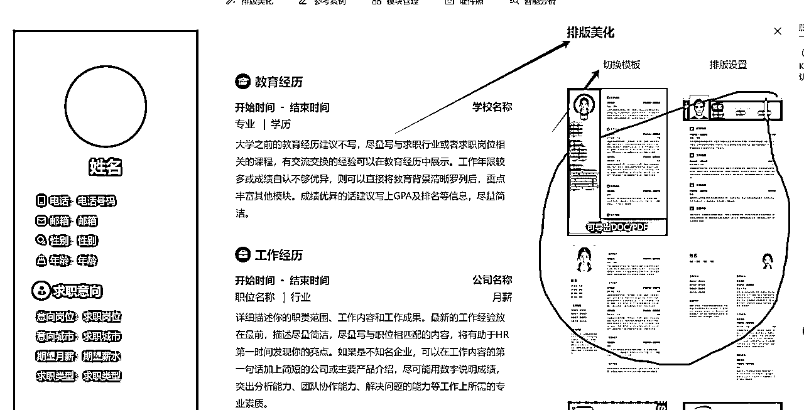