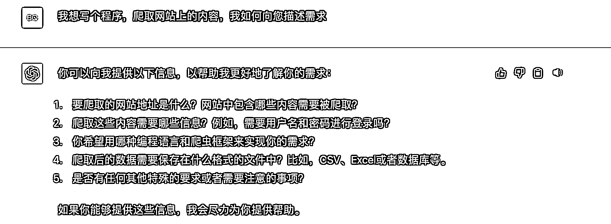
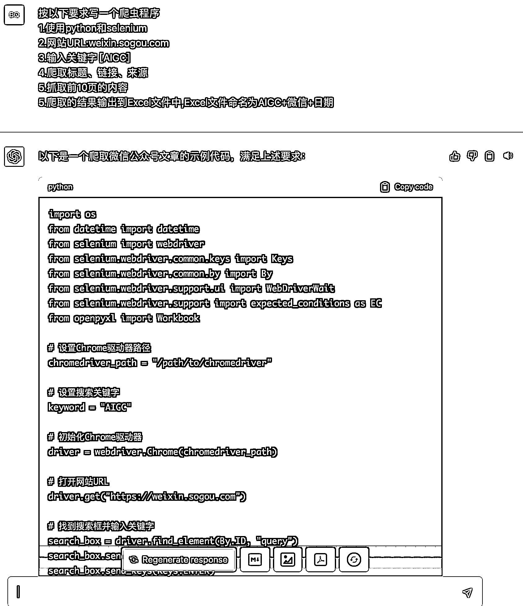
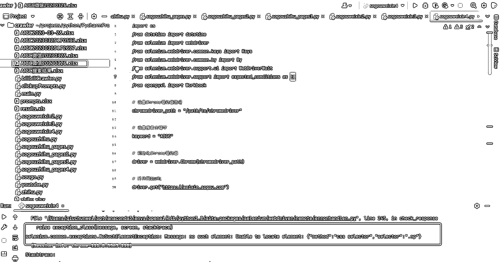
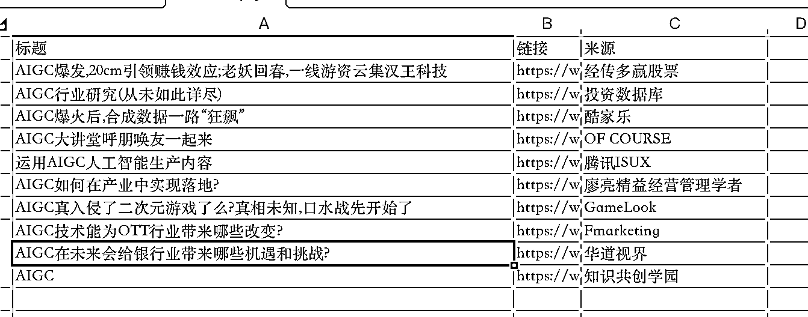
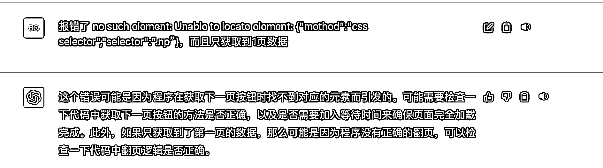
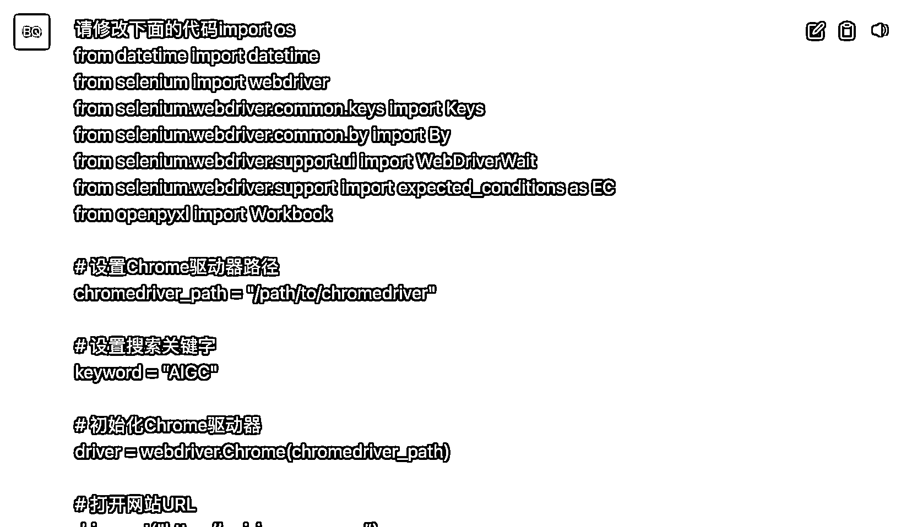
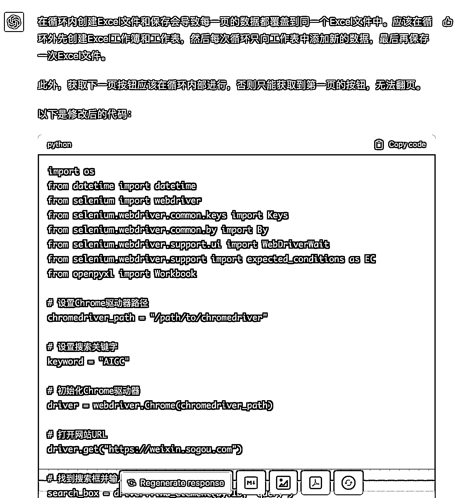
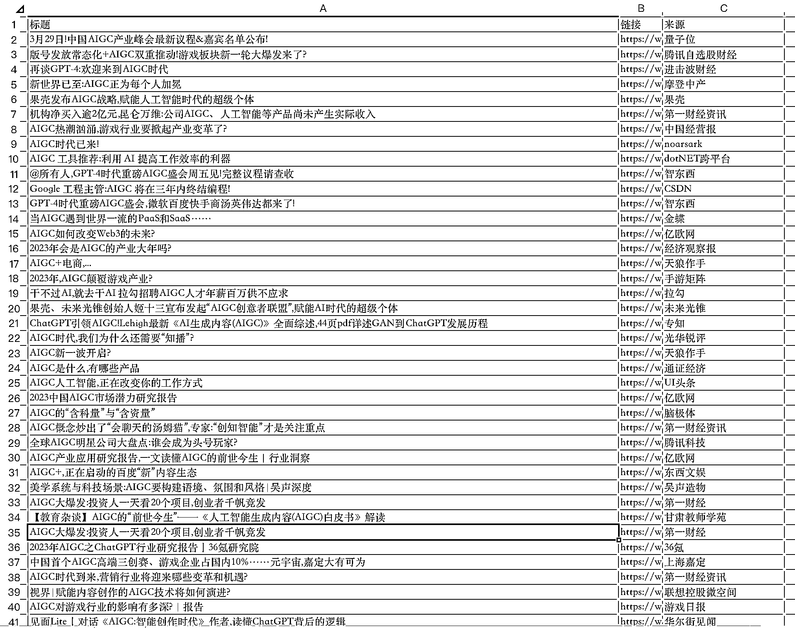
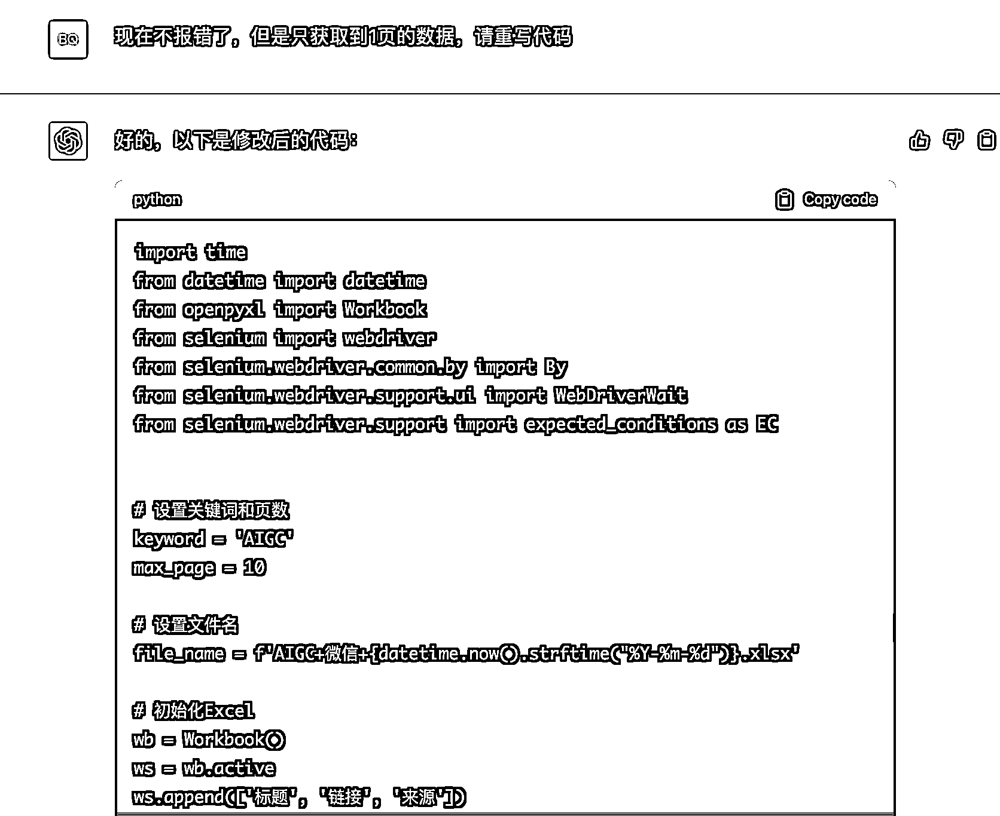

# 对话式 AI 帮我自动采集微信热文的一次实践
作者：龙哥

当我想集中看 AIGC 相关热文时，第一反应不是去订阅号里翻，而是让 AI 帮我写个采集脚本。

今年年初，AIGC 话题特别火，我常在两三个内容平台之间来回切换。微信刷一遍，知乎刷一遍，很费时间。于是想到用程序把微信上热度较高的文章自动聚合起来。搜狗当时能同时找到微信、知乎两边的文章，所以就拿它当数据入口，以“AIGC”为检索词，把当天靠前的文章抓下来。

动手之前，我先问 ChatGPT：“我该怎样描述需求，你比较容易抓到重点？”

它给出的指引很直接，基本上把“怎么提问”也变成了一条可执行的清单。我按照这个思路，整理了需求：

- 用 Python 语言、Selenium 库来采集

- 访问搜狗网站里的微信内容搜索入口

- 检索词定为 AIGC

- 记录标题、跳转链接、来源账号

- 搜索结果从第 1 页覆盖到第 10 页

- 汇总结果写入电子表格，文件名体现 AIGC 和当天日期

下面这张截图，是那时候发给它的完整需求：

ChatGPT 据此给出了初版脚本。我把它放进 PyCharm 里执行。

执行时抛了异常，但表格文件还是生成了。打开文件后发现，表格里仅保留了末页的内容。

我把异常信息和运行结果一起发回给 ChatGPT。

它回复中的解释偏技术化，对新手不够友好。我没有纠结，直接把初版脚本原样贴了过去，请它在原有逻辑上修补。

它找出了漏洞，交回一版修正后的脚本。

再次运行，这次顺利拿到了搜狗结果页第 1 到第 10 页的全部文章数据。

这次尝试下来，我的体会有四点：

第一，需求表达比模板更重要。我不会直接套用网上的 Prompt，而是先让 ChatGPT 告诉我它习惯怎样的表达，再照着写。

第二，它具备一定的“自我修复”能力，把报错丢回去后，它能自己找到 Bug 并调整。

第三，对没有编程经验的人来说仍然有门槛，至少要知道脚本怎么启动、报错在哪里看。

还有一个细节值得单独讲：为什么我选择把旧脚本贴回去让它改，而不是请它“从头再来一份”？

因为当我要求它“另写一份”时，它常常会换一种新实现。脚本已经改动一半时，换实现等于一切从头调试，非常不划算。

所以后续遇到问题，我都会把当前脚本完整贴回去，要求它在原有方案上做局部修复。

这套采集脚本也比较通用，把固定的“AIGC”改掉，换成自己感兴趣的词，就能继续用来收集微信与知乎的信息。

如果有圈友想要源码，或想交流“微信+知乎”的采集思路，可以私下找我。

