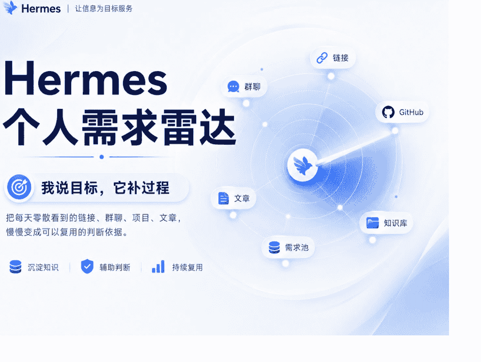
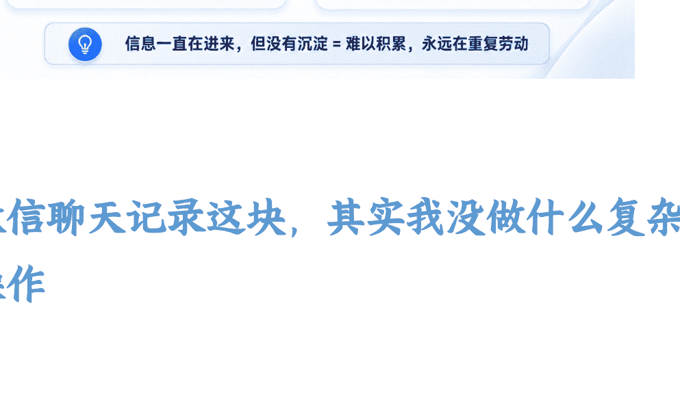
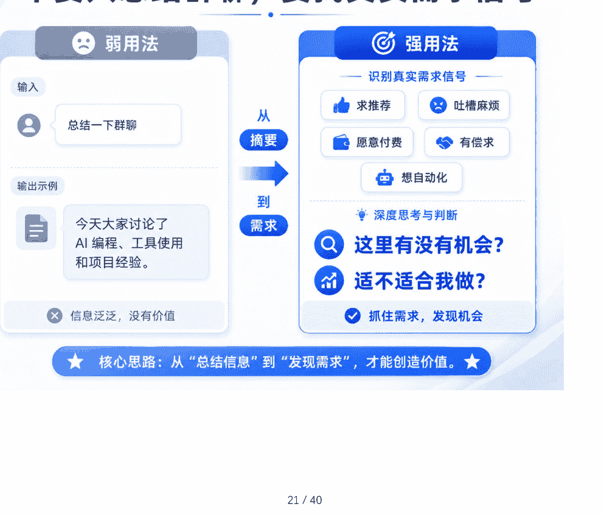
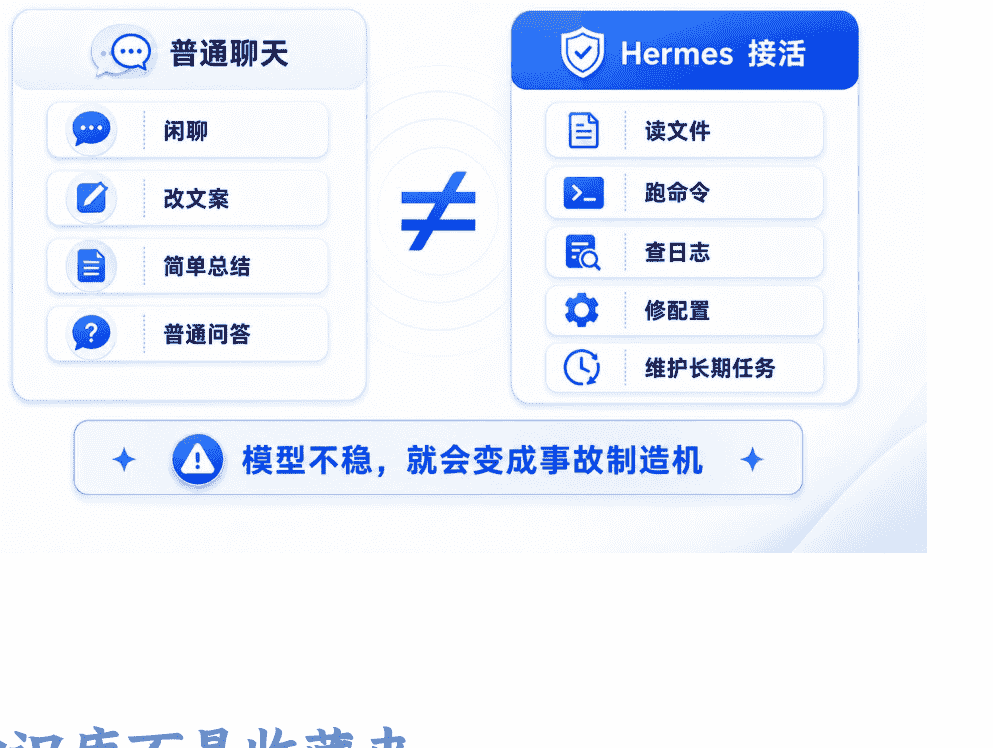

# 我是怎么把 Hermes 驯成「需求探测器」的

先说明，这篇不讲部署。默认你手上的 Hermes 已经能正常对话、能调用外部工具、能读写本地文件、能加载技能包。

我想分享的，是部署完成之后，我每天都在用它做什么。

因为我发现一个很普遍的现象：大家装完一个 AI Agent，还是会下意识地把它当成 ChatGPT 用——你问我答。能用，但太浪费了。

我现在更倾向于把 Hermes 定位成一位常年驻场的私人幕僚。

大多数时候，我做的事特别简单：甩一条链接、一个想法、一个问题过去，然后等它自行查证、阅览、判断，再把值得留的东西写进我的资料库。

比如我经常直接说：

> 这个 GitHub 仓库是干嘛的？适不适合我？

> 别瞎猜，别瞎编，查证之后再回我。

我不会写很长的 prompt，也不会一步步交代操作顺序。我的习惯是：我提目标，它补过程。

## 整套工作流，拆开只有六条线

刚上手的用户，不必一上来就搞复杂架构。

我目前的完整玩法，捋到底只有六条：

用大白话说就是：

**链接**：它负责读取、查背景、判断价值，值得留就归入笔记库；日后碰到同类的，可以在旧笔记上继续推进。

**微信群**：它负责捕捉吐槽、求推荐、有偿求助、想自动化的信号，放进机会清单，将来评估需求时随时取用。

**GitHub 仓库**：它去翻 README、过 issue、留意 star 数和更新频率，整理成项目分析笔记，帮我决定要不要学习、复刻或改成小工具。

**文章/课程/长帖**：它提炼与我相关的重点，存成学习笔记，以后做产品和选方向时继续使用。

**重复性事务**：它固化成标准操作，做成技能包，之后用一句话就能唤起。

**每日固定任务**：它按计划自动执行，设成定时任务，每天早晨把结果送过来。

简单解释几个术语：

- **资料库**：我长期存东西的地方，目前是 Obsidian。

- **机会清单**：先囤着可能值得做的小需求。

- **技能包**：一套固定流程。比如"扫群找需求"，无须反复交代。

- **定时任务**：按点自动运行的脚本，比如每日晨报。

换个角度说，Hermes 最值钱的地方，不在于单次回复有多聪明，而在于它能把我每天路过眼的碎片信息，一点一点变成可复用的系统。

## 我真正想解决的麻烦

我是独立开发领域的新手，最近才开始用 AI 辅助写代码。

对我来说，最难的从来不是写代码，而是判断方向、寻找需求。

每天轰炸到我眼前的信息非常多：GitHub 项目、X 上的帖子、微信群讨论、赚钱帖子、知乎、小红书、V2EX、各种文章……

然后问题就来了：

哪些值得看？哪些只是营销噪音？哪些背后有真需求？哪些适合我这种一个人扛事的小产品？哪些要存档、过几天接着看？

经常是手机刷了大半天，最后什么也没记住。

以前看到项目或文章，我的默认动作是收藏。然后呢？大概率就没有然后了。

收藏只是安慰了"我在学习"的错觉，实际上一点东西都没留下。几天后再刷到类似内容，又得重新判断一次。

信息一直在输入，却从未真正留存。

直到 Hermes 上线，一切开始改变：

1. 刷到一条链接，顺手转给它。

2. 它自行抓取内容、摸清背景、评估价值，把判断反馈给我。

3. 如果值得存，就整理成 Markdown 归档到 Obsidian 里。

4. 如果里面有需求苗头，就登记到机会清单。

5. 下回再撞见同类内容，它能接着旧笔记继续分析。

在我看来，这才是 Hermes 真正强的地方。不是"帮我做个总结"，而是把每天散落的信息，逐步变成能反复调用的判断依据。

## 我和 Hermes 的分工

我的工作：找线索、补偏好、拿主意。

它的工作：查资料、读内容、整证据、写文档，以及把高频流程沉淀成技能包。

这些流程，没有一条是我提前设计好的。

说实话，我既不太会写 prompt，也不太会描述需求，甚至常常不知道自己想要什么。

真实的情况是：我不断把想法抛给它，然后顺着它的回应，用更口语的方式继续表达。通常要聊上两三轮，才能得到满意的结果。

跑的次数多了，Hermes 自己会发现：

- 这个动作以后还会反复出现

- 这个流程应该固定下来

- 这个坑下次不能再踩

- 这个输出结构有必要统一

- 这个环节值得做成技能包

于是，我的个人工作流就这样慢慢成形了。

现在我会用到的技能包包括：

- obsidian：读写我的 Obsidian 资料库

- wechat-daily：生成微信群聊日报和高价值讨论

- daily-demand-report：逐日抓取需求线索

- scys-content-access：访问龙哥盟内容

- market-research-miniprogram：做小程序方向调研

但我平时根本不会去想这些技能包的名字。大半都是 Hermes 根据我的日常习惯自己创建的。

我只需要直接说：

> 今天 xx 群有什么值得留的讨论？

或者：

> 扫一下今天有没有新需求，记进资料库。

技能包的价值就在这里：复杂的流程封装好以后，平时调用只需要一句大白话。

### 最高频的用法：扔一个 GitHub 链接

这是我最常用的场景。

刷到一个开源项目，有点兴趣，但不想自己慢慢读 README、翻 issue、掂量它值不值得关注。我直接甩给 Hermes：

> 研究一下这个仓库：解决了什么问题？有没有真实需求？对我这种独立开发者有什么价值？如果值得留，就收进资料库。

后面的事，它全包了：

- 通读 README

- 梳理项目要解决的问题

- 考察 star 数、issue 活跃度和更新频率

- 判断目标用户是谁

- 判断有没有产品化的可能

- 判断对我是否有用、能帮上什么

- 如果我想试，就研究安装方式、跑 demo、做本地验证

- 如果思路值得留，就写成笔记归档到 Obsidian

我不用交代"先打开网页、再看 README、再翻 issue、最后总结"，这些动作它会自己补齐。

这也是我眼中 Hermes 和普通聊天机器人的核心差异。聊天机器人是在被动应答；Hermes 是在主动接单——不光回答你，还会把活干完。

### 第二常用场景：扔文章、课程、帖子

我也会经常把公众号文章、X 链接、赚钱帖子转给它。

比如：

> 替我学一下这个，看看对找需求有没有用。

或者：

> 把这篇整理成 Markdown，学完放进资料库。

Hermes 会先判断链接属于哪一类：文章？产品页？课程？帖子？还是 GitHub 项目？

然后它会去资料库检索，看是否已存过类似内容。如果有旧笔记，先调出来对照，避免重复劳动；如果没有，才去抓网页、读正文、提炼要点。

现在我已经很少让它做"全文总结"了，因为表面完整，实则无用。

我更常说的是：

> 别总结，就说对我有什么用。

换句话说，我不想让资料库变成收藏筐。我希望它存的是判断：这个内容跟我有什么关系？对我做产品、找方向、搞独立开发有没有实际帮助？

我确实记不住太多东西。但 Hermes 会在需要时来一句提醒：你资料库里有一份旧文件，正好能用来处理眼前这件事。

这才是资料库真正该有的意义。

## 微信聊天记录：远没有想象中复杂

很多人听到"读微信记录"，第一反应就是数据库、解密、SQL。

我日常完全不是这样的。

我从未手动处理过微信数据库，只是让 Hermes 调用 wechat-daily 这个技能包。读取、清洗、提取、总结这些事，都由它按技能包自动完成。

这里重点聊聊 wechat-daily 的诞生过程。

某天我在 X 上刷到一篇关于微信聊天记录解密的文章，很感兴趣，就顺手把链接发给了 Hermes。互动了几轮之后，这个技能包就这么形成了。

底层引用的是开源项目 Thearas/wechat-db-decrypt-macos。

后来刘小排老师发文提到了叫 wechat-cli 的工具，实测更简单更好用，我就把它当备选方案了。

另外说明一下：wechat-daily 是 Hermes 在我机器上自主生成、又一步步迭代出来的本地技能包，不是飞书、微信或 Hermes 官方预置的。

它最早创建于 2026-04-24，路径是 /Users/hec/.hermes/skills/wechat-daily/。在后来实际跑微信数据库、日报、cron、密钥失效、LLDB 挂死、contact.db 解密失败等过程中，这个技能包陆续补进了不少说明和脚本。当前 SKILL.md 的最后修改时间是 2026-05-08 12:20:27。

但里面的内容不是凭空变出来的：

- 流程、脚本、日报模板、踩坑记录，基本是在我机器上实测调出来的；

- 微信数据库解密部分，依赖了外部项目，不是我一行行从零实现的；

- 后面的 quick decrypt、群 ID 映射、contact.db 失效处理、单聊分析流程，都是实操后沉淀进去的。

所以总结成一句：它是 Hermes 在我本机生成并维护的本地自定义技能包，部分底层能力向开源项目借了力。

当然，这套方案有边界——它只适用于处理你有权限的本地聊天记录。而且环境要求比较苛刻，macOS 版本、微信版本、本地数据库状态，任何一环不对都可能跑不通。

我自己走的是 macOS 路线。理论上，Hermes、OpenClaw、Claude Code、Codex 这类 agent 都能帮你研究此类项目，但最终跑不跑得通，取决于系统权限、微信版本和本地环境。Windows 我没试过，不乱说。

我日常说得最多的话：

> 看看 AI 编程群今天有什么值得留的讨论。

> 扫一下群里最近有没有人求推荐、吐槽麻烦、想自动化、有偿找方案。

我在意的不是它怎么实现，而是这些问题：

- 群里有没有人反复吐槽同一件事

- 有没有人在找现成工具

- 有没有人愿意付费

- 有没有需求适合做成小程序、插件或轻量工具

所以，如果你也是小白，别一上来就啃数据库解密。真没必要。能跑通即可，原理交给 AI。我们当老板的，提问题、做决策就够了。

这个思路本身比技术更值钱：把复杂流程交给 AI，让它自主生成并迭代技能包，我们坐享其成。

### 别只让它"总结群聊"

一开始我也会说"帮我归纳今天的群聊"，但后来发现这话太弱了。

它给出来的东西往往是：

> 今天大家讨论了 AI 编程、工具使用和项目经验。

毫无信息量。

现在我换了个说法：

> 在群聊里找需求信号，重点盯：求推荐、吐槽麻烦、愿意付费、有偿求、想自动化。不要泛泛归纳。

这样一来，输出就从"聊天摘要"变成了"需求分析"。多提几次之后，Hermes 会自动记住你的偏好。

我希望看到的格式：

### 需求名称

- **用户场景**：

- **原始信号**：

- **痛点**：

- **现有解决方式**：

- **为什么还有机会**：

每一条需求一个模块，而不是裹脚布式的流水账。

顺便说一下 MVP 的含义：先做最小可跑版本，别一上来就奔着大而全去。

普通总结在告诉你"大家说了什么"，需求分析在问"这里藏着什么机会"。两者本质不同。

## 很多建议，反而是 Hermes 先提出来的

这一点很有趣。

我的工作流不是一开始就规划好的。很多时候，我只是丢一句"帮我琢磨一下这个"，它看完反而会主动提议：

- 这个适合进资料库

- 这个可以挂进机会清单

- 这个方向最好先看竞品

- 这个任务以后会反复出现，建议做成技能包

- 这个日报可以改用定时任务

- 这个输出版式可以固定下来

我只需要回一句"行，就这么办"，或者"方向不对，XX 先别碰"，或者"以后这类都按这个格式来"。

几个回合下来，它对我的口味就摸得清清楚楚。

所以 Hermes 的用法，从来不是"人先写一套完美 SOP，再让 AI 执行"。更像是：你把真实活儿扔过去，它边干边沉淀流程，持续优化自己的 SOP。

这一点特别关键。太多人卡在"先把流程设计完美再开工"的误区里。但事实上，好用的流程都是在一次次实战中自然长出来的。这对新手小白尤其友好。

### 模型选择：这个坑我踩得非常多

Hermes 好不好用，一半看工具，一半看模型。

像这种需要读文件、跑命令、改配置、维护长期任务的 AI 助理，模型的稳定性是命门。

有些模型聊天还行，一涉及工具链操作和系统故障排查就露馅。

比如前阵子很火的 MiniMax。说实话，它在这些场景里给我的感觉不太可靠，甚至偶尔会直接崩掉。

典型症状包括：指令执行不稳定、上下文说断就断、明明需要查文件却开始编内容、任务半途把流程跑崩、对 Hermes 自身的配置和工具链理解不到位。

只是聊天的话，这些毛病还能将就。但 Hermes 不是聊天工具，它要读文件、跑命令、判断报错、改配置，出故障还得会绕路。

模型不稳，它就会从"助理"秒变"事故源头"。

我现在常让 Codex 来维护 Hermes 的系统，比如查日志、改配置。如果 Hermes 某个工具报错，或者 gateway 挂了，我就派 Codex 去：

> Hermes 报错不能用了，你查一下原因，跟我确认后修复。

它会自己看日志、读配置、跑命令、改文件、重启服务。

换来换去之后，我的结论是 GPT-5.5 最适合 Hermes。

（因为 Claude Opus 4.7 实在太贵了！）

所以我干脆上了 Pro 会员，让 Codex 与 Hermes 对接，两个配合使用。具体操作步骤，直接让 Codex 教你就行。

需求不大的话，GPT Plus 就足够。我开 Pro 是因为要用 Codex 跑项目，否则真没必要花这个钱。

我的经验法则：别什么活都上最贵模型，也别省到让弱模型扛重活。可以往 DeepSeek 充点钱，再向 Hermes 交代一句：GPT-5.5 挂掉的话，默认切到 DeepSeek 兜底。

模型没选对，后面有得折腾。

## 资料库不等于收藏夹

我目前用 Obsidian 作为长期资料库。Hermes 会把有价值的信息写进去，比如：

内容生产/日报/

内容生产/分享稿/

知识库/出海方向调研/

知识库/技术观察/

需求池/

我过去对资料库的理解，约等于收藏夹：看到好东西就存。

但收藏夹的致命伤是：存完就忘。

我现在更关心的是，Hermes 以后能不能反复利用这些存档。比如我隔几天又看到类似的方向，我会直接问：这个方向我们之前有没有研究过？先从资料库查起，再决定要不要继续深入。

它会先翻旧笔记，再看需不需要补充新内容。只有这样，信息才会越积越厚。

否则每次都从白纸开始，AI 再聪明也是浪费。

## 我给 Hermes 立的规矩

Hermes 很能干，但我不会让它什么活都接。

我的边界很清楚：授权范围内，它全权负责；需要拿主意的事，它只提供建议和证据，拍板权始终在我手里。它可以读写文件、跑命令、维护资料库，但对外发言、花销、碰隐私数据，必须先经过我的确认。

说到底，工具再强也只是工具。做决定的，终究是我们自己。

很多人对 Agent 有个误解：以为越“自主”越好，最好全丢给它就不用管了。

但真正用下来，你会发现——自由，得画个圈。

Hermes 能做的事很多。读资料、查证、跑本地脚本、往知识库里写东西，这些我放手让它做，它胆子越大我越开心。

但另一类事，它必须停下来问我：

对外发任何消息、公开发布东西、删掉文件、改账号设置、花钱调用服务、替我拿主意、碰我没有权限的数据。

一条都不行。

这个边界不是保守，是保命。

Agent 的自主性越强，出错的爆炸半径就越大。它能替你跑得越远，就越需要一条“安全绳”。

所以我跟它说得最多的一句话是：

别脑补，先验证。

尤其是在判断“一个需求值不值得做”的时候。不能靠模型的直觉拍脑袋，要去看真实用户怎么说的、市面上有没有对手、有没有人愿意付费。

我越来越觉得，Agent 真正值钱的地方，恰恰不是它比你更会“编内容”。

而是它能替你把验证的脏活累活多跑几轮。

自动化的道理也一样。

Hermes 支持定时任务，也就是 cron。你可以理解成：每天、每周、每隔几个小时，让它自动执行某个固定动作。

我现在确实挂了一些常跑的任务：每日独立开发趋势、AI 编程群日报、需求扫描、行动建议、每周机会复盘。

但如果你是个新手，我劝你别一上来就搞全家桶自动化。

更稳妥的顺序是这样：

先手动丢几个链接，看它接得住不；再手动让它扫一个信息源，看输出有没有营养；然后让它把结果按固定格式写进知识库；最后，才把那些跑顺了的高频任务交给 cron。

自动化本身一点不稀奇。

稀奇的是稳定地产出有用的东西。

不然你自动化的根本不是工作流，而是一条流水线——一条批量制造垃圾的流水线。

想自己复刻这套玩法，我建议你按下面这几步走。

第一步，先把“家”告诉它。

比如：我的 Obsidian 主库在这个路径：xxx。以后所有调研、日报、需求池、分享稿，都优先写到这里。

不用一开始就把目录设计得花里胡哨，先让它知道东西往哪儿放就行。

第二步，从“丢链接”开始。

你可以直接这么跟它说：

以后我发你一个链接，你先判断它属于哪类：GitHub 项目、文章、产品页、课程还是帖子。然后自己读取内容，提炼重点，判断它对我有没有价值。如果值得存，就整理成 markdown 写进我的知识库。最后给我一句话结论和保存路径。

这一步是整个体系的基石。

先别急着自动化。把“丢链接 → 判断 → 保存”这条链路跑顺了，后面都是水到渠成的事。

第三步，把重复动作沉淀成 skill。

比如你发现老让它分析某个群、某个榜单、某类项目，就直接说：

这套流程以后会反复用，帮我整理成一个 skill，下次我一句话就能触发。

skill 别想得太玄乎，你就把它当成：Hermes 帮你记住了一套固定的干活姿势。

第四步，别只让它“总结”。

“总结一下”是最浪费的用法。

更好的问法是：

这对我有什么用？背后有没有真实需求？适不适合我这种人做？下一步怎么验证？

你的问题越贴近“判断”，它给出来的东西就越值钱。

第五步，有价值的产出，一定要落进知识库。

聊天窗口是那种水泼上去就干的地方。

直接说一句：用 markdown 格式写进我的知识库。

别让好东西漂在对话框里，要让它们沉淀下来，以后才能反复调用。

下面这些指令，是我日常用得最顺的，你直接抄。

看 GitHub 项目：

看看这个仓库是干嘛的，解决什么问题，有没有人真需要它，对我这种独立开发者有什么启发。值得保存的话，写进知识库。

看产品：

这个产品满足了什么需求，用户是一群什么人，怎么收费的？有没有可能让我做个轻量版、小程序版或者插件版？

看文章：

学这篇文章，提炼对我有用的部分，别做全文总结。重点判断它对我找需求、做产品、搞独立开发有什么启发。弄成 markdown 存进知识库。

扫群聊：

用 wechat-daily 看最近群里有没有真实需求信号。重点找这些：求推荐、嫌麻烦、愿意付费、有偿求助、想搞自动化。别给我泛泛而谈。

做需求判断：

先别脑补。查清楚真实用户证据、竞品状况、付费可能性、MVP 难度，再告诉我值不值得做。

让它自己补步骤：

你自己看着办，别拿一堆问题烦我。能查就查，能读就读，能存就存，最后给我结论就行。

这几条指令多跑几遍，Hermes 大概率会自己生成 skill。到那时候，你一句话甚至一个链接丢过去，它就知道该怎么配合你了。

最后说说我的真实体感。

Hermes 在我这儿，不是个答题机器。

它更像一个我丢过去一个模糊目标，就能自己拆解、自己检索、自己跑工具、自己写文档的搭档。用得久了，它还能把流程固化成 skill。

我负责给线索、定方向、补偏好、做拍板。

它负责查资料、读内容、交叉验证、维护知识库、更新 skill、定时跑重复任务。

出 bug 的时候，还能一起修。

这套配合对我这种独立开发者来说，太对味了。

因为我的问题从来不是信息不够。

而是缺一个能持续帮我过滤信息、判断价值、沉淀证据的系统。

如果你也刚开始碰 Hermes，别一上来就研究底层实现。从一句话开始就够了：

看懂这个链接，判断对我有没有用，有价值就写进知识库。

每天重复这个动作，慢慢地，你就会拥有自己的“需求雷达”。

它不会替你创业。

但它能让你少漏信号、少做无效判断、少凭情绪选方向。

对我来说，这就已经值回票价了。

———分割线———

看完这套 SOP，是不是觉得“就这？我懂了”？

但说实话，90% 的人一上手实操，第一步就卡住了。

工具和教程从来都是最低门槛。真正的护城河只有两条：说干就干的执行力，和信息差里的圈层。

这里不聊虚的，只拆商业闭环、榨干 AI 效率。系统里已经沉淀了 1000+ 跑通的套利实战局。