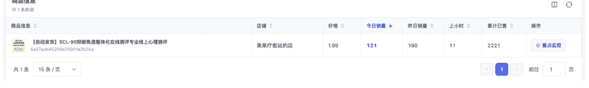
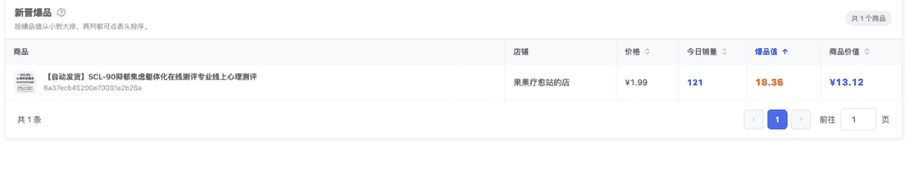
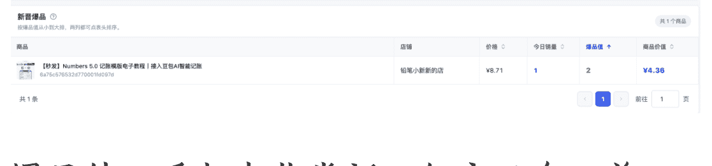
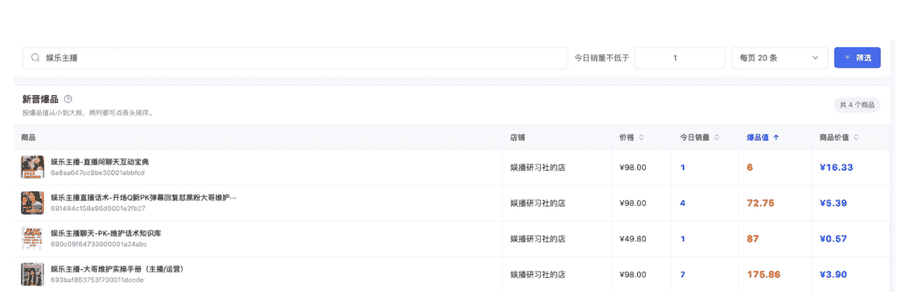
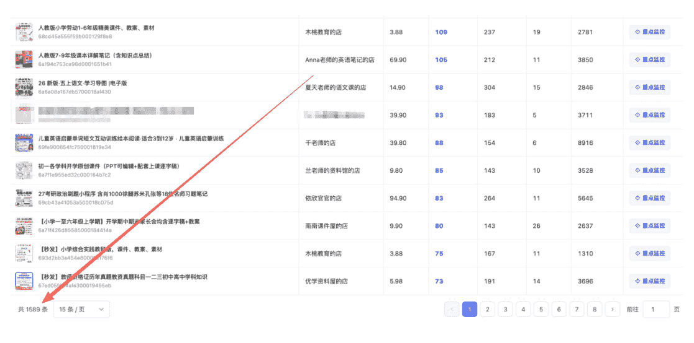
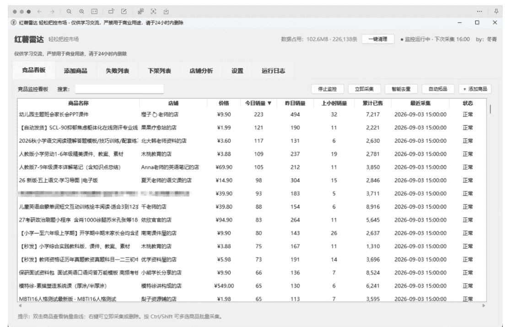

# 我是怎么把小红书虚拟资料的选品方法做成了一套监控工具（附完整提示词）
## 我是怎样把小红书虚拟资料选品，变成一套可持续追踪的数据系统
- 260904 副业 SC 精华

> **小懒判断** ｜ 这套方法更适合已经做过小红书虚拟资料、经常被“累计已售几万”吸引，却无法判断该不该跟的人；如果你还没有完成第一单，只想找一个软件直接复制赚钱，暂时不建议使用。核心指标是“爆品值”：累计已售÷今日销量。数值越小，通常说明链接越新、近期增长越快。再结合“商品价值”——客单价×今日销量÷爆品值——进行排序，连续观察两小时左右，就能初步分辨是真起量还是偶然成交。需要注意的是：工具必须运行在一台长期在线的 Windows 电脑上，并且累计销量超过 1 万的商品无法进入监控池，很多老链接因此无法追踪。
大家好，我是龙哥，来自山东泰安，目前是一名个人创业者。
过去一年多，我一直在做小红书虚拟资料，主要依靠自然流量，月收入最高做到过 5 万左右。上一篇内容，我分享了如何从淘宝寻找产品，再去小红书匹配真实人群。
文章发布以后，不少圈友来找我交流：
有的人问，商品累计卖了几万单，现在还有没有机会？
有的人问，一个刚出现的链接，怎样判断它是真的开始增长，还是只是偶然出了几单？
也有人问，销量监控工具到底是怎么做出来的？不会写代码，能不能借助 AI 自己搭建？
所以这一篇，我准备把前文没有展开的部分补充完整。
前半部分，我会结合一些实际商品，说明我是怎样观察累计销量、近期销量、连续变化、售价等数据，并判断一个商品是否值得继续研究。
后半部分，则会拆解我做的一个小工具——“红薯雷达”。它的作用不是直接告诉你哪个商品一定赚钱，而是定期记录商品价格、累计已售和销量变化，让原本凭感觉的选品过程，变成一个可以反复验证的数据观察系统。
最后，我也会放出完整开发提示词，方便有需要的朋友交给 AI，尝试生成可运行的软件。
先把结论讲清楚：
> 一个商品累计卖得多，并不代表它现在仍然卖得好。真正值得优先观察的，往往是累计销量尚未特别夸张，但近期销量明显上涨，同时客单价、利润空间和内容复刻难度都比较合适的商品。
当然，这个工具只是辅助。
有了监控，不代表就能自动赚钱；有了 AI，也不代表创业难题就消失了。你依然需要持续观察市场、研究用户、制作资料、测试内容，并且根据自己的能力做判断。
## 一、为什么“累计已售”经常会误导选品
我们在寻找竞品时，很容易先看商品页面上那个醒目的数字。
累计已售 1 万、3 万、5 万，往往会让人下意识认为：
“这么多人买过，需求肯定已经被验证了，我跟着做应该不会错。”
但累计销量只能说明这个链接过去卖出去过很多份，无法证明它现在还保持着相同的成交速度。
我曾经观察过一个红包封面类商品。
春节期间，这类产品确实需求旺盛，而且利润空间不错。由于我自己也有相关资源，看到同行大量跟进时，确实产生过跟做的想法。
当时这个链接显示累计已售几万单，看起来非常像标准爆款。
但是放进监控之后，实际情况完全不同：它现在每天也许只有几单、十几单，偶尔才会突然多一些。那几万单，是很长时间积累出来的，甚至可能包含这个链接改品之前销售过的其他商品。查看历史评价还会发现，早期评价内容与现在的商品并不完全一致。
这就是只看累计销量的风险。
你看到的是一份历史总成绩，却不知道这些销量是在什么时候完成的，也不知道它当前是否还在增长。
例如，三个商品都显示累计已售 5000 单：
- 第一个用了两年，最近每天只有两三单；
- 第二个在近三个月保持稳定，每天几十单；
- 第三个两周前刚刚起量，现在每天能卖两三百单。
表面上，它们的累计销量相同，但商业机会根本不是一个级别。
如果目标是寻找正在上升、适合快速测试的新商品，我一定会优先关注第三种。
所以，选品不能只问：
“它过去卖了多少？”
还要继续追问：
“它最近到底卖得有多快？”
要回答这个问题，就不能只看某一个时间点的页面，而要把不同时间的累计销量保存下来，再计算相邻时间之间增加了多少。
这也是销量监控真正有价值的地方。
## 二、监控的重点不是数字，而是数字的变化
“红薯雷达”的逻辑并不复杂。
把需要观察的商品添加进去，程序运行在一台可以长期在线的 Windows 电脑上，每隔一小时读取一次商品公开信息，并将以下内容保存到本地数据库：
- 商品价格；
- 店铺信息；
- 累计已售；
- 采集时间；
- 采集状态。
假设某个商品上午 10 点累计已售 2203，11 点变成 2214，那么这一小时新增了 11 单。
如果继续持续记录，就可以计算出：
- 最近一个完整小时的销量；
- 当天截至当前时间的新增销量；
- 昨日销量；
- 一天内的出单高峰；
- 最近几天销量是在增长、稳定还是下降；
- 一个店铺的成交主要依靠单个商品，还是多个商品共同支撑。
程序真正保存的，不是单纯的“2214”，而是“2203 增长到了 2214”。
换句话说，它更像一名不会疲劳的记录员，每隔一个固定时间，帮你把页面上的关键数据抄下来。
不过，真正难的地方也在这里。
如果页面加载失败，不能直接记录成 0；如果接口超时，不能把请求失败当成销量归零；如果商品暂时下架，也不能和网络异常混为一谈。
否则一次采集失败，就可能让曲线从 2000 突然跌到 0，下一次恢复后又跳回 2000，系统就会凭空制造出 2000 单虚假销量。
因此，一个相对可靠的监控工具，至少要考虑：
- 快照数据；
- 整点基线；
- 失败重试；
- 商品下架识别；
- 累计销量回退处理；
- 历史最高值记录；
- 跨自然日统计；
- 数据库迁移；
- 采集状态标记。
这些具体要求，我会在后面的开发提示词里一并写出。
## 三、我重点关注的两个指标：爆品值与商品价值
当我们同时拥有“今日销量”和“累计已售”以后，就可以构建一些简单的筛选指标。
### 1. 爆品值
计算方式是：
**爆品值 = 累计已售 ÷ 今日销量**
这个数值越小，意味着今天的销量在累计销量中占比越高，商品越可能处在较新的增长阶段。
举个例子：
商品 A：
- 累计已售 10000 单；
- 今日销量 100 单；
- 爆品值 = 100。
商品 B：
- 累计已售 2000 单；
- 今日销量 100 单；
- 爆品值 = 20。
虽然两者今天都卖了 100 单，但商品 B 当天销量约占累计销量的 5%，商品 A 只有 1%。
如果这种速度可以延续，商品 B 更像一个刚刚进入增长期的链接。
换一种更直观的理解：
- 爆品值为 20，大约代表今日销量占累计销量的 5%；
- 爆品值为 100，大约代表今日销量占累计销量的 1%。
但爆品值也不能单独使用。
如果两个商品的爆品值都是 20，一个售价 1 元，一个售价 100 元，它们的收入潜力显然不一样。
### 2. 商品价值
所以我又加入了第二个指标：
**商品价值 = 客单价 × 今日销量 ÷ 爆品值**
也可以理解为：
**商品价值 = 客单价 × 今日销量 × 今日销量占累计销量的比例**
这个指标同时考虑了三件事：
1. 当前每天卖多少；
2. 当前销量占累计销量的比例；
3. 每单的客单价。
它更适合帮助我们解决一个问题：
> 我应该先研究哪一个商品？
但它不能直接回答：
> 这个商品最终能给我带来多少利润？
因为真实利润还受到内容制作成本、人工交付、售后压力、竞争程度、退款率和流量来源等因素影响。
## 四、通过一个真实商品理解这两个指标
我曾经观察过一个商品：
**【自动发货】SCL-90 抑郁焦虑躯体化在线测评专业线上心理测评**
当时监控到的数据大致如下：
- 价格：1.99 元；
- 今日销量：121 单；
- 昨日销量：190 单；
- 上一小时销量：11 单；
- 累计已售：2203 单。

先计算爆品值：
再计算商品价值：

接着看前一天的数据。
昨日销量为 190 单，按照 1.99 元的售价进行简单估算，单日模糊销售额接近 400 元。
虚拟产品不需要实物库存和物流配送，通常也没有太高的单份交付成本。因此，只要产品能够稳定成交，并且售后压力可控，这样的销量就具备一定利润想象空间。
我之所以会关注这个商品，主要有几个原因：
第一，累计销量还只有 2000 多单，并没有达到特别夸张的程度；
第二，单日销量却已经接近 200 单；
第三，前后几天仍然在持续成交，而不是只有某一天突然爆发。
简单按照每天 200 单估算，累计 2000 多单大致相当于十天左右的销售量。真实情况当然不可能每天完全一致，但至少可以判断：这个链接近期增长很快，并不是靠几年时间慢慢积累出来的老商品。
累计 2203 单，按照 1.99 元计算，历史模糊销售额约为 4384 元。
这个金额本身并不算特别惊人，但它验证了更重要的一件事：
确实有人愿意为这类即时测评产品付费，而且当前仍然在连续产生订单。
对选品而言，这种正在发生的成交证据，通常比一个累计销量几万、现在每天只卖几单的老链接更有参考意义。
## 五、爆品值很低，也不一定代表真正起量
这个公式虽然简单，但绝对不能机械套用。
例如，我还看到过一个 Numbers 记账模板：
- 售价：8.71 元；
- 今日销量：1 单；
- 爆品值：2；
- 商品价值：4.36。

爆品值为 2，看起来非常“新”。
但它只有 1 单成交。累计已售从 1 变成 2，就能得到一个非常漂亮的比例。这个结果可能意味着产品刚刚产生第一单，也可能只是一次随机成交，证据强度很弱。
另一个商品是“娱乐主播直播间聊天互动宝典”：
- 售价：98 元；
- 今日销量：1 单；
- 爆品值：6；
- 商品价值：16.33。

客单价把商品价值推高了，但一天只有 1 单，仍然不足以证明它已经稳定起量。
当然，如果继续查看它的店铺，发现其他商品也在持续成交，那么判断就不能只盯着单个链接，而需要结合店铺整体情况分析。
因此，当我发现一个商品爆品值很低时，还会继续核对以下三点：
### 第一，绝对销量够不够
一天 1 单和一天 100 单，即使爆品值相同，可信度也完全不同。
### 第二，增长是否持续
连续三天、七天都在增长，比某一天偶然增加几单更有价值。
### 第三，是否拥有完整自然日数据
如果程序是下午才启动，那么“今日销量”可能只是下午到当前时间的新增量，不能直接和拥有零点基线的完整自然日进行比较。
所以，对每天只有一两单的商品，我通常会继续观察，而不是马上做决定。
只有当一个商品每天能够稳定成交几十单甚至上百单，并且连续几天保持，我才会明显提高它的优先级。
## 六、商品价值高，也不意味着你应该马上复制
按照商品价值从高到低排列新晋商品时，我看到过几种很有代表性的情况。
例如：
- “素描塑造系统课”：售价 549 元，今日销量 59 单，爆品值 105.68，商品价值 306.51；
- “人教版 7—9 年级课本详解笔记”：售价 69.90 元，今日销量 94 单，爆品值 40.84，商品价值 160.88；
- “幼儿园主题班会家长会 PPT 课件”：售价 9.90 元，今日销量 191 单，爆品值 37.62，商品价值 50.27；
- “艺术美学体验”：售价 635 元，今日销量 2 单，爆品值 27.5，商品价值 46.18。
这些例子说明，商品价值可以把不同价格、不同销量的商品放进同一个排序框架里。
不过，它只适合完成第一轮筛选。
549 元的素描系统课，商品价值最高，但爆品值已经超过 100，说明它可能不是刚刚出现的链接。它更适合用来研究高客单课程如何包装、怎样建立信任，而不一定是最适合立刻跟进的新品。
9.90 元的幼儿园 PPT，虽然客单价不高，但每天有 191 单，目标群体清晰，内容形式也比较直观。如果你擅长制作教师资料，它反而可能更适合快速测试。
所以，最终选择不能只看公式，还要看：
- 你是否拥有对应资源；
- 内容是否能完成；
- 是否具备快速交付能力；
- 产品能不能做出差异；
- 售后是否会消耗大量时间。
例如，有些视频系统课程虽然数据不错，但制作周期长、成本高、复刻难度大，即便指标漂亮，也不一定适合个人创业者。
## 七、我会用四类模型给商品排序
把爆品值和商品价值结合起来，可以先将商品划分为四种类型。
### 第一类：爆品值低，商品价值高
这通常是我最先研究的一类。
它往往意味着：
- 链接相对较新；
- 当前销量不错；
- 客单价或整体销售效率较高。
但“优先研究”不等于“直接复制”。
我还会继续查看商品内容、评价时间、店铺历史、笔记结构、售后难度，以及自己是否有能力做出差异。
### 第二类：爆品值低，商品价值低
这类商品可能刚刚出现增长，但客单价偏低，或者绝对销量还不够。
它们适合放进观察池。
有些低价产品可以作为引流款，再通过组合包、定制服务或升级版本提高客单价；另一些则可能只是偶然成交，实际利润空间有限。
### 第三类：爆品值高，商品价值高
这类商品通常已经比较成熟，但当前仍然有较好的成交表现。
它们更适合用来研究成熟模型：
- 用户为什么购买；
- 产品如何包装；
- 内容如何建立信任；
- 店铺如何设计关联商品。
如果想直接跟进，就必须考虑竞争是否已经激烈，以及你是否能做出明显区别。
### 第四类：爆品值高，商品价值低
这类商品可能历史销量很好看，但现在动销较弱，客单价也不高。
除非它与你的资源高度匹配，或者可以作为店铺配套产品，否则通常优先级最低。
需要注意的是，商品不会永远停留在某一类。
今天可能属于第一类，七天后可能因为销量下降进入第三类。监控的价值，就是让你根据新的数据持续调整判断，而不是一直停留在第一次看到它时的印象里。
## 八、公式之外，我还会做四层人工判断
数据只能帮我缩小范围，真正决定做不做，仍然需要人工分析。
### 1. 我能否完成并交付产品
看到一个商品卖得好，只是看到了结果。
真正开始制作时，还要考虑：
- 是否需要录制视频；
- 是否需要复杂排版；
- 是否需要长期更新；
- 是否需要大量人工服务；
- 是否存在较高的时间和资金成本。
如果做不出来，或者制作周期太长，数据再好也没有意义。
### 2. 现有产品是否存在优化空间
跟品不等于照搬。
我会重点查看竞品差评、评论区追问，以及商品页面中没有解决的问题：
- 目录是否混乱；
- 内容是否不够完整；
- 有没有可编辑版本；
- 是否能针对更精准的人群重新设计；
- 能否升级成网页工具、小程序或定制服务。
很多机会都藏在这里：
> 已经有人愿意购买，但现有商品还不够好用。
如果竞品只有 10 万字，你能不能做出真正有结构、有使用体验、解决问题更彻底的版本？这才是差异化的起点。
### 3. 价格和利润结构是否成立
低价不一定不好，高价也不自动代表高利润。
低价商品要研究能否跑量；高价商品则要承担更高的信任成本、更长的成交周期和更高的用户预期。
我更关注单位时间的回报。
一天卖 100 单，但每一单都需要人工服务十分钟，可能比一天卖 20 单、能够自动交付的商品更辛苦。
### 4. 数据是趋势，还是短期波动
开学资料、考试资料、节日模板、红包封面，都可能出现明显的季节性。
一个商品突然上涨，可能是长期需求正在形成，也可能只是节日前后的短暂集中成交。
因此，越是季节性强的商品，越需要观察：
- 过去几天的销售曲线；
- 用户搜索时间；
- 需求窗口长度；
- 产品准备和交付周期。
如果等你把产品做好，需求窗口已经关闭，那么之前再漂亮的数据也没有实际价值。
## 九、从发现线索到决定生产，我通常这样做
我的候选商品不会只来自一个渠道。
日常刷小红书时看到的商品、同行店铺、搜索联想、评论区需求、淘宝 MCP、**赚钱的风向标（有人发了你就监控一下，也许有一天就能用上）**，以及小红书后台商机板块中推荐的电子资源，都会成为我的线索来源。
看到一个商品后，我还会继续查看它所在店铺的其他商品，再从关联商品扩展新的关键词。
这些线索会先进入选品库，而不是马上投入制作。
下一步，我会进行人工初筛：
- 小红书上是否有对应人群；
- 是否存在真实竞品；
- 产品形态是否能够交付；
- 我是否具备做出差异的能力。
通过初筛后，才会把商品添加到销量监控中。
监控数量也不能无限增加。
商品太多，不仅会增加采集压力，还容易让自己陷入一种“每天看了很多数据，却没有真正生产产品”的假忙碌状态。
我更倾向于维护一个规模适中、能够持续观察、定期淘汰的候选池。
一般来说，我会先观察 3—7 天：
- 爆品值持续偏低；
- 商品价值较高；
- 每天有足够的绝对销量；
- 连续几天没有明显衰退。
符合这些条件的商品，会进入第一梯队，我开始进一步拆解产品和内容。
如果数据忽高忽低，就继续观察。
如果累计销量很高，但当前几乎没有成交，或者确认只是老链接改品，就降低优先级。
进入第一梯队后，我会研究同行已经验证过的内容，但不会逐字照抄，而是分析：
- 选题；
- 封面；
- 内容结构；
- 用户痛点；
- 成交场景；
- 评论区需求。
然后结合自己的资料重新创作，用少量笔记快速测试。
如果测试有数据，就继续优化产品、增加内容，甚至扩展更多账号。
如果没有数据，则要进一步判断问题来自哪里：
- 选品不对；
- 内容表达不对；
- 封面点击不足；
- 账号状态不佳；
- 商品本身不适合当前人群。
确认方向不成立后，就及时停止。
整个流程可以概括成：
**“值得做”的人，最终仍然是我自己判断。**

到现在，我的选品库里仍然有 1000 多个商品，其中还有不少值得继续研究。
## 十、公式与经验，应该如何配合
坦白说，我现在做选品，依然离不开经验。
真实经营中，有很多因素无法被两个指标完全表达。
但是，经验也有一个问题：它往往很难被清晰描述，更难被重复执行。
爆品值和商品价值的作用，不是替代经验，而是给经验增加一层可验证的筛选机制。
它们可以帮助我：
- 少被“累计已售几万”误导；
- 更早发现正在起势的新链接；
- 减少在长期不动销的老商品上浪费时间；
- 用相对统一的标准维护候选池。
但最后是否值得做，仍然要回到产品本身、用户需求、竞争环境和个人交付能力。
工具负责记录变化，指标负责缩小范围，经验负责做最终决策。
持续观察、持续学习、持续测试，才是这套方法真正有效的原因。也许某一天，当你回头看自己的选品库时，也会忍不住感叹：
“原来这种东西，真的也有人愿意买。”
关于挑品的判断，我现在更习惯用三条线索来交叉核对。
第一条是消费线索：这个东西是真的有人在买，而且近期的购买节奏还在保持；第二条是内容线索：平台上持续有人在做相关内容，并且笔记的曝光能够维持一段时间；第三条是自有能力线索：我有办法把成品质感拉到合格线，同时也能稳定地输出内容。
三条线索都成立，才值得把资源压上去。
如果只有销量数据而没有内容导流入口，这个品大概率不适配小红书的玩法；如果内容很火但转化的效果很差，往往只是大家爱看不爱买；如果只是自己会做却缺乏市场反馈，最后容易做成一份没人要的资料。
我会用计算把消费线索的信号放大，而内容线索和能力线索更多依赖人工补齐。另外在软件里我也加上了 MCP 接入，让 AI 能直接读到正在监控的选品库，结合你的个人画像和擅长方向来做分析和推荐，实践下来效率提升比较明显。
谈到销量追踪工具，很多人的第一反应是：我不会写编程，这事跟我没关系。
其实在 AI 编程的背景下，把东西原型化已经不再是最大障碍，真正难的是把自己的逻辑表达清楚。
如果你只对模型说“帮我做一个小红书销量监控工具”，它大概率会回你：没有授权就无法获取小红书数据。就算继续往下做，给出的也可能只是界面好看、数据来源不可靠的演示版本。
所以上手前最好先把思路理顺。至少要明确数据从哪里抓取、需要保留哪些字段、采集频率怎么定、如何用两次累计值推算增量，以及在抓取失败、下架、跨天场景下该怎么处理。
我过去用过另一个基于 MySQL 的自用版本，大量规则都是写给自己看的，并没有整理成对外说明。上一篇笔记的投锚反馈比较多，也收到不少人询问实现细节，于是我重新梳理了一遍，把实际踩坑和解决思路整理进了现在的指令集，也算回馈大家的支持。
这份指令涵盖了技术选型、商品录入、字段采集、定时任务、异常兜底、销量推算、竞品看板、店铺洞察、企业微信推送、只读 MCP 接口、Windows 可执行包等模块。
里面很多细节都是在真实使用中补上的。比如工具在 09:35 启动，不应该把 09:35 当作一次正式快照，而要等到 10:00 再记第一笔；21:00 的任务如果拖到 22:00 仍未完成，也不能让旧任务堆积；抓取失败时不能写一个虚假的 0；新读到的累计值如果低于历史峰值，也不能凭空造出负增长。
现在整套开发指令已经整理完毕，使用方式很直接：直接复制整段指令给能够写代码并运行的 AI 即可。
注意我目前只做了 Windows 环境，复制时请用 Ctrl+C、Ctrl+V，不要用 Command 系列快捷键。Mac 用户可以在此需求基础上让 AI 自行改造。
这份指令肯定不完美，我只能解决已经遇到的坑，无法预知所有电脑上的特殊情况。它也不可能一次就生成一个完全能用的产品，通常需要看报错、调试，然后让 AI 迭代修改。界面、数据库、采集方式或某个功能如果不满意，也可以直接提需求让 AI 在现有项目上继续调整。
我无法预判你运行时会碰到什么具体问题，但处理思路是固定的：把现场现象和完整报错贴给 AI，让它定位、修改、重新运行。不要看到一堆代码就默认完工了。
AI 编程的本质不是许愿，而是先把思路讲明白，再在真实使用中反复打磨。
拿到完整指令后，AI 的目标不再是写一份方案，而是直接生成一个可运行的项目组。
理想交付物包括 Python 源码、本地 SQLite 存储、Windows 可视界面、定时采集、重试机制、企业微信消息、只读 MCP 服务、说明文档、打包脚本、PyInstaller 配置，以及双击即可运行的单文件 EXE。
使用流程很清晰：
1. 将商品的分销口令、短链、完整链接或 24 位 ID 录入软件；
2. 在一台 24 小时在线的 Windows 机器上运行；
3. 程序按自然时间点每小时记录一次累计销量和价格；
4. 通过相邻快照推算每小时、当日、昨日及历史销量；
5. 用爆品指数和商品价值对候选品进行排序；
6. 把值得深入研究的品加入重点监控，再结合店铺和内容做人工判断。
指令里还要求提供只读 MCP 服务，这样以后支持 MCP 的 AI 就能直接查询本地数据，回答诸如“今日增长最快的商品”“销售额最高的店铺”“某商品过去七天是否在加速”等问题。

最终跑出来的样子可能跟示例一致，也可能大不一样，这主要取决于你用的模型。
## 红薯雷达完整开发提示词
下面是我重新整理后的完整提示词，可直接复制使用。
### 红薯雷达完整开发提示词
### 完整提示词
```text
# 红薯雷达：Windows 桌面软件完整开发提示词
请直接为我开发并交付一套完整可运行、可打包、可分发的 Windows 桌面软件。不要只输出产品方案、界面示例、伪代码或零散片段；请创建完整项目文件，运行调试，修复错误，并在环境允许时打包出双击即可运行的 EXE。
**软件定位：** 监控用户主动添加的小红书公开商品，定时记录商品累计已售、价格、店铺等公开信息，通过相邻快照计算商品和店铺的小时销量、今日销量、昨日销量与历史趋势。所有业务数据保存在本机 SQLite 数据库中。
> **执行要求：** 请严格按照下面的规格一次性完成。
## 一、交付目标
*交付内容至少包括：*
1. 完整 Python 源码。
2. SQLite 数据库初始化与自动迁移代码。
3. Windows 桌面图形界面。
4. 定时采集与三级采集兜底逻辑。
5. 企业微信机器人通知。
6. 只读 MCP 数据服务。
7. `requirements.txt`。
8. `README.md`。
9. 一键打包脚本 `build.bat`。
10. PyInstaller `.spec` 文件。
11. 最终无控制台黑框的单文件 EXE。
代码必须是可维护的正式实现，不要把所有功能堆在一个巨大函数里。建议将界面、数据库、采集、统计、通知、MCP 拆分成独立模块；如果为了便于分发选择少量文件，也必须通过类和函数清晰分层。
## 二、技术栈
- Python 3.11 或 3.12。
- GUI：Tkinter + ttk，禁止依赖需要单独安装运行环境的前端框架。
- 数据库：SQLite，开启 WAL 模式，所有表都要自动创建，旧数据库缺少字段时自动迁移。
- HTTP：标准库 `urllib.request`，可使用系统 `curl.exe` 作为补充请求方式。
- 浏览器兜底：Playwright。优先使用系统 Chrome，其次 Microsoft Edge，最后使用 Playwright Chromium。
- 图片：Pillow，用于商品主图缩放与展示。
- 打包：PyInstaller， `--onefile --windowed`，运行时不得出现命令行黑框。
- 时间口径：全部使用 `Asia/Shanghai`。
- 软件首次运行自动在 EXE 同目录生成 `monitor.db` 和必要的数据目录。
- 所有外部进程在 Windows 下都要使用 `CREATE_NO_WINDOW` 或等价配置，避免采集时反复闪现黑色命令窗口。
## 三、商品输入和解析
**“添加商品”必须同时支持以下四种输入：**
1. 小红书分享口令，例如包含标题、表情、短链和提取码的一整段文字。
2. `xhslink.com` 短链。
3. 完整商品链接，例如 `https://www.xiaohongshu.com/goods-detail/商品ID?...`。
4. 单独输入 24 位十六进制商品 ID。
还必须支持批量导入：文本框中一行一个，可混合放入口令、短链、完整链接和商品 ID。
**解析规则：**
- 优先用正则从整段文字中提取 `/goods-detail/` 后的 24 位 ID，或者直接提取独立的 24 位十六进制字符串。
- 短链需要跟随重定向，再从最终地址或返回页面中提取商品 ID。
- 商品 ID 统一转成小写。
- 批量导入时按 ID 去重，已经存在的商品跳过并计入“重复”。
- 单个添加时，先采集并展示商品名称、店铺、实际价格、累计已售，再弹窗让用户确认是否加入。
- 批量添加结束后显示：成功、待采集、下架、重复、超过销量上限、无效输入各有多少个。
## 四、商品详情接口和字段解析
> **商品接口：**
> 从 `data.template_data[0]` 中解析：
- 商品标题：优先 `descriptionMain.name`，回退 `descriptionH5.name`。
- 店铺名称：`sellerH5.name`。
- 店铺 ID：`sellerH5.id`。
- 商品主图：`carouselH5.images[0].url`，以 `//` 开头时补 `https:`。
- 累计已售：`priceH5.itemAnalysisDataText`，支持“已售 123”“1.2 万”“1.2w”等格式。
- 店铺累计销量：`sellerH5.salesVolume`。
- 实际购买价格：优先 `priceH5.dealPrice.price`，其次 `bottomBarMainH5.dealPrice.price`，再次 `priceH5.highlightPrice`。不能用优惠前原价覆盖实际到手价。
- 粉丝数：`profitBarPopupH5.follow.fansNum` 或 `sellerH5.fansAmount`。
- 库存状态：`carouselH5.stockStatus`。
- 是否可配送：`bottomBarMainH5.deliveryInfo.ableToDelivery`。
只有当接口明确 `success=true`、`template_data` 完整存在时，空的已售字段才可以解释为真实 0。请求超时、状态码异常、返回体不完整、页面未加载、JSON 解析失败、元素缺失或安全校验时，绝对不能用 0 代替，应判定本次采集失败，不保存假快照。
累计已售按高水位处理：统计时取历史可信累计值的最大值，防止偶发读取变小造成虚假负销量。若新读数小于历史高水位，本轮不应用这个较小值计算销量。
累计已售超过 10000 的商品不支持监控：添加时直接提示并跳过；存量商品一旦明确超过 10000，移出监控，停止继续请求。
## 五、三级采集策略
每个商品必须严格按以下顺序独立执行，不允许先把全部商品都走完第一种方式再统一走第二种方式：
1. 轻量接口直采。
2. 当前商品直采失败后，立即使用静默浏览器采集。
3. 静默浏览器仍失败时，立即使用可见浏览器兜底。
4. 当前商品完成后，下一个商品重新从轻量接口直采开始。
### 静默浏览器要求
- 使用 Playwright 持久化 Context。
- `headless=True`，不显示窗口。
- `locale=zh-CN`，`timezone_id=Asia/Shanghai`。
- 设置合理 viewport。
- 整轮任务复用同一浏览器上下文，不要每个商品新开一个浏览器进程。
- 优先在浏览器中直接打开商品接口；接口无完整数据时再打开商品详情页，让页面建立正常会话后重新读取接口。
### 可见浏览器要求
- 只作为最后兜底。
- 每次进入可见兜底前创建新的临时 Profile，避免长期受限的旧环境一直失败。
- 打开该商品详情页，再读取商品接口。
- 当前商品成功或明确失败后关闭窗口，继续下一个商品。
- 默认逐个商品处理，不要一次打开多个页面。
- 临时 Profile 使用完后安全清理。
浏览器不可用时，要明确提示用户安装最新版 Chrome 或 Microsoft Edge，不能直接崩溃。
请求之间默认随机等待 0.1~0.3 秒，并允许在设置页修改为 0.1~60 秒。使用随机区间而不是固定值。
## 六、异常分类、重试和熔断
必须区分“临时失败”“风控”“明确下架”，不能混在一起。
1. HTTP 500、连接超时、连接重置、DNS 临时错误、`Network.getResponseBody`、`Execution context was destroyed` 等属于临时错误。首轮先继续采集其他商品，在整轮结束后等待 5~15 秒，再统一重试一次。
2. HTTP 461 属于请求环境受限。单轮连续出现少量 461 时记录；达到阈值后立即停止继续请求，把未完成商品加入队列，冷却 15 分钟后自动续采，禁止高频循环重试。
3. 自动重试成功后应从失败列表移除，并照常生成本地数据和企业微信时报。
4. 一个商品失败不能卡死整轮任务，除非触发全局 461 熔断，否则必须继续下一个商品。
5. 所有错误都要捕获并写入运行日志，界面线程不能因为后台异常退出。
## 七、下架识别和下架列表
三种采集路径都必须识别下架：轻量接口、静默浏览器、可见浏览器。
### 明确下架特征包括：
- JSON 中购买按钮 `type=unBuyableGoShop`。
- 页面或接口文字包含“已下架，进店逛逛”“当前商品已下架”“商品不存在”“商品已失效”等明确状态。
- 页面包含“当前商品违规，无法展示”、`item freeze` 等违规状态。
不要仅凭网络错误、空白页面或超时判定下架。只有出现明确业务特征才能转入下架列表。
### 确认下架后：
- 设置商品 `active=0`。
- 记录 `delisted_at` 和 `delisted_reason`，原因区分“商品已下架”和“违规下架”。
- 清除普通失败状态。
- 保留该商品原有历史销量快照。
- 从竞品看板、店铺分析和以后所有采集任务中排除。
- 继续采集下一个商品，不能停在当前商品。
“下架列表”位于“失败列表”旁边，表格列为：商品名称、店铺、商品 ID、下架时间、下架状态。双击可查看下架前的单品历史数据。
## 八、定时任务和整点规则
- 默认采集周期 60 分钟。
- 用户在非整点击击“开始监控”后，不立即把该时刻当正式整点；例如 09:35 启动，第一次正式采集为 10:00，下一次 11:00。
- 支持修改周期，但必须按自然时间边界调度。
- 每轮采集使用该轮整点作为统计归属时间。
- 如果 21:00 轮次尚未完成，时间已经到 22:00，必须停止 21:00 剩余任务，立即切换到 22:00 轮次；不得让旧任务无限积压。
- 同时只能运行一轮采集，使用线程锁避免“定时采集”和“立即采集”重叠。
- GUI 必须保持响应，所有网络和数据库重任务放在后台线程，界面更新通过主线程调度。
## 九、SQLite 数据结构
至少建立以下表:
```sql
CREATE TABLE products (
id TEXT PRIMARY KEY,
title TEXT NOT NULL,
shop_name TEXT,
shop_id TEXT,
cover TEXT,
active INTEGER DEFAULT 1,
created_at TEXT,
last_error TEXT,
delisted_at TEXT,
delisted_reason TEXT
);
CREATE TABLE snapshots (
product_id TEXT,
captured_at TEXT,
sold INTEGER,
shop_sold INTEGER,
price REAL,
fans INTEGER,
stock_status INTEGER,
deliverable INTEGER,
PRIMARY KEY (product_id, captured_at)
);
CREATE INDEX idx_snapshots_product_time ON snapshots (product_id, captured_at);
CREATE TABLE settings (
key TEXT PRIMARY KEY,
value TEXT NOT NULL
);
CREATE TABLE logs (
id INTEGER PRIMARY KEY AUTOINCREMENT,
timestamp TEXT,
level TEXT,
source TEXT,
product_id TEXT,
product_title TEXT,
message TEXT,
error_details TEXT
);
CREATE INDEX idx_logs_time ON logs (timestamp);
CREATE TABLE deleted_products (
product_id TEXT PRIMARY KEY,
deleted_at TEXT
);
```
- 为商品和时间建立索引。
- 记录用户主动删除的商品 ID 和删除时间，避免自动拓品时马上重新加入。
- 数据库操作要使用参数化 SQL，设置合理超时，开启 WAL。软件升级时通过 `PAGMA table_info` 检测并补充新字段，不能要求用户删除旧数据库。
## 十、销量统计口径
所有销量都由累计已售快照的差值计算，不能把累计已售直接当作当日销量。
- 今日销量：当前可信累计已售减去今日 00:00 的累计高水位。
- 昨日销量：今日 00:00 累计高水位减去昨日 00:00 累计高水位。
- 上小时销量：当前整点累计高水位减去上一个完整整点小时的基线。
- 某日销量：次日 00:00 累计高水位减去当日 00:00 累计高水位。
- 当日每小时销量：相邻整点累计高水位差值。
- 0 点快照既是前一天结束值，也是新一天基线，不能重复计入两天。
- 若软件当天中途才开始监控，没有 00:00 快照，可以使用当天第一条真实成功快照作为起始基线，但界面要允许显示为不完整口径。
- 缺少足够基线时显示“—”，不要伪造 0。
- 确认两个真实快照累计值相等时，销量增量才显示 0。
- 模糊销售额：销量增量 × 当时实际价格，并明确标注“模糊试算，不代表真实成交额”。
- 所有统计函数都应处理跨日、0 点、缺少快照、重复快照和累计值偶发回退。
## 十一、桌面界面总体风格
采用简洁、克制、清晰的 Windows 桌面工具风格：
- 默认窗口 1280×780，最小 1050×650。
- 字体优先 Microsoft YaHei UI。
- 浅灰白背景，绿色作为主强调色，红色仅用于错误或风险。
- 表格标题清晰、行高约 34、列宽合理，支持横向和纵向滚动。
- 不做花哨动画，优先信息密度和操作效率。
- 紧邻标题区域显示：仅供学习交流，严...
```
仅供个人研究使用，下载后请于24小时内彻底删除。
界面右上角会持续显示数据库占用的空间、当前进程是运行还是空闲，以及下一次抓取数据的预计时间点。
右上角的 by：冬青 是个可点击的链接，点开后进入作者主页：https://scys.com/personal/3941891?number=201255&tab=posts。
导航栏采用横向页签，排列顺序不可调整：
1. 竞品观测面板
2. 录入商品
3. 抓取异常清单
4. 已下架清单
5. 店铺维度分析
6. 参数配置
7. 运行记录
## 十二、竞品观测面板
面板顶部左侧放着“竞品观测面板”的标题和查找输入框；右侧的控制按钮从右往左依次是：录入商品、自动发现新品、智能去重、立即抓取、启动/暂停监控。
表格包含以下列：
商品名称、卖家店铺、实时售价、当天成交件数、前一日成交件数、上一个整点成交件数、历史累计成交、最近成功抓取的时间、状态。
交互规则：
搜索框输入时即时过滤，匹配范围覆盖商品名、店铺名和商品编号。
当天、前一日、上一小时和历史累计四列支持点击列头排序，再次点击可在升序和降序之间切换；初始状态按当天成交件数降序呈现。
双击任意一行会调出该商品的详细数据弹窗。
鼠标右键弹出菜单，里面有“查看详情”“立即重新抓取所选”“从列表移除”。
通过 Ctrl 或 Shift 可以同时选中多行，并一起发起抓取。
移除前必须弹窗确认；一旦移除，该商品连同所有历史数据都会被清掉，以后也不会再进入抓取队列。
状态取值规则：还没有过一次成功抓取时显示“待抓取”；最近一次抓取报错显示“异常”；正常完成则显示“正常”。
页面顶部不添加任何概览统计卡片，把尽可能多的空间留给商品表格。
## 十三、智能去重
“自动发现新品”按钮旁边放置“智能去重”入口。
以下所有条件同时成立时，才判定为重复：
1. 来自同一卖家店铺。
2. 商品标题经过清理和标准化后完全一致。
3. 历史累计成交数相同。
4. 上一小时成交数相同。
5. 商品编号互不相同。
6. 售价存在差异。
每组重复候选中仅保留标价最高的那个，其余候选会先弹出预览窗口，用户确认后才删除。假如任意关键字段的值是“---”，该商品不参与去重判断，以免错误清除。
## 十四、自动发现新品与同店商品探索
> 功能限制：目前此能力已失效，小红书已不支持在未登录状态下通过电脑浏览器查看店铺商品。
当某个主商品成功加入监控后，程序会根据 shop_id 进入对应店铺主页，分析店铺内挂出的其他商品。店铺卡片有时会同时给出 itemId 和 skuId，请求详情时优先采用 skuId。
点击“自动发现新品”后执行的操作：
1. 把当前监控列表涉及的店铺按去重后的集合遍历一遍。
2. 读取店铺对外展示的在售商品。
3. 剔除那些已经纳入监控、已被删除、已被下架或者本次判定为重复的商品编号。
4. 为剩余的新品抓取名、店名、销量、售价、封面图。
5. 打开选择窗口，每行显示勾选框、标题、店铺名、销量、价格、商品编号。
6. 可以单个选，也可以全选/取消全选，还能把勾中的商品一次性加入监控。
7. 单独加入某个商品时，如果店里还挂着别的未被监控商品，会给出“店铺还发现了其他 X 个商品”的提示，并列出名字和价格，让用户自己决定要不要一起加。
8. 某个店铺扫描失败时，只把这家店标为失败，整个自动发现流程照常继续。
## 十五、抓取异常清单
这个清单只收临时性抓取报错和环境异常，明确显示已经下架的商品不放在这里。
表格列为：商品名称、店铺、商品 ID、最近一次失败时间、失败原因。旁边提供按钮：全选、重试所选、忽略所选但保留监控、删除所选、刷新。
所有动作既支持单条也支持批量。
重试成功之后，这条记录会立刻从异常清单中移除，商品恢复正常。
如果重试后发现商品已明确下架，就转入下架清单。
“忽略”只是消除当下的错误提示，下一轮抓取时该商品仍会继续尝试。
“删除”则是把商品和它的历史数据整体移除，以后再也不会抓取。
双击清单里的失败商品，也能查看它已有的历史数据。
## 十六、店铺维度分析与单品详情弹窗
店铺分析的入口以卖家店铺为视角，而不是以某个商品为根页面。
顶部是店铺下拉选择器。选定某家店之后，会显示：店铺名、正在监控的商品数、累计成交数、当前查看的时间范围。
时间切换逻辑：
选取任意具体日期，可以看到那一天按小时拆分的成交曲线和明细列表。
“近 7 天”快捷键给出最近七个自然日各自的成交量。
“近 10 天”快捷键给出最近十个自然日各自的成交量。
下方左右分成两块：
左边是成交明细：时间点、成交增量、模糊销售额。
右边是该店铺中被监控商品的总览：商品标题、当天成交、实时价格、累计成交、商品编号。默认按当天成交量由高到低排列。
双击某一商品，打开模态弹窗。
单品弹窗里包含：
商品主图。
商品名、店铺、商品编号。
当前真实售价、历史累计成交。
日期选择控件、近 7 天和近 10 天快捷键。
当天按小时的成交折线图。
多天按日的成交折线图。
明细数据及模糊销售额。
如果图片加载不出来，展示占位区域，其他内容不受影响。
## 十七、企业微信机器人提醒
设置界面提供：Webhook 地址输入栏、启用勾选框、发送测试通知按键、选择通知店铺按键、当前状态文字。
点击“选择通知店铺”会弹出店铺勾选窗口，里面支持全选、取消全选、搜索和保存。只有被打勾的店铺会在推送范围内，未选择的店铺不会收到任何推送。
每一轮正式抓取完成后，系统推送一次店铺成交播报，按上一小时成交量从高到低排列。示例格式：
```
12 点店铺销量时报
08 月 17 日 12:00 - 12:59
XXXXXXX 的店
上小时销量：22 单
今日总销量：24 单
XXXXXXX 的店
上小时销量：16 单
今日总销量：20 单
```
前三名可以用奖牌样式，后面的店铺用普通序号。店铺名、上一小时成交、当天成交要分行写清楚；消息过长时程序会自动切分，绝不超出企业微信机器人单条消息的长度上限。
如果有抓取失败的商品，再额外推一条失败通知，内容包括时间、抓取方式、失败条目数量、商品名称、商品 ID 和报错原因。已经确定下架的商品不会被当作临时失败反复推送。
Webhook 地址必须要格式校验；推送失败只写进日志，不影响抓取数据的正常落地。
## 十八、参数配置页
配置页用纵向分组卡片排列，内容多的时候允许滚动。
第一组：监控参数
抓取周期间隔，默认 60 分钟。
每个商品之间的最小停顿秒数，默认 0.1。
最大停顿秒数，默认 0.3。
保存配置按钮。
打开浏览器处理验证码/人机校验按钮。
当前监控商品总数和预估一轮抓取需要等待的时间都会展示出来。
第二组：企业微信机器人提醒
按前一节说的来实现。
第三组：AI/MCP 数据读取
显示一段可以复制给 AI 的本地 MCP 配置使用说明。
提供“复制 MCP 配置说明”按钮。
明确注明 MCP 是只读模式，不允许对数据库进行修改。
## 十九、只读 MCP 服务
单独提供 mcp_server.py，使用 stdio 通信方式，以只读模式打开同目录的 monitor.db，不暴露任何增、删、改的工具。
至少需要提供以下工具：
list_shops：店铺清单、各自监控的商品数量、当天成交、上一小时成交。
list_products：商品清单，支持按店铺、关键词、状态过滤。
get_product_sales：查某个商品在指定日期的小时级销量，或取最近 N 天的每日销量。
get_shop_sales：查某个店铺在指定日期的小时级销量，或取最近 N 天的每日销量。
get_product_ranking：按当天、昨日、上一小时、累计、模糊销售额排名。
get_shop_ranking：按店铺的当天、昨日或上一小时销量排名。
search_products：按商品标题、店铺名、商品 ID 检索。
get_overview：总览数据，包括商品数、店铺数、当天销量、昨日销量、上一小时销量、数据截止时间。
所有结果都要带上统计口径和数据时间标记。MCP 查询和桌面端调用的是同一套统计函数，保证两边拿到的数字一致。
设置页生成的配置话术参考：
> 请帮我配置一个本地 MCP 服务器，名称设为 xhs-sales-monitor。服务器使用 stdio 通信，命令路径是： [这里自动填入红薯雷达 MCP.exe 或 mcp_server.py 绝对路径]。配置完成后请连接并调用 tools/list 验证。这个 MCP 用于读取我本机红薯雷达中的小红书店铺、商品、销量、销售额和排名数据；只允许读取，不要修改数据库。
## 二十、运行记录
运行记录必须持久化到 SQLite，重启软件也不丢。
记录字段：时间、级别、来源、商品、商品编号、摘要、完整详情。
界面要求：
按“全部、成功、失败、信息”四类筛选。
提供刷新按钮。
清空记录前二次确认。
支持导出 CSV。
双击任意一条记录查看完整异常堆栈，并且能复制。
商品抓取失败时，必须写下真实异常信息，不允许只写“失败”。
单次加载的记录条数要设上限，防止界面卡死。
## 二十一、本地数据占用与一键整理
右上角实时展示数据库大小和快照数量，示例：数据占用：19.1MB · 31,386 条。
一键整理功能：
默认只保留最近 90 天的销量快照。
每个商品额外保留一条更早的基线记录，保证清理后近期的销量依旧能被算出来。
日志默认保留 30 天。
随后执行 WAL checkpoint 和 VACUUM。
清理前二次确认，完成后给出删除的快照条数、删除的日志条数、保留的基线数量、释放的磁盘空间。
这项整理能力随时可用，不受其他开关状态影响。
## 二十二、稳定性与安全性要求
源码里不写入任何个人 Cookie。
浏览器 Profile、Cookie 文件和数据库一律存放在本机。
日志不得输出 Cookie 明文、完整 Webhook 地址或其他敏感信息。
所有后台线程的异常都必须翻译成用户能看懂的提示。
退出软件时尽量关闭 Playwright Context 和相关临时进程。
数据库写入全部放到事务里，避免中途退出留下脏数据。
图片下载、商品请求、推送通知都有超时控制。
任何单个失败都不能拖垮整个 GUI。
要正确处理长标题、空店铺、无封面、零销量、缺价格、跨日以及上海时区（与夏令时无关）等边界情况。
## 二十三、打包与项目文件结构
建议的目录结构：
```
red-potato-radar/
├─ app.py
├─ desktop.py
├─ collector.py
├─ database.py
├─ analytics.py
├─ wecom.py
├─ mcp_server.py
├─ requirements.txt
├─ README.md
├─ build.bat
├─ 红薯雷达.spec
└─ assets/
├─ app-icon.png
└─ app-icon.ico
```
可以按实际需要把某些模块合并，但功能点不许缩减。
打包要求：
主程序最终生成 红薯雷达.exe。
MCP 服务生成 红薯雷达 MCP.exe。
两个 EXE 放在同一个文件夹里，默认共用同一个 monitor.db。
主程序必须 console=False，抓取过程中不弹黑色控制台窗口。
打包时必须带上 Playwright 和它需要的资源。
目标电脑没有 Chrome 时，按 Chrome→Edge→Chromium 的顺序自动寻找可用的浏览器。
图标要同时出现在窗口、任务栏和 EXE 文件上。
打包完成之后要检查文件真实存在，并输出路径和大小。
**现在开始实施：**请立即动手搭建完整项目。第一步先检查当前工作目录是否已有现存文件或用户数据，全部保留；然后按顺序完成源码、数据库、GUI、调试和打包。不要只罗列计划，也不要做到一半就停下。遇到非关键的不确定之处，按以上规格做出合理假设并继续；只有当缺少必要的图标源文件时才可以用临时图标顶上，并在代码注释里标出替换位置。
### 十四、写在最后的话
上一篇文章发布后，有人问我：数据和工具都齐了，选品是不是就可以全自动？
我的判断依然是：不行。
工具能让我看到数据的变化，公式能帮我排出优先顺序，AI 能替我处理掉大量重复劳动，但“做这个人群到底有没有真实需求”“我能不能做得比已经在卖的更好”“等我做完了这个窗口还开不开”，这些始终要经营者自己做决定。
我做红薯雷达，不是想让一个算法分数替我押注，而是想把自己过去比较模糊的经验，变成可以验证、可以复查的账本。
以前看到一个累计几万单的商品，我第一反应是激动；现在我会先问：这个品昨天出了多少，今天出了多少，连续几天是在往上走还是往下走，评论区讨论的内容和现在这个版本是否匹配。
以前看到一个新品一天卖了一百单，我只觉得它“有点东西”；现在我会接着算它的爆品值、商品价值，拿到同类目里去横向比，再决定我有限的精力该往哪里投。
这大概是我现在最认同的 AI 用法：不是让 AI 替我做判断，而是让 AI 把我脑子里的判断流程，固化成一跑就能出结果的系统。
如果你正在做虚拟资料，不用急着把上百个商品一次性灌进去。先挑出 10 到 20 个你自己懂、也确实有把握做的商品，连续盯上一周。每天看它们的销量变化，再回到商品页、店铺页、笔记和评论区去对照信息。
你会发现，累计销量最高的并不代表当前最好的机会；真正值得放进监控的，往往是那些总销量还没高到人尽皆知、但最近几天已经在明显起量的款。
把这些商品一直存下去，你攒下来的就不只是一张榜单，而是一套和你自己的判断方式越来越契合的选品系统。
这一篇把上一篇文章漏掉的两块内容补全了：怎么用数据来看一个商品值不值得做，以及怎么把监控软件的需求完整地交给 AI。
如果你觉得这套做法有用，欢迎去赚钱给我投个锚。也欢迎带着你正在观察的商品来聊天。公式还能继续迭代，工具也能不断完善，但一切的前提，永远是先让真实数据被记录下来，再讨论下一步判断。
分割线
看到这里，你可能觉得 SOP 已经懂了，但九成的人实际操作时会卡在第一步。
工具和攻略只是最浅的壁垒，真正的壁垒是“立刻动手”和信息差。
我们不整虚的，只拆商业闭环、压榨 AI 效率。社群文件库里已经攒了 1000+ 跑通的套利实操案例。
- 查看完整数字资产与入群条件：
[https://lazys o.com/insider/](https://lazys o.com/insider/)


微信：