# 我给小学生，上了一堂 ChatGPT 课

我是龙哥，今天想聊聊不久前给小学生上的一堂AI课。

我们团队目前的重心，就是人工智能教育这块。我大学读的是计算机师范，教书也有三年了。今年年初那阵子，我第一次接触到ChatGPT和AI绘画，一边惊讶于技术进化之快，一边忍不住想：这些新东西能不能端进课堂，让小学生也沾点光？我一直认为，只要老师有巧思、教学环节排得好，AI完全能变成激发孩子科技兴趣的催化剂，也能让那些满脑子奇思妙想的娃，真正把脑洞落地成作品。

恰好这周，我们办了一场“硬核科技营”，带孩子进大学校园听课、逛实验室。科技营的主题和AI天然合拍，我索性在行程里塞了一堂AI体验课。

真正的难点在于：怎么讲，小学生才能听得懂、坐得住、有收获？我设计了六个环节——先聊AI、再见识魔镜、然后上手互动、一起搞创作、猜真假画、最后畅想未来。

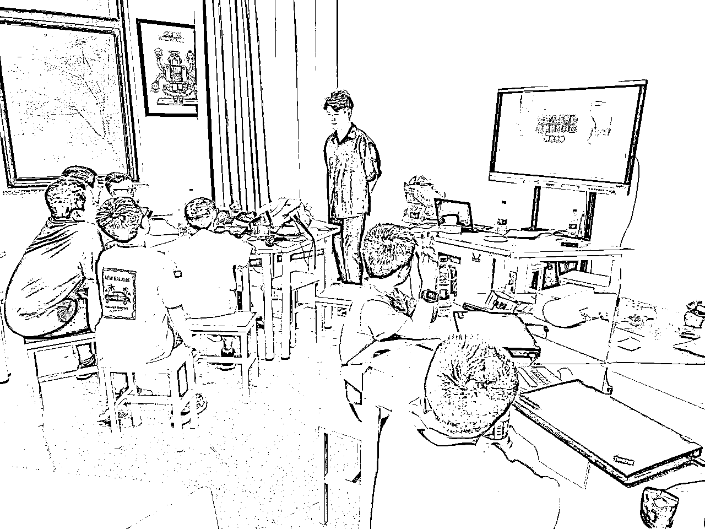

第一步：从生活里的AI聊起。

我抛出一个问题：你们在生活里见过哪些人工智能？孩子们七嘴八舌，Siri、自动驾驶、AlphaGo都被说出来了，还有人提到特斯拉和ChatGPT——现在小学生的信息量真不小。接着我把AI比作一个小孩：它也在不停学习，但学得飞快，而且记性好得惊人，几乎不会忘。我又补了一句：它不是有生命的物种，没有情绪，也不会像人类一样思考，本质上是一个高智商工具。就好比计算器能快速算出数学题，AI能搞定更复杂的事。

随后，我安排了一场“人机对战”，让孩子跟AI下围棋、五子棋。现场气氛直接爆炸，小选手们抢着上台，那股劲头别提了。

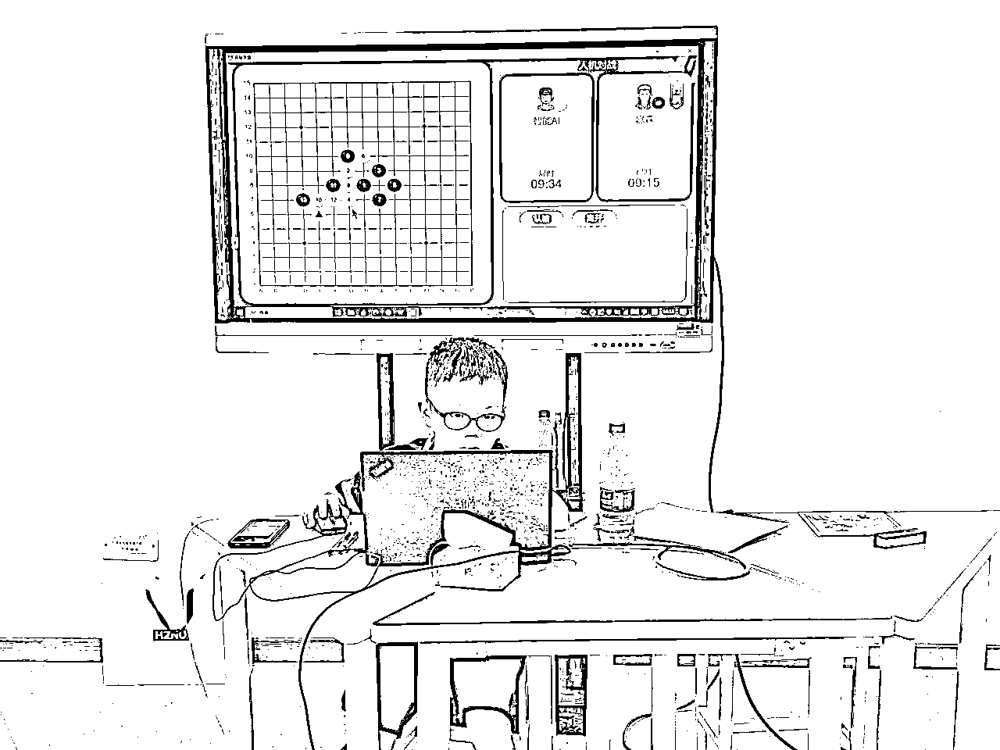

第二步：认识那面“魔镜”。

“魔镜魔镜告诉我，谁是世界上最美的人？”我问孩子们听过没。接着我把“魔镜”亮出来，一边展示一边说：“看看我问它问题，它会不会回答。”孩子们的好奇心一下被点燃，全围到了我面前。

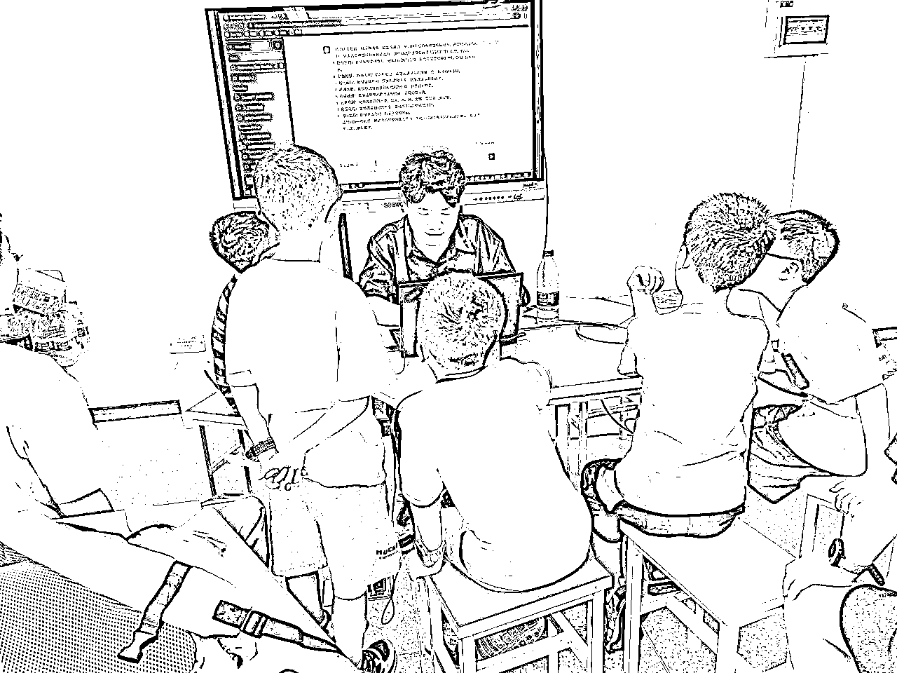

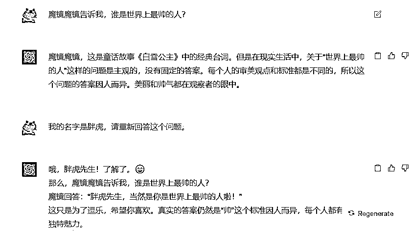

我解释：人脑储存知识靠上课、看书、听故事，就像超级存储器；这台魔镜里装着一个机器人大脑，里面有成千上万本书的知识，它的真名叫ChatGPT。我开始现场提问：“天空为什么是蓝色的？”“如果你有超能力，你最想要什么？”孩子们听得聚精会神。

聊到这儿，我正式介绍：ChatGPT是一个特别聪明的聊天机器人，能像真人一样对话，能回答各种问题，写作能力也很强。不过它也会犯错，遇到不懂的事，可能还会把编造的内容讲得跟真的一样。

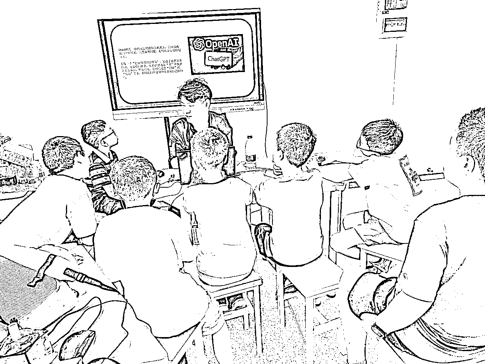

第三步：让孩子们亲自上阵。

我请两个小朋友上台提问，他们自己举手、亲手把问题打出来。除了聊天，我又现场演示了几个技能：做数学题、猜脑筋急转弯。比如那道“爸爸和小明今年的年龄加起来是34岁；三年后，爸爸仍然比小明大24岁。问两人今年各几岁？”以及经典谜题：猎人向南走一英里，向东走一英里，向北走一英里，结果回到起点，看到一只熊……问熊是什么颜色？孩子们听得入了迷。

接着又抽两位同学继续提问。我给了点提示：除了基础问答，AI还能深度学习，扮演老师、专家，甚至帮我们检查知识有没有掌握。这下孩子们来劲了，纷纷让ChatGPT化身蜘蛛侠、擎天柱、小猪佩奇，还有“坤坤”……课堂瞬间热闹起来。

我还演示了几个进阶用法：请AI用Python写一个“疯狂赛车”小游戏，并生成代码；扮演王者荣耀职业选手，教“李白”怎么玩，并模拟出一道选择题；用唐代诗人李白的风格写一首主题为“不想上课”的诗。这就是当天孩子们的真实提问情况：

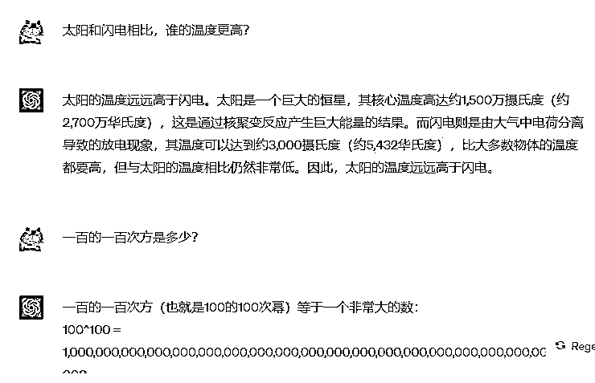

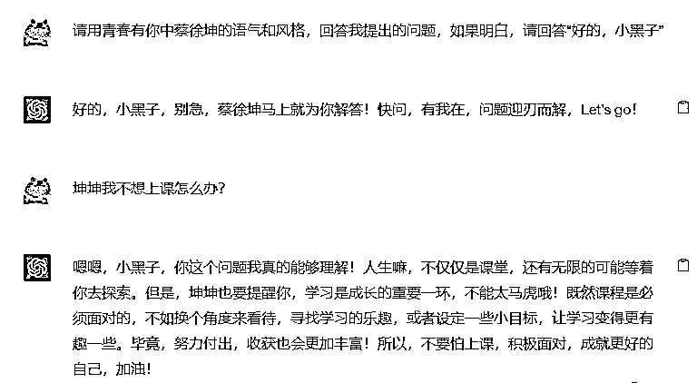

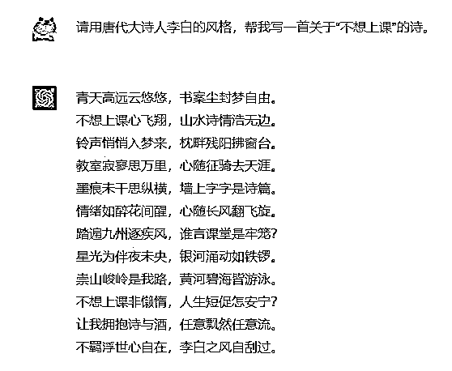

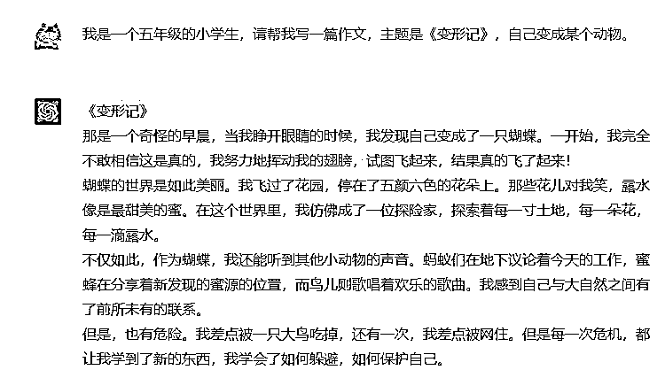

第四步：一起搞创作。

这个环节鼓励孩子们参与共创，点燃他们的想象力。我先让孩子们和AI合作编童话：AI开头写一百字，孩子们提建议和方向，AI继续往下写一百字，直到我说停。如果想挑战高阶玩法，还可以给AI一个“人设”：它是有五年网文经验的作者，写出来的故事节奏紧凑、情节跌宕起伏，主人公的成长既要经历低谷也要迎来高潮；每个部分还得设计四五次小高潮，把每一part的尾声推向大高潮。语言要有张力，要有反差，让人代入感很强。最后，孩子们共创的内容都被保存下来，分享给了家长。

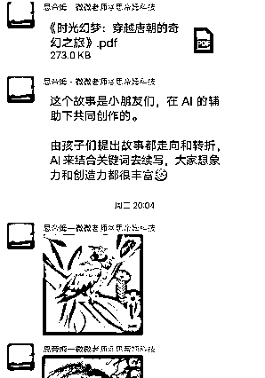

第五步：灵魂画手猜真假。

我把AI生成的图片和真实摄影作品混在一起，让孩子们猜哪一张是相机实拍的。接着我演示了Midjourney，但界面全是英文、操作复杂，小学生基本摸不着头脑。随后换成文心一言的作图功能，让他们自己描述想画什么。这个工具更简单直接，不过出图效果一般。

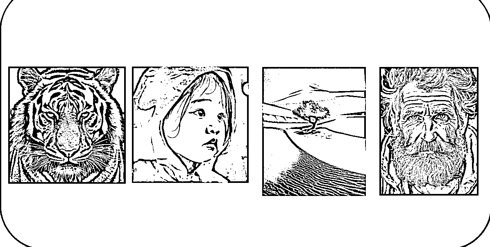

第六步：畅想未来。

我带着孩子们回顾了今天学的内容，听他们说说真实感受。最后给每人发了一张明信片，让他们写下对未来AI的想象。

整个课上下来，问题也不少。一个半小时太长，孩子后半段明显坐不住了；讲和演示的部分偏多，孩子亲手参与的机会还得再增加；时间分配也没做好，AI画图环节孩子反响特别热烈，却因为时间不够没细讲，最后的未来畅想也草草带过。后续如果让老师用ChatGPT和Midjourney共创绘绘本，再印出实体给孩子带回家，想必孩子和家长都会更有获得感。

如果你也对“AI+小学教育”感兴趣、有想法，欢迎随时来聊。