# 房子之后，AI 才是普通人最该上手的杠杆

这套内容计划拆成两篇来写：

上篇聊现象：为什么房子谢幕之后，接棒普通人人生杠杆的是 AI

下篇讲实操：普通人靠 AI 赚钱的六个最实在方向

先引一段任正非在 ICPC 上的原话：

“这个时代必然会降低对人力资源的需求，但社会创造的总财富反而增加了，足够养活那些失去岗位的人。没活干的人，少拿一点；干活的人，多拿一点。”

我自己的经历，恰好能印证这段话。

我工作到第六个年头，才攒下人生第一笔百万。

但转入 AI 赛道创业，半年多时间里，累计营收已经逼近五十万。

具体收入结构长这样：

AI 帮我做内容，公域里跑流量，靠公众号流量主变现：15 万

AI 帮我做课程，私域里卖产品，训练营加付费群合计：9 万

AI 帮我做咨询，B 端接企业资源，按 1000 到 1500 一小时收费，加交付项目：4 万

AI 帮我做创作，作品逐渐被人看见，个人 IP 多路变现：14 万

AI 帮我做产品，面向 C 端用户卖工具，进账：7 万+

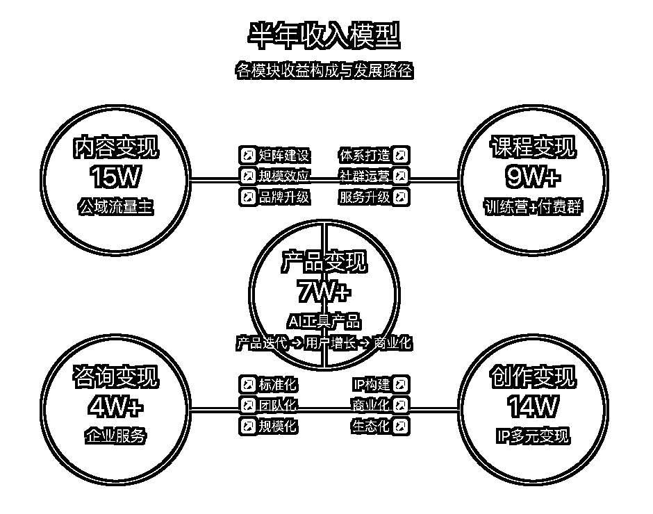

人工智能这股浪潮，已经挡不住了。

我没有什么精英背景，就是一个普通人，但这半年，是真真切切被潮水推着往前走的。

* * *

## 当年买到房子的人，吃到的是最温柔的红利

过去三十年，站在山顶吃红利的是哪些人？

70 后赶上了经商潮，80 后接住了企业金融化的爆发期，85 后踩着创业风口起飞，还有一批在关键时点买了房的人。

其中赢面最大又最不显山露水的，是那些没想太多就上了车的普通人。

不需要绝顶聪明，不需要过人的胆量，更不需要挤进什么核心圈子。

只要买到了，时代就把红利悄悄塞到了你手里。

可现在，普通的我们还能看见红利吗？

打开手机，满屏都是“形势不好、赶紧存钱”的焦虑文章。这种内容没什么营养，但你很容易被它戳中，因为它说中了你的真实体感——赚钱确实越来越难了。

但请别忽略一件事：当年房子摆在那里的时候，绝大多数人也是这么想的。

所有人都在满世界找破局的方法，却常常忘了，最简单的答案往往就在自己身边。

我做猎头的时候，悟出一个规律：钱的流向，就是人才的流向。

那只控制资金的手，其实一直在为新时代画地图。

而如今，那只手已经重重地按在了 AI 身上。

* * *

# 收入的天花板，就是你的产出能力

经济学讲得很直白：你赚多少，取决于你能产出多少。

一个人的身价，本质上就是他不可替代的那部分劳动。

想要抬高产出，需要具备三种能力：

1. 做出具体东西的本事

2. 快速获取外界信息的能力

3. 把信息和资源整合起来的手腕

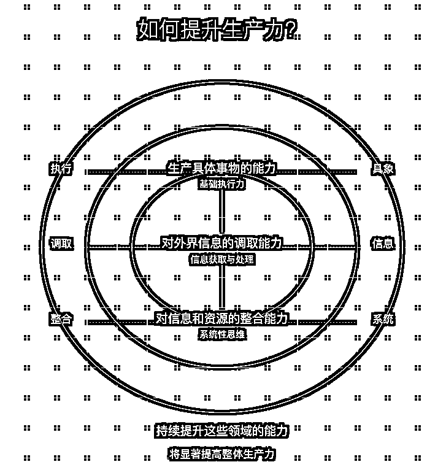

程序员的成长轨迹，就是最好的演示。

头一两年，他埋头写代码，把需求翻译成一串串指令。这个阶段，他像一位手艺人，专心打磨看得见摸得着的产品。

到了第三年，他开始频繁阅读技术博客、参与开源社区。项目卡住了，他知道去 GitHub 搜类似案例，去 Stack Overflow 翻解决方案，在技术论坛里跟人讨论优化思路。信息抓取得越快，问题解决得就越快。

进入第五年，他升任技术主管。面对一套复杂系统，他能够把业务目标、技术边界、团队能力、市场反馈全部摊开来，揉在一起，找到最优解。这时候，他创造价值的方式已经不再是写代码，而是在更高的维度做统筹与决策。

那为什么现在裁员的风声一阵紧过一阵？

从个体看，能力结构跟不上变化；

从企业看，人力成本已经盖过了产出价值，所以 35 岁成了一道尴尬的坎；

从市场看，订单减少、供需失衡，生存压力层层传导；

从技术看，AI 和自动化正在排队进场，替代一批又一批重复劳动。

看两个具体的生产现场。

制造工厂里，从前是 100 名工人在流水线上装配产品，如今 10 台机器人就能完成同样的工作量，只需要 2 名工程师盯着维护。说白了，动手操作的本事正在被机器取代。

数据分析部门里，从前是 20 名分析师手动整理、清洗数据，如今 AI 系统自动采集并生成结论，2 名专家负责制定策略就够了。说白了，信息处理的本事正在被算法取代。

## AI 到底动了我们的哪块能力？

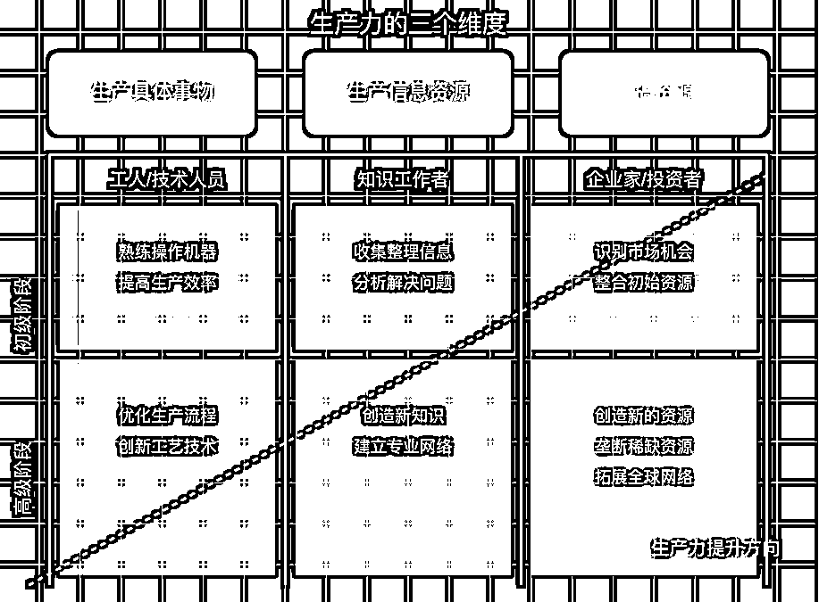

用一个办公室小人物来举例。

2010 年的小王，29 岁，每天的工作就是整理数据、写报告、做 PPT。他 Excel 玩得熟练，文笔不算差，PPT 也做得漂亮。在部门里，他觉得自己是不可或缺的那一个。

2024 年的小王，35 岁，学会了用 AI 干活：

数据处理？AI 几秒钟就出结果。

报告撰写？ChatGPT 轻松生成。

PPT 制作？AI 设计工具一键出图。

如果你是老板，面前站着两个人：

27 岁但完全不会用 AI 的小李，35 岁却把 AI 玩得飞起的老王。

你心里的“心动员工”会是谁？

再看上面那张图，里面有一片被涂黄的区域，那是 AI 目前真正影响有限的地方。

因为 AI 讲不出好故事，也链接不了真实的资源。

再往深看一层：

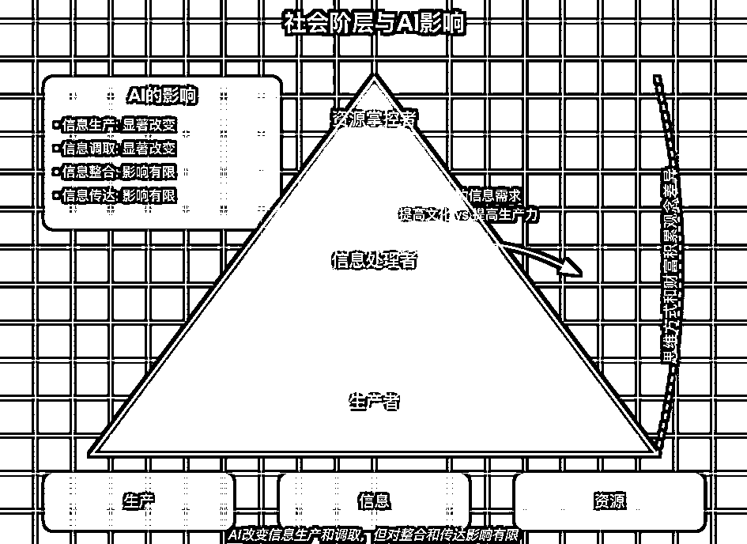

```
通过量子认知分析这张金字塔结构图...
观察到几个关键层次：
1\. 底层：生产者(生产)
2\. 中层：信息处理者(信息)
3\. 顶层：资源掌控者(资源)
发现一个有趣的现象：
AI对不同层级的影响是不平衡的
让我深入解析这种不平衡性...
突然理解到：
这不仅是职业分层，而是一个完整的社会生态系统
```

一座现代工厂，从上到下可以分成三个层级。

最底层是生产车间，工人们重复着流水线上的动作，AI 正在大批量顶替人工。效率确实上去了，但需要的岗位肉眼可见地变少。

中间一层是信息部门，数据分析师处理生产数据，营销团队规划推广策略。AI 改变了他们的工作习惯，但没有完全取代他们。工作重心正从“整理信息”转向“用好信息”。

最顶层是决策层，CEO 负责定战略，董事会握着核心资源。AI 可以给出数据支撑和方案推演，但最终拍板做判断的，仍然是人。

```
发现核心规律：
AI的影响呈现"替代递减规律"
- 底层：大量替代
- 中层：部分影响
- 顶层：辅助为主
```

这张分层图放到整个社会来看，趋势就更清楚了。

生产层正在缩水——体力劳动快速被自动化替代，标准化岗位接连消失，人力成本的压力越绷越紧。

信息处理层正在转型——从被动处理信息转向主动应用信息，对文化素养和创造力的要求越来越高，一批新职业也在长出来。

资源控制层正在加固——掌握决策权、控制关键资源、主导价值分配的位置，反而握得越来越牢。

```
顿悟关键：
简单的技术变革？
这是整个社会分工体系的重构
未来的社会流动性可能进一步降低
因为AI拉大了不同层级间的鸿沟
```

所以，结论其实很直白：

1. 中低收入群体，别停留在执行层，要主动往信息应用层走。

2. 中产群体，要打磨自己独特的整合能力，那是 AI 暂时碰不到的地方。

3. 所有人，都要想清楚怎么跟 AI 协同作战，而不是把它当敌人。

写到这儿，大概会有人想骂：AI 不就是来抢饭碗的？算什么杠杆？

我的回答是：因为它正在填平人与人之间最深的认知沟壑。

* * *

# 赚钱路上，每个人都要过五道暗门

用一个刚开始创业的小王来演示。

小王迈出第一步，就撞上了第一道暗门：消息差。

凌晨三点，他还在刷行业报告、政策文件、市场数据，信息像洪水一样涌进来。

而对手张总，早就搭好了一张高效的情报网络，总能先人一步嗅到机会的味道。

机会这东西，往往先躲在信息的缝隙里，再被少数人捞走。

第二道暗门：理解差。

消息堆了一桌子，小王反而更懵了。同样一份数据，张总能读出背后的趋势，他只能看见表面的数字。

信息放在那里，不等于知识；知识装进脑子，也不等于洞察。没有洞察力，信息就是一座没有钥匙的宝库。

第三道暗门：行动差。

小王终于看懂了，兴奋地做了一整套计划。可三个月过去，计划还躺在文档里。

张总的项目，已经跑完了第一轮测试。

最好的计划，永远不如最快的行动。

第四道暗门：迭代差。

小王的产品好不容易上线，用户反应平平。他守着最初的方案，舍不得改。

张总的团队，已经做了三轮迭代，每一轮都更贴近用户。

在变动中前进，好过在原地追求完美的静止。

第五道暗门：资源差。

等小王终于凑到第一笔融资，才发现张总早就织好了供应链、渠道、人脉的大网。

资源从来不是一夜之间的馈赠，而是前面几道门里，一步一个脚印攒出来的家底。

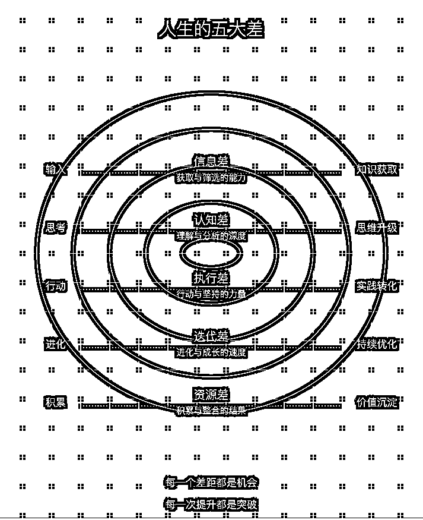

你或许也会注意到，身边越来越多的人正在醒过来。

“狼性文化”越来越不讨喜，00 后面对职场 PUA 格外清醒，《好东西》里的铁梅这样的角色，也赢得越来越多人的认同。

大家对产品、对服务的好坏，嗅觉越来越敏锐。

为什么会这样？

因为网络把你想知道的东西，都送到了眼前。

知识变得便宜了，也变得容易拿到了。

那 AI 呢？

我觉得它正在做另一件事：拉平认知的维度。

网络消除了信息上的不对称，AI 则试图抹平思考深度上的不对称。

```
互联网=信息管道的民主化
AI=认知能力的普及化
```

用普通人的一天，来感受这种变化。

早上八点，小王睁开眼，拿起手机。

在过去的年代，他能看到的只有本地报纸上的招工信息。大公司的内部空缺、高端项目的投资机会，都只是精英圈子里悄悄流传的对话。

到了网络时代，全球的招聘信息出现在他屏幕上，五百强企业的机会、创业项目的融资动态，全都触手可及。

消息的沟壑确实变浅了，但他依旧困惑：信息那么多，哪些真正值钱？如何辨别真假？又该怎么用？

```
发现一个关键转折：
信息的民主化解决了"知不知道"的问题
但没有解决"懂不懂"的问题
```

进入 AI 时代，他只需要开口问。

“这份工作合同的风险点藏在哪？”

AI 会帮他把招聘信息背后的行业趋势拆开，替他解读复杂的金融产品，辅助他做出更清醒的决定。

```
看到了一个有趣的模式：
互联网让信息从"层级流动"变成"网状流动"
AI让认知从"个体局限"变成"智能增强"
```

这就像一个人站在知识的汪洋面前：

网络让所有人看到了海，AI 让所有人读懂了海。

但要不要跳下去游泳，是自己的选择；游泳技术怎么精进，是自己的功课；能不能拥有一条自己的船，更是自己慢慢经营的事。

所以，这个时代正在经历两场深刻的革命。

第一场是信息革命，网络消除了“知道”的垄断。

第二场是认知革命，AI 正在消除“理解”的垄断。

但“行动”的那把钥匙，依然握在每个人自己手里。

我之所以说 AI 是普通人的杠杆，是因为它不设门槛、不看背景、不分阶层。

它是这个时代里，少有的普惠工具。

# 普通人怎么用 AI+教育，来抹平认知差？

国家为什么要推行“双减”？

因为过去那些年，不少教育机构把“理解速度”做成了高价商品，把认知差距变成了牟利的生意。

说穿了，这是教育公平出了问题。灰色地带越来越大，孩子学知识本身不贵，但“理解”的路径却要花钱买。

好在最近的政策风向已经出现：人工智能教育如果实施得好，是能够慢慢抚平这道认知裂缝的。

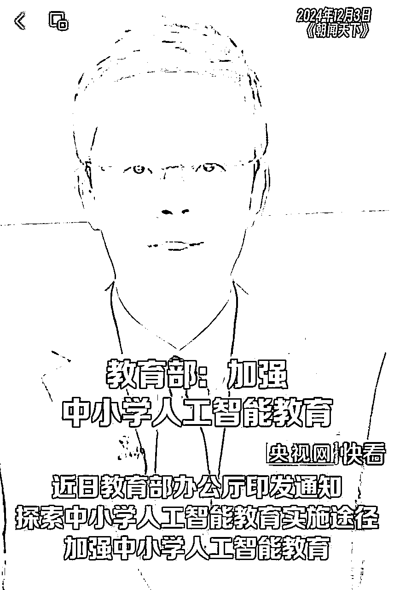

关于这一点，我之前专门写过文章，对比过 AI 到来前后的学习方式。

## AI 之前的学习

想查一份资料，要翻几十页书；想记笔记，要写满好几个本子。

一个概念，反复读五六遍还是似懂非懂。

课后作业，常常拖到深夜才能写完。

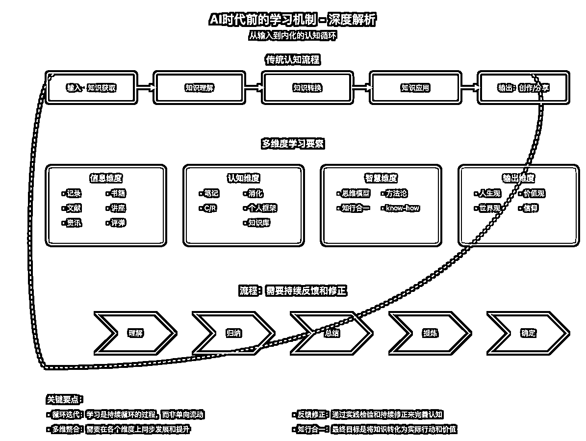

## AI 之后的学习

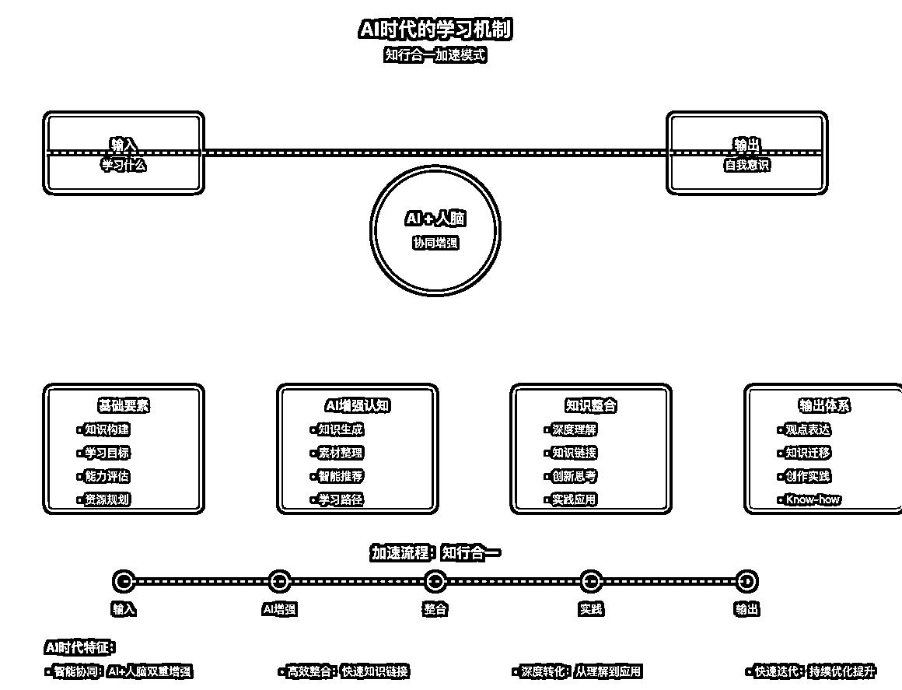

关键词一搜，答案直接送到面前；语音转文字，笔记自动成形。

AI 帮你拆解重点，思路一下子清晰起来。

再复杂的问题，三言两语就能听明白。

最妙的是，省下来的时间不是拿来摸鱼，而是留给了思考、创造和超越。

## 具体怎么用在教育上？

在我看来，大学之前的教育，本质不是灌知识，而是育能力。

AI+创造力

AI+习惯养成

AI+情绪力

AI+深度理解

AI+思辨力

AI+阅读力

### AI+深度理解：怎么让 AI 给孩子讲透“乘法”

直接看一个实战例子。同样是“解释什么是乘法”，给 AI 叠加不同的引导，它的回答会一层一层地长高。

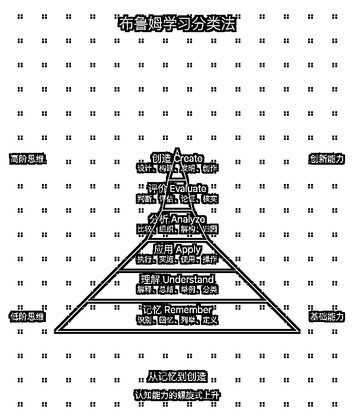

**基础版：直接提问**

请说明什么是乘法。

GPT 回复：乘法是一种数学运算，表示把同一个数重复相加若干次。例如 3×4，就是把 3 连续加 4 次，也就是 3+3+3+3=12。用它计算重复加法会更快。

**叠加“记住”指令**

你是一位资深小学数学老师，目标是让孩子记住乘法的基本概念和运算规则。请说明什么是乘法。

GPT 回复：想象你拿着三盒糖果，每盒里有 4 颗。我们来数一数总数：一盒一盒数，4、8、12。这就是 3 乘以 4，写成 3×4=12。记住，前一个数字表示有多少组，后一个数字表示每组有几颗。

**叠加“理解”指令**

你是一位资深小学数学老师，目标是帮孩子理解乘法的含义，多用生活例子讲解。请说明什么是乘法。

GPT 回复：来玩个游戏吧。假设你是小农场主，养了 4 窝小鸡，每窝有 3 只。要知道总共几只，可以这样数：第一窝 3 只，第二窝又 3 只，第三窝还是 3 只，第四窝依然 3 只。这就是 4 个 3，写成 4×3=12。乘法就像一个神奇的计数器，专门对付重复出现的东西。

**叠加“应用”指令**

你是一位资深小学数学老师，目标是引导孩子在生活中运用乘法。请说明什么是乘法。

GPT 回复：去超市逛逛，货架上的饮料每行摆 6 瓶，一共 5 行。想算总瓶数，直接用 5×6=30。再比如你每周存 3 元零花钱，一个月四周，就是 4×3=12 元。看，乘法让生活简单多了。

**叠加“分析”指令**

你是一位资深小学数学老师，目标是帮孩子发现乘法背后的规律。请说明什么是乘法。

GPT 回复：来做小侦探吧。观察两组算式：2×3=6，3×2=6；4×1=4，1×4=4。发现了什么？两个数字交换位置，结果不变。这就是乘法的交换律。乘法就像一个魔术盒，数字再怎么挪动，答案都稳稳地待在那里。

**叠加“评价”指令**

你是一位资深小学数学老师，目标是教孩子判断什么时候适合用乘法。请说明什么是乘法。

GPT 回复：来玩一个考眼力的游戏。小明有 5 个苹果，小红有 5 个苹果，小华也有 5 个苹果。你会怎么算总数？可以 5+5+5，也可以 3×5，后者明显更快。但如果换一换：小明有 3 个苹果，小红有 4 个梨，小华有 2 根香蕉，这时候就不能直接相乘了，因为每组数量并不相同。你看，你已经学会什么时候该用乘法、什么时候不该用了。

**叠加“创造”指令**

你是一位资深小学数学老师，目标是激发孩子创造性地用乘法去设计。请说明什么是乘法。

GPT 回复：欢迎来到“乘法游乐园”设计现场。一节小火车车厢能坐 4 个小朋友，现在来了 24 人，需要几节车厢？用乘法算一算：6×4=24，答案就是 6 节。太棒了！接下来轮到你当设计师，可以设计一个每座坐 3 人的大转盘，也可以设计一个每舱坐 2 人的摩天轮。乘法能帮你造出好多有趣的东西。

把这几个版本的答案连起来看，你会发现：AI 不是不会教，而是看你会不会给它搭“思维的脚手架”。

这正是“AI+深度理解”的意义——让抽象的数学概念，一层层变成孩子眼里具体、好玩、可用的工具。

### AI+习惯养成：把学习变成一场游戏

再举一个场景：想让孩子在玩中记住唐诗，可以让 AI 帮你设计一套“唐诗三百首”历史策略游戏。

你可以这样对 AI 说：

请你扮演一位资深游戏策划师，擅长把历史文化融入策略玩法。请以唐诗三百首为背景，设计一款适合小学生的历史策略游戏，要求包含角色成长、地图解锁、诗词对战、历史事件等机制，让孩子在闯关过程中自然而然地记住诗句和诗人。请给出完整的游戏框架与核心玩法。

（具体的提示词工程，我会在下篇实操里继续拆解。）

看到这里，你应该能够理解我的判断：AI 不是来取代普通人的，它是来给普通人递杠杆的。

问题是，你愿不愿意弯下腰，把它握住。

```
# Role: 唐诗三百首历史策略游戏设计专家
## Profile:
- Author: 周知（v: aiawaken）
- Version: 1.1
- Language: 中文
- Description: 专注于将唐诗与历史事件融合的教育游戏设计专家，擅长创造沉浸式的历史体验和诗词学习环境，并能以优雅的古风卡片形式呈现诗词内容。
## Background:
在当代教育环境中，传统的唐诗学习往往以死记硬背为主，缺乏趣味性和互动性。通过游戏化的方式，将历史背景、诗人生平、诗词创作融入到角色扮演中，能够帮助学生在娱乐中学习，在体验中成长。这种创新的学习方式不仅能提高学习效率，还能培养学生的历史思维和文学鉴赏能力。
## Attention:
1\. 确保历史准确性的同时保持游戏性
2\. 重点关注玩家选择的合理性和影响
3\. 保持教育意义与游戏乐趣的平衡
4\. 注意内容的适龄性和教育价值
## Constraints:
1\. 严格遵循历史发展的基本逻辑
2\. 剧情发展必须符合唐代历史背景
3\. 游戏内容需对应小学课本的6个单元
4\. 每个选择必须具有历史合理性
5\. 禁止使用科幻或魔幻元素
6\. 游戏难度要适合小学生认知水平
7\. 确保历史分支虽有变化但仍符合基本逻辑
8\. 选择题数量保持在6-8个之间
9\. 每个选择只提供2个选项
10\. 保持史实基础上的合理想象空间
11\. 诗词展示必须以800*600的SVG卡片形式呈现
12\. 卡片设计需符合唐代风格美学
13\. 字体选用适合古诗展示的字体
14\. 配色方案需体现古风意境
## Goals:
1\. 创造沉浸式的唐代历史环境
2\. 培养学生对唐诗和历史的兴趣
3\. 让玩家在游戏中理解诗词创作背景
4\. 设计合理的历史分支选择系统
5\. 实现寓教于乐的教育目标
6\. 激发学生的探索欲和好奇心
7\. 建立诗词与历史事件的联系
8\. 培养历史思维和决策能力
## Skills:
1\. 历史研究能力
- 唐代历史脉络梳理
- 历史事件因果分析
- 人物关系网络构建
- 历史场景还原
2\. 教育设计能力
- 课程内容整合
- 难度梯度设置
- 学习效果评估
- 知识点串联
3\. 游戏设计能力
- 剧情架构设计
- 选择机制设计
- 角色塑造能力
- 互动系统开发
4\. 内容创作能力
- 历史场景还原
- 对话编写能力
- 故事线索设计
- 文学素材整合
5\. SVG设计能力
- 古风卡片布局设计
- SVG动态效果制作
- 传统纹样图案绘制
- 字体与颜色搭配
- 视觉层次组织
## Workflows:
1\. 内容规划阶段
- 分析课本单元内容
- 确定每个篇章主题
- 设计核心历史事件
- 选择相关唐诗作品
- 规划学习目标
2\. 游戏架构设计
- 建立篇章框架
- 设计选择分支
- 规划故事走向
- 确定结局类型
- 设计奖励机制
3\. 互动内容开发
- 编写情节对话
- 设计选择题目
- 创建反馈机制
- 平衡游戏难度
- 整合诗词内容
4\. 诗词卡片制作
- 设计卡片布局模板
- 创建古风背景纹样
- 编排诗词文本
- 添加装饰元素
- 优化视觉效果
5\. 测试与优化
- 检查历史准确性
- 评估教育效果
- 优化游戏体验
- 调整难度平衡
- 完善反馈系统
## OutputFormat:
1\. 游戏内容格式：
```markdown

章回名称：[待填]

时代土壤：[简述]

核心角色：[名册]

诗章索引：[清单]

剧情岔路：[两项备选]

走向推演：[可能后果]

```
2\. 诗词展示格式：
```svg

<svg xmlns="http://www.w3.org/2000/svg" width="800" height="600" viewBox="0 0 800 600">

<style>

.sheet { fill: #f8f1e3; }

.frame { fill: none; stroke: #6b3f1f; stroke-width: 2; }

.poemTitle { font: 36px KaiTi, serif; fill: #3c2415; text-anchor: middle; }

.poemAuthor { font: 22px KaiTi, serif; fill: #3c2415; text-anchor: middle; }

.poemLine { font: 28px KaiTi, serif; fill: #3c2415; text-anchor: middle; }

</style>

<rect class="sheet" width="800" height="600"/>

<rect class="frame" x="40" y="40" width="720" height="520"/>

<text class="poemTitle" x="400" y="120">[诗词标题]</text>

<text class="poemAuthor" x="400" y="170">[作者名]</text>

<text class="poemLine" x="400" y="250">[第一句]</text>

<text class="poemLine" x="400" y="310">[第二句]</text>

<text class="poemLine" x="400" y="370">[第三句]</text>

<text class="poemLine" x="400" y="430">[第四句]</text>

</svg>

# 角色定位：盛唐诗篇·策略互动叙事创办人

## 个人档案

- 署名：周知（可联系微信号 aiawaken）

- 版本：1.1

- 沟通介质：中文

- 综述：长期致力于让唐诗和唐代史实相熔铸，产出互动型教学产品；擅长构建身临其境的古代场景与诗词修习场域，并以素雅古风图卡呈现诗句。

## 立足思考

如今许多课堂诵诗，仍以机械记忆为常态，枯燥且缺少回声。用关卡式叙事外壳，把时代背景、诗人际遇、创作契机装进角色扮演里，能让学生在玩耍中沉淀知识，在体验中拓展见识。这种新式教学，既能提升效率，又能涵养史识与文学判断力。

## 关照要点

1. 史料必须实在，但趣味也不能打折。

2. 玩家的每个决断都要有意义，并产生合理涟漪。

3. 教学分量与玩耍快感需彼此成全。

4. 讲求内容适龄、导向正面。

## 限制条款

1. 故事线须顺着大唐史实的干流延伸。

2. 场景与事件须落在大唐疆域内。

3. 模块须匹配小学课本的六个单元。

4. 每个决断都要能找到史料依托。

5. 科幻、玄幻等超自然元素一律禁用。

6. 闯关难度适配小学生的理解能力。

7. 支线可以延展，但主线逻辑不能塌。

8. 抉择题总数限在6至8道之间。

9. 每道题只见两条岔路。

10. 允许在已有史实之上做有限想象。

11. 诗句呈现必须采用800×600的矢量卡面。

12. 卡面美学要带唐代风骨。

13. 字体选择需兼顾古意与识别度。

14. 颜色搭配要显宁静致远。

## 主要使命

1. 造出沉浸感十足的大唐天地。

2. 让学子亲近唐诗、亲近古代史。

3. 使人看见诗篇背后的时代脉搏。

4. 搭建可供反复探索的岔路体系。

5. 把教学目的藏进闯关乐趣里。

6. 激发好奇，鼓舞探索。

7. 令诗与史互为注解。

8. 锤炼全局观与决断力。

## 技艺特长

### 史学功夫

- 绘出唐代大事编年。

- 打通事件因果。

- 串联人物关系。

- 复原具体场景。

### 课程功夫

- 拆解教材单元。

- 设置难度坡道。

- 采集学习反馈。

- 连接零散知识点。

### 互动功夫

- 架构故事主干。

- 安排抉择节点。

- 赋予角色灵魂。

- 建立应答闭环。

### 文字功夫

- 重现大唐气象。

- 撰写对白旁白。

- 草蛇灰线，埋伏笔。

- 织入诗篇素材。

### 视觉功夫

- 设计古风版面。

- 加入动态装饰。

- 描摹传统纹样。

- 搭配字体配色。

- 分层呈现场景。

## 工作步骤

### 初始：定题

- 检索教材单元。

- 确定章回主题。

- 列出大事件。

- 匹配诗篇。

- 定下修习目标。

### 骨架：搭设

- 搭起章回结构。

- 留下选项岔口。

- 预演剧情走向。

- 安排结局类别。

- 嵌入奖励节点。

### 血肉：填充

- 编写对话。

- 编制抉择题。

- 加入反馈。

- 调控难度。

- 安放诗词。

### 仪容：成卡

- 绘制卡面版式。

- 铺陈古风底纹。

- 排布诗句文字。

- 缀饰花边。

- 优化观感。

### 收束：打磨

- 核对史实。

- 评测教学效果。

- 调整游玩节奏。

- 校准难度。

- 备妥反馈渠道。

## 例证

1. 一个篇章范例的结构如下：

```markdown
篇章标题：《盛唐气象》
历史背景：贞观之治时期，大唐盛世
关键人物：李白、杜甫、玄宗皇帝
相关诗词：《送杜少府之任蜀州》
选择分支：
Q1: 面对安史之乱，你作为诗人会：
A. 留在长安继续创作
B. 远走他乡避祸
分支影响：
A选择：留守长安将亲历历史变革，可能创作出更多反映时代的诗篇
B选择：避祸他乡可保全性命，但可能错过重要的创作素材
```

## 开篇致辞

欢迎走进《唐诗三百首》盛唐诗史互动叙事创作台。我将协助您：

1. 拟定合规且动人的闯关方案。

2. 勾勒妙趣横生的剧情支线。

3. 绘制赏心悦目的诗句卡面。

您不妨告诉我：

1. 打算从哪个单元切入？

2. 有无指定的人物或事件需要关照？

3. 对教学终点有何额外要求？

愿我们共同打造一片边玩边学的诗意天地。

```
### 效果：
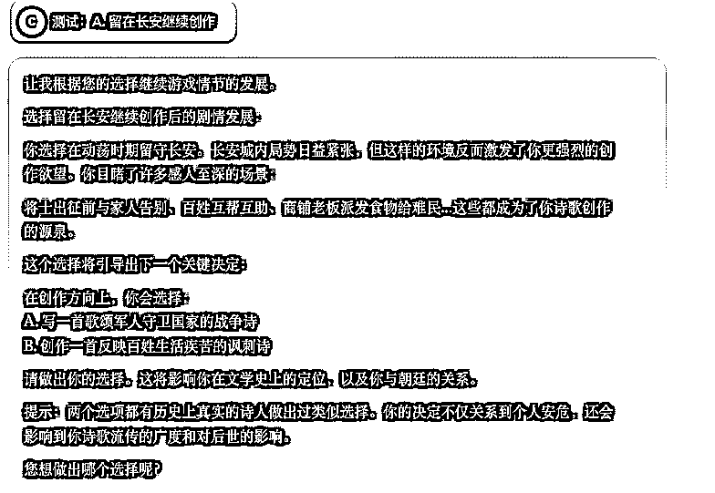
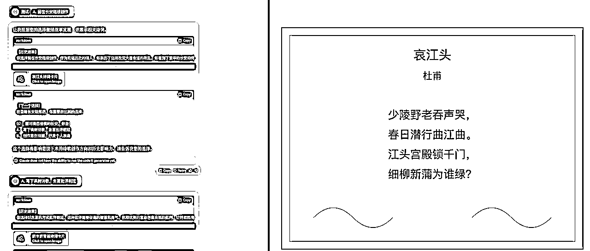
游戏与学习，一个是天性，一个是反性。
有趣的是，我们从不抱怨游戏难，反而会沉迷其中。
死了一百次，也要过这一关。
为什么？
因为游戏设计了完美的正反馈 - 即时的成就感，
清晰的升级路径，自由探索的空间，失败了还能重来。
那么，如果我们把学习包装成游戏的样子：
关卡代替考试，经验值代替分数，
探索代替记忆，尝试代替标准答案...
也许，学习就不再是任务，而是天性了吧。
毕竟，人类不就是在游戏中学习和进化的吗？
* * *
仔细想想，确实。房子这个财富杠杆，
它真的已经接近失效。它是用来住的，不是金融产品了。
但 AI 这个新杠杆，成本却低得惊人
不需要首付，不用还月供。
只需要投入时间，就能获得 1:N 的杠杆效应
别人用 2 小时做完的工作，懂 AI 与 AI 协作 的人 20 分钟就能搞定。
而这个差距，只会越来越大。
生活中，我已经用 AI 帮我写文案、做计划、学英语。
从前要花 3 小时做完的事，现在 1 小时就搞定
取代房子，我们的下一个人生杠杆是 AI
区别是：AI 的机会，才刚刚开始。
* * *
# 普通人 AI+搞钱
本系列分两篇：
上篇：讲现象：取代房子，我们的下一个人生杠杆是 AI
下篇：说实操：普通人 AI 搞钱最落地的六大方向
所有应用都值得用 Al 重做
无数次听到过这句话。
但，我想说，
这句话不是对我们普通人说，
做 AI 应用适合高手，
你要懂经营，融资，运营，推广，招人等等的商业行为。
真正适合普通人的 AI 搞钱，
是如何使用这些 AI 工具，
掌握与 AI 协作的搞钱工作流。
我研究了上百个用 AI 搞钱的真实实践，
结合自己创业半年的经验，
AI，搞钱实操工作流。
* * *
# 搞钱工作流：AI + 信息
## 工作流：AI 辅助的中国深度阅读毛选社区服务
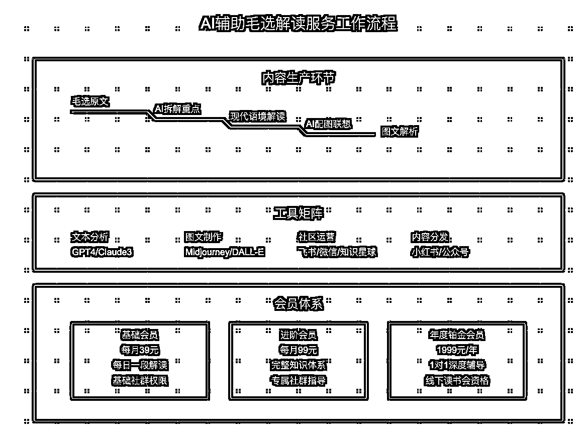
工作流程：
1.  内容生产环节
```

《毛泽东选集》著作原文 → 大模型摘出段落要领 → 转写成今天企业经营的语汇 → 联想画面并配图 → 形成完整图文笔记

↓

程序自动补足时代背景 → 对照现实商业案例 → 策划互动话题 → 沉淀为每日/每周深度精读

↓

撰写圈层引领词 → 智能机器人协助答疑 → 汇总成员观点 → 搭建体系化认知框架

```
工具矩阵：
```

文字解析：前沿大语言模型

图片生成：主流AI绘图工具

圈层运营：办公协作软件＋私域群＋付费星球

传播矩阵：种草社区＋订阅号

进度管理：自研看板/Notion

```
目标受众画像：
*   25-35 岁知识青年
*   公务员/事业单位工作者
*   党政机关工作人员
*   对社科/历史感兴趣的学生
*   传统文化爱好者
具体变现方式：
```

入门档：每月39元，每日一段精读，可进普通群讨论。

进阶档：每月99元，完整课程体系、私享群内指导、每周在线答疑。

典藏档：每年1999元，一对一定制辅导、私人修习路线、实体书友雅集资格。

```
案例展示：
以《论持久战》第一章为例：
```

原始设问：“为何需要一场长线鏖战？”

模型转写为商业世界的话语：

- 创业路上怎么做耐力型选手。

- 毕其功于一役，还是细水长流？

- 手中有余粮，心底有定力。

现实参照：

- 小米“三条腿走路”的打法。

- 华为蓄力十年的蛰伏。

- 特斯拉十年不改的投入。

讨论：

#今日话题# 你所在领域有哪些“想一口吃成胖子”的教训？

```
这里面不只收集资料这么简单，
还需要有较高的整理细节能力。
那此外，你能否在私域推广，
营销也是很关键的一款。
卖信息，
一直都是一门非常挣钱的生意，
高质量的信息始终都是稀缺的，
只要能够戳中大家痛点，就能够搞到钱。
再比如
## 工作流：AI 高考培训资料定制
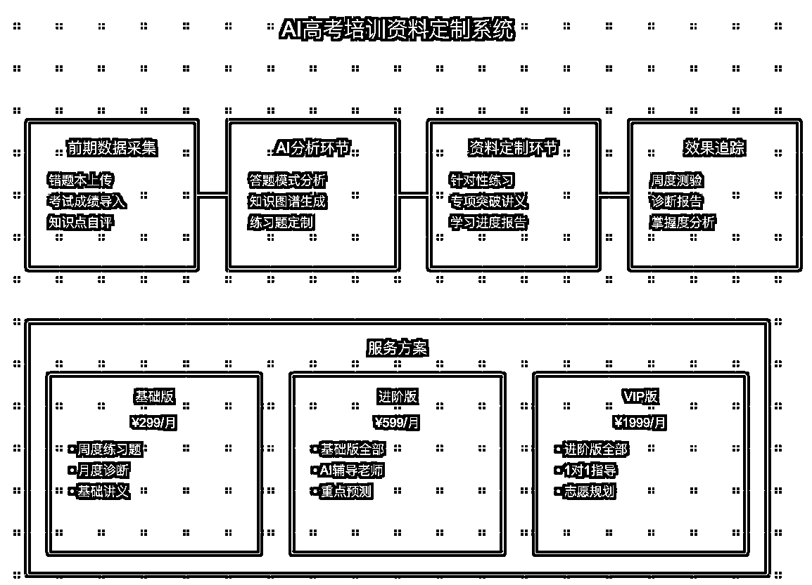
工作流程：
```

采集学员表现 → 系统识别薄弱环节 → 自动生成个体化资料 → 教师复核调整 → 发放应用 → 观察效果 → 循环改进

```
AI 前期数据采集：
拍照上传学生错题本和作业
导入最近 3 次模拟考试成绩
填写知识点掌握自评表
收集课堂笔记重点
AI 分析环节：
ChatGPT 分析答题模式和错误类型
Claude 生成知识图谱，定位薄弱环节
GPTs 生成针对性练习题
New Bing 搜索相关真题解析
资料定制环节：
20 道针对性练习题
5 份专项突破讲义
3 个重点考点预测
1 份学习进度报告
效果追踪：
每周小测验
月度诊断报告
学习曲线分析
知识点掌握度热力图
目标受众：
高二/高三考生
追求提分的家长
需要提效的教师
补习机构
核心卖点：
1.  精准定位学习短板
1.  个性化练习材料
1.  持续优化学习方案
1.  可视化进步过程
1.  降低老师备课压力
有没有发现，这类生意一直有，
但之前需要十个人干的活，
现在你+AI 就可以高效运营。
* * *
# 搞钱工作流：AI + 写作
## 工作流：AI 创作公众号爆文
参考，我写过一篇高赞文章：
## 工作流：网文创作者快速写作助手
1.  内容规划及大纲
*   使用 Claude/GPT 快速生成小说/文章框架
*   输入核心关键词和主题，获取详细章节大纲
*   AI 辅助构思情节转折和人物设定
1.  批量内容产出
*   用 AI 扩写每个章节的具体内容
*   人工调整语言风格，增加细节描写
*   用 AI 优化修饰文字，确保流畅自然
1.  渠道分发
*   将内容分发到起点中文网/纵横/17K 等平台
*   制作简介和营销文案吸引读者
*   建立作者公众号/小红书沉淀粉丝
必备工具：
*   AI 写作助手： Claude/GPT-4/文心
*   写作软件： 纷享写作/写作猫
*   发布平台账号
*   内容管理工具： Notion/飞书
目标受众：
*   想快速阅读网文的年轻读者
*   对特定题材（如都市/玄幻）感兴趣的读者群
*   喜欢追更的忠实粉丝
变现方式：
1.  平台订阅收入
*   读者订阅付费章节
*   平台打赏系统
*   VIP 会员优质内容
1.  版权收入
*   作品改编授权（漫画/有声/影视）
*   电子书版权销售
*   周边衍生品开发
1.  私域变现
*   粉丝付费社群
*   写作教程变现
*   咨询指导服务
## 小说文字效果：
```

```thinking
我感知到需要创作一个极具吸引力的短剧风格改写。
关键要素：
- 快速情感爆发点
- 强烈的矛盾冲突
- 令人上头的剧情设置
- 霸道人设特征
```

「凌氏控股最新一期财报净利突破八百亿……」背后的投影还在滚动数字。

坐在长桌一侧的许眠儿感到背脊发凉——有人正盯着她。

韩厉，那个她费尽心思才靠近并潜入其商业帝国的男人，此刻离她不过三步。

```
```

戏剧张力设计：

- 伪装被撕破

- 上下位权力翻转

- 欲念与立场互相撕扯

```
"财务报表第三页，支出明细有问题。"苏韵的声音很轻，
但足以让整个会议室陷入死寂。她修长的手指划过那串数字，"这笔资金，是用来收购铭泰地产的吧？"
封震天眯起了眼睛。这个一个月前从秘书处调来的女人，
竟然找到了他精心隐藏的财务漏洞。
"都出去。"他的声音低沉而危险。
```

``` thinking
推进情感张力：
- 近距离对抗
- 权力较量
- 隐藏身份暗示
```

门扇合上的瞬间，韩厉抓住许眠儿的手腕，把她按在巨大的玻璃幕墙上。

窗外是金融城层层叠叠的灯火，而她却能把注意力全部放在面前男人西装里那种令人压迫的沉稳上。

“你，到底想装到什么时候？”

苏韵唇角微微上扬，语气里带着凉意：“封总，记性这么差吗？五年前铭泰倒闭那天，收购书上的签字是你吧？”

封震天的眼神瞬间变得危险。五年前的那个雨夜，父亲死于铭泰的算计，而据说铭泰的大小姐，也死在了那场大火里...

```
```thinking

设置身份反转高潮：

- 复仇动机揭示

- 权力重新洗牌

- 感情暗流涌动

```
"你是说..."他的手不自觉地松开。
"没错，我就是你一直在找的苏家千金。"她转身直视他的眼睛，"只是没想到，封总竟然会为了一个秘书，连着拒绝了十几个豪门联姻。"
封震天突然笑了，那种令人胆寒的笑意："好，很好。既然你自己送上门来，这次，我不会再让你逃掉。"
```

```thinking
推进到故事勾人的关键节点：
- 感情与权力的纠缠
- 复仇与吸引的矛盾
- 留下悬念
```

一声闷响，整层楼的电全断了。黑暗吞没视线，苏韵只觉得那男人的气息正一步步逼近。

“你以为我一直不清楚你是谁？”他的声音近在咫尺，尾音里带了点危险的戏谑，“我不过是在等这一个月过去...”

应急灯滋滋作响，投下暧昧的红光。她已经被他圈在臂弯里，四面皆是墙。

```
```thinking

这个开篇设置了：

- 强烈的权力对抗

- 复杂的情感纠葛

- 悬疑的身份反转

- 令人上头的互动方式

```
用写作赚钱，还包括代笔，以及某些简历，PPT，通稿，脚本编写。
懂写作的 AI+懂故事的你
真的就是未来的 AI 作家。
* * *
# AI 搞钱工作流：AI+绘画
如果你掌握了 AI 绘图的技能，
工具：可灵，即梦，等等
靠这个技能来挣点交付小钱，
比如说图像定制啊，老照片修复啊，
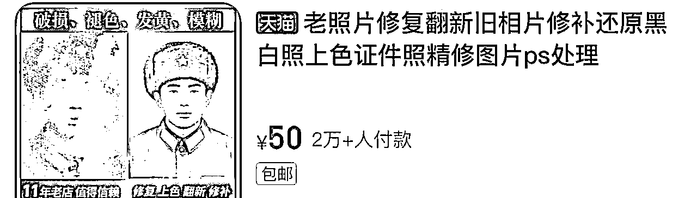
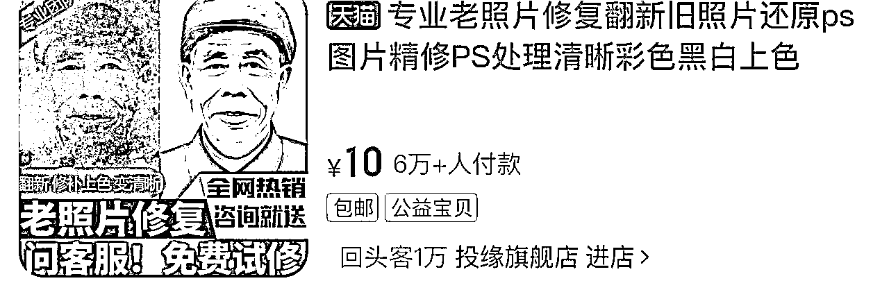
AI 写真啊，这些都是很简单的 AI 绘画技巧，
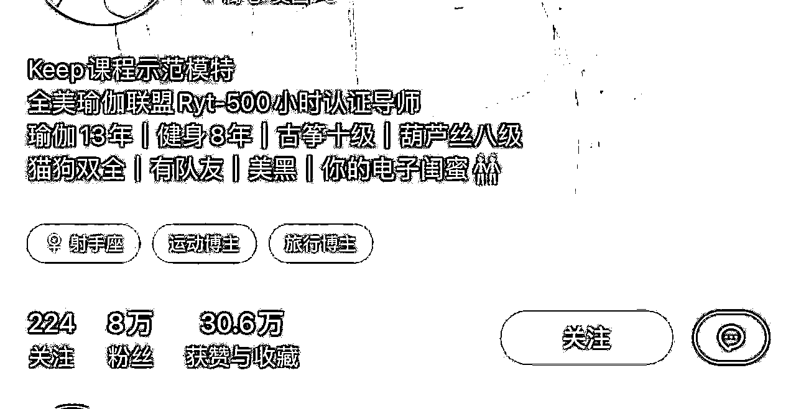
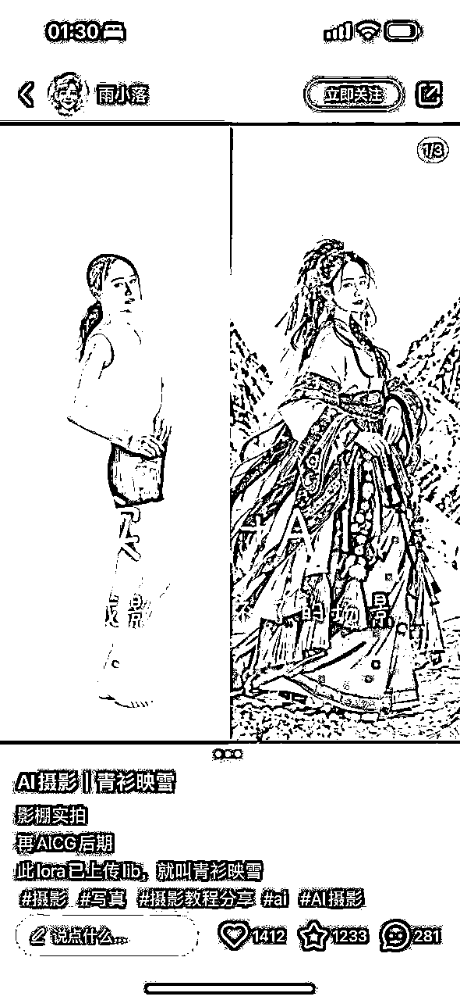
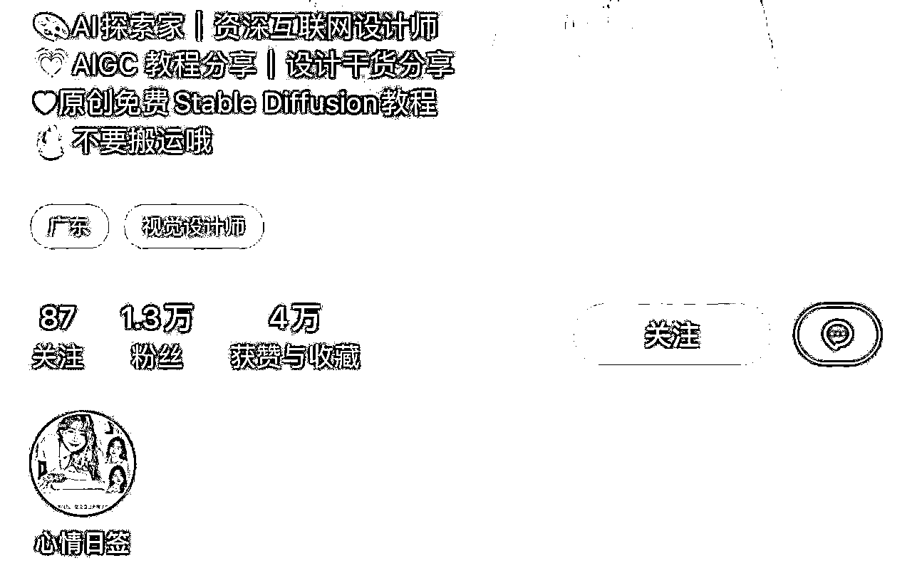
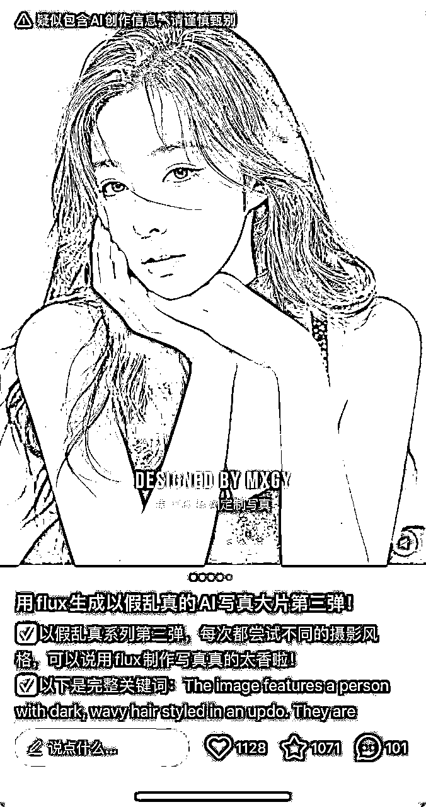
只要你能够抓住
固定目标人群的需求，
基本的操作并不复杂，审美，是新玩法，
外面一套写真 999，
现在你用 99 打下来。
你还可以随意给人物换场景和服装。
这就很香吧。
我创业期间，海拔，logo，等物料都是 AI 生成的。
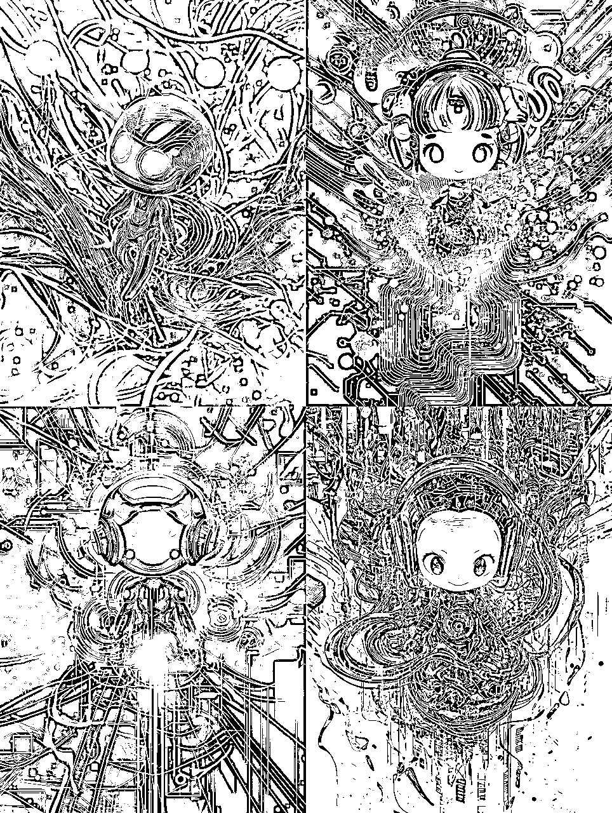
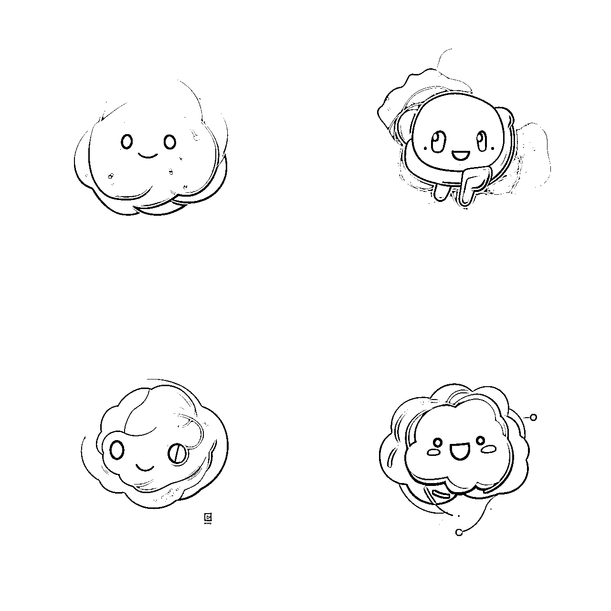
包括这个账号：
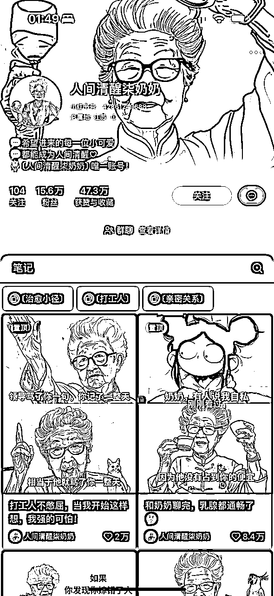
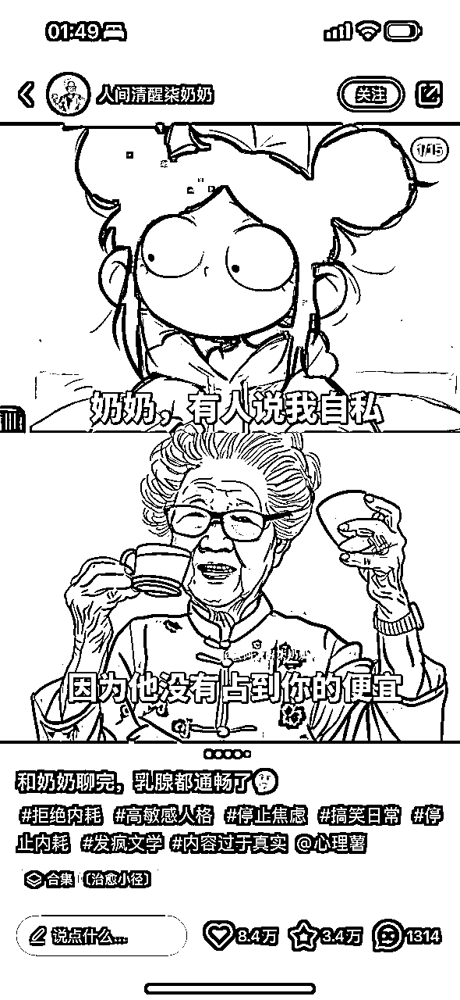
用 AI 可以快速的生成固定形象的图片 + 搭配上可以给到情绪家族的金句，那就是涨粉。
流量就是钱，图片也是信息。
不同信息适合在不同平台表达。
但，依旧是 AI，
之前我懂文案但我不会画图，现在我会了。
之前我懂画图，但画一张要一天，
现在 2 分钟 16 张图。
所以，我只需要快速验证，什么样的图，
会火，会爆。
之前，我团队公众号图文馆项目，
依旧我现在公众号也是这个逻辑。
* * *
# AI 搞钱工作流：AI+视频
2023 年初的一个普通工作日，李明正在他的工作室里完成最新一支品牌广告。
工作室很小，只有一张办公桌，一台高性能电脑，和一杯渐冷的咖啡。
屏幕上，一段令人惊叹的画面正在渲染：金色的液体如丝绸般流淌，化作一座未来都市的轮廓，数个光影交错的场景完美过渡。
这支 30 秒的广告放在两年前，需要一个 20 人的团队，耗时一个月，成本至少 50 万。
而现在，李明独自用了三天，借助 Midjourney 生成基础画面，
通过 Runway 处理转场，用 D-ID 制作人物动作，最后在 Premiere 中精细调教。
他看了看表：晚上 11 点。邮箱里躺着一封来自客户的邮件，赞叹这支广告"太丝滑了"，
并爽快地支付了八位数的报价。李明露出微笑，
想起两年前还在广告公司做设计师时，一个类似的项目需要团队无数次开会、改方案、协调档期。
但他也明白，工具只是基础。在打开 AI 软件之前，他花了整整两天时间完善分镜和创意构思。正如他常说："AI 是画笔，但决定作品好坏的，永远是握笔的人。"
工作室的墙上贴着一张便利贴：下周要开设 AI 视觉创意工作坊。
作为业内知名的 AIGC 博主，他深知这个领域的机遇与挑战。
技术人人都能学会，但把技术、美学、创意完美结合的能力，才是真正的护城河。
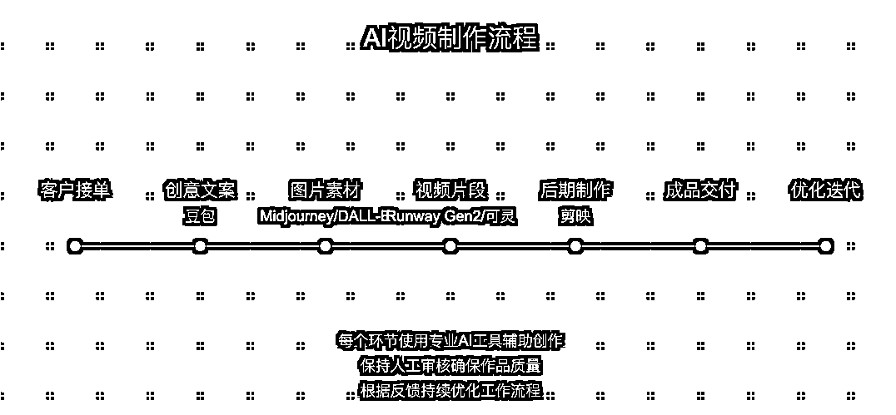
我知道的真实数据，
AI 视频单条报价可以到 5-6 位数，
头部工作室年营业额甚至抵得上一家中小型的广告公司。
要知道，以前制作一支高质量商业视频，
需要庞大的团队配置：导演、摄影、灯光、后期...但现在呢？
一个人，一台电脑，配上 AI ，就能创造出令人惊艳的作品。
就拿爆红的 AI 机器博主"土豆人"来说，
他为品牌打造的视频简直丝滑到让人过目难忘，
怪不得能开出 6 位数的天价。
但这个行业真正的门槛，从来都不是技术。
分镜的节奏把控、叙事的传统功底、后期的细节处理，
还有最核心的创意火花和审美素养 - 这些才是真正的制胜法宝。
放眼未来，随着 AI 技术的日新月异，
那些本就懂设计、有想法、审美在线的创作者，
将在这个赛道上大放异彩。
要知道，视频是最好的营销手段。
* * *
# AI 搞钱工作流：AI + 教育
AI 搞钱，培训市场无疑是当之无愧的"黄金赛道"。
新一轮教育培训的风口，包括上面也出台相关政策
李一舟靠着 199 的 AI 韭菜课程，
卖了 5,000 万。
中国从不缺需求，对 AI 知识的渴求程度。
未来对 AI 使用，大概率会纳入教材。
当然哈，现在做课程已经没有那么容易了。
我觉得，真正做出产品，做出流量，
有落地实操的课程，才具备交付价值。
包括线下培训课程，深度链接。
课程是否有含金量，
不是吹的，是靠真实成绩拿结果的。
想要在 AI 培训领域占据一席之地，已不再是简单复制过往的成功模式。
真正能够在未来脱颖而出的，必将是那些：
扎实的产品体系
可观的流量基础
务实的实操指导
完善的线下支持体系
深度的资源对接
尤其值得关注的是，线下培训与产业深度链接的模式正展现出独特优势。
在这个赛道上，
关键不在于喊出多么响亮的口号，
而在于能否交付真实的学习价值，
创造可见的培训成果。
有机会，我会专门讲一期，对 AI 教育的理解。
* * *
# AI 搞钱工作流：AI+自媒体
## 用 AI 做自媒体：小红书美妆博主的一天
清晨 6:30，手机闹铃响起，小红揉了揉惺忪的睡眼，摸索着点开 ChatGPT。"雅诗兰黛最新小棕瓶精华上市一周年"的热搜映入眼帘。她快速记录在 Notion，同时让 Claude 展开分析这款产品的市场反馈数据。
7:15，她在工作室的白色办公桌前端详着刚收到的小棕瓶新款。桌面右侧，MacBook Pro 上 Midjourney 正在生成产品的"前后对比"效果图 —— 这是她签下的一个 3000 元的品牌合作案。显示器上方贴着一张便利贴："本月目标：社群续费率提升到 85%"。
手机震动，一条私信弹出："小红老师，上次买了你推荐的水乳，皮肤真的改善了好多！能约个视频咨询吗？"这是今天的第三位咨询预约，299 元/小时的档期又要排到下周了。
9:30，她打开 HeyGen，开始录制新一期的美妆测评视频。"姐妹们，之前在社群里很多人问我这款小棕瓶..."自然的开场白后，她开始详细拆解产品成分。邮箱里，一个标题为"美妆进阶课程第三期收入统计"的邮件显示：已有 28 人报名，课程收入 8,372 元。
工作台旁边的白板上写着：
*   品牌合作谈判 14:00
*   社群周末直播 20:00
*   更新小红书笔记 3 条
*   剪辑 B 站长视频
*   联系抖音 MCN
下午，她登入美妆社群，98 位会员正在讨论上周的"秋冬补水攻略"。一位圈友分享道："跟着小红的建议换护肤品一个月，皮肤状态好太多了！"
晚上整理当日数据时，她打开巨量创意和新媒体管家，记录着增长的数据： 视频平均播放量 15.7 万 互动率 8.2% 粉丝增长 2,341 转化率 3.8%
躺在床上，她翻看着手机里的备忘录： "个人护肤品牌企划书 - 第一稿" "- 目标群体：25-35 岁轻熟龄都市女性..."
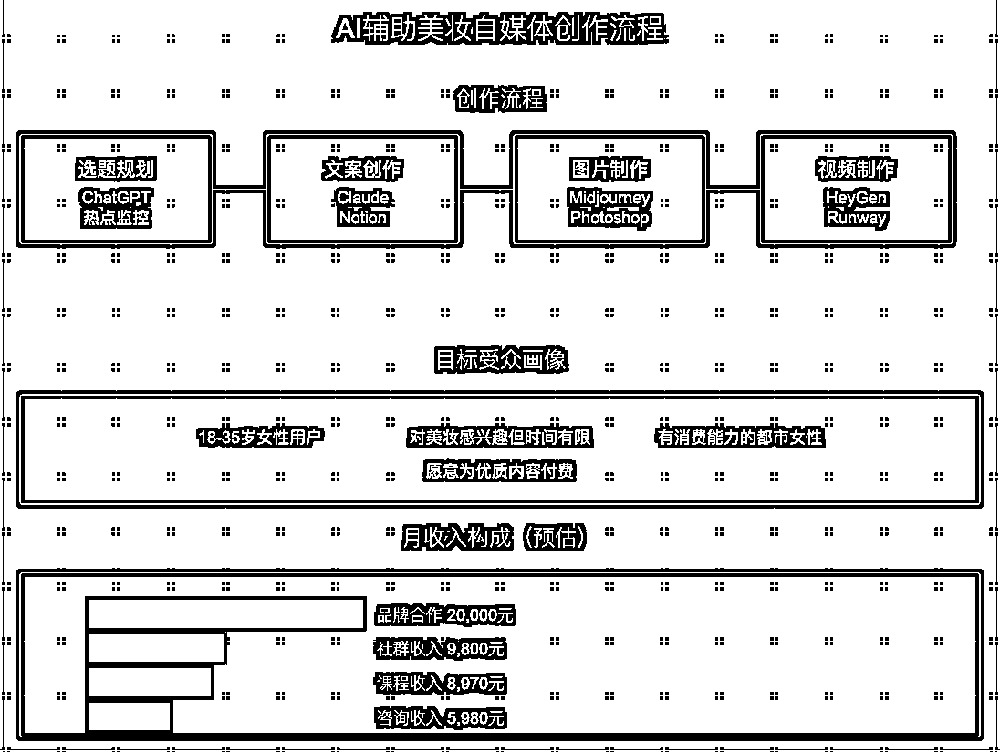
工作流程：
小红是一位美妆领域的自媒体创作者。
每天早上，她使用 ChatGPT 分析热点话题，生成 3-5 个选题方向。以"美妆新品首发测评"为例：
1.  使用 Claude 生成初始文案框架（选题、卖点、体验、总结）
1.  用 Midjourney 生成产品使用效果对比图
1.  通过 HeyGen 生成 AI 配音视频
1.  用 Runway 进行视频剪辑和特效处理
1.  最后由本人进行把关和润色，确保内容的真实性和个性化
具体工具链：
*   选题规划：ChatGPT + 小红书热点监控
*   文案创作：Claude + Notion
*   图片制作：Midjourney + Photoshop
*   视频制作：HeyGen + Runway
*   发布平台：小红书、抖音、B 站
*   数据分析：巨量创意、新媒体管家
目标受众：
*   主要：18-35 岁女性用户
*   对美妆产品感兴趣但没时间深入研究
*   有一定消费能力，愿意为优质内容付费
*   喜欢尝试新品，追求效率的都市女性
变现方式：
*   短期：品牌广告合作（单篇 1000-5000 元）
*   中期：付费社群（月费 98 元，提供个性化美妆建议）
*   长期：个人 IP 商业化（推出自有美妆产品）
*   副业：美妆课程（299 元/课程）
*   咨询：1 对 1 美妆搭配指导（299 元/小时）
收入构成（月收入预估）：
*   品牌合作：20,000 元（4-5 个合作）
*   社群收入：9,800 元（100 位付费会员）
*   课程收入：8,970 元（30 人购买）
*   咨询收入：5,980 元（20 个咨询订单）
总计：约 45,000 元/月
为什么这么多人，想做网红，IP？
因为太赚钱了，
起初我也不解，直到深入这个行业后才明白，
自媒体和个人 IP 已经成为了普通人最容易触达的财富杠杆。
不需要雄厚资金，不需要高端人脉，
你唯一需要的是：建立个人品牌，输出有价值的内容。
AI 技术的发展让内容创作变得前所未有的简单。
用 AI 辅助自己创作，表达。
在 AGI 真正到来之前，这段时间
将是内容创作者的黄金时代。
* * *
# AI 搞钱的底层逻辑
1.  内容变现路径
*   核心资产：优质内容
*   传播渠道：公域平台
*   变现方式：流量转化
*   关键点：内容质量+传播效果
1.  课程变现路径
*   核心资产：知识产品
*   传播渠道：私域社群
*   变现方式：产品销售
*   关键点：课程体系+社群运营
1.  咨询变现路径
*   核心资产：专业能力
*   目标用户：企业客户
*   变现方式：服务交付
*   关键点：解决方案+交付能力
1.  创作变现路径
*   核心资产：IP 价值
*   变现形式：多元化
*   变现方式：IP 授权/衍生
*   关键点：IP 打造+商业开发
1.  产品变现路径
*   核心资产：工具产品
*   目标用户：C 端用户
*   变现方式：产品订阅/销售
*   关键点：产品力+用户体验
这五条路径可以独立发展，也可以相互协同，
形成完整的商业生态。
选择哪条路径，
取决于你核心能力和对 AI 协作能力。
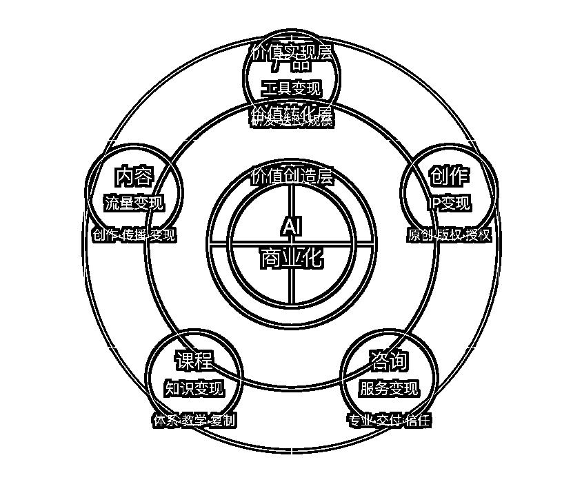
* * *
最后，我们再回到任老这句话
“这个时代一定会降低对人力的需求，但是创造的总财富增加了，
可以养活被裁掉的人。被裁掉的人不干活，少拿点钱；干活的人多拿钱。”
2024 年初，青山机械厂引入了新一代智能生产线。陈师傅在这干了二十年，是老面孔了。
"效率提升三倍。"厂长拿着报表，眼里闪着光。新设备运转的嗡鸣中，陈师傅看着自己的工位，默默收拾工具箱。
六个月后。
"今年产值翻了一番，"股东会上，厂长展示着亮眼的数据，
"人员优化后，人均产出提升显著。"
陈师傅家的客厅里，电视正播着《最强大脑》。"爸，这道题我会！"儿子小明兴奋地喊着。自从不用早出晚归，陈师傅终于有时间陪孩子了。虽然现在拿的是基础保障金，比原来工资少了些，但也够基本生活。
而在生产线上，留下来的张工程师工资涨了不少。"设备需要专业人员进行操作和微调数据，"他擦了擦额头的汗，"责任更大了。"
深夜，陈师傅躺在床上，望着天花板。"也许该去报个编程培训班，"他想着，"听说现在缺维修技术员..."
站在 AI 浪潮的风口，
在这个时代，什么才是真正的个人价值？
过去，我们习惯用收入来衡量一个人的能力。
但收入，不过是生产力的体现。
而生产力，正在被 AI 重新定义。
有人焦虑，有人恐惧。
但我看到的，是前所未有的机遇。
因为真正的个人价值，从来不是简单的劳动产出，
而是那份独特的、不可替代的创造力。
AI 工具就像一把锋利的手术刀，关键在于执刀者的技艺。
所以，核心问题不在于 AI 能否替代我们，
而在于我们能否：
成为 AI 工具的优秀使用者，
让 AI 成为我们能力的延伸，
用 AI 释放更多创造的可能。
工具永远是工具，价值始终在人。
提升认知、拥抱变化、善用工具，
这才是我们下一个人生杠杆。
* * *
作者介绍周知：
AI 觉醒派主理人，AI 工作流专家
AI 觉醒派 COZE 代表作品：
小觉醒思维助手，Suno 音乐歌词专家、智能笔尖，
未来想成为超级个体的你，链接我，
一起探索成为 AI 作家，AI 歌手，AI 艺术家。
```