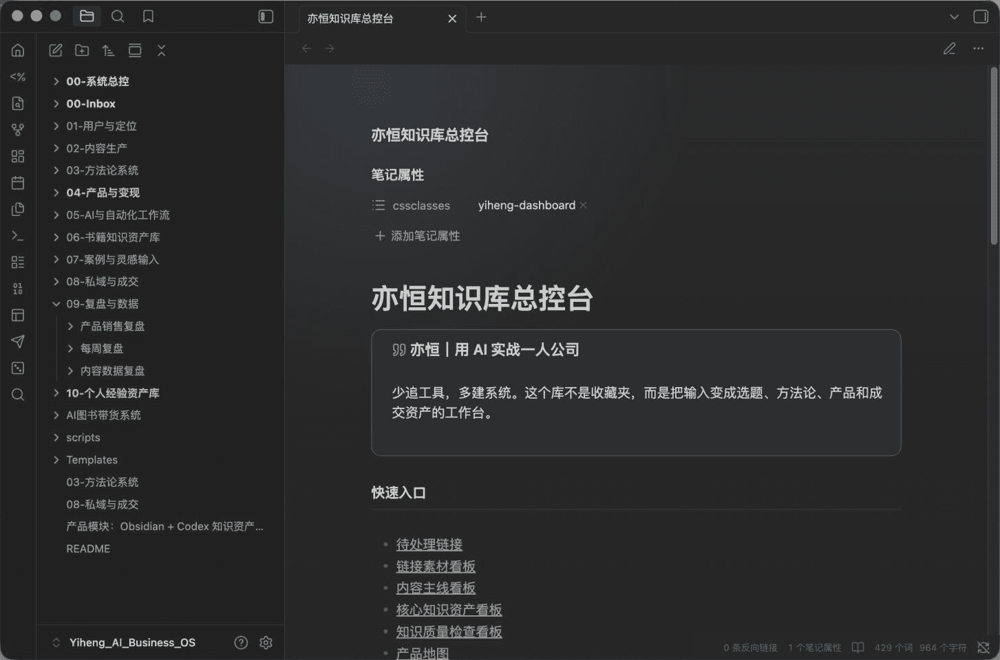
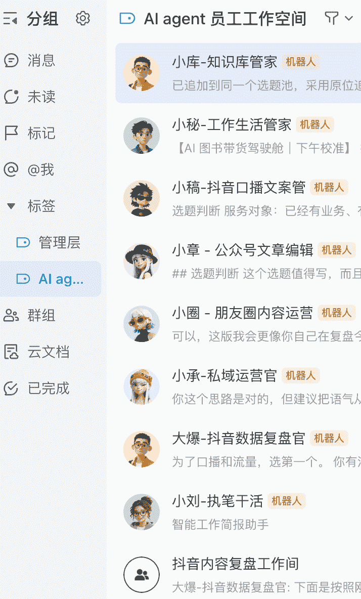
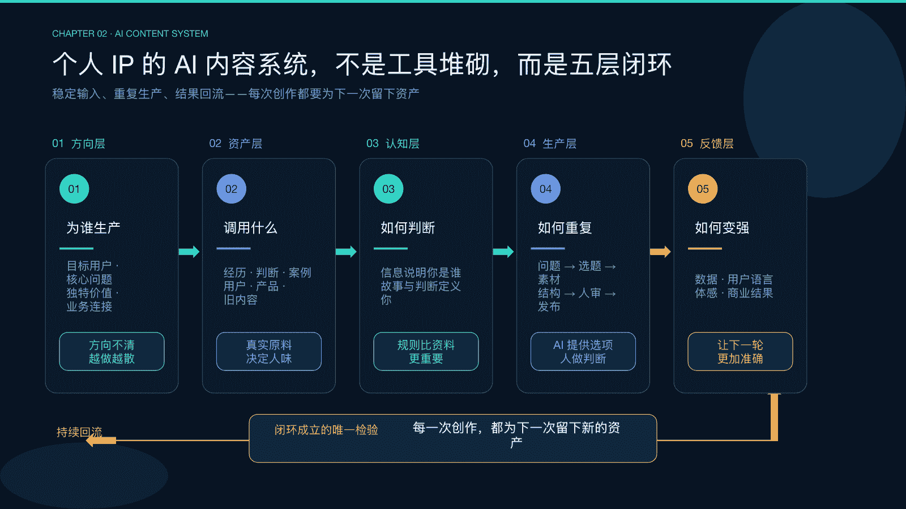

# 把个人沉淀变成可被 AI 反复调用的内容资本
作者：龙哥

260724 副业SC 精华

大家好，我是龙哥，很高兴受赚钱团队邀请，上周末跟大家聊了 AI 与个人影响力落地的实操。

我在图书赛道已经做了将近四年，前期主要做内容电商、流量经营和知识付费。去年十月开始尝试 AI 与影响力的结合，年底首个个人品牌项目达到十万营收，有兴趣可以看这篇复盘：

https://scys.com/articleDetail/xq_topic/22811428254242421

此前在赚钱也写过一些关于内容、电商、资料产品的思考，有需要可以回看：

超级术：

图书垂直小店：https://scys.com/articleDetail/xq_topic/82811885541851452

虚拟资料产品变现玩法：https://scys.com/articleDetail/xq_topic/5845845554115844

今年三月前后，我做了一次业务中台的升级。把过往的项目复盘、用户咨询、内容复盘和阅读摘记，逐步沉进 Codex 与 Obsidian 构成的私密知识库。下图是我现在在用的智能作业框架。

这不只是资料库，而是一套可落地的商业作业中台：Codex 负责思考与执行，Obsidian 负责长期记忆，Hermes 与飞书 CLI 负责把中台连向业务现场。经验、案例、素材和用户回流被重构成一套能持续产出、复盘、决策与变现的闭环，后续还会继续迭代。

整体来看，中台主要做三件事。第一，把历史项目经验、用户提问、案例素材与产品思路收敛进来；第二，让 Codex 基于真实原料参与选题判断、结构搭建与脚本生成；第三，把上线后的数据、评论、私信等回流写进中台，作为下一轮创作与产品判断的输入。

跑通后，我围绕 Codex+Obsidian 的账号累计播放已破百万。

这次的反馈让我意识到，读者真正关心的不只是某个工具，而是一个更底层的问题：如何把长年积累的知识、经历与项目，转化为能被智能系统持续调用的个人资产。

搭建之前，我的内容更多依赖灵感。想到一个方向就让模型扩写，成品逻辑完整却缺少个人韵味，也很难复用。

搭建之后，我会先从真实原料出发，比如一次复盘、一段现场录音、一本笔记、一条咨询或一次数据回馈。再让 Codex 提取事实、经历、判断、用户痛点与可复用方法，随后产出选题、骨架与复盘资产。

变化不只是效率提升，而是生产逻辑的迁移。

过去是：灵感出现 → 模型生成 → 修改发布 → 结束。

现在是：真实原料 → 资产卡 → 选题评估 → 创作 → 上线反馈 → 写回中台。

基于这段实践，我想拆解五个核心议题：

- 借助智能辅助后，为什么内容反而更杂乱？

- 一套适配个体品牌的智能内容中台应包含什么？

- Codex 如何把碎片原料加工成资产？

- 原料如何进阶为选题、骨架与可发布的爆款？

- 只有七天，如何跑通最小可用版本？

分享前先回应一个普遍好奇：在智能普及的阶段，为什么个体影响力反而更关键？

无论品牌方、个体创业者还是 OPC，讨论增长与升级时最终都落到内容。因为模型正在快速拉低内容生产门槛，会写稿、做图、剪片的人会越来越多，内容本身会贬值。

当人人都能生产，稀缺的不再是产量而是“用户信谁”。品牌需要具体的人承载价值，创业者需要影响力降低获客与成交成本，一人团队需要影响力放大个人能力。越普及，真实经历、独到判断与长期信任越稀缺。

个体影响力的意义不是包装成网红，而是让用户在同质化信息里辨认你、信任你，并在产生需求时优先想到你。因为模型可以制造大量标准答案，但用户最终愿意关注、咨询、付费的，仍是一个拥有真实经历、稳定价值观与解决能力的人。

工具会迭代，平台会更迭，但沉淀的信任可以跨周期迁移。

纯人工做影响力会遇到素材散落、产出不稳、经验难复用、每次从零开始。因此需要人机协同：人提供经历、观点、判断与信任；模型负责整理、关联、辅助创作与重复调用。

搭建中台的价值不在于写得更快，而在于把项目经验、踩坑记录、答疑积累与决策逻辑逐步沉淀为可调用的个人资本。模型放大效率，影响力建立信任，中台产生复利。

我的创作心法是：用模型的检索、整理与加工能力替代八成重复低效环节，保留两成无法替代的个人经历、观点与实战判断，保持内容的灵魂。

本质是降低试错成本，压缩从灵感、原料到上线的周期。模型的价值不是制造更多同质内容，而是帮助梳理过往经历、打磨思考，并沉淀为可反复调用的个人资本。

模型负责效率，影响力负责信任，中台负责复利。三者结合，才是一套能持续生产内容、建立信任、连接产品与生意的个体品牌体系。

## 一：为何借助模型后内容反而更混乱？

这是许多创作者的痛点。模型写稿极快，过去要想选题、查资料、列大纲，现在数分钟就能出一篇完整稿。

但使用一段时间后会发现：生成的文本越来越多，能看得上眼、愿意发布的却越来越少。生成二十个选题，选不出一个；写三篇稿，每篇完整却都不想发。

我也经历过。以前想到一个方向就丢给模型生成，结构完整、逻辑通顺，可读完总觉得不对劲——它哪里都对，唯独不像我。

缺少真实经历、判断缘由、项目坑点、个人表达习惯与金句。像一副标准骨架，缺血肉与灵魂。

判断是否具备品牌感，我常用一个办法：删掉作者名，这篇文章是否任何同行都能发？能，就只是合格的信息，不是你的品牌内容。

个体影响力的价值恰恰在无法复制的部分：

- 你经历过什么；

- 为何会这样认为；

- 第一次失败后如何调整；

- 面对同一问题，为何做出不同选择。

“人味”不是加几句口语词，而是真实发生的事与你对它的判断。我们提高了生成速度，却没提高判断力。以前一天一个选题只需要一次判断，现在模型一分钟给几十个选题，选择与返工成本反而上升。

我把这种错位总结为四点。

### 1. 目标错位

要求模型写爆款，却没说明写给谁、解决什么问题、建立什么信任、导向什么结果。没有目标的生产只会堆积选择。

### 2. 输入错位

只给一个选题和一句提示，却没喂入真实经历、案例、用户问题、产品信息与历史判断。没有原料，模型只能产出公共表达。

### 3. 分工错位

把定位、故事、立场与判断全交给模型，自己只负责改。而正确分工是：人定方向、经历、立场与判断；模型做整理、连接、扩展与复用。

### 4. 闭环不完整

大部分流程是：选题 → 模型写稿 → 发布 → 结束。发布后的评论、私信、数据没有写回中台，每次创作都是临时任务，模型也不懂你。

内容与内容资产不同。发布即消失的是一篇内容；能被下一条选题、产品设计与用户沟通继续利用的，才算资产。

未来结构完整的内容会越来越容易，真正稀缺的是真实经历、可验证判断与一套能持续调用它们的系统。

问题不在于缺一个提示词，而是要从“让模型替我写稿”升级到“让模型进入长期积累的个体品牌内容中台”。

### 个人 IP 背景提炼提示词

你现在是我的个人 IP 背景访谈顾问。任务不是包装虚假人设，而是通过访谈提炼真实经历、能力、观点与判断，形成可被 AI 长期调用的《个人 IP 背景说明书》。请围绕下面方向访谈我：

1. 我是谁，现在主要做什么？

2. 我想服务哪类人，他们遇到什么问题？

3. 过去有哪些相关经历、项目与结果？

4. 经历过哪些失败、转折或认知变化？

5. 我擅长解决什么具体问题？

6. 对这个领域有哪些明确观点与判断？

7. 反对哪些常见做法，为什么？

8. 用户凭什么信任我？

9. 我的表达风格、常用语言与内容边界是什么？

10. 内容最终想连接什么产品、服务或长期目标？

访谈规则：

- 每次只问一个问题，根据回答追问。

- 回答抽象时，请补充时间、场景、人物、行动与结果。

- 不编造经历、数据、观点与成绩。

- 区分“真实事实”“个人判断”“未确认信息”。

- 优先挖掘难以复制的经历、选择、失败、案例与判断。

- 暂时不写文章，不急着定位。

访谈结束整理成：

一、基础身份

二、目标用户

三、关键经历

四、核心能力

五、观点与判断

六、信任依据

七、表达风格

八、业务连接

九、独特素材库：最值得用于创作的 10 个故事或案例

十、待补充信息

最后用一句话概括：“我是一个______，通过______，帮助______解决______问题。”现在从第一个问题开始。

## 二：个体品牌的智能内容中台该如何搭建？

很多人听到中台会先想到工具：飞书、Notion、Obsidian 怎么选？怎么分文件夹？要不要自动化？这些是中台的一部分，不是中台本身。

从实践看，判断一套东西是不是内容中台，看三点：

- 是否有稳定输入，模型能否持续看到你的经历、项目、用户与历史内容？

- 是否有可重复的生产路径，换一份素材仍能按同样方法产出？

- 结果能否回流，数据、评论、用户问题是否影响下一轮创作？

我把个体品牌的智能内容中台拆成五层加闭环：方向层、资产层、认知层、生产层、反馈层。

### 第一层：方向层

解决模型为谁、为什么生产内容。至少回答：服务谁？对方正经历什么问题？我能给出什么独特价值？想建立什么认知？内容最终连接什么产品或业务？

方向不清，模型越强内容越散。内容边际成本趋零，但判断力与内容价值成本在上升。模型能填充血肉，不能决定灵魂，没锚定只会产出“正确的废话”。

### 第二层：资产层

解决模型能调用哪些属于你的原料。个体品牌的原料有六类：个人经历与故事、观点与判断、项目与案例、用户真实对话、产品与服务、历史内容与数据。

资产层不是收集更多外部资料，而是把已拥有却未整理的经验打捞出来。模型懂逻辑，你懂生活；模型有智商，你有故事。没有这一层，模型只是在写别人的故事。

### 第三层：认知层

让模型不仅知道你有什么，还逐渐理解你怎么判断。需要让它看见信息、故事与判断。信息说明你在做什么，故事说明你为何成为今天的你，判断说明你面对具体问题时的选择。

一次失败是经历，总结出以后如何选择、什么不再做时，它才变成可重复调用的判断规则。知识库需要经过本人确认的经历、观点与规则才进入长期系统。

### 第四层：生产层

把临时创作变成可重复流程。基础路径：用户问题或母题 → 选题判断 → 调取真实素材 → 生成内容结构 → 人补充经历与观点 → 复核 → 发布。不是模型先写人再改，而是模型基于问题与资产提供选项，人做最终判断。

### 第五层：反馈层

让发布结果回流系统。至少收集四类反馈：内容数据、用户语言、创作体感、商业结果。目的是帮助判断什么值得保留、什么需删除、什么该升级，而不是预测爆款。

五层组合后，需一个闭环。每一次创作是否给下一次留下新的资产？若每次发布后系统多了一段经历、一条判断、一个用户问题或一次复盘，系统就会越用越强。

### 个人IP内容系统盘点提示词

你现在是我的个人 IP 内容系统诊断顾问。请帮我盘点当前创作方式，判断 AI 内容系统缺失的环节，给出最小可执行的优化建议。围绕五层访谈我：

1. 方向层：目标用户、核心问题、内容目标与业务连接是否清晰？

2. 资产层：是否积累了个人经历、观点、案例、用户问题、产品资料与历史内容？

3. 认知层：AI 是否了解我的故事、立场、判断标准与表达边界？

4. 生产层：从素材到发布是否有可重复流程？

5. 反馈层：数据、评论、私信、创作体感与商业结果是否回流系统？

访谈规则：

- 每次一问，根据回答追问。

- 了解真实做法，不要用理想流程补充答案。

- 区分“已具备”“部分具备”“尚未建立”。

- 不先推荐复杂工具或自动化。

- 优先找到最影响生产的 1-2 个关键问题。

输出结构：

一、系统现状，一句话概括阶段

二、五层诊断：方向/资产/认知/生产/反馈 各自现状、问题、建议

三、关键断点：目前最影响运转的三个问题，按优先级排序

四、已有资产：可立即调用的内容资产清单

五、最小优化方案：未来 7 天最值得完成的三个动作

六、闭环检验：每一次创作是否能为下一次留下经历、判断、用户问题或复盘资产

以下是我的个人IP背景说明书：【粘贴IP背景说明书】

现在从第一个问题开始访谈我。

为了让这套方法更易理解、更易上手，我把“把一批零散素材，变成可反复调用的内容资产卡”这一过程展开说明。

## 三、用 Codex 将碎片素材固化为内容资产

前文已经勾勒出个人 IP 内容系统的全貌。真正让系统运转起来，往往不是先搭建文件夹，而是让一份真实的原材料进入系统。

对个人 IP 而言，可被吸收的原材料很多：一次线下分享、一段即兴录音、阅读笔记、过往项目、用户提出的疑问，以及发布后的数据，都是潜在资产。形式各异，加工路径本质相同：

原始材料 → 拆分事实来源与主观判断 → 与真实用户痛点挂钩 → 提炼可复用的方法 → 延展选题方向 → 沉淀为产品或工作流 → 以真实数据持续校验。

下面用四个情境演示这条路径。线下录音部分现场演示；书籍、学习文档与数据则以已有成果快速呈现逻辑与效果。

### 案例一：一段线下录音如何变为可复用的经验资产

也是今天现场演示的重点。

对赚钱圈友而言，活动结束、分享完毕或深度交流后，常会留下数十分钟到数小时的录音。里面往往藏着价值：亲历故事的讲述、现场产生的判断、回应提问时的金句、尚未正式梳理的方法、听众最关心的议题。

可活动一结束，录音大多躺在飞书妙记、手机或电脑里。最多转成逐字稿便停止。

逐字稿不等同于资产，它只是把声波变文字。真正的资产化要回答：这段录音里哪些属于我？哪些判断未来还能被复用？

#### 第一步：拿到原始录音与转写

原始转写体量庞大，混杂重复表述、口语停顿、临时举例与识别错误。

直接让 AI 把它压缩成一篇稿，往往只得到一份会议摘要。摘要能说清讲了什么，却未必指出哪些值得进入 IP 系统。

因此我不会指令 Codex“总结录音”。先让它阅读：

我的定位；目标读者；现有知识库结构；这份转写；已有的方法论与资产。

随后明确要求：先不写稿。请识别录音中出现的真实经历、核心判断、可复用方法、用户提问与可验证案例。区分原始表达、整理与需要我确认的信息，不要为我虚构经历。

#### 第二步：打捞真实经历与判断

Codex 的首要工作不是生产内容，而是从大量口语中捞出价值。

它可提取：我讲述了哪些亲历；该经历想说明什么；在何处表达了明确立场；哪些观点反复出现；哪些判断与既有方法一致；哪些可能是新判断。

此环节最关键的是人工确认。AI 可提示某句疑似核心观点，但是否真正相信、能否代表长期立场，最终由我决定。只有本人确认的经历与判断，才会进入长期库。

#### 第三步：把口头经验提炼为可操作的方法

录音中有些内容只是随口数分钟，Codex 可协助梳理为：问题是什么 → 为何发生 → 我如何解决 → 哪些步骤可重复 → 适合谁 → 有何边界。

经此处理，一段口头经验可变为：经验卡、方法卡、操作 SOP、创作规则或课程模块。

  

上图即为该录音处理后输出的方法论卡片截图，仅展示部分。

于是，一场分享的录音可继续沉淀为：分享逐字稿、公众号长文、短视频选题、学员高频问题、下期课结构、可交付的模板清单。

录音资产化的本质不是“录音变文字”，而是把一次表达，变为未来可反复调用的经验、方法与产品资产。

#### 第四步：打开更多内容方向

获得经验卡和方法卡后，再让 Codex 生成选题。

可要求分别输出：适合短视频的冲突型选题；适合公众号的深度选题；适合朋友圈的信任型个人经历；适合课程或产品的操作模块。

现场可一起判断：上图中的哪些选题具备爆款潜质，哪些仅有流量假象？

  

再追问：哪些选题承载了叙述者经历？哪些能连接目标用户的真实困扰？哪些方法值得继续沉淀为产品？

原则不变：AI 负责发现、整理与候选，人负责决定留存。

至此 MVP 已跑通：一段录音从一次性表达，变为可持续生产内容、课程与产品的资产。

### 案例二：一本书如何从知识输入变为业务工具

以近期阅读的《真需求》演示。

过去读书多为摘抄金句、写读后感或让 AI 概括。全书摘要不等同于个人资产。

我让知识库 Agent 处理《真需求》时聚焦三件事：区分作者原意与我的业务应用；把书中方法连到内容、产品、私域与 AI 工作流；把抽象知识变为可直接使用的工具卡与诊断工具。

最终，书在知识库中不再只是一份总结，而是：书籍总览卡、章节精读卡、原子方法卡、真需求诊断工作流、内容选题、产品自检表、私域问诊问题。

例如书中“产品特性不等于用户感知价值”这一观点，进入业务后可加工为：产品特性 → 使用场景 → 内容需求挖掘 → 用户可感知变化 → 可信证据。

于是“Codex 可读取本地知识库”不再是功能介绍，而是落地场景：下次写公众号时，无需翻阅几十份资料，Codex 可从已确认的方法与案例中调取相关内容。

此时，书的知识才真正进入内容与产品系统。

书籍资产化的关键不是总结更全，而是这本书是否改变了判断，并能否进入真实工作。

### 案例三：发布数据如何回流为新的内容与产品资产

前三个案例属输入端资产化。第四个案例发生在发布之后，且更关键。创作者若只关注输出，忽视发布后数据、复盘与对成败经验的沉淀，便难形成可复用资产。

不少人流程到发布就结束，播放高则喜，播放低则换题。

但数据本身即是重要素材。如我此前一条视频播放超 10 万，另有完播、收藏、评论、私信、新增关注等综合数据。只看播放只能得出“表现不错”。把各项放一起，才能判断：用户为何收藏；哪观点击中真实需求；为何分享关注高；完播为何不理想；下一条应保留什么；哪些用户问题值得深挖。

复盘后发现评论区高频词是“知识库”。用户关注的不仅是 Codex 或 Obsidian，而是：如何把自己的知识、经验与项目变为可反复调用的系统？

该信号可沉淀为：下一轮系列选题、知识库最小结构、内容资产卡模板、搭建教程、产品需求假设、咨询诊断问题。

数据复盘不是解释“为何爆/不爆”，而是完成：发布结果 → 用户行为 → 需求判断 → 内容规则 → 下一轮选题 → 产品验证。

这一步让内容系统从单向生产变为根据真实反馈持续调整。

#### 底层逻辑统一

四个案例并置：

线下录音沉淀个人经历、方法与 SOP；书籍沉淀知识方法与业务工具；学习文档沉淀个人判断与方法论；发布数据沉淀用户需求、内容规则与产品信号。

输入形态各异，却走同一加工链：原始材料 → 事实与来源 → 个人经历与判断 → 对应用户问题 → 可复用方法 → 选题 → 产品或工作流 → 数据验证。

于是个人 IP 内容系统不是文章仓库，而应持续接收三类输入：学到了什么；经历与实践了什么；真实用户与市场反馈了什么。

再逐步转化为三类资产：内容资产、产品资产、判断与工作流资产。

这才是 Codex 参与个人 IP 内容系统的核心价值。它并非凭空造人设，而是把散落在录音、书籍、文档、项目与数据中的东西组织起来，让一次学习、一次表达、一次发布，都能为下一次工作提供养分。

资产越积越多，并不等于自动变为生意。

### 内容资产化提示词

以“个人 IP 内容资产整理顾问”身份执行任务。我会提供一份原始材料，可能为线下录音、会议逐字稿、书籍笔记、学习文档、项目复盘、用户咨询或内容数据。任务不是立刻写稿，而是把一次性材料整理成可反复调用的《内容资产卡》。

先读取：1. 我的《个人 IP 背景说明书》；2. 本次原始材料。

处理约束：不得编造材料中未出现的经历、数据与观点；明确区分“客观事实”“材料原意”“我的判断”“AI 推断”；找不到的信息标注“待补充”，不自行补写；优先提炼与目标用户、内容方向、业务相关信息；暂时不输出完整文章。

结构如下：

一、素材信息：类型、来源、发生时间、核心主题、可信度与待确认信息。

二、事实与原意：材料中明确出现的事实；原作者或原始表达的核心意思；可直接引用的数据、案例或场景。

三、个人经历与判断：材料关联到我的哪些经历或项目；它印证、改变或补充了什么判断；哪些内容最能体现立场；还需补充哪些真实细节。

四、对应用户问题：目标用户正面对什么问题；他们通常如何描述；材料为何值得关注。

五、可复用方法：把材料提炼成可重复使用的方法、框架、检查清单或 SOP，并说明适用场景与边界。

六、内容选题：分别生成 3 个曝光型、3 个信任型、3 个转化型选题，每个说明目标用户、核心观点与适配材料。

七、资产应用判断：判断材料还能沉淀为内容资产、产品资产、案例资产、判断规则、工作流程或 SOP。

八、写回建议：建议资产卡保存位置、使用标签，未来可被哪些创作任务调用。

整理完成后先展示资产卡，不直接写完整文章。若缺少关键个人经历或判断，每次只追问一个问题。

以下是我的个人 IP 背景说明书：【粘贴 IP 背景说明书】

以下是本次原始材料：【粘贴录音转写、文档、笔记、复盘或数据】

接下来必须回答：从内容系统走向 IP 生意闭环，中间缺了什么？

## 四、从内容系统到 IP 生意闭环，关键差距

一句话：内容系统解决“如何持续生产真实、有价值、可积累的内容”；生意闭环解决“这些内容如何找到对的人、建立信任、承接需求并形成持续价值交换”。

重要判断：IP 是业务放大器，但 IP 不是业务本身。流量可放大已有产品与需求，信任可降低成交成本。若缺少清晰用户、真实问题、可购买产品与交付能力，IP 不会凭空创造生意。

内容闭环通常为：素材 → 内容 → 发布 → 数据 → 复盘 → 下一条内容。

生意闭环需向前后各延伸一步：真实用户需求 → 内容触达 → 持续建立信任 → 用户采取行动 → 产品或服务承接 → 完成交付 → 产生案例与反馈 → 重新成为内容。

走向生意闭环，我的经验是完成三步。

### 第一步：真实需求

做选题时别只问有没有流量，还要追问：吸引来的是不是目标用户？对应什么真实问题？用户是否已为此投入时间、金钱或精力？与我的产品与能力有何关系？

同样聊 AI，最新工具测评可能吸引大量工具爱好者，但若服务是个人 IP 内容系统，这批人未必是目标。

反之，播放不高的内容，若评论区反复出现“资料怎么整理”“AI 写出来不像我”，可能更有商业价值。

### 第二步：信任路径

并非每条内容都要直接销售，但每条内容应清楚承担的任务。

曝光型内容让目标用户首次看见你；信任型内容展示经历、案例与判断；转化型内容让已有需求的人知道下一步做什么。

个人 IP 的信任很少单条内容完成，而是围绕同一用户问题递进：先让用户意识到问题，再理解你如何判断与解决，最后让真正有需求的人行动。

### 第三步：下一步承接

用户看完若产生需求，接下来可去哪里？

不同阶段可对应：关注系列；领取自检表或模板；提交具体问题；参加公开答疑或诊断；购买边界清晰的产品或服务。

真正承接不是把用户从公域搬到私域，而是让他的问题进入可被持续理解与解决的路径。

例如此前关于知识库的视频，评论区反复出现“知识库”。说明用户看到的不是 Codex 工具，而是一个与自己相关结果：过去的知识、经验与项目可被整理成随取随用的个人资产。

下一步不是复制十条相似标题，而是判断用户真正需要什么：工具教程、文件夹模板，还是完整的内容资产化方法？

这些真实问题可长出知识库最小结构、内容资产卡模板、7 天清单、搭建手册或诊断服务。产品交付后，用户结果又变为新案例与内容，于是闭环形成：

需求 → 内容 → 信任 → 行动 → 产品 → 交付 → 案例 → 再传播

用三个问题自检：内容正在吸引谁？用户为何通过内容信任我？当用户产生需求时，下一步去哪？

若答不上来，问题多半不在更新频率，而在内容与生意未真正连接。

### 从内容机会到最小商业闭环设计提示词

担任我的个人 IP 商业闭环顾问。我会提供个人 IP 背景、目标用户、内容选题、现有产品与历史反馈。目标不是优化文案，也不是强行设计销售话术，而是找到一条可真实验证的最小商业闭环：

目标用户 → 真实需求 → 内容触达 → 信任建立 → 用户行动 → 产品承接 → 完成交付 → 案例回流

遵守规则：

1. 不把播放量等同于商业价值。

2. 不默认用户提问就代表愿意付费。

3. 不虚构用户需求、案例、产品与成交数据。

4. 不罗列大量方向，只选择当前最值得验证的一条路径。

5. 无产品时可设计最小验证方案，不设计复杂产品。

6. 区分客观事实、已有证据、个人判断与待验证假设。

7. 每条内容只承担一个主要任务：曝光、信任或转化。

分析步骤：

一、确定目标用户：这次内容应吸引哪类人？他们正经历什么具体场景？问题带来多少时间、金钱或情绪成本？哪些人不是目标？

二、验证真实需求：检查是否存在证据：用户主动搜索或反复提问；评论、私信、咨询中出现高频问题；用户已尝试其他方案；用户为此投入过时间、金钱或精力；问题具紧迫性；已出现咨询、购买或交付记录。

将需求判断为已验证需求、初步需求或待验证假设，并说明依据。

三、判断用户阶段：目标用户处于尚未意识到问题、已意识到问题、正在寻找解决方案、正在比较方案、已准备行动中的哪个阶段，进而决定内容任务。

四、设计内容切口：输出核心用户问题、内容核心观点、最适合的真实经历/案例/判断；说明内容属曝光型、信任型还是转化型；用户看完后应产生什么认知或行动。

五、补充信任证据：检查内容是否具备真实经历、项目案例、方法或判断、数据与结果、用户反馈、适用条件与服务边界；指出最缺少的信任证据及补充方式。

六、匹配产品方案：核对现有产品是否匹配用户问题：产品解决什么具体问题；适合哪类用户；提供什么明确交付；购买后会发生什么变化；哪些人不适用与交付边界；内容承诺与交付是否一致。

若暂时无成熟产品，设计最小验证版本：清单或模板、一次公开答疑、一次标准化诊断、小型训练营、边界清晰的服务、可预售的最小产品。不设计大而全课程或复杂服务。

七、设计最短转化路径：设计一条自然、低摩擦的用户路径：

你是不是也遇到过这种情况：收藏了大量关于借助AI做内容的方法，换了好几套工具，账号数据却始终平平，内容仍然得靠自己硬写。

问题往往不在投入度，而在底层逻辑是散的。AI一加入，散的地方会被进一步放大。

下面这份从触达到变现的整体框架，是我自己实操后做的梳理，建议先存下来，慢慢对照。

一、先把用户走到付费的路径看清楚

一条内容被发出到最终产生付费，中间需要一条设计好的走线：

内容入口 → 产生兴趣 → 完成低门槛行为 → 提交真实问题 → 进入咨询或诊断 → 匹配方案 → 完成成交

每一步都要逼自己回答四点：

用户当前需要完成什么行为

这一步我应该给出什么

什么信号说明他进入下一站

什么阻碍会让他卡在这一站

把这四点填满，内容才不再是发完即止，而是把人一步步推向成交。

二、每个阶段只给单一承接指令

最容易出错的是：一篇里同时要关注、加群、领资料、买课，用户根本无所适从。

正确做法是，根据所处阶段，给出最轻的下一步：

追更一个系列、评论指定关键词、领取清单或模板、填写问题问卷、参加公开答疑、预约标准化诊断、购买边界清晰的产品。

承接表达要自然、不强求。例如：“想要模板的朋友，评论区回复‘模板’，我看到后会私发。”

三、交付之后要做沉淀

产品交付并非终点，而是下一轮创作的起点。交付结束后，需要记录：

用户起初的问题

解决思路

使用的方法

最终效果

用户的主观反馈

仍未解决的点

可对外公开的案例片段

产品本身可优化的环节

这些信息会成为下一轮的内容弹药、信任背书和产品迭代依据。一次交付，要为下一次增长储备养分。

四、用数据说话，不要凭感觉

不必追太多指标，七个维度足以：

曝光，目标人群是否愿意停留

信任，是否出现收藏、关注和有效互动

线索，有人是否提交具体问题

咨询，需求是否变得清晰

成交，是否愿意为解决方案买单

交付，用户是否获得预期结果

回流，是否沉淀为案例并反哺选题

先聚焦当前最需要验证的那个，其余逐步补充。

五、把商业闭环压缩成一条线

目标人群 → 真实痛点 → 内容切口 → 信任凭证 → 行动诱因 → 咨询承接 → 产品设计 → 交付结果 → 案例回流

这条线可以很短，但必须真实。信息不足时，宁可一次只追问一个问题，靠真实回答推进，不要靠想象补全。

随后给自己安排七天最小验证，每日自检：今天发布什么、验证什么假设、用哪个钩子承接、收集哪些反馈、依据哪个数据决定继续、调整或停止。

六、七天跑通最小可用内容系统

最大坑是：还没验证出结果，就先搭建完美后台。

我早期也这样，需求不清却被工具带着走，目录越建越多，自动化越弄越复杂，时间与 Token 都耗光，一个月下来也未稳定产出一条真正属于自己的内容。

因此 MVP 只验证一件事：能否把一份真实素材稳定转化为自己的内容，并留下可复用的资产。

最小链路只有五环：

真实素材 → 资产卡 → 明确选题 → 发布内容 → 反馈归档

工具层面只需要五类区域：

00-IP说明

01-原始素材

02-资产库

03-选题与创作

04-发布与复盘

七天演练如下。

首日，定范围

只锁定四项：目标人群、核心议题、发布平台、阶段目标。

不要写“服务所有想学AI的人”，要写成“已在做个人IP，却发现AI写的东西不像自己的人”。

产出：一张目标卡。

次日，完成一页IP说明

整理信息、经历与判断三类，让模型能说清：你是谁、服务谁、凭什么可信、长期关注什么、表达边界在哪。

产出：一页IP说明。

第三日，收集五份真实素材

来源可以是个人经历、项目复盘、用户提问、旧稿、读书笔记或交付记录。

筛选标准：与目标人群相关、含有真实经历或判断、后续可复用。

产出：五份原始素材。

第四日，完成首张资产卡

选其一，由系统整理来源、事实、个人判断、用户问题、可信佐证、可复用方法、选题方向。

务必区分事实、判断与模型推断；案例不足时留空，不允许虚构。

产出：一张资产卡。

第五日，生成选题并只留其一

由系统提供备选，最后由人根据人群、目标与判断筛选出唯一选题。

产出：一个确定选题与一份结构。

第六日，人机协作并上线

系统负责结构与素材整理，人负责补充经历、立场与情绪，最后人工校验事实、表达与承接。

重点不是是否爆款，而是首次把真实素材走通发布流程。

产出：一则已上线内容。

第七日，完成首次复盘归档

记录数据表现、评论私信、创作感受、下一步调整方向。

先把事实、解释与待验证假设分离，再把已确认的内容写回系统。

产出：一张复盘卡。

七天后，用五问验收：

模型是否基本理解定位与人群

素材能否稳定转为资产卡

选题是否对应真实用户问题

成稿中是否有个人经历与判断

发布反馈是否进入下一轮创作

五问皆满足，MVP 即算跑通。

起步期有三件事不要做：

一次性导入所有资料，质量远大于数量

过早追求全自动，流程未通自动化只会加速错误

把搭建系统当成拖延发布的借口，没有真实发布就没有反馈

升级顺序应该是：

真实输入 → 得到可用结果 → 归纳判断规则 → 反复验证 → 固化流程 → 最后再自动化

系统的价值不在于复杂度，而在于需要时能否稳定交付。

七、记住五点

AI 并不能解决内容混乱，它只会把混乱放大

个人IP内容系统应包含方向、资产、认知、生产、反馈五层，每次创作都要留下资产

模型的最大价值不是一键生成，而是把散落素材整理成可调用的资产

内容要变现，必须串起真实需求、信任路径与清晰承接

不要先建完美知识库，先用七天跑通一次真实闭环

如果只记一句：

别把AI当成内容印钞机，它真正的价值是重构、整理、连接并放大真正属于你的经验、判断与商业系统

未来生成会越来越容易，不会贬值的永远是你的真实经历、项目判断、用户信任以及把经验转化为解决方案的能力

所以不必等准备完全，就从一份真实素材开始，用七天跑通第一个闭环

把随机灵感沉淀为可积累资产，把临时使用AI转变为长期的人机协作

——分割线——

读完这套SOP，你可能觉得已经懂了。但实操时，九成的人卡在第一步

工具和教程永远是最低门槛，真正拉开差距的是立刻动手与圈层信息差

我们不聊虚的，只做商业闭环拆解与AI效率压榨。系统内已沉淀1000+跑通的套利实战局

👉 查阅圈子完整数字资产与上车门槛：

