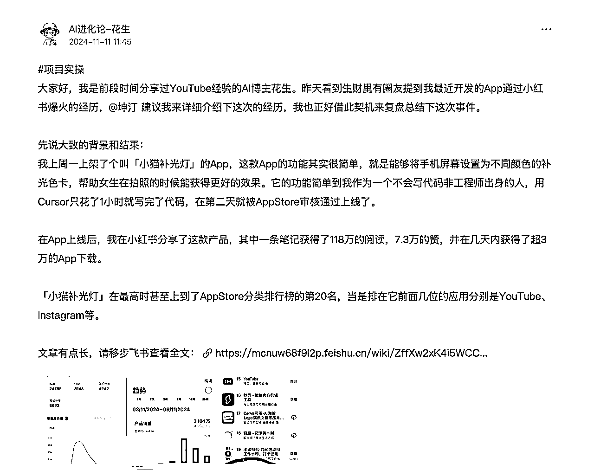
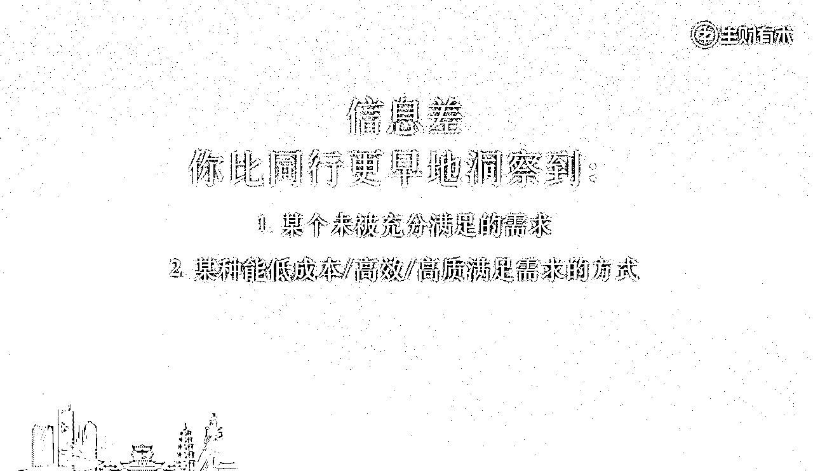
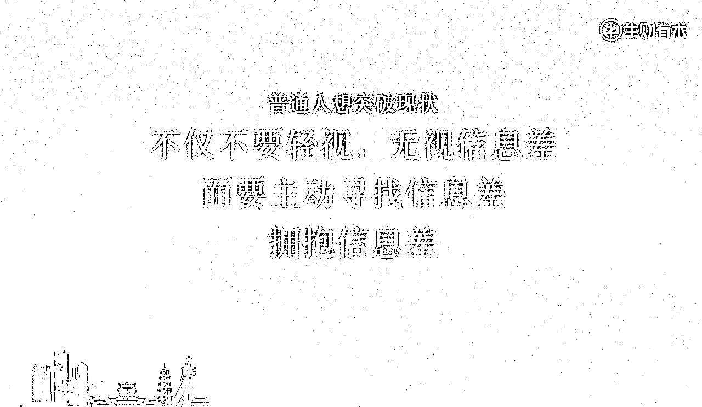
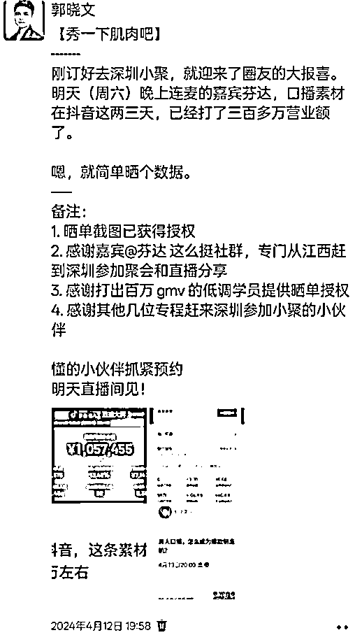
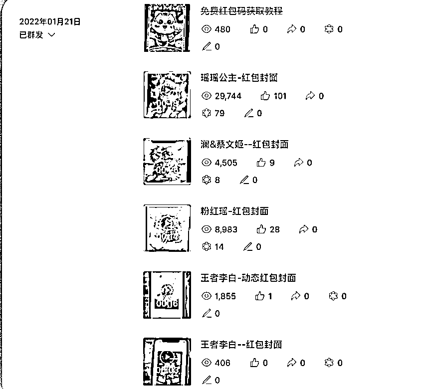
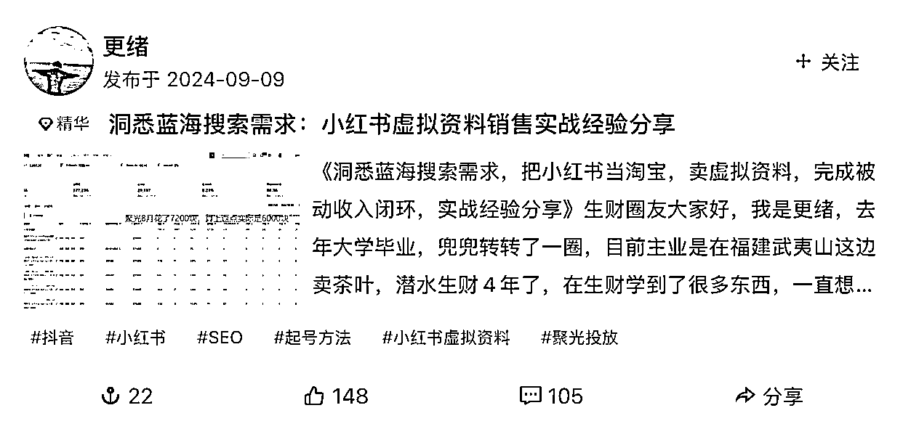
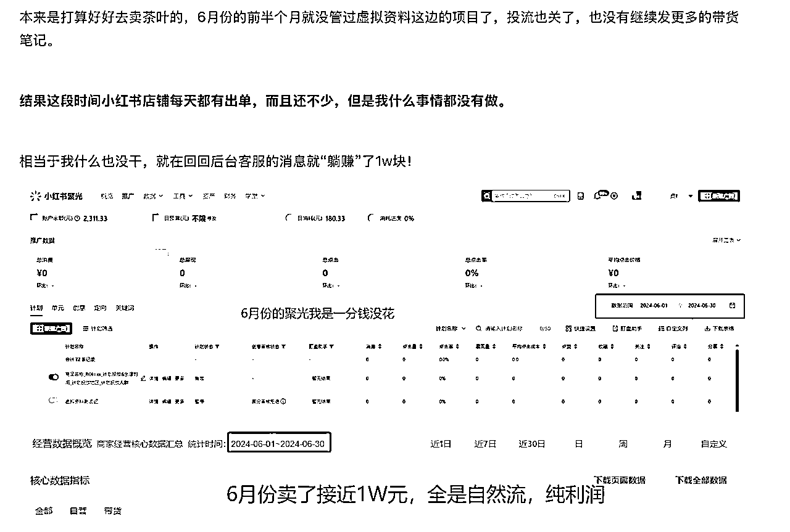
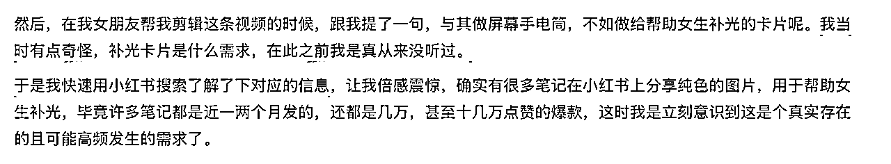
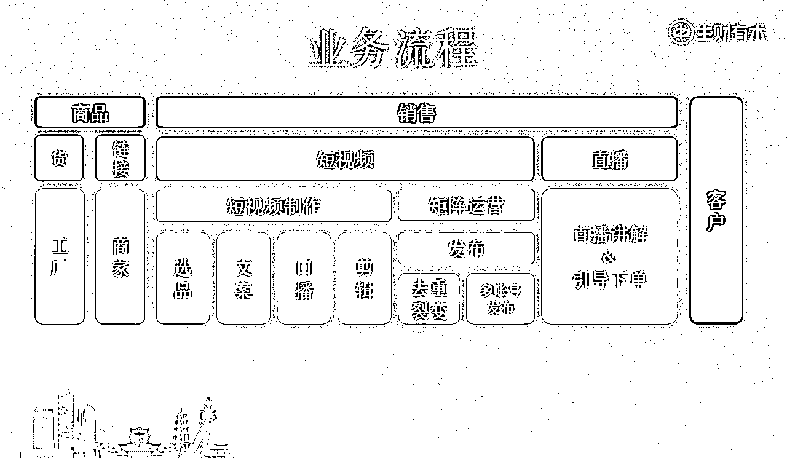

# 新手的第一堂商业课：玩弄信息差的艺术（年会演讲逐字稿）

四年前，我还蹲在创业失败的废墟里，不知道下一步该往哪走；四年后，我敢站在这里，和大家聊一聊关于赚钱、选择和信息差的事。我是龙哥，很多人叫我“最懂新手的男人”。

最近收到龙哥盟福建圈友见面会的邀请，我犹豫了很久。因为正扑在一个新方向上，没什么表达欲。直到有天夜里，脑子里突然冒出一句话：如果现在的我，能对四年前那个又穷又慌的自己说点什么，该多好。然后我就答应了秀儿，于是有了今天这场分享——新手的第一堂商业课：玩弄信息差的艺术。

## 为什么新手要先懂信息差？

因为搞钱新手，正卡在两个身份中间。

往前一步，是打工人；往后一步，是单干的人。而这两种状态，最本质的差别，不在于努力，不在于能力，而在于——谁帮你选。

打工人常自嘲是“牛马”。牛马可怜吗？看着挺可怜的。但牛马有个隐形福利：骑在你身上的人，知道哪片草地有吃的，他会告诉你“什么时候吃、用什么姿势吃、去哪里吃”。

等你自己出来单干，画面就变了。自由是真的自由，但有代价：找食得自己找，姿势得自己琢磨，方向得自己定。你要自己回答“什么时候、用什么方式、去哪里”。

也就是说，从你决定独立搞钱那一刻起，你自由了，也必须自己扛了。以前有人帮你选，虽然收走大部分劳动成果，但至少给你兜底，饿不死。现在你自己选，抢到的草都归你，但选错了，可能连饭都吃不上。

那怎么选？

## 把独立搞钱当成一场游戏

刚开局你是个穷光蛋，没钱、没兵、没粮，武力值还低。这时候你想立住脚跟，有两条路：一是去攻打别人已经守了很久的地盘，正面硬刚；二是找一块还没被强者盯上的野地，趁别人没反应过来，悄悄发育、猥琐成长。

选第一条路的，基本还没交手就被人拍飞了。就算对手不收拾你，咱们普通人的钱和心力，也撑不到能和强者掰手腕那天。

选第二条路的，虽然也可能被强者发现、被抢走地盘——就是大家常说的“做不了了”——但哪怕只是短暂地赢过，你也能攒下资金、资源、团队、能力、认知。这些，都是下一次打仗的底气。

给你看三个真事。

第一个：赚钱圈友花生，用 AI 编程工具 cursor，花了一个小时做了个“小猫补光灯”软件。后来这软件大火，pro 版一度冲到苹果商店付费榜第一，花生也被媒体追着采访。

你可能会觉得，这是因为花生编程牛、洞察深、资源多，或者 AI 编程太神了。但你打开应用商店搜一下“补光”，就会看到：一堆同质化产品，有的还是大厂做的，功能更好。如果你现在才入场，想杀出来？比登天还难。

花生真正赢在哪？他比别人更早看见了那块地、那个需求。所以他那个简陋得只花了一小时的版本，也能爆火。后来对手越来越多，蛋糕会被人抢，赚钱会变难，但他攒下的影响力和资源，已经切切实实落袋了。下一次，他就有资格去竞争更肥的地盘。

第二个：前不久热榜上有个视频，讲一个人怎么用 8000 块半年赚到 130 万。主人公叫戚凯。他买了辆带车载冰箱的理想 L9，开车时发现饮料在冰箱里晃得哐哐响，体验极差，电商平台上也没找到解决方案。于是他花了 100 块在闲鱼上找设计师画图，花几千块开模，产品没做出来前先渲染好效果图挂到新淘宝店预售。结果零推广、纯预售，直接爆单，一路赚钱。

可这钱为什么只赚了一百多万，没能一直赚下去？因为半年内，同行一个接一个冲进来：有人抄他的款打价格战，原价近两百的东西被卷到几十块；有人做出更好的产品。最后他那款商品卖不动了。

你想想，如果你是个新手，选在什么时间入场，结局会不一样？

第三个：你肯定有过这种困惑——照着项目帖一步步做，就是赚不到钱。不是作者藏私，而是作者赚钱的时候，市场还没卷成现在这样。那个阶段，轻松赚大钱是真的。可惜等你知道这个项目时，全天下都进场了，红利早被啃光了。

说这么多，就一句话：在需求还没被充分满足的战场上打游击，是普通人起步很划算的选择。

你看小猫补光灯：作者早期掌握两个信息差——用 cursor 能极低成本开发软件；女生用手机补光的需求还没被完全满足。戚凯呢？他提前知道理想 L9 会大卖，感受到了车载冰箱的普遍痛点，还知道当下能用极低成本、极短周期完成产品开发生产销售。

抓住这类信息差，新手才能走出新手村，完成从零到一。所以我想说：想突破现状的人，千万别小看信息差、别瞧不起信息差，反而该主动找它、抱紧它。

## 信息差有个残酷的特点

我带过很多人做过不少信息差项目，有个很实在的体感：项目进行中，参与者的能力、资源、人脉都在涨，但大多数人的收入却在跌。

说白了：从信息差被看见那一刻起，它就开始被抹平了，红利以天为单位蒸发。

今天这个时代，信息差的衰亡速度，远远跑赢我们成长的速度。所以，如果你把信息差当成风口，想多吃一点红利，你得做四件事：

1. 更早发现哪里有风——这就是怎么找信息差；

2. 扩大自己的受风面积——这就是怎么抓住信息差；

3. 风吹过后，你能剩下什么？有的人啥也没剩下，有的人留下了能力、资源、团队、影响力、钱，还有的人留下了一颗好高骛远的心。

## 去哪儿找信息差？

我把它分成五个地方：公域、搞钱圈子、垂直行业圈子、战友圈子、自身体感。

### 公域

就是抖音、小红书、视频号这类地方，用极低代价从陌生人口中获取信息。

这里当然有信息差，但两个问题：一是筛选太难，人人都说自己有内部消息，你分得清真假吗？二是就算真的有，也快烂尾了——你能低门槛刷到，别人也能。一个信息被大量人低门槛拿走，它就不值钱了。

### 搞钱圈子

龙哥盟就是典型代表。付费圈子的好处是：筛选成本下降了——相当于整个团队帮你把作者和内容过了一遍，更贴近“搞钱”主题，同一圈子里的人，真实性也更高；门槛也抬高了——门票和价值观，筛掉了大量闲杂人等，信息不会烂大街。你既能看到项目分享贴，还能通过航海这类活动直接上手干。

### 垂直行业圈子

就是围绕某个项目、某个行业的训练营和社群。这类圈子的信息差，往往更精准、更落地、更及时。但前提是你得先选择一个行业，真刀真枪地干起来。不干，里面的信息你看不懂，看懂了也动不了手。所以我很想呼吁大家：认真对待航海，多参加几次。过去一年参加过三次以上航海的小伙伴，举个手？

### 战友圈子

垂直行业圈子，是你开始干之后才会有的；战友圈子，门槛更高——你得干一段时间，还得积极利他，才会慢慢攒出来。

我 21 年做的公众号引流项目，是之前搞笑号时期帮过的战友告诉我的；22 年在赚钱发的视频号带货红利项目，是跟着我做公众号引流的学员告诉我的。早期我靠自己去挖，后期我靠战友们喂。

人家为什么愿意喂我？因为我也会喂他们。别人给我需要的资源，别人有难处时我搭把手。这种战友怎么来的？第一，我参与实战时，顺手帮同期同学解决问题；第二，一有结果就在赚钱发帖分享，无形中帮了很多人；第三，后来开始做航海教练、直播采访高手、写公众号，把心得尽量传出去。说到底，就是力所能及地输出、帮人、攒“福报”。

现在我把这句话也送给你：积极实战，积极分享，多帮别人。哪怕当下没有回报，你放出去的善意，早晚会绕个圈子回到你身上。

### 自身体感

前面四种，都是等别人发现信息差。这一种，靠你自己发现。别人给你的信息差，是二手信息。而信息差最要命的是“快”，二手信息注定慢。

怎么拿一手信息？记住这句话：春江水暖鸭先知。河水什么时候变暖？泡在水里的鸭子最清楚。想拿一手信息，你得入局。

但入局的人那么多，凭什么你抢先？答案是：保持敏锐，敢闯没人去的地方。

举个例。之前大家挤破头做视频号带货，有个小伙伴把在视频号卷到不行的视频，顺手同步到抖音。结果抖音大爆，单场 GMV 百万，一场直播拿了几十万佣金。

那会儿，大家都知道视频号很卷，但也能赚钱，所以都留在那儿卷。同样的内容在抖音、快手卷不卷？没人知道。大多数人怕试了也白试，就不去了。极少数人愿意试错，失败了 99 次也不怕，第 100 次真撞上一个信息差，就成了吃红利的第一波人，收益远超之前的试错成本。

再举个例。最近大家都在做 mini 航海里的红包封面。三年前我也做过，那会儿大多数人都在视频号、抖音、小红书发红包封面视频引流，卷得不行。我一边跟大家卷，一边顺手把视频同步发到公众号和微店。结果公众号上那条引流视频被猛推，一天涨粉过万，当天获利大几千，过了个好年。

这两个例子是想告诉你：听话照做、掌握实操技能之后，别停在那儿。要敢往无人区走，用自己的体感去拿第一手信息差。财富往往藏在不确定里。

## 怎么判断这是不是信息差？

信息差说白了就是——某个地方，20 分的实力，居然能赚到 80 分的钱！这是什么？这是 bug，是异常值。

以后你看赚钱的项目分享贴，可以留意作者是怎么发现项目的。你会发现，无数项目的起点，都是作者先发现了某个“异常值”。

比如更绪的虚拟资料销售项目，是从一个闲置的店铺突然出了很多单开始的。

比如小猫补光灯作者，是从女朋友一个没被满足的需求这个异常值开始的。

比如我之前那个视频号带货项目，是我们一个学员随手发了一条带货视频、当天赚了一万多佣金这个异常值开始的。

但真到实际用的时候，问题就来了：大多数项目摆在你面前，你看不懂。就算看懂了，你也不知道正常值是多少、异常值长什么样。

举个例子——

看到有人在做“补光”这个需求，你可能觉得很鸡毛。但很多人根本想不到，满足这个需求的一款小工具，实打实只需要花一个小时就能搭出来。

同样是刷到一条爆款带货片，绝大多数人只会点赞走开，根本意识不到这条片子压根没真人出镜，是数字人跑出来的；更想不到数字人现在玩起来有多门槛低、成本低。

异常值是什么？用二十分劲，吃八十分的回报。

可大多数人卡在两点上：

1. 看不清自己手上到底有多少实力

2. 看不懂别人的钱到底是怎么赚出来的

连行业内一个正常的利润逻辑都摸不透，又怎么去辨别什么是真正的异常值。

那怎么破局呢？

1. 先补商业常识。建议去看看赚钱思维课。

2. 躬身入局。航海就是一个很好的下场方式。

# 如何把信息差变成钱

前面我们聊过怎么捕捉信息差，聊了五个来源和一套判断标准。

现在说点更落地的：看清楚信息差后，怎么把它变现。

没有标准答案。我也不讲虚的理论，就拿过去一年视频号口播带货这波红利里，真实的人是怎么吃到信息差的，来举例。

想了解项目本身的可以这里先看：

https://scys.com/view/docx/MiWJdJeOhoc8DFxpzRDc1HPsnvg

我是怎么知道这个机会的？

2023 年底，我的一个学员，也是圈里的老朋友，突然变得特别忙，而且明显在赚钱。

聊下来才知道，他在搞视频号口播视频连怼，半个多月时间就收了好几万。

我当时唯一的判断就是：这就是一波红利。

于是直接劝他别自己闷声发财，把这个机会做成培训放大。

### 培训模式：从单打独斗到带一群人一起吃差价

他的第一反应是：再验证下？万一不可复制怎么办？

我的回复很直接：

1. 红利按天在流失，等你验证到百分百确定，饭都凉了

2. 招不到人第一批我帮你拉

3. 课程不会做我来搭

4. 真交付不上，学费全额退

把交付风险兜住后，我写了篇文，999 元帮他收了 100 个学员。

效果超出预期。虽然最后因为各种原因没长期合作，但双方都赚得挺舒服。

本质上就是用培训把信息差打包，卖给更多人，同时把收益做大。

这次合作也让我记住两件事：

1. 吃红利，速度是第一生产力

2. 想快，就先筛选再培养，合作比自己憋强多了

### 培训+团长模式：从收一次学费到持续分佣金

知识付费里大家只盯学费，但学费终究是一锤子买卖。

和这位朋友合作后，结合他之前的供应链资源，我们顺势做了“培训+团长”。

两层关系：

1. 培训合作

学员花钱学方法，我们收学费教技能

2. 供应链合作

我们给学员对接高佣金、结算快的供应链。供应链省下了找达人的 BD 成本，就把一部分佣金让出来给我们做管道收益

等于我们先收学费，再靠学员成交持续抽成。教得越好，我们的长尾收益越高。

这里的启发是：

1. 吃风口，就要放大受风面积

2. 受风面积的放大方式，就是变成别人绕不开的管道

要感谢这位圈友，没有他我可能还没意识到团长这条线。

### 筛选+团长模式：不收学费也能把受风面积做更大

看这张图有两个核心环节：

1. 做出优质的带货视频

2. 给视频做矩阵分发

前者要内容人才，后者要运营能力+低成本的分发资源。

我们当时最大的坑就是想把两类人都自己养出来。

做教程教表现力，教拍摄；做教程教运营，教矩阵。结果发展很慢。

因为能力成长是慢变量，红利消失是快变量。

有个聪明人另辟蹊径：

* 他不自己培养口播。口播不缺，他直接去直播广场蹲爆号私信合作。

* 他也不培养打品。他不收学费，大量低门槛吸纳打品团队。

手里打品的人越多，口播越愿意来合作；口播越多，又能吸引更多打品团队。短时间内营收就起来了。

这就是“需要的人才不稀缺时，合作永远大于培养”。

### 代播/代剪模式：给别人淘金，你卖铲子

“淘金者不一定赚钱，卖铲子的肯定赚钱。”

做项目时大家很快发现直播是个大痛点：

* 直播费时间费精力，但技术门槛不高，换个人就能上

* 请固定主播不划算，爆单时要长时间在线，不爆单就闲置

痛点就是生意。

几个做不起打品、又拍不好视频的小伙伴，转头去搭代播团队，招兼职主播给打品团队服务。零起步一年做到月 GMV 破百万。

创始人也是赚钱圈的老面孔。

### 超级个体：卡在稀缺环节

前面都是需要团队协同的打法。那个人能怎么玩？

还真能。

看这张图，唯一个体能打赢团队的点是：内容创作。

这波红利里，有一批人靠“文案+出镜表达”综合能力封神。

他们只做内容，把内容做成壁垒，其他环节全靠团队找上门合作。我认识的顶尖者，今年收入早已七位数。

启发也很简单：

* 个体想赢团队，得靠软实力、非标能力

* 长期深耕稀缺且有价值的能力，才能成为超级个体

# 写在最后

今天的内容就这些，要是嫌啰嗦，只记住这张图就够了。

从你开始独立赚钱那天起，选择权在你，同时后果也得你扛。

信息差是个好选择。

可以把今天理解为“选择大于努力”的新手实操版。

但别跑偏！

我在准备这篇稿子时最怕的就是：把大家从“埋头苦干”的一个极端，推到“等信息差”“只想找捷径”的另一个极端。

选择大于努力没错。

但没实战铺垫，你根本选不出好牌。

判断信息差也一样：没实战经验、没基础商业认知，信息差摆你面前你也认不出。

获取信息差也一样：

1. 没筛选能力，公域信息再多也筛不出差价

2. 没进社群学习实战，进去也白进

3. 不输出、不帮人，你不会有战友圈

4. 不下场实战感受痛点，体感信息差根本不会出现

所以我的意思是，别傻干，也别空等。要聪明地用力，有选择地用力，在自己还没长成前游击发育。

最后两句话送你：

何以赚钱，唯有实战

想抓住信息差的关键：身在局中，保持敏锐，敢为人先。

共勉。