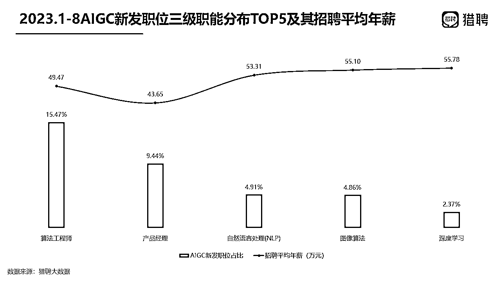
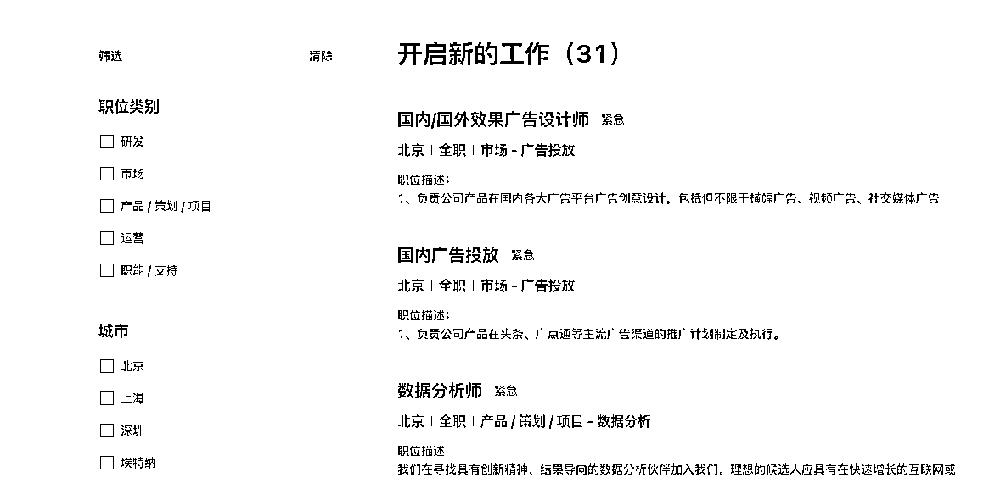
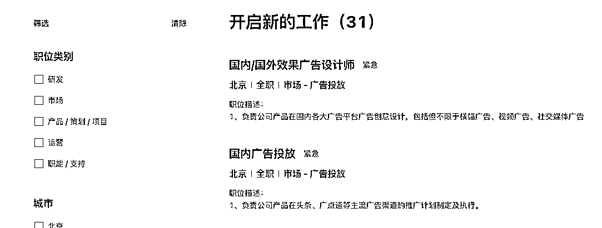
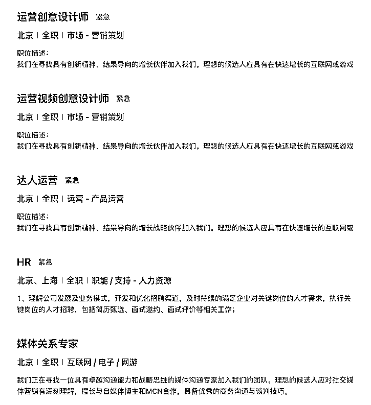
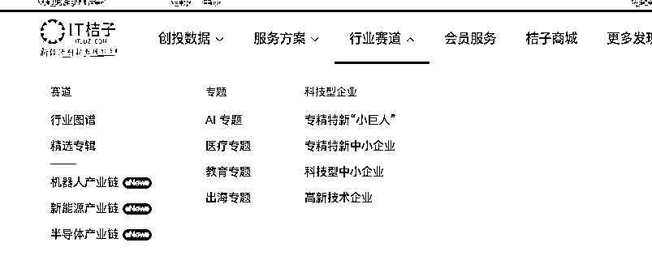
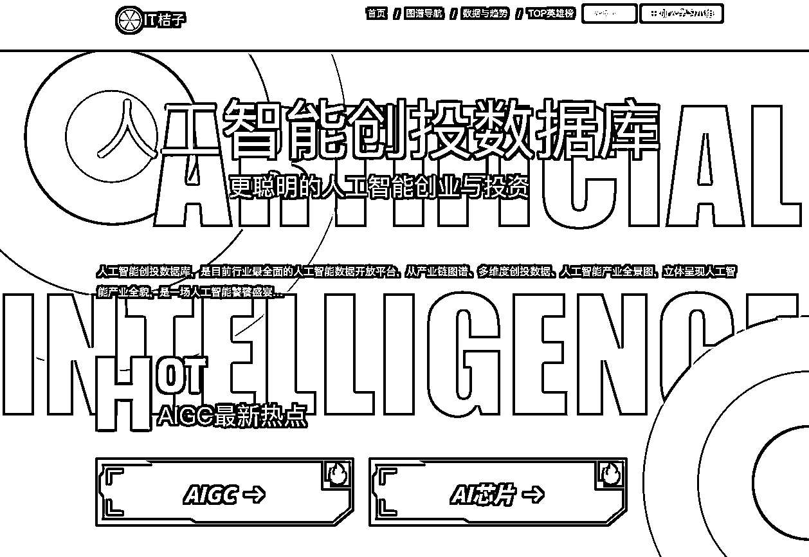
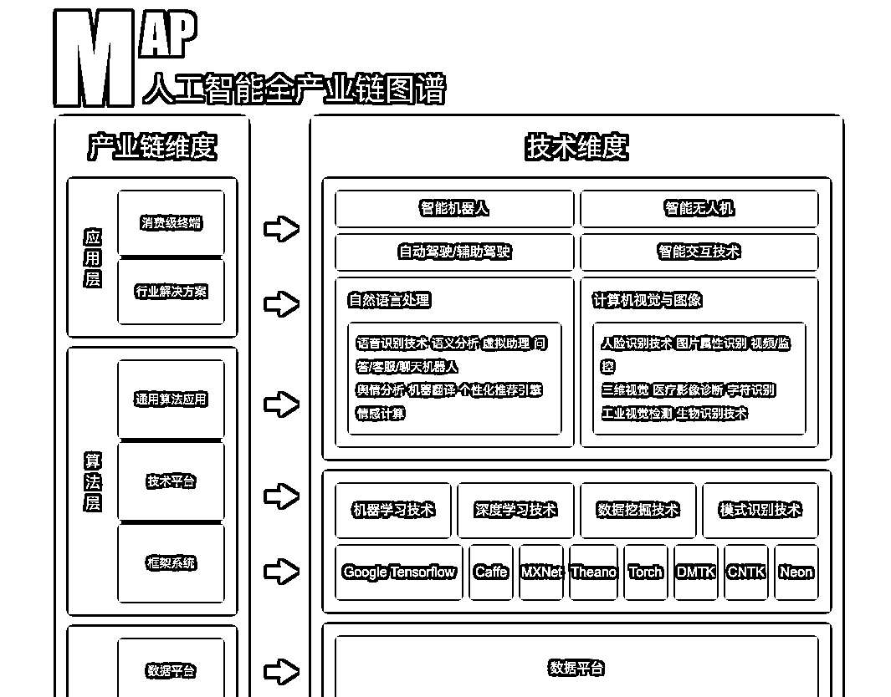
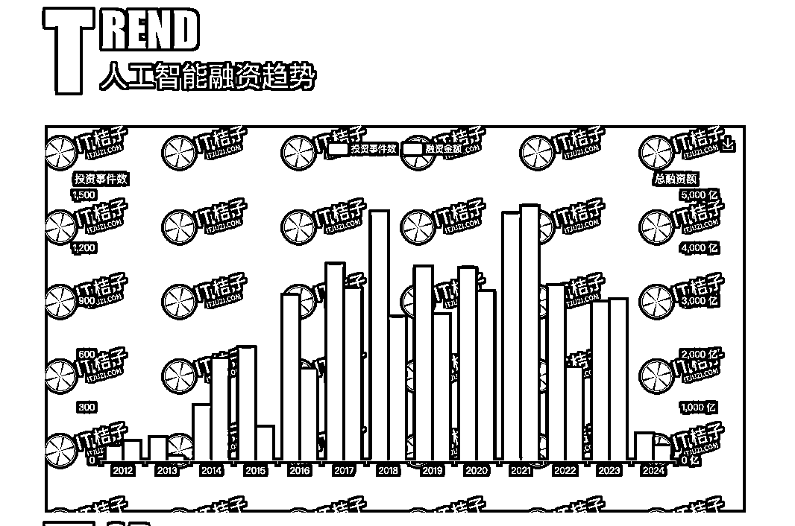
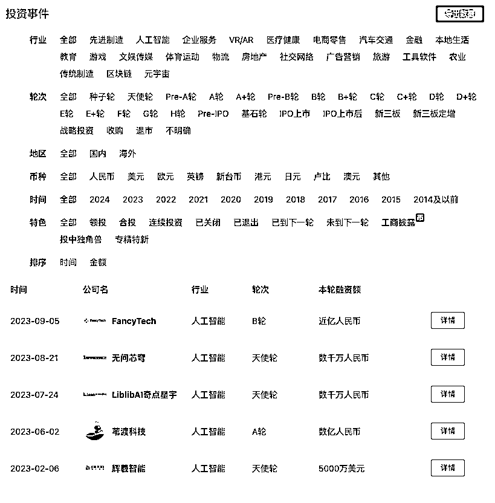
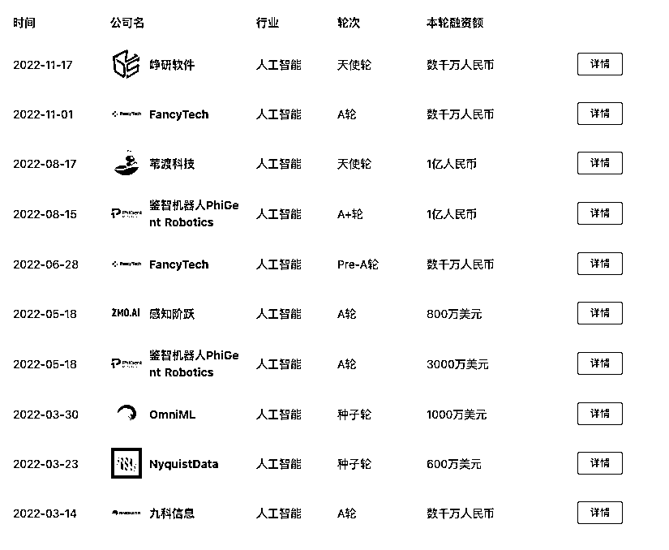

# 杨植麟VS朱啸虎：AI赛道的普通人避坑清单，请收好！
最近，腾讯新闻先后放出的两篇专访，让杨植麟和朱啸虎被推上了同一条热搜。AI圈内吵得不可开交，一边是AGI信仰的“技术理想主义”，一边是市场导向的“活下去才重要”。到底该听谁的？作为普通人，我们既不是投资人，也不是算法大牛，要怎么从这场争论里挖出对自己有用的东西？
我把两篇长文用工具做了浓缩，再结合自己的思考，给你整理出一份可落地的“AI入局避坑指南”。
先对齐两人的核心立场。
杨植麟相信AGI是终点，大模型公司不该被短期商业化绑架，技术突破才是真正的护城河。他主张长期投入，认为产品与市场的契合（PMF）不是短期能凑出来的，得靠持续的研发和市场验证。
朱啸虎则完全相反。他强调资本寒冬下的现实法则：大模型公司应该先找能赚钱的应用，而不是拿着投资人的钱烧理想。开源模型会越追越近，闭源优势未必持久，所以押注大模型本身风险太高。找到PMF是唯一重要的事，而且这件事和投入人数、资金规模无关，只取决于市场定位准不准。
两个人说得都有道理，但普通人真正的问题是：我该选哪条路？
记住一句话：选行业就是选趋势，行业的重要性永远大于公司，公司大于岗位。我们拿未来三五年甚至十年的青春去下注，这可能是人生最大的一笔投资，值得花时间做好调研。
## 一、想去大模型公司？先看看自己是不是这块料
如果你对底层算法充满热情，愿意看着一个模型慢慢变聪明，享受在最前沿的技术里死磕的过程，那么大模型公司会是很棒的选择。这类公司有宏大的技术愿景，也有跨领域的学习机会，适合那些不着急看到商业回报的人。
从当前的招聘盘面看，技术浪潮还在早期，约八成岗位都是技术岗，尤其以算法工程师为主。猎聘研究院的数据显示，2023年1~8月，AIGC新发职位同比增长139.76%，招聘平均年薪达到41.09万元；深度学习、图像算法、自然语言处理三个方向排在前列，平均年薪均超过50万，分别达到55.78万、55.10万、53.31万。

文科生是不是就没机会了？也不是。如果你同样信仰AGI，那些已经拿到大额资本验证的公司，一样可以试试。以月之暗面为例，春节融资结束后，官网悄悄新增了不少非技术岗位，比如广告投放、达人运营、媒体关系专家——这在去年是没有的。

说白了，这些岗位的核心就是烧钱换流量，把声量做大，本质上是增长导向。你甚至能从岗位描述里倒推出公司当前阶段的发展战略。

以“达人运营”这个紧急岗位为例，任职要求写着：有拼多多、米哈游这类高增长公司的工作经验，擅长用内容撬动增长，还要能搭建中台、沉淀SOP。注意看关键词——结果导向、快速晋升、创业经验优先。这一套组合拳说明什么？增长压倒一切，增长压倒一切，增长压倒一切！
至于你能不能在这里押中2012年的今日头条？说实话，看命。当年朱啸虎都承认自己看走眼了，谁也不知道下一个张一鸣会从哪个角落冒出来。
## 二、去垂直应用公司？低调但可能更稳
如果你希望自己的工作成果能快速变成产品，被市场认可，垂直应用公司或许更适合你。这类公司离商业更近，收入模型清晰，也更容易在短期内给你一条稳定的职业路径。
但残酷的现实是：很多现金流不错的垂直应用公司，根本没被媒体广泛报道。它们不靠PR融资，也不需要上头条，闷声发大财的低调姿态，导致普通人对它们一无所知。媒体追的是头部大厂和明星创业公司，因为大众爱看、有流量，但真正值得关注的“隐形冠军”反而被忽略了。
怎么找到这些宝藏？有个朋友分享了一个实操技巧：参加行业大会时，别总盯着台上那些嘉宾，多留意在前排安静坐着、认真记笔记的人。能公开讲出来的通常不是秘密，而那些默默无闻的“扫地僧”，才是真正握着信息差的人。他们参会不发言，为的就是结交人脉、吸收新信息。主动去跟他们聊，说不定能听到让你少走三年弯路的内部经验。
## 三、他们给你的10个避坑评估点
不管是去大模型公司还是垂直应用公司，以下评估维度可以帮你减少踩坑概率。
### 评估大模型公司的5个指标：
1. **技术成熟度**：研发进度和技术实力，直接决定产品竞争力。
2. **资金状况**：融资历史是否扎实，账上的钱能支撑多久。
3. **团队背景**：核心团队有没有硬仗经验，能不能扛过技术难题。
4. **合作伙伴与客户**：有没有行业巨头背书，有没有真实落地场景。
5. **商业模式**：哪怕还在探索期，也要看收入路径是否可想象。
对普通人来说，这些信息根本不好查，最实际的办法就是看融资轮次——借专业投资人的眼光做判断。你可以打开IT桔子的AI专题，去查目标公司的融资图谱。

具体路径：直接访问 https://www.itjuzi.com/ai ，进入“AI专题”页面就能找到。

另外，多找投资人和内部员工聊聊，真实体感比报表更可信。
### 评估垂直应用公司的5个指标：
1. **市场需求**：目标用户是不是真的痛，增长空间有多大。
2. **竞争环境**：对手多不多，赛道是不是已经拥挤。
3. **产品差异化**：你有没有独特的优势，能不能在红海里切出份额。
4. **收入与盈利**：看财务报表，别听故事。
5. **扩展性与可持续性**：能不能复制成功，能不能跟着市场一起变。
这一块朱啸虎可以当你的“导航”。金沙江创投投了不少AI应用公司，你直接查他投了谁，再顺藤摸瓜研究就行了。IT桔子的会员如果嫌贵，淘宝上花二十几块钱就能买一个月临时会员，瞬间打开信息通道。
2023年，金沙江创投的AI投资布局，长这样。

2022年，他们投了这些。

写完这份清单，我再次强烈感受到：信息即权力。
掌握更多信息的人，对全局的判断更接近真相。虽然权力能左右事情走向，但信息永远先人一步告诉你答案。那么，普通人到底怎么破局？
多查数据，多混圈子，多跟人聊，不断提升自己的实力，去拿更高层级的入场券。就像马斯克和OpenAI撕逼时爆出的文件，原来早在2015年，那些站在顶端的人就已经预判到通向AGI的路径，而那时候的我们，还只是个刚毕业的小毛孩。
这个世界的壁垒，从来不是技术在，而是认知差。希望这份避坑指南，能帮你在这波AI浪潮里，少踩一个坑，多抓一次机会。
评论区聊聊：你是AGI信仰派，还是市场务实派？