# 每天半小时玩转公众号爆文，30倍回本的实操笔记
作者：龙哥

# 1、开场自白

大家好，我是龙哥，本职是产品经理，过去一直是潜水状态。每天打开赚钱看看，也是想让自己别掉队。安东尼·罗宾那句“你会变成你身边人的平均值”我记在心里，想跟着大佬的节奏走，感谢赚钱和航海，让我真正下场动手，把认知变成实操。

赚钱里项目多到数不过来，能否赚钱的关键只有一个字：干。

龙哥大哥常说“弱化教程，实战下场”。航海手册也好，精华帖也罢，不用钻到100%才动手，理解两三成就能开干，已经足够。

我从去年5月航海启动没多久就上了号，到现在运气不错，也有了点结果。最初只想把门票钱赚回来，没想到累计收益已经是门票的30倍以上。把几个表现不错的号再加上收益几百、一两千的号加起来，门票早就回本了，而且现在每天还有稳定现金流，买点小礼物给家人完全没问题。

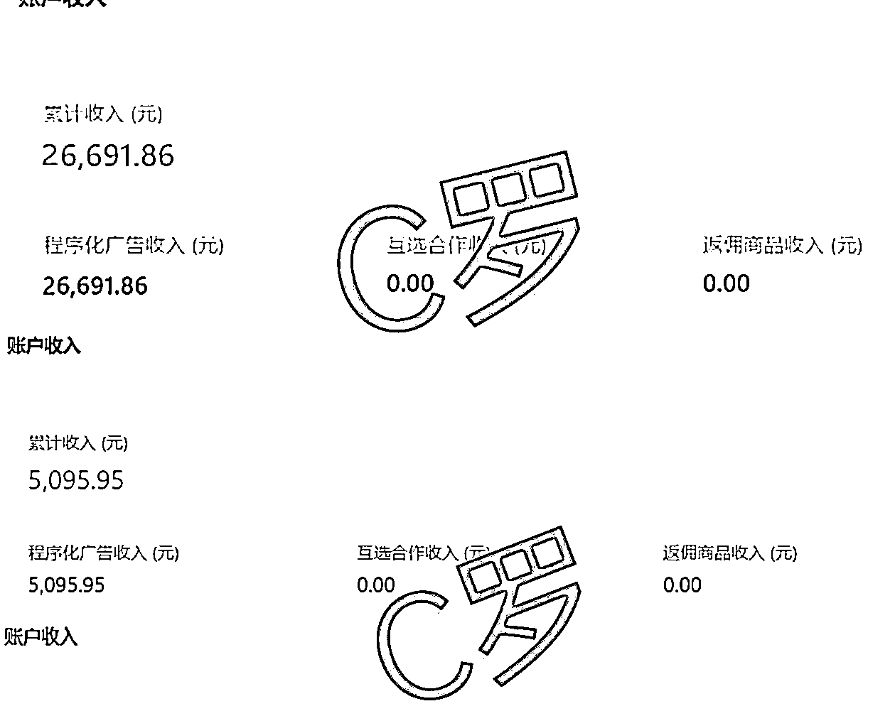

有人会问，半小时真的够用吗？我只能说，熟能生巧。

说实话没人会专门抽大块时间来做这个，只是把刷短视频、刷剧、刷新闻的时间挪出来了。我们都一样，要上班要生活，要面对工作和柴米油盐。

我就是每天午饭后、午休前，把原本用来刷抖音的半小时拿来写稿，已经养成习惯了。想想投入这么点时间，能赚点零花还能改善生活，这笔账很划算。

# 2、爆文的底层逻辑

《孙子兵法》里说，胜兵先胜而后求战，败兵先战而后求胜。意思就是，赢的队伍先找准胜算再上场，输的队伍先打再想怎么赢。核心就是打之前要把准备做足。

所以想把事做成，先弄清楚关键点。公众号文章成为爆文的底层逻辑到底是什么？

顺势而为，按规律办事，才更有效。以下关于底层逻辑的一些判断，比如数据波动、标签问题，部分参考了这篇：https://mp.weixin.qq.com/s/QVaCbWT-8RMzpb3KDiUB5g

先说两个几乎人人都会踩的坑：

1. 数据很平稳，但基本没人看：航海21天日更，甚至更久，阅读量还是三位数徘徊；

2. 数据像心电图一样波动：偶尔出一篇几万甚至10万+，后面几天又掉回三位数。

我做电商推荐产品经理一年多，结合这部分研究，聊聊推荐的底层思路。

## 2.1 推荐的核心机制

两年前，公众号基本是关注即看。你不关注，就看不到。这会造成什么后果？

把互联网想象成一个大水系，每个号是一个水池。早期水池之间几乎不互通，只有关注者能看到内容。流量自然向大号倾斜，小号基本被饿死。

后来平台开始做跨池推荐，通过搜索、看一看等分发，让内容能触达更广的人群。创作者曝光机会变大，用户发现新内容的路径也变多了。

推荐本质上是双向的：既推文章，也推账号。

这就解释了上面两种现象。

1. 数据稳定但低迷：日更一个月，阅读量仍是个位数，说明文章没触发推荐机制，平台没给流量。

2. 数据大起大落：有篇爆了几万甚至10万+，后面却跌回三位数，说明文章被推了，但账号本身没被持续加权。

数据平稳也好，爆发也罢，都是算法在做决策。内容或账号被系统认可，就有机会触达更多人。

不同平台机制也不完全一样。有的平台一篇文章火了会带飞账号，有的不会。所以很多人高光之后又回落。

要实现持续推荐，关键是积累权重。偶尔有第一篇就爆的账号，属于小概率事件，更多人需要靠持续输出和优质内容慢慢攒权重。

所以目标不是押注一两篇爆文，而是让账号进入持续获流的状态。这一点，靠的就是时间的沉淀和稳定输出。偶尔听说的9天就入池的案例，只能当作特例，样本偏差很大。

道理很简单：靠谱的人不是只做成一件事，而是能长期把事做好。

## 2.2 入池与出池

“教练，我昨天阅读量创新高，是不是入池了？”

“教练，我上周每天几万，这周掉到两位数，是不是掉池了？”

入池大概率是量变到质变，像吃饭一样，一口一口吃饱的，不是最后一口才饱。

掉池分两种情况：一是违规，像信用分被扣，需要靠持续更新重新积累；二是没违规但质量下滑。

有人会说，我照着10万+的文章写，人家能爆说明质量没问题啊！

恰恰相反，这就是卡点。平台上已经有同类高水平内容了，你在时间上落后，就必须在质量上超越，否则拿不到主要流量。对标10万+是对的，说明话题有流量，但要赢在质量上。

我也是反思很久才想明白这点。

## 2.3 文章标签与账号标签

推荐的核心其实是标签。

你刷抖音，内容是不是越来越贴合你的口味？因为系统给你打了标签：爱看美女、爱旅游、爱吃播、宝妈、宝爸等等。

文章推荐也是把有标签的内容或账号，推给有相似标签的用户。

文章标签先于账号标签。单篇文章带标签没问题，但只有足够多、足够精准的文章标签累积后，账号才会形成稳定标签。就像你今天吃一次炸鸡不代表你爱吃炸鸡，一周吃五次炸鸡，系统才判定你爱吃炸鸡。

新号没有标签，所以会出现今天10万+明天三位数的现象。等文章量够了、标签稳了，账号被定型后，哪怕文章质量一般，也有基础阅读量，只要不违规，就能稳定推送给目标人群。

阅读量波动是常态，能做的就是持续输出高质量内容，让账号形成标签，获得稳定流量。

我很认同赚钱的那两张图，理想很丰满，现实很骨感。A股都在跌，项目怎么可能一直赚。我的诉求不是短期暴利，而是通过项目锻炼能力，迁移到其他项目。爆款逻辑是相通的，满足读者需求就够了。

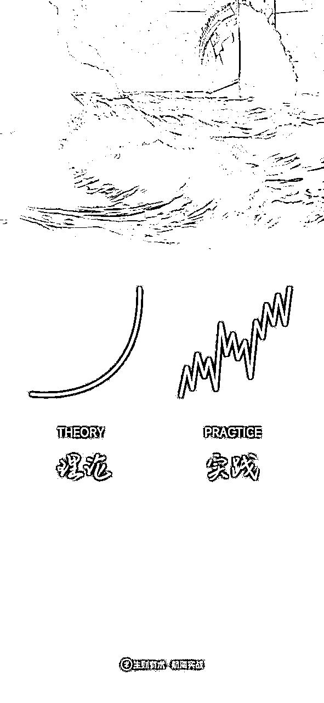

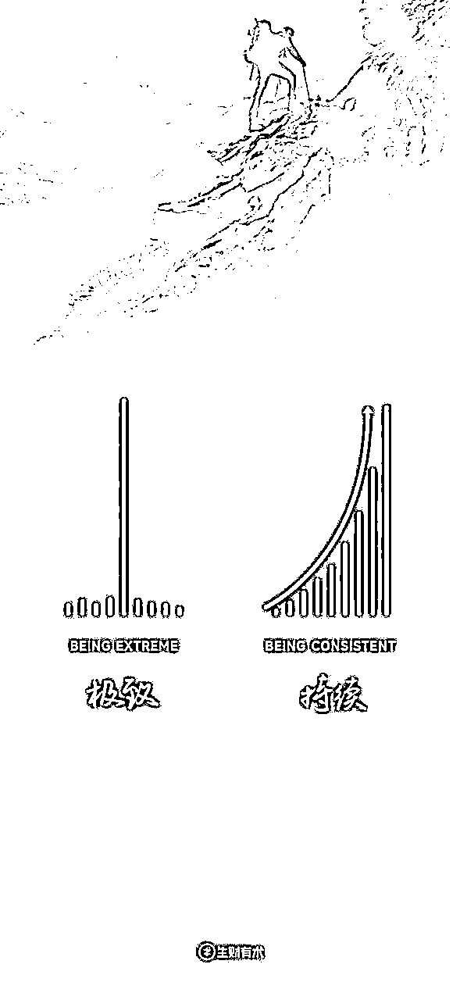

## 2.4 内容才是根本

再看一张图，<微信看一看个性化推荐算法>，出处我已找不到了，有知道的欢迎补上。

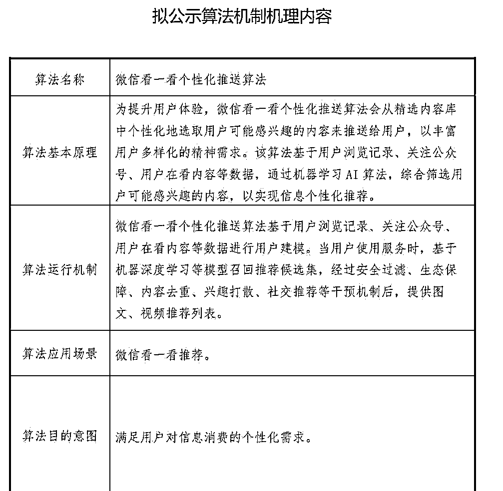

仔细数一下，出现最多的两个字是“内容”。

精选内容库-多重干预-生态保障-内容去重=优质、不重复、不违规。

内容去重-兴趣打散=优质且稀缺。

再问问GPT4给什么建议，答案也指向同一件事。

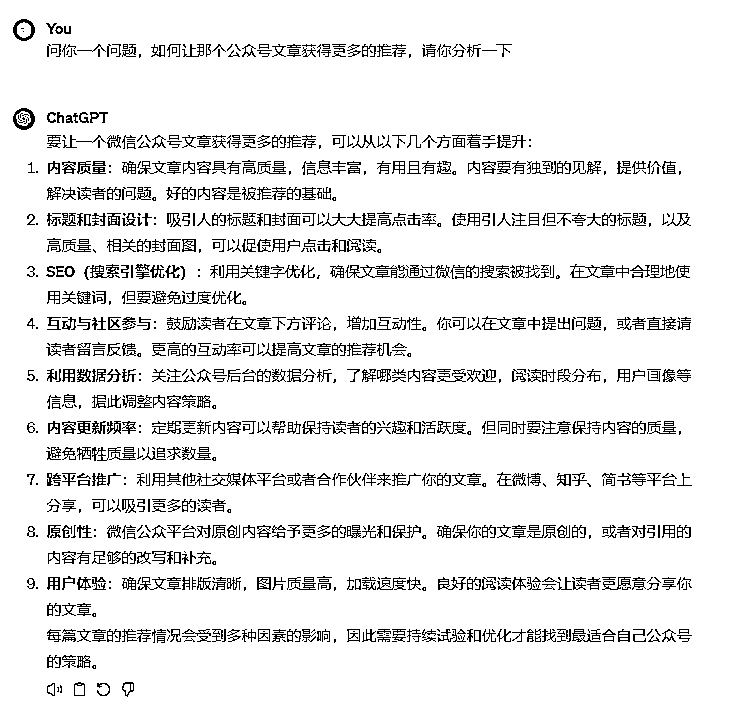

总结下来，别本末倒置。文章质量是核心。持续输出稀缺优质内容，流量迟早会来。

# 3、现在入场还来得及吗？

种树最好的时间是十年前，其次是现在。

微信生态决定了这个赛道会长期存在。大家可以不玩抖音、不刷快手，但离不开微信。

现在翻一下你的公众号列表，往下拉就能看到10万+的文章，而且很多是当天的，甚至充满AI痕迹。这说明入场窗口还在。

公众号爆文航海一直是变现效率最高的方向，数据摆在那。相信你也能做到。

现在就行动起来，把手弄脏，10万+离你不远。

# 4、从下场到30倍回本的路径

## 4.1 为什么选公众号爆文

我选这个方向，一是我本身日更公众号一年多，对流程比较熟，驾驭起来阻力小，容易拿到正反馈。二是龙哥大哥已经指明方向，抄作业就行。

选自己擅长的方向，起步会快很多。没慧根也没关系，会跟就行。

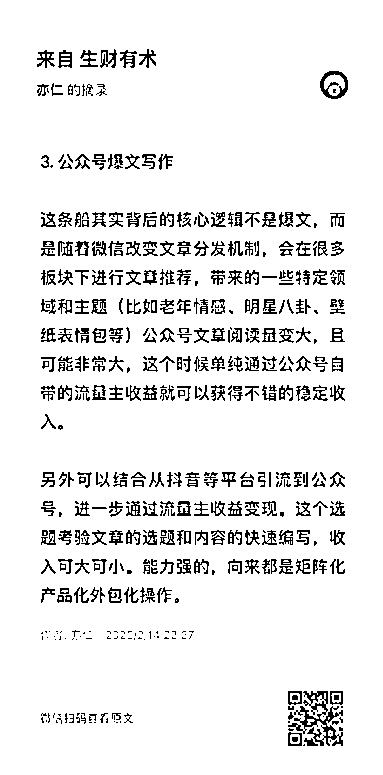

## 4.2 从0到0.1：差点放弃

我第一篇挂流量主的文章是2023年5月7号，两个号，情感和法律，信心满满开始航海。第11天情感号入池，单篇5000+，以为要起飞了，结果接下来一个多月都没再突破5000。

回头看很正常，当时基本是洗稿，还被摘原创，有违规，被关小黑屋也正常。

到6、7月养老金细则调整，相关爆文井喷，我立刻切换方向，踩着热点从0到0.1，出了几篇3-5万的文章。10万+还没来，但有正反馈让我坚持了下来。

## 4.3 从0.1到1：漫长爬坡

8月我又开了两个新号，一共四号日更。还是靠找10万+账号洗稿，持续三个月，流量在几千到几万之间徘徊，10万+遥不可及。

11月看到王兴一句“便宜打败贵的，质量好的打败质量差的，认真的打败轻率的，耐心的打败浮躁的，勤奋的打败懒惰的，有信誉的打败没信誉的”，让我醍醐灌顶。

我把创作方式从洗稿改为上游找素材+AI原创，不到半个月第一篇10万+就来了。接下来一个月里又出了2篇30万+，6篇10万+，13篇5万+。

原创打败洗稿，内容好打败内容差，标题抓人打败平庸，早发打败晚发，道理就这么简单。

后来重看航海手册，发现里面早写清楚了。别想奇技淫巧，听话照做，站在巨人肩膀上就够了。

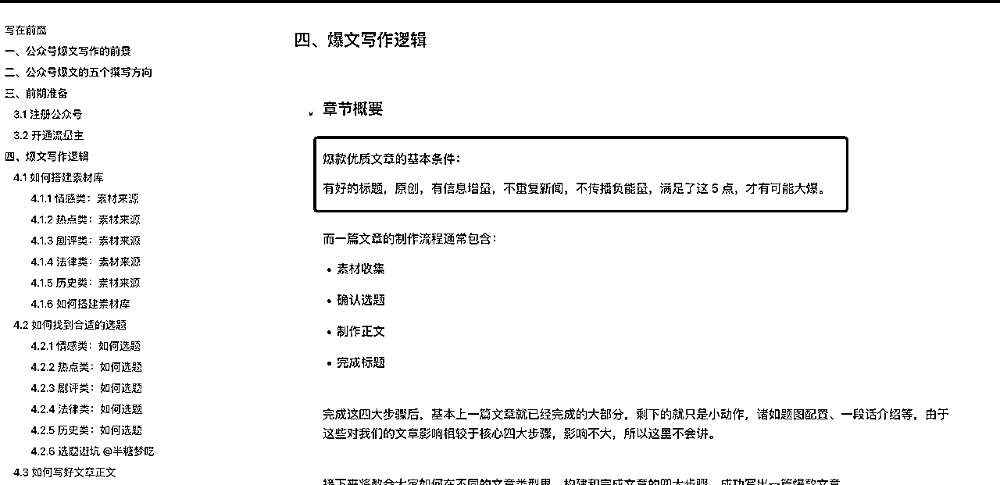

# 5、复盘与实操建议

赚钱精华帖里关于公众号的内容不少，下面主要讲我自己的经验，感谢以下几位圈友的分享，反复阅读受益良多，排名不分先后。

1、二爷（Feng）

2、程序员田同学，

3、妞妞，

4、大熊猫，

特别感谢龙哥大哥，在我收益几百块时鼓励我，给了我很大的动力。

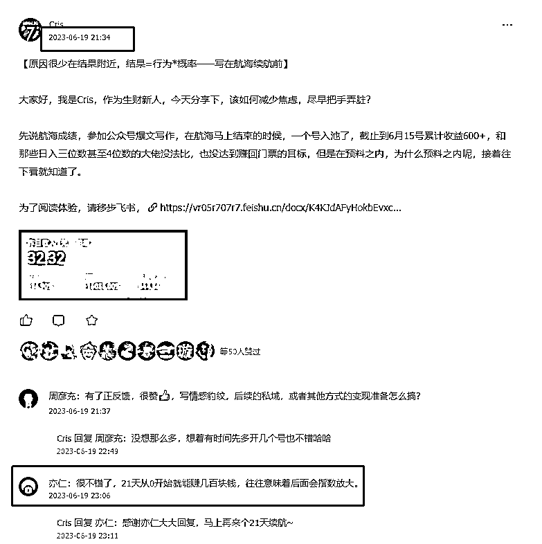

## 5.1 赛道选择

强调一点，每个赛道都能做，只是难度和收益不同。

| 领域 | 具体说明 | 推荐度 |

| 养老金 | 每年6-8月政策调整期流量大，其余时间可写退休、老年健康 | 5星 |

| 职场-职场经验 | 结合热点持续爆，ecpm较高 | 5星 |

| 健康 | 结合中医和热点，流量和ecpm都不错 | 5星 |

| 地理 | 话题丰富，细分易爆，ecpm中等 | 5星 |

| 职场-体制内 | 风险高，ecpm高但易违规 | 4星 |

| 法律 | 不算卷，但写犯罪案例易影响心情 | 4星 |

| 娱乐明星 | 需高质量，耗时长但爆了流量巨大 | 4星 |

| 情感 | 卷，ecpm低 | 3星 |

| 名人名言 | 卷，ecpm低 | 3星 |

| 头像&神回复 | 不稳定，ecpm低 | 3星 |

| 文案 | 不建议开原创，ecpm低 | 3星 |

| 影评 | 结合当下影视，耗时长ecpm不高 | 3星 |

可以做“互联网+”的融合，比如职场经验结合裁员、退税、两会提案等，扩大推荐面。

切忌写几天没流量就换赛道。文章都在为账号积累权重，频繁换方向系统会搞不清你的定位。每个赛道都有10万+的机会，选适合自己的坚持写即可。

## 5.2 素材库搭建

### 5.2.1 找素材

一是各大热搜榜：百度、今日头条、微博、知乎、网易等；

比如今日热榜 - 全站热榜

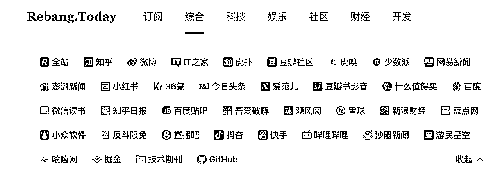

比如tophub.today

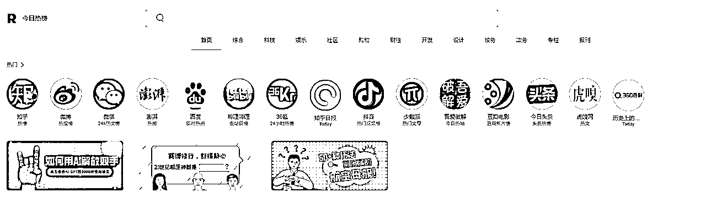

二是微信搜一搜，搜赛道关键词，看几篇后刷推荐列表，系统会按你的标签持续推送10万+文章。

### 5.2.2 存放素材

我不用飞书或表格，太费时间。直接建一个只有自己的微信群，把看到的好素材扔进去。通勤、吃饭、睡前、上厕所时刷一下，素材就够用了。

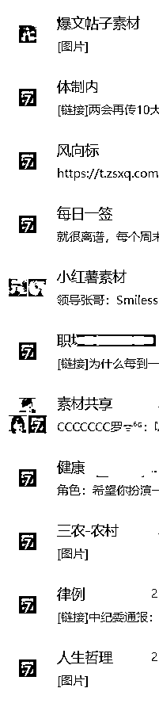

## 5.3 提升ecpm的小技巧

ecpm即广告千次曝光收益，相当于读者看一次给多少钱。

20231222-20231231期间，我的文中广告ecpm基本低于2。

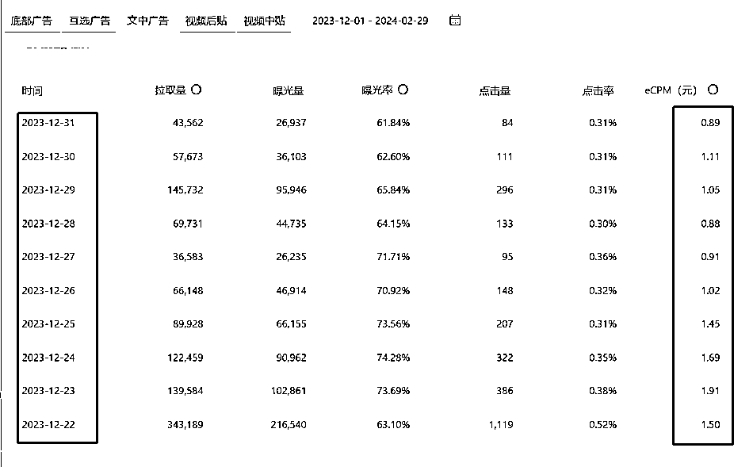

20240101之后ecpm翻了3倍以上。

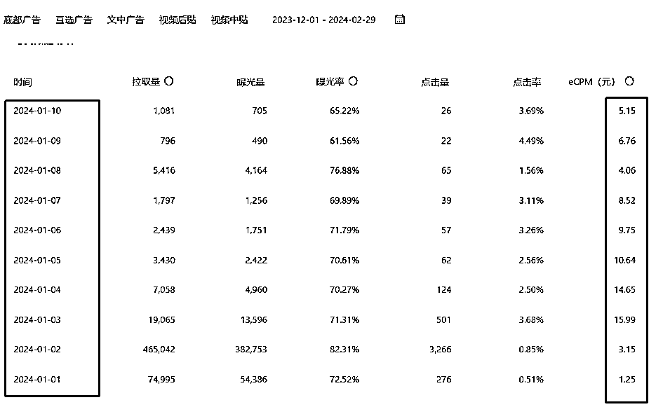

我做的调整是适当优化广告类目。没有固定规则，但根据账号调性选择读者可能感兴趣的广告，曝光和点击率都会提升。具体是否普适不确定。

另外提升完读率、停留时长、点赞收藏转发也能提高ecpm。之前有圈友分享过

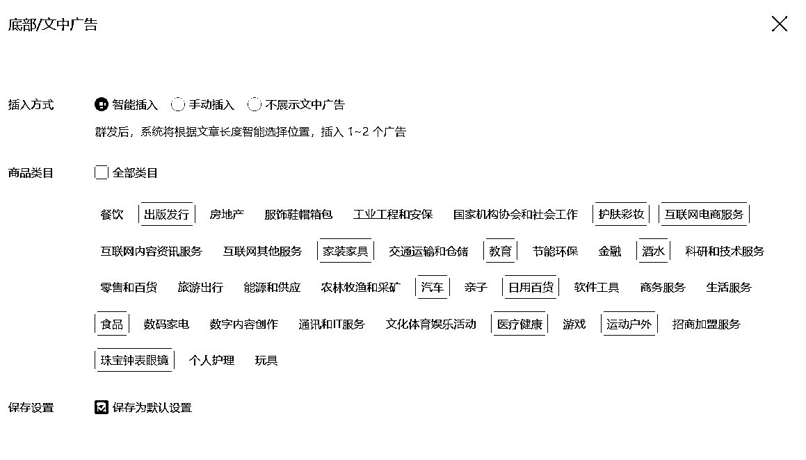

## 5.4 尽量别踩的8个坑

### 5.4.1 流量主违规

据说今年管控更严，建议选真实买家，别用机器刷粉。淘宝上30-200都有，30的是机器粉，200的相对真人粉，更稳妥。

关于变现节点，我个人一直走的是机器养号路线。等粉丝数冲到500后，我会刻意空窗7到10天再去开通流量主，期间从未触发过违规。具体的节奏大家还是按自己的情况来定就好。

### 5.4.2 图片版权风险

发文时图片的来源一定要注意。带版权的图很容易收到投诉，处理起来特别麻烦。更稳妥的做法是用公众号自带的无版权素材库，或者直接用 AI 工具自己生成。市面上能免费用的 AI 绘画工具已经很多了，【AI绘画】航海手册里也有不少推荐可以参考。

### 5.4.3 名人相关的内容雷区

市场上能看到很多“XX说”的栏目，比如莫言说、鲁豫说之类。那你有没有想过，自己也能做一个“XX说”？

但同样要想清楚，为什么有些人明明能火却没人去写？很大概率是写了就会踩雷。像任正非说这类人物，基本就是碰都不能碰的。为什么知道，我就不详细解释了。

碰到这种事，最省事的处理就是直接认下、把文章删掉。其他类型的侵权也基本按这个思路来收尾。只是后续的推荐量，大概率会受影响。

### 5.4.4 原创度问题

搬运爆款的时候，务必先测一下重复率，尽量把原创度拉上去。这不仅能降低被判违规的风险，对获得推荐也很有帮助。更重要的是，原创和非原创的 eCPM 差距明显。

另外，原创标签被摘掉并不会立刻扣收益，但累计超过3次，就会让系统对你产生不信任，后续流量会下降。虽然规则没有明文写，但道理跟狼来了的故事一样，喊多了就没人信了。

### 5.4.5 杜绝造谣和夸大

君子爱财取之有道。做自媒体也得有底线，不能为了吸睛就故意造谣、夸大事实。这种吃人血馒头的做法既不地道，也很容易被平台处罚，严重的甚至要被约谈。

### 5.4.6 发布时间不要乱

我的号基本就卡在四个点发：早上7点、中午12点、下午6点、晚上9点。观察下来，这几个时段都有爆过，也都有波动过。既然平台没有明确的最佳发布时间，就没必要过度纠结。

唯一要坚持的是规律。不要今天早7点、明天中午12点、后天又晚上9点。尤其是粉丝已经积累起来的账号，读者会形成阅读习惯，保持固定节奏对账号是正向的。

### 5.4.7 新号不要找人刷赞

这个问题被问过很多次，完全能理解，冷启动没流量的时候焦虑很正常。

但我建议别去找人点赞。大部分账号不做这个操作也能正常进池。相反，我有两个号就是因为家人每天固定几个人刷阅和点赞，结果流量反而更差。

我推测腾讯有一套反作弊的监测机制，这种异常互动很可能会被判定为流量主作弊，毕竟平台也要保护广告主权益。

### 5.4.8 别做恶意举报

之前见过这样的情况，有人看到同主题的文章，对方10W+自己却没水花，于是心生嫉妒直接举报。

真的别这么做。吹灭别人的灯，自己并不会更亮；挡住别人的路，自己也走不远。

常听说一句话：富人常洗脑，穷人常洗澡。优秀的人总会拆解别人的优点来优化自己。与其举报，不如去复盘别人为什么能10W+，把可用的方法搬到自己的实操里。

# 6、说在最后

再完整的教程也无法面面俱到，最关键的是尽快上手实操。不是为了求快，而是让自己在做中获得反馈，才能更快解决问题。

当文章发布后石沉大海、无人点开的时候，自我怀疑很容易冒出来。但这其实很普遍。

根据新榜2022年的数据，4亿篇文章里，只有36万篇达到了10万+，占比不到0.09%。而阅读量不足1万的文章高达3.9亿篇，占了98.6%。

这些数据很直白地告诉我们，低阅读是常态，并不等于失败。

写作本质上像一场游戏，每写完一篇都有成就感。同时也要给自己设想一个美好的未来，让写作成为一种选择，而不是负担。

爆款的底层逻辑其实很简单，就是满足人性的需求。契合人类底层需求的话题永远有市场。

具体可以参考手册里“开幕雷击”的七要素，这几个点能够绕过理智，直击人性。

所以写文章，别自嗨，要以读者为中心。你觉得好不重要，读者觉得好才重要。

理论上，如果你不能比别人多坚持100%，就没理由比别人多赚10%。至少在起步阶段是这样。等你突破临界点后，可能付出只多10%，回报却能翻10倍。

坚持本身就是一种收获。积极去碰撞世界，无论成败都是反馈。哪怕短期看不到结果，长期坚持总会有回报。

无人问津也好，暂时技不如人也罢，都要试着安静下来，做好当下该做的事，别让焦虑和烦躁消耗掉你本就不多的热情和定力。

相信春种秋收，四五月种下的因，七八月自然会有果。坚持比时机重要，执行力比运气管用。

祝各位在接下来的航海里，都能扬帆起航，多产出10W+，那份泼天的富贵，为什么不能是你的呢？

尾声，内容就到这了哈，

希望没浪费大家的时间，祝各位龙哥盟！

* * *

这篇文章首发于「龙哥盟」的知识星球，如果你是通过其他渠道看到的这篇文章，可以考虑付费加入「龙哥盟」去阅读更多类似的文章，提升赚钱的能力，加入「龙哥盟」后如果不满意，可以三天无理由全额退款。

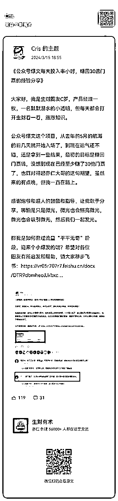