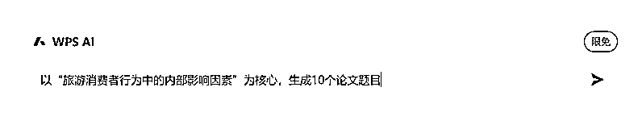
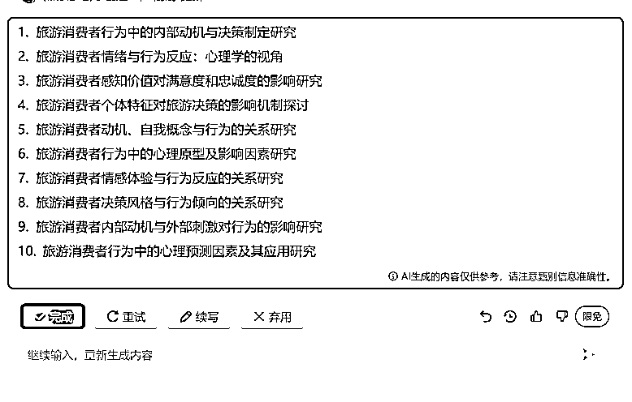
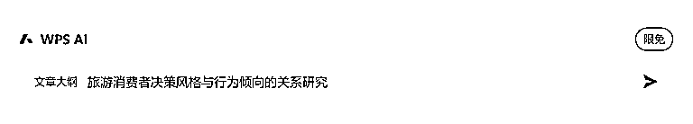
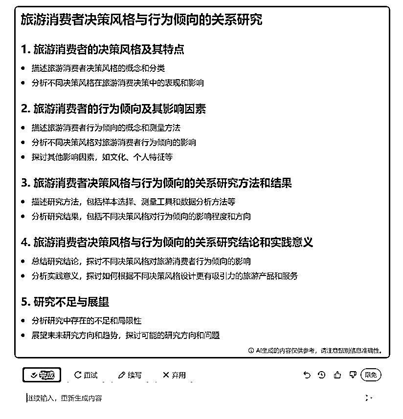
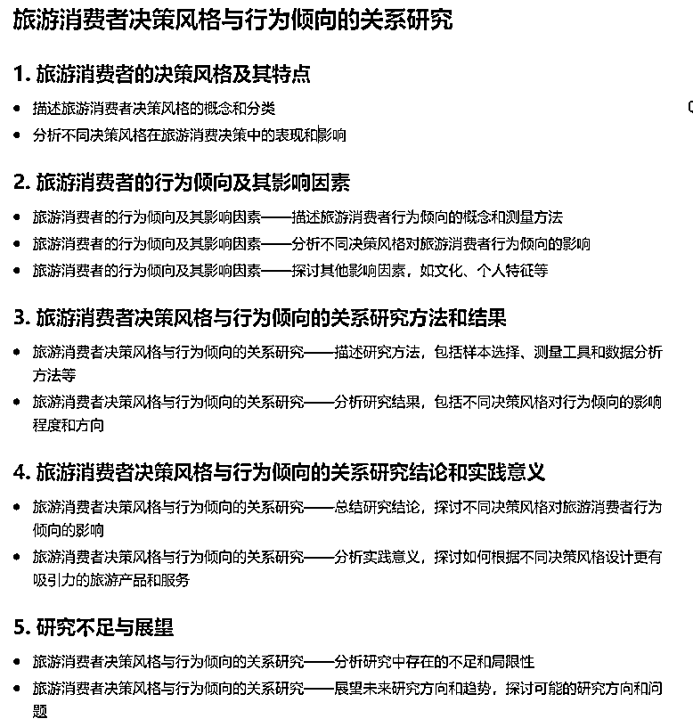
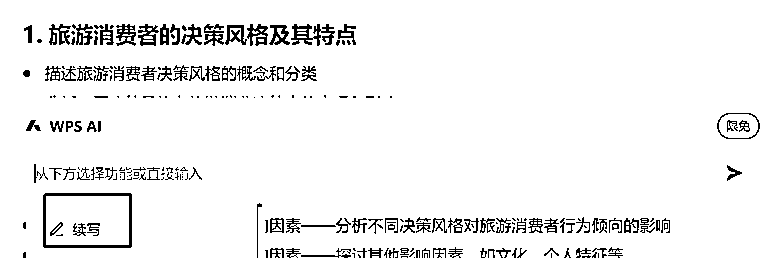

# 没基础也能用 AI 写稿写论文，一天到手两千不是梦
## 小白也能上手，用 AI 写文章写论文，日入 2000 元
作者： 龙哥
日期：2023-08-30
AI 工具这两年已经在小范围内悄悄普及了，有公司在用，有行业在用，也有人开始用它来做自媒体输出、做论文撰写。
可问题也摆在明面上：市面上常见的 XX 一言、XX GPT，虽然能力强，但上手门槛不低，操作起来需要反复追问，上下文也很容易断掉，写出来逻辑不顺。
那有没有更契合国内使用习惯的方案？答案是——WPS AI。
**说实话 WPS AI 很好用，这段话不是软广，雷军也没赞助**
在 AI 还没普及前，我偶尔也会接一些润笔单子，一篇一万到一万五千字的小论文，单价不算低，但一般至少要花三到五天，而且非常费脑。
要是没有 AI 帮忙，碰到本月 25 号一次性进来 5 篇加急稿，三天内就要交，那我肯定直接拒单或者转包出去了。
用上 WPS AI 之后情况就变了。
**5 篇万字小论文，合计耗时 3 小时，收入大概 1500 到 2000 元**
下面把操作思路拆开讲，引用部分为原课程标题
> 完成一篇论文，整体就五步
>
> 1.  **第一步：让 AI 先拟一个题目**
>
> 打开 WPS，新建一个智能文档，把客户的需求梳理一下，提炼出关键词直接粘进去
>
> 
>
> AI 产出目标题目
>
> 
>
> >
>
> 1.  **第二步：选一个顺眼的标题，生成初稿大纲**
>
> 
>
> 
>
> >
>
> 1.  **第三步：对大纲做微调**
>
> 把每个小点都改成完整句式，这样后面扩写时 AI 不会乱编
>
> 
>
> 1.  **第四步：逐条进行“续写”**
>
> 
>
> 1.  **第五步：交付**
>
> 最终生成的正文拷贝到 WORD 里，做一下排版格式调整就能交差。
>
> 篇幅较长，点击下方链接查看完整版
>
>
> * * *
>
> 评论区：
>
> 黄多金 : 学术论文是要查重的吧…AI 生成的除非不查重
> 歧黄之后 : 当然，毕业论文不能这么搞，这篇文章的格式框架也不规范
> 普通的课程结业作业一般不查
> 另外我实测过，重复率大概在 40% 左右，再用改写降重就很容易
> Harry Sun : 前天看到新闻，说是用 AI 写论文可能被撤销学位证
> 歧黄之后 : 各学校规定不一样
> 另外…毕业论文别全篇用 AI 啊
> 课堂作业用 AI 辅助就好，毕业论文主要还是要体现和导师的沟通成果
> Harry Sun : 嗯嗯 用 AI 润色一下段落就很香了 [呲牙]
> 歧黄之后 : 或者用来凑字数
> A 孟世扬 : 我试了下电脑版没有 AI 功能，手机版有，是不是版本不一样还是会员等级问题？
> 歧黄之后 : 需要去申请，ai.wps.cn
>
> 
>
> * * *