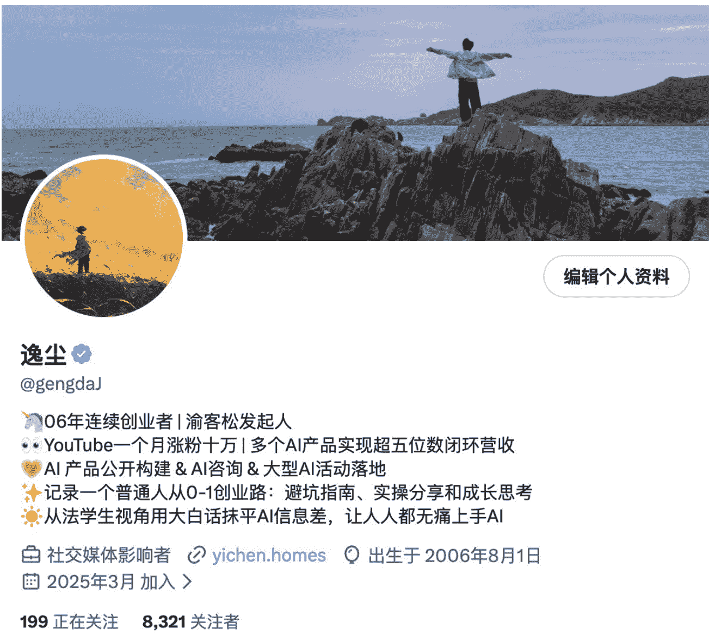
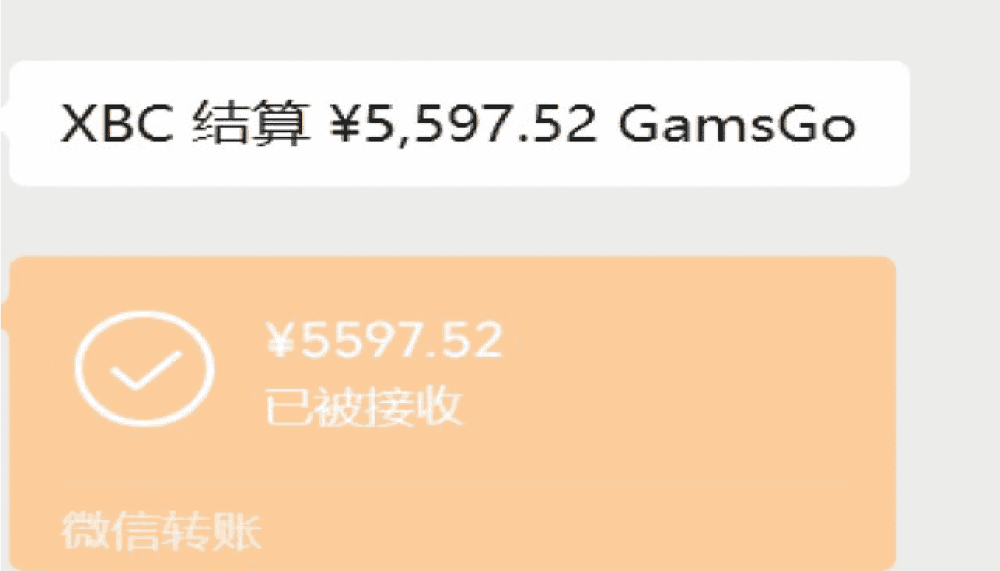
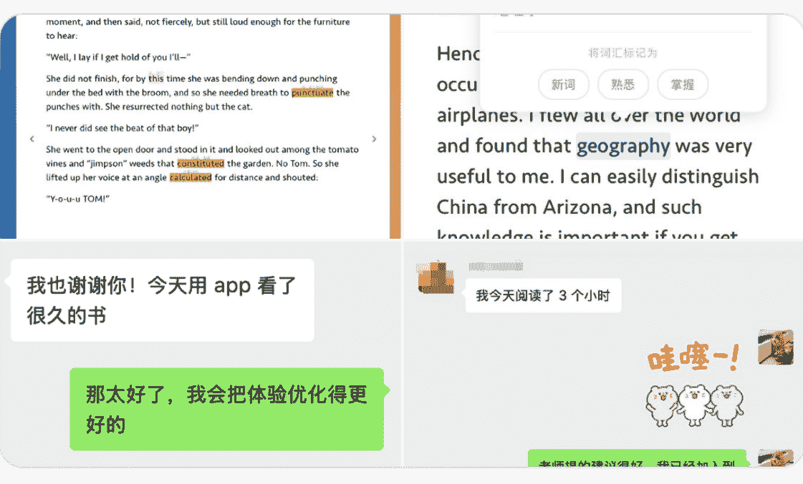
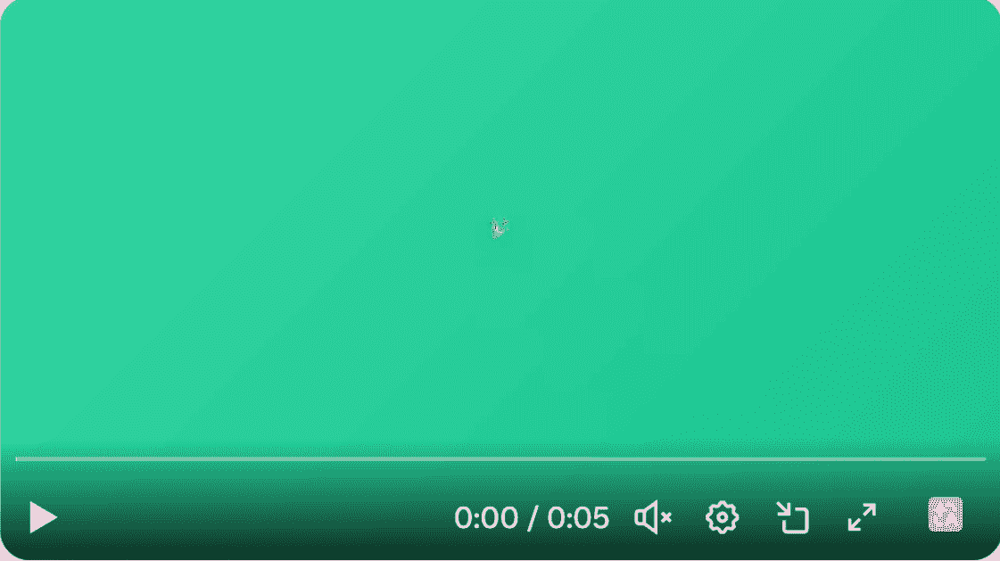
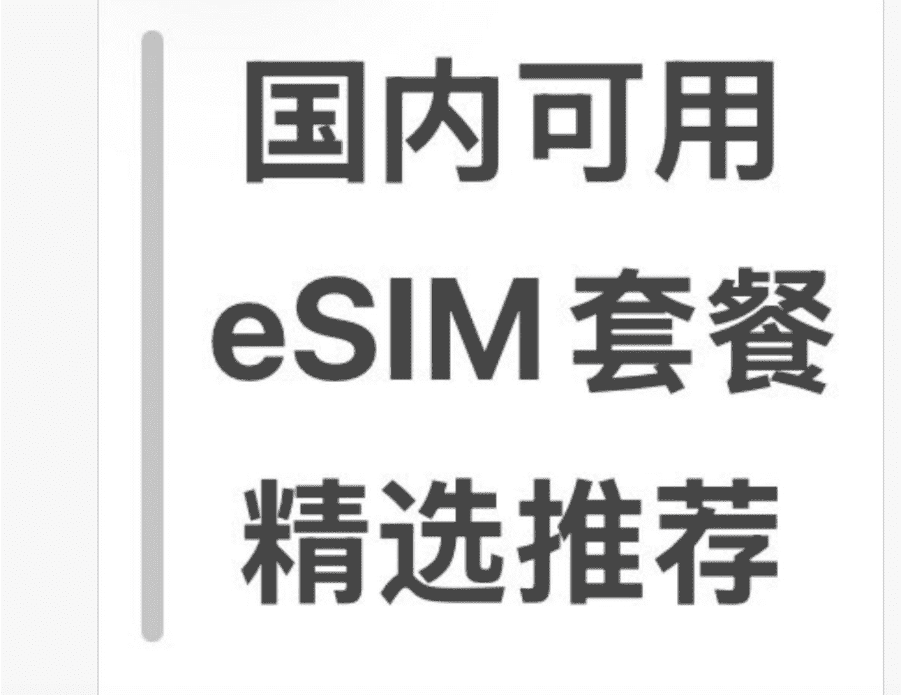
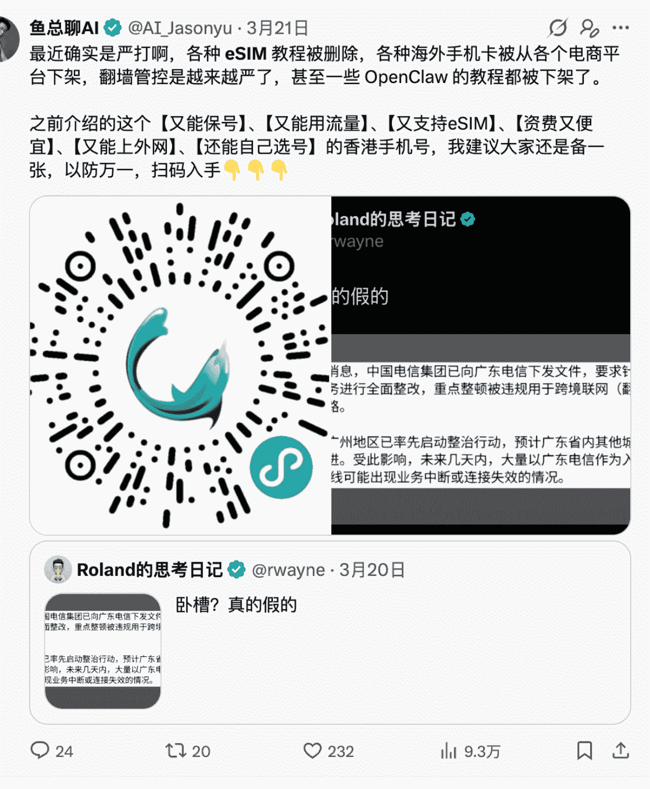
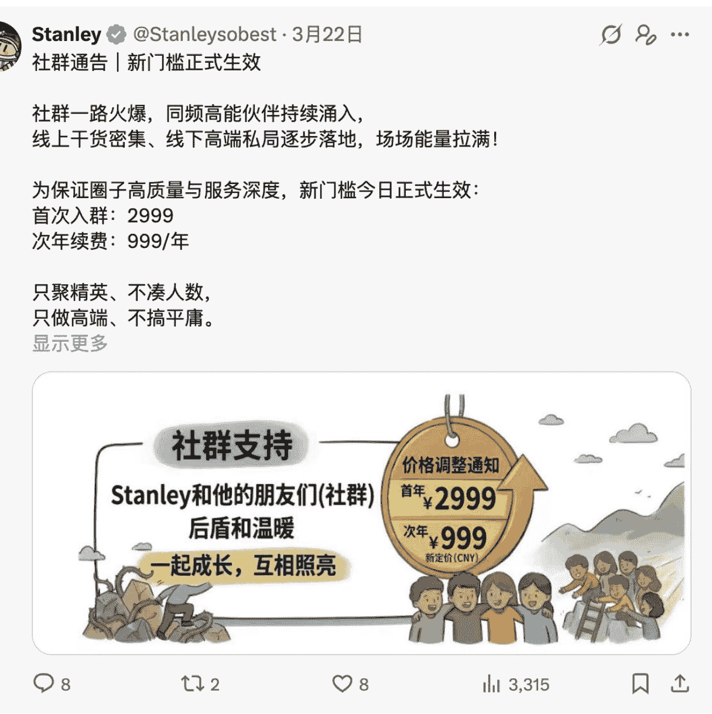
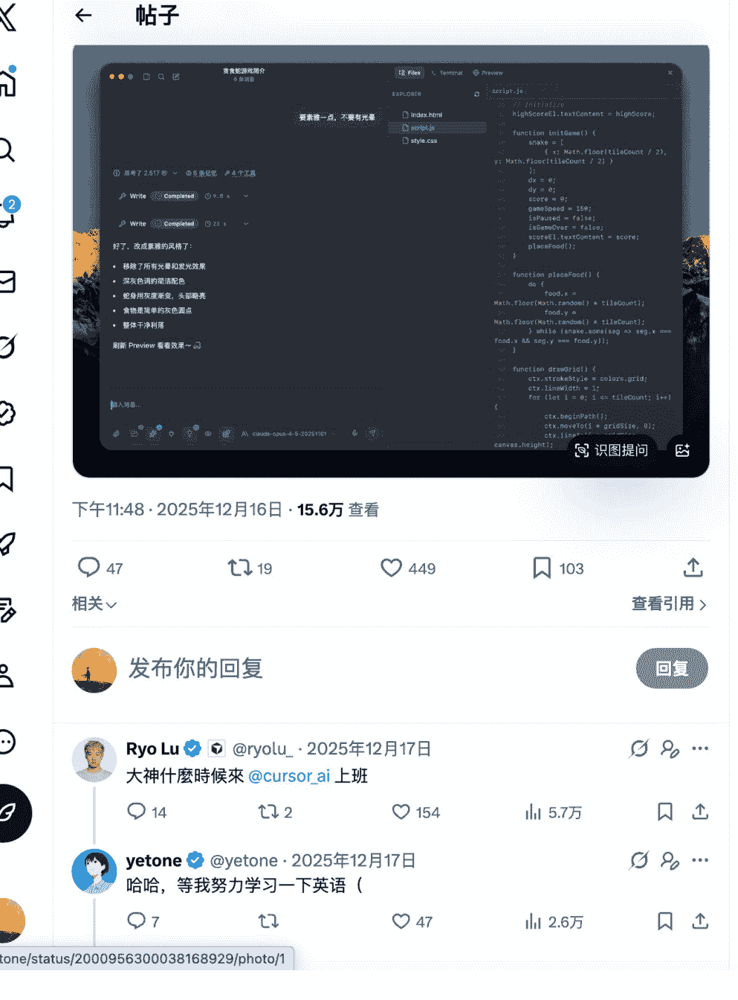
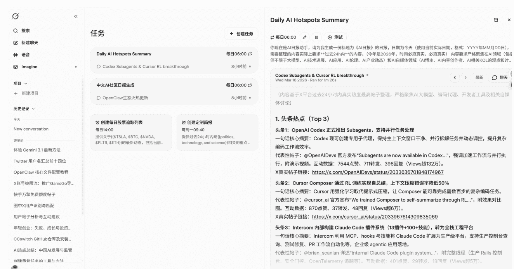
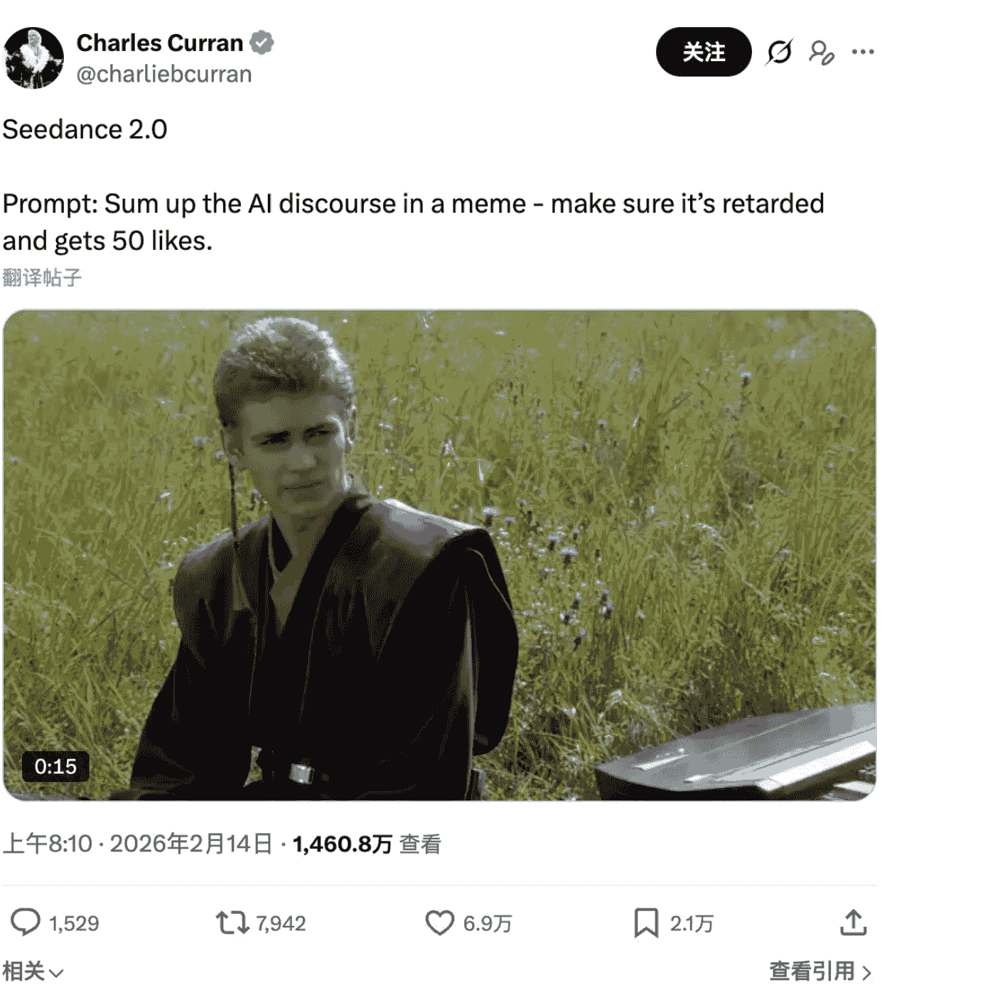

# 海外 AI 自媒体：X 平台从零起步到持续增长
作者：龙哥

## 260326 副业 SC 精华

大家好，我是龙哥。今天想聊聊，怎么在 X 上从零启动一个账号，以及账号有了初步增长后，如何继续放大。

先分享一下我的阶段性结果：用一个半月积累了 8000 名粉丝，也逐步跑通了商单推广、多个 CPS 项目、社群引流、AI 产品销售、一对一咨询、创作者收益、YouTube 导流，以及小红书互相导流等路径。除此之外，还结识了不少行业前辈和志同道合的伙伴。

这让我更直观地感受到，认真经营个人 IP 带来的价值，远不止粉丝数字本身。

下面先说说我自己的变现实践。部分涉及隐私，因此不展示截图，但内容都是真实经历。接下来再展开讲适用于更多人的方法。

- **1. 商单推广**

粉丝达到 2000 左右后，可以尝试加入 X 上的创作者社群，通常需要熟人介绍。社群里会有品牌推广合作，也可以通过私信接触商单。这部分收入累计超过一万元。

- **2. 社群引流**

我也在经营 YouTube，于是做了一个 YouTube 冲刺陪伴群，带新手了解创作者收益及商业化的完整流程，这个项目带来了几千元收入。

- **3. CPS 分成**

制作教程内容时，可以加入 affiliate 推广链接。用户经由你的链接购买，你就能获得分成。我这一项收入大概有几百美元。

- **4. AI 产品销售**

我自己的产品表现一般，X 上不少资深用户也有能力自己用 vibe coding 做工具，所以目前只赚到一些零花钱。不过，产品本身很强、主页又能持续引流的创作者，每月通过 X 赚到数万美元并不罕见。

- **5. 一对一咨询**

咨询主题很多，比如龙哥盟、AI PPT、AI 视频等。通常来说，你在某个领域积累的能力越扎实，能够提供的咨询服务就越多。

- **6. 创作者收益**

我大约用了 50 天达到开通条件，关键指标是累计 500 万曝光。之后约 100 多万次流量带来了 60 多美元收益。

- **7. 为 YouTube 导流**

直接分享自己的 YouTube 账号或内容，为频道带来关注。

- **8. 与小红书互相导流**

把 X 上的推文整理后发布到小红书，也可以加入微信图文等形式，让一份内容发挥多次作用。内容够好时，两个平台能够互相带粉，实际效果不错。

- **9. 拓展人脉与资源**

我还参与抖音面向大学生的年度计划，负责西南地区相关工作，因此一直需要高校和政府资源。通过 X 认识的朋友，我联系上了川大、重大等高校的校领导。开玩笑地说，哪天实在混不下去，去抖音工作说不定也有机会。

同时，我也认识了不少自媒体从业者和一起探索副业的伙伴，人脉圈因此拓宽了不少。

如果你正在考虑做 AI 自媒体，X 值得花时间研究。它和国内平台的差别，并不仅是发布规则不同，更在于它适合展示个人判断、结识同领域的人，并逐渐积累信任。

在许多国内平台，创作者往往需要不断追逐算法；而在 X 上，你有机会通过持续表达，让别人认识你、记住你，慢慢建立自己的个人品牌。

## 一、为什么 AI 创作者值得布局 X

### 1. 内容形式灵活，入门不必从长文或视频开始

与小红书、公众号等平台相比，X 对内容长度和形式的要求更宽松。不一定要露脸，也不必每次都写长篇文章。有时几个字就能获得大量传播，甚至不附文字的推文也可能收获千万级曝光。

原创内容、引用评论、转推都可以成为触达受众的方式，创作门槛相对友好。

Kevin Ma  @kevinma_dev_zh · 2 小时

我做了半年的英语阅读产品 SentiaRead，今天正式发布了。

AI 驱动的英语阅读工具，能结合你的英文水平和上下文语境来解释生词和句子。目标就一个：降低读英文时的摩擦，让你专注在阅读本身。

核心理念是可理解输入和 i+1。语言学习的关键是大量、场景化的输入，在阅读中建立语感，用英语学英语。SentiaRead 做的就是让这个过程更顺畅。

从开发到内测打磨差不多半年，200 多位用户参与内测，反馈都挺不错，上架当天就有多位内测用户直接付费了年费会员。现在是时候推给更多人了。

免费下载，免费试用。支持 iPhone / iPad / macOS。sentiaread.com

Fox@MkSaaS.com 已转帖

Fox@MkSaaS.com  @indie_maker_fox · 3 月 23 日

大家好，分享一个免费制作数据增长型视频工具

tanstarter.dev/tools/video

周末使用 TanStarter 模板写的，不论是你社媒粉丝数达到多少、MRR 收入突破多少、Github 收藏量多少、软件下载量多少，都可以使用这个工具来制作，分享到社媒吸引流量，支持参数定制。

请不要错过任何一个里程碑的庆祝时刻🎊

X 对表达方式的包容度也很高：你可以分享看法、行业观察、项目案例、个人感受、图片、链接，或者用一句话谈谈某个新趋势。对于不擅长写长文、暂时不想拍视频的人来说，这提供了一个轻便的起步方式。

### 2. 表达限制相对少

国内平台对不少词汇和话题有审核要求，X 的限制相对宽松，除种族歧视等极端内容外，很多日常观点都能直接表达。随手分享生活和想法，也不会因此必然影响账号权重。

这使 AI、创业、产品和商业模式等话题更容易展开讨论。许多在国内平台不便深入交流的内容，在 X 上可以更完整地说明。

比如下面这类 eSIM 相关信息，在部分国内平台很难看到，但在 X 上并不少见。

### 3. 从内容到私域，转化链路短

X 允许创作者在个人主页展示联系方式、微信、社群二维码和产品链接，也可以直接发布二维码招募群成员。相比不少国内平台，引流到私域的操作更直接。

这代表内容、关系和转化之间不必经过太多环节。想做咨询、社群或产品服务的人，能够更方便地建立连接。当然，方便并不等于自动成交，仍然要靠有质量的内容，以及真实、可信的表达。

### 4. 圈子紧密，关系可以持续累积

X 中文社区（包括简体和繁体）有数百万活跃用户，圈层相对集中。熟悉之后，创作者和读者更容易彼此认识，不必每次发布内容都从零争取注意力。

从流量来源看，大约 30%—40% 来自关注者，另外 60%—70% 则来自相关领域的非关注用户。只要持续输出，既有机会触达新人，也能够不断加深与老读者的联系。

这是一种有积累效应的关系网络：当别人逐渐记住你，后续的内容就更容易获得关注，也更适合长期经营个人 IP。

### 5. 平台提供创作者收益机制

X 的创作者收益计划要求账号在三个月内达到 500 万累计曝光，满足条件后便可申请开通。中文区泛流量头部账号有过两周收入约 2000 美元的情况；AI 垂类账号通常分成较低，但相对更容易获得广告合作。

收益可通过 Stripe 提现至 Wise 或部分银行卡，通常每两周结算一次。

分成未必是做 X 的首要目标，但它为内容变现增加了一条平台内的收入来源，也能成为初期的正向反馈。

### 6. 商业合作有空间，透明标注更稳妥

推广内容往往能带来不错的流量。平台要求广告内容标注“商业推广”，只要内容本身有质量，标识并不会明显影响传播；如果刻意不标，反而可能遭到举报，进而影响账号权重。

因此，接广告时应尽量清楚说明合作关系，同时保持表达自然。账号定位明确、读者信任度高，商业合作就更容易开展。

左下角有标注付费推广。

### 7. 有机会直接接触行业关键人物

许多 AI 创业者、资深从业者和投资人都活跃在 X 上，也会在这里谈论一些不常在国内平台公开讨论的话题。只要能力和表达足够突出，普通创作者也有机会被行业人士看到，甚至出现大厂在评论区主动招人的情况。

X 的价值不只在于发布一条内容，而是能让你在专业人士密集的网络中展示自己的思考和能力。

### 8. 获取前沿信息，形成信息优势

不少 AI 领域的新动态会首先在 X 上出现，国内平台常常要晚一段时间才跟进。掌握信息差，有时能进一步转化为机会，例如早期 AI 工具带来的闲鱼知识服务需求。

龙哥老大也经常在 X 上浏览信息，这从侧面说明了平台作为一手信息来源的价值。

对 AI 创作者来说，X 同时是发布渠道、选题来源和行业情报站。即使不打算专门经营账号，也可以借助自动化流程，持续获取前沿消息。

## 二、X 账号冷启动的三个关键动作

新号最难的地方，是内容没人看。没有初始曝光，再好的内容也难以发挥作用。下面是实践中验证过的一套起步方法。

### 第一步：开通 Premium 会员

建议把蓝 V，也就是 X Premium 订阅，作为冷启动的基础配置。主要原因有三点：

- 在大账号的评论区互动时，蓝 V 用户的评论通常更容易排到前面，获得额外曝光。

- 免费账号的推文长度有限，中文约 140 字，英文约 280 字，表达空间比较紧张。

- 订阅 Premium 后可以解除字数限制；达到 500 万曝光后，也可申请创作者收益。

订阅时可以尝试用美元支付。点击取消订阅时，平台有时会弹出优惠挽留，可能提供半价价格。刚开始选基础 Premium 即可，等达到 500 万曝光、跑通收益后，再考虑要不要升级 Premium+。

这并不只是购买额外功能，而是为新账号争取更好的起步条件。账号还没有积累权重时，蓝 V 有助于增加获得首批曝光的机会。

### 第二步：用首条重点内容说清自己的价值

X 是一个重视关系的社区，新读者需要尽快明白你是谁、有什么经历，以及关注你能得到什么。起步推文最好覆盖三个方面：

- **个人背景：** 简洁说明自己是谁，正在做什么。

- **实际成果：** 分享可信的项目、数据或收入经历，让读者了解你的实践能力。

- **持续价值：** 讲清楚后续会持续分享什么，例如 AI 创业、项目过程或某个领域的实用经验。

逸尘

@gengdaJ

复盘时我才发现，自己不到一年的经历，已经抵得上很多人好几年的履历。

我曾把月收入做到 3w+，独立对接 B 端资源，发起过百人规模的黑客松；YouTube 一个月增长到 10W+ 订阅，也独立开发过十多个产品，变现超过五位数。

这九个月里，我做过不少大小项目，包括海外网站 Adsense、YouTube Shorts、小红书虚拟产品、出海陪伴社群、AI 视频咨询，以及 AI 中长视频的全域变现。

不过，项目做得多，账户里并没有留下太多钱，主要有两个原因：

**第一，不是每个项目都能成功。** 很多项目投入了不少资金，最后却没能跑通。但我不认为这类经历毫无价值。对我来说，创业要么带来收入，要么带来经验和认知。一次项目没成，过程中学到的商业逻辑也可能迁移到下一个项目，产生长期价值。

比如，我曾在小红书卖过一款“自动把锁屏添加到待办事项”的 App。它能跑通，背后至少需要四类能力：从失败的 Web 项目中积累的 AI 编程和快速迭代经验；对小红书用户画像及女性用户付费意愿的理解；研究竞品标题、图片和文案的能力；以及拓展流量与收入渠道的经验，包括 SEO、截流、投放、安装包买断、网盘二次变现和私域转化等。

最近有不少新朋友关注，我也简单介绍一下自己：

我是 03 年出生的 25 届毕业生，正在深圳打拼。白天做 Amazon 运营，月销 30w+；晚上研究副业、AI、出海工具和 Web3。

我不是老师，只是一个刚毕业、没有特别背景的普通人。我会持续公开记录：

# 一个年轻人如何靠行动和方法，慢慢为自己争取更多选择

这里不会承诺一夜暴富，但会分享真实进展、走过的弯路，以及普通人可以参考的实践路径。

# 无论结果是成功还是受挫，我都会尽量如实记录

你可以把我当成一个现实中的“电子宠物”——今天来看看可以，过一个月、甚至一年再回来，也能看到我走到了哪里。

# 欢迎随时回来，看看我的下一步

# 【案例】一位 03 年出生的创作者，把自己从普通人起步、持续成长的过程公开记录下来，吸引了许多有相似感受的读者。另一种起号方式，是围绕热点写一篇稀缺、实用的技术内容，让作品本身带动传播。

这类内容的目的，不只是完成自我介绍，而是让读者快速得到答案：你是谁？你有什么值得参考的经历？关注你之后能获得什么？如果这些问题都没有说明白，账号增长通常会比较慢。

### 第三步：争取大 V 转推

对于新账号来说，大 V 转推是突破冷启动的重要助力。没有大号推荐，即使开通蓝 V，推文可能也只有一两百曝光；如果获得拥有数万粉丝的大号转发，就有机会迅速突破千粉。

可以从以下途径入手：

- **选择活跃的大号：** 优先关注粉丝数 2 万以上、近期仍稳定发内容的账号。

- **加入付费小社群：** 社群主理人或成员有时愿意帮助有内容的新作者转推。

- **长期参与评论区互动：** 认真交流、持续提供价值，等对方认识你之后再开口请求。

- **等待读者自发传播：** 内容足够打动人或干货密度高，也可能被主动转发，不过新号不宜把希望全押在这一点上。

AI 时代给了年轻创作者不少新机会。我所在社群里，就有一些 00 后取得了很不错的进展：

- @gengdaJ，06 年：一个月把 YouTube 做到 10W+ 订阅，单条视频播放 8500W+，同时做 AI 自媒体，也是渝客松发起人。

- @harrisonitsme，06 年：连接大厂和 AI 社区，是 Trae Fellow，也是 AI 公司创始人。

- @Leobai825，03 年：Amazon 月销 30w+，主业跨境，副线研究 AI 和 Web3，认知与实操都很扎实。

- @Astronaut_1216，02 年：一个月从工地转型为 AI 产品经理，月薪 16k，专注打造产品化超级个体。

- @MersonVoice，04 年：负责媒体公司，认为表达是低成本杠杆，并擅长把思考沉淀为资产。

这只是部分案例，但类似的年轻创作者正越来越多。

过去没有团队，很难从头到尾做出一款产品；现在，一个人也有机会把产品从 0 推进到 1。这是时代带来的窗口，而且并非只向少数人开放。

我创建 WE·LINK 社群，初衷也是希望把这些人聚集到一起。

需要记住的是，冷启动不是发完内容等着流量到来，而是主动进入已有的社交网络。评论区交流、持续互动和社群关系，都是账号成长的一部分。

## 三、过了冷启动，如何持续经营

### 1. 稳定输出有用内容，积累信任

X 上真正有价值的资产，不只是产品，而是读者对你的信任。持续提供有帮助的内容，才能为后续的咨询、社群或产品转化打好基础。

AI 自媒体可以围绕这些方向展开：AI 工具测评和使用技巧、编程与副业、AI 内容创作、创业经验、项目复盘等。内容可以逐步聚焦，但最好让读者慢慢形成一个印象：你长期关注这个领域，输出稳定，也能把复杂的事讲明白。

### 2. 研究同领域账号，学习后发展自己的表达

观察头部创作者的成长轨迹，拆解热门推文的选题、结构和表达，再从实践中总结适合自己的方法。AI 工具可以帮助提高效率，但如果想打造长期 IP，内容仍要有个人经验和判断。完全依赖 AI 生成，很难形成鲜明的人设。

学习别人不是照搬，而是观察他们如何选题、组织观点、吸引读者停留，以及保持稳定的个人风格。早期可以先学方法，逐渐再长出自己的表达习惯。

### 3. 借助 AI 建立信息监测流程

分享者介绍过一种做法：用 AI 工具持续关注对标账号，每天早上自动整理两份动态简报，一份汇总英文 AI 领域大号，一份关注中文 AI 创作者。这样做可以：

- 及时发现传播表现好的推文，参与讨论或引用评论，也能增加自己的曝光；

- 跟进行业新消息，为后续选题积累素材。

需要注意的是，中文区推文通常更容易带来互动。读者能够直接理解内容，回应意愿往往也更高，因此引用中文内容时，流量表现可能优于英文内容。

这类系统不只是为了少花时间刷社交媒体，更重要的是把被动浏览变成主动追踪。对 AI 内容创作者而言，及时发现热点、快速组织选题，会成为持续运营的重要优势。

我的提示词分享如下：

你现在需要产出一份标题为《AI 日报》的内容，日期使用 2026 年的真实日期，格式为 YYYY 年 MM 月 DD 日。所整理的素材必须来自过去 24 小时。

覆盖范围应围绕 AI 领域，包括大模型动态、技术落地、应用案例、伦理议题、产业变化，以及 AI 自媒体生态，重点突出编程代理、开发者工具、工作流提效相关话题。

信息来源须为 X 平台在最近 24 小时内互动量靠前且可验证存在的帖子。建议采用多组检索策略以保证覆盖：

- 广度检索 中英文混用：AI OR 人工智能 OR artificial intelligence OR LLM OR 大模型 OR Grok OR ChatGPT OR Claude OR Gemini OR OpenAI OR Anthropic OR xAI OR AI 自媒体 OR AI 博主，模式 Latest，limit 20-30，优先 min_faves:500 或 min_retweets:200，若结果偏少则适当放宽阈值。

- 编码代理专项：("Claude Code" OR "Claude Projects" OR Cursor OR OpenCode OR Aider OR Devin OR "AI agent" OR "coding agent" OR "SWE-agent" OR "agentic workflow" OR "AI coding" OR "code interpreter")，模式 Latest，limit 至少 30，优先 min_faves:300，以便捕获新兴插件与开源项目讨论。

- Anthropic/Claude 生态：(from:AnthropicAI OR from:bcherny OR from:trq212 OR Claude OR "Claude Code" OR "Claude Mem")，模式 Latest。

- 补充高热：(AI agent OR "AI coding" OR "agent mode" OR "dynamic context" OR "memory plugin") min_faves:500，模式 Top。

优先挑选点赞、转发、回复合计高且具代表性的内容，特别关注 @bcherny、@trq212、@LiorOnAI、@cursor_ai、@DeepNodeAI 等头部创作者及开发者社区的声音。

#### 头条 Top 3

从当日讨论量最大的 3 个具体事件或话题中选择，尽量包含编程代理类热点。每个条目需包含：

- 简短标题

- 一句话核心要点

- 代表帖引用：作者、要点摘要、互动数据

- 真实 X 链接

#### 热门话题榜 Top 8-10

列出当日 X 上热度靠前的 AI 相关议题，按热度降序排列，确保至少 2-3 条为编程代理/开发者工具相关。每条包含：

- 话题关键词

- 2-3 句简述

- 代表性博主观点或典型帖摘要

- 互动参考：点赞/转发数

- 真实 X 链接

#### AI 自媒体声音

挑选 3-5 位当日活跃或被广泛讨论的 AI 创作者，优先编程代理圈的 Anthropic 团队成员、Cursor 相关、开源项目作者，概述其核心观点与影响：

- 话题关键词

- 2-3 句简述

- 代表性观点或帖摘要

- 互动参考

- 真实 X 链接

#### 小结与展望

用一段话概括当日 AI 领域的整体情绪与趋势，并提示可能持续发酵的议题。

抓取完成后需做二轮核验，重新打开所有链接确认帖子真实存在且未删除。若链接失效则重新检索，不得收录。

风格：客观、中立、精炼、专业，简体中文。所有引用必须来自当日 X 检索结果，仅呈现事实与热点，不加入主观评价。若编程代理当日异常活跃，请提升其在头条与榜单中的权重。

你现在需要产出一份《中文 AI 社区日报》，标题格式同上，日期为 2026 年真实日期。

内容来源严格限定为指定账号过去 24 小时内发布的全部真实原创推文，不含回复、转发、引用。账号列表：@bourneliu66、@Khazix0918、@vista8、@dotev、@dontbesilent12、@oran_ge、@lifesinger、@lxfater、@xiaohu、@yetone、@op7418、@gkxspace、@Leobai825、@Zesee。若某账号 24 小时内无原创，则不列出。

抓取方法：对每个账号执行 query "from:用户名 -filter:replies"，时间范围 since:前一日 until:当日，mode:Latest，limit 50-100。若存在线程，用 x_thread_fetch 补全。若量大可分批，确保不遗漏。每条链接生成后二次校验，确认可访问且未删除。内容必须 100% 来自上述账号，聚焦大模型、技术进展、应用、伦理、产业、编程代理、开发者工具、工作流优化、AI 产品创业等，不引入外部信息与主观评价。

排版：

不使用固定分节，直接按互动热度降序呈现所有帖子，热度=点赞+转发+回复，相同热度按发帖时间倒序。若总条数>20，可先按账号分组，组内再按热度排序。

每条格式：

- 作者：@用户名（显示名）

- 互动数据：点赞 X | 转发 Y | 回复 Z（总互动：N）

- 内容摘要：一句话概括原帖核心，线程可简述主要观点

- 完整原帖链接

- 线程标注“（线程）”并给主贴链接

列表前加统计：今日共抓取 X 条原创帖子，涉及 Y 位活跃账号。

列表后加“当日小结”：100-200 字客观总结账号当日讨论主题分布、情绪倾向，并点明高热帖主要话题，保持客观，不做预测。

若 24 小时内总帖子<10 条，开头注明“今日社区较为安静，共 X 条帖子”；若完全无帖，则输出“今日指定社区账号无原创发帖，社区较为安静。”并结束。

特别突出编程代理、开发者工具、工作流优化、AI 产品创业相关内容，可在摘要中加粗关键词，并在小结中重点提及。

仅输出正文，不加说明或工具痕迹。

#### 3.4 积累 500 万曝光的技巧

500 万曝光不只靠原创推文，以下行为同样计入：

- 引用 转推并附加评论 他人的高流量推文

- 在热门推文评论区发布高质量评论

此点常被忽视，很多人对“做内容”的理解过窄，只关注原创。实际上在 X 上，互动本身即是分发环节。

#### 3.5 掌握 AI 领域基础名词

做 AI 自媒体需熟悉圈内常用名词，如 MCP、Claude Code、Codex、OpenAI、hook 等。日常刷推自然积累，不懂时可即时检索。无需体系化学习，至少做到能看懂、能接话、能解释，避免表达卡顿。

### 4、变现路径详解

#### 4.1 平台创作者收益

三个月内累计 500 万曝光后可开通，收益约每 100 万曝光 60 美元左右，实际波动取决于蓝 V 互动量。收益每两周通过 Stripe 提现。

该收入更适合作为附加回报，不宜作为唯一目标。

#### 4.2 接商单广告

粉丝约 2000 后会被邀请加入 X 上自发的 MCN 圈子，可承接广告推广如 VPS 等。结算方式通常为固定费用或附带链接的销售分成。注意商单需标注商业推广标识，否则可能影响账号权重。

对多数人而言，这是较早且现实的变现方式。

> 现有一项品牌合作项目，想先与您确认是否有合作意向。

> 本次项目为 Skywork 同公司旗下的另一款 AI 产品，属于目前市场关注度较高的 AI Agent 方向，鉴于产品尚处于保密阶段，相关产品信息将在后续与您进一步同步。

> 目前项目的初步 PR Schedule 如下:

> 1 月 30 日：产品公开并确认合作 Brief

> 2 月 6 日：完成内容投稿

> 在正式 Brief 发出前，想先向您确认:

> • 您是否有合作意向。

> • 此次合作的报价，以便客户进行内部评估。

> 如您方便，期待先与您建立联系，后续我们也将第一时间同步更为详细的项目及产品信息。

> 期待您的回复。

> 金山

> Marshmallow Interactive Entertainment Co., Ltd.

> XBC 14 Days Campaign for gamsgo.com

> 目标：通过 XBC 的 “Creators + Boosters” 爆量实践，助力 gamsgo.com 在 X 上实现全球曝光，打造国际影响力。

> 产品官网：gamsgo.com

> Total impression: 100w

> 宣讲会日期：1 月 28 日 晚上 10 点，产品介绍、推广切入点、答疑

> 宣发时间：预计 1 月 29 开始

> 参与方式

> 1. Creators (原创作者): 共享奖金池 3/4。使用产品后，进行内容创作，先审后发，帖子链接发群里，品牌方审核后发稿。每个 Creator 仅统计发布的前 2 条推文。

> 2. Booster (加热者): 共享奖金池 1/4。所有 XBC 社区成员都参与这一分类;具体可参考附录中受益分配情况;我们会根据大家对于推文的 Boost (Reply/Quote) 的表现数据来做最终结算。

> 原创方式，二选一: quote 官方推文，或者包含官网地址 gamsgo.com，或者包含关键字 #GamsGo

> 额外奖励：“品牌方最爱”专属奖金池，品牌方挑选出最好的 3-5 条推文，获得额外激励（纯粹契合品牌

说明 X 上稀缺的不是低价流量，而是高信任、高认知、高付费意愿的用户关系。

#### 4.4 一对一付费咨询

IP 信任建立后，粉丝会主动私信寻求付费咨询，适合有专业积累的创作者。若本身具备可售卖的经验、方法、资源或专业能力，转化相对自然。

#### 4.5 后端业务转化

将 X 流量与信任导向自身产品或服务，是最灵活的变现路径。适合有具体业务的创作者：

- AI 产品开发者：主页挂载产品链接，将关注者转化为用户

- 实体/服务业务：借 IP 信任带动销售

- B 端企业服务：通过 X 对接投资、政府资源、合作方等

这部分往往比平台分成更值得重视，决定流量能否变为业务。

#### 4.6 隐性人脉价值

嘉宾特别强调：X 的最大价值可能不是显性收入，而是人脉网络带来的隐性机会——资源对接、合作、投融资、政府资源等，往往远超创作者收益与商单本身。高质量内容带来的不总是几百块广告费，而可能是更长久的机会入口。

#### 4.7 引流至其他平台

X 可作为流量枢纽，将粉丝引导至 YouTube、其他自媒体，形成多平台联动。X 更像高密度认知与链接中枢。引流方式：推文与简介直接放目标账号或视频链接。

#### 4.8 核心原则

X 打造的是个人 IP，IP 成立后变现路径近乎无限。不要过度依赖平台分成或外部商单，要把 X 作为打造个人品牌的核心阵地，其他变现是衍生。不要把 X 当成单纯赚分成的平台，而要当成长期品牌资产的发生器。

## 三、Q&A

### Q1: 不开蓝 V 也可以做吗？只开基础的 Premium 就够了？

A: 前期 Premium 足够，无需 Premium+。额度更高但前期无必要。账号跑通 500 万曝光后再考虑升级。订阅时若点击取消，平台常弹出半价挽留可利用。

### Q2: 创作者分成收益单价大概是多少？

A: 约每 100 万曝光 60 美元左右，会波动，主要取决于互动蓝 V 数量。视频推文权重略高于文字，算法细节未完全公开，仅供参考。

### Q3: 发帖频率有没有要求或上限？

A: 无限制。建议前期先积累十几篇内容打底，增加信任感。早期单条流量少属正常，无需在意。

### Q4: 500 万曝光是连续三个月都要达到，还是累计？

A: 三个月内累计达标可开通，开通后需持续维持，上月达标才能继续，非一次性。

### Q5：X 平台对内容质量和广告有什么要求？

A：内容限制极少，除违法内容外基本可用。内容质量越高流量越好。广告需标注“商业推广”，否则被举报会降权。

### Q6: 养成系 IP 在 X 上好做吗？

A: 可做。X 为时间线逻辑，内容会推给常互动的关注者，粉丝黏性高，适合深度连接。核心是提供真实记录与持续价值。

### Q7: X 平台与小红书有什么区别？

A: 小红书审查严格，有违禁词与限流；X 基本无限制。小红书靠推荐冷启动，X 靠时间线熟人社区，混熟后曝光更稳定。X 用户认知与付费意愿整体更高，但建立关系需更长时间。

### Q8: YouTube 视频可以同步发到 X 吗？

A: 可以，但 X 用户更习惯文字，视频需配合高质量文字介绍。视频只是推文一部分，核心仍是文字吸引力。同步前最好先有一定粉丝基础，否则效果有限。

很多人因看到赚两万多刀的案例心动，但需满足两点：会结合经典电影片段做 AI 视频，且是英文区大 V。第一点可学，第二点难在多年积累。中文区 AI 视频流量几十万封顶，英文区可达几千万上亿，但起号难度大，需混社区、获大 V 转推。若非长期在海外科技圈，很难做起。因此 YouTube 深海圈打法可迁移到 TK，不易迁移到 X。理解 X 是打造 IP 的平台即可明白。

### Q9：X 平台如何引流到微信等国内私域？

A：管控宽松。主页可直接放微信号、QQ 群、二维码，推文中亦可。引流到抖音、小红书等也无限制，只要推广内容标注商业推广标识即可。

### Q10：没有 AI 技术背景，如何克服 AI 焦虑、系统化学习？

A：不要追热点，先打牢底层。建议：

- 优先学 Claude Code 或类似编程辅助工具：当前最重要基础工具，玩不明白后续工具难用

- 找具体切入点实战：如写公众号，用 AI 优化标题、钩子、框架，拆解颗粒度后用 Claude 逐步打磨完整流程

与其先把所有概念啃明白再开工，不如直接上手干，卡住了立刻让 AI 解释，问题解决了知识就沉淀下来了。先用起来再回头学，用着用着底层逻辑自然就通了。

### 问：现在做知识管理，有什么工具值得投入？

嘉宾的当前主战场是 Obsidian 本地 Markdown 知识库，原因很实在：

- 文件全是本地 Markdown，AI 去读、去改、去总结的速度和准确度都很高

- 生态插件能把多端打通，典型的路径是飞书记录内容 -> 推到云端 AI 库 -> 同步到 GitHub -> 最终落地到本地 Obsidian，形成闭环工作流

- 能装载个人写作风格的 style 文件，让 AI 改写后的文章保持你自己的语气，而不是千篇一律的 AI 感

- 创作链路上还能接公众号预览、代码一键推 GitHub 等辅助插件

提醒一下，Obsidian 门槛不低，建议先有一定工具功底再迁移。对新手来说，把 Claude Code 先玩到熟练度更关键，Obsidian 更适合作为进阶阶段的武器。

### 问：做 AI 自媒体就只能写 AI 相关的东西吗？

完全不是。核心是把 AI 当成放大器，依托你自己的专业和资源。嘉宾亲眼见过做养殖、做男性养生的账号在 X 上做得很火，因为 X 的核心用户集中在 30-40 岁，他们对这类话题既有关注度又有付费意愿。

本质是：先定一个你能持续产出的定位，围绕它长期深耕，再把内容和线下的具体业务连起来变现。AI 只是当下最吃流量的话题之一，不是唯一的赛道。

看完 SOP，很多人会觉得自己已经掌握了，但真正动手的第一步，一到实操就卡住的人占了 90%。

工具和教程是最不值钱的壁垒，真正拉开差距的是当下就开始做，以及你手里有没有别人没的圈层信息。

我们不做空聊，只拆商业闭环，只榨 AI 效率。圈子里已经沉淀了 1000+ 真正跑通的套利实战案例。

👉 查看圈子数字资产合集与加入门槛：

