# 海外抖音 TIKTOK 讲故事玩法 3 天 10 个万粉

最近在TikTok上，有个玩法悄悄火了起来：一张静态照片，经过AI处理就能在画面里开口讲故事，再加上字幕，播放量动不动就是百万、千万级。这就是“AI数字人讲故事”，也是目前海外短视频圈相当吃香的变现路子。

先说大家最关心的钱：做TikTok中视频计划，1000次播放大概能拿到1美元，折合人民币约7块钱。这类视频的时长通常在一分钟到一分半之间，但制作速度绝对超乎想象——最快几分钟就能出一条。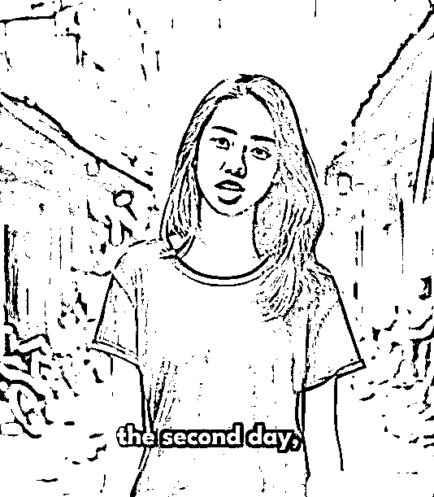不仅产量快，涨粉和收益也很猛。比如群里一位伙伴做了个题材，3天粉丝直接涨了4万多，而他那条最火的视频播放量也就一百多万。以前做影视剪辑，想出个万粉号都得靠爆款运气，现在用AI讲故事，轻轻松松就能做到。看来“爱听故事”真是刻在人类基因里的。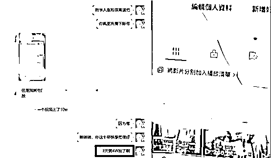

其实这种数字人讲故事，只是当下AI玩法的一个分支。目前TikTok上不少这类账号都是我们团队在做，高峰期三天就能孵出十来个万粉号。社群里已经带过两期陪跑，大家跑出来的成绩也都挺不错。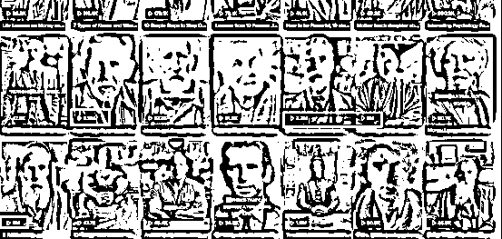

那具体怎么操作？放心，真的简单到“有手就行”。这边没法直接放视频，想感受实际效果的可以找我拿账号看。简单说，你要做的就是在画面里放一个会张嘴讲故事的人物，故事内容越吸引人，流量就越好看。这个玩法既好玩又不复杂。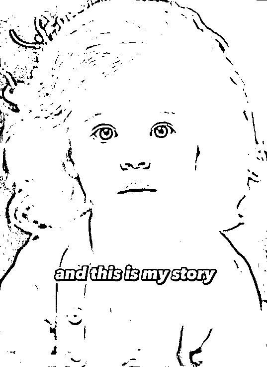

拆解下来，做一条视频只需要四样东西：一份故事文案、一张人物图片、一段配音，以及最后的剪辑合成。

**一、故事文案怎么来？**

方法一：让ChatGPT这类AI直接帮你写故事。如果生成的不满意，就多给它几个同类爆款案例，让它照着那个感觉写，本质上就是不断训练调教。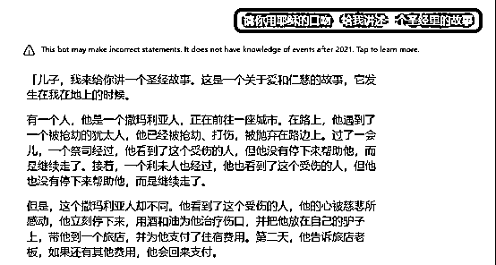

方法二：直接用同类作品的文案。把你想模仿的爆款视频下载下来，然后提取里面的文案。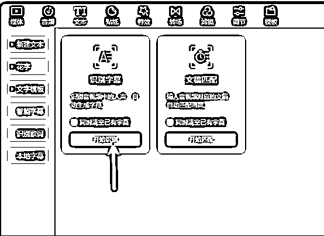这里最简单的方式是用剪映做“智能识别字幕”，再导出字幕文件，文案一下子就能搞到手。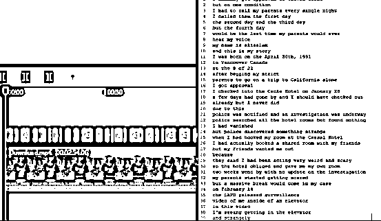

方法三：让AI帮你改写故事。不想跟别人的文案一模一样，就把别人的故事喂给AI，让它给你出一个类似但更新的版本。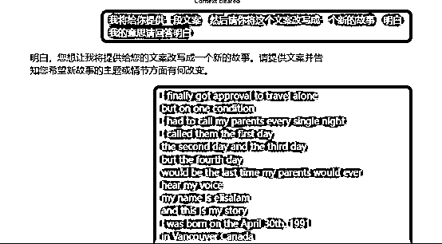就这样，一份顺手的故事文案轻松到手。

**二、人物图片怎么画？**

说到AI生成人物，绕不开Midjourney，它目前算是顶级的AI绘图工具之一。这里先给没用过的朋友简单过一遍注册流程，学一下还是值得的，不过后面我会介绍一个更简单的替代方案。

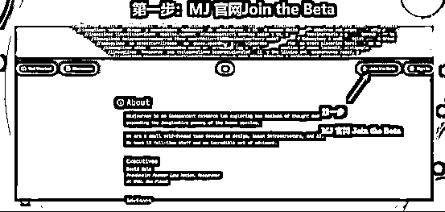

第一步：去Midjourney官网，点击“Join the Beta”。

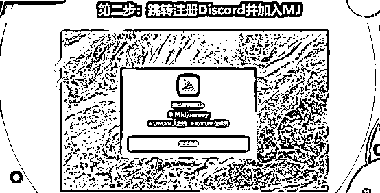

第二步：页面会跳转到Discord——可以把它理解成一个类似QQ频道或贴吧的社区平台——然后注册一个Discord账号。

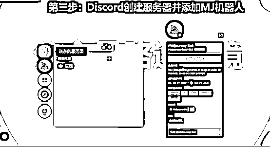

第三步：在Discord里新建一个服务器，并把MJ机器人邀请到自己的服务器里。

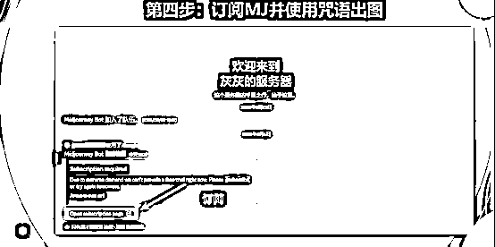

第四步：进入你的Discord服务器，用“/image”指令调用MJ机器人。注意，前提是先付费订阅，不然用不了。

光听这套流程，是不是已经觉得麻烦了？我还没说，整个过程还得学会“🪜”。当然，如果对MJ感兴趣，网上教程一大把，可以自己去翻。

太复杂的方法，普通人肯定玩不来。所以我也找了一个直接调用MJ接口的替代方案，完美绕开那些绕路操作。

再看最初的目标：我们无非是想生成一个和参考图相似的人物。比如我随手画了下面两张，大家看看效果：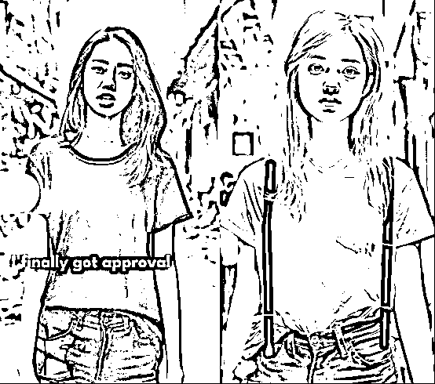还不错吧？操作很简单，第一步：把你想模仿的图片上传到平台，甚至可以直接截图别人的作品。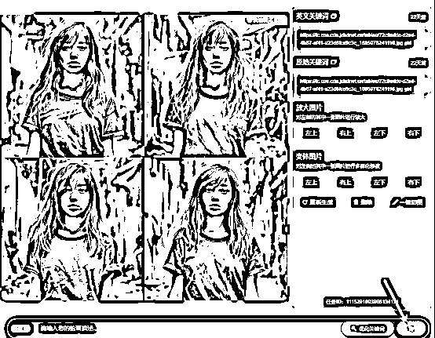第二步：输入关键词，点击生成，人物图就出来了。

是不是很简单？这个平台底层还是用的MJ接口，支持中文指令，省去了一堆复杂配置，对国内用户很友好——估计是赚钱圈友开发的。

价格再给大家展示下：新用户有10次免费作图机会，如果你有多张手机号，可以多注册几个账号撸免费次数。购买网站会员的话，一个月68元。链接是：https://2gpt.ai/?shareKey=VU69AOL3。如果注册时提示缺少邀请码，填VU69AOL3就能过。

我也试过一些免费平台，但出图效果达不到我的要求，所以就没怎么用。不过也一起列出来，感兴趣的朋友可以自己试试：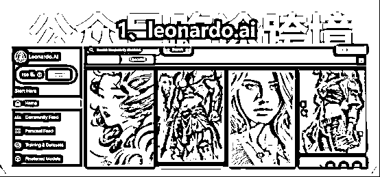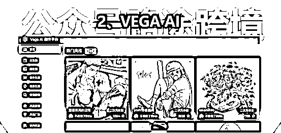

**三、怎么让图片开口说话？**

文案和人物都搞定后，接下来就是让人物开口。这一步同样很简单，只需用下面这个网站：https://studio.d-id.com/

第一步：上传你做好的人物图片，创建新角色。

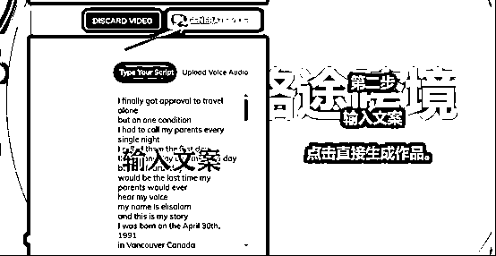

第二步：把故事文案粘贴进去，点击生成。

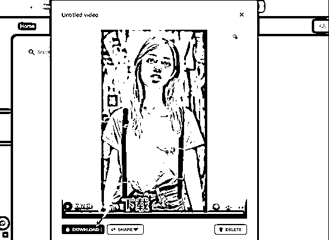

一个会说话的数字人就搞定了。

如果还想做名人题材，可以玩声音克隆。目前网上的克隆模型大多需要训练，但我找到一个比较省事的办法：直接上传一段目标人物的录音，再输入想说的话，就能生成对应的声音。遗憾的是目前只支持英文，但胜在简单，基本是傻瓜式操作。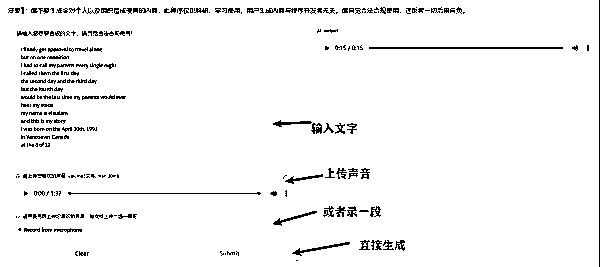

**四、最后一步：剪辑合成**

剪辑部分推荐剪映。把素材拖进去，选择“识别字幕”功能。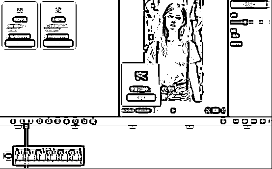字幕会自动匹配好。再调整一下字幕的字体和动画效果，一条成品视频就宣告完成。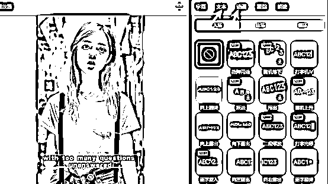熟悉流程后，哪怕是新手，几分钟出一条也不是问题，效率超高。

**超级小技巧：更快速出片**

有人肯定会问：我是百分之百纯小白，有没有更快的生产方式？有的，最后再分享一个取巧技巧，同样有手就行。

还记得前面做数字人的步骤吗？其实最费时间的无非是文案和配音：原创文案常常找不到感觉，配音又很难碰到自己想要的音色。这时候完全可以取巧——直接借用别人的声音和文案，把它们上传上去，一秒完成，你就能得到一个口型和配音都很完美的数字人。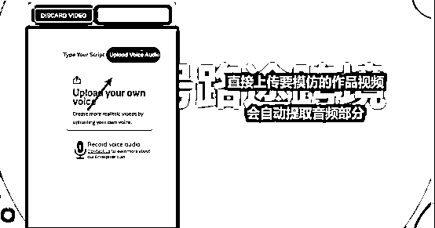所以偷懒版的流程就变成了这样：拿到手的基本就是成品作品了，再加个字幕就能直接发布。

怎么样，学会了吗？觉得有用别忘了点个赞。