# 烧掉 230 亿 Token 后，我才摸清实体商家能复用的 AI 变现路径
作者：龙哥

如果你做的是线下生意，或者手里有行业 Know-how 和客户资源，想把 AI 包装成一个能收钱的小产品，却不知道从哪条需求切入，这篇更适合你。文里不讲宏大的平台战略，也不罗列工具玩法，只讲怎么从真实业务里找一个小口子，先做出 Demo，再去跟真商家做验证。

我用 Codex 做了一个美业方向的小程序，目前处于内测阶段。阶段性反馈是：

- 内测中已有 10+ 家门店在用；

- 内测期按 500 元/店收费；

- 已有 20+ 家门店预约正式版上线；

- 正式版计划定价 9800 元/年/店；

- 老板看完演示后的第一反应基本一致：原来还能这么做。

项目还在放大初期，具体门店、品类、数据不会全部公开。但反馈已经说明一件事：老板不是没见过 AI。他们惊讶的是，门店里那些隐形、难教、难复盘的销售细节，居然可以被拆出来。

这个小程序的本质，用通俗话说就是：

把美容师与顾客的沟通、服务过程、成交机会、回访话术、小红书内容这些原本靠经验感知的环节，变成老板能看见、员工能练习、门店能复盘的结构化信息。

老板为什么觉得有价值？因为过去很多环节是黑箱。顾客躺在床上说了什么、员工怎么接、哪里有成交信号、哪里有风险、哪里被错过，事后店长基本看不到。

一旦被拆出来，老板会发现：

- 销售记录可追踪；

- 服务过程可复盘；

- 美容师可被训练；

- 回访可更及时；

- 素材可从真实服务中沉淀；

- 原本靠感觉的部分开始可量化。

本文的核心判断是：

一个 AI 产品值不值钱，不在于用了多少模型，而在于是否让真实业务变得更可追溯、更可复盘、更能带来收入。

所以本文只讲一件事：

普通人做 AI 变现，别先问 AI 能做什么，先问自己熟悉的行业里，哪个动作每天都在发生、强依赖人、易出错、出错就丢钱。

找到这个动作，再用 AI 做成一个小工具，就有机会让客户付费。

下面拆成 4 部分：

1. 成交背后的客户购买逻辑；

2. 一套小白可照做的 4 张表框架；

3. 美业里的 4 个真实案例；

4. 从想法到验证的 SOP。

## 一、结果背后的逻辑：客户买的是业务结果

### 1. 这是我用 Codex 消耗的算力

先放两张图，不是为了证明我很会玩 AI，而是交代前提：下面这些方法，不是偶然试出来的，是把 Codex 长期嵌进真实项目后的复盘。

第一张，是我的 Codex 使用量。

第二张，是我某天登上赚钱 Token 榜的截图。

目前 Codex Token 消耗约 200 多亿，单日最高约 10 亿，赚钱 Token 榜冲到第 6。

想强调的不是消耗数字。

Token 本身只是燃料，烧完不等于有产品；只有烧进真实业务流程里，才可能变成交付和收入。

如果你只是让 AI 写稿、做图、搭页、写方案，当然有用，但很容易停在半成品。

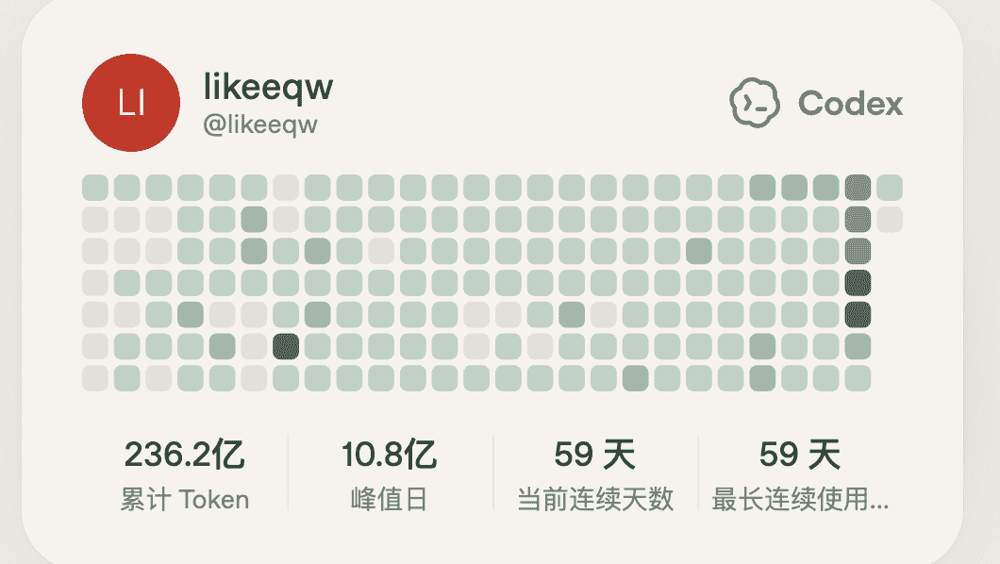

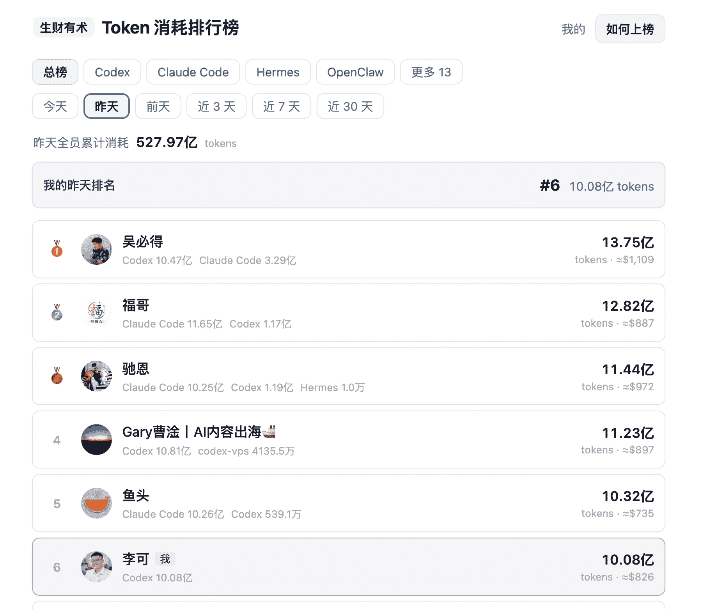

客户不会因为你用了大量 AI 就付钱。

客户只会因为你解决了真实问题才付钱。

所以这两张图要引出的不是 Token 越多越好，而是下面这张图：

Token 要变成业务结果，中间必须经过组织方式。

这张图的意思是：Token 至少有三层。

第一层是数量：每天能让 AI 干多少活。

第二层是质量：模型能力、上下文质量、任务拆解质量够不够。

第三层是组织方式：这些输出能不能放进一个可复用、可验收、能产生业务结果的流程里。

压缩成公式：

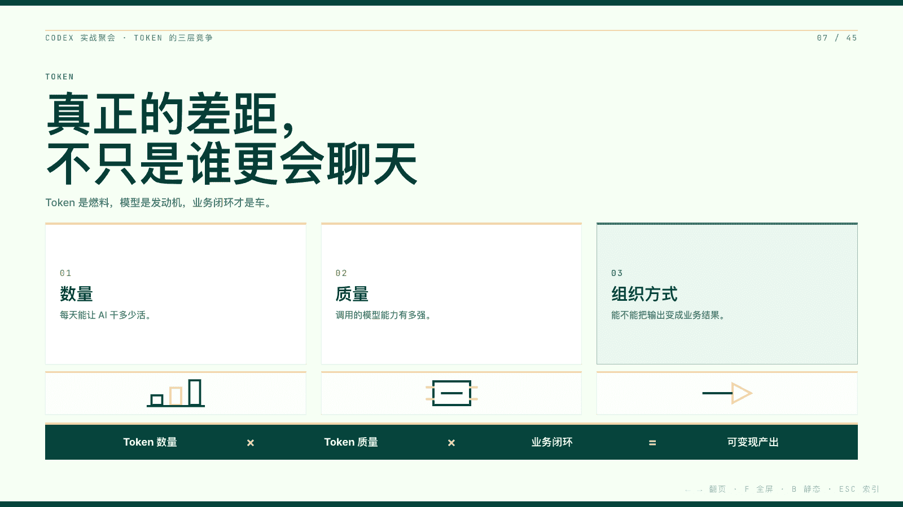

这段时间烧了这么多 Token，我最大的体会是：

真正管用不是某个神奇 Prompt，而是你能不能持续把行业资料、真实流程、客户反馈和验收标准喂给 AI，再让它围绕一个最小闭环反复迭代。AI 不是帮你凭空想产品，而是把你已看见的业务问题，更快变成能演示、能验证、能改进的结果。

所以我想说的是：当 Token 被组织进一个每天发生、强依赖人、离钱近的业务闭环里，它就不只是成本，会变成产品、交付和收入。

接下来你会看到，我的 Token 最后不是落在炫技 Demo 上，而是落在了一个美业小程序里。

### 2. 算力最后落在了哪里

我这段时间做的是一款美业 AI 小程序，现在也在迁移成 App。

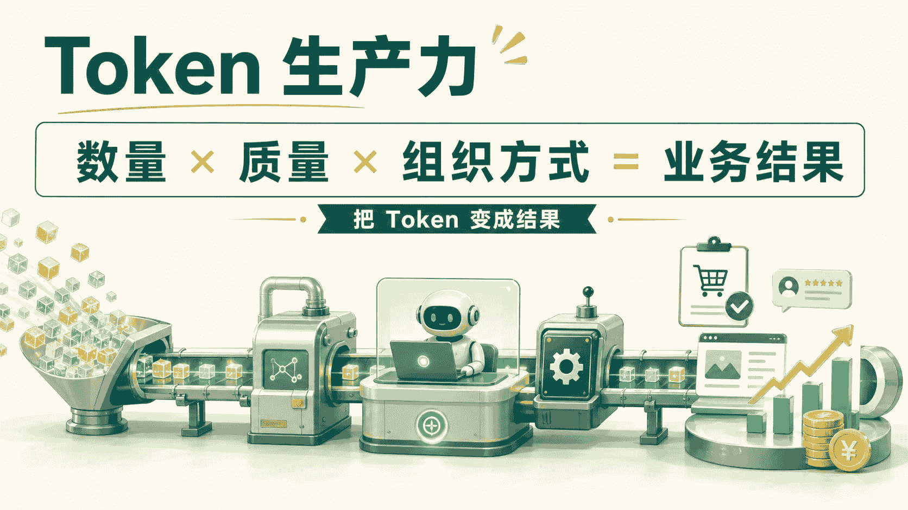

它不是泛泛的 AI 助手，而是围绕美容门店每天真实发生的流程做的：

- 美容师如何与顾客沟通；

- 顾客异议如何回应；

- 服务过程如何记录；

- 销售机会如何识别；

- 私域回访和预约怎么写；

- 小红书内容如何从服务素材里生长；

- 店长如何知道员工哪里弱；

- 老板如何看到过去看不见的销售过程。

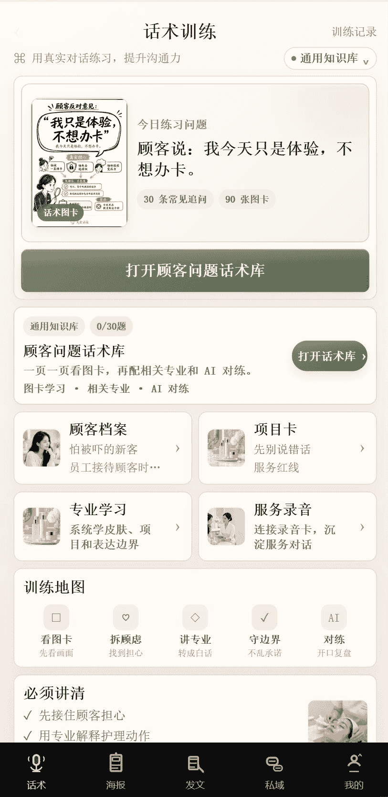

### 3. 老板真正买的是什么

我后来发现，老板买的不是对话功能。老板真正关心 4 件事：

#### 5. 看得见

- 过去服务过程看不见，现在顾客说了什么、员工怎么接，可以留下记录。

#### 6. 复盘得了

- 过去员工说顾客还行，现在能拆出顾客顾虑、销售机会、风险提醒。

#### 7. 训练得动

- 过去店长只能口头带人，现在能基于具体弱点反复训练。

#### 8. 跟进得上

- 过去顾客提到兴趣点，服务完就忘了；现在可以生成下一步动作和回访话术。

这四件事合起来，就是一个强业务结果：把销售黑箱变成可追踪、可复盘、可训练、可跟进的系统。

所以给一个判断标准：

如果你的 AI 工具只是生成内容，客户可能觉得新鲜。如果能让他多赚钱、少漏单、少培训、少返工，他才更可能付钱。

## 二、核心框架：用 4 张表拆出一个能收费的产品

很多人做 AI 产品，第一步就跑偏。

他会先问：我能用 AI 做什么？

这个问题会把你带向功能清单：写文案、做图、做网页、做客服、搭知识库。

功能越列越多，客户越不知道为什么要付费。

所以我会换问题：这个行业里，哪个动作值得被改造？

不要从 AI 能力出发，要从业务里正在耗人、易错、漏钱的动作出发。只有先找到这种动作，后续的 +AI 才不是硬加功能，而是放到有客户、有流程、有痛点的位子上。

不是随便找个行业加个聊天框。

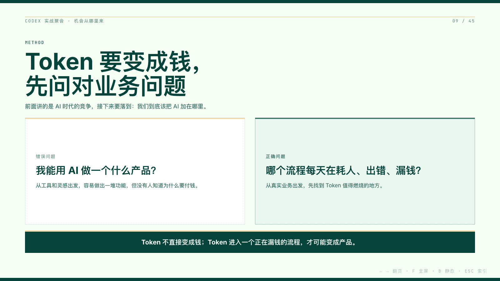

它至少要同时满足 5 个条件：已有行业、已有客户、已有流程、已有痛点，最后再用 AI 改造。如果前面 4 个没有，做出来大概率只是演示；如果前面 4 个成立，AI 才可能变成提效、增收、训练、复盘这些客户愿意买单的结果。

所以建议不要先写需求文档，而是先用下面 4 张表把这 5 个条件层层拆清。

### 第 1 张表：行业流程表

先别想产品，先画一条业务线。比如美业门店，大致可拆为：

内容获客 -> 私域咨询 -> 预约到店 -> 到店诊断 -> 项目服务 -> 成交转卡 -> 服务复盘 -> 老客回访 -> 内容沉淀 -> 复购转介绍

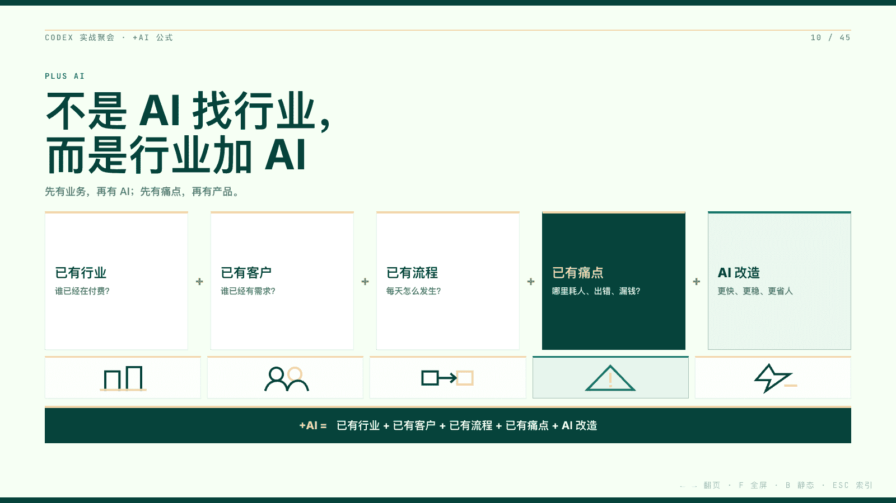

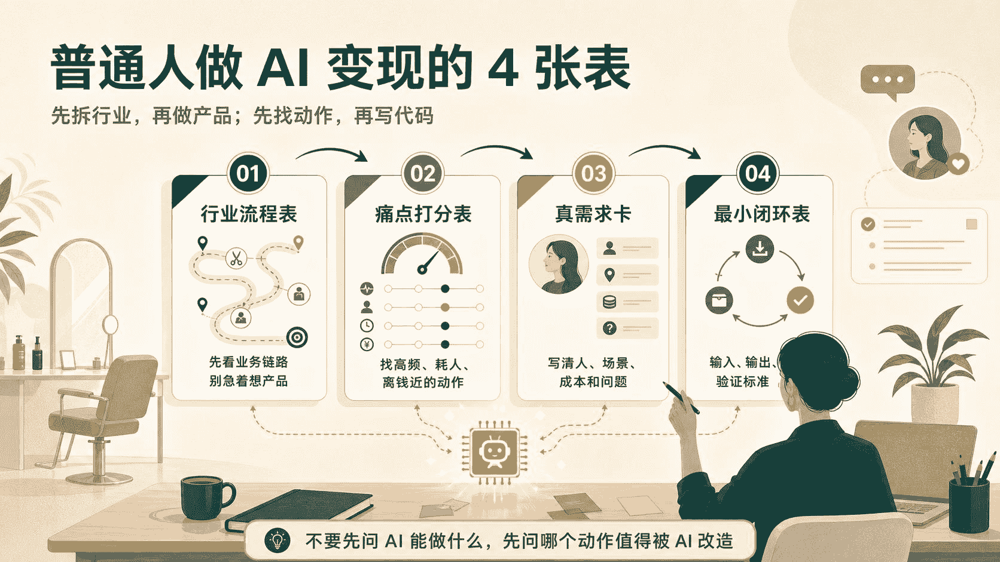

【这是我之前拆解的美容行业流程表】

然后把每一步继续细化。不要写成交这种大词，要写真实动作：

- 顾客问价格，美容师怎么答；

- 顾客怕刺激，美容师怎么解释；

- 顾客说我回去考虑，员工怎么跟；

- 顾客做完护理，第二天怎么回访；

- 老客三个月没来，怎么自然邀约；

- 服务过程里出现了什么小红书选题；

- 店长怎么知道员工有没有错过成交信号。

这一步的目的是把我要做一个 AI 产品变成我看到了一堆可改造的业务动作。

### 第 2 张表：痛点打分表

流程拆完后，不要全做。用一张打分表筛选。

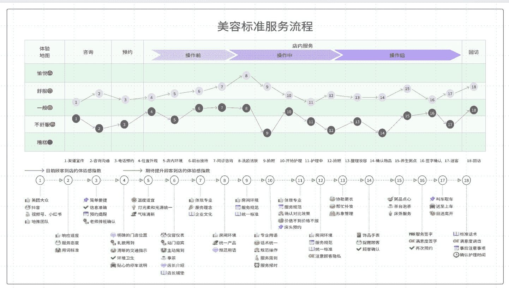

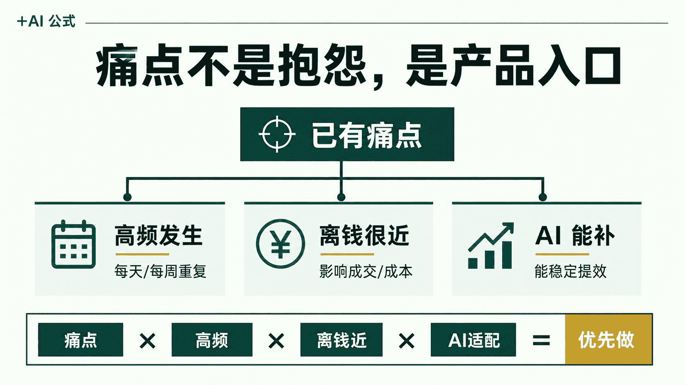

每个动作按 6 个维度打分，1-5 分即可：

| 维度 | 问题 |

| 高频 | 这个动作是不是每天/每周都会发生 |

| 耗人 | 现在是不是要员工反复做 |

| 易错 | 做不好会不会影响体验或成交 |

| 离钱近 | 会不会影响成交、复购、续费、转介绍 |

| 依赖人 | 是不是很依赖员工经验、表达、判断 |

| AI 适配 | AI 能不能明显帮上忙 |

【美业流程诊断表示例】

分数最高的不一定最大，往往是一个很小但贴近现金流的动作。比如美业，我优先选的不是做一个完整门店管理系统，而是：

- 话术训练；

- 服务记录复盘；

- 私域预约回访；

- 小红书内容拓客。

因为这些动作高频、离钱近、依赖人，且 AI 能明显助力。

### 第 3 张表：真需求卡

有了高分动作，还不能直接写代码。高分动作只能说明这里可能有价值，但没说明谁来用、在什么场景用、已经付出什么成本、第一版解决什么问题。

所以中间还要压一次：把方向压成开工需求。上面这张图讲的就是这个过程：先从低效环节选一个需求方向，再压到具体场景，最后才变成 Codex 能执行、客户也能听懂的开工单。

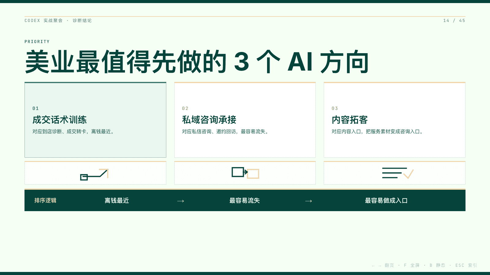

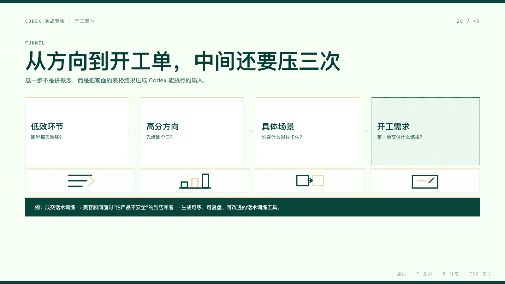

关键不是把需求写得高级，而是写得足够具体。真需求不是一句做个 AI 门店管理系统，而是要同时说清 4 件事：谁在用、什么场景、已付出什么成本、首版只解决什么问题。下面这张图就是判断公式。

落到填写时，可直接用这张卡。它不是完整需求文档，而是防止你和 Codex 一起跑偏的最小开工单：

| 问题 | 写法 |

| 具体的人是谁 | 老板、店长、美容师、顾客，不能写用户 |

| 具体场景是什么 | 在什么时刻发生，不能写提升效率 |

| 已付出什么成本 | 时间、工资、漏单、培训、流失、老板检查成本 |

| 首版解决什么问题 | 只解决一个小问题，不能一上来做系统 |

写这张卡时，不要追求完整，先追求具体。

比如我的服务记录复盘方向，可以这样写：

具体的人：美容院老板和店长。

具体场景：顾客做完服务后，店长不知道过程中出现了哪些顾虑和销售机会。

已付出成本：员工培训靠感觉，销售机会易漏，老板事后看不见过程。

首版解决：把服务记录拆成顾客顾虑、销售机会、风险提醒、员工复盘和下一步话术。

你看，这比做一个 AI 门店管理系统具体得多。它已能让 Codex 判断输入是什么、输出是什么、首版边界在哪；也能让客户判断结果是否解决真实问题。

下面这张图，就是差需求和好需求的区别。

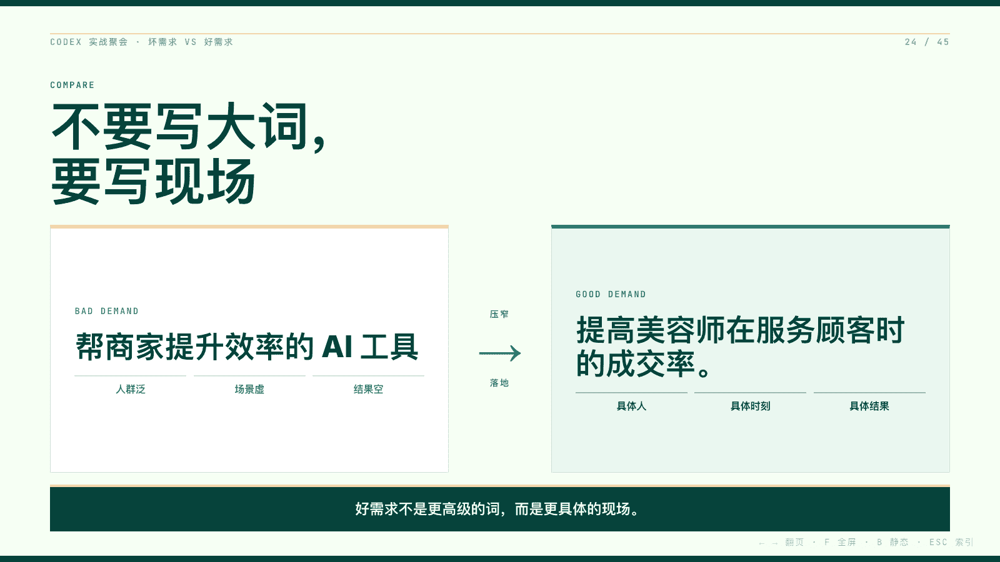

真需求卡写到这个程度，才进入下一步：把它变成一个可演示、可验收、可给客户看的最小闭环。

### 第 4 张表：最小闭环表

最后一张表，不是列功能清单，而是把真需求压成一个最小可验证闭环。

所谓最小闭环，就是只保留 5 件事：用户给什么输入、AI 做什么处理、用户看到什么结果、怎么判断结果有没有用、下一步拿给谁验证。

只要这 5 件事说不清楚，就说明需求还没到可开工程度。

| 项目 | 例子 |

| 用户输入 | 一段服务记录 / 一段顾客异议 / 一个预约场景 |

| AI 处理 | 提取顾虑、机会、风险、话术、评分 |

| 用户看到 | 一份复盘报告 / 一句可发送文案 / 一篇小红书草稿 |

| 判断标准 | 老板看完是否愿意试，员工是否能直接用 |

| 下一步验证 | 找 10 个真实客户演示 |

这张表的价值，是把你从大系统冲动里拉回来。首版不需要登录、支付、多角色、复杂后台，也不需要一上来做成完整产品。首版最重要的是让客户看到一个结果，并且愿意拿真实场景继续试。

所以，这张图要看的不是页面多完整，而是链路是否跑通：

用户给你一个真实输入，你给他一个能用的结果，他愿意继续给你真实场景。

只要闭环跑通，后续才值得加登录、后台、权限、支付、报表、团队协作。

下面进入案例部分，你会看到我在美业做的几个功能，本质都是从这个最小闭环长出来的。

## 三、真实案例：美业 AI 产品是怎么从流程里长出来的

下面这 4 个案例，不是为了展示功能。

【美业 AI 业务闭环】

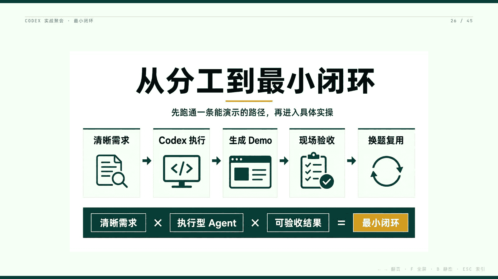

重点看它们的共同逻辑：

真实场景 -> 当前痛点 -> AI 输出 -> 老板为什么愿意付费

### 案例一：话术训练，把美容师销售能力标准化

小白版解释：

就是让美容师在接待真实顾客前，先和 AI 顾客练一遍。AI 顾客会像真人一样问价格、问效果、怕被推销、怕刺激，然后系统给训练报告。在美业里，离钱最近的场景，不是一味拓新客，而是顾客已到店、正在服务中和美容师沟通时。

美容师一句话，可能影响：

- 顾客是否信任；

- 项目是否听懂；

- 是否转卡；

- 是否加项；

- 是否复购；

- 是否愿意介绍朋友。

但现实里，大多数门店训练员工仍靠：

- 店长口头带；

- 新员工背资料；

- 老员工凭经验；

- 顾客提出异议时现场发挥；

- 练完无记录、无复盘。

所以我做了话术训练。

【话术训练对练界面】

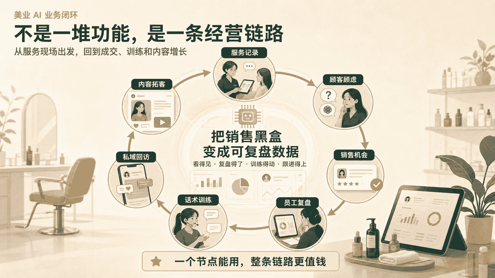

它不是让员工背话术，而是进入真实场景：

- 顾客抛出一个异议；

- 美容师用语音回答；

- AI 顾客继续追问；

- 系统记录整个过程；

- 最后生成训练报告。

【回答建议界面】

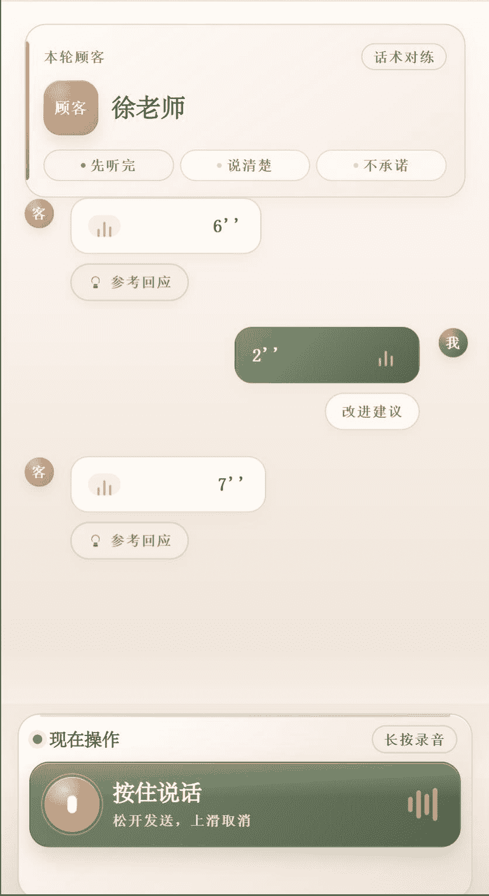

报告看什么？不是一句表现不错，而是具体拆：

| 维度 | 看什么 |

| 专业准确度 | 是否讲清专业 |

## 重点

- **口语表达**：顾客能否听懂

- **信任建立**：是否先接住顾客担心

- **异议处理**：是否处理价格、效果、推销等问题

- **边界意识**：是否避开医疗承诺和恐吓成交

- **下一步推进**：是否给出低压力下一步

这里我后来又做了两个更具体的知识库样板，它们很适合理解：同样是知识库，不能都做成资料库。

第一个是 A 门店。A 门店原来有企业文化、产品专业、项目专业、服务标准。如果只是把这些资料塞进小程序，员工大概率不会看，也不会用。

所以我把它拆成了开口训练包：

原始资料 -> 专业内核 -> 门店判断动作 -> 顾客听得懂的话 -> 员工可复用句式 -> AI 顾客追问 -> 店长验收标准

它最后不是一篇知识库文章，而是一张张训练卡。一张训练卡长这样：

**顾客原话**：我今天只是体验，不想办卡。

**隐藏担心**：怕体验变成办卡压力，怕美容师不尊重边界。

**高手 6 秒说法**：可以的，您今天就按体验来，我先把适合和不适合讲清楚。

**三句块**：

1. 先接边界：可以的，您今天就按体验来。

2. 再讲标准：我先看肤况，把适合和不适合讲清楚。

3. 最后低压推进：您觉得舒服，我们再聊下一步。

**AI 顾客追问**：

- 那你们不会一直推套餐吧？

- 如果我不办卡，你们服务会不会变差？

- 今天体验里到底包含什么？

**禁说词**：

- 今天不办就没有这个价

- 做完您肯定会想办

- 不办就白来了

**通过标准**：

- 先尊重体验边界；

- 讲清先看肤况；

- 主动说明包含和不包含；

- 给出低压下一步。

你看，这就不是 AI 总结知识库。这是把一堆资料拆成了员工能练、店长能查、老板能管理的训练资产。

第二个是 B 门店。B 门店的需求又不一样。A 门店更适合做顾客问题开口训练，B 门店更适合做项目卡知识库。因为它的核心不是先回答顾客异议，而是让员工快速记住项目：

- 这个项目是什么？

- 一句话怎么记？

- 适合什么顾客？

- 美容师看哪里？

- 核心专业是什么？

- 操作重点是什么？

- 可以怎么说？

- 绝对不能怎么说？

我在资料里整理到的 B 门店知识库已经不是一个小文档，而是 26 个卡组、217 张项目卡图片。但员工端仍然不能直接丢 217 张图给他看。正确做法是把它拆成：

项目卡 -> 项目拆解卡 -> 项目话术卡 -> 禁语卡 -> AI 对练卡

比如苗药筋骨养护不是让员工背一堆专业词，而是让员工知道：

- 顾客说肩颈紧，先问哪里紧、多久了、有没有明显不适；

- 只能讲草本外用、体感观察、舒缓放松和服务跟进；

- 不能讲治疗疼痛、保证见效、排毒排寒、越辣越有效；

- 可以用半边体验、体感记录和下次复盘做低压承接。

真正稀缺的，从来不是一套资料，而是把资料翻译成前线人员当场能执行、事后能检查的行为。老板愿意投入，原因也不在“能和 AI 对话”，而在于：原本依赖美容师悟性、个人经历和店长口授的销售方法，被整理成可教学、可打分、可回看的训练机制。换到其他行业，依然成立。

凡是存在顾问接待、客户提出疑问、推进成交的场景，都可以用同样的拆法：

- 牙科门诊咨询；

- 教培机构试听后的转化；

- 健身教练续费；

- 房产经纪带看；

- 企业销售顾问跟单。

## 场景二：让服务过程留下经营线索

通俗理解，就是把一场服务中的客户表达，整理成管理者能够利用的机会、隐患、训练建议和后续安排。

这是整套方案的地基。缺少过程素材，员工训练、私域触达和内容创作都会变成凭空猜测。过去门店最难管理的，正是现场发生了什么：顾客说了哪些话，员工如何回应，顾客真正介意什么，哪些话透露出购买意向，哪些地方可能引发投诉，服务结束后往往没人说得清。

一份服务转写或文字记录，可以进一步整理为：

- **客户在意点**：担心刺激、抗拒推销、怀疑效果、预算有限；

- **可推进线索**：主动了解小套餐、询问费用、确认补水卡能否组合；

- **表达边界**：避免夸大结果，也不能一味推高客单；

- **员工表现**：哪些回应有效，哪些问题被错过；

- **管理安排**：要不要由店长介入，什么时间再次联系；

- **档案补充**：新增顾虑、偏好以及感兴趣的项目；

- **后续表达建议**：下次沟通可以怎样自然接上。

老板真正感受到的变化在这里：

以前员工结束服务，只能概括成“顾客感觉还可以”。现在管理者能够看到：这位顾客害怕刺激，也排斥被推销，但她主动问过小套餐费用，这说明后续存在一个更温和的推进窗口。

模糊印象被整理成可核对的信息，管理就不再只靠感觉。

管理者付费购买的，也不是一份文字档案，而是它背后的经营改善：

- 及时发现被遗漏的成交线索；

- 提前识别容易踩雷的沟通方式；

- 让员工知道自己到底该改什么；

- 让店长拥有明确的管理依据；

- 让顾客资料随着每次服务持续完善。

## 场景三：让私域沟通不再靠临场发挥

它解决的是一个非常具体的问题：美容师准备联系顾客时，只需选择当前情境，再补充一句真实情况，系统就能整理出一段可以直接发送的内容。

门店每天都在处理这些细碎但高频的联系：

- 安排预约；

- 到店前确认；

- 邀请老客再次到店；

- 护理后的状态跟进；

- 复购提醒；

- 回复朋友圈互动；

- 重新联系长期未到店的顾客。

单次动作不大，累积起来却非常占时间。更麻烦的是，沟通质量高度不稳定：

- 有人写得像硬广；

- 有人语气过于生硬；

- 有人面对顾客不知如何起头；

- 有人忘记对方上次的情况；

- 有人明明拥有再次邀约的机会，却没能把话接下去。

因此，私域助手的首个版本无需复杂，重点是回答：“现在联系这位顾客，怎样说更合适？”

**【私域助手界面】**

可先覆盖几类高频情境：

- 预约：提供两个合适的时间选项；

- 回访：先了解感受，再给出轻量提醒；

- 再次邀约：用自然理由打开话题，而非强行推项目；

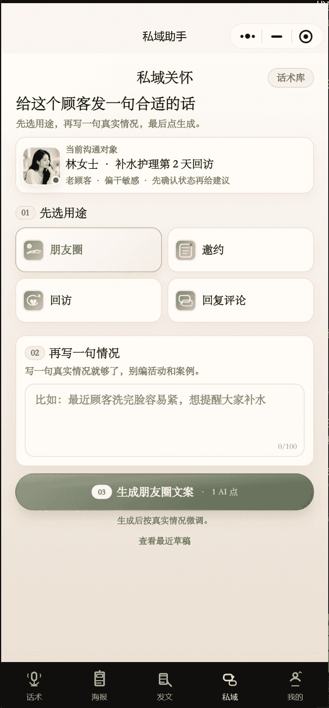

- 评论回应：先在公开区域正常互动，再延伸到私聊；

- 长期未联系唤回：从近况关怀开始，不急着介绍项目。

它之所以有商业价值，是因为它不是孤立功能，而是嵌入每天都会发生的工作。使用频率足够高，才可能形成持续使用；离顾客足够近，才更容易带来后续机会。

## 场景四：把真实接待素材变成内容线索

重点并非让模型随意写一篇笔记，而是从真实项目、接待过程和顾客疑问中提取内容方向，再把它们加工成能够引导咨询的表达。

很多门店知道要经营小红书，却长期卡在这些地方：

- 每天没有稳定选题；

- 接待现场的素材没有被保存；

- 员工无法把项目讲明白；

- 成品看起来像打折海报；

- 线上内容与线下体验脱离；

- 内容发布后没人负责承接；

- 项目的卖点不会拆分。

所以真正需要的不是普通写作工具，而是一张连接服务现场与内容运营的“发文台”。

**【小红书发文台界面】**

它可以按这样的路径工作：

服务素材 / 项目信息 / 顾客疑问 → 归纳内容角度 → 形成标题和正文 → 配置封面及配图方向

例如，顾客在护理时说：

“我担心抗衰项目太刺激，也不想第一次就买一整套。”

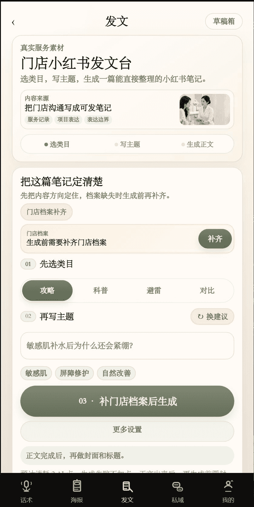

这句话已经包含了一个明确的内容入口，可以继续展开为：

- 皮肤容易敏感的人，如何了解抗衰项目？

- 为什么首次体验不适合直接选择大组合？

- 第一次接触抗衰，应该观察哪些信号？

- 小规格方案为什么更适合新顾客先做判断？

这不是凭空编写，而是把接待现场的真实问题加工成可被搜索、可被咨询的内容。后续还可以继续展示具体品项的拆解案例，但当前项目仍处在试运行和扩展阶段，具体门店与打法暂不公开。

## 四、从零验证 AI 应用：一套可执行流程

这一部分最值得照做。

如果你准备把方法带回自己的行业，别先规划完整平台，也别急着堆所有功能。先完成一个可展示的原型，再拿给十位真实从业者或客户看。你要验证的不是“能不能上线”，而是：对方是否愿意为这个结果投入时间、资料、试用机会，甚至费用。

**【通用行业诊断表】**

**【AI 小产品验证 SOP】**

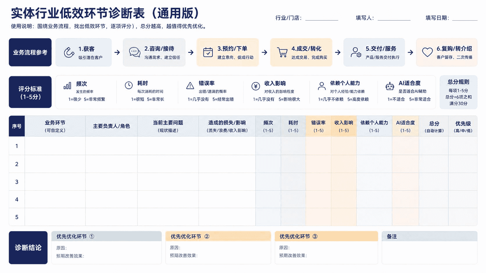

### 第一步：从你能触达的领域开始

优先选择你有接触渠道的赛道，而不是只看市场规模。以下条件满足任意一项即可：

- 你本身就在其中工作；

- 手上已有相关客户；

- 曾经服务过该类企业；

- 认识这个领域的老板或一线人员；

- 能够约到十个人交流。

请先写下：

所在领域：

准备服务的人群：

可以联系的十位真实对象：

他们目前怎样产生收入：

一旦出问题，最担心损失什么：

以美容门店为例：

所在领域：美容服务门店

准备服务的人群：美容院经营者、店面负责人

收入来源：项目购买、储值转化、后续复购、老顾客维护

主要损失：员工不会沟通、顾客流失、过程无法追踪、潜在成交被忽略

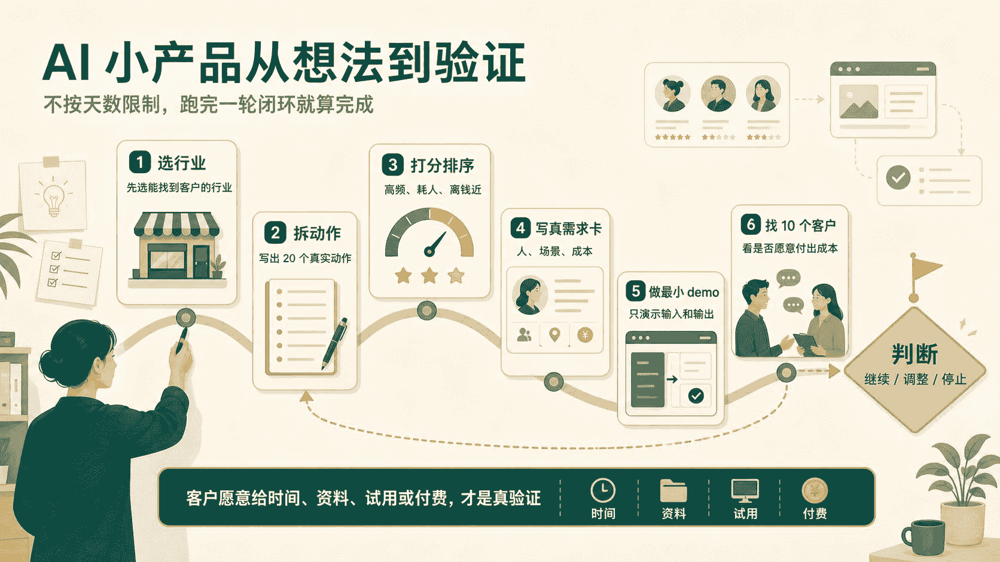

### 第二步：列出二十个可观察的工作行为

暂时不要讨论产品，也不要急着想功能，只把从获客到成交、交付和维护过程中反复发生的行为写出来。

表格可用以下字段：

| 环节 | 发生了什么 | 由谁完成 | 当前处理方式 |

比如：

| 咨询 | 顾客问费用时如何回应 | 美容师 | 凭个人经验 |

| 服务中 | 顾客担心刺激时怎样解释 | 美容师 | 临场组织语言 |

| 服务后 | 隔天怎样联系顾客 | 美容师 | 手动编辑消息 |

| 管理 | 负责人如何回看接待质量 | 店长 | 询问员工主观感受 |

筛选标准很简单：

- 至少列满二十条；

- 每一条都必须对应真实行为；

- 不要写“提升效率”“赋能业务”等抽象口号；

- 只记录能被看见、被描述的动作。

最终得到的是一张业务行为清单。

### 第三步：给每条行为做价值评估

可以从六个方向判断优先级：发生频率、人工负担、出错概率、与收入的距离、对个人能力的依赖程度，以及是否适合交给 AI 辅助。

| 行为 | 频繁程度 | 人力消耗 | 出错风险 | 收入关联 | 个人依赖 | 适配程度 | 合计 |

| 顾客异议应答训练 | 5 | 4 | 5 | 5 | 5 | 5 | 29 |

| 护理后的联系 | 5 | 4 | 3 | 4 | 4 | 5 | 25 |

| 内容选题与撰写 | 4 | 4 | 4 | 4 | 4 | 4 | 24 |

优先挑选分数靠前、同时又容易拿到真实材料的事项。

请明确：

首个切入点：

为什么它值得先验证：

它如何连接收入：

### 第四步：制作一张“需求事实卡”

在正式写需求文档前，先把需求压缩成一页纸：

服务对象：

发生时刻：

现在的处理方法：

已经产生的损耗：

准备先消除的麻烦：

对方需要提供什么：

系统返回什么：

首轮明确不做什么：

美容行业示例：

服务对象：美容院老板与店面负责人。

发生时刻：护理结束后，负责人无法判断顾客的真实顾虑和潜在购买意愿。

现在的处理方法：依靠员工口头汇报。

已经产生的损耗：线索被错过，员工训练缺少依据，管理者看不到服务过程。

准备先消除的麻烦：把服务文字整理为顾客顾虑、可跟进线索、表达风险、员工表现和后续建议。

对方需要提供什么：服务对话文字，或由录音转换出的文本。

系统返回什么：一份结构化的服务分析结果。

首轮明确不做什么：账号体系、支付功能、多门店管理和复杂权限。

这张卡的作用，是防止需求在开发过程中不断膨胀。

### 第五步：让 Codex 先参与规划，再开始搭建

到了这里，才适合把任务交给 Codex。下面这段可以直接复制：

我准备验证一个规模很小的 AI 应用，现阶段不考虑完整平台。

使用者：【填写岗位或身份】

发生时机：【填写具体工作瞬间】

当前困扰：【说明耗时、出错、机会流失或过度依赖个人经验的部分】

首轮只处理：【限定为一个清晰问题】

资料形式：【文字 / 语音转写 / 图片 / 表格】

返回形式：【分析结果 / 沟通建议 / 检查清单 / 评分 / 待办】

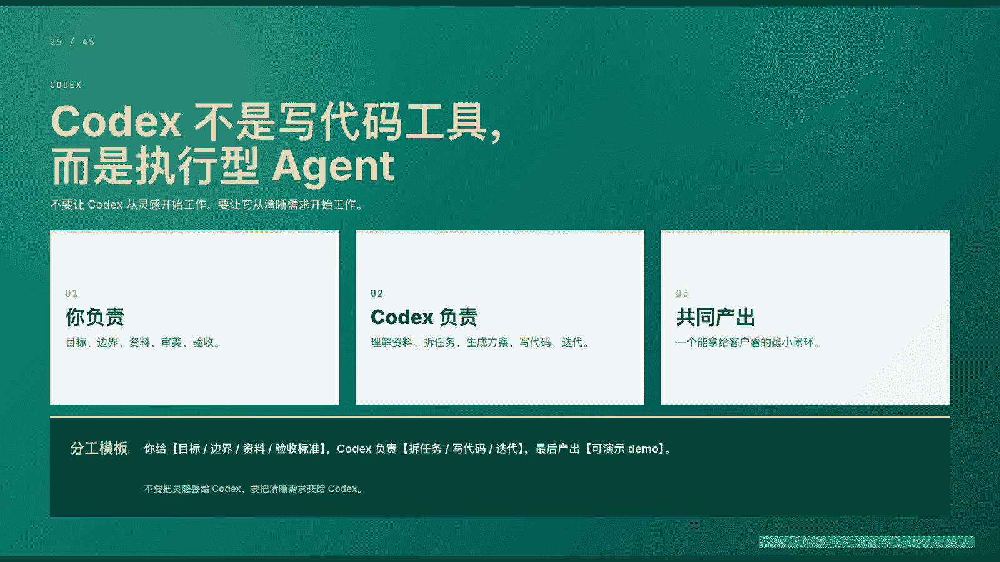

暂不纳入：【账号、支付、权限、多角色、复杂后台】

请先不要编程，先完成以下工作：

1. 判断描述是否已经足够明确；

2. 指出还缺哪些关键信息；

3. 规划一条最短的输入到结果路径；

4. 给出页面和数据的基本组织方式；

5. 说明如何用最低成本做出可展示版本。

原型可以非常朴素，例如：

- 单页网页；

- 飞书模板；

- 表单提交后返回结果；

- 静态演示页；

- 小程序单页；

- 终端脚本。

形式并不重要，关键在于使用者能否一眼理解输出对自己有什么帮助。

最终要得到一个能完成“输入—处理—展示”的演示版本。

## 六组可复制指令

如果你刚开始接触这类开发，不必一次把所有任务交给 Codex。每次只处理一个环节，确认结果后再继续。

### 指令一：梳理某个行业的真实流程

我想在【填写领域】寻找适合 AI 辅助的细分问题。

请暂时不要提出产品方案，先从获客、成交、交付到再次购买，完整列出该领域的业务路径。

要求：

1. 每个环节都写成具体行为；

2. 标明执行者是老板、店长、员工、顾客还是运营人员；

3. 说明当前通常怎样处理；

4. 说明做不好会造成什么损失；

5. 至少列出二十个可能适合智能化辅助的行为。

输出字段：

环节 / 具体行为 / 执行者 / 当前做法 / 失败损失 / 与收入的关系

### 指令二：从行为清单中选出首个验证点

以下是我整理出的业务行为：

【粘贴清单】

请从频率、人工投入、错误概率、收入关联、个人依赖、技术适配六方面进行评分。

要求：

1. 每项采用 1 至 5 分；

2. 为每项给出评分理由；

3. 选出最适合做首个原型的三项；

4. 分别说明输入资料、输出结果，以及对方可能愿意付费的原因。

请只推荐短链路，不要设计平台级方案。

### 指令三：把行业资料整理成“项目卡”

适用于产品说明、服务手册、培训资料较多的行业。

以下是【行业 / 门店 / 项目】资料：

【粘贴资料】

不要把它改写成文章，请整理成一组前线人员可以快速查看的项目卡。

每张卡需要回答：

1. 这项服务是什么；

2. 怎样用一句话记住；

3. 哪类顾客更适合；

4. 接待时应该观察什么；

5. 专业原理如何用通俗方式说明；

6. 服务或操作时要注意什么；

7. 推荐怎样表达；

8. 哪些表达必须避免。

要求：

- 语言贴近日常沟通；

- 不夸大结果；

- 不使用医疗诊断式表达；

- 每张卡控制在一分钟内可读完；

- 最后补充三条可用于 AI 对练的顾客追问。

### 指令四：将企业资料加工成开口练习卡

适合销售、顾问、客服、美容师、教培顾问、私教等岗位。

以下是产品、企业或培训资料：

【粘贴资料】

请整理为一张可练习的沟通卡，而不是知识摘要。

字段包括：

顾客可能说的话：

这句话背后的担忧：

发生场合：

员工需要掌握的专业重点：

六秒回应：

二十秒回应：

六十秒回应：

三句表达骨架：

AI 扮演顾客时的追问：

需要避开的说法：

店长如何判断合格：

要求：

1. 顾客原话要像真实对话；

2. 回复要口语化，员工可以直接练习；

3. 禁用表达需覆盖夸张保证、逼单、医疗化和违规承诺；

4. 合格标准必须能够被管理者检查；

5. 不输出长篇理论。

### 指令五：把沟通材料转成经营分析

适用于服务、销售、咨询和客服等场景。

以下是一段服务对话或沟通转写：

【粘贴内容】

请整理成经营负责人能够使用的分析结果。

输出：

1. 本次沟通概况：控制在一至三点；

2. 顾客关注：指出真正担忧，并引用对应原句；

3. 可跟进线索：说明类型、信号、建议动作和优先级；

4. 表达风险：哪些说法不可使用，哪些承诺不能作出；

5. 员工表现：有效之处、遗漏之处、下一轮训练重点；

6. 管理安排：是否需要负责人介入、由谁负责、何时联系；

7. 顾客档案建议：需要补充哪些顾虑、偏好和兴趣；

8. 后续可用表达：给出一条下次可以自然接上的话。

硬性规则：

- 每个判断都要有原话依据；

- 没有依据就标注“需要复核”，不能自行补写；

- 不进行医疗诊断；

- 不保证效果；

- 输出应指向经营动作，而不是会议记录。

#

### 指令六：把服务素材分别加工成私域文案与内容选题

以下是服务记录、顾客问题或项目资料：

【粘贴素材】

请分别完成两部分：

A. 私域沟通

- 状态跟进短句三条；

- 再次邀约短句三条；

- 先表达关心，再提出轻量的后续建议；

- 不要直接写“我不推销”“没有压力”，通过语气体现自然感。

B. 内容选题

- 提供十个标题；

- 每个标题对应一个顾客疑问；

- 每个选题列出三个正文要点；

- 给出画面或配图思路；

- 不夸大结果，不制造恐慌。

限制：

- 只使用我提供的事实；

- 不虚构案例；

- 不写固定周期见效；

- 不使用保证、根治、永久、不复发等表述。

## 第六步：让十位真实对象看演示

别在朋友圈泛泛询问“大家觉得如何”，而是逐个约真实经营者或一线人员交流。优先选择认识已久、沟通成本较低的连锁门店老板或从业者。

可以这样说：

> 我正在验证一个很轻量的 AI 应用，不是现在让你购买。我想拿行业里的真实场景试试看，花十五分钟给你展示一次结果，你帮我判断它有没有实际用途。

展示时，先呈现业务变化，再解释实现方式。以美容门店为例：

- 原先管理者看不到接待过程，现在能够回看关键沟通；

- 原先员工只会说“顾客还行”，现在能进一步识别顾虑、线索、风险和后续动作；

- 原先培训依赖店长现场提醒，现在可以围绕分析结果逐轮练习；

- 原先老板不知道员工短板在哪里，现在能够看到复盘内容和下一轮训练重点。

接着观察对方是否产生真实行动。

较强的反馈包括：

- 愿意提供材料进行测试；

- 主动约下一轮交流；

- 愿意介绍同领域的人；

- 开始询问收费方式；

- 愿意支付试用成本；

- 愿意让团队成员实际操作。

较弱的反馈包括：

- “挺不错”；

- “有点意思”；

- “以后有机会再看看”；

- 只称赞技术，却不愿提供任何业务材料。

### 本阶段要留下的材料

整理十位对象的反馈、异议、使用记录和后续意愿，而不是只记一句“感觉不错”。

## 第七步：根据真实行为决定后续方向

完成一轮接触后，先判断验证到了哪种程度，不要马上继续堆功能。

### A 类：出现继续投入的迹象

例如：

- 有人愿意支付试用费用；

- 有人愿意提供真实资料；

- 有人愿意让员工实际使用；

- 有人询问正式合作价格；

- 有人主动引荐同业。

做法：收取一笔小额测试费用，在真实使用中继续修正。

### B 类：方向有价值，但需要换切口

例如：

- 对方认可用途，却觉得输出还不够准确；

- 暂时不愿付费，但愿意继续沟通；

- 对方指出另一个问题更迫切。

做法：回到行为清单，重新选择优先事项。

### C 类：暂时停止

例如：

- 没人愿意提供材料；

- 没人愿意参加第二次体验；

- 所有人只停留在礼貌称赞；

- 这个问题目前并没有让客户付出代价。

做法：停止开发，换一个需求验证。

真正的验证，不是对方口头说“不错”，而是他愿意承担某种成本。成本可以是钱，也可以是时间、资料、员工试用或转介绍。如果连这些都不愿意投入，就不能把礼貌反馈当成市场信号。

## 五、初学者常犯的六种错误

### 错误一：开局就规划完整平台

“智能门店系统”“企业经营中台”听上去很宏大，但首轮验证只需要服务一个明确行为。

### 错误二：只展示内容生成，却没有嵌入工作

能写一段话、做一张图，不代表形成了产品。只有进入客户反复使用的日常环节，才可能留下来并产生付费。

### 错误三：反复介绍技术，却不说明业务收益

客户通常更关心：

- 是否能减少线索遗漏；

- 是否能改善预约表现；

- 是否能降低培训投入；

- 是否能帮助新人更快独立；

- 是否能让管理者发现问题所在。

### 错误四：把礼貌称赞误认为需求成立

“挺好”只是态度，不是承诺。愿意拿真实资料来试，才是更可信的信号；主动问费用，信号更强。

### 错误五：描述过于宽泛，导致开发方向失控

“做一个智能管理平台”太模糊，容易让开发不断发散。

“输入一段服务沟通，返回顾客顾虑、跟进线索、表达风险、员工表现和后续建议”，边界就清楚多了。

### 错误六：还没验证就公开全部细节

项目处在试运行阶段时，具体门店、品项资料和操作打法都属于经营资产。方法可以分享，客户信息和细节应当保留。

## 结尾

AI 带来的机会，不一定要求普通人从零打造一个庞大的平台。更现实的路径，是回到自己熟悉的行业，挑出一个高频、依赖个人经验、又与收入紧密相关的环节，再用智能能力把它整理成轻量应用。

最初的形态可以小到只处理一次沟通、一条回访、一篇内容、一张训练结果或一次过程分析。但只要它真正进入业务现场，并且有人愿意为实际改善投入成本，它就已经跨过了演示阶段，成为产品的起点。

别忙着展示自己会使用 AI，先拿出证据，证明有人愿意为你交付的结果付出代价。