# 用 3000 人小私域撬动月入 16 万+，我到底踩对了哪几步？

大家好，我是龙哥，专注帮 I 人用不硬销的方式做私域。

以前我也怀疑副业月入十万是不是个段子，直到我自己做到为止，才知道素人也能成。第一次副业收入破十万时，我才做了不到半年。

今天把经历拆开聊聊，这 16 万+ 到底怎么来的，我走了哪些弯路，中间抓住了什么，以及私域里真正该做的事。

希望能给你一点参考。

# 一、16 万+ 到底由什么组成

自己操盘发售产品：7 万+

带操他人的产品抽成：1 万+

分销高客单产品：2.2 万+

分销三位数客单产品：5000+

分销两位数客单产品：2000+

分销十元小报童：5000+

与大咖合作获酬：6000+

主业收入另算，还有几笔零碎没记清，我向来记账马虎......

你发现没，我基本上都在卖别人做好的好产品，可不就是一个资深的分销者。说白了，这就是私域最原始的打法。

私域最吃香的就是转化效率。现阶段的主流套路基本是：公域负责拉人，私域负责成交。

# 二、我换了四条副业路

第一份副业：卖面膜、摆摊卖花

第一桶副业钱想从面膜开始，拿了 400 元代理费。可是我太社恐，开不了口，朋友圈也不敢发，最后只卖出一盒给同学，赚了 10 块，倒亏 390 元。

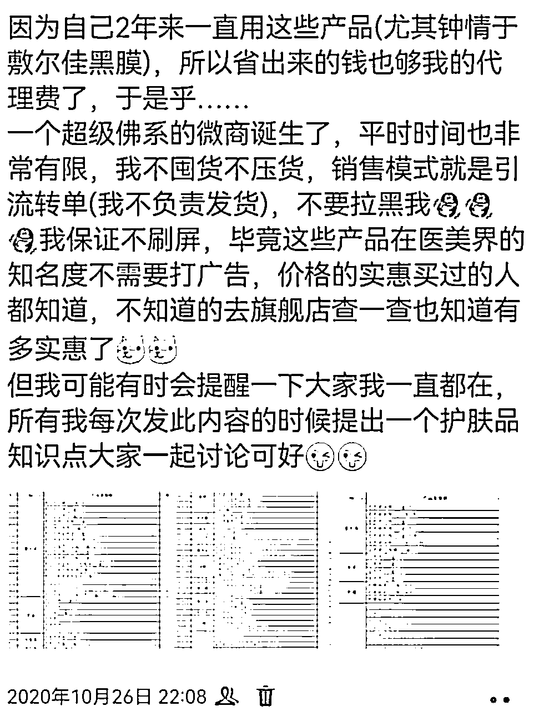

接着朋友在云南做鲜花生意，价格很便宜。我心动了一把，批发了一箱回来。忙着剪枝醒花摆花，最后我只带了一个麻袋和一个小板凳，跑到地下通道摆摊。

一下午下来，我一句话没敢说，就等别人来问，卖了 100 多块，勉强回本。

第一次副业就此收场，亏了 390 块草草结束。

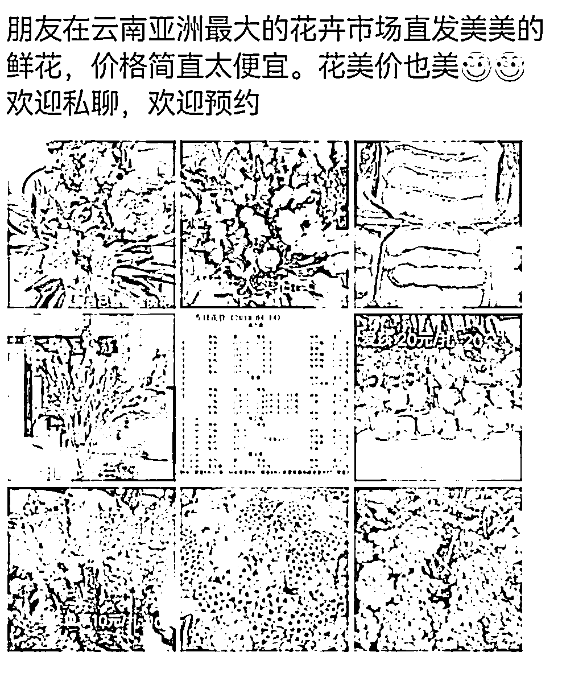

第二份副业：优势解读教练

其实我就是个典型的 I 人，长年自卑，活在他人评价里。人生最低谷时遇到一个很会 PUA 的领导，我自己又迷恋自我 PUA，于是抑郁倾向冒头，觉得生活没意义，上班像做噩梦。

我决定从救自己开始，学心理学、学优势。从一个大V的公众号看到优势发掘训练，便开始接触知识付费。

优势体系重塑了我，我也想帮到别人，于是开了第二份副业：优势解读教练。

起初我送出 10 个免费名额。可是跟人聊优势时，我发现自己在内耗，解读完特别累，完全不享受，后来就停掉了。

第二份副业撑了一个月左右，最后只留下几十个小时的学习成本。

第三份副业：搜商教练

在学优势、不断买课的过程中，我认识了很多人。慢慢发现，我的搜索能力是别人没有的，于是系统学了搜索技能，开启了第三次尝试。

这里是我私域的雏形。那段时间我第一次敢发朋友圈运营免费社群。没想到，我直接把收款码发出去，居然真有人默默扫码付款。有时我戴着耳机，收款提示把我吓一跳。

当时我还不知道这叫私域。

做了两年，招了 50 多个学员，还做了不少分销，代理一个大佬的理财课，两年里大概有 1 万左右的收益。

第四份副业：私域营销

2023 年 3 月，我加入一个大佬的职场 VIP 星球，本是想学职场，结果 AI 爆发，我顺势加入 AI 学习，并开始在朋友圈分销这个星球。

不知不觉分销了 40 多个星球后，大佬发帖说分销满 20 个可以领红包。我最初不好意思领，但想到这是链接大佬的机会，就鼓起勇气私信过去。由此真正跟这位大佬搭上线，后来我分销快到 100 个星球，大佬把我拉进了“分销大佬”群。

第一次切身体会到 KOL 的影响力，群里全是公域大 V，他们的聊天让我认知不断被刷新。

我做了什么？我成了群里的活跃分子，把群置顶，每次有人说话我就找机会接话，就一个目标：让大佬们记住我、熟悉我。后缘分自然就近了。

7 月份大佬招合伙人，给我打来电话，我手足无措，从没付过这么高的费用。跟老公商量后，他说觉得有价值就报吧，当天我就报名了。

大佬给我做了定位，他说我适合做私域，关系处理是我的长项。就此我开启第四份副业：私域营销。

到现在，我很爱在社群里聊天，爱跟人交流，爱在朋友圈输出。当然我也在持续付费学习。

现在的我进了更多优质圈子，认识了更多优秀的人，认知版图被打开了很多。

第四份副业已让我主业加副业实现七位数的小目标，还在持续增长......

定位不是一下子就准的，我也花了多年在试错，未来还会调整。

# 三、我到底做对了什么

1、足够热心，利他先行

我建了不少社群，也肯耗精力运营。群友有求必应，信任感慢慢积累，粘性越来越高，经常有人主动说要拉朋友进来，产品推荐时转化也很好。

建议想赚私域第一桶金的人，可以先从好好运营一个社群做起。

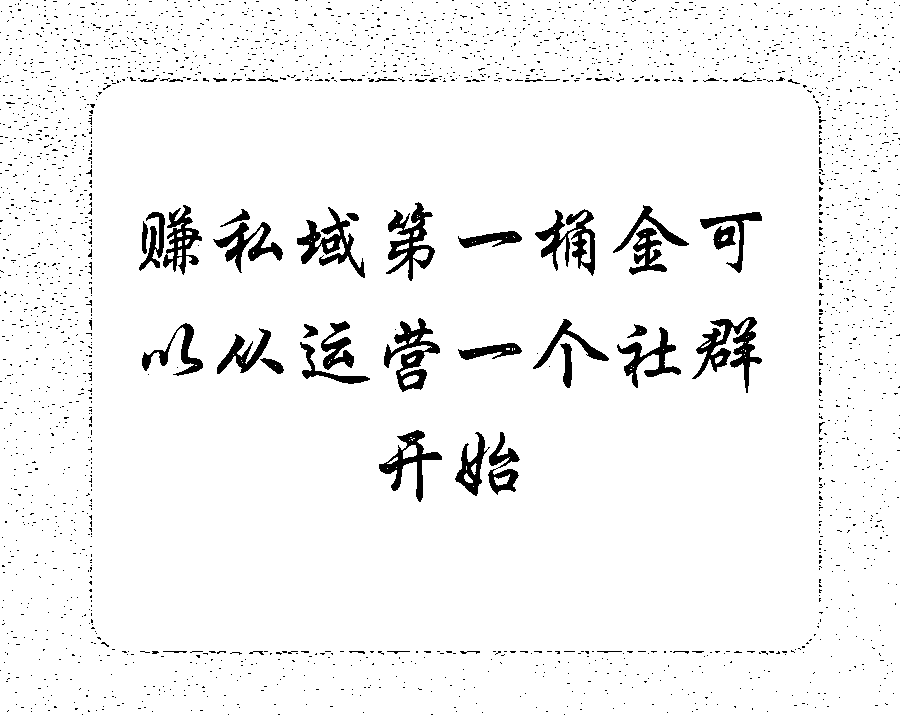

2、敢用付费撬动资源杠杆

以前我总以为知识都能白嫖，这是典型的程序员思维。后来才明白，付费解决的是效率、认知、方向和行动力。

我愿意花钱进圈子，接触优秀的人，看别人的做法，也赢得信任。现在我每年大概有 10 万预算投进高能量的圈子和牛人身上，因为他们真的能带动我。

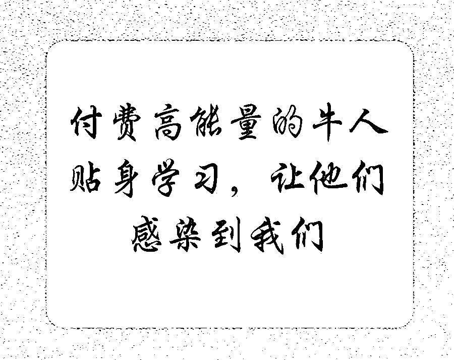

3、真诚低感，营销感很弱

现在大家都很警惕。我几乎不私聊推销，也不群发广告，只在朋友圈和社群里适度分享。不销而销，让人有选择权，需要的人自然会来，不需要的人也不会尴尬。

4、严格筛选人脉

我乐意跟优秀的人相处，会持续给正反馈，会发礼品和红包，情绪价值和物质价值都给到。

对不同频的人，我直接过滤。跟志同道合的人做事才有正反馈，内耗少。

成年人只筛选不教育，不带人上路，而是在路上涨朋友。

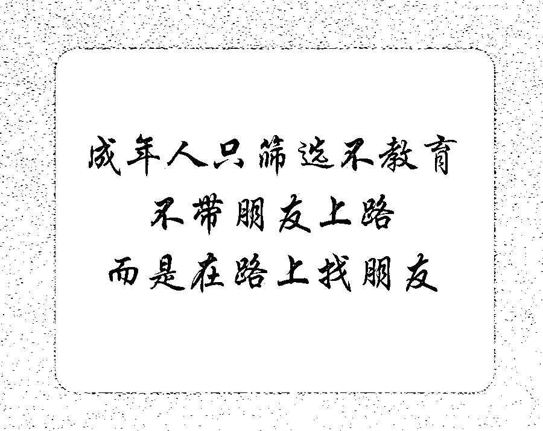

5、懂得感恩

只要有贵人或朋友帮过我，我都会及时反馈，送心意礼物，不一定贵，但要走心。

自己有成绩也会及时回馈，让贵人感受到情绪价值。

6、顺应人性

营销的核心是找准真正有需求的人，找到痛点，给出方案。再加上对人性的理解，最高级的营销是不触发防御机制。

让用户自己觉得“就是我需要的、适合我的”，自然匹配，双赢，更高级。

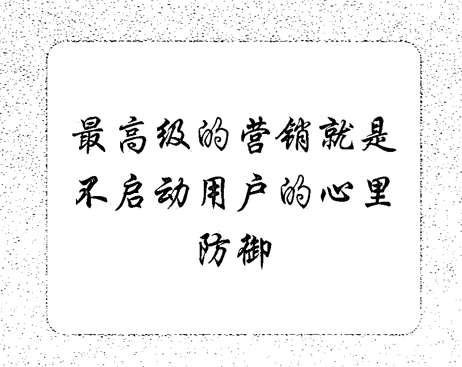

7、魔鬼在细节

别人做不到的细节你做到了，别人忽略的你注意到了，你的人设就出来了，于是被看见、被佩服。

我接手的活要么不做，要么做到极致，尤其是别人的事，责任心会让我更完美。

8、立刻开干，边走边调

我换过很多方向，没有人一开始就对。关键是先动起来，路上再调整。

想都是问题，做才有答案。

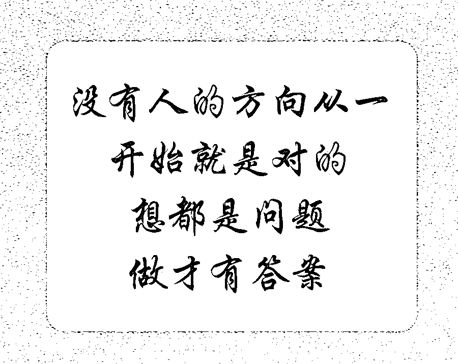

# 四、副业月入十万+是什么体验

是赚到钱的爽吗？有一点。

更多的是内心被填满的踏实感，是一种被信任围绕的幸运与幸福。

是被铁粉托着的感觉。

有几位铁粉，我推荐的东西他们从不问，直接下单。也有铁粉在别处看到信息，特意来问我有没有分销，从我这里买。

发售时一天能收到 52 个进群信号，10 分钟内 34 人付费，甚至有人先打钱再说话。

到这一步你会发现，私域的本质是关系，是为人处世。

还有一批贵人，他们总能把我往前推一把，指明方向，不然我还是慢慢摸索。

所以当有人愿意拉你一把时，好好把握。大佬们在我需要时，总会伸手帮忙，这也是付费牛人的价值。

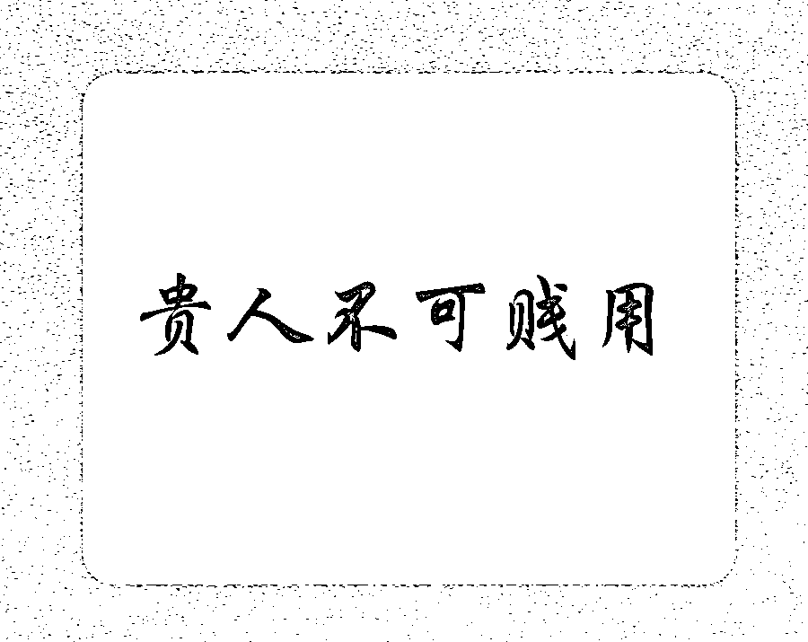

# 五、如何经营好自己的私域

私域是可以做一辈子的事，你的人脉、铁粉大多都沉淀在这里。

第一步：先做初始定位

定位的本质是用极简信息占据用户心智，方便对方第一时间想起你、找到你。

想学私域就想到文姐，这就是定位。

怎么找，我在私域小册里放了一篇文章截图。

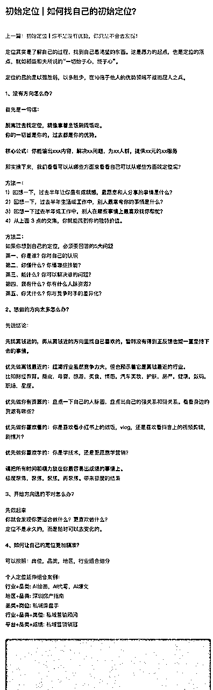

第二步：精进自我，先修己再达人

在成长中洞悉人性，与金钱和解。向上学，向下帮，提升学习力、行动力和商业思维。

对人性的洞察里，最大的武器是真诚。成年人防御心强，要先被信任。

要和金钱和平共处，打破卡点，在财富、健康、幸福间找到平衡。

跟人相处可遵循三原则：对更优秀的人愿付费贴身学，对学员重点培养做核心，对同盟相互扶持。

........

下面是小册中节选。

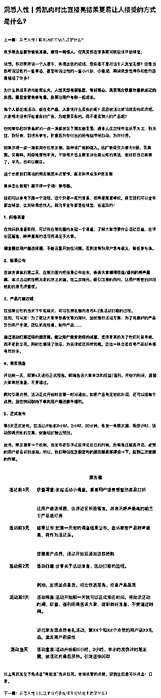

第三步：学会增长，让流量成河

无论公域私域，流量都不能是死水，要持续流动，新流量更有价值。

公域可通过各大自媒体引流，

图文类：微信公众号、微博、企鹅号、头条号、百家号、脉脉、知乎、豆瓣、简书等

视频/短视频类：抖音、快手、小红书、短视频、B站

音频类：喜马拉雅FM、网易云音乐、荔枝微课、小鹅通、播客等

私域可做社群引流、产品发售、知识星球、小报童、微信互推等

总的来说，粉丝质量排序：付费社群 > 免费社群 > 公域粉丝

第四步：私域运营，立人设、处关系、赢信任

运营中要不断立起个人 IP，多维度展示真实且优秀的自己，人设就是定位，让人多角度了解你，从而信任你。

维系客户是核心，社交礼仪重中之重，一点不注意就可能留下坏印象。私聊也有很多细节要注意。

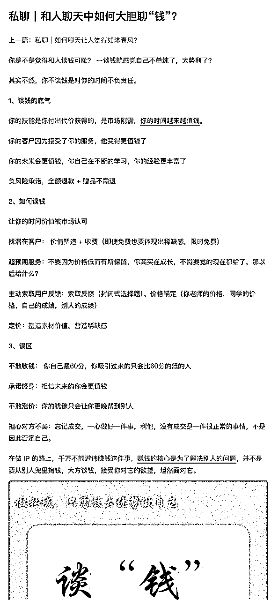

第五步：内容为王，私域的葵花宝典

公域平台也好，私域朋友圈、知识星球也好，内容力是内功。

朋友圈是私域重要阵地，既是自我展示也是免费广告。底层逻辑是人性，掌握人性就能不销而销。

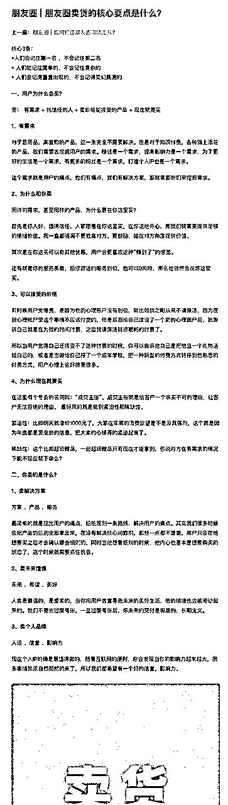

第六步：销冠技巧，不销而销的真谛

私域成交是目的，卖是必修课。要学会抓注意力、激起兴趣、提升购买欲、增加信任。

解决用户“为啥买、为啥现在买、为啥找你买”的问题。

下面是关于“为什么买”的节选：

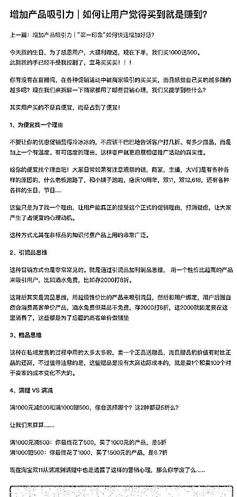

第七步：产品发售，越卖越信任

走到这一步，恭喜你完成从 0 到 1。私域高阶要学打磨和发售，好的发售不会消耗信任，而是越卖越有。

一次发售要经过准备期、造势期、预售期、发售期、跟进留存期。

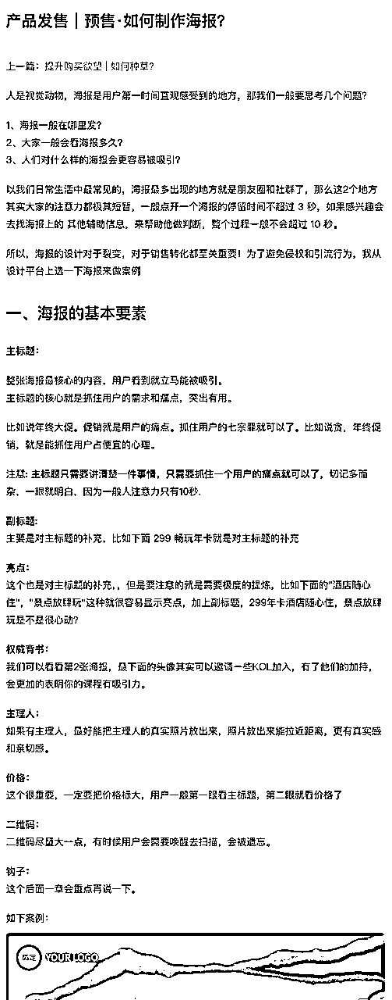

第八步：打磨产品，交付是根基

内容是内功，交付力是检验你能走多远的试金石，也是根基。好产品靠口碑自传播。

要思考引流品、利润品、锚定品怎么设计，这是产品体系的核心。

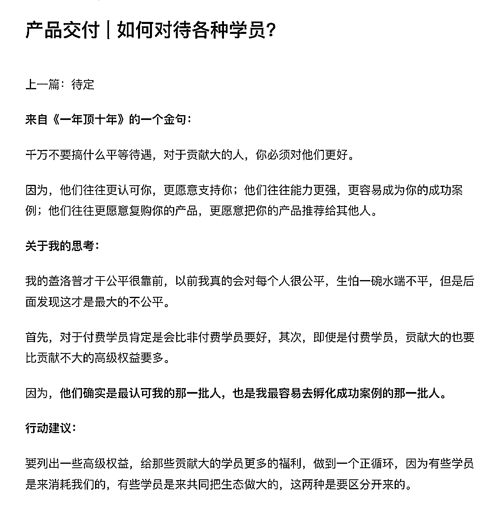

# 六、结语

私域值得做一辈子，无论是为了变现、处世，还是提升影响力和人脉，它都值得投入。

最后祝大家像我的 Slogan 那样，做私域，只需放大优势，做真实的自己。

愿你爱自己、做自己，成为自洽的人。