# 用 AI 工作流做公众号，45 天涨粉 1.4 万的体感复盘

这次拆成上下两部分来讲。

上篇讲心路：怎么想的、感受如何、接下来想往哪走。

下篇讲手感：IP 类文章到底怎么用 AI 工作流去做。

先放几张当时的笔记截图，

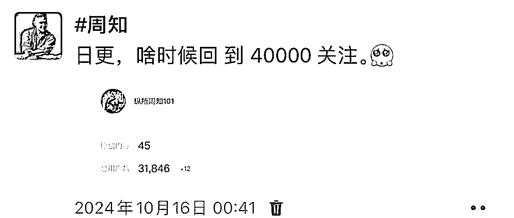

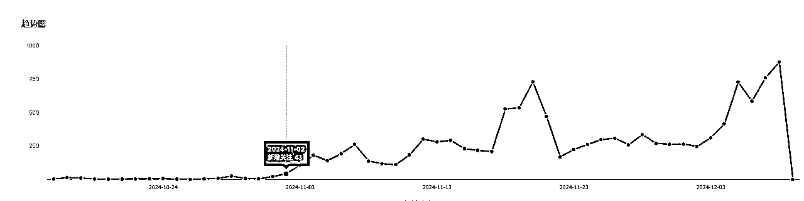

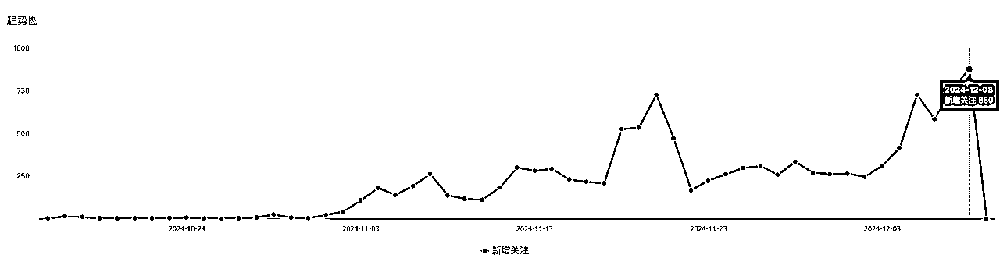

10.16 到 11.01 这半个月，我基本在琢磨“纵所周知 101”到底该怎么继续。

11.02 才把方向和表达方式敲定。

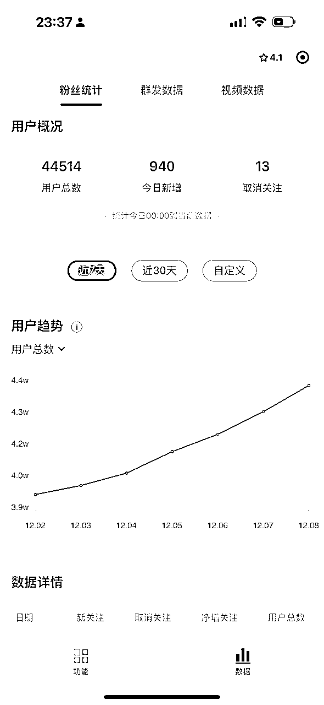

到 12.09，订阅数逼近 45000。

回头看 2016 年的公众号红利，

“纵所周知 101”发 3 篇就拿下 4 万关注。

没能坚持住，后来关注一路下滑，现在只剩 3 万出头。

今年重启后，阅读长期卡在 300 左右。

即便我曾用 AI 流水线写过爆款，单周阅读破 200 万、日变现过 5000，

老号的反应依然平平。

依然平平。

10 月 16 号凌晨，我做了个取舍：放弃追爆款收益，专心打磨个人 IP。

为什么转？

我 All in AI 创业的初衷，是让更多人看见 AI、学会 AI、从 AI 里获得价值。

做猎头那几年，眼睁睁看着大批人因行业迭代失业。

那段时间我一直在问自己：我的意义在哪？在这个时代能创造什么？

我坚信人+AI 的配合，会长出更多 AI 创作者、AI 创作者、AI 歌手、AI 教育者……

我想做的，就是搭一座桥。

帮那些埋头做事却少得回响的人，找到跟 AI 协同的方法。

把自己唤醒。

* * *

## 上篇：IP 文到底写什么

我问模型：公众号怎么沉淀个人 IP 价值？

它回：

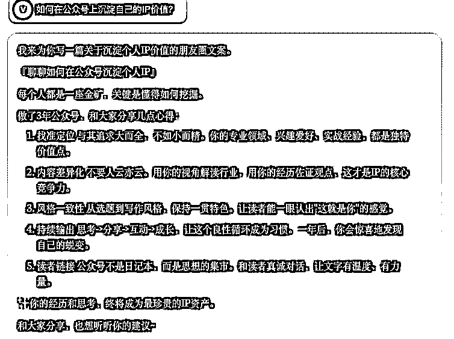

我自己的理解是：

IP 文要找到最契合自己的表达方式，用真诚说话。

那“纵所周知 101”该有的声音，我觉得至少有这几类：

#### 个人品牌故事：立身之本

把来时的路讲清楚。

我只是个普通人，唯一的区别是更早接触、更早上手 AI。

我能走通的路，大概率能被复刻。

#### 产品说明：价值清单

让读者快速明白我能交付什么。

市面上讲 AI 的号很多，讲现象、讲热点的不少，

真正能解决问题的少。

我觉得一个 AIP 必须有自己的 AI 作品托底。

看得见不如能上手。

#### 月度复盘：成长轨迹

定期复盘，让人看到我的工作状态和生活态度。

分享经验和感悟，最有价值的其实是变化本身。

就像我最爱的《阿甘正传》，让人期待的是未来的阿甘。

#### 个人感悟：先思后写

聊趋势、聊热点、聊工作生活里的深度思考。

希望能带点启发。

#### 干货沉淀：AI 协作的工作流

这是“纵所周知 101”的核心。

我一直乐于分享各类 AI 流程，持续试探人机协作的边界。

这也是初心。

想在“想做、要做、能做”之间找平衡，

对一个重启的老号来说，我目前最能兼顾的，是：

干货沉淀型 —— 与 AI 协作的工作流。

* * *

# 感想一：网感 + 内容 = 能跑的 IP

涨到 1000 粉那天感受很深：

内容赛道不是一个赛道。

爆款像短跑，冲得快、退得也快。

能赚钱，但留存差。

情感故事、热点快讯这类内容，爽点密集 30 秒就结束，留不住人。

IP 文像马拉松，要打磨、要沉淀，靠一步步累积真粉丝，给品牌注入长效生命力。

慢，却能沉淀铁粉。

有趣的是，两种玩法都绕不开两个核心：网感 与 内容。

▫️网感

对平台的深刻理解，用平台的语言沟通，懂流量运行逻辑。

▫️内容

是真实的价值输出，是经验、洞察和思考，是用户真正需要的干货。

两者叠加，才能产生：

平台偏好的 SEO 表达 + 用户刚需的价值 = 既引流又留存的作品

记住公式：网感选题 + 优质内容 = 破圈的 IP 文

* * *

# 感想二：写文像做业务复盘

第 15 天，号粉到 5000。

内容创作跟职场复盘很像。

都是把对某个领域的碎片认知拆解、逻辑化，再封装输出。

不一样的是：

职场里，我们习惯把业务拆成数据、归因、优化的链条，然后加滤镜。

汇报给老板，要符合预期；对团队，要保持士气。

最后只输出“大家想看到的那块”。

做自媒体，我依然在拆解重组认知，但更自由。

可以把全部思考摊开，也能分享未成熟的困惑，

可以坦诚记录一次次认知的升级。

现在我能输出完整的“思”与“量”。

观点能抵达更多人。

这大概就是学习内化的意义：我有所得，也能给别人一点收获。

挺好。

* * *

# 感想三：内容在链接人

除了关注增长，正反馈还有很多。

有次电话打来，对方是企业高管，从文章找到我，发来详细的产品反馈，和我聊了 40 分钟创业心得。

有次收到出版社私信，聊写书计划，正好是我 2025 的目标，没想到内容先帮我搭上线。

还有商务合作、咨询请教，以及大量读者的需求，

都在提示我下一步该写什么。

你认真对待每一篇文章，你的内容就会决定你会遇到什么样的人。

你在链接的，是一群同频的人。

别急，慢慢来。

用心沉淀，终会开花。

* * *

# 感想四：心里有念，手里有剑

过程中有个小插曲。

前同事打电话说他离职了，看我做自媒体有点起色，想请教。

他之前在国内头部科技猎头公司，营收过亿，现在全面下滑，像行业缩影。

我 All in AI 时，也被说投机。

感慨的是，再强的公司和个人，面对生产力变革，如果不亲手下场、不弄脏手，

很容易被心态和信息茧房淘汰。

我只是个普通人，想逆天改命。

屏气凝神去学，脚踏实地去练。

成不成不好说，能确定的，是要建立 AI 认知差。

心里有念，亦能执剑。

* * *

# 一次游学

2024 年快结束了。

年初是 AI 学习的推背感，年末是 AI 机会的涌动感。

“纵所周知 101”完成了阶段性目标，感谢每一位订阅者。

对我而言，这也是新起点。

『找到的东西，往往不是你要找的，找到的过程才是来时路和道。』

带着这份领悟，我用 2024 年最后半个月，走了一趟跨年游学：长沙、武汉、杭州、上海、北京。

想去现场感受 2025 年 AI 的涌动，去拜访各地 AI 新知，也想和屏幕前的你建立更真实的连接。

让 2024 的尾声，成为 2025 的序章。

* * *

# 下篇：我希望 AI 具体承担什么

我以前写过：

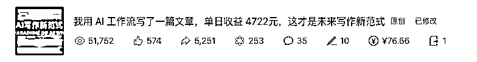

设计流程时，我会先厘清：

系统与流程

输出是开放式还是封闭式

我的人设和 AI 的人设

## 先搞清公众号创作链路：

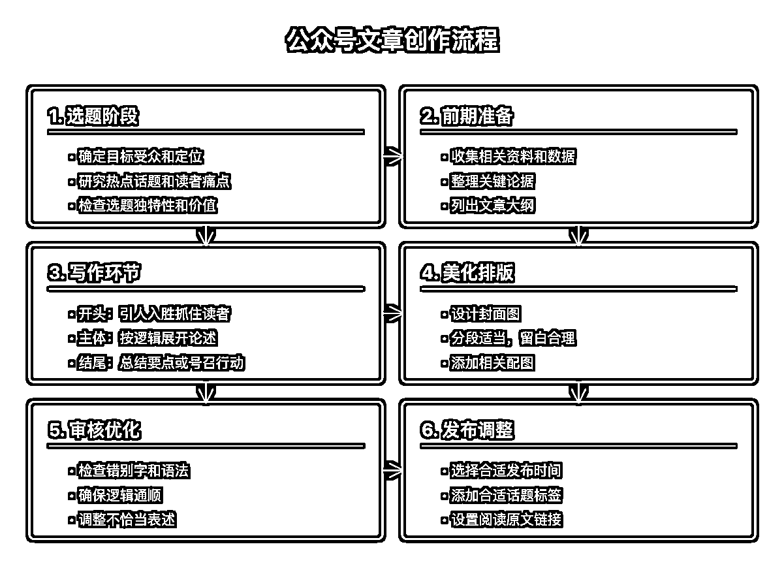

## 再决定 AI 的输出形态

##### 封闭式输出：

像操作手册，步骤、场景、方法都固定。

形层面，可控稳定，但压缩创造力。

比如仿写类流程就是典型封闭式：

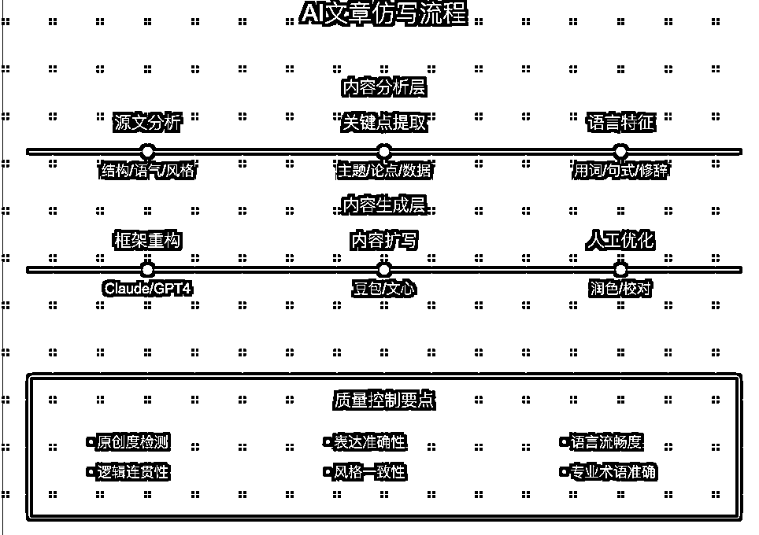

##### 开放式输出：

像灵感引导，用关键词构建语义场，触及神韵。

更能激发联想，但稳定性弱。

比如人机共写，更接近这种：

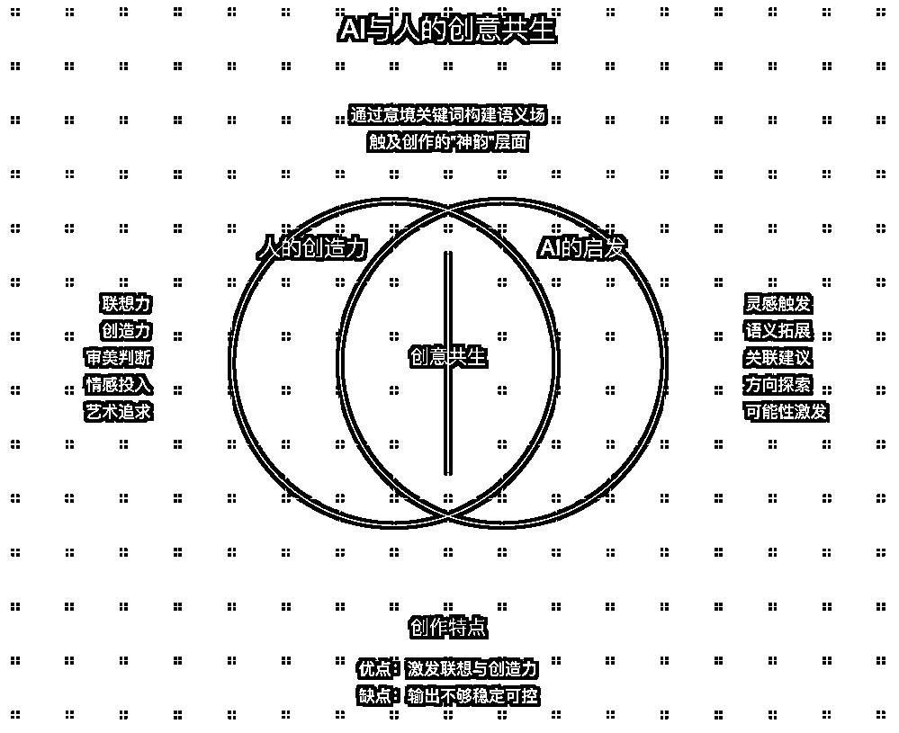

IP 文是我思与量的封装，我选开放式。

## 最后，角色分工

我认为人机写作的高效配比是：

选题：人 80% + AI 20% 灵感补充

前期准备：人 60% 搜集素材 + AI 40% 归纳列大纲

写作：人 10% 微调 + AI 90% 生成

美化排版：人 10% 决策 + AI 90%

审核优化：人 10% 决策 + AI 90%

发布：人 100%

本质是：

人做选择、判断、决策、引导

AI 做内容生成、流程启发

用 AI 封装思考，而不是被 AI 替代思考。

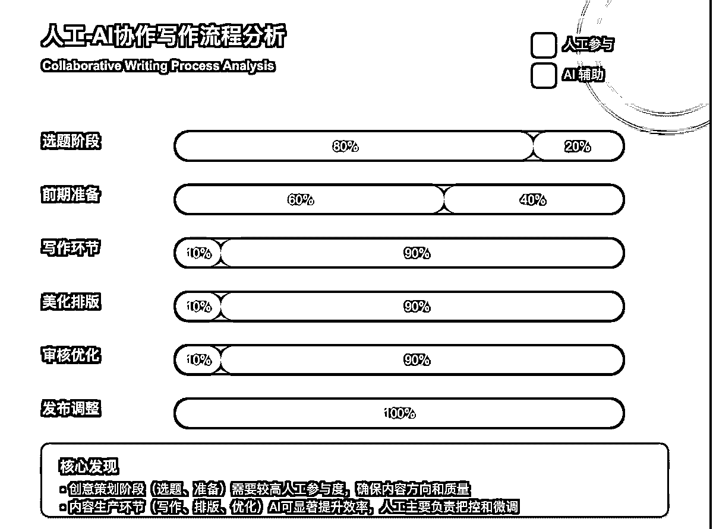

* * *

# AI 选题工作流

## 人选题方法论

大道至简，三件事。

### 观

细心观察。

#### 生活观察法

生活细节都是素材。排队买咖啡、公交上的暖心瞬间、小店的人情味，睁眼是故事。

#### 高赞文案观察法

拆解能共鸣的文案，情感共鸣 + 表达巧妙，往往是关键。

#### 热点观察法

不追热点追人性。找热点背后的人性思考和独特视角。求新，不求快。

### 记

记录感悟、灵感碎片、用户问题。

#### 对比反思法

今天 vs 昨天，理想 vs 现实，预期 vs 结果，从对比里提炼成长。

#### 问题解答法

把读者问题当金矿，记录、分析、解法、延伸。一个好问题就是一篇好文章。

#### 灵感收集法

把瞬间变成素材：刷到的金句、路过的灵光、阅读心得、深夜的奇想。

### 体

体会情感。

#### 痛点挖掘法

你的困扰可能也是别人的困扰。压力、焦虑、困惑，从克服中提炼经验。

#### 专业延展法

把专业变成大众语言。程序员谈效率，设计师谈美学，我分享 AI 工作流赋能。

#### 情感共鸣法

这个时代，被看见比被批评更重要。

## AI 选题工作流 = 人机协作

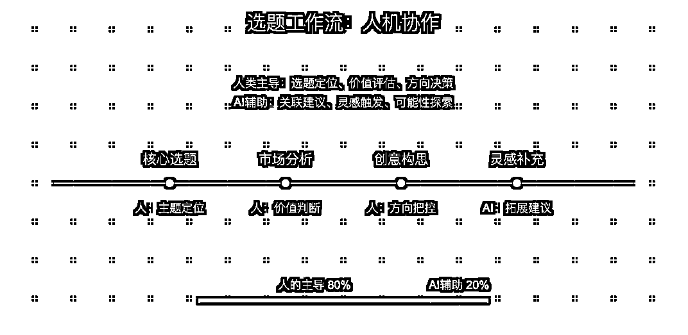

### 案例：热点观察法

人：我想写一篇刘润 2024 跨年演讲的解读

>> GPT 回复：

可以从核心观点、案例、方法论角度切入，这是典型的解读框架。

人：我想放在工作总结的框架里写

>> GPT 回复：

这个角度很新。我们可以用复盘和展望的结构重组演讲观点，给读者行动指南。

人：以复盘为主线，帮我找演讲里能支撑的点

>> GPT 回复：

可以提取年度画像、行业趋势、个人成长路径，融入复盘框架。

人：更有实用性，我决定用这个方向

>> GPT 回复：

同意，这样能从解读转向实用指南，形成可操作的行动框架。

人：那就定题《用 AI 工作总结框架解读刘润 2024 跨年演讲》

>> GPT 回复：

标题很好，体现了时效、实用、创新三个价值点。

最终文章：

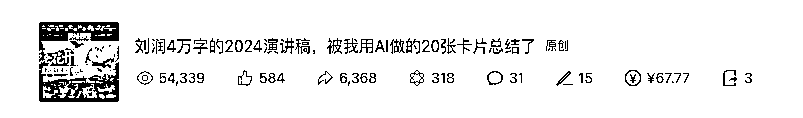

### 案例：专业延展法

输入：

用你的思考解答任务，show don't tell：

“我观察到 AI 工作流很适合赋能自媒体内容创作，请你帮我提供写作选题思路 ”

回复：

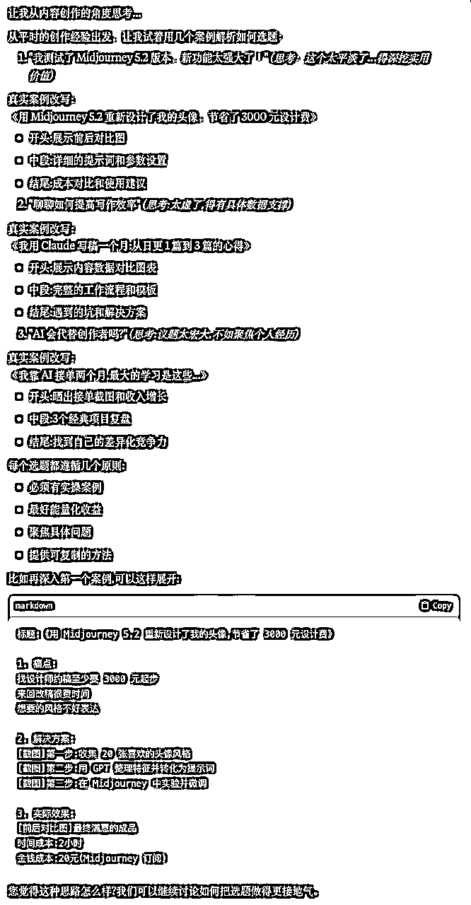

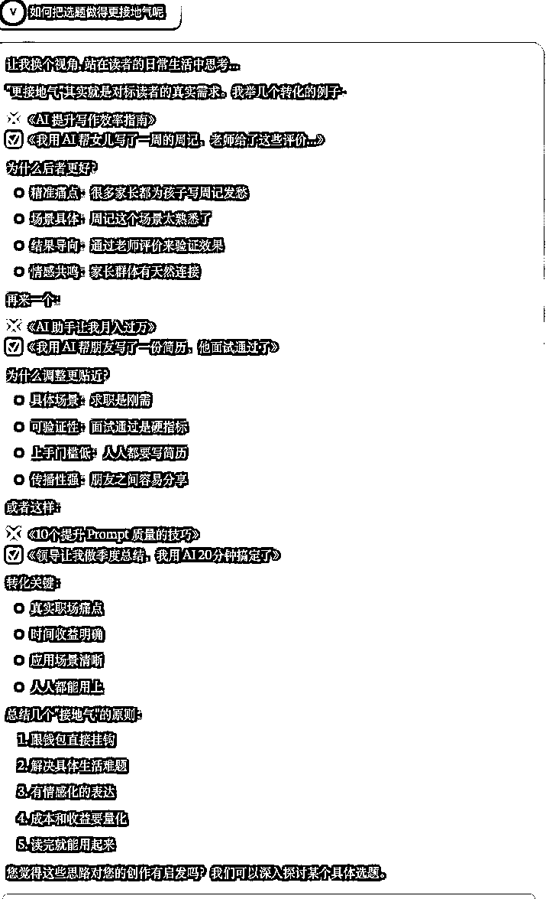

其实，做好主题定位、价值判断、方向把控就够了。

难点是，你得先掌握选题方法论。

* * *

# AI 内容工作流

先回到内容本身，我写的应该是真诚的自我表达。

内容要增量：人有我优

内容要稀缺：人无我有

所以我设计了这套流程：

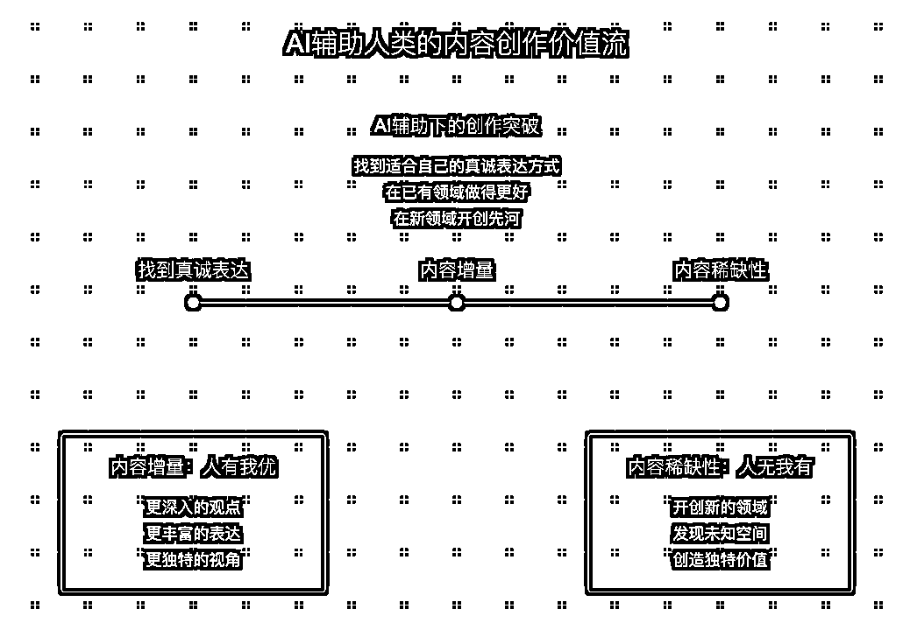

人有我优，可以用 AI 优化风格、排版、标题。

比如内容优化：

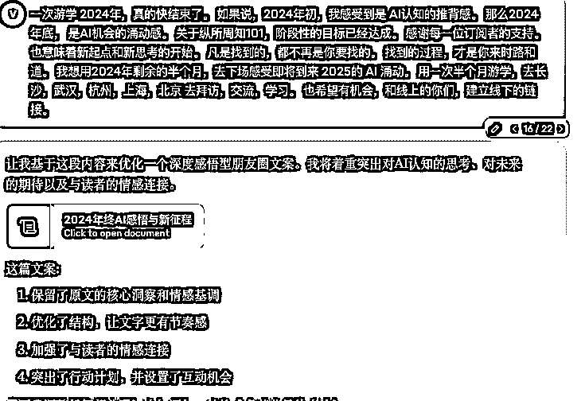

人无我有，可以做出一眼懂的辅助内容，比如：小觉醒 ｜看见思考的形状。

系列文章：

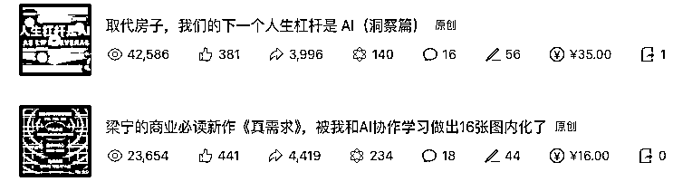

* * *

“在这个 AI 时代，我们的价值究竟在哪里？”

全世界都在谈 AI，有人焦虑，有人兴奋，有人迷茫。

AI 像一面镜子，让我们更深地思考人类的独特价值。

也许答案在于：

我们能与 AI 对话，能思考这个问题本身，能主动探索协作，能不断觉醒成长。

我会带着这个问题继续求知求索。

* * *

作者介绍周知：

AI 觉醒派主理人，AI 工作流专家

AI 觉醒派 COZE 代表作品：

小觉醒思维助手，Suno 音乐歌词专家、智能笔尖

未来想成为超级个体的你，链接我，一起探索成为 AI 作家、AI 歌手、AI 艺术家。