# 用AI工具10分钟生成儿童睡前故事，全程免费
最近刷YouTube的时候，被一些儿童睡前故事视频狠狠治愈到了。画面温柔、节奏舒缓，看着看着我就忍不住琢磨：这种内容能不能靠AI一键搞定？想干就干，直接开整。
做内容嘛，最快的方式永远是模仿。我是从油管上找的热门视频，先把字幕扒下来，再丢给ChatGPT做二次创作，一条龙走起。
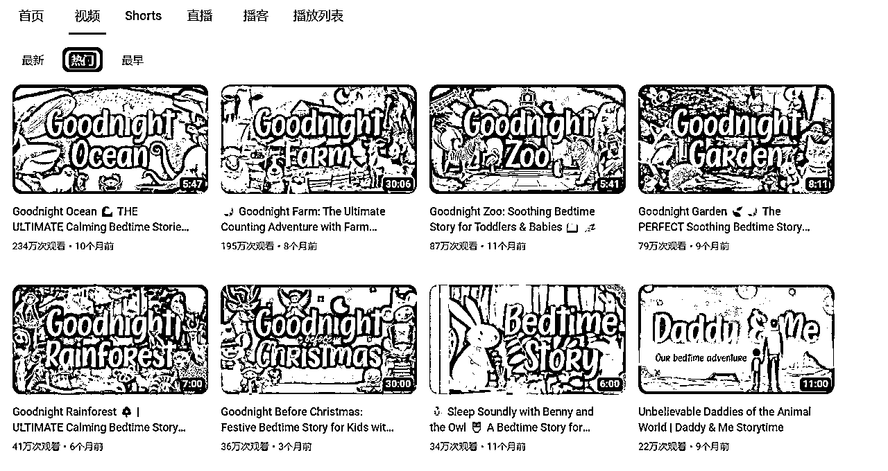
## 第一步：把油管字幕抓下来
先去YouTube找那种播放量特别高的视频，复制链接，然后打开字幕提取网站：https://downsub.com/，粘贴网址，字幕就能直接下载下来，不需要花一分钱。
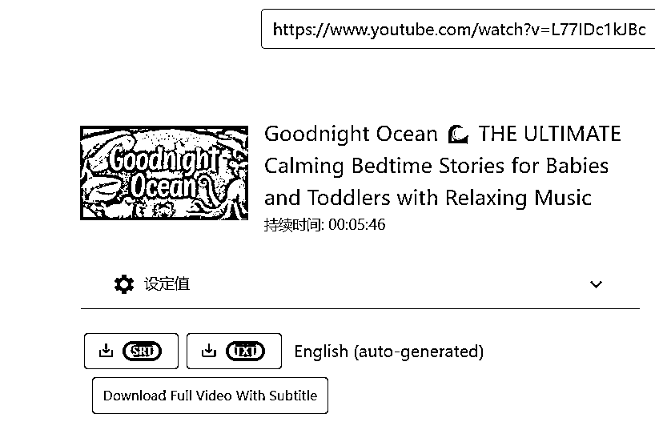
## 第二步：让ChatGPT3.5重写睡前故事
把刚才扒下来的字幕整段发给ChatGPT，让它照着原故事的风格和节奏，重新生成一篇全新的儿童睡前故事逐字稿。AI的改写能力这时候就派上用场了。
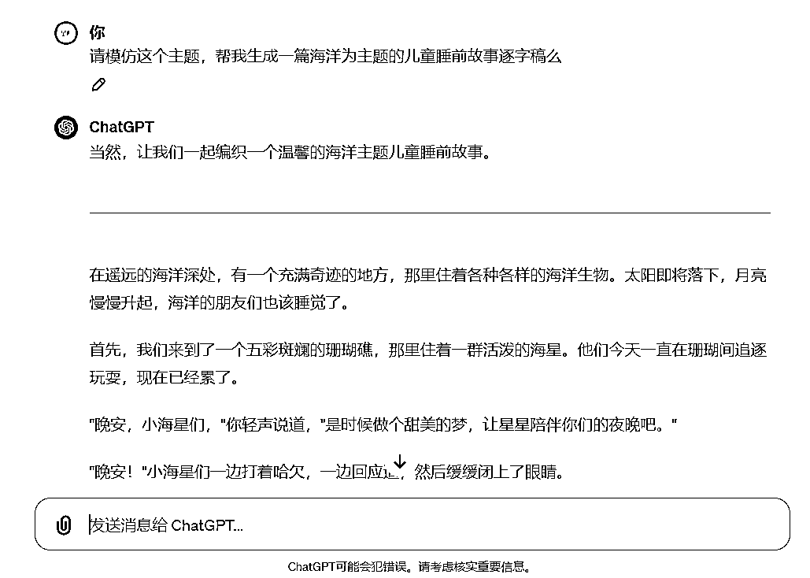
稿子出来之后，我总不可能睁大眼睛一句句去核对吧？字那么多，看也看不过来。干脆让ChatGPT自己告诉我，它到底改了什么、哪里不一样。
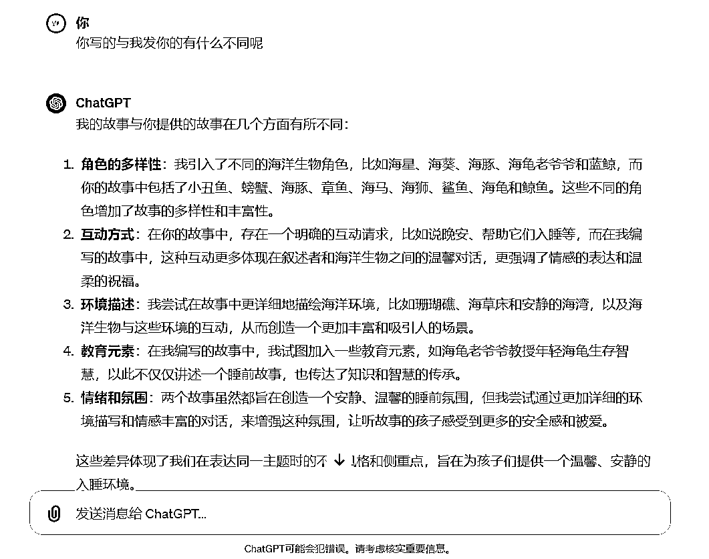
## 第三步：配音怎么解决
有了逐字稿，下一步就是配音。现在能选的声音平台很多，比如魔音工坊、腾讯智影、配音神器，都挺好用。
我这次挑的是腾讯智影。睡前故事嘛，声音一定要温柔，女声或者童声最合适，听着才安心。
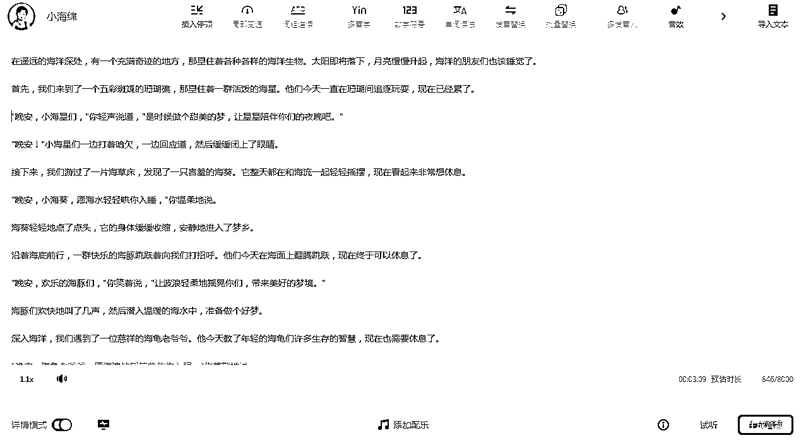
## 第四步：按分镜生成图片
接下来要搞定视频里的每一帧画面。图片生成我用的是leonardo.ai，主要是它免费，不心疼。
不过生成图片之前，得先把中文逐字稿转成中英文对照版，这个活儿直接交给ChatGPT就行，几秒钟搞定。
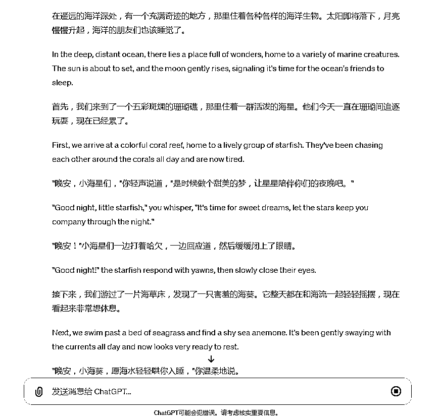
打开leonardo.ai官网（这里需要🪜，用谷歌、微软或Apple账号都能直接登录），进到Image Generation页面，就进入AI绘画模式了。
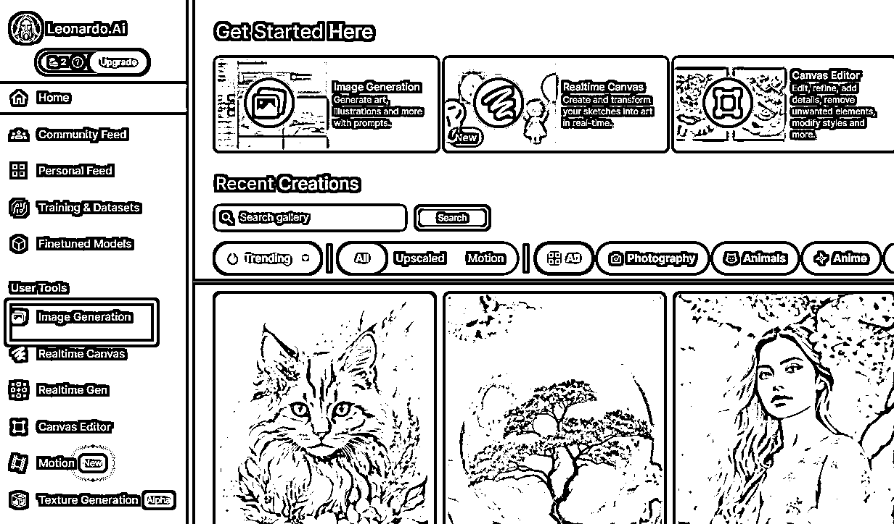
画布比例设成16:9，模型挑DreamShaper v7，其他参数看心情微调。然后复制英文版的逐字稿内容来生成画面，一个分镜配一张图，比如小海星一张、小海葵一张，对应着来。
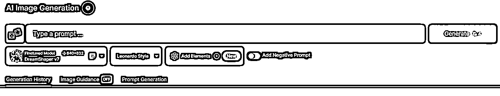
看看生成的图片效果，其实就是用ChatGPT写的逐字稿直接喂给AI画的，一个字没改，视觉氛围已经挺对味了。
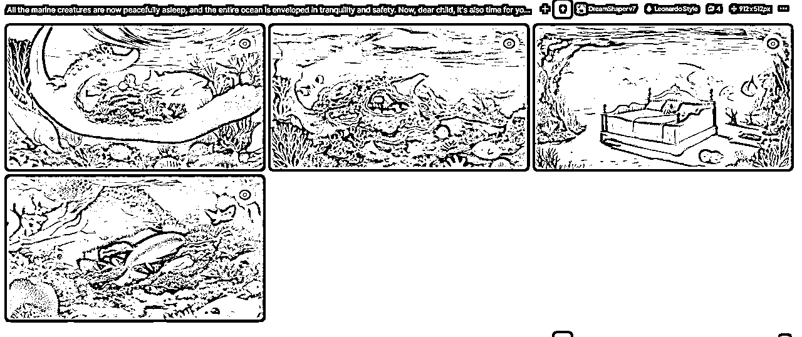
## 第五步：把静态图变成动态视频
视频这块同样主打免费。我用了leiapix和pika两个工具（同样需要🪜），它们都有免费试用额度，做这种短视频绝对够用了。
先做景深动画。打开leiapix官网，用谷歌账号登录，把刚才生成的图片传上去，简单设置一下，点Export就能下载。
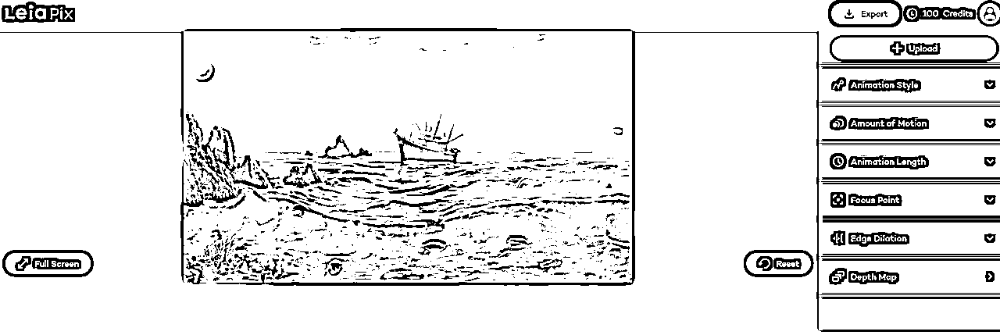
视频开头可以直接用leiapix的效果。但如果你想让画面动感更丰富一点，那建议还是上pika。
打开Pika官网，用谷歌或Discord账号登进去就行。
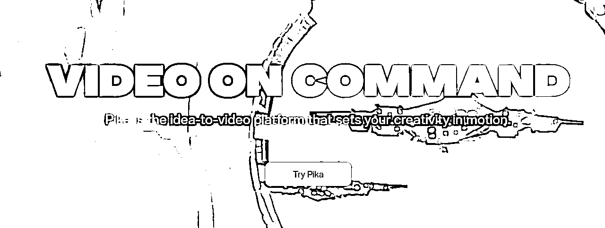
直接把图片传上去，不填任何关键词，让每张图自动生成一段动态视频，省心省力。
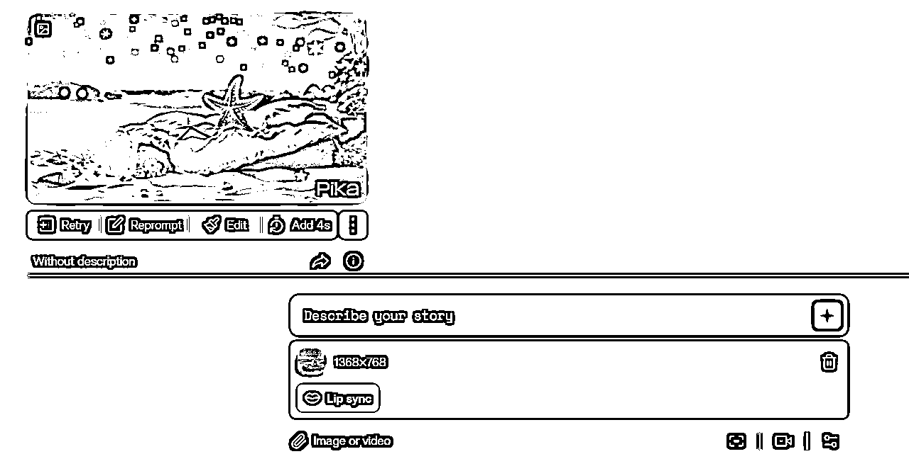
不过注意，生成的视频是带水印的。去水印我用的是腾讯智影，反正之前也用它配音，顺手就一起处理了。
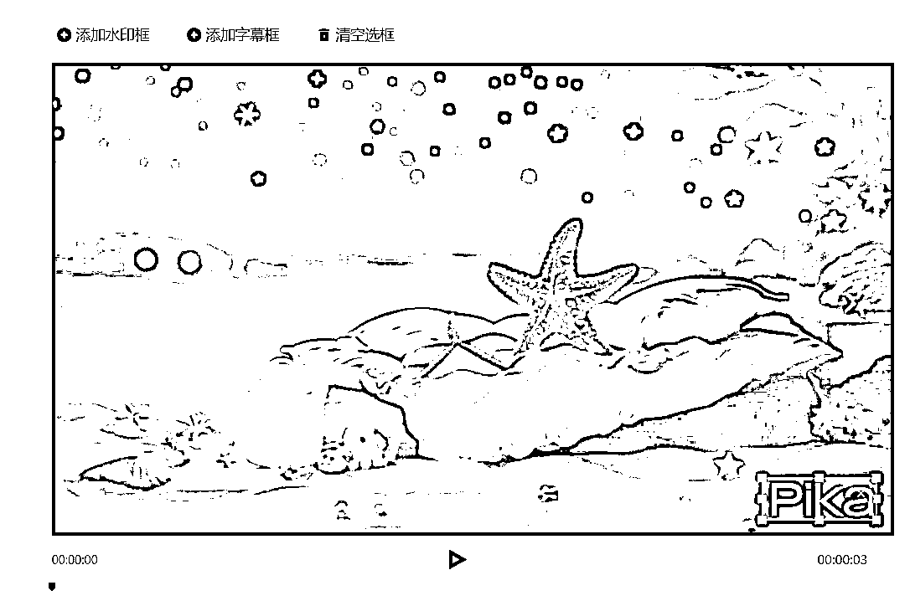
## 第六步：剪到一起
所有素材——配音有了，视频片段也有了——现在就差剪辑。打开剪映，把每个片段按故事顺序拖到轨道上，排列整齐。
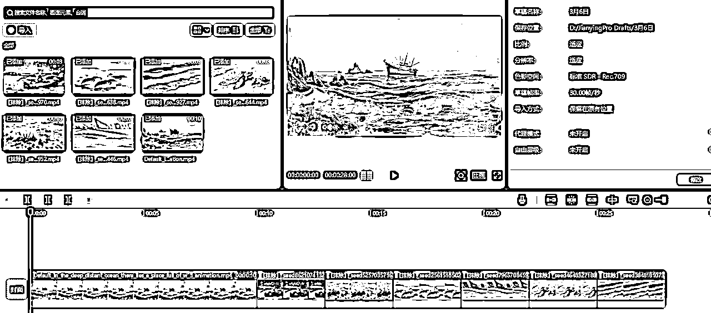
再把配音文件传上去，配上背景音乐。这种睡前故事我个人推荐用海浪声，白噪音的治愈感直接拉满。
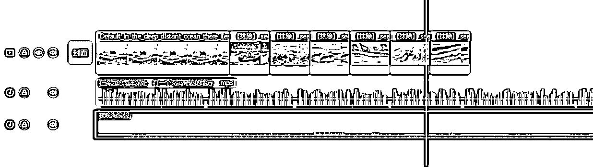
搞定！一个完整的儿童睡前故事视频就这样出炉了，全程AI参与，几乎不用自己动手，而且统统一分钱没花～