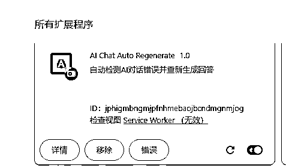
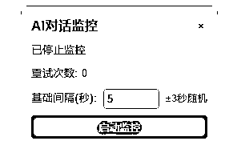
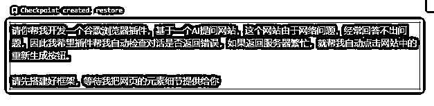
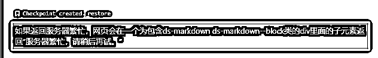

# 用Cursor开发了一个DeepSeek自动回复插件

最近 DeepSeek 的日子不太好过——一边是美国那边的 DDoS 攻击，一边是用户量暴涨，两边夹击下，官网服务器直接扛不住了。聊天窗口动不动就跳出“服务繁忙”，或者干脆提示“无法联网搜索”，气得人想摔键盘。

更尴尬的是，虽说市面上有不少第三方平台接的是 DeepSeek 的 API，但真用起来，效果跟官网一比，差距不是一星半点。说到底，还是官网体验最稳。

所以呢，我干脆自己动手，打开 Cursor，让 DeepSeek 帮我写了个小插件：只要对话一报错“服务器繁忙，请稍后再试”，它就会自动重新提交。全程不需要手动操作，省心。

**怎么装？跟着两步走**

**第一步：把插件装进浏览器**

先把插件下载下来，解压之后会得到一个文件夹，长这样。

接着打开谷歌浏览器，地址栏输入 `chrome://extensions/`，回车进入扩展程序页面。别忘了把右上角的“开发者模式”开关打开。

然后直接把刚才那个文件夹拖进页面。看到多出一个扩展程序，就说明安装成功了。

**第二步：开启监控，让它自己干活**

回到 DeepSeek 官网，刷新一下页面，右下角会冒出一个悬浮小窗口。

点一下“启动监控”就行。为了不让插件频繁去点页面，作者特意加了一个基础间隔：每次检测到对话出错后，会先等上 5 到 8 秒，再去自动点击重试。效果嘛，就是挂着不用管，它自己会重发。

**再说说 Cursor 开发插件这件事**

其实用 Cursor 写插件，真没想象中那么难，哪怕你完全不懂代码也能上手。

首先，你只需要用大白话告诉 AI，这个插件到底是干嘛的，让它对需求有个整体认知。

然后，再一步步补充细节就行：

来回聊上几句，Cursor 基本就能把整个插件给你写出来。如果你看不懂什么 `div`、`css` 之类的术语，也完全没关系——直接把页面上看到的文字、提示原样告诉 Cursor，它就能帮你找到对应的按钮或元素文本。

所以，别再被“不会写代码”劝退了，只要会描述需求，AI 就能帮你实现。