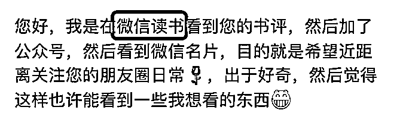
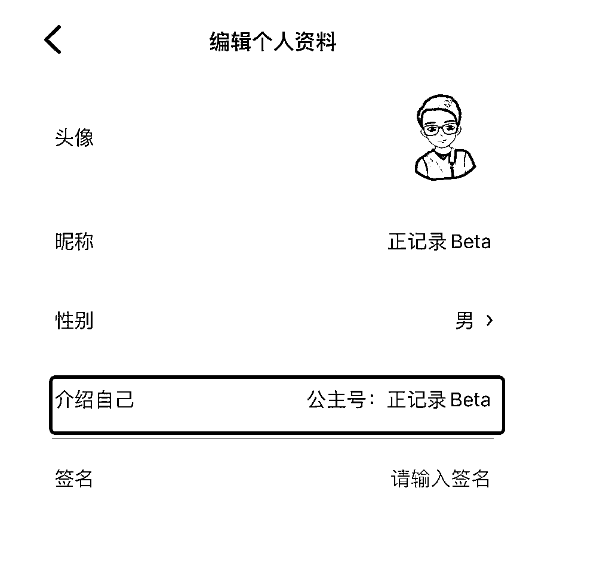
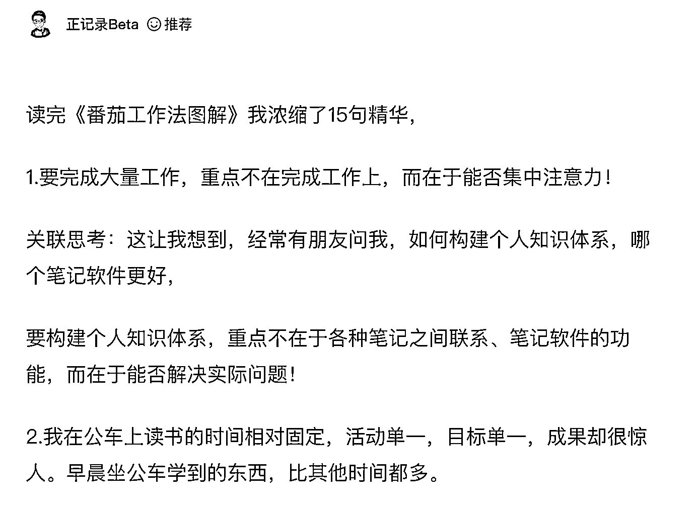
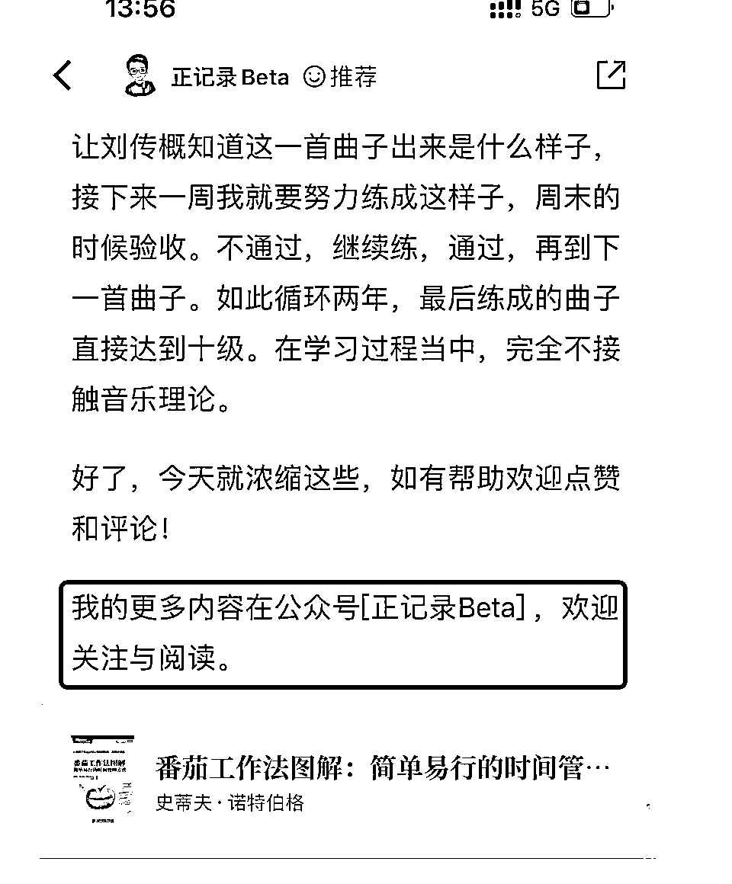
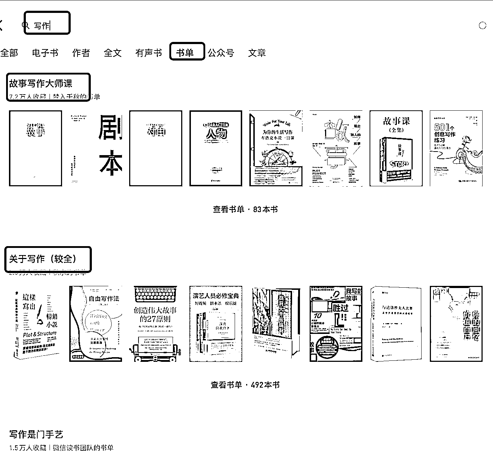
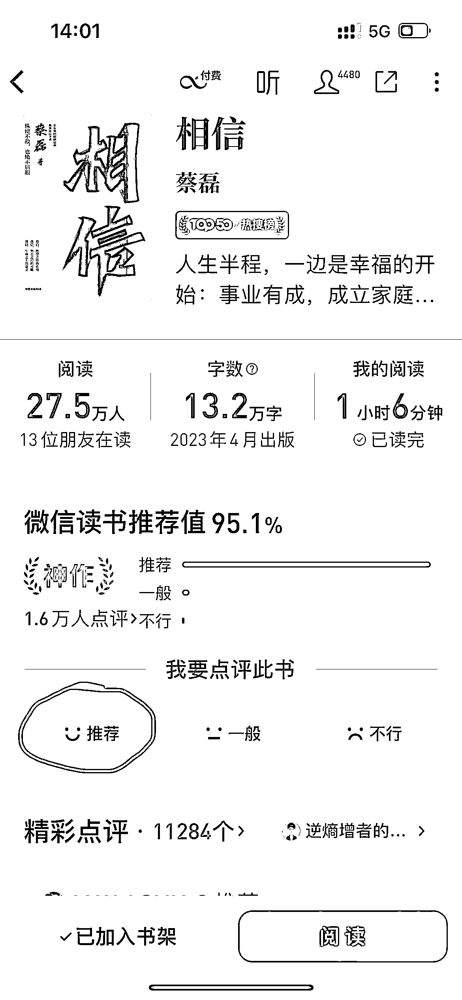
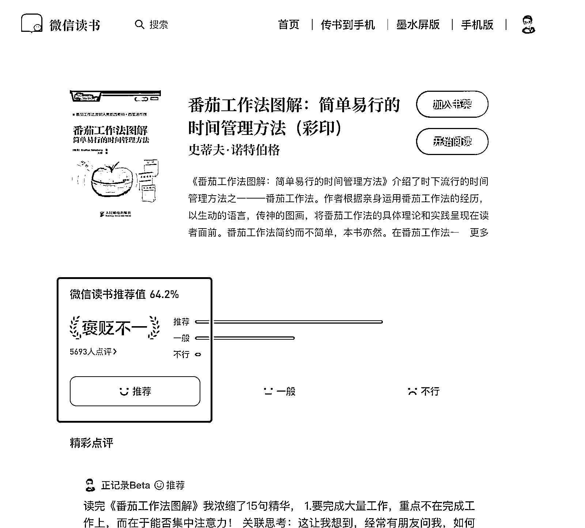
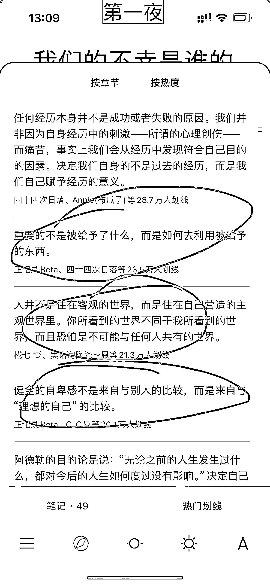

# 用微信读书写书评做引流，这套批量打法很管用

## 如何在微信读书 App ，通过快速写书评进行引流

作者： 龙哥 Beta

日期：2024-02-05

**先说前提，引流必须选在人多的地方下手。微信读书自带庞大阅读流量，发书评本身就是在流量的池子里作业。**

接下来是个人资料的包装，

接下来是个人资料的包装，

平台对敏感词有拦截，公众号的名字没法直接写，得换个代号来暗示。个人微信号也可以放在简介里放，到底放哪一个看你自己的规划。

微信读书和公众号虽然都是腾讯体系，但运营归不同团队管，引流上自然会有一些限制要绕开。

我互动最好的那篇书评写的是《番茄工作法图解》，点赞数破了一百，期间不断有人通过这条评论找到我的公众号。

> 

>

> 我互动最好的那篇书评写的是《番茄工作法图解》，点赞数破了一百。

>

>   

>

> 那问题来了，选哪类书去写评？

>

> 一方面可以选自己看过的书，另一方面更高效的做法是围绕一个主题批量操作。

>

> 比如你想做写作方向的书评，就在微信读书搜索“写作”，切换到“书单”标签，会出来一大堆相关书单，从里头挑三四十本目标书就行。

>

>   

>

> 锁定书目后，进入微信读书的主站找到对应书籍，点击“推荐”入口就能开始写书评了。以蔡磊的《相信》为例。

>

>   

>

>

> 

>

> 下面说核心：如何把书评写得快。

>

> 第一步，打开微信读书 App

>

> 第二步，打开任意一本你想做的书，或者曾经看过的书

>

> 第三步，进入本书的热门划线区，挑几条质量高的出来

>

> 

>

>

> **这些热门划线本质上是前人帮你筛选过的金句，书评的价值就在于告诉新读者书里有哪些干货，以及你对这些干货的延伸思考和落地动作。**

>

> 写作时套用固定的结构即可，至于你有没有真正读完这本书并不关键，关键是让读者觉得你读过、读懂了、并且能给他们带来收获。

>

> 这类联想式思考完全可以交给 ChatGPT 等 AI 来生成。熟练之后，一篇书评十多分钟就能完成。

>

> * * *

>

> 评论区：

>

> 暂无评论

>

> 

>

> * * *