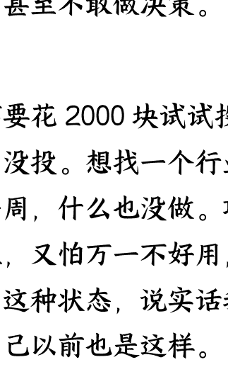
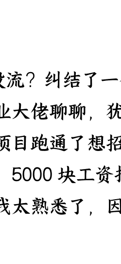

# 用期望值算账，你的决策会快十倍
260416 副业 SC 精华

哈喽，我是龙哥，目前负责联合办公空间的业务，日常就是和一群创业者泡在一起聊项目、拆卡点、帮他们把下一步想明白。聊得多了，我发现一个共性问题：很多人做决定的速度太慢了，甚至干脆不做。
要不要花 2000 块试试投放？纠结一个月没动。想约个行业前辈喝杯咖啡，犹豫一周就作罢。项目有点起色想招个小助手，又怕 5000 块工资打水漂。这样的状态我太懂了，我自己以前就是这样。
还在打工时，决策是别人的事。领导分配任务，你执行到位拿绩效即可，风险不用你背。但一当老板，每天睁眼就是一连串选择：招不招这个人？投不投这个广告？去不去这个线下活动？要不要和这家聊合作？
如果你还带着职场的老思路——“没八九成把握就不碰”，那很多事会一直卡在原地。小排老师曾在创业复盘里说过一句话很戳人：“我打工太久了，对不确定性的耐受力几乎为零。现在出来创业，不确定性承受力反而成了我必须练的硬技能。”这大概就是很多从体制内出来的创业者的真实写照。
今天想和你分享一个我长期在用、效果很明显的方法——期望值决策。它把我从一个不敢搭讪、不敢试错的 i 人，带到了更从容地面对不确定性的状态。希望对你也有用。
## 一、期望值决策到底在算什么
很多人习惯用“成败率”来判断：
“这事成功率只有两成，太低了，不碰。”
“有一半可能亏，风险太大算了。”
这是典型的概率思维。在这种思维下，所有不确定的事都会被筛掉。可创业本身就没什么确定性，等到十拿九稳再出手，基本就错过了。
老板看的不是概率本身，而是概率乘上收益的综合结果，也就是期望值。
这个概念来源于德州扑克。扑克就是在信息不全的环境下做选择，你要同时评估赢面大小、赢了能拿多少、输了要丢多少。创业和打牌很像，都是在雾里走路。
**公式很简单：**
期望值 = 赢的概率 × 赢的收益 - 输的概率 × 输的成本
只要结果为正，哪怕成功率只有一成，也值得去试。反过来，期望值为负，再高的成功率也不值，比如为了赚一万去冒赔一百二的风险。
举个例子。有个小游戏，赢的概率 10%，赢了赚 100 元，输了亏 10 元。你玩吗？
单看概率，10% 谁敢玩？
算一下：玩十次，赢一次赚 100，输九次亏 90，净赚 10。十次稳赚十块，这样的局不玩才是亏。
期望值决策的精髓就是：别只盯着成败几率，要把几率和赔率绑在一起看。创业者要做的，就是不断去捕捉“亏得有限、赚得极大”的机会。
下面按四种常见情境，结合联合办公里真实看到的案例，讲得更具体。
## 二、四类高期望值的决策样本
**第一类：社交触达，拒绝成本几乎为零**
这类动作的特点是：做了最差也就是被拒绝，不花钱，只是面子上有点难受。但一旦成功，回报可能非常夸张。
比如想约一个行业大咖聊项目。你会想：人家那么忙肯定拒我，项目太小没资格，被拒绝多尴尬。结果一周内耗过去，啥也没干。
算一下，拒绝你会损失什么？没少肉，没少钱，就是花几分钟发条消息的尴尬。在商业里，尴尬值 0 元。
但如果约上了呢？大佬一句话可能帮你省两个月试错，直接促成一个合作，价值可能是上万、十万甚至更多。就算成功率 5%，
赢的期望 = 5% × 10000 = 500
输的期望 = 95% × 0 = 0
期望值 = 500
每发一条消息的平均收益是正 500，为什么不发？
内耗才是真的亏，因为你浪费了时间和注意力。
我们 MINI 航海里一个学员就讲过，她以前觉得要等自己厉害了才配敲别人门。后来想通了——本来就没拥有，拒绝了也不算失去，成功了就是赚到。主动才有故事。
我自己也变了。以前参加活动就站墙角，现在每次都会说：我们下一步需要 xxx 资源，有的话请介绍我。被拒是常态，十次九次无所谓。创业者要的是“厚脸皮”，因为被拒绝的成本真的为零。
发朋友圈晒业务也一样。发一条的成本接近零，最坏是没人理。最好的情况是来一个客户，客单价几千到上万。100 个好友里有 1 个转化，期望值就已经有几百。后来那个做 AI 代写的学员开始主动晒业务、群里自我介绍，很快就接到了好几个合作，形成了流量方和交付方的分润模式。他感慨：老板最该做的就是拓展渠道，这事我之前根本没做。
结论很简单：凡是做了最多被拒、不做就永远没戏的事，立刻去做。加微信、发消息、约饭、晒朋友圈，被拒就再问一次。
**第二类：小额试错，用小赌注换大可能**
这类决策要花一点钱去试，比如投流、招人。很多人卡住，是因为只看到钱花出去了，没看到买到的是可能性。
投流的例子。很多项目做到每月几万的自然流就停步了，怕投放打水漂。联合办公里有个做 AI 自媒体的圈友，听完课后拿 1000-2000 元第一次开了投放。
最差情况就是 1000 元打水漂，亏损封顶。而一旦跑通，他一个商单报价就是几千，粉丝翻倍后商单价格也会涨，一年可能多出十万。就算跑通概率 30%，
期望值 = 30% × 100000 - 70% × 1000 ≈ 29300
花 1000 买 3 万的期望，这笔账不算划算吗？实际效果更好，月涨粉从几千变成两三万，商单报价突破五位数，正循环转起来了。
招人的逻辑同理。AI 大会那晚一个做跨境电商的哥们年营收 2000 万，两个人扛着累。老华建议他招 5 个员工，一年 50 万成本，最多亏 50 万。但跑通了业务可能翻倍到 4000 万。成功率 20% 也好算：
期望值 = 20% × 600 万 - 80% × 50 万 = 80 万
亏损封顶，收益天花板高，这就是非对称。
再举个小例子。山东做熟人社区小店的圈友，想招第一个店员，底薪 2900。算完期望：胜率 40%，赢面每月释放精力带来 1.4 万收益，
期望值 = 40% × 14000 - 60% × 2900 = 3860 > 0
他第二天就约了面试。县城小店和年利润 600 万的电商，用的是同一套算账方法。
打工时老板替你扛试错成本，创业就是自己买可能性。2000 块投流买到的是经验，5000 块招助理买到的是时间杠杆。怕亏几千而不试，你就永远卡在个体户阶段。
注意一点：试错的前提是能承受亏损。月入 3000 时别拿 1000 去赌。等你稳定月入两三万后，用不影响现金流的小资金去买可能性。
**第三类：非对称风险，下行封顶上行无顶**
这是我最看重的决策类型。亏损有上限，收益几乎没上限。
比如去年我们决定在杭州余杭开第二家联合办公。风险是租金、押金、装修，一年大概 50 万封顶。收益是模式跑通后可以复制到深圳、广州、北京，盘子可能是千万级。概率按 50% 算，期望值依然是正的大数字。
于是我们上了。后来深圳、广州陆续落地，比 OPC 空间热潮早了一年起步，提前拿到了整整一年的运营经验。
做 MVP 验证也一样。花几百块、两周业余时间做个最小可行产品，最多亏 1000。跑通了可能是一个月入几万的副业，一年几十万。成功率 10% 也好：
期望值 = 10% × 500000 - 90% × 1000 ≈ 49100
亏损几百，收益几十万，这样的非对称不去做说不过去。
很多人怕失败，三个月都在研究，时间才是最大的沉没成本。快速试，通了就加码，不通就换下一个。
**第四类：认知投资，回报率最高的花钱方式**
老板为什么愿意花几千上课、几万买大会门票？用期望值就明白了。
报一个烂课亏 1 万，报一个好课可能解决一个核心卡点，带来几十万增长。假设课程一半好一半差，10 个课里只要有一个带来百万回报，整体期望值依然是正的。
去线下大会门票加差旅 5000，买的是两天时间。有效收获概率 20%，平均价值 10 万，
期望值 = 20% × 100000 - 80% × 5000 = 1.6 万
一次活动期望值上万，去十次就是十六万。很多圈友一两次没收获就不去了，这是典型的概率思维。次数堆上去，回报是必然的。
创业里认知就是天花板。每年拿收入的 10-20% 投入学习、上课、出席活动，是回报率最高的投资。被割韭菜是概率成本，看的是总账。
## 三、搭配一个利器：可逆与不可逆
把期望值和可逆性结合，决策会更清晰。
可逆决策：买东西 7 天无理由、1000 块试投流、不行就停、副业没成继续打工、按月租工位。今天选错明天能改。
不可逆决策：裸辞创业、签一年办公室、买房。一旦做了回头成本很高。
原则很简单：可逆的要快，不可逆的要慢。可逆且期望为正，直接干。可逆且期望为负，别碰。不可逆的先评估最坏情况能不能承受。
你回头盘点，会发现让你纠结的大多数事——试投流、招助理、发朋友圈、找人谈合作、参加活动、测一个小项目、申请联合办公试住——全都是期望为正且可逆的。说白了，根本不需要纠结。
## 四、写在最后
我年轻时最怕的就是不可控。打工的日子里，路数早被画好，只要把自己的那块板子抠明白就行。真正自己扛事之后才猛地醒悟：不确定和波动才是日常，所谓稳定才是最昂贵的东西。
后来学会用期望值去做判断，你会发现一个反直觉的真相：看上去最猛的创业者，恰恰是最算数的。他们明明只有两成把握还敢押上，因为算下来期望是正向的；他们面上镇定，是因为早把最差的亏损算清了，并且心里完全能消化。
我创业到现在，总结成一句话送给你：被拒绝得不够多，基本就是出击得不够多。
做主事人的人，对被怼、被拒已经麻木了。十次发起，能成一两回就已经很顶了。可你一直原地等，成功率就是零。
要声量，就得主动去搭线、主动去发圈；
要视野，就得掏钱去学、去找真正厉害的人请教；
要筹码，就得主动去聊、去谈合作。
所有到手的牌，都是你一次次主动冲出去抢来的，天上根本不会掉馅饼。
哪怕前面摔了九次，只要第十次站起来了，这局就是你的。
别再死磕确定性了，去捕捉可能性吧。
# ————分割线————
SOP 看完觉得豁然开朗，到了实操第一步就僵住，这几乎是常态。工具和方法是最不值钱的护城河，真正拉开差距的是“马上开干”和“圈子里独有的信息差”。
我们不空聊，只拆商业闭环，以及如何用 AI 把效率榨干。体系里已经沉淀了 1000+ 真正跑通的套利实战案例。
👉 查看圈子数字资产全貌与加入门槛：

