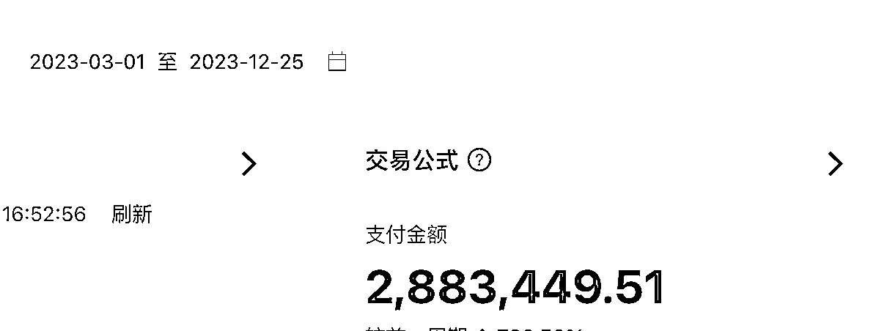
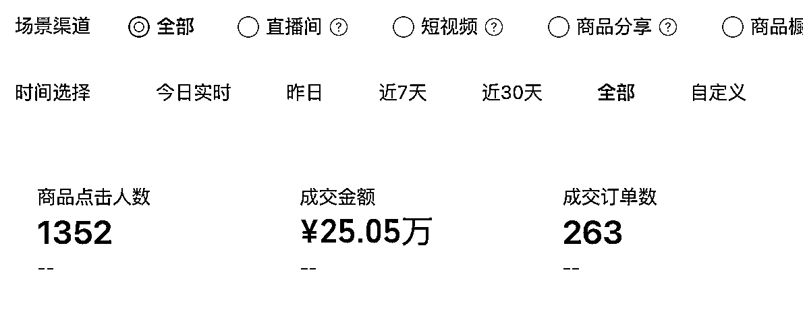
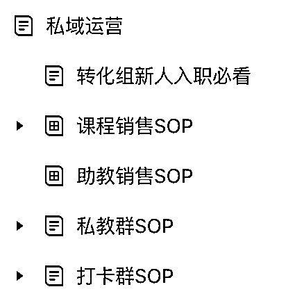
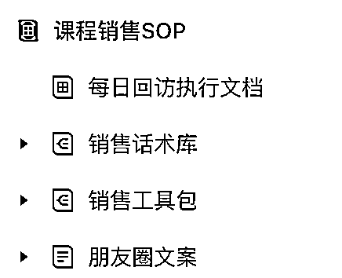
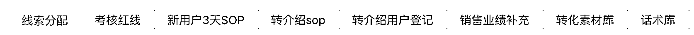

# 用矩阵笔记把小红书流量导入私域，10 个月完成 300 万营收

## 小红书做种草，私域做成交，10 个月变现 300 万

日期：2023-12-26

跟圈友打个招呼，我是龙哥，一直在做私域方向的生意。现在手上在跑社群团购、K12 教育，还有一个洗护类新品正在筹备，工厂已经谈妥，预计 3-4 个月后上线售卖。整体打法都一样，公域负责拉新，私域负责成交。

今天重点讲今年年初启动的一个新概念英语线上课项目。合作方是北京一家上市教育机构，我拿的是代理权。授课模式接近斑马英语、火花思维，购买后在小程序里自学。客群锁定小初阶段孩子的家长，尤其是北上广深等一二线城市以妈妈为主的人群。这个品类刚需属性强，用户质量高，沉淀下来的价值很大，所以就开始做了。

先说个结果。从启动到本月月底，10 个月时间，0 投放、0 大号，靠小红书矩阵内容的种草投放完成私域引流，课程销售额做到 300 万，利润率约 60%。按这个势头，明年 GMV 有望翻倍，利润率也计划提到 70%。今年一路踩坑测试，现在闭环已经跑通了。

收款凭证放几张，有赞到账：

视频号到账：

企业微信的直接收款就不贴了。

这 10 个月里私域里还积累了数万名 K12 家长，转化还没有吃透，明年会作为重点来做。

下面拆成两块来聊：

**一、小红书矩阵引流怎么玩**

**二、私域转化率怎么提升**

# 一、小红书矩阵引流怎么玩

## 1、 先把路径定下来

课程客单价在 1000-2000 元区间，在小红书站内直接成交难度很大。所以一开始就把策略定为引流到私域再成交。

小红书引流常见两条路，一是各种方式留微信，二是做内容种草让用户自己去站外搜。

我选了第二条。留微信看起来近，水里下得很深，既要对抗平台规则，又要兼顾内容和引流，号养起来成本高，还容易翻车。

做项目最怕动作太多，动作越多越难复制。动作越少，标准化越容易，放大也越快。

于是采用种草路径：小红书种草上课小程序 → 用户自行搜索小程序 → 通过销售领取免费体验课 → 销售推进正价课成交。

路径看起来长了一点，但实际转化并不差。站内留微信的干扰多、添加率低，反而把流量导到自己能承接的站外平台，种草更干净更高效。

## 2、 选方式开始小规模验证

确定种草后，面临选择：找 KOL 还是 KOC，还是自己做大号？

我三个都没做。

我采用的是伪 KOC 模式。新注册 10 个号，全部包装成宝妈人设，每天每号发 1 条软广，推荐这个小程序。

目的很简单，验证一个判断：小红书单条笔记表现，和账号粉丝量相关但不绝对，内容才是核心，低粉爆款常有。

如果成立，那唯一的解就是提高发帖量，提升爆款概率。

于是和同学把历史爆款笔记按关键词扒了一遍，直接抄。第一周就抄出了一篇几百赞的小爆款，接着 5 个号一起复刻，第二天又爆了一篇，且进来的私域用户质量合格。

## 3、 验证通过开始规模化复制

方法跑通后，就做两件事：模板化、加人。

为了保证新人也能写出合格内容，我们把一篇笔记拆成 7 个模块：标题、封面图、内页图、正文、关键词、话题、评论区维护，每个模块都有样例和要求，形成了完整 SOP 文档。

这样新笔记既能保留爆款 70% 的结构，又不会被判定为重复抄袭。

招人环节控制成本，找的是大三、大四还没毕业的实习生。最多时 8 人同时在线，组长统一调度，按模板每天每人产出 20 条原创笔记。

有朋友问过是否用 AI 写。我们试过，效果差，最终还是要人工润色，性价比不高就停了。

自己账号不够用后，开始找大学生兼职群的代理。内容我们提供，代理派单给兼职账号发布，按篇计费。

日均在小红书发布 100 多篇笔记，平均每篇能带来 1.5 个私域线索，按 30 天算，单个线索成本约 70 元，ROI 很健康。

## 4、 遇到天花板，也看到新机会

有人会问，为什么不放大到 1000 篇、10000 篇？

实际发到 150 篇/天时就出现问题。用户在评论区反馈，刷到好几篇同样产品的帖子，内容雷同，像广告。

后来用小号私聊才发现，问题不是铺量太多，而是搜索被占满。我们所有笔记都带品类关键词，而品类本身搜索量有限，导致用户一搜，2-3 屏就全是我家的内容。

这也给了启发：以前只想着靠推荐流获取曝光，没想到搜索流也能截断。单个产品的笔记上限大概在 100 篇/天左右，那不如多上产品，用新模板去占领新关键词。

我们重新注册了小程序，复制一套代码继续种草。目前已经做到第三个小程序。

曝光量上来后，每个月都有博主主动找来谈代理，在自己的账号和私域里分销拿佣金，这是意外收获。

# 二、私域转化率怎么提

引流进来后，产品价格带是 0 元体验课 → 1000 元线上课 → 2000 元社群服务。30 天转化率在 10% 左右，在教育行业里算非常靠前的数据。分术和道两层讲：

## 1、术：动作全部 SOP 化

下面是私域销售的基础 SOP 截图：

二级清单太多，这里截几个代表。

按时间轴，从 0 天、1 天、3 天、7 天、15 天，每个节点的行为和分支都写死。

按关系轴，从建联、破冰、熟悉、信任、成交，每个阶段的话术和分支也全流程化。

项目现在体量不算大，今年做到几百万，但天花板高。从第一单开始就一直在完善运营体系，保证点、线、面全覆盖，持续迭代优化。魔鬼都在细节里，利润也在细节里。

标准化、可复制，是做大的基础。SOP 本质上是对抗人性的惰性，把私域水准拉到及格线之上。

## 2、道：私域里要把人当人

术做到及格，道做出来才能优秀。

做私域的道，我归纳为四个字：把人当人。借一段之前写过的话：

我觉得一个合格的私域操盘手要经历两个阶段，先学会方法，再悟到心法。

方法好学，框架、SOP、文案，肯学肯抄都能掌握。

难的是心法。私域不是数字，是活生生的人。

你微信里一定加过卖货的，有人一上来就硬广，看到就想删；有人是润物无声的种草，不烦反而被吸引。差别在于运营者有没有意识到，私域里面对的是人，不是流量。

“把人当人”分两面：一是把用户当人，二是把自己当人。

私域不是点对点的轰炸，是从认识、了解、信任、吸引、成交、复购、转介绍的关系进阶。相比公域的快进快出，私域是慢生意。想着收割一批就走的人，做不好私域。

明白了这一点，就能理解为什么同样产品，私域变现体量能差 10 倍。

把用户当人

用户主动加进来，说明有需求。别急着推销，先换位思考，找到需求点再匹配产品。我们能赚钱，是因为先解决了问题，再顺带获得报酬。

心态变了，动作就变了。是“我要你的钱”还是“我帮你解决问题”，情绪是截然不同的，用户能感知到。

想慢慢变富很难，守着流量不收割更考验人性。但越急越赚不到钱，这是规律。

把自己当人

私域里，情绪价值往往大于产品价值。很少有产品能甩竞品几条街，看一圈下来都大同小异，客户为什么选你？因为认同你这个人/品牌。

私域卖货，先卖人，再卖品。卖情绪价值，卖信任感。核心逻辑是“我觉得你靠谱，你的东西应该也没问题”。

所以私域要先解决信任问题。这很重，是慢功夫，短期看不到爆发，但绝对是难而正确的事。

在私域里把自己活成一个真实的人，产品过关，变现自然不会差。

其中，讲故事的能力极其稀缺。

少一点营销，多一点人味；少一点技巧，多一点真诚。

以上就是这个项目的完整拆解，希望对做小红书和私域的朋友有一点启发。抛砖引玉，感谢。

* * *

评论区：

啊浩 : 你好，请问下你们是用什么载体进行分销的呢，是单独开发个小程序放分销的课程么？

史贵鹏 : 分销用的有赞，拍完课了用户会收到兑换码，自己去小程序兑换

米米 : OK

陈大红 : 跟淘宝商家同理，区别是淘宝卖家引导用户去淘宝搜索商家名字，你是引导去微信搜索小程序，非常值得借鉴！！

啊吹(不二) : [强]

Rio : 做对了三件事

易水 : 写的很棒！很受启发！

啊浩 : 那小程序的话就是你们的合作方他们自己的是么？

* * *