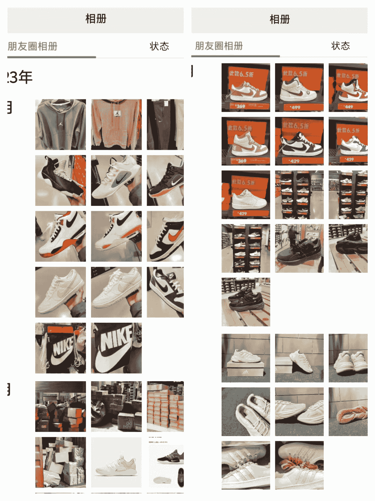
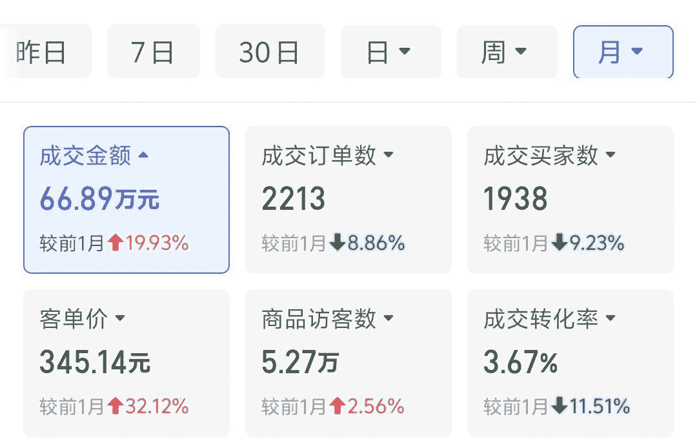
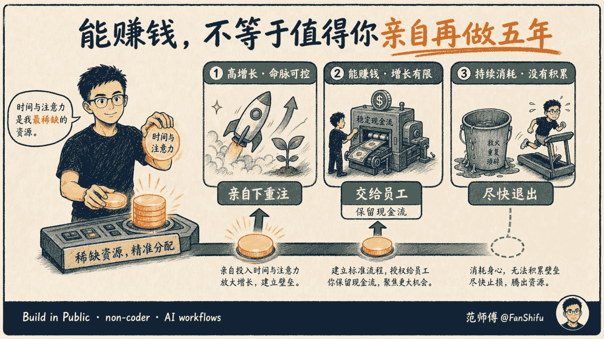
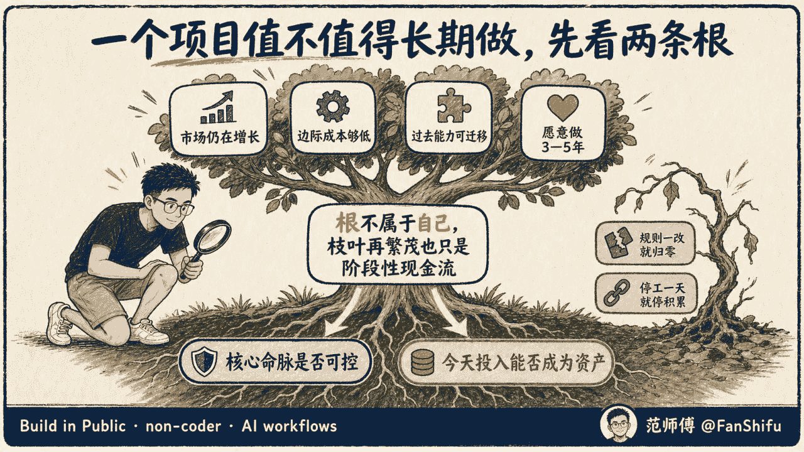
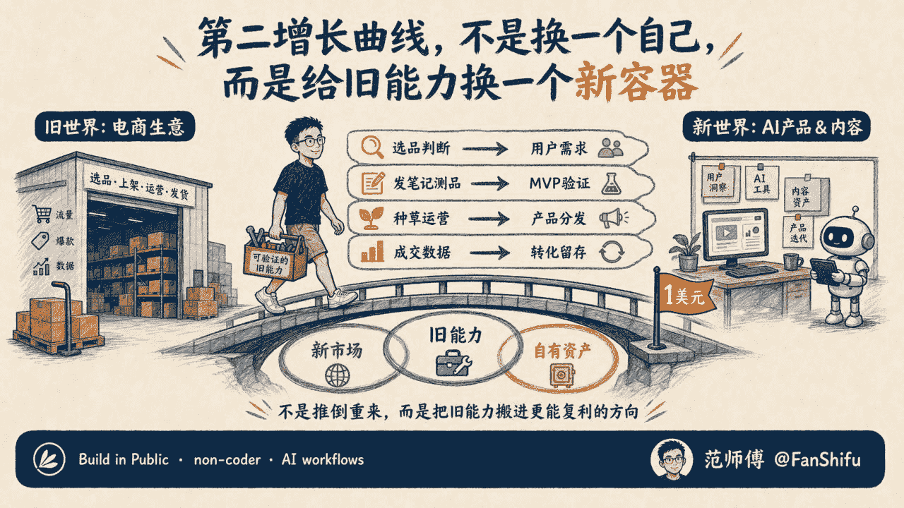

# 省直公务员辞职创业，从副业兼职做到电商月 GMV 60W+，我终于想明白什么值得长期做

真正值得用很多年去做的事，不是追着风口跑，而是让自己一直有本事站在风口会经过的地方。这是我从稳定工作裸辞、又换过好几轮生意之后，最想讲清楚的一句话。

从头说起。我985高校哲学系毕业，那个年代人工智能远没有现在火，哲学专业想找对口的岗位基本没戏。我原本想进游戏公司做策划，结果被安排写营销文案。后来我连换过几份差不多的差事，始终觉得被困住。为了给自己找一条稳妥的路，我去考公务员，广东、四川、广西都进了面试，最后选了一个四川的省级机关。可我只待了十个月。

机关的日子并不差，食堂到现在我还想念，福利虽然不如老一辈说的从前，但整体可以。真正的问题在我身上。我负责起草公文，经常加班到深夜，工资不高，太太怀孕后，买房压力更显得无处安放。让我敢于离开的，是那时兼职已经跑通了：低价买入热门运动鞋，再放到二手交易市场转卖。一开始只是年末大促随手买来试水，赚了几十块。后来得到朋友指点，摸到了线下折扣门店的进货门路。头一批六百双鞋，不到三十天赚了八万多，兼职收入远超工资，这才动了辞职的念头。

事后回看，当时敢走，既不是赌气，也不是有底气，而是几个因素刚好同时出现：上班这件事严重消耗状态，工资撑不起家庭计划，兼职经过了市场验证，手头有一笔存款，最差无非是重新找工作。在我眼里，稳定不是某个机构永远不赶你走，而是你离开任何组织之后，还能靠自己找到饭碗。

辞职之后，我全力做运动鞋生意。那几年的行情的确凶猛，新鞋一发售就有明显溢价，转售渠道的规则对卖家也友好，货走得快，钱回得快，售后不用自己操心。我在那个渠道做到很高的等级，也攒下了一笔属于个人的钱。但我后来复盘，这笔钱里，个人能力最多占两成，八成来自行情帮忙。顺风走久了，人会误以为全是个人本事。我当时也有这个错觉，甚至没想过这阵风会停。

行情果然停了。某个事件之后，两个国际品牌遇冷，新鞋价格从溢价变成破发，同行纷纷低价抛货。转售渠道不断调高费用和门槛，退货量越来越大，库存慢慢把我压住。中间李宁、安踏有过一波短暂热度，我也赶上了一小段，但品牌很快收回折扣，热潮也就散了。

那段日子教会我一套判断方法：市场、渠道、同行，三个信号要放在一起看。单独一个信号变差，可能只是震荡；三者同时走坏，再努力也很难翻身。正确的动作不是硬扛，而是停止进货、清掉库存、保住现金，尽快把旧能力搬到新的地方。最没意义的事，是站在原地抱怨环境。

后来我开始试内容社区。最早在小视频赛道吃过亏，直播不到二十分钟就被封号，还罚了两千块。直到有一年，我在付费社群里看到种草社区的店铺招募，太太说这个App女孩子很多，我便报了一个名。当时这个社区刚开始推小视频，大量折扣货却还在线下门店，线上只有大促才有折扣，线下折扣店每周都在变化。这个时间差，正好接住我过去攒下的挑货经验。

我给自己定了一个拍摄模板，每隔几天去一次折扣店，自己琢磨剪辑，把穿着效果、面料质感、颜色选择、设计细节都讲清楚。并不专业，只是比随手拍多了些设计。很快，某款耐克长袖先火了，接着裤子和鞋也出了量。头三十天，两个号的总成交额接近五万，毛利四成多。还有一个在旧渠道卖不动的背包，经我拍成内容后成了爆款，线下折扣店的货几乎被我清空，价格从一百零九元涨到三百六十九元，仍然有人求购。我因此想明白，选货本质上是选货架。同一种货，在A渠道沉默，放到B渠道可能被疯抢；没有永恒的畅销品，只有被放对或放错人群的货。

这门生意后来走到头了，因为家里有人考上老家的教师编制，我们搬回一座小城市。那里没有大型折扣店，实拍场景和货源都成了难题。硬要继续，就必须自己搭场景、囤货测款，把原本轻巧的模式变重。我不想强留一门前提已经失效的生意，所以把它放下了。

回到老家之后，运动鞋生意重新变成单一渠道，我心里清楚这不是长久之计。正好有同行朋友在做传统网店，愿意告诉我品牌资质怎么申请、售后投诉怎么处理，我租下小仓库，单枪匹马选品、报活动、管客户，慢慢把月流水做到六十多万。跟真正的行业大卖比不算什么，但对我是一个新的节点。

后来有朋友愿意注资，让我扩大规模，我拒绝了。生意是赚钱的，可是我能预先看到它放大后的样子：行业过了爆发期，品牌不在自己手里，货源没有稳定授权，任何一项政策变动都可能把利润压没。之前那个背包就是案例，内容有人看，客户有需要，可我就是拿不到货。我总不能自己去买台缝纫机生产，真这么做，大概就要进去“踩缝纫机”了。

所以我做了个折中选择：网店不关，也不再追加投入，请了一位助理维持运营，让它持续提供稳定收入。我自己抽身出来，去找新的增长线。对待一门生意，我的标准很简单：成长空间大且核心资源可控的，亲自压上；能赚钱但增长空间有限的，交给团队当现金牛；费时费力又没积累的，趁早放手。

前几年我开始留意AI，但一直没认真学。到2026年初，一款开源智能体忽然出圈，我才发现大模型这项技术已经能覆盖设计、写代码这些活。过去我脑子里有很多产品点子，可一想到外包成本和维护就打了退堂鼓。现在入门门槛低了很多，非技术背景的我也能动手。我报了一个写代码方向的训练营，做了几个练习用的小程序，还给网店搭了开票、对账、数据统计的自动化流程。

更让我意外的收获在写作上。我靠写字出身，但一直害怕整理素材，也怕把零散想法拼成完整文章。如今这些重复劳动可以交给工具，我只负责提供真实经历和判断，最后再把稿子改到位。今年五月，我开通了海外社交平台的付费会员，开始认真发内容。不做互关，也没有网红转发，靠两篇深度文章拿到十万次阅读，从零攒了几百个关注者。数字不大，却验证了一件事：老写作能力加上新技术工具，可以组成一套很轻的内容生产方式。

产品那边刚刚起步。我的目标是国庆前赚到1美元，时间还剩九十天左右，多少有些紧张。但我不会期望它像当年的运动鞋和种草社区那样，一进场就带来高回报。网店有稳定收入，心里有底，我更愿意把这当成三五年甚至更长期的计划。

之所以把方向定在小型软件和内容创作，是因为它们符合我对长期生意的全部要求：能积累，有复利，核心握在自己手里。技术恰好又把这扇门的门槛降到了我够得到的位置。

风会停，人会散。但只要手里有真东西，下一阵风来时，还是能飞起来。

我想要的生意，是能先放着自己跑一段时间的那种。

把东西上线后，需求还在往上走，新增成本很薄，睡着时也能有动静。跟做实体或传统电商不一样，那种模式想把收入做大，货、仓、人力几乎要同步放大。

更关键的是把主动权拿回来。定价卖给谁、什么时候升级，这些决定要在自己手里。数字化的产品不会出现仓库堆满、订单却卡死的窘境。个人品牌做起来后，本质是跟人绑定的。就算平台哪天改了规则，有方法经验和真正认识自己的人，换个赛道重启也不至于全盘归零。

这件事顺手的一个原因是，过去攒的经验可以直接迁移。

电商里做选品，本质是找需求。发笔记试货，就是用MVP探路。小红书的种草和账号运营，对应的是分发和用户运营。拆解活动和成交数据，就是在看转化和留存。

有了 Claude Code 和 Codex，敲代码不再是最大的门槛。找需求、设计商业路径、做内容和推广才是核心。而这些，我在电商阶段已经干了十来年。

不是把过去推倒重来，而是把已经被市场验证过的能力，装进一个增速更快、复利更强的全新容器里。

## 几次起落后，我只守两条底线

以前做电商的思路很朴素：高增速、差异化、重投入。现在我依然认可，但在下重注前，我会先看两根根。

第一根，核心命脉能不能自己握着。

球鞋和传统电商给过我很直接的教训。产品、货源、授权、平台全是别人的。你可以把需求点燃，但任一个关键环节收紧，生意就可能直接停。

所以现在评估机会，我先问：产品归谁、用户关系能否沉淀、规则变化后能否迁移、供应链、资质、流量会不会被别人一夜掐断。命脉不在自己手里，短期回报再诱人，我也只当成阶段性现金流。

第二根，今天的投入能不能变成明天的资产。

传统货架电商，规模想翻倍，资金、库存、客服、履约、售后基本都要同比例放大。歇一天，活不会消失，只会堆到第二天。没有复利的打法，久了就是高级体力活。

代码和内容不一样。一个项目可以反复售卖，一篇有价值的文章几年后仍会被检索、阅读、转载。它们不是做完就躺赚，但至少今天种下的东西不会明天自动归零。

根不稳，重注只是赌短期。根稳了，我才去看市场是否在扩张、边际成本是否够低、旧技能能否迁移、我愿不愿意连做三五年。

## 衡量新方向的五问

看一个新机会，我会自问：

1. **自主性：**如果平台明天改规则，这个项目还能留下什么？

2. **沉淀性：**停工一个月，之前积累的价值会不会清零？

3. **增长性：**市场是否处于爆发前夜？收入翻倍时，库销、人力、资金需要同比例上涨吗？

4. **差异性：**过往经历能否让我比纯新手更快跑通？

5. **投入性：**是否值得把八成的精力和资金砸进去？

后三问决定要不要做，前两问决定能不能做成长期事业。前两问不过，赚得再多也只是现金流，不是第二曲线。

这也是我转向 AI 海外的理由。

目前还没有收入，第一笔海外美元还没到，可能也会失败。但它至少通过了筛查：市场仍在快速变化，代码和内容具备积累属性，核心产品有机会自控，边际成本比传统电商更低。更重要的是，文案、运营、选品、需求判断、测品、投放、数据分析，这些我十年验证过的能力，都能换一种形态继续用。

第二曲线，不是抛弃过去换一个自己，而是把已被市场验证的旧能力，放进增长更快、复利更强的全新场景。

## 从月销60W，到重新赚第一美元

毕业十年，35 岁了。让我再去追只能赚几个月快钱的项目，我不排斥，窗口合适就抓。短线能提供现金流和实操，但我不会再把它当成长期事业。

回看十年，我从哲学专业毕业，进游戏公司写文案，后进省直单位，一年后离职。再做球鞋、小红书、拼多多、淘宝，如今又开始折腾 AI 海外。表面换赛道，内核在迁移。游戏文案让我能做内容，运营训练出用户意识，后来用在小红书种草。球鞋生意练出选品和价格感，迁移到拼多多淘宝。电商里的测品、成交、投放，现在开始迁移到 Micro-SaaS 的需求验证与分发。

过去我问下一个能赚钱的项目在哪，现在我问我到底积累了什么，什么东西平台拿不走，什么事做完能让明天的我更值钱。

此刻电商业务由团队日常运转，继续贡献现金流。我把自己放回新手状态，学 Claude Code、Codex，研究 X、Reddit，去找海外用户需求。

从月销 60W+，到重新追求第 1 美元，数字看起来小了。

但这 1 美元很重要，它要验证我能否把十年积累的能力，用在资源更可控、能长期复利的方向上，再做一次从 0 到 1。

国庆前能否跑通我不知道，三五年能做到哪一步我也不知道。这一次，我不想因短期没钱就换赛道。我把 AI 当成这辈子最后一次重押。不是因为它必然成功，而是到这个年纪，我清楚自己不想过怎样的日子，也清楚什么事值得长期投入。

稳定工作是否放弃，无标准答案。红利退潮也无需硬刚周期。项目能赚钱却天花板低，就留着收现金流，不必让它吞掉全部精力。

第二增长曲线，未必藏在完全陌生的赛道，它更可能出现在旧能力、新市场与长期资产的交汇点。

如果你也在构思长线项目，先问自己那两件事。

我的核心命脉，究竟掌握在谁手里？自主权。我今天投入的时间，明天还能留下什么？沉淀性。

这两个问题，我花了十年才想明白。希望你能比我早一点。

范师傅丨35岁Non-coder，用AI做产品与内容出海验证。前省直单位公务员，吃过球鞋红利、做过小红书和传统货架电商，目前正在寻找自己的第二增长曲线。

————分割线————

看完这篇SOP，你觉得你懂了。但90%的人一到实操就会卡在第一步。

工具和教程只是最低级的壁垒，真正的壁垒是“立刻动手”和“圈层信息差”。

我们不聊虚的，只做商业闭环的拆解与AI效率的压榨。系统内已沉淀1000+跑通的套利实战局。

👉 查阅圈子完整数字资产与上车门槛：

