# 社群专属表情包，从零到一怎么搞？
# 先搞清楚，社群表情包到底有什么用
小马宋老师早就点过，未来五年超级个体只会越来越多，个人IP和社群运营已经进入常态。
以后几乎人人都要有自己的IP和自己的圈子，所以做自媒体的、做社群的，都可以给自己的群做一套专属表情包。
别觉得表情包只是个小玩意儿，它其实就是一群人的文化符号，和企业文化是同一个逻辑。
第一点，它能把人心拧成一股绳。当成员们下意识地用同一套表情包聊天时，就说明他们已经对这个IP和这个圈子产生了认同和归属。
第二点，它自带传播属性。群里用起来顺手，就容易破圈出去，顺带给IP带来更多曝光。
# 零基础也能做的完整实操流程
直接看干货部分就行。
### 用到的核心工具：Canva可画
https://www.canva.cn
### 具体怎么一步步做
##### 打开网页后，点击【自定义大小】，新建一个1080X1080px的画布
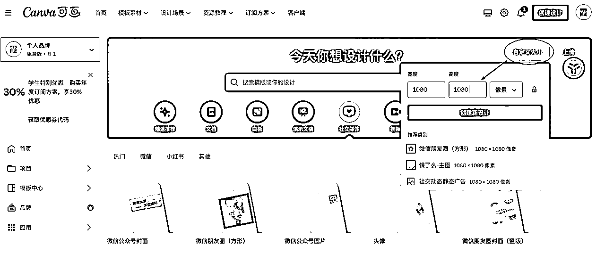
##### 在左侧菜单点【素材】-【形状】-【查看全部】，用【方形和三角形】拼出一个对话框的造型
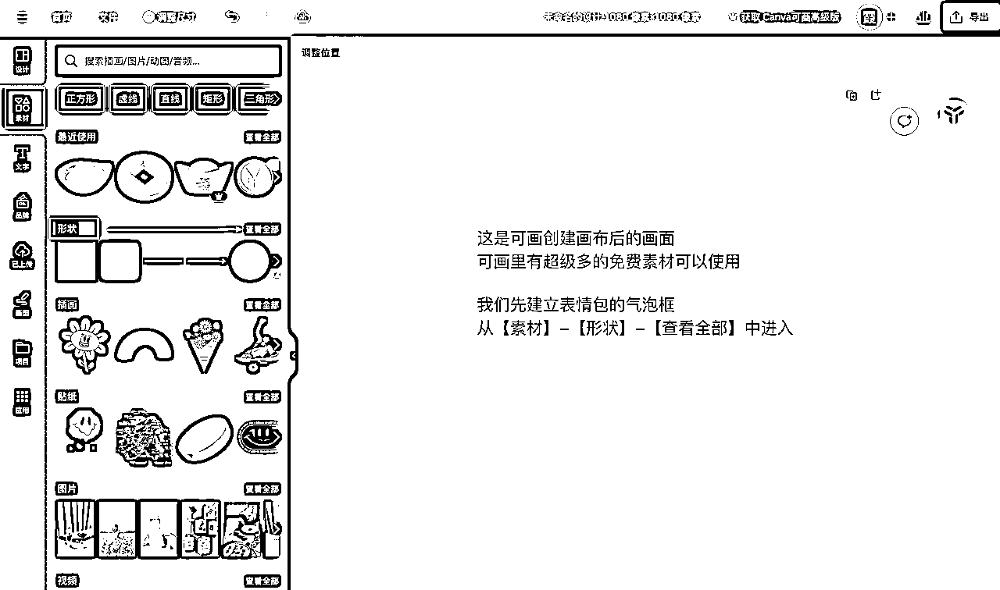
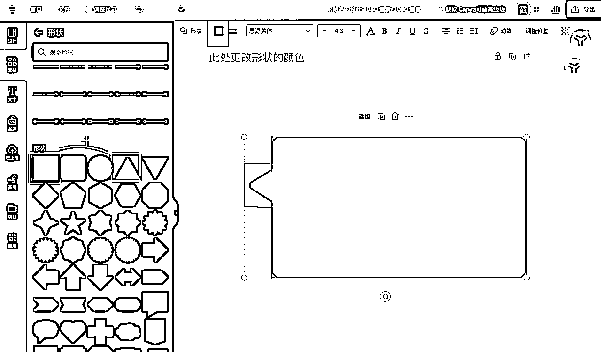
觉得棱角太硬的话，可以把圆角调大一点，在【填色】旁边的【三横杠】图标里就能调节
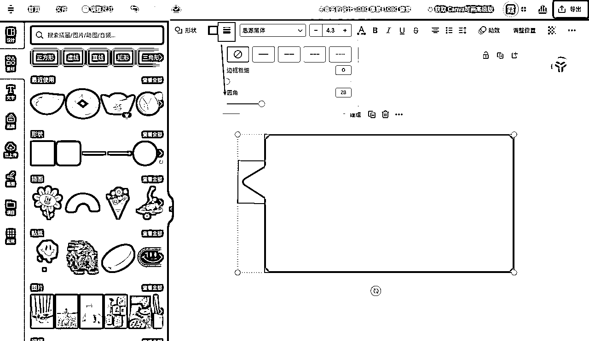
##### 填入文案，优先选群里高频高需的表达
比如【老马赚钱陪伴群】里，经常出现的场景有：
新人进群时：可以做成“欢迎加入老马赚钱陪伴群”的表情
听到老马分享时：做成“满满的赞，给老马举大旗”
嘉宾分享结束后：做成“感谢分享，真的很有收获”
群主准备发福利时：做成“准备，要发红包啦～”
跟单赚钱的瞬间：做成“跟着老马，天天爆单”
我给老马做的“十年之约，一起成长”这张，用的是字由点字简宋，字体可以在画布左上角直接换，里面免费字体很多，随便挑
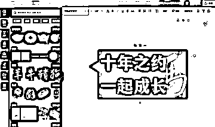
##### 加入图片或插画
1. 可以在【素材】库里直接找，也能在左侧的搜索框里输入关键词检索
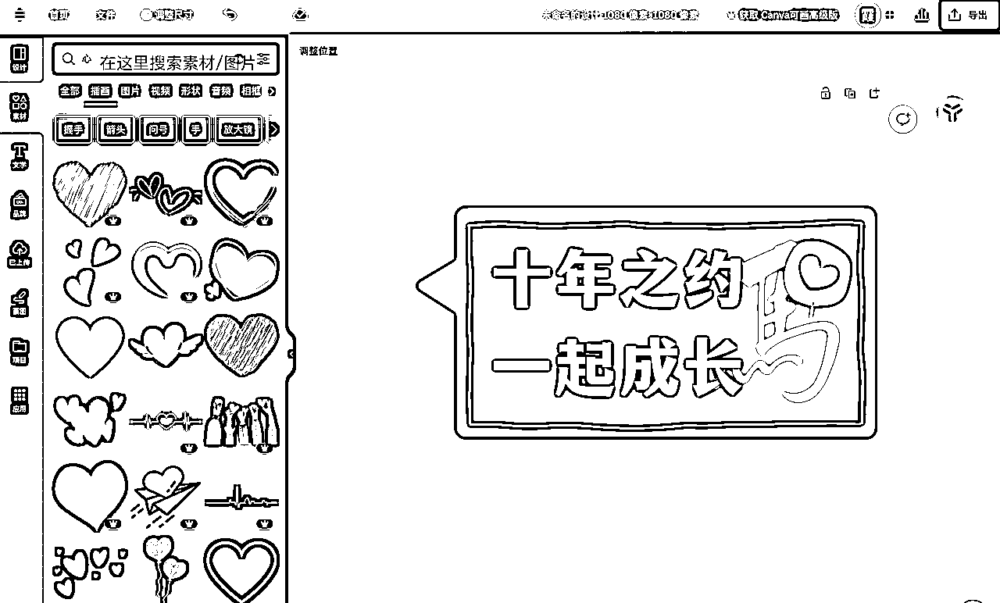
##### 导出PNG：点【导出】-【下载】-【文件格式选png】-【下载】
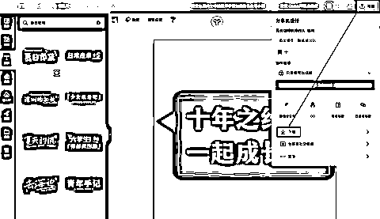
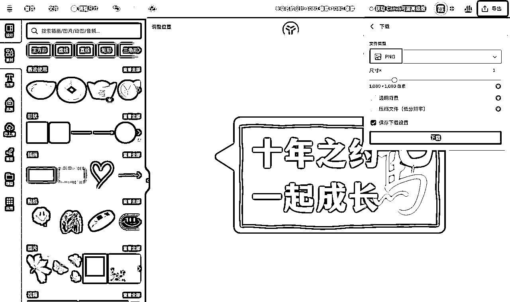
导出后文件会进你的本地文件夹。注意非VIP用户导出的PNG会带白底，对话框类表情必须透明底，有两个解决办法：
1. 免费方案：多走一步，找个免费抠图网站批量处理一下
1. 这个抠图网址我试过还行，可以试试 https://pixian.ai
1. 其他免费抠图工具，可以参考知乎这篇汇总 https://zhuanlan.zhihu.com/p/647052492
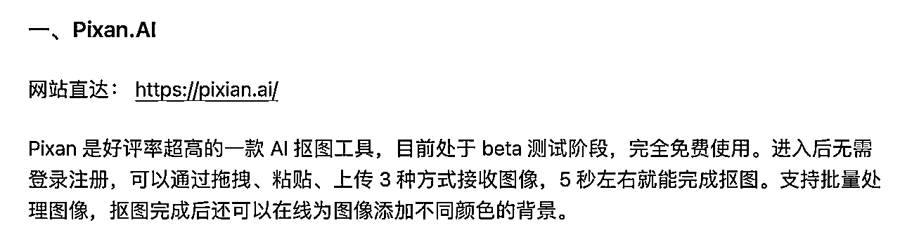
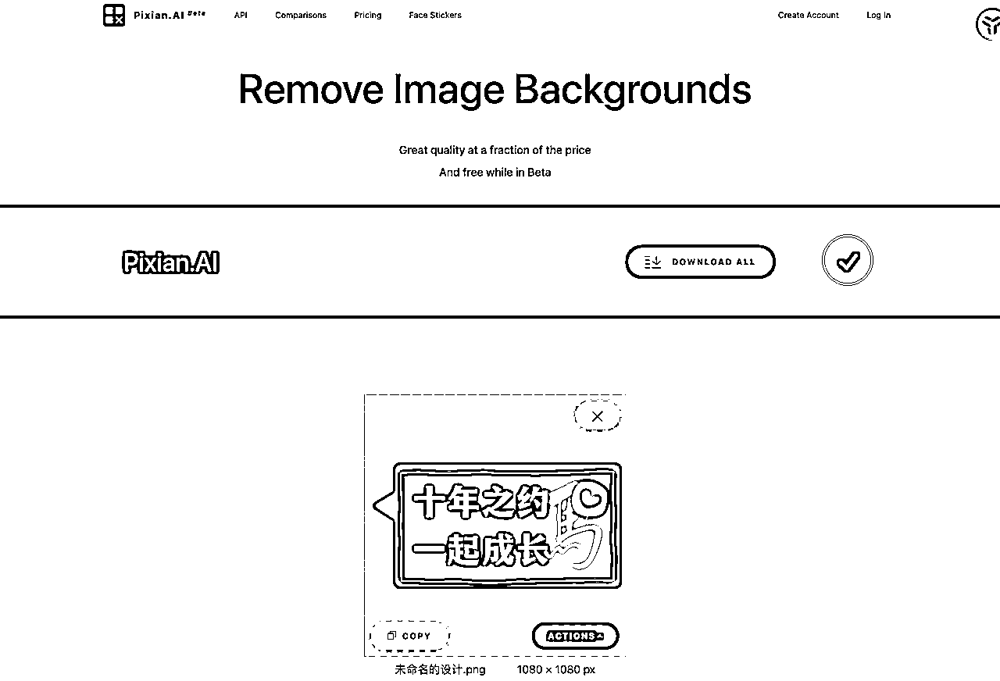
2. 付费方案：去淘宝买个可画VIP，年费大概20元左右，素材和无限制导出就都开了
##### 传到手机里，添加到微信表情库，以后聊天就能直接用了
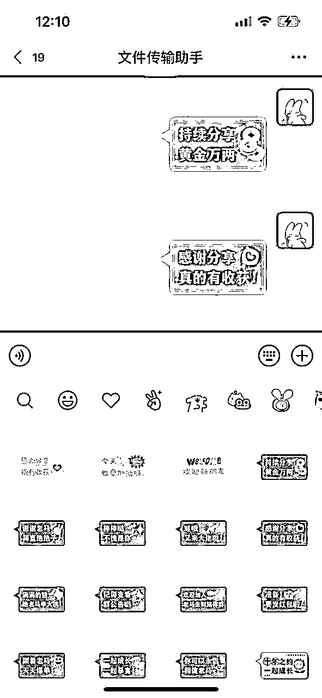
# 做的时候要注意的点
### 整体要简洁，话要短
* 文案最好做成金句，一眼就能看懂意思
### 必须围绕高频场景来做
* 提前预判，在不同聊天场景里，大家大概率会说什么
* 把这些高概率的回复直接做成表情包
### 配色和排版要统一
* 结合品牌色，长期用同一个色系做底色，比如老马就是主打红色
* 配色控制在3种以内，别花哨
* 排版可以是文字+插画，也可以是文字+IP头像，粥左罗老师就是用的第二种
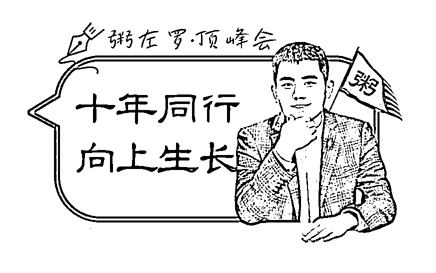
### 语气要口语化，像日常聊天
* 口语化的表达更亲切，能拉近群友之间的距离
### 整套风格要统一
* 配色统一，底色不要乱换
* 版式统一，比如固定在左边放文字右边放素材
* 字数统一，最好别超过10个字，否则表情包会显得很臃肿
# 最后说两句
我加入老马的十年合伙人之后，很享受这种被陪伴的社群氛围，归属感很强，一直想为群里做点贡献。
正好自己是做设计的，就主动给老马做了一套文化向的表情包，也得到了不少认可。再次感谢老马和各位支持。
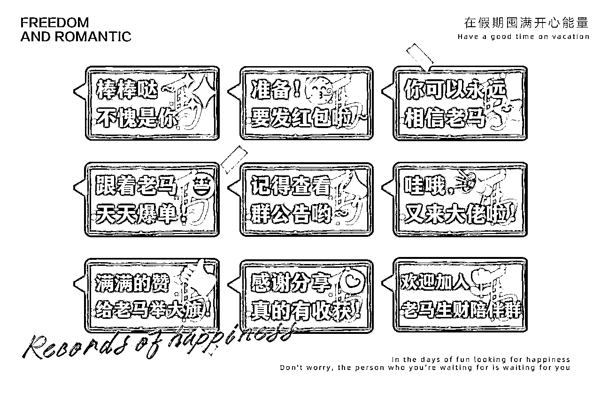