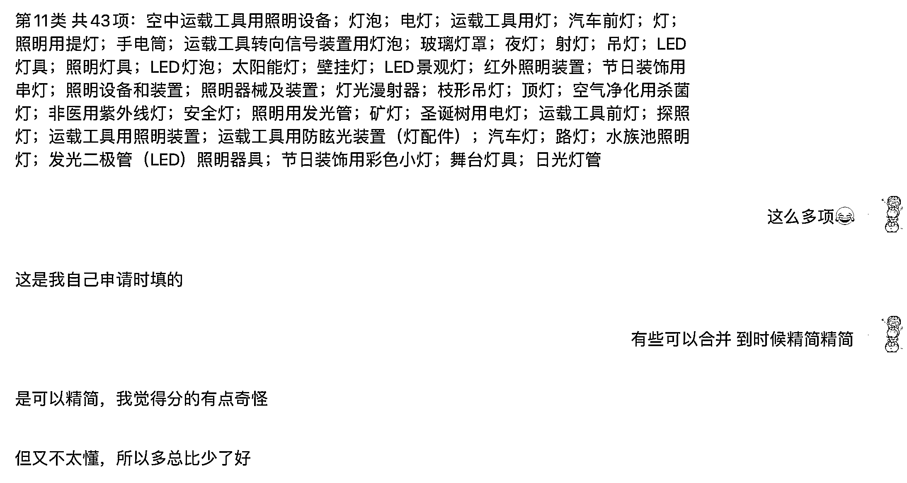
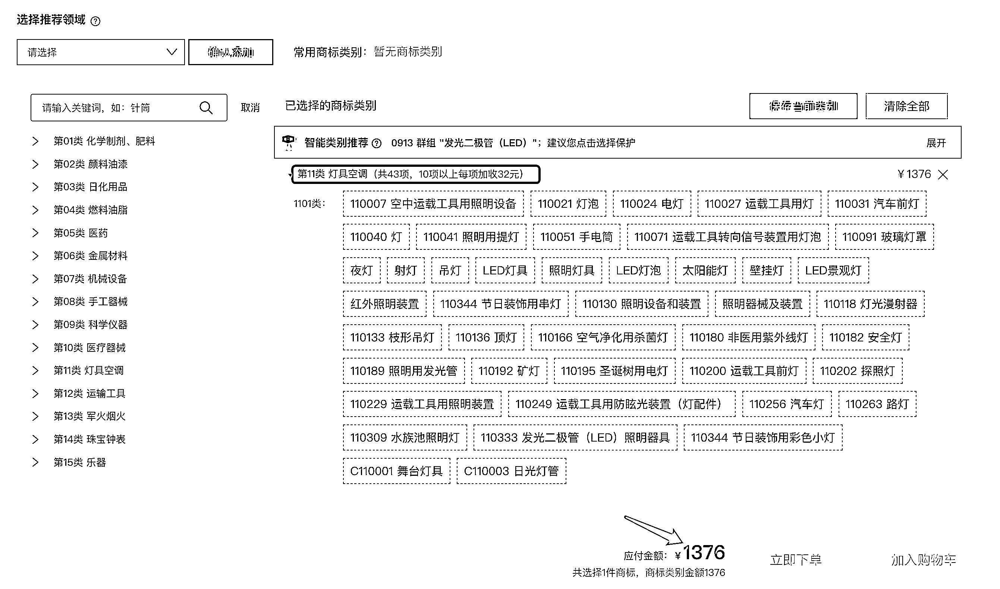
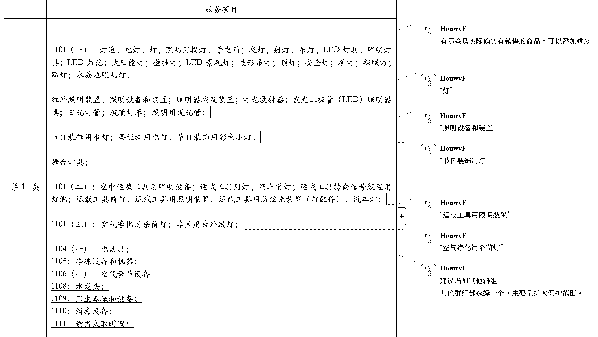
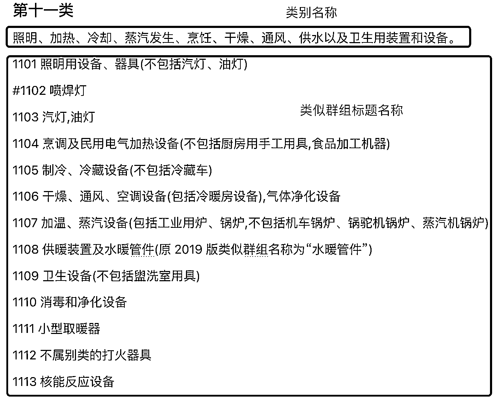
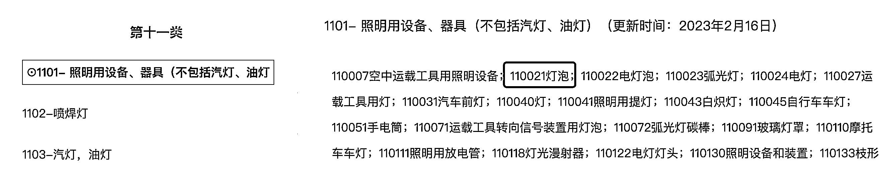
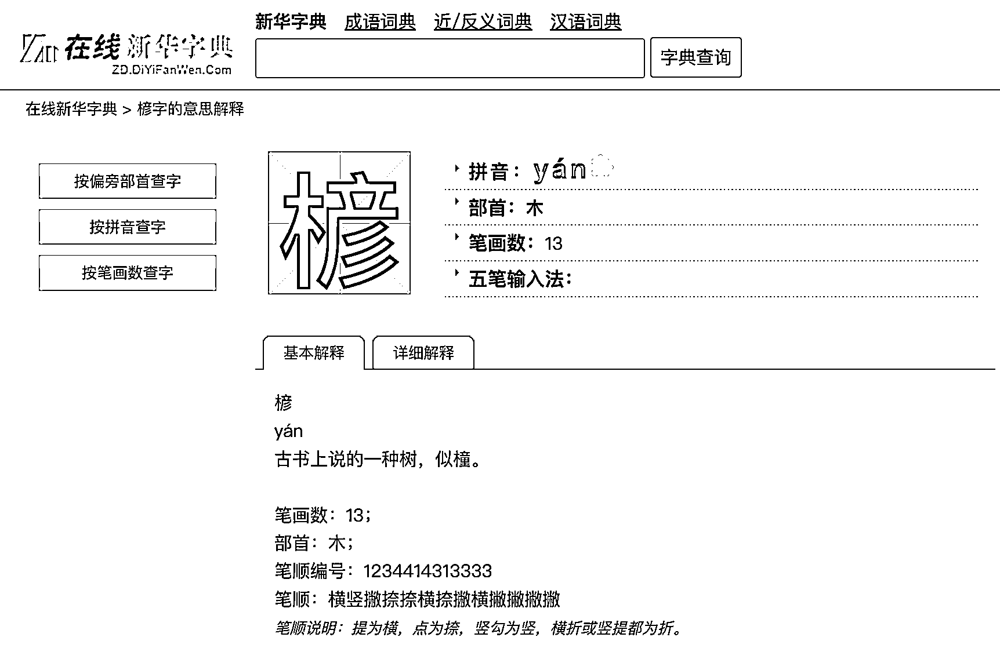
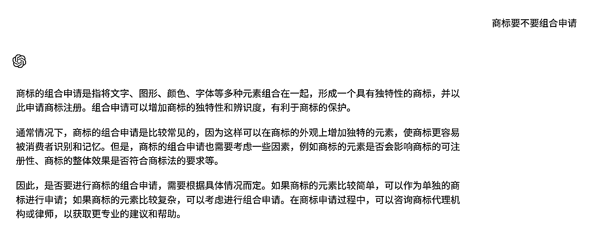
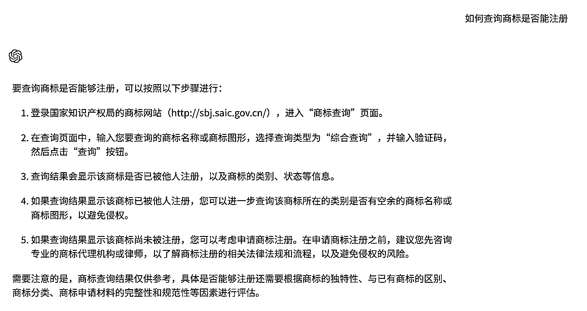
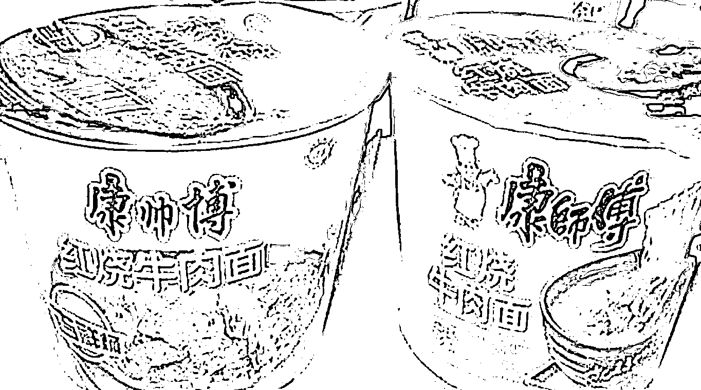

# 经手五千多件商标案，终于把注册商标这事聊透了

> 原文地址：

文 / 侯小妹

2023-06-19

有人说注册商标又贵又慢，还有一堆坑；我做了八年品牌确权服务，累计经手五千多件注册案，感受是：只要把申请前的功课做足，后面基本就是按部就班。

整个流程拆开看，无非四段：圈定保护范围、把名字/图形定下来、查风险、交件等证。

**第一段：圈定要保护的商品与项目**

商标分类并不是谁拍脑袋定的，国际上有一套统一归类办法，由 WIPO 牵头维护。目前国内执行的是官方发布的《区分表》2023文本，底层逻辑来自第十一版国际分类体系。这份材料会随市场变化更新，提交之前最好核对一下最新状态。

费用结构其实很朴素：一个类别的基础官费是270元，默认覆盖10个项目；每多一个项目，再加27元。

很多人第一次面对名录，会产生“什么都相关、什么都想选”的冲动。之前有位做灯具的朋友，营业执照上写得满满当当：电子电器、照明设备、电光源、驱动电源、开关、显示类商品、LED类商品、相应配件及开发销售。他只在第11类上报，却从表里挑出43个小项，比默认额度多了33项，额外官费891元；加上基础费，总计要交1161元。若走阿里云的自助办理页面，整体测算约1376元。阿里云的手续费在同行中算低，不过这属于“自己动手”的类型，需要用户本身对分类比较熟。

阿里云自助系统费用试算页面

逐项筛选操作界面

这个案例里有三个典型毛病：一是很多小项描述相近，属于重复保护，全选只会放大账单；二是精力只放在第11类里的1101小组，其他相关小组没有理会；三是实际会用到的开关等9类商品没有纳入，类别版图本身就不完整。

官方能查到完整名录，准确但界面老旧；我平时查得比较多的是 sbfl.cn。另外我把常见行业的分类思路整理了两个文档：《常见行业，商品/服务分类选择》与《商品分类表：各类别所涉及商品及服务领域》，地址如下：

第一份：https://iwvmcwbmc4c2.feishu.cn/docx/E7ZHdk5FzoyqmTxBrRjcIIR7n8e?from=from_wechat&login_redirect_times=1

第二份：https://iwvmcwbmc4c2.feishu.cn/docx/OpXIdbXvZoXp1HxU0BLcH4TtnHe

还有个小提醒：填表时不能把“类别名称”或“群组标题”直接当成项目提交，必须选它们下面更细的商品或服务条目。

绕开这些坑，我在选项目时默认三条准则：

先确定商标真正要用的业务方向，以此定大类；可以同时布局多个类别。

再对照真实在卖或真实在提供的项目去勾选，不为“以后可能用到”提前多付钱。

最后做防守式补充，在大类内部挑几个相邻小组的关联项目，提前占位，减少被蹭的风险。

**第二段：把名字或图形定下来**

取名是整个过程中最考验耐心的环节。一个合适的名字，通常具备五个特征：容易记、容易念；在同类里跳得出来；与自己的产品有联系；符合法律法规；经得起品牌定位和市场视角的推敲。

最常见的第一道坎是：想好的名字已经有相同或近似记录。我习惯拿《新华字典》来找同音替代字。比如植物类目里原本想用“颜植”，初步检索就觉得风险偏高；翻字典找到一个跟植物有关联又比较少见的“楌”，组合成“楌植”后，风险明显下降。

第二种情况是，服务商不查就说“缺显著性”。我的自检方法是：把自己当消费者，看看这个标记能不能起到“认牌”的作用。能，就不算没戏。

第三种纠结是选择文字、字母还是图形。答案取决于你的顾客群，不过底层原则一直很朴素：简单一点，再好认一点。

中文、英文、图形要不要合成一件提交？很多老手会劝导“分开报”，因为每一块的驳回风险更独立，以后拼一起用也更自由；但合并报也有好处，整体识别度更强，保护关系更紧凑。正确做法是把每个组成部分单独查一遍，再比较两种路径的得失。

**第三段：查风险，判断近似**

现在问 AI，通常会被指引到主管部门的免费检索系统。权威，但速度不稳定，偶尔报 502。民间渠道还有飚局这类站点。

免费查询页面参照

我自己更常用的是付费数据库，比如白兔、权大师、摩知轮，速度快、结果也更稳定。

工具只解决“能不能查到”，真正的难点在于“怎么判近似”。我的判断基准是：站在普通购买者的角度，两个标识放在一起，会不会认错？这一切的前提是商品/服务所属类别相同或相近；如果类目八竿子打不着，标识相同也未必算近似，除非对方是驰名商标或有很强的公众认知。

第一看整体观感。字形、配色、构图方式相近，就容易被归为一类。康师傅与康帅傅是典型：读音差距不大，包装风格也接近，不细看很容易拿混。

第二看读音是否接近，第三看含义是否接近。这些判断多少依赖经验；行业新人可能要反复核对，老手看多了驳回文，心里基本有数。也要记得：近似与否并不是绝对概念，不同的人可能得出不同结论。查重不是为了打保票，而是把肉眼可见的障碍提前清掉。

**第四段：递交、等待、拿证**

到了这一步，反而没什么技巧可言：备好资料、签章、递交、等初审，然后等最终结果。

线上那些自助/半自助服务，本质上是帮你完成“递交”这一环；前面三步都得自己解决。一旦注册被拒，这类平台通常只会转给你一张驳回通知。而一个负责任的服务商，能在驳回后帮你分析原因，评估要不要复审、复审的代价和机会分别是什么。

所以我的建议很直接：你若自己能搞定前三段，自助通道或官网直交最省钱；若没有把握，就找一个值得信任的顾问。这行做久了确实有优势：听你说完业务，类别能大概估出来；名字拿过来，哪些容易折也有谱；驳回见得多，对审查尺度会更敏感。

价格高低当然存在，就像买衣服，几十块和几千块的都有。服务本身很难在付款前量化，体验过才知道值不值。遇到负责的人，费用不高也能办得顺；运气不好，贵价也未必稳。

也得承认，注册多少带点“玄学”。年中、年底递交的案子，驳回比例好像会比平时高，被误伤的也更多；遇到知识面特别广的审案人，你甚至猜不到他会搬出什么理由。但把前三段做扎实，至少能控制能控制的部分，让好运站在自己这边。

**互动摘录**

龙哥说，自己几乎每次办注册都碰壁，之后总有中介打电话来劝复审，他怀疑那些复审建议基本没有意义。侯小妹回应：复审值不值，要看具体的驳回理由；有些案件属于误伤，她会把复审与放弃两种选择的利弊、成本都说清楚，再由对方结合需求和风险拍板。

Caleb 则直接点赞：自己的商标就是交给侯小妹办下来的，很放心。龙哥也感叹，小型创业者身边需要愿意讲真话、不靠帮办业务赚钱的顾问。侯小妹最后自我介绍：专职做这一行八年，帮很多客户顺利拿过证书，感谢大家的信任。