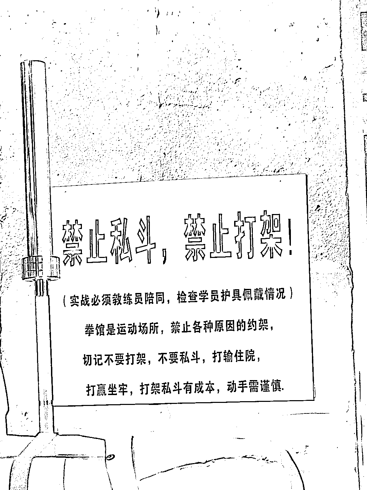

# 腰部的创造者，最容易受 AI 影响
作者：龙哥

“腰部创作者会最先被AI冲击”——这个说法流传挺广，但我一直觉得哪里不太对劲。今天总算想明白了。

为什么那么多人认同这个判断？他们大概是这样推演的：

有了AI，本来在及格线以下的人，突然能摸到及格线了，这算是跨越式的提升；而顶尖高手呢，一个人就能顶一支队伍，想法落地的速度更快、质量也更高。唯独处在中间层的人，高不成低不就，卡在尴尬的位置上，最容易被动摇。

乍一听，这套逻辑没什么毛病。但细品一下，它更像是在二维游戏里玩贪吃蛇的思维，用一条直线去理解世界的格局。现实不是平面棋盘，马化腾很早就讲过“天空法则”：天高任鸟飞，麻雀有麻雀的高度，老鹰有老鹰的高度，大家各有各的空间，真正决定你能飞多远的，是你发现需求、创造连接的能力。

先讲一个反直觉的现象：大量腰部创作者，其实早就在AI这波浪潮里尝到了甜头。

2021年前后，我浅浅参与过一些“抖音商业IP”的项目，亲眼看到不少中腰部创作者赚到了真金白银。为什么他们也能把生意做成？这段话能解释一部分：

如果马云做生意能打100分，他大概率只愿意和90分以上的人合作。那90分以下的人该怎么办？80分的可以跟90分的学，70分的跟80分的学，60分以下的就跟70分的学——这不是割韭菜，这是市场里价值流动的规律。因为90分的人时间太贵了，让他们去一对一辅导60分的人，成本根本打不平。可如果60分的人不想只听大课，而是需要有人带着实操呢？90分的人带不过来，70分、80分的人就有了生存空间。

我们没必要一开始就做行业顶尖，也不用服务全国市场，只要在一个细分区位里有一点点优势，找到那些刚好需要你的用户，踏踏实实服务好他们，就已经非常够用了。

但这里还有一个关键问题：凭什么你有点小优势，就一定能被需要你的人看见？答案是推荐算法。大数据会把腰部创作者的内容精准送到真正需要它的人面前，这才让“1000个铁杆粉丝就能养活自己”从理想变成了现实。

举个极端的例子：论搞笑天赋，小杨哥未必比得上周星驰，甚至可能够不到开心麻花的门槛。但短视频和推荐算法让他的内容突破了圈层，于是他成了安徽合肥的“三只羊”。

有人会说：推荐算法是AI，和ChatGPT这波生成式AI不是一回事。那我们就专门聊聊生成式AI。

过去几个月，我已经看到不少腰部创作者，因为生成式AI而明显受益。

第一，生成式AI能帮腰部创作者更好地打磨独特性。不少人对AI的印象是“只会输出套路化内容”，试几次就放弃了。但聪明的人会这么做：自己写一版，再让AI写一版。如果两版高度相似，就说明这个方向还不够原创，还有继续深挖的空间。接下来怎么挖？依然可以让AI来帮你提供新角度、新思路。

第二，生成式AI让更多腰部创作者有机会被看见。过去，能被大家注意到的，基本是名气大或者数据好的人。可名气再大，也保不齐扑街——流量明星的票房翻车还少吗？数据好看，也可能是迎合平台，甚至水分十足。那为什么不能直接按内容质量来决定谁被看见？因为C端用户和B端采购者，都不可能一篇一篇读完全部内容。结果就是，许多没名气、没数据的“金子”，被埋没在角落里。

现在不一样了。普通人可以用AI帮忙筛选值得读的内容，于是更多匹配度高的内容被送到了他们面前；采购者也不必再死死盯着名气与数据，而是可以腾出精力，直接去发掘内容的闪光点，为真正有价值的内容付费。

我始终相信，随着生成式AI不断普及，越来越多的中腰部创作者会在“被看见”和“被赋能”的双重加持下，成长为各个垂直细分赛道里的新头部玩家。

生成式AI带来的，不只是强者的马太效应，也不只是底层的及格线保卫战，更是腰部创作者遍地开花、细分品类空前繁荣的大时代。

评论区：

李彬：有同感!我就是这样的腰部，也能抓住一些机会。不过这些机会可能是头部看不上的。