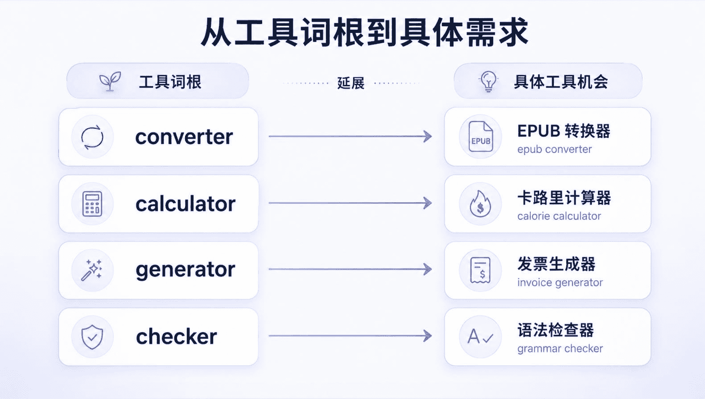
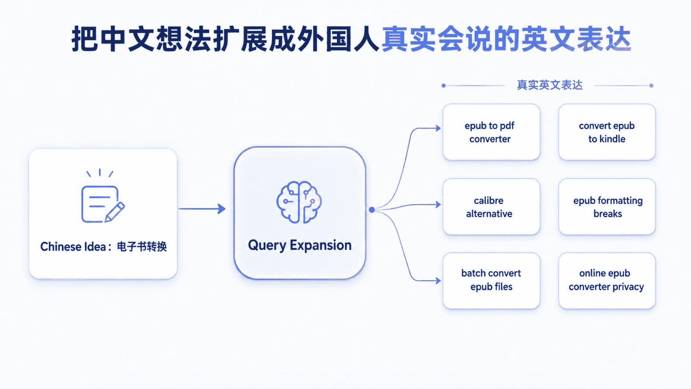
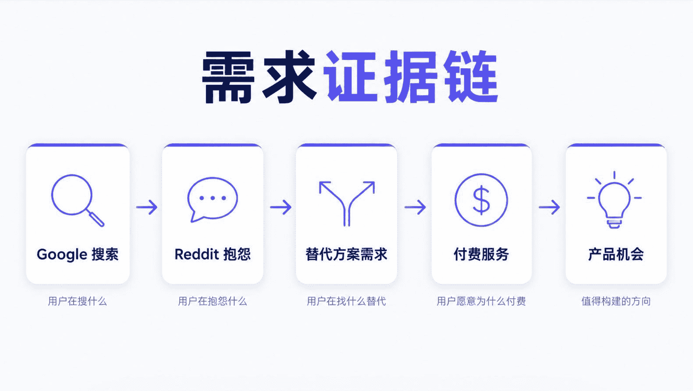
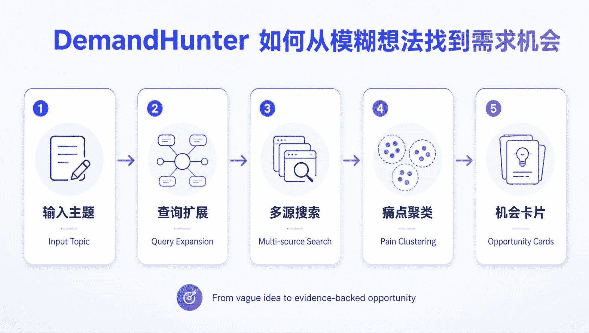

# 裸辞之后做海外项目，我是怎样判断“外国用户到底缺什么”的
260531 副业SC 精华
大家好，我是龙哥，曾经是一名大厂程序员。今年离开公司后，我开始尝试开发面向海外的独立站和 SaaS。
刚开始时，我也犯过一个很普遍的错误：以为只要把产品上线，访问者和收入就会自动出现。于是我陆续做了几个网站，也尝试过一些小程序。
现实很快给了反馈：多数项目没有明显访问量，变现更谈不上。
这让我重新认识到，独立开发真正困难的地方，往往不是编码，而是确认“这个东西是否值得被使用”。做海外项目时，这个问题尤其明显——我们很容易站在国内开发者的角度，凭想象替海外用户定义问题。
但我们其实：
- 不是目标人群；
- 缺少他们熟悉的文化和交流背景；

- 不清楚他们习惯用哪些词寻找解决方案；
- 也未必知道他们在哪些社区里反复吐槽。
因此，最近一段时间我一直在整理一套更系统的调研方式：怎样从公开信息里，找到海外用户已经暴露出来的需求？以下是我的实践总结。
## 一、别急着想点子，先观察需求留下的痕迹
过去我经常这样选方向：
- 某个 AI 模型突然走红，要不要做个外围产品？
- 某款软件是不是还能补一个功能？
- 图片生成类网站是否仍有空间？
这些判断听起来像分析，实际上仍然是在猜。
后来接触了哥飞老师、小排老师的一些方法，我开始把注意力放在四种可验证的信号上。
### 1. 搜索信号：用户主动输入的内容，通常对应明确目的
Google 依然是海外用户寻找解决方案的重要入口。一个简单的判断方式是：有没有人持续输入和某个问题相关的词，尤其是那些带有工具意图的词。
常见的英文词根包括：
- generator
- converter
- calculator
- checker
- finder
- tracker
- planner
- template
- analyzer
- formatter
- summarizer
真正值得研究的不是词根本身，而是它与具体使用场景组合后的结果。例如：
- calculator → calorie calculator → mortgage calculator → pregnancy calculator
- converter → pdf converter → heic to jpg converter → json to csv converter
- generator → invoice generator → workout plan generator → caption generator
如果一个搜索主题既有稳定需求，趋势没有衰退，竞争程度又处于可切入范围，就可能成为工具站的选题。
这类用户的特点是：他们通常已经清楚自己想完成什么，只是在寻找更方便的解决方式。对应的产品形态可以是：
- 免费在线工具；
- 依靠长尾流量获客的页面集合；
- 功能聚焦的 SaaS；
- 基础功能免费、高级功能收费；
- 通过广告获得收入；
- 通过联盟推荐进行变现。

### 2. 负面反馈：一句具体的牢骚，可能比一万个点赞更有价值
第二个来源是海外社区，例如 Reddit、X、Hacker News、GitHub Issues、Product Hunt，以及 App Store 的用户评价。
我会留意这类句子：
- I hate...
- so annoying
- takes too long
- manual process is terrible
- is there a tool for...
- I need a way to...
- I wish there was...
- alternative to...
- too expensive
- too complex
- slow
- buggy
- overwhelming
它们往往不是泛泛而谈，而是指向某个真实阻力：
- 价格超出用户接受范围；
- 操作步骤太多，耗时太长；
- 软件学习成本过高；
- 文件处理结果不稳定；
- 某项工作每次都要重复手动完成；
- 现成产品没有覆盖一个关键小功能。
相比搜索词，这类内容通常更接近需求形成的早期阶段。用户也许还没有决定买什么，但已经清楚表达了“哪里让人难受”。对于个人开发者而言，解决其中一个狭窄问题，往往比复制一个大型平台更现实。
### 3. 替换需求：当用户频繁寻找竞品，说明旧方案并不理想
我也会专门组合这些搜索方式：
- 产品名称 + alternative
- 产品名称 + too expensive
- 产品名称 + sucks
- 产品名称 + slow
- 产品名称 + complex
- 产品名称 + missing feature
它们背后通常代表一种状态：用户承认这个问题需要解决，也知道已经有产品存在，但现有方案没有让他满意。
例如：
- Notion alternative
- Canva alternative
- Calibre alternative
- CapCut alternative
- Zapier alternative
这不意味着要直接复制一个大产品。更可行的做法，是寻找其中一个小而明确的缺口：
- 不重做 Notion，而是面向某类用户提供更轻便的笔记导出方案；
- 不重做 Canva，而是只服务某一种电商或广告素材制作；
- 不重做 Zapier，而是专注某个平台之间的数据传递。
很多细分项目，最初都来自大产品评论区里的不满。
### 4. 交易信号：出现真实付费，商业价值就更容易成立
前三类信息只能说明“可能存在问题”。如果想进一步判断能不能形成生意，还得观察用户是否已经在花钱。
我常看的地方包括：
- Fiverr
- Upwork
- Gumroad
- Etsy
- Toolify
- There’s An AI For That
- Product Hunt
- Similarweb 的广告流量数据
- Semrush 的竞品词数据
可以重点观察：
- Fiverr 是否有人长期提供某类人工服务；
- Upwork 是否反复出现类似项目；
- Gumroad 是否有人销售模板、资料或小程序；
- 某个网站是否持续购买搜索广告；
- 某个 AI 产品的访问量是否在一段时间内不断增长。
这些现象说明，市场里已经有人愿意用金钱换取结果。接下来可以继续追问：
- 这项人工服务能否变成自助流程？
- 重复劳动能否交给 AI 或自动化程序？
- 一个模板能否升级为在线生成系统？
- 外包任务能否被包装成普通人也能操作的产品？
例如：
- Fiverr 上有人专门提供人工配音服务，可以研究自动化语音方案；
- Upwork 上持续有人招聘表格清理人员，可以考虑数据清洗产品；
- Gumroad 上有人销售评分表或测评资料，也许可以把它变成自动出结果的系统。
与单纯的抱怨相比，付款记录是更扎实的验证，因为它已经证明有人愿意为结果买单。
## 二、正式调研前，先把表达方式扩展开
这是我在海外调研中感触很深的一点：很多人以为自己在做英文研究，实际上只是把中文想法逐字翻译过去。
比如要研究“电子书格式转换”，只搜 ebook converter，往往只能看到一层表面结果。
不同用户、不同平台里，可能出现的是：
- epub to pdf converter
- convert epub to kindle
- calibre alternative
- epub formatting breaks
- batch convert epub files online
- epub converter privacy
还有一些人根本不会使用 converter 这个词，而会直接描述自己的困扰：
- Calibre is too complicated
- EPUB formatting keeps breaking
- I need a way to convert EPUB files in bulk
- Is there a tool to fix EPUB layout?
所以，我现在会把调研拆成两个阶段：
第一阶段，扩展用户可能使用的表达；
第二阶段，再带着这些表达去搜索和归类。
通常我会从以下几个方向扩展。
**核心搜索词**
比如：epub converter、epub to pdf、epub to mobi、convert epub to kindle。
这类词最接近搜索引擎中的直接需求。
**问题与场景词**
比如：formatting breaks、batch convert、kindle compatibility、privacy concerns、layout issue。
它们不一定是流量最大的词，却更容易让你看到具体麻烦。
**关联实体和场景词**

比如：Calibre、Kindle、self-publishing、ebook formatting、KDP。
这类词能帮助你找到更明确的用户群体和使用环境。
**平台特有的表达**
同一个问题，在不同地方的说法可能完全不同：
- Reddit：常见的是求助、抱怨和经验交流；
- GitHub Issues：更多是故障描述和功能建议；
- Product Hunt：常出现价格、替代方案和产品体验反馈；
- X：更适合观察趋势、新品和开发者讨论；
- YouTube / TikTok 评论：更接近普通用户的实际使用感受。
因此，不能拿同一批词去覆盖所有平台。
**排除可能混淆的含义**
某些英文词同时可能是软件名、电影名、游戏名、品牌名或专业术语。如果不提前加入排除条件，结果中会混入大量无关内容，影响后续判断。
## 三、为什么“扩词”值得单独做？
海外需求调研最容易犯的错误，不是缺少数据，而是第一步就用了错误的表达。
如果沿用中文的思考方式，就可能完全错过用户真正使用的说法。
我通常会先问自己：
- 当地用户真的会用这个短语吗？
- 他在 Google 里会输入什么？
- 他在 Reddit 上会怎样描述不满？
- 他在 GitHub Issues 中会怎样报告故障？
- 他在 Product Hunt 的评论里会如何评价产品？
- 当他想换掉现有方案时，会使用哪些词？
只有先校准语言，后续的数据收集、分组和判断才有基础。
目前我的做法是，先让 AI 帮忙生成一轮英文表达。提示词大致如下：
你是一名用于发现市场机会的英文搜索表达扩展助手。
任务：
1. 将用户输入转换成简洁的英文研究主题；
2. 生成海外用户在 Reddit、X、YouTube、TikTok、Hacker News、GitHub Issues 等平台上可能采用的自然说法；
3. 避免输出过于宽泛的词；
4. 后续将这些表达与 pain / tool / payment / alternative 等意图词搭配使用。
请返回：
- englishSearchQuery：英文研究主题
- keywords：直接搜索词及其变体
- relatedTerms：相关问题、相邻场景或用户群体
- derivativeTerms：同义说法和常见搭配
- sourceHints：平台词、标签、仓库词和社区线索
- excludedTerms：需要过滤的多义词
看似只是增加了一步，实际解决的是调研入口问题：不是“有没有搜”，而是“是否用对了用户的语言”。
## 四、出现一条线索，不代表值得立刻开发
我过去经常因为以下情况冲动开工：
- 发现某个搜索词有流量；
- 看到一条帖子在抱怨；
- 发现某类 AI 产品突然流行。
但单独一条信息，并不能证明需求已经成立。
现在，我会把每个方向放到几个问题下重新审视：
- 到底是哪类人遇到了麻烦？
- 麻烦发生在什么具体时刻？
- 他们目前采用什么替代办法？
- 现有做法最让人不满意的地方是什么？
- 用户是否主动寻找过解决方案？
- 是否存在更换产品的讨论？
- 有没有实际交易或预算痕迹？
- 能否在一到两周内做出一个可测试的最小版本？
如果这些问题无法回答，我通常会先继续调查，而不是立即写代码。
## 五、比“我觉得能做”更重要的是完整证据链
只有一句“这个方向应该有机会”，几乎没有决策价值。
更值得投入的方向，通常能拼出类似这样的链条：
- 搜索引擎里有人持续查询；
- 社区中有人反复描述相同困难；
- 用户主动寻找其他方案；
- Fiverr 或 Upwork 上已经出现付费行为；
- 现有产品的低评分集中指向同一个缺陷；
- 这个缺陷可以由一个范围很小的产品解决。
我会把线索大致分为三个等级：
**较弱的迹象**：有人聊过、表示感兴趣，但使用环境和问题边界都不明确。

**中等强度的迹象**：多个用户在相似场景下反复提到同一困难。
**较强的迹象**：用户主动搜寻解决方式或替代方案，并出现付费、订阅、外包或广告投放等市场动作。
对独立开发者来说，起步阶段不必追求一个庞大的市场。更值得优先考虑的，往往是这些方向：
- 目标人群容易描述；
- 使用时机足够明确；
- 同类烦恼反复出现；
- 现有解法让用户不满意；
- 第一版范围可以控制得很小；
- 能通过搜索流量或社区传播获得第一批用户。
## 六、用“电子书转换”走一遍完整流程
假设研究主题是 epub converter。
以前我可能看到有人搜索，就直接得出“这个可以做”的结论。现在会按层次验证。
**第一层：搜索需求**
先看：
- epub converter
- epub to pdf
- epub to mobi
- convert epub to kindle
- online epub converter
重点观察搜索规模、变化趋势和更细的延伸词。
**第二层：用户摩擦**
再到 Reddit、GitHub 和相关论坛查找：
- epub formatting breaks
- calibre too complicated
- epub converter privacy
- epub to kindle not working
- batch convert epub files
看看用户是否集中遇到这些问题：
- 导出后排版变形；
- Calibre 的操作门槛太高；
- 对在线上传文件存在隐私顾虑；
- 转成 Kindle 格式时经常失败；
- 多文件处理不够方便。
**第三层：现有方案的替换空间**
继续观察：
- Calibre alternative
- best epub converter online
- epub converter alternative
目的是确认用户为什么不满意当前产品。
**第四层：是否已经有人付费**
可以进一步检查：
- 是否有收费的转换服务；
- 批量处理是否被单独拿出来收费；
- 作者、出版者或 Kindle 用户是否愿意购买；
- Fiverr 上是否有人提供排版修复服务。
完成这些检查后，才进入产品决策：
- 它是否适合成为一个小型产品？
- 应该先做免费页面获取搜索流量，还是直接提供高级批处理？
- 更适合网页端，还是强调本地处理的桌面版？
- 第一版究竟只解决哪一个问题？
这样得到的结论，显然比“我想做一个电子书工具”具体得多。
## 七、于是我做了一个 DemandHunter
过去我经常手动查看 Reddit、X、Google、Product Hunt 和竞品低评分内容，效率并不高。更麻烦的是，很多时候并不是不会查，而是从一开始就输入了不合适的词。
中文想法直接换成英文，往往只能看到泛泛结果。真正有价值的用户说法，可能出现在：
- epub formatting breaks
- calibre too complicated
- convert epub to kindle
- batch convert epub files
- online converter privacy
- calibre alternative
因此，我把这套流程整理成了一个小工具，名字叫 DemandHunter。
它并不是替你凭空制造创意，而是帮助你更快收集已经存在的市场迹象。
目前它主要会完成这些工作：
- 接收一个主题或初始词；
- 将其改写成海外用户可能使用的搜索、求助和吐槽表达；
- 结合 pain / tool / payment / alternative 等意图进行检索；
- 汇总近期讨论和反馈；
- 按问题、找解决方案、寻找替代、付费迹象等维度整理；
- 过滤广告、榜单、目录类页面带来的干扰；
- 将反复出现的困难聚合起来；
- 输出适合独立开发者进一步验证的细分方向。
你可以把它理解为一台“海外需求探测器”。
它当然不能承诺任何方向一定赚钱，但能帮助你少犯一个常见错误：用自己的经验和想象，替海外用户构造一个他们并没有提出的问题。
## 八、哪些人可能用得上？
我认为它比较适合：
- 想做海外在线产品，却迟迟选不出方向的人；
- 希望进行独立开发，但过去主要靠灵感选题的人；
- 想了解 Reddit、X 等海外社区，却不愿长时间手动翻帖的人；
- 正在寻找 AI、SEO 或轻量级订阅产品机会的人；
- 手里已经有一个初步想法，希望先检查市场讨论和用户摩擦的人。
以下情况可能不太适合：
- 希望软件直接给出“照做就一定赚钱”的答案；
- 不愿自行分析目标群体和商业模式；
- 目标是研发周期很长、结构非常复杂的大型平台；
- 只关心中文市场，而不打算研究海外表达。

目前 DemandHunter 仍处于早期阶段，功能和判断都还有改进空间。
我开发它的理由并不复杂：
不想再投入几周时间，最后才发现做出来的产品根本没人需要。
## 九、送给赚钱圈友的一份试用福利
DemandHunter 本身就是围绕海外市场调研设计的，因此我觉得它和赚钱里做独立开发、AI 产品、海外网站、SEO 项目的朋友比较匹配。
接下来，我会向赚钱圈友开放 DemandHunter Lite，提供一个月的免费体验。
它不是“赚钱项目生成器”，更像是一个帮助你完成前期验证的研究助手。
你可以用它来：
- 检查某个想法是否真的有人讨论；
- 了解海外用户反复遇到的麻烦；
- 从一个搜索主题延伸出更多潜在问题；
- 判断现有产品是否存在可切入的替换空间；
给自己的工具站找长尾切口，其实可以换个思路去挖。
如果你现在在做出海、工具站、AI 产品或者独立开发，这个方向很值得试一试。
想上手的朋友可以直接去：
https://demandhunter.app/
在购买 Lite 套餐时填上折扣码：
SCYS2026
就能直接白嫖一个 Lite 会员。
用完之后也别客气，直接来反馈：
- 哪个地方看着费劲；
- 哪个模块感觉鸡肋；
- 哪些数据字段用不上；
- 哪些需求判断跑偏了；
- 你希望最后呈现的是什么样。
只要能帮大家避开几个“自嗨造产品”的坑，这工具就算有意义了。
#### 十、用我现在的做法做个收尾
我对出海找需求的认知已经变了：
别先靠灵感脑补，先看用户已经留下的痕迹。
这些痕迹指的是：
- 用户到底在搜哪些词；
- 他们在哪些社区里吐槽；
- 他们在找哪些替代方案；
- 他们吐槽现有产品是什么原因；
- 他们是否愿意掏钱请人解决；
- 这个痛点是不是反复出现；
- 场景够不够具体可落地；
- 这事能不能用一个小工具先验证。
对独立开发者而言，真正能做的，不是那些看起来体量巨大的赛道，而是：
一小群特定的人，在一个确定的使用场景里，反复被同一个问题困扰，并且已经开始主动寻找解法。
这或许才是普通独立开发者出海更现实的起点。
————分割线————
SOP 看完感觉都懂了，但真到动手时，90%的人会在第一步就卡住。
工具和教程最多只能算入门门槛，真正拉开差距的是“现在就开干”和“你能接触到的圈层信息”。
我们不做空谈，只拆商业闭环和 AI 效率的极致压榨。圈子里已经沉淀了 1000+ 跑通的套利实战案例。
👉 查看圈子数字资产的完整清单和加入门槛：
