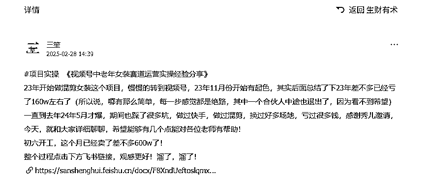
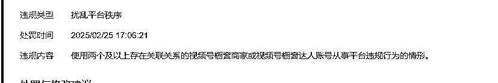
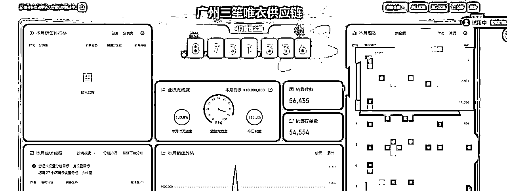
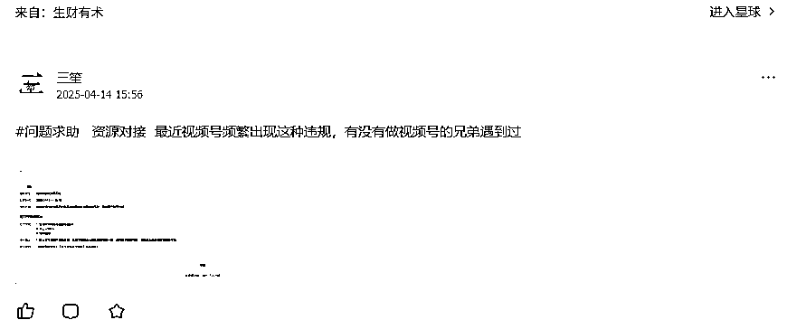
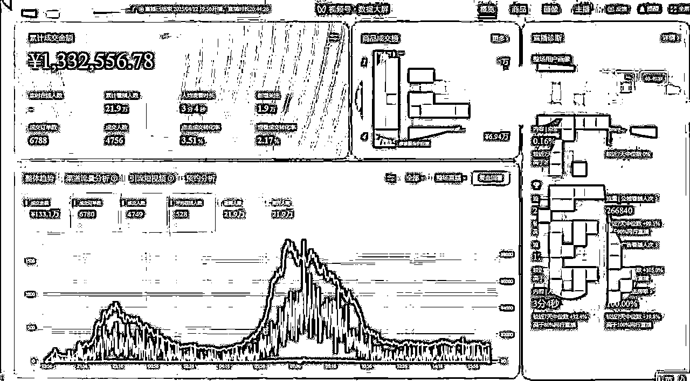
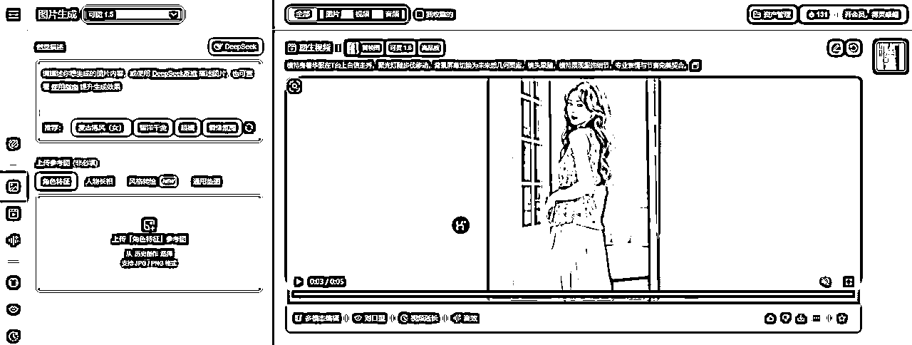
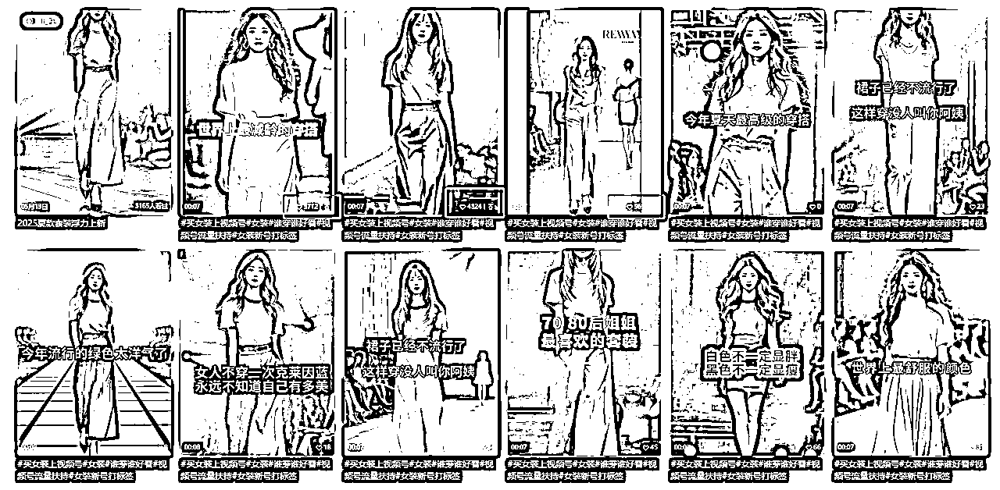

# 视频号+AI(一个月销售额做到1000w）
在短视频带货的圈子里，想让同行主动来找你，最直接的办法就是亮出自己——你做了什么、正在做什么。只有被人看见，才会产生链接，链接背后就是资源，就是机会。这也是我今天写下这篇分享的原因。
先简单聊聊我自己。我是龙哥，在赚钱这个圈子待了7年。说实话，这几年圈子里的牛人越来越多，我反而越来越不敢动笔了，总怕写出来的东西不够硬核，再加上文笔本来就一般，分享的频率也就低了。
我的业务，说穿了还是店群那套逻辑，只是从“店铺端”转到了“账号端”，本质上依然是矩阵运营。之前那篇《中老年女装赛道：从亏损160w到月销600w的逆袭之路》讲了前半段故事，现在三个月过去了，续篇来了。

不废话，直接讲干货。
2月份算是开了个好头，月销600w，美滋滋。但紧接着3月份就是电商圈的“黑暗时刻”——视频号生态被一堆玩短引的兄弟搞乱了，平台顺势在315前后做了一轮大清洗，结果就是大规模关联违规：法人关联、店铺关联、管理员关联，各种连锁反应。整个3月几乎没法看，从3月8号开始就断流，直播间根本不敢开，但团队的工资还得照发。

只翻到一张违规截图，时间隔得有点久。
直到3月29号流量才慢慢回来，数据重新有了动静。整个3月只做了200w，惨不忍睹。
4月份流量全面恢复，大家铆足劲干，一个月冲到1000w。中间也有过违规提醒，但调整之后影响不大。

当时还在赚钱发了个求助帖，毕竟做视频号女装这个圈子太小了，我平常也少对外交流，基本是自己闷头干。服装类目嘛，狗看了都摇头，想找人聊也聊不到一块去。

4月13号来了个大爆发，单账号当天自然流做到130w+，一分钱广告费没花。

唠叨完了，直接上实操和我的一些思考，希望对大家有帮助。
我们前端布局了500多个视频号账号，打法很简单：批量做短视频，批量发，用内容去撬动流量。一旦某个视频爆了，立刻开播承接。整个4月我们把一套模板跑通，然后就直接批量复制。
所有视频素材全是AI生成，然后混剪发布。
# 短视频+AI，业绩直接翻倍
上面的流程图就是我们的全部工作流，重复做、反复做就行了。只要测出一套能跑的模板，那就全员套用。

下面这些账号数据就是我们的日常，基本属于“无脑照做”就能出结果的状态。套路一旦清晰，马上就能落地。

不太会写文章，直接给大家做了个视频。
记住：复杂的事没法批量复制，能批量做的视频绝不复杂。
其余的，跟我上一篇写的没有本质区别。我们只是看到了这套模板，然后直接复制、模仿、照抄，全员按这个路数执行，真没想那么多。别人能卖爆，我们照着来也不会差。服装生意核心就是款式，别人已经测出爆款了，跟款就行。
# 结语
6月7日，广州赚钱航海家新流量大会，我希望能遇到更多做视频号的朋友，互相碰撞思路。女装能做业绩，但利润实在太薄，如果你们是做私域的团队，也欢迎来聊聊。中老年女装背后的用户群体非常优质，值得深挖更多价值——这正是我们现在欠缺的部分。
赚钱的兄弟们，你们不是做不了，是没把目光放在这里。对你们来说，一旦进场，真是降维打击这个行业。