# 论文代写被团灭之后：我从几十块的碎单做起，把工作室从归零拉回月入五万

我叫浩然，一个靠“帮人写字”吃饭的创业者。计算机科班出身，2024年组了支小团队做在线写作服务。巅峰时一个月十万进账，低谷时收入一夜清零。现在，我们在完全合规的前提下，月纯利稳定在3到5万。

如果你也在做服务型生意、知识付费，或任何靠技能交付的业务，这篇文章值得你读完。

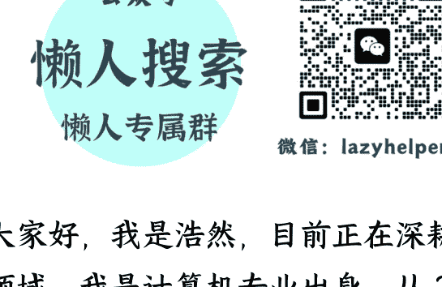

本文所有数据与截图均为真实记录。

## 01 从云端坠落的那个秋天

2025年秋天之前，我的商业模式堪称“傻瓜式印钞”：闲鱼发帖、小红书聚客、客服居中对接、外包写手交付、我们吃差价。品类极其单一——论文代写，客单价几百到上万，利润率40%到60%，月营收轻松破六位数。

但今天回过头看，那是一门没有护城河的生意，靠的是平台红利和政策空子。四个隐患从一开始就埋在那里。

第一个隐患是品类病。收入长在一根藤上，藤断了，一切归零。第二个隐患是写手军团不受控，我们倾尽心力培养的人，翅膀一硬就绕过工作室私接订单。第三个隐患是护城河为零，本质上就是个中间商，信息差人人可复制。第四个隐患是节奏过山车——开学季、毕业季、期末周忙到手软，寒暑假冷清到让人发慌。

直到2025年下半年，国家重拳整治学术不端，平台同步封锁学术类内容。我的获客系统一夜之间全部瘫痪。

两条路摆在面前：一条是换个马甲继续赌，赌监管追不到头上；另一条是连根拔起，去阳光底下重新找方向。

我选了后者。跟道德洁癖无关，纯粹是被现实教育后的商业判断：政策只会越收越紧，风险收益比早已不值得赌。与其提心吊胆赚快钱，不如把力气花在能长期运转的赛道上。

## 02 向几十块钱的碎单低头

转型后的第一个决定，是去接以前看都看不上的“碎单”。几十块到一两百块的需求：简历润色、工作总结、述职汇报、公文代笔、情侣情书……这是我们翻遍聊天记录后，用AI归纳出来的高频方向。

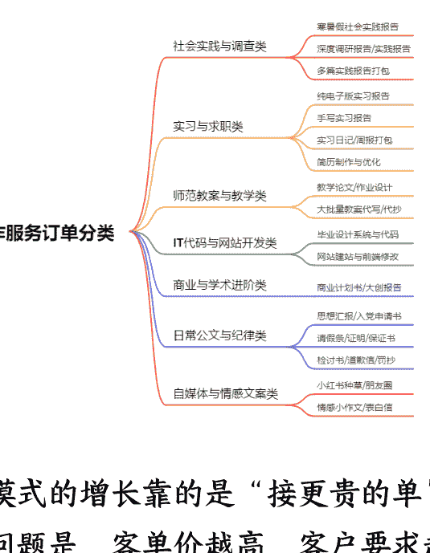

当初多少有点放不下面子，直到我开始认真算账，才看清大单模式其实是个陷阱。

大单的逻辑是“卖得更贵”。客单价越高，客户预期越高，修改次数越多，交付越依赖那个最厉害作者的个人能力。换句话说，你最强的人就是公司的天花板，这是线性增长，连上限都写在墙上了。

碎单的逻辑是“扩产能”。活虽然小，但结构固定、标准清晰，一个新人照着SOP跑两天就能上手。要增长，加人就行。这种增长才有复利可言。

跑了一两个月数据，我彻底服了。碎单在几个维度上把大单按在地上摩擦：

修改率低到能忽略。大单客户把你磨到崩溃，碎单客户付了钱拿货就走，售后几乎为零。

交付效率高到可怕。论文要磨一两周，简历两小时搞定，同样一天时间，产出根本不在一个数量级。

需求池深不见底。职场人年年写总结，求职者天天改简历，完全免疫政策波动。

最关键的，可标准化。论文千篇千面，简历和总结模板高度统一。标准化意味着两件事：AI能介入提速，SOP能批量育人。这才是规模化的地基。

数字是最有说服力的。2026年1月，工作室总流水4.95万元；2月做到6.81万元；3月刚到8号，已经收了近3万元。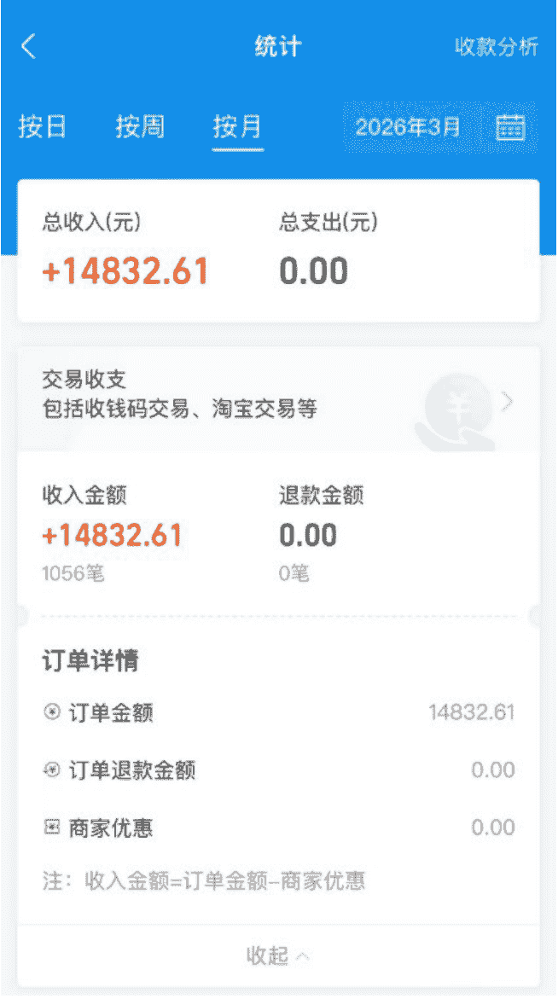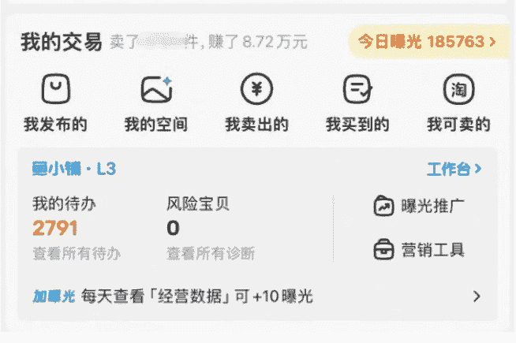

那段时间的账单有个很有意思的特征：一天三五十笔，一笔几十块，又碎又密，像沙子一样铺满整个盘子。这种收入结构反而稳得要命。

成本端：写手稿费加客服工资，占流水的三成。纯利每月落在3到5万之间，旺季还能往上探一探。

和过去月入十万相比，绝对值确实缩水了，但这中间隔着三个本质差异。其一，每一笔都干干净净，再也不用担心风向突变。其二，成千上万笔碎单汇成的川流，远比三五张大单结实。其三，流水线的复制路径明明白白，加人即可增产。

组织也跟着纤体。核心班底仅剩三人：一位运营总控，两位客服全流程跟进。写手端反而扩容到上百人，全部兼职、按单结账。以前围着几个“高手”团团转，现在流程标准化了，谁都能顶上，管理反而更轻松。

## 03 闲鱼流量，我们是怎么打穿的

很多人问我，被平台封过一次之后，客户从哪儿来？

答案是闲鱼。

这一年，我们在闲鱼上蹚过不少坑，交过不少学费，才攒出下面的方法论。

首先，闲鱼的流量时代早就变了。随便发帖就有曝光的好日子已经到头，想稳定获客，必须把“擦亮”和“付费投放”当成一套系统工程来设计，而不是想起来就随手点一下。

选类目靠数据，不靠直觉。我们常用生意参谋、灰豚、巨量算数看热搜关键词，锁定赛道后拿三五个账号赛马测试，能自己跑出单的类目才是真金。

但别急着撒钱。新链接没有自然流量，投流基本等于泼水。等到链接能自己出单了，再考虑放大投放。

怎么催生自然流量？两个开关。

第一个是封面图。用户划到你的页面，第一眼只有封面和标题。你的图必须在一堆平淡无奇的封面里，用大字、高亮色瞬间勾住视线，让人不假思索就点进来。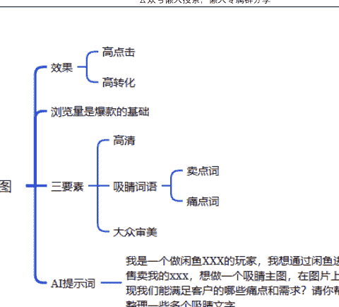

第二个是关键词。标题前五个字要打到命门上：“润色修改”“演讲稿代写”“PPT美化”，越直给越好。

自动回复同样不能含糊。擦亮带来的访客情绪很急，没有秒回的保障，客户转头就溜了。

写文案也有三个心法，换到哪个平台都成立：

第一，说人话。“PPT两小时出稿”永远比“PPT制作”更有力量。第二，给确定感。说“纯人工”，别让用户猜来猜去。第三，少堆形容词，多上动词。

擦亮的投放策略也有讲究。

时段上，避开凌晨，瞄准上午10点到11点、下午3点半到8点半的黄金窗口。

节奏上，小额快测。先投最低档试探数据，半小时内点赞、“想要”、私信肉眼可见地涨，再加码追投。

新老链接要分灶吃饭。新链接从曝光起步，让系统快速打标签、攒初始数据；曝光有了基础，再转投浏览，刺激点击率；点击率和停留时长稳住之后，最后投咨询收割转化。顺序一旦搞反，不是白烧钱就是链接废掉。老链接有销量和评价垫底，直接投咨询，ROI最漂亮，平时定期擦亮维持活跃度，别让它沉到底。

## 04 把AI请进管理层

转型后最得意的一手，不是用了什么高级的AI写稿工具，而是把AI放到了“监工”的位置。

每天，我们把所有客服的聊天记录导出来，交给AI做系统化分析，产出一份“团队服务质检日报”。打分维度有五个：响应速度、需求确认、报价规范、沟通技巧、流程遵从，每项20分，满分100。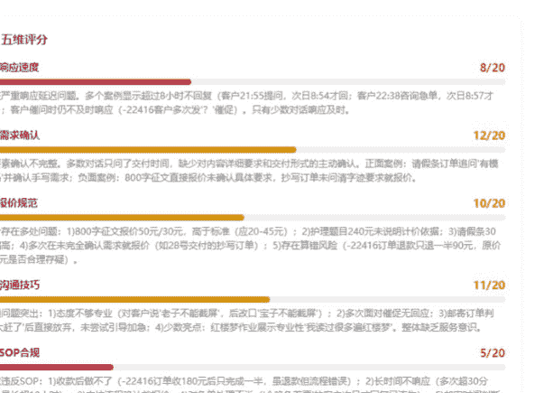

这比人盯人好用太多。AI会把每个问题定位到具体哪条消息、几点几分，再按P0到P2排出优先级，每条整改建议都附带预期的产出效果。

几个经典案例，我详细说说。

第一个：响应太慢，客户跑了。有客服深夜十点多没回一位急单客户的询问，第二天早晨客户已经另找了别家。AI给出的方案是：5分钟未回复自动提醒，急单1分钟内必须回应，夜间咨询最迟30分钟回复或说明次日处理时间。只此一项，预估成交率提升20%到30%。

第二个：接了做不完的活。一位客服收了180元、12篇作文的单，结果只完成一部分，居然问客户“退一半行吗”。AI的判词一针见血：接单之前先掂量能力，没把握的坚决不收款；真收不了尾，就全额退，不要讨价还价。

第三个：一句话毁了品牌。客服一着急甩出一句“老子不能截屏”，虽然马上改口，AI依然把它记进了报告，推动我们连夜建立了标准话术库和禁用词清单。

第四个：乱报价。800字的征文，客服开口要价50元，超出标准价近一倍。AI立了一条规矩：报价前必须确认三要素——内容、时间、形式，价格按SOP标准执行。

第五个：错判工期。客户要求28号前在成都完成手写邮寄，客服26号就判断“肯定来不及”而放弃订单，实际上用顺丰发成都，两天时效完全足够。AI据此推动做了个“邮费时效计算器”，输入城市和交付日，自动判断能不能接。

这套系统每天都在跑。每个客服每周都有一份趋势曲线，是升是降一目了然。哪里出问题、该怎么修，AI把方案摆在桌面上，我要做的只是批准或否决。

海量聊天记录被AI啃透之后，我们还提炼出一本完整的客服SOP手册，把所有动作钉上准星：首次响应、需求梳理、可行性评估、报价、确认收款、派单执行、交付验收、售后跟进，环环相扣。

手册扉页写着一句话：先摸清需求，再谈价格，绝不劈头就问“多少钱”；接不了的活，第一时间讲明，绝不拖着客户。

## 写在过山车之后

回望这两年的起落，我最想分享的一句话是：

商业最大的风险，往往不是同行竞争，而是你站的赛道某天突然被规则清空。

但我感谢那场风暴。它逼我放下了对大单的执念，找到了小而稳、稳而可复制的活法；也逼我把AI从“写手”的位置提拔到了“管理者”的位置，把交付真正做成了系统。

如果你正在技能变现的路上摸索，希望这篇复盘能给你一点启发。觉得有用，点个在看，转给同样在路上的朋友。评论区聊聊你踩过的坑，我会一条条看完。

我经营过一家以文字服务为主的工作室，收入曾冲到每月十万元，也经历过几乎没有进账的低谷。如今，凭着一套逐步验证的运营方法，月收益稳定在三万至五万元。下面这份复盘，来自真实经营过程中的试错和数据，而不是纸上谈兵。

### 先把接单底线立起来

钱收了，就要对委托负责：尽力按约定完成；确实无法履约时，当日把款项退回。沟通内容也应留存文字凭证，对能力范围外的要求不要轻易答应。

正式确认委托之前，至少把三类事项核实清楚：

- **任务细节**：具体要完成什么、篇幅多长，是否有范本、附件或其他规范。

- **时间与送达**：最晚何时需要，采用线上发送还是实体寄送，收件地点在哪里。

- **成品形态**：文件、照片，还是手写后邮寄；纸张和版式有无指定。

手写邮寄单尤其要谨慎。先核对物流预计耗时，并给运输留出三天左右的余量。实际沟通中，不少取消委托的情况，都与期限、收件地址未在开始前确认有关。

这些流程不是主观设定的。我们让 AI 整理客服对话和流失记录，再据此归纳问题。分析结果显示，拒单首因是期限过于紧迫，占37.3%；邮寄无法赶上占15.5%；客服响应迟缓占12.4%；报价超过预算占11.2%；客户转而自行处理占9.3%；接单后因人手不够而退款占7.5%；需求超出服务范围占5%；成品质量引发不满占1.9%。由此可见，流失并不只发生在成稿环节，接单能力、响应速度和物流安排同样影响成交。

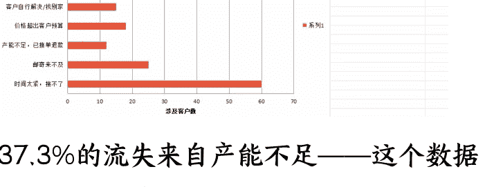

### 按问题轻重安排改进

近四成潜在订单因无法承接而流失，因此补足供给能力成为最紧迫的任务。我们扩大写手来源、按能力划分层级，并为每日订单量设置上限，避免接下超出负荷的工作。

客服方面，采取轮班方式，争取在15分钟内首次回应，并通过预设消息收集需求。报价方面，建立统一价格参考：距截止不足24小时加收50%，不足48小时加收30%，大批量委托则按数量设置优惠。对于物流不确定性，优先推荐文件或照片形式；必须寄送时，提前留出运输时间，也可在重点地区寻找本地配送资源。

订单容易遗漏，就用编号、进度和跟踪记录管理；成品发出前安排检查。若收入过度集中于假期作业，则逐步增加简历、论文等常年需求，并尝试服务企业客户。为提升付款信任度，可以提供闲鱼担保交易；较大金额的委托可采用先付一部分、完成后结清的方式。

经营团队不该仅凭印象判断症结。把问题拆成可记录的指标，才能看清该先改什么，以及改动是否有效。

### 把新人培养纳入生产流程

我们曾把希望寄托在招来就能上手的成熟写手身上，结果发现外部人员筛选费时、沟通成本高，交稿速度和质量也难以统一。后来，经营重点转向内部培养，把常见任务整理成清晰的操作规范。

简历、工作总结、幻灯片和公文等业务，都将从接需求到完成成品的步骤逐项说明：工具如何选、范本怎么用、哪些地方必须检查。新人按流程练习，不必完全依赖个人摸索。

完成学习后，先安排难度较低、金额较小的委托，由客服把关。试做阶段即使遇到客户取消，工作室仍会按约结算基础稿酬，减少新人承担的试错风险。表现稳定后，再逐渐安排更高价值的任务。优秀成员可以成为签约合作伙伴，取得更高分成，并参与新业务流程的设计。

我们还设置了经验分享奖励：写手把有效做法和典型案例整理出来，投稿被采用后即可获得红包。这样既增加了个人收入，也让内部规范不断吸收一线经验。

这套安排将学习与实际服务连在一起：新人在真实任务中提升能力，工作室则获得更稳定的供给。新成员达到可独立操作的时间，也从原先的3至7天压缩到了1至3天。

### 用本地协作应对手写件的时效难题

流失原因中，邮寄赶不上位列第二，问题多集中在手写材料。客户要求紧，物流时间却很难保证。我们的做法是在闲鱼按地区寻找本地抄写人员：委托人所在城市有合适人选，就安排当地合作方完成，再由对方当面交付或使用同城配送。工作室负责协调和分派，从中获得服务差价。

筛选合作人时，不能只看帖子标注的地点，还要核验账号的 IP 地区。例如，页面看似来自广州，账号实际显示在四川，就不符合广州本地需求，应当排除。

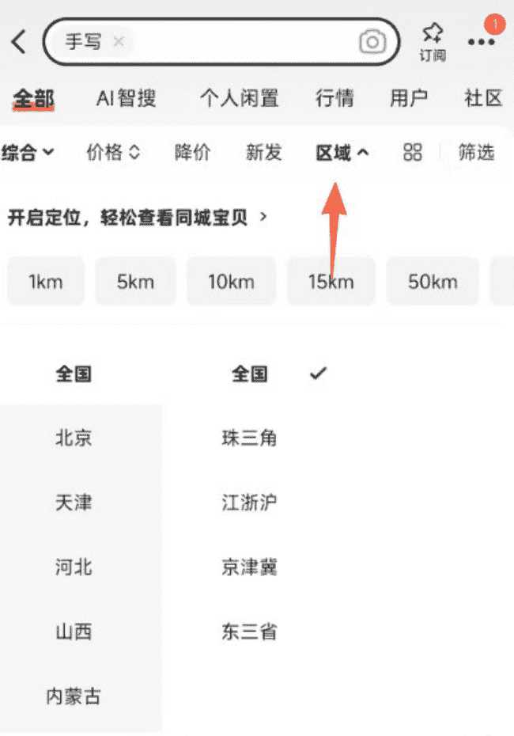

这项尝试解决了部分紧急订单的配送难题，也让我们逐渐在多个城市积累起本地合作人选。

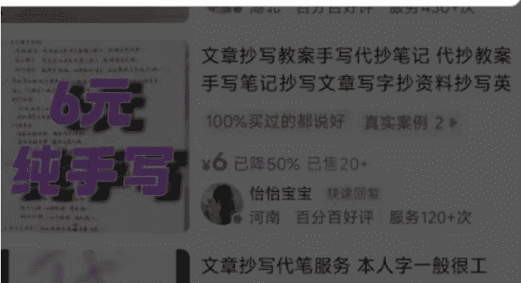

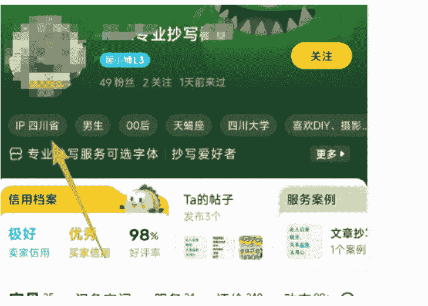

### 从常规小单延伸到技术服务

小额委托能支撑日常经营，但收入空间有限。基本业务稳定后，我开始寻找更有价值的方向。我有计算机专业背景，接单过程中注意到一些技术需求长期存在，而能承接的服务方不多，例如计算机毕业项目、WordPress 网站搭建、独立电商站、数据处理和 Python 自动化脚本。

这类项目价格往往较高，从数千元到万元不等；普通文字团队较难进入，因此竞争相对有限。由于许多需求建立在相对固定的技术框架上，也有机会整理成可重复执行的流程，同时客户再次委托和介绍新客户的可能性较高。眼下最需要解决的，仍是技术人才储备不足。具备计算机或相关技能、愿意尝试协作的朋友，欢迎交流。

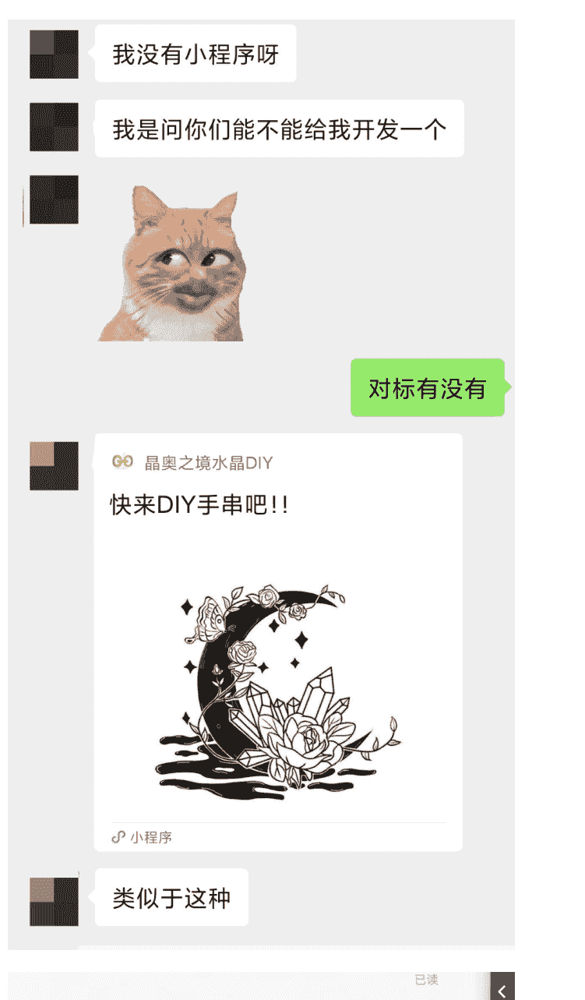

### 把日常经验沉淀成数字商品

承接大量委托，也让我们拥有了持续的需求观察窗口：客户常问哪些问题、偏爱什么格式、哪些表达更符合行业习惯，都留在过往的服务记录中。把这些实践经验整理成模板，就能形成可单独售卖的数字商品。

以求职材料为例，与其只做一份通用版本，不如围绕不同岗位和求职情境开发内容，例如计算机岗位、销售岗位、国企招聘、银行校招和公务员考试等。工作总结可按行政、技术、销售或管理岗位区分；述职材料、汇报幻灯片、公文以及入党申请相关材料，也可以继续细分，形成多个实用版本。

数字商品完成后可反复销售，后续维护成本相对低。前端可以在小红书、闲鱼展示模板，吸引有需求的人；需要进一步调整的买家，则可以转为定制服务客户。对工作室来说，这相当于让已有的服务经验拥有了另一种销售方式。

### 从单点中介转向协作网络

经营半年多后，我对工作室的理解发生了变化：与其事事亲力亲为，不如搭建一套让不同角色共同参与的协作体系。

单纯做中介，寻找人员、检查质量、获取客户和处理客服，都集中在少数人身上，能做多大取决于个人精力。新的组织思路则分为三个环节：

**获客环节**负责内容传播、渠道运营和客户转化。团队主要投入在流量获取，并培训客服做好咨询与成交衔接。

**规范研发环节**由各领域有经验的写手或外部内容创作者参与。他们负责更新操作标准、审核新成员的成品，并通过培训内容分成和审核管理服务获得收入。

**实际服务环节**由经过训练的写手承担，按任务结算。表现突出的成员也可以参与流程研发，进入更高层次的合作。

三部分相互推动：渠道带来需求，合作成员完成任务，执行中的问题促使流程改进；更完善的规范有助于培养更多合格人员，新的供给又能接住更多客户。团队只需把握获客和客服转化等关键工作，其余环节可以交由合作伙伴共同完成。

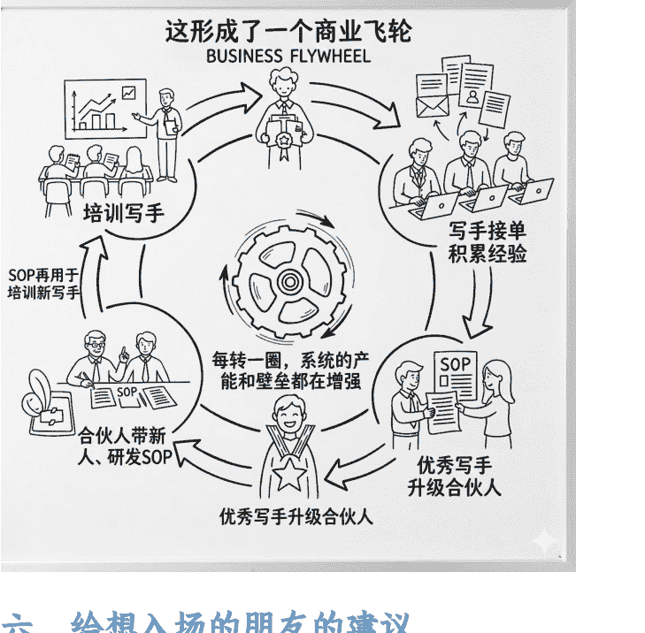

### 给准备尝试的人几点建议

1. **先从熟悉的一类服务开始。** 不要一上来就铺开很多方向。没有明确专长，可以选择演讲稿、读书笔记或简历修改等较简单的任务，独立走完发布、沟通、成交和完成全过程。若有设计、计算机等背景，则可以从相关领域切入。

2. **现金投入不高，但需要留出测试时间。** 初期不一定要租场地或招人，电脑和平台账号就可以开始。前两周更适合测试不同服务页面、图片和介绍方式，找到有稳定咨询的方向，不必急着追求收益。

3. **把 AI 当助手，而不是替代判断的工具。** 对任务本身缺乏理解，即使生成内容看起来流畅，也可能不符合实际要求。可以先借助 AI 整理初稿，再结合专业常识、客户意见和修改反馈完善。每次返工都能帮助自己了解标准、提升能力。

4. **从一开始就记录经营情况。** 每天的咨询数、成交数、平均订单金额和未成交缘由，都可以记在表格或手机里。持续记录一段时间后，往往能发现原先没留意的规律：咨询高峰在哪、什么介绍更有效、客户为何放弃。有时表面上像是价格问题，真正原因却可能是回复太慢。

5. **合理设定收入预期。** 根据我们的经营记录，稳定运作后每月三千至五千元是较实际的目标。有明确专业能力的人，进入技术、设计等高价值领域后，收入空间可能更大。

### AI改变生产方式，但没有抹去客户需求

不少人担心 AI 会让文字服务失去价值，我的看法相反：工具改变了生产成本和竞争方式，却没有消除客户希望解决问题的需求。

首先，客户需要的不是孤立的一段文字，而是能直接使用、满足具体目的的成果。理解诉求、拆分任务、确定方向、整理格式和检查质量，都在生成初稿之外。许多客户并不熟悉这些环节，也不想投入时间自己完成。

其次，工具本身很难形成长期优势。大家都可以接触 ChatGPT、Claude 或 DeepSeek，差异在于能否写好提示、设计清晰流程、设置有效检查标准，以及建立可靠的人员合作网络。这些能力需要在实践中逐步形成。

再次，AI能够提高生产效率。过去写手一天或许只能完成两三篇较完整的稿件，现在借助工具处理小型任务，日产量有机会达到十余单，效率约提升五到十倍。相同的人力因此可以服务更多客户。

最后，客户愿意付费的原因并未改变，只是期待从“有人代写”转为“有人快速、可靠地帮我完成”。省下时间、得到合格成果、少操心，始终是核心价值。

因此，这个领域更像是在更新生产方式：从依赖个人手工劳动，走向有规范、有检查、有工具配合的服务体系。只靠增加人力和工时的团队会承受压力，及早完成流程升级的一方更有机会取得优势。

### 这套经营方式的底层结构

回头看，我们逐渐形成的体系主要由三部分构成：

- **流程可复制**：把个人经验整理成规范步骤，让新人经过学习也能执行。

- **培养与实际服务联动**：新人通过学习进入真实任务，任务中发现的问题再用于改进教学和规范。

- **伙伴共同成长**：写手不仅是被安排任务的人，也可以逐渐参与流程完善，并获得相应的成长与收益机会。

这种结构并不限于文字服务。设计团队可以整理 Canva、Midjourney 等工具的使用规范，培养设计人员并承接项目；短视频运营可以把剪辑、脚本和投放环节整理成流程，再培养运营人员；电商客服外包也能将常用答复、投诉处理和 AI 协助流程标准化。只要技能可以拆解和传授，就有机会形成“学习—实践—改进”的增长循环，而 AI 会进一步提升运行速度。

从月收入十万元跌到几乎归零，再回到每月三至五万元，账面数字看起来缩水了，但经营结构比过去稳健得多。过程中，我逐渐确认了几点：

- 可长期经营、合规的收入，比短期灰色收益更值得追求。

- 小额任务并不意味着价值低。流程清楚、修改少、需求稳定的服务，可能比高价但难以控制的项目更适合持续经营。

- 问题不一定出在获客端，供给不足同样可能限制增长；数据能帮助找到真正的短板。

- 培训和服务执行联动，比各自孤立运作更容易积累能力。

- 从赚取信息差的中间环节，转向搭建协作体系，是小团队扩大规模的重要变化。

工作室仍在探索技术服务和新的合作方式，很多细节还需继续验证，但方向已逐渐清晰。

平台规则会调整，市场环境会变，客户需求也会更新；真正值得长期投入的，是把一项业务梳理成稳定流程、持续改进的能力。

看完一套流程，并不代表马上就能上手。许多人真正遇到的障碍，是迟迟没有开始实践，也难以接触到一线经营信息。

最新实操记录可在这里查看：

