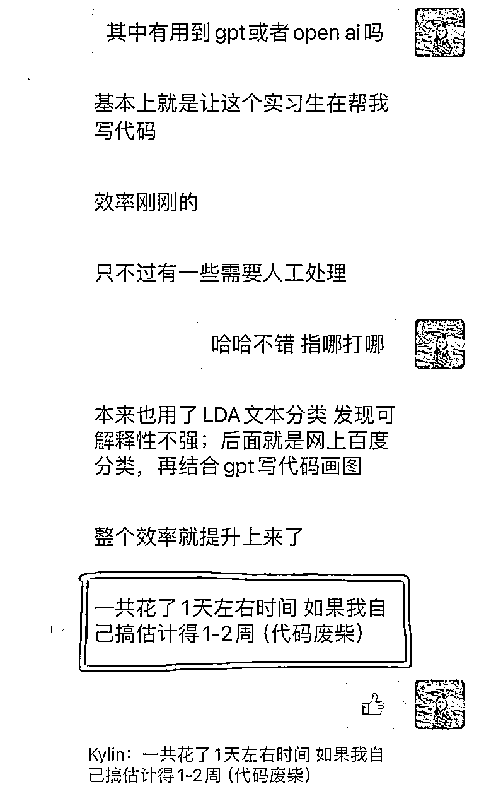
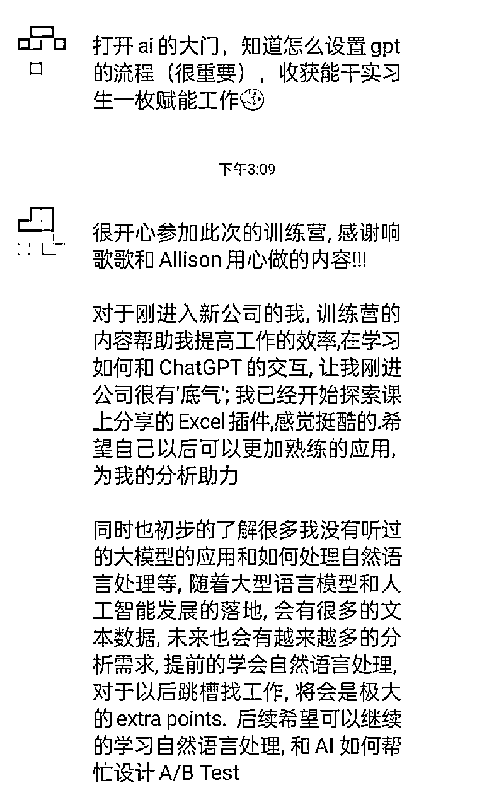

# 赚钱第一单：用AI+数据分析知识付费，两个月到5万
作者：龙哥

各位好，我是龙哥。入局赚钱后做的第一笔正经生意，算是成功收官了。金额不算大，在场的大佬们可能看不上，但对我而言意义完全不一样，这是我第一次真正面向市场做一件事，从无到有跑通了整个商业闭环。

现在心里有个小目标，想靠三件事实现十倍放大：做大流量池、迭代新品类、切入海外市场。希望三个月后，能带着50万的成绩单再回来复盘。

# 为什么我决定下海搞副业

前三十年我活得很标准：二线小城出生，父母都是工人。耳濡目染的信条就是考个好大学、进个稳定单位、安稳过一生。我照做就好，从初中保送重点高中，到985本科，再到美国读研，毕业后跳了几家公司，最后落在硅谷大厂，薪水可观、福利拉满，一切看起来都很顺。

直到有一天我突然不想再往上爬了。

四年大厂螺丝钉生涯，让我很难获得真实掌控感。项目再多，我也只是成熟体系里的一颗小齿轮，改变不了产品方向，也看不到用户因为我多得到什么价值。做数据分析，常年坐副驾给人出主意，却没机会体验决策落地后的冲击感。内耗本就够难受，叠加上经济周期下行、公司裁员，我的老板和两个手下被一刀切走，只剩我这种能干活又便宜的老黄牛。那一刻我才明白，再缜密的职业规划，也可能一夜归零。

我想要一件更直接面对市场、自己能说了算的事。从那时起我一直在找方向，摩洛哥旅行时还在调研当地留学的中国市场，点子库里塞满了想法，却一直卡在“准备再准备”的状态。直到我接触到赚钱，和几位真实变现的互联网创作者交流，才看清赚钱是可以被拆解执行的，而且真正赚钱的人，核心差别就是快。

于是我决定先干起来，再边跑边调。

# 做课这个念头是怎么来的

2021年初我就在小红书发数据分析相关的干货，昵称响歌歌。当时平台什么内容都吃，只要发就有流量，我6千粉时就停手了，没意识到这是一个正在起飞的赛道。直到最近才重启账号，连续更新后粉丝破万。

ChatGPT出来后，私信开始暴增，都是数据人问我AI会不会取代我们，接下来该怎么应对。我的工作从去年7月起就主导一个大模型Agent项目，在硅谷也长期接触AI应用，对这块的理解比普通从业者深一些。去年下半年我试用了上百款AI数据分析工具，也常被创始团队和投资人约着评测产品。慢慢意识到，AI+数据分析这个交叉点，我是有话语权的。

基于这个判断，我做了几期相关内容，数据不错。灵感就出来了：不如做一个《AI赋能数据分析师训练营》，既帮同行解决职场焦虑，也给我自己一次从0到1操练商业的机会。

# 先验证，再做产品

想法落地前，我找了两位伙伴一起做最小可行性验证。一位是国内头部大厂出身后来做个人IP的数据经理，另一位是同样有资源的朋友。我们决定先办一场AI圆桌，议题是AI对数据分析职业的影响及工作赋能。

筹备数周后海报上线，报名很踊跃，最后超过一百人。门票定在9.9，主要是用付费门槛筛人。感谢那位博主把她的私域导了大半进来，现场转化出了几个种子学员。

圆桌效果超出预期，直播互动很热烈。结尾我预告了后续训练营的计划，当场就有同学表示想报名，还给出了很多做课建议。我们采纳了其中一个点子，把课程做成实战项目制，带学员用真实案例看AI如何重塑数据分析流程。

# 拿着大纲就敢卖

圆桌结束后，我们迅速把大纲做出来，并用共创的方式让潜在用户参与选课。放出5个实战方向投票，选票最高的3个进入开发。投票过程让参与感拉满，群里讨论很活跃，最后投过票的十几个人基本都转化成了首期学员。共创这个打法从此成了我们迭代课程的常规动作。

这段路我深深受益于赚钱上的前辈经验，尤其是三位老师。

突围一只鹰的文章

梁靠谱谱神的几篇帖子

根源老师的长文堪称知识付费运营的百科全书，训练营的设计我借鉴了他很多运营打法。

加入赚钱最大的体感是，这件事本来就有解法，而且别人通常已经趟过路了，我们站上去迭代就好。

讲座群大约10%的转化率带来了首批学员。第一期我们没再额外投放公域，因为年底回国结婚，随后又双双生病十几天，时间被课程开发占满，只想把这十几个人的交付做好。

# 第一次交付，粗糙但跑通

考虑到时间紧，我们选择直播交付，避免前期录制。还能实时捕捉学员反馈即时调整。作为一个重度I人，第一次直播我提前对着逐字稿排练了近十遍，上台还是一小时高度紧张。效果还算可以，至少把承诺兑现了。

五周交付期我们是边做边讲，卡着Deadline赶内容，有时也会觉得愧疚，课程打磨度不够。但最后顺利收官，口碑还不错。最让我有成就感的是看到学员反馈：本来一周的活儿，用AI一天就搞定了。这种真实的价值感，是我在大厂四年都没体会到过的。

回头看，完成远比完美重要。正因为这一次闭环被跑通，我们才知道哪里会卡，才有针对性地击穿。课程强调交付，对学员时间要求高，结业作业要求他们挑一个真实工作场景用AI重做一遍。虽然投入大，但反馈非常扎实。我还观察到，学员产出的案例本身就是资产在累积。卖IP一次性的消费不可持续，持续沉淀的案例池才是社群长期留存和复购的密码。

# 第二期招生，才是真考验

以为第一期跑通就能复制，其实第二期招生才是最难的关口。第一期有直播引流和合作博主加持，第二期必须自建流量闭环。主打小红书引流私域再成交。

我账号1万粉，合伙人小红书和B站加起来2万粉，但精准度一般。这是第一次真正用自己的账号变现，挺忐忑的。目标定40人，最后只招到16人，当头一棒，也让我深刻意识到流量盘子不够大。

复盘下来有几个关键点：

私域需要高频维护，两条朋友圈就带来了4个学员，8000块到账。熟人圈的信任背书，比冷流量更容易成交高客单。

时间被严重稀释。第一期结束后的两周要同时更新内容、引流、招生、海报设计等，细节太多。作为还在全职的人，精力明显不够，于是我决定把低价值环节外包，自己只聚焦内容和交付。之前读《精简工作周》里Tim Ferris提到给自己定时薪，外包低于此价值的工作，这句话我现在真的践行了。

内容需要工业化。过去我发视频是三天打渔两天晒网，一个3-5分钟的视频从拍到剪要吞掉一个周末。必须建立一套内容生产流水线，才能稳定输出。

# 用人把时间买回来

明确后我先外包了剪辑和社群运营。剪辑在网上找了几位大学生和机构试剪，选出风格最契合的长期合作。

运营则从首期优秀学员里选了一位做助教。他学习力强、执行力好，正好快毕业还没正式入职，有空有劲一起把训练营推着走。

# 下一步的十倍增长计划

## 1. 把流量做大

流量是漏斗顶端。要扩就得多渠道：持续在公域做短视频和直播引流到私域；做分销和老学员转介绍；尝试与知识付费平台合作；运营免费或低价的社群做蓄水池；多混圈子，露脸共创。

结合我的内容优势，我会把内容引流当基本盘，分销和转介绍做增量，平台合作后期再深入，交流也能帮我看到更成熟的课怎么卖。

## 2. 上新产品

流量起来后需要产品矩阵。首期学员反馈我们讲得太深，受众面窄，建议出一个面向小白的入门课。面向销售、运营、财务等需要数据技能但非专业的用户，客单低、覆盖面广，正好形成进阶路径。

## 3. 出海

我人在美国，课程内容天然适配北美的数据分析师和数据科学家。英文课能抬高客单价，汇率也有优势，而且北美企业普遍有员工教育福利可报销，支付门槛更低。

未来三个月，我会按流量-产品-海外这个顺序推进，去冲那个十倍目标。