# 退伍一年、入赚钱半年：一个零技术基础的小白，如何靠 AI 做到净赚 10 万+
260926 副业 SC 精华
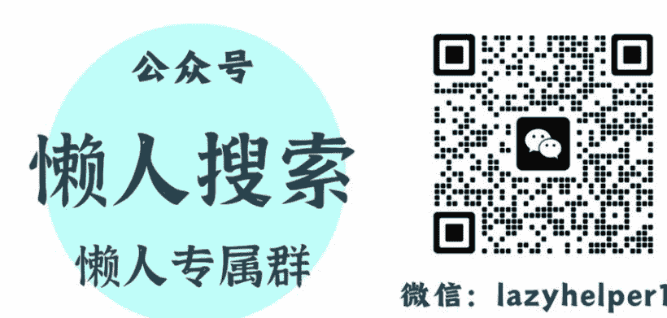
> **小懒判断**｜这是一篇适合“想靠 AI 接单、却没有技术背景”的人阅读的真实复盘。作者退伍后从送外卖起步，加入赚钱半年，靠 5 类业务累计实现 10 万元以上净利润：账号与渠道服务、YouTube 分成、团队网络环境配置、自动化脚本定制，以及一笔 2.2 万元的企业获客系统订单。
>
> 他没有靠某个神秘项目暴富，所有收入都来自帮助别人解决具体问题。最值得参考的，是他的 FDE 思路：不追求从底层研发模型，而是把成熟工具组合起来，针对业务卡点快速交付结果。企业客户真正关心的不是你用了什么模型，而是能不能带来线索、内容和成交。
>
> 当然，账号渠道类业务也有明显风险：售后琐碎、平台规则一变就可能失效。因此，拿到第一笔正反馈可以，但不要长期沉迷，应该尽快把时间投入到可积累、可复用的技能上。
大家好，我是龙哥。
去年 9 月，我从部队退伍，到现在正好一年；加入赚钱，也已经半年。
这篇文章前前后后修改了很久。它既是我退伍一年以来的阶段性总结，也算是一次尽可能完整的经验公开。
正式开始之前，先特别感谢小武老师和七天老师。[首先要特别致谢小武老师和七天老师。](#)
从文章结构，到业务交付过程，再到个人认知复盘，两位老师都给了我很多具体建议。很多原本模糊的经历，在他们的帮助下被重新梳理，才逐渐变成了今天这篇复盘。
目前，我主要承接 AI 落地类外包项目，客户集中在美牙、美业等高客单价行业，具体提供获客系统、内容工作台和自动化流程等服务。同时，我也在尝试独立开发小程序。
过去半年，单靠 AI 相关业务，我的净利润已经超过 10 万元。
可能有人会好奇：一个没有技术背景、刚退伍不久的人，究竟是靠什么把这 10 万元一笔一笔赚到手的？
下面这份拆解，全部按照扣除成本后的实际利润来计算：
- **企业获客系统与外包定制：约 5 万元**
主要为美牙、美业等行业搭建 AI 获客系统，包含一笔已经全额到账的 2.2 万元合同，以及后续的内容工作台、维护和其他正在推进的项目。
- **团队网络配置、批量账号及运维：约 3 万元**
为跨境工作室和自媒体团队提供多账号、多环境隔离方案、独立网络配置，以及长期技术支持。
- **YouTube 广告分成与实战陪跑：约 1.8 万元**
自己跑通了 3 个 YPP 频道，单月广告收益最高预估超过 1000 美元；同时把起号、创收和避坑经验整理后，提供 1 对 1 陪跑服务。
- **自动化脚本与工作流交付：约 1.2 万元**
为创作者和同行开发本地批量出图、视频处理、剪辑辅助等脚本，单笔价格大多在 500～800 元之间，客户主要来自私域和自媒体渠道。
- **早期资料整理与体验渠道：约 1.5 万元**
包括闲鱼、小红书上的双语访谈资料包，以及早期的工具体验资格、轻量化服务等。其中一套定价 6.9 元的资料包，累计成交超过千单。
这半年里，我还花了几万元购买网络节点、调用大模型 API，以及支付即梦、Lovart、GPT、Mac 电脑等工具和设备费用。扣除这些必要支出后，真正留在手里的净利润依然超过 10 万元。
每一笔收入，背后都对应着一次明确的交付，而不是凭空出现的数字。
刚退伍时，我完全没有现在的状态。
那时既没有工作经验，也不懂如何做生意。拿着退役费和战友合伙投资，市场都没研究清楚就匆忙下场，结果不到两个月亏掉了 4 万多元。
之后，我做过健身教练，也跑过美团外卖。炎热天气里骑着车到处送单，一单收入只有三四块钱。
这一年基本就是不断试错、不断调整的过程。最开始我甚至不知道 AI 能做什么，只能到处看帖子、进群、试工具。接过几千元的小单，也碰到过几十万元级别的项目；有做成的，也有搞砸的。最困难的时候，我确实认真想过要不要放弃。
后来回头看，业务似乎有一条很清晰的成长路径，但在当时，我并不知道下一步会走向哪里。
很多新业务，都是在解决上一个问题的过程中自然出现的：
客户买了账号，接着会问网络环境怎么配置；网络配好了，又觉得每天手动出图、下载、剪辑太费时间；于是，自动化流程的需求又出现了。
我就是这样一边交付、一边学习，在一个个具体问题中逐步接触到更复杂的业务。
全文大致分为四个部分，预计阅读时间 10～15 分钟：
1. 退伍后的低谷：合伙亏钱与送外卖；
2. 我尝试过的几类业务：体验渠道、YouTube、账号环境、脚本定制；
3. 第一笔企业订单：如何从提示词培训，谈到 2.2 万元的 AI 获客系统；
4. 过程中踩过的坑，以及后来形成的工作习惯。
先放一张我的日常消耗截图。咱也曾经登上过消耗榜 TOP1。
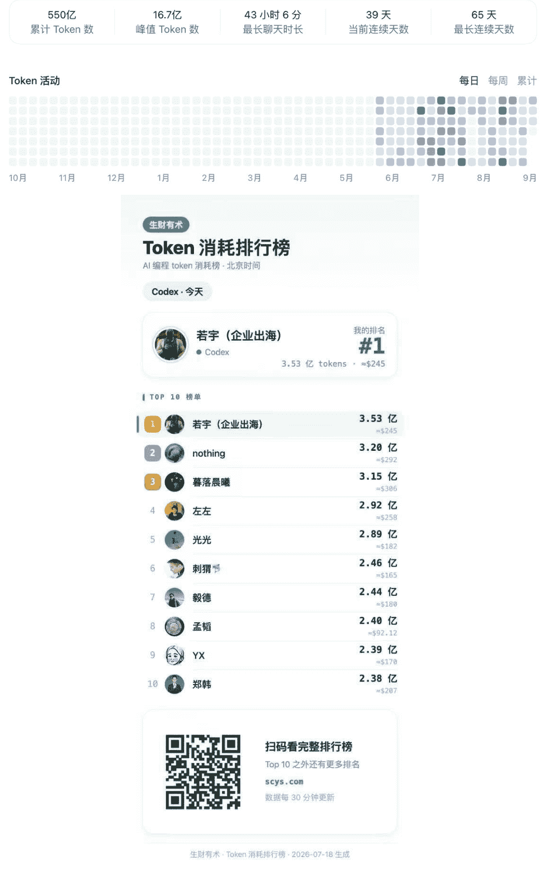

龙哥盟·Token 消耗排行榜·2026-07-18 生成
## 一、退伍后，我先解决“怎么活下去”的问题
### 1.1 部队经历给我留下了什么
2025 年 9 月以前，我在部队服役了两年。
这期间参加过野外集训，做过基层骨干文书，画过黑板报，也代表连队参加比武并拿到过支队第一。曾获得“四有”优秀士兵、军管最美风采等荣誉，相关作品还登上过《人民武警报》。
我也在炊事班做过保障，做过大蛋糕。训练和做饭，都曾在身上留下伤疤。
这些经历看起来和后来做 AI 外包没有直接关系，但真正开始交付之后，我才发现，部队里形成的一些习惯一直在发挥作用：
文档必须写清楚；事情交代出去后要有反馈；别人能不能按照说明完成操作，自己还要再检查一次。
这些看似普通的习惯，后来都变成了我做服务时的基本要求。
#### 若宇的来时路 · 军营两年的多面手与荣誉
> “当过文书，画过板报，参加过比武拿第一；当过炊事班，保障过首长，上过武警报。”
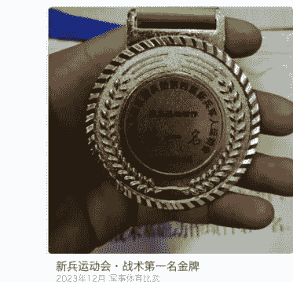
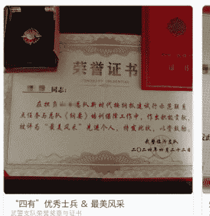
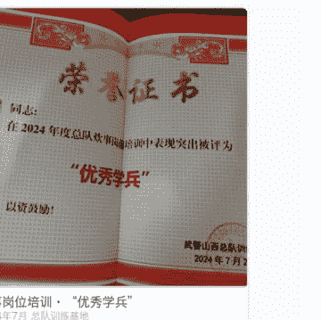
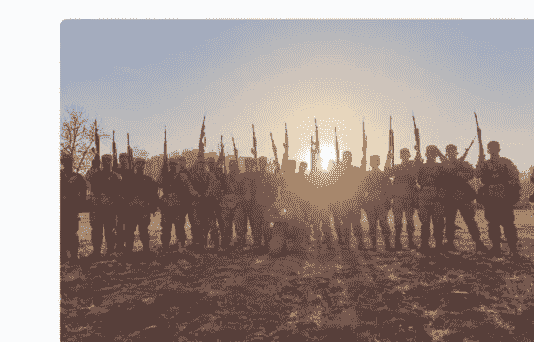
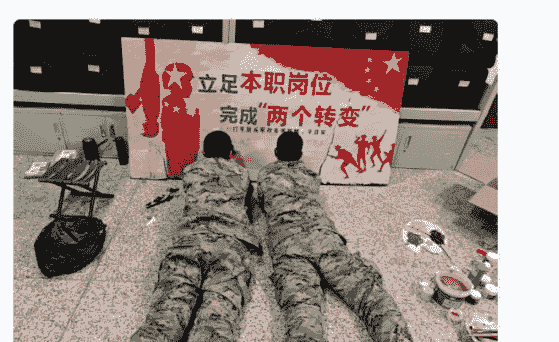


### 1.2 合伙投资失败后，我去送外卖
刚退伍时，我特别想尽快做出一番成绩。
退役费到账后，我和战友合伙投资。因为没有真正了解市场，也没有做好风险评估，短短不到两个月，4 万多元就亏了进去。
钱没了，生活还得继续。
我先做过健身教练，后来又成为外卖骑手，骑着一辆二手电动车穿梭在街头。
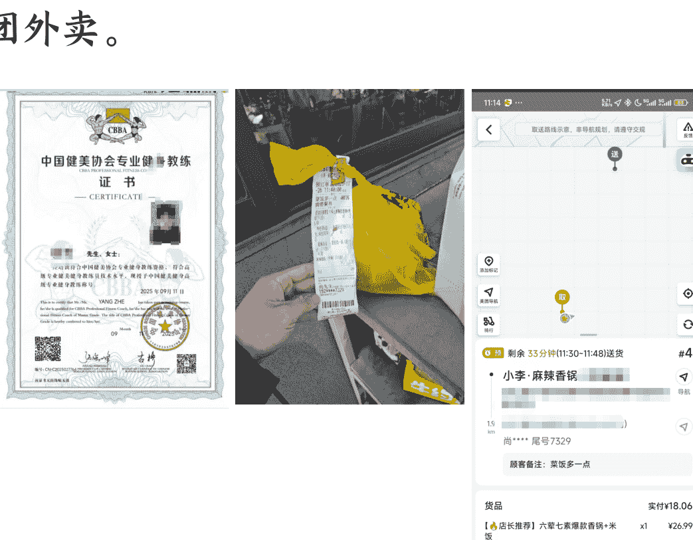
夏天跑单，胳膊被太阳晒到脱皮；爬楼爬多了，腿会不停发抖。手机屏幕上不断跳出“+3.5 元”“+4.2 元”，有时我会停在路边休息，心里反复问自己：
如果一直这样跑下去，到底什么时候才能把亏掉的钱赚回来？
那时，身边已经有人在讨论大模型和出海项目。我听得着急，却不知道自己应该从哪一步开始。
有一次，我在路边看完了罗伯特·清崎的《穷爸爸富爸爸》，复盘时写下了一句话：
“千万不要梭哈。只要还在牌桌上，就不算真正失败；但如果一次性押上所有筹码，甚至背上负债，家庭、生活和精神压力可能会把人彻底压垮。”
之前亏掉 4 万元，本质上是因为刚离开部队，太急于证明自己，连游戏规则都没有摸清，就贸然下注。
送外卖虽然辛苦，但它至少提供了最低限度的现金流，让我能够保住生活，不至于继续透支本金，也让我有机会留在牌桌上寻找下一次机会。
后来，我又读到 Dan Koe 的一句话：
“如果你想得到某种生活结果，就必须在结果出现之前，先过上能够创造这种结果的生活。”
很多人改变几周后就放弃，是因为只是在旧地基上刷了一层新漆。他们靠意志力逼自己早起、逼自己自律，却没有真正改变对自己的定义。
那段时间，我也完成了一次重要的身份切换。
我不再把自己看成“刚退伍就失败、只能靠送外卖维持生活的人”，而是开始把自己定义为：
一个正在学习数字技能，并尝试用 AI 解决现实问题的人。
送完单回到出租屋后，我会看教程、测试工具、搭建工作流。这个过程不再只是苦熬，而是在过一种新身份应该有的生活。
身份发生变化后，每天学一点、试一点，就不再需要反复逼迫自己，而会慢慢变成自然习惯。
#### 人生转折 · 虚荣心被现实击碎后，在泥地里重新开始
退伍后和战友投资亏掉 4 万元，为了生活去借教训、跑外卖。从军营里的高光时刻，到冬日街头不断计算配送倒计时，这段经历让我重新认识了风险、现金流和重新起步。
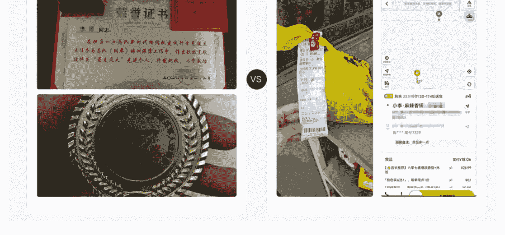
## 二、我尝试过的几类生意
刚开始做 AI 时，我做的事情非常分散。哪里有需求，就先去哪里试。
3 月，经朋友推荐，我参加了一次赚钱的航海家大会，后来正式加入赚钱，也带着身边伙伴一起加入，之后进入新榜 TOP50。
其实，在加入之前，我就通过其他渠道接触过赚钱的资料。很多人可能也见过闲鱼上几块钱一大包的资料，其中偶尔就会出现“龙哥盟”的内容。我当时没有特别重视，只是跟着一些实战教程试过几个项目。
加入之后，我开始认真尝试把一件事情从头到尾做完整。
看到别人已经验证过的教程，我就先照着执行；遇到卡点，再想办法解决。对“以战养战”的理解，我一直比较直接：
先完成一单，拿收入和经验去推动下一单。
### 第一阶段：从体验资格和资料整理开始
刚接触 AI 时，我每天都在群里看各种工具发布。信息越多，反而越不知道自己到底应该做什么。
后来我发现，很多新手连第一步都走不出去：没有工具资格，不知道怎么注册，也不知道账号如何使用。
当时 Sora 很热门，我开始帮别人解决体验资格问题。几天时间赚了几千元，也因此慢慢建立起一个一百多人的交流群。
随后，我又帮用户处理一些海外工具平台的注册、登录和使用问题，也获得了几千元收入。
除了账号渠道，我还在闲鱼和小红书上做资料整理。
比如，我把马斯克一场 3 小时访谈的中英文逐字稿整理出来，用 Markdown 重新排版，制作成电子资料包，再以 6.9 元的价格自动发货。
这一阶段，闲鱼和小红书累计成交超过千单，纯利润超过 1 万元。
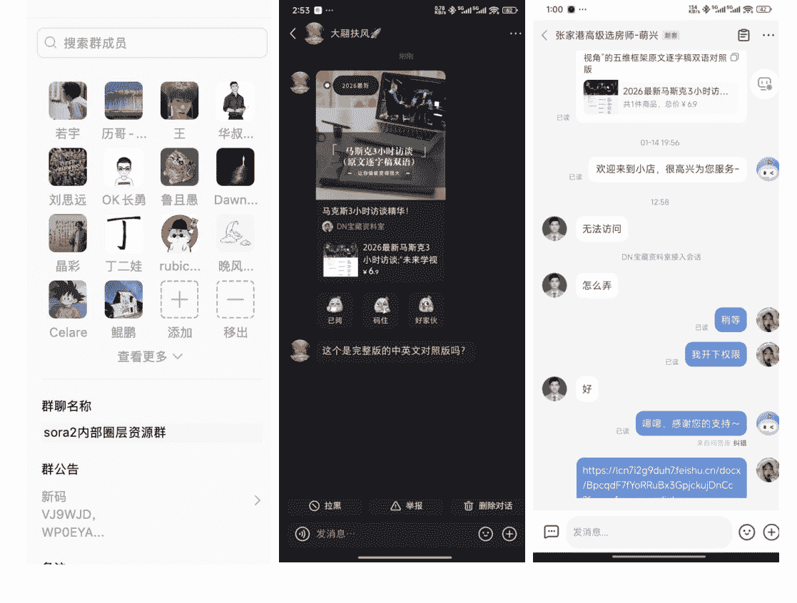
不过，这类业务让我很快认识到：赚钱和轻松是两回事。
账号掉线、密码错误、无法登录、渠道失效，最后都可能变成售后问题。经常需要同时盯着几部手机，不断回复消息、排查故障。
而且，渠道一旦发生变化，前一天还能提供的服务，第二天可能就彻底失效。
所以，这门生意虽然让我拿到了第一笔收入，却没有形成真正的长期积累。
做了一段时间之后，我开始寻找那些能够沉淀经验、下次还能重复利用的事情。
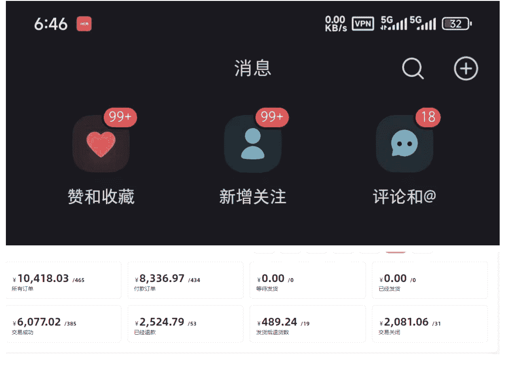
- **当时的真实感受**：刚赚到 1 万多元时，我一度以为赚钱好像也没那么难。但账号掉线、换密、封号等问题很快让我明白，反复处理售后并不等于成长。每天忙着回消息，看似很充实，实际却是在用低水平重复劳动，逃避技能积累。一旦渠道变化，之前的业务很可能立刻归零。
- **给新手的建议**：如果没有本金，想靠这种服务赚到第一笔钱，可以尝试。哪怕先赚到 100 元，也能降低对“搞钱”的恐惧。但一旦获得正反馈，就不要继续恋战，应尽快把时间转向能够产生复利的技能。
### 第二阶段：做 YouTube，并开始陪跑带人
那段时间，我投入了大量精力研究 YouTube。
我购买了阿初的《YouTube 出海手册》，从环境配置、寻找对标账号，到 AI 脚本、剪辑和导出，全部按照教程自己执行。
一个人前后测试了十多个频道，其中有频道用了 29 天开通 YPP，也有频道 14 天就完成了开通。
最终，我跑通了 3 个 YPP 频道。按当时的分类，1 个属于高级频道，2 个属于初级频道，单月广告收益最高预估超过 1000 美元。
其中一条 AI 短视频获得了 **100,471,637 次播放**，带来 4.1 万订阅。后台截图中的预估收入为 **571.06 美元**。
当然，我也经历过失败。
为了提升产量，我曾经过度依赖工具批量生产，却忽略了内容本身。后来先后两次因为“重复内容”或“重复利用内容”被取消创收资格，甚至遇到过新发布的长视频长期 0 播放。
当播放量很高时，人很容易误以为自己已经掌握了平台规律。但被取消创收之后我才发现，之前的一些方法根本不适合长期经营。
后来，我开始小范围提供 YouTube 陪跑服务，收费 600 元，主要分享自己从起号到开通创收的经验，以及中间遇到的问题。
有人直接转账，并称呼我为老师。
但我也很快发现，做自己的频道和教别人做，是两件完全不同的事情。
自己能完成操作，并不代表能把步骤解释清楚；真正的陪跑，还要帮助对方处理具体的账号、内容和平台问题。
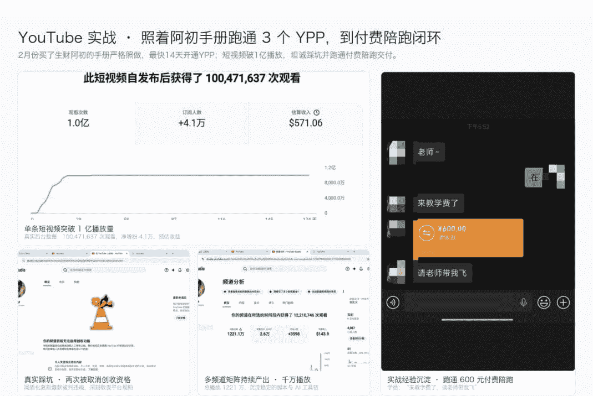
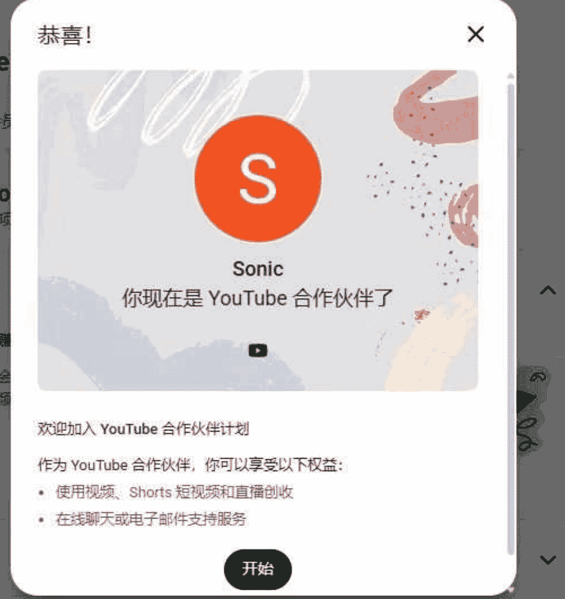
- **给新手的建议**：做自媒体不要一开始就疯狂铺量、追求短期数据。先把一个重点账号做好，反复打磨视频前 3 秒的 Hook、内容节奏和受众痛点。做陪跑时，也要如实讲清楚自己的经验和失败，不要只展示漂亮数据，更不能夸大结果。
### 第三阶段：为团队解决账号和网络环境问题
在做海外视频、陪跑学员的过程中，我接触到了工作室和企业团队。
他们往往需要批量账号，也需要配置稳定的网络环境和多账号隔离方案。更重要的是，账号交付之后，使用过程中还会不断遇到登录、节点和环境问题。
于是，我把批量账号、独立网络节点、多环境隔离配置以及后续维护支持整合成一套服务。
客户不用再分别寻找账号、网络和技术人员；遇到问题时，也可以直接在保障群里提问。
下面是 3～4 月期间，我和一家客户合作完成的几笔订单。
这几次合作让我真正接触到团队型客户。
账号交付并不意味着项目结束。环境配置、成员使用、异常排查和后续维护，都会成为服务的一部分。
随着客户增加，我建立的群也越来越多。第一个群接近 200 人后，新增成员只能通过邀请进入。后来又陆续建了 2 群、3 群，以及《网络技术解答群》，专门帮助大家处理网络、节点和工具使用问题。

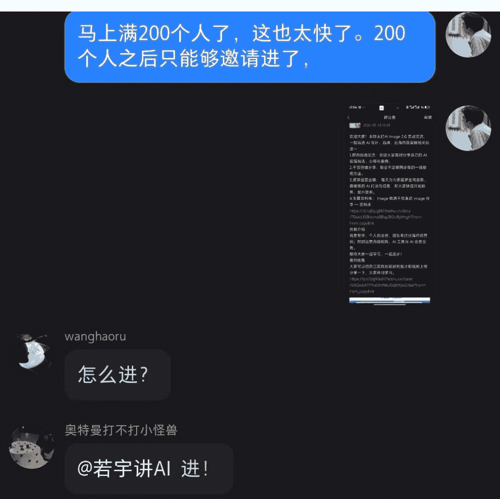
马上满 200 个人了，这也太快了。200 个人之后只能够邀请了，
wangchaoru 怎么进？
奥特曼打不打小怪兽 @若宇讲 AI 进！
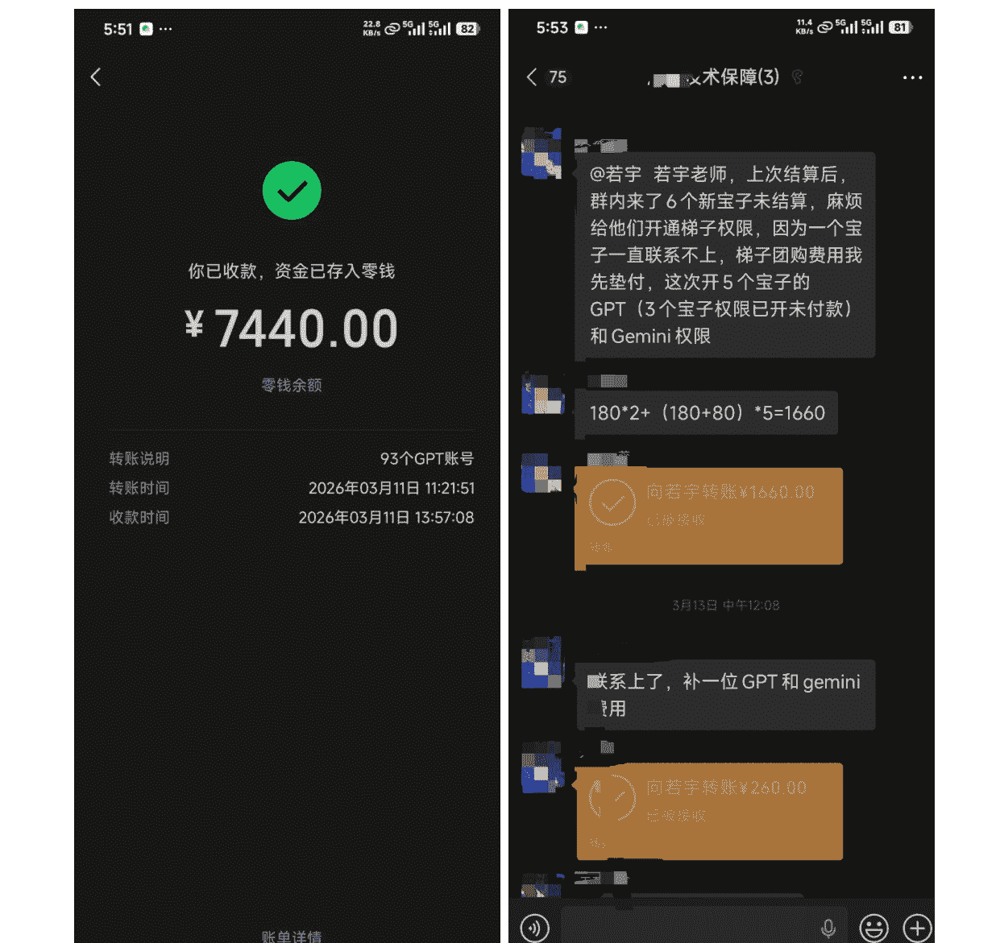
一开始，我觉得“配环境”就是帮人修电脑、配路由器，算不上什么高级工作。
但真正深入之后才发现，很多传统团队最缺的恰恰是一个能够兜底的人。
老板愿意支付上万元，买的不是某个复杂技术，而是“我不用自己反复折腾，出了问题随时有人处理”的确定性。
- **给新手的建议**：进入服务市场后，不要因为事情看起来不够体面，就拒绝那些别人不愿意做的脏活累活。能把团队最麻烦、最耗时间的事情稳定解决，本身就是价值，也是在积累用户和信任。
- 交付时一定要设置边界，同时把常见问题整理成 SOP 和文档。否则所有排障都依赖人工回复，很容易陷入无休止的消耗。
### 第四阶段：把自己使用的脚本变成商品
到了 5 月，客户开始提出新的需求。
账号和网络已经配置好了，但每天出图、下载、复制文案、剪辑，仍然需要人工重复操作。看到我平时做内容，有人开始问：这些步骤能不能自动完成？
于是，我把自己的工作方法拆解出来：
通过脚本连接接口，把出图、下载、视频处理、文案、字幕和动效串成一条流程，再交给后台自动运行。
原本客户需要手动操作很久的内容，经过配置后，几分钟就可以完成。
我开始把日常使用的脚本、提示词和 Skills 配置整理起来，提供定制化服务。单笔报价大多在 500～800 元之间。
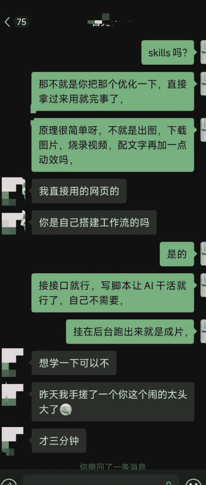
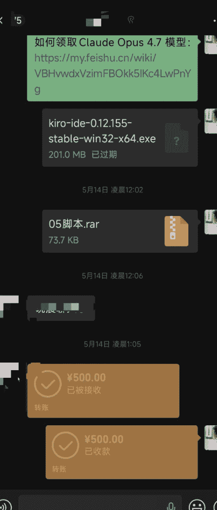
5 月 14 日，一位自媒体同行想简化短视频处理流程。
我为他打包自动化脚本，在 Windows 电脑上配置 IDE，接入 Claude Opus 模型接口，并额外制作了一份飞书操作文档。客户成功跑通后，支付了 500 元。
这次交付让我更具体地理解了“价值”的含义。
对于已经熟悉脚本的人来说，代码可能并不复杂；但对于一个卡在安装、配置和操作环节的人来说，能有人把环境搭好、流程讲清楚，就已经节省了大量时间。
5 月 17 日，另一位创作者需要网络节点和自动化出图工作流。
我把报价拆成两项：
- 网络节点：300 元，5T 流量，使用期 4 个月；
- 自动化工作流：500 元。
合计 800 元。对方当时还在和朋友一起攒钱，后来直接用微信扫码付款。
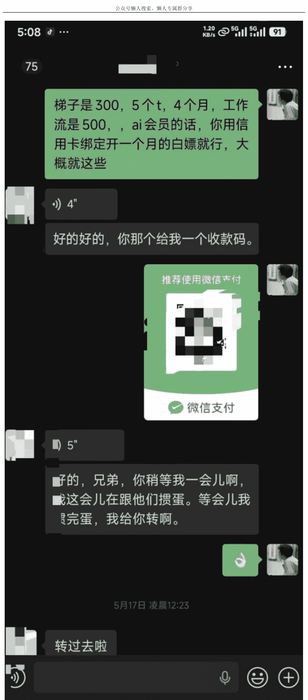
6 月初，一位圈内前辈想在本地使用 Codex，但被账号和开发环境卡住了。
我通过语音和屏幕共享的方式，协助他完成配置，收取了 589 元服务费。交付结束后，我又补充发送了额度消耗提醒和功能说明，并告诉他后续账号出现问题可以继续联系我。
这些订单金额都不算特别大，解决的也都是看起来很具体的小问题。
但客户对服务的判断，往往就在细节里：
文档是否容易看懂，脚本能不能在他的电脑上正常运行，遇到异常时有没有人及时回应。
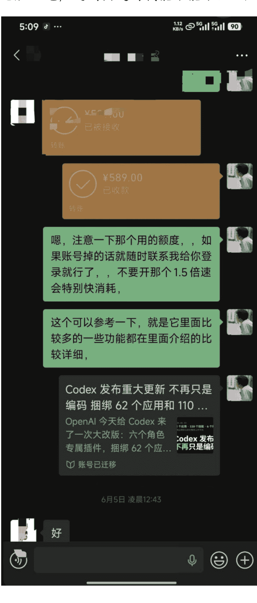
过去我很容易陷入“技术自嗨”，总想着研究复杂架构、追逐最新模型。
但在帮一位打掼蛋的朋友写完脚本，并顺利收到 800 元后，我才真正想明白：
**商业的核心不是展示技术，而是解决问题并完成价值交换。**
如果一个简单脚本能让客户每天节省 2～3 个小时，即使只有几十行代码，也同样具有商业价值。
- **给新手的建议**：不要为了做工作流而做工作流。先观察身边的人，找到那些最痛苦、最重复、最耗时间的动作，再从最小问题开始解决。
- 交付的最终标准只有一个：客户能在自己的电脑上跑通。除此之外，最好配套制作图文教程或飞书文档，降低后续使用成本。
### 第五阶段：参加黑客松，尝试独立做产品
过去一年，我也参加了一些线下活动。
加入赚钱后，我进入了龙哥盟 418 TOP100 影响力排行榜 TOP50，也因此认识了很多圈友。
很多人会问，一个没有背景的小白，怎样才能认识那些已经做出成绩的前辈，甚至和他们建立合作？
参加《别独自用餐》的作业后，我重新理解了“人脉”。
对我来说，人脉不是通讯录里有多少个厉害的人，而是能不能和别人一起把一件具体的事情做成。
向别人请教时，我尽量不问“你有什么建议”这种过于宽泛的问题，而是准备好自己的真实数据、项目链接和具体卡点：
这个步骤是怎么跑通的？这里为什么会失败？我现在最应该优先调整哪一环？
更重要的是互惠。
如果永远只是单方面索取经验，关系很难持续。我能为别人提供什么？脚本、工作流、环境配置、网络排障，这些都是我能够帮上忙的地方。
朋友的项目卡在 API 和数据处理环节，我就花几个小时帮他把系统搭起来；圈友遇到网络、节点或工具问题，我也会协助排查。
一次次真实的合作和帮忙，逐渐变成了理解彼此能力、建立信任的基础。后来一些小程序合作和业务推荐，也是在这种协作关系中自然产生的。
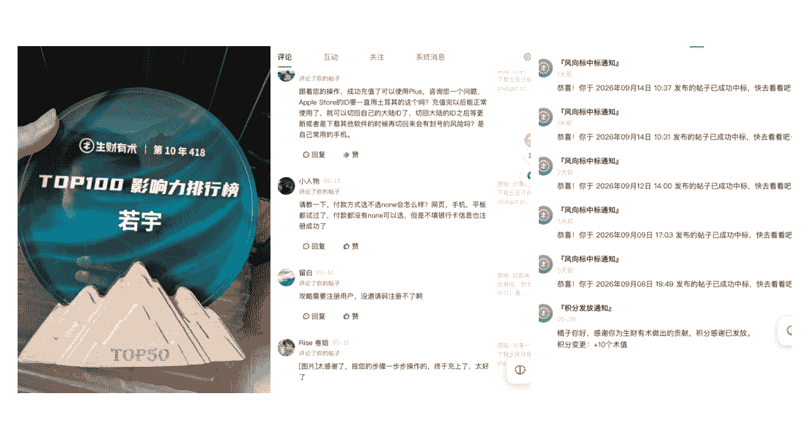
今年夏天，我还参加了几场黑客松。
过去遇到陌生代码时，我多少会有些畏惧。但黑客松会把时间压缩到一个明确期限内，要求参赛者现场完成产品，还要上台讲清楚它解决了什么问题。
在杭州 EvoMap“进化酒馆”黑客松中，我作为核心主创参与开发并完成路演，作品是一个“互动影音创作平台”，最终进入全国总决赛。
现场聚集了 100 多位开发者和 AI 架构师，整个比赛持续了 72 小时。

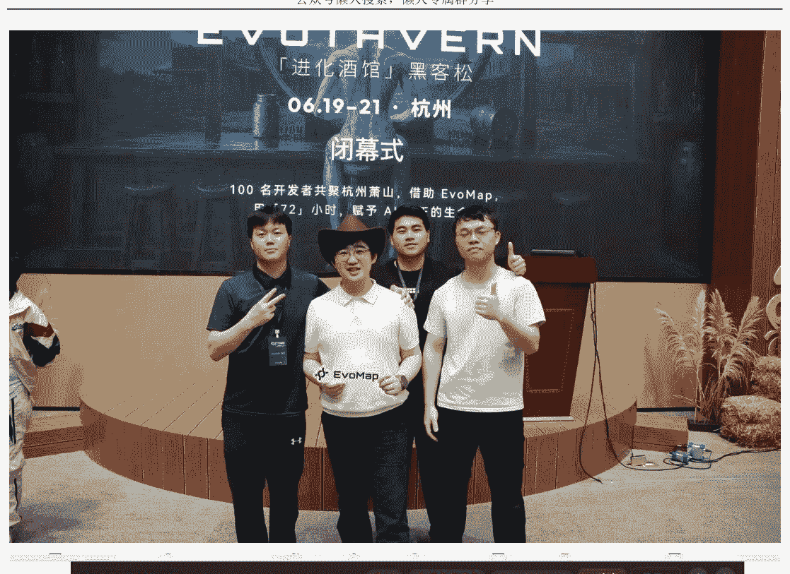
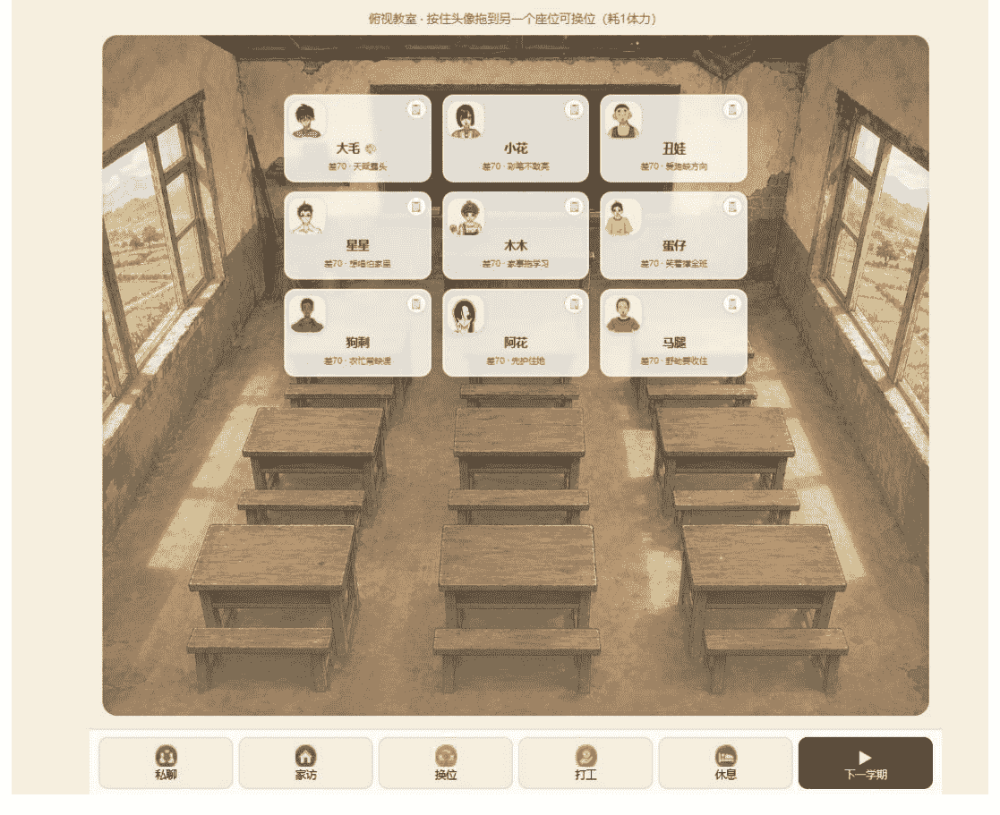
我最初并不是一个能熟练处理代码的人。很多时候，电脑弹出的错误提示，我连含义都判断不了，只能先交给 AI 分析，再一点点跟着修改。
但正是在这种“边做边补课”的过程中，我完成了几个独立项目：参加比赛拿到奖项，做出微信小程序，也把一项 22,000 元的企业服务从需求梳理推进到交付结算。
没有计算机科班经历，也没有专门负责拓客的团队，我是怎么一步步走到今天的？这篇文章，把几段关键经历完整记录下来。
在腾讯黑客松游戏开发挑战赛中，我把大山里留守儿童的成长故事，设计成互动作品《山那边.九学期版》，作品一路进入华东赛区半决赛。
在上海创作者黑客松，我牵头制作了《小V内容库/实时数据大屏》，尝试把飞书中的知识关系与短视频研究结合起来，最后获得最佳人气奖。
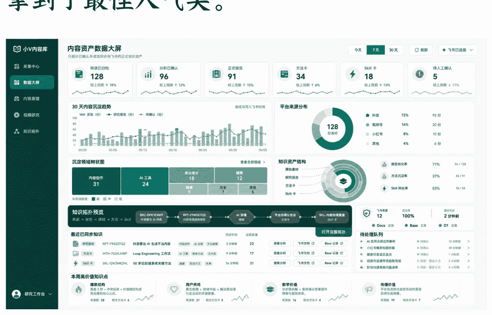
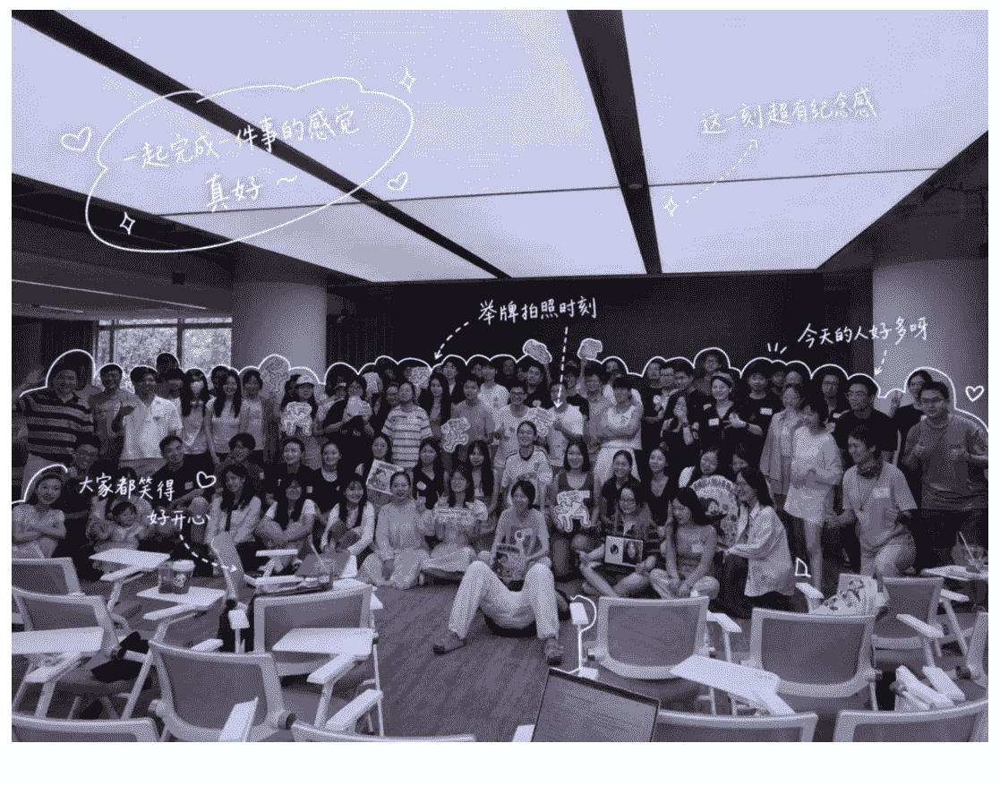
之后，我借助 AI Coding 独自完成了微信小程序《排班同休 / 倒班调休》。从程序编写、接口联调，到页面制作、审核备案，全部由我推进，产品也顺利上线。
不过，这次上线也留下了一个很明显的教训：产品当时设置了 100 人的使用上限，实际访问人数很快就达到了顶格。由于事前没有准备扩容或分流方案，那一波进入量并没有被承接住。
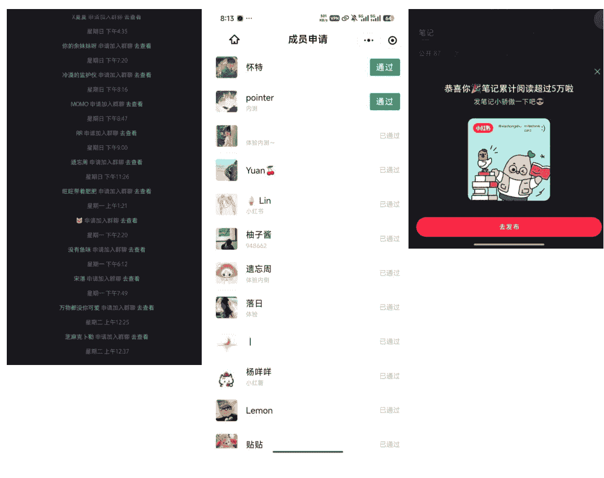
这些项目并没有让我立刻变成专业程序员，却让我跨过了最初的心理障碍。
现在接到陌生需求，我会先把任务拆开：哪些环节有现成方案，哪些部分适合交给 AI 辅助，哪些基础知识需要马上补齐。对新手来说，最重要的并不是先把所有语法学完，而是围绕一个具体目标开始行动。
很多人都在借助模型拼接现成能力，差距往往出现在“是否愿意先做一步”。在真实协作中主动承担、主动解决问题，通常比长时间等待准备充分更有优势。
#### 给初学者的提醒
不要一上来就啃几百页语法教材。可以把报错信息交给 Cursor 或 Claude Code，让它先协助定位原因，再在修改过程中理解原理。
另外，尽量参加线下交流。真正的合作，常常不是从一条线上消息开始，而是在一次具体的见面、一次现场协助中逐渐建立起来。
## 从零散脚本到 2.2 万元企业项目
项目金额的增长，表面上是报价变化，实质上是思考方式发生了转变：过去只需关注某个功能能否运行，后来还必须理解一家企业每天怎样工作。
### 我怎样理解 FDE
FDE 是 Forward Deployed Engineer，通常被译作“前置部署工程师”。
在我的实践里，这个角色并不只是写程序，而是先进入业务现场，观察客户的真实操作，再把合适的智能能力嵌入原有流程。
有些老板听完 AI 课程后，给员工开通了会员，但一线人员仍然不知道如何把它用到工作中。也有公司采购过 CRM，结果系统逻辑与实际业务习惯对不上，最后只能闲置。
因此，真正开始做方案前，必须先了解销售团队的日常：他们怎样寻找对象，如何判断沟通价值，跟进记录放在哪里，哪些环节依赖个人经验。只有掌握这些细节，才能判断哪些地方适合模型，哪些地方用固定脚本更稳，哪些判断必须交给员工完成。
我不是科班出身，也不擅长从底层研发全新的算法。我的优势在于面对陌生任务时，能够快速查找资料、请教相关人士，从开源项目和成熟服务中筛选可复用模块，再以较低成本组合出一个能验证效果的初版方案。
很多公司缺少的并不是宏大概念，而是一个能把零散能力串起来、让业务真正运转的人。
### 客户当时怎样寻找潜在对象
这是一家面向高价值客户的美业公司。过去，销售主要在公开平台搜索目标人群，再逐个发送私信。这个过程消耗大量时间，还可能受到平台限制。
经验传承也存在问题。优秀销售往往有自己的沟通方式和推进节奏，新人很难完整掌握；一旦人员离开，原有客户的跟进就可能中断。
公司之前买过一套价格不低的 CRM，但因为操作复杂，销售人员缺少持续使用的意愿。
客户最初找到我，是希望安排一次提示词培训。我观察了他们一天的工作流程后，提出了一个不同方向：与其只教员工几个 AI 技巧，不如把线索发现、价值筛查和沟通准备串成连续步骤。
这样，销售拿到初步名单后，就能直接推进下一步，而不需要每个人重新研究一遍提示词。
### 七天内如何完成交付
**第 1—2 天**
我坐在销售工作区域旁，观察他们怎样寻找目标、筛掉无效对象、完成第一次联系，再把合适的人导入私域。通过屏幕记录和时间统计，把原本凭感觉进行的筛选，拆解成 5 个可执行的判断维度。
**第 3—5 天**
我用 Python 写了批处理程序，连接模型接口和本地图片分析模块。整套流程包含三部分：持续接收多个公开渠道的线索，过滤低价值对象，再根据不同情境生成销售可直接参考的开场表达。
**第 6—7 天**
我整理操作说明、异常处理方法，并带着员工实际试跑。最终文档超过 20 页，网络延迟、接口额度不足、失败后的再次尝试等情况，也都列入了排查部分。
试运行后，团队从大量原始信息中筛出上百条较有价值的潜在客户。负责人看过结果，直接在微信上让我发合同并完成线上签署。
随后，8,800 元首笔款到账，转账备注为“AI 获客系统 40% 款项”，对应的项目总额是 22,000 元。完成培训、资料交接和最后调试后，余款也全部结清。
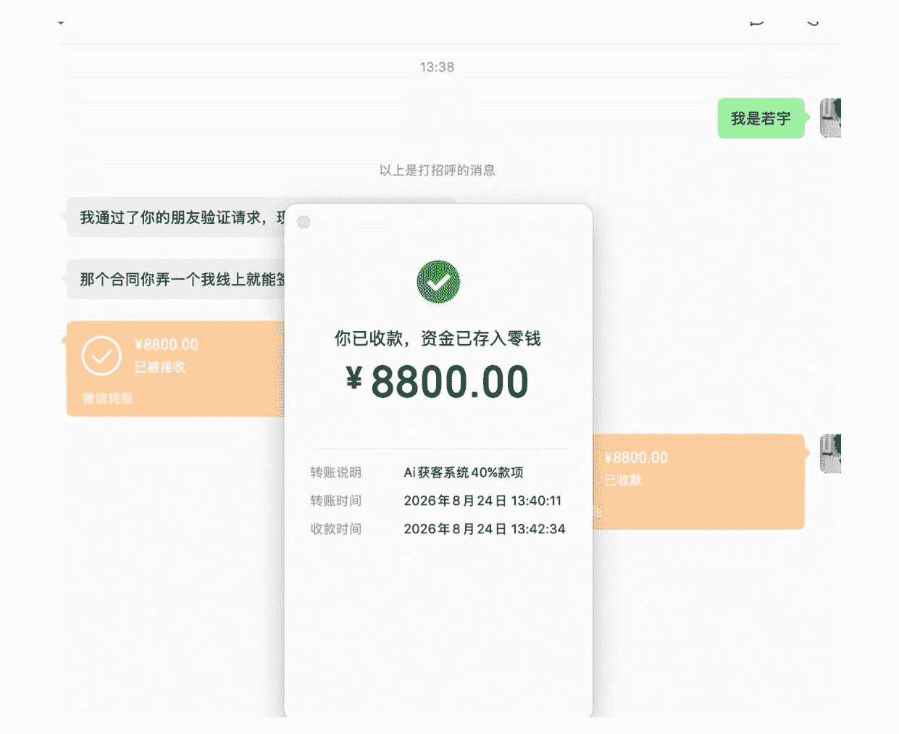
这次交付让我更加确定：企业项目不是“写完程序就结束”。员工能否顺利上手，出现故障后如何处理，流程能否持续运行，都是服务的一部分。此前做环境搭建和自动化小工具时积累的经验，也在这里派上了用场。
过去接几十元、几百元的零碎需求，我经常陷入单纯比价格、比工时的循环。读段永平的《大道》后，我逐渐明白，低价本身很难构成长期优势，真正重要的是找到区别，并围绕客户结果完成交付。
做这套美业方案时，对方并不关心我把代码写得多漂亮，也不会因为我调用了多少新模型就满意。他们真正关心的是：
- 每天能不能稳定获得一批有效线索；
- 销售拿到开场内容后，能不能顺利把对方引导进私域。
当我从“展示技术”转向“解决业务阻塞”，项目的价值才被看见，22,000 元也顺利完成回款。
我很认同龙哥在直播中提到的一类观点：企业服务更像开发和陪跑的结合。复杂部分由服务方提前处理，前线员工只面对清楚、稳定、容易执行的步骤。凡是能够用固定程序明确处理的规则，就不应交给模型随意发挥。
#### 给准备承接企业需求的人
中小公司的需求往往十分具体：找线索慢、筛选耗时、开场表达不自然。只要找到其中几个关键堵点，就有机会做出较高价值的服务。
同时，说明文档和现场带练不能被当成附属品。很多时候，员工能否真正使用，决定了项目是否能产生结果。
### 企业客户是怎么来的
这一年，我陆续接触过咨询答疑、故障排查、自动化脚本制作和系统调试。有人问过我：
“若宇，你刚离开部队不久，既没有名气，也没有销售班底，这些项目为什么会找到你？”
我的答案是：我没有购买广告，也没有到处私聊推销。多数机会来自熟人介绍、原有客户再次合作，以及过去在社群中提供帮助的人。
在赚钱社群和黑客松现场，只要有人遇到环境安装、节点调优、接口报错等麻烦，我通常会开屏幕共享一起排查。有时为了让朋友把整套流程跑起来，我会连续投入几个小时，最初并没有把这些协助当作收费事项。
信任不是一句口号，而是在一次次具体行动中累积出来的。别人看到你愿意处理麻烦，承诺的事情有回应，交付的结果有着落，就会逐渐形成判断：这个人做事踏实，技术也靠得住。
当这种判断稳定下来，合作机会就可能从原联系人扩展到他们身边的公司和朋友。对商业来说，可信度往往比一次曝光更加有价值。
读《纳瓦尔宝典》时，我记住了两个方向：先采取行动，再耐心等待结果；把长期积累当成重要变量。一个人越可靠，越有机会吸引到与这种可靠相匹配的资源。
《财富方程式》中的逻辑也很清晰：品格影响行为，持续行为沉淀成信誉，信誉最终会在市场里转化成财富。
一次免费排查、一次认真答疑，短期可能没有收入，甚至看起来不够“划算”。但每次用心完成的帮助，都会变成别人认识你的依据。
如果你正处在缺少资源和客户的阶段，不必急着寻找所谓捷径，也不需要沉迷于表面热闹的社交。先把自己训练成一个能够处理具体难题的人，在熟悉的圈层里主动帮忙，把答应的每件事做好。持续一段时间后，机会往往会从这些细小积累中长出来。
### 几段真实沟通
有用户问我，能否在一个月内用 500 个小红书账号发布 1,500 条作品。我回复：从实现角度看，可以进一步研究。随后他又发来一个视频，询问能否做成智能化版本，双方继续讨论了“一键生成视频”的流程方案。

还有一位负责人说，想制作一款与参考产品高度相似的小程序，让我先估算预算。
我回复稍后评估，再根据功能范围、实现难度和交付方式拆解成本。

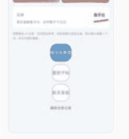

之后我说明，几个方案中，第一个已经完成优化，后两个仍然处在未优化状态。
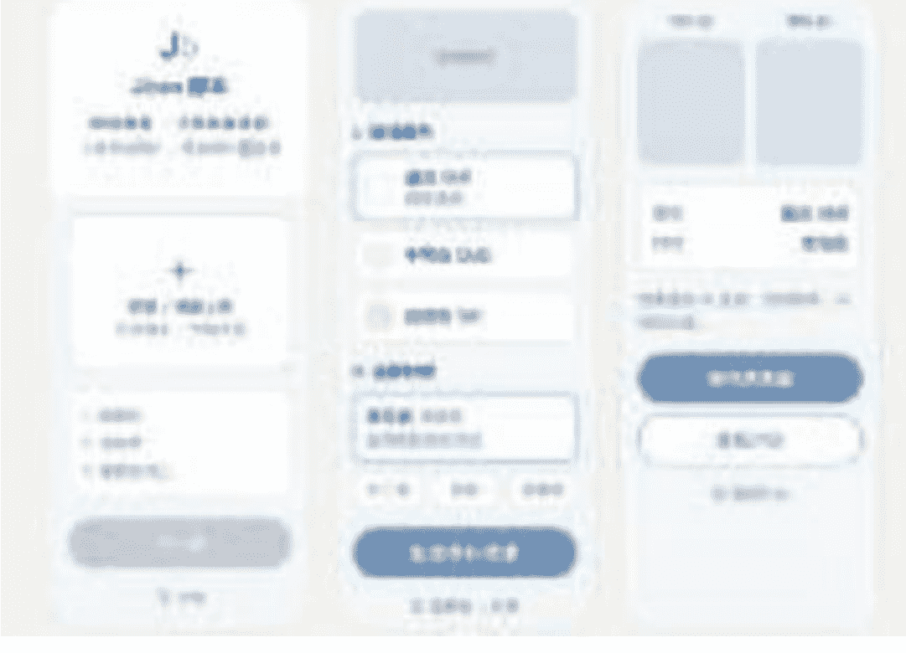
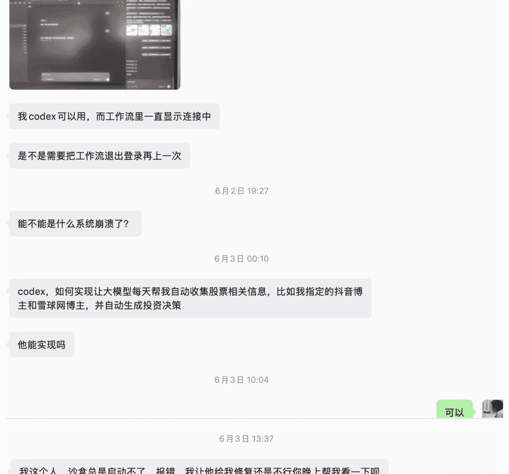
另外一段沟通里，有人反馈 Codex 在工作流页面持续显示连接状态，询问是否需要退出后重新登录。我先判断可能是运行环境出现异常。
还有人希望让模型每天收集指定抖音账号和雪球账号的股票信息，再整理成投资参考。与此同时，也有人遇到沙盒始终无法启动的报错，请我协助处理。我提出用 50 元调整底层实现，绕开沙盒限制，并通过远程方式开始排查。
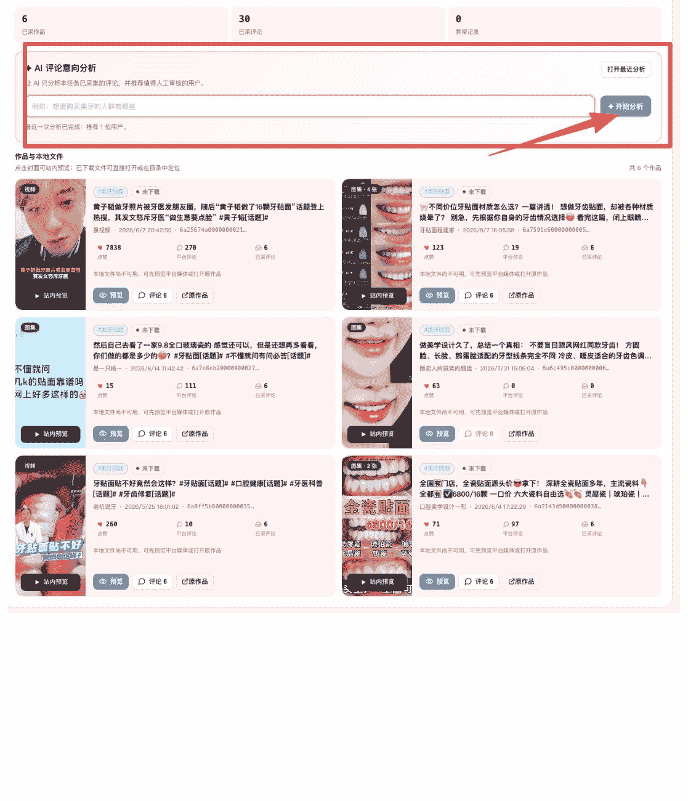
后续页面展示了线索采集、评论价值判断、人工复核、回复模板以及分配规则等环节。
表面看，这只是几个页面和按钮；真正重要的是流程背后的判断：哪些信息需要收集，什么样的对象值得保留，哪些结果必须由人再次确认，回复内容又该怎样交给销售处理。
```
您 好
```
```
10 分 钟
```
如果你也想借助 AI 做一个属于自己的产品，不必等到所有准备都完成后才开始。可以先从身边的真实任务练习，在解决问题的过程中补足能力；愿意帮助别人，也要把每次交付认真做好。
很多结果不会马上出现，但持续行动、可靠交付和长期积累，往往比短期技巧更能决定一个人的下一段路。
整理近期跑的执行日志与过去十二个月的思考笔记，感觉两件事在指向同一个方向：把零散操作沉淀成可复盘的闭环，把偶然运气变成可复制的产出。下面是当前工作台的现场快照，以及年度复盘的主线。
先说正在进行的触达与寻人任务。
当前派发与复核的逻辑是这样的：关闭对方主动推送的访客接入，在其他客户触发节点到来之前，单个人在7分24秒前被系统自动流转，按分配规则交到执行同事发起发送，先走非自接收这条线。人工已完成投放对象的确认，对话内容与投放策略已归档备份。草稿已保存，自接收投放任务已激活。
本轮投放规模：共19个受众，模式为自接收投放，派发问题指向想问别墅区的人有哪些，都货与我。非自接收投放每人，每位在7分24秒前抵达时触发回复对话。
现阶段的话术库主打公众号搜人搜索和搜人专属群分享。
1/12 共 李李手工作坊，人工号投放要求是进入人工账号后约5小时内提交结果与交互截图数据，未知数据不可忽略需删除。
批次执行总览：
| 批次 | 公开身份 | 发言身份 | 过程 | 状态 | 下一步 | 操作 |
| #713 2025/04/20 09:20:42 | 想找宁姐教的人有哪些？有官方电话， | | 1 已发送 · 0 待执行 | ● 匹配度 无待执行 | 查看 删除 |
| #712 2025/04/20 20:42:48 | 想找到天一籽茶奶的人有哪些？ | | 2 已发送 · 0 待执行 | ● 匹配度 无待执行 | 查看 删除 |
| #71 2025/04/28 16:35:58 | 那些人是要得看脸的，就我忘记它。 | | 1 已发送 · 0 待执行 | ● 匹配度 无待执行 | 查看 删除 |
| #70 2025/04/28 16:34:45 | 那些人是要得看脸的，就我忘记它。 | | 0 已发送 · 0 待执行 | ● 无任务 (已复制) 无待执行 | 查看 删除 |
| #9 2025/04/28 16:46:52 | 帮我看一下这款评论需要装 MacBook M5 的人有哪些，还有询问价钱的/有哪些？ | | 1 已发送 · 0 待执行 · 1 失败 | ● 无任务 (已复制) 无待执行 | 查看 删除 |
| #5 2025/04/08 10:02:12 | 想我购买某国产高品能帮帮我送教的人有哪些？ | | 1 已发送 · 0 待执行 | ● 匹配度 无待执行 | 查看 删除 |
以上为目前已识别到对应待执行或历史批次，但尚未闭环或已失效的清单，目前无人认领，其中被计划群/间/社/任务无法继续的批次。
批次 #0 · 完成 含解答
该数据源为手动操作对应的结果，无关注，系统经人工辅助产生数据并已处理。
| 用户 | 回复量 | 状态 | 结果 |
| 奶黄包小公举 | 那个M5 现在多少钱？ | done | 已接单·本人直接 |
| ZONEoverTime | 那个M5 现在多少钱？ | failed | 私信已读完，但没接单，对方确认没看私信或忽略掉 |
监控列表 02/19
筛选条件：搜索用户昵称/ID，全部分组，全部标签。显示 1/1。
| 用户 | 分组/标签 | 作品数 | 间隔 | 下发设置 | 上次扫描 | 状态 | 操作 |
| 口红 标签 #口红 | #口红 | 35 | 60 分 | 已扫描 默认 | 2025/04/20 11:02:1 | ● 已暂停 | 立即数据 编辑 启用 删除 |
最新笔记 / 下载状态
筛选条件：搜索作品描述/ID，全部分组，全部标签，全部来源，全部类型，全部状态。排序：最近点赞，最新发布。显示 18/38。


先不一步到位 先做一些基础的活动预约和发起的功能 你看看能不能做 多少预算🤔
9月3日 下午2:22
可以先了解一下
酷
我们现在要真的开始启动小程序的开发...
- 小程序_产品流程与后台系统...v1.0.docx (7.1 KB)
- review (7).html (3.4 KB)
- _后台管理测试版.html (20.7 KB)
我先看看啊
嗯嗯
"这样的话，他们要如果开拓这个FDE市场的时候，那你也是他们其中的，也可以跟他们合作啊，当然也可以不合作，只不过是多了一个选择的机会吧，好吗。"
14:18 大概了解了，如果他们那边有人的话，我就不参与了，目前手上有两个项目在跑，怕交付不了
好的，那就让他们试一下
那个张三我好像刷到过几次吧，但是不知道他们有没有具体的项目
没关他们介绍客户能不能接得动，就看他们本事了 我给介绍对象，不能保生儿子是不 反正我都会先发给你 你要是没空就让他们试试看
还得是我姐
回看过去十二个月，踩坑的次数比赚到钱多，最深刻的可以归纳为四类。
4.1 渠道依赖与堆量不可持续，长期变现靠真实价值
刚开始提供账号渠道与资料时，很容易盯着眼前订单，忽视渠道随时可能变化。后来成天处理封号、掉线售后，才意识到这类收入很不稳定，不能因为几天订单多就当成长期生意。
做 YouTube 也是一样。播放上去就想用工具堆量脱离内容质量，结果被平台先后两次取消变现资格。由此才分清“有播放”和“能稳定赚钱”的差异。盲目追量是最底层的竞争，能穿越周期的永远是内容或系统本身为用户带来的真实价值。
4.2 把好奇心转化为可复盘的结果，别让探索欲吞噬专注
我天生好奇心强，新模型、新视觉算法一出，能通宵研究。但代价很大：项目从0到1时很兴奋，进入枯燥的重复运营、维护、等待期就忍不住追新热点，导致很多事面广而浅。
做完《别独自用餐》复盘后想通了：不需要消灭好奇，而是给它导流。现在的规矩是，任何新工具、新玩法研究，必须服务当前主线业务。研究工具不是终点，能否嵌入工作流、能否产生真实用户反馈、能否跑出一次可复盘闭环，才是终点。
4.3 搭建机制，而非死盯指标
读《纳瓦尔宝典》时，关于要建体系而不是定目标的观点触动很大。以前每天给自己定指标，今天必须涨千粉，本周必须变现几千，指标越多越焦虑，短期无反馈就内耗甚至想放弃。
后来把精力转到搭建体系：
搭建内容工作台，把选题抓取、结构拆解、批量生成、排版发布流程化；
搭建客户获客与交付流水线。
体系的价值不在于保证每次满分，而在于守住下限，保证稳定产出。每日工作被体系明确后，只需专注执行，结果是体系运转的自然产物。
4.4 错了立刻改，任何代价都是最小代价
段永平在《大道》里讲，做对的事，把事做对，发现错了马上改，任何代价都是最小的。
过去常陷沉没成本：方向需求小、转化困难，却因投入几天时间和几百块工具而硬撑，等奇迹。
后来学会认错。小实验用真实数据验证走不通时立刻止损。因为死守错误方向，消耗的不仅是本金，更是高昂的机会成本。
过去一年沉淀的几个习惯。
5.1 先完整跑通，再谈优化
学一件事，我会先找已跑通的步骤，完整做一遍。还没开始就改工具改流程，出问题很难定位。
部队里说的先僵化、后优化、再固化对我帮助很大。买了手册、看了案例，先把动作不折不扣做完，拿到真实反馈后再按自身情况微调。
5.2 过往的经验可以继续用
起初觉得部队经历跟做 AI 八竿子打不着。后来发现不是：当文书时练出的文档整理与逻辑表达，写系统说明时能用；部队“凡事有交代、件件有着落”的作风，在企业排障与客户交付时更是核心竞争力。
学 AI 需不断补充新技术，但生活与部队沉淀的好习惯不用丢。很多时候客户把几万块项目交给你，不全因技术多强，而是因为靠谱、有耐心、能把事情兜底。
5.3 交付后仍把问题收尾
账号出问题要处理，环境配不通要远程排查，系统交出去要有二十多页图文说明。这些事不适合讲故事，但占了大部分精力。
我越来越在意客户能否脱离我独立使用。交付不是丢代码，而是以客户业务跑顺为终点。
5.4 带着具体问题走出去，协作互惠
加入赚钱、参加黑客松的初衷很简单：看大结果的人怎么思考怎么操作。
一人闭门造车，简单问题能卡一周。走出去请教时，要带着思考过的具体问题与数据交流；同时永远想着能为对方做什么，哪怕修个 Bug、配个节点、搭个小工作流。互惠协作才能换来长期信任。
5.5 不好高骛远，日进小步即可
刚退伍时很急躁，想着一两年做出轰动事业、赚几百万。真正被现实泼冷水，又一步步赚到第一个十万净利润后，心气反而沉下来。
段永平说不要好高骛远，每天小步前进就好。因为多数伟大之事，往往不是靠宏大蓝图计划出来。
我不再画虚无的三年五年大饼，而是把注意力集中在接下来三到六个月：把手上每个业务闭环跑好，保持作息与健身，保持每日阅读与复盘，解决客户的每一个具体问题。
慢即是快。只要不退出局，把时间当朋友，每天踏实挪一步，日复一日的复利自然会把你带到想去的地方。
写在最后
退伍这一年，经历过投资亏光的窘迫，经历过烈日下跑外卖的迷茫，也体验过靠双手搭出系统、拿到客户尾款的踏实。
从倒腾账号渠道、做资料整理，到做视频出海、接脚本定制，再到今天深入美业一线做获客系统与小程序独立开发，回头看，没有哪一步是白走。
感谢这一路毫无保留分享经验的前辈，也感谢愿意相信我、把业务交给我落地的一线客户。
在人工智能浪潮里，我仍是路上探索者。后面会继续泡在具体业务里，做成了就拆解实战，没做成也把踩过的坑坦诚讲清。
这是退伍一年来最完整、最坦诚的一次复盘。不谈宏大叙事，只是一个普通人如何保持在场并持续前进的真实记录。
如果文中某句话、某个案例触动了你，或对你的业务有一点参考价值，恳请点赞投鱼锚。每一票与鼓励都是最大支持。评论区我在线，大家实操有疑问随时交流。
路还长，牌桌上见。
附：这一年重塑认知的五本案头著作
1. 《穷爸爸富爸爸》—— 罗伯特·清崎
为什么推荐：退伍后第一本商业启蒙著作。当时合伙亏四万多、顶着大太阳跑外卖，在树荫下用手机看完。
最大触动：帮我分清资产与负债，更刻下终身纪律——千万不要梭哈，只要不退出局，就不会真正失败。它帮我戒掉急于赚快钱的赌徒心态，懂得守住生存现金流、等待机会。
2. 《大道：段永平投资问答录》—— 段永平
为什么推荐：这一年翻阅次数最多的一本。段永平不仅是顶级投资家，更是顶级产品经理与商业实干家。
最大触动：书里全是质朴却见血的大白话：做对的事，把事做对；成本优势不是护城河，客户导向才是差异化；发现错了马上改，任何代价都是最小代价；不要好高骛远，每天小步前进就好。做美业获客系统时能彻底摒弃技术自嗨、沉下心死磕客户体验，底层商业常识来自这本书。
3. 《纳瓦尔宝典》—— 埃里克·乔根森
为什么推荐：AI 时代想成为超级个体、一人公司的人都应反复通读的指南。
最大触动：建立体系而非设定目标；利用代码与媒体这种无需他人许可的无杠杆力量。纳瓦尔让我理解为何要把脚本沉淀为自动化工作流，为何要通过体系控制不良率，以及慢即是快，把时间当朋友。
4. 《别独自用餐》—— 基恩·法拉奇
为什么推荐：彻底颠覆普通人对人脉狭隘理解的一本著作。
最大触动：人脉不是认识多少牛人，而是能一起把具体事做成的关系。请教要带着具体链接与思考，建立关系必须建立在真诚利他的互惠上。这一年绝大部分企业客户与朋友转介绍，都践行了这本书的理念。
5. 《遥远的救世主》电视剧《天道》原著 —— 豆豆
为什么推荐：一本把商业本质、客观规律与人性弱点剖析淋漓尽致的经典。
最大触动：破除了内心所有等靠要的幻觉。这世上没有神仙与救世主，真正拯救自己的唯有按客观规律办事、实事求是深入现场下苦功。
堪比龙珠咨询的四小时：少则得，多则惑：在龙哥开放日，我想明白了一件事
[龙哥盟·会员主题贴](#)
个人博客： [https://blog.outageai.xyz/](#)
————分割线————
看完这篇 SOP，你觉得你懂了。但九成的人一到实操会卡在第一步。
工具与教程只是最低壁垒，真正的壁垒是立刻动手与圈层信息差。
我们不聊虚的，只做商业闭环拆解与 AI 效率压榨。系统内已沉淀一千多条跑通的套利实战局。
查看圈子完整数字资产与上车门槛：
https://lazys0.com/insider/

