# 长视频三月冲上高级YPP，我把整套打法拆开了
大家好，我是龙哥。上周刚用长视频把第一个YPP拿下。最近看到站内很多人在聊Shorts怎么做，也有人开始摸索长视频的路子，这里把我这段时间的实操流程整理出来，供想入场的朋友参考，少踩点坑。
从赚钱这儿学到不少。
附上的截图是我的一个新号，发布第5条视频时时长就达标了，接着发了3条短视频把订阅补满，从而开通高级YPP。从首条上线到达标，只用了约半个月。
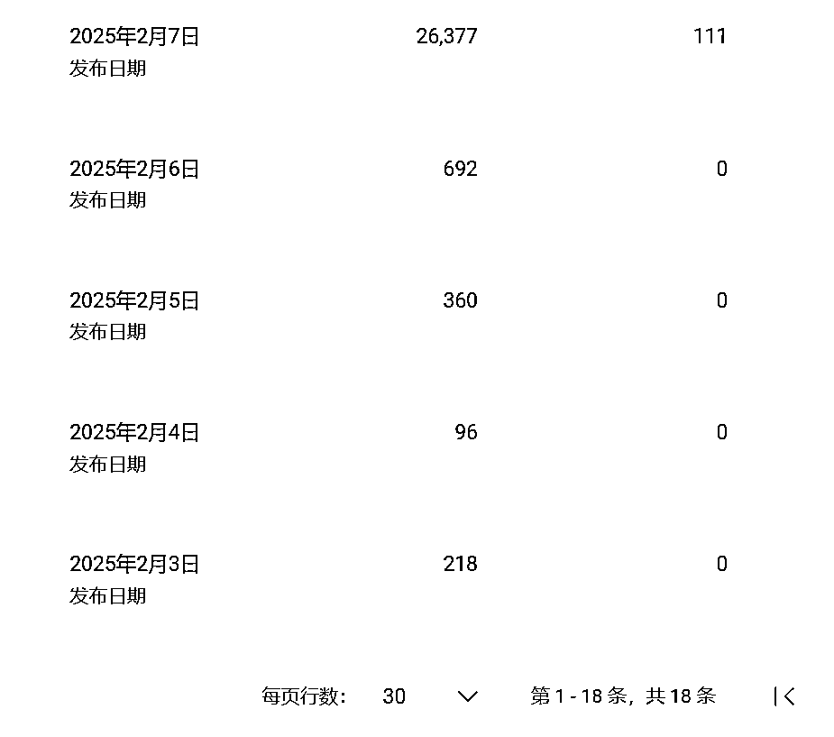
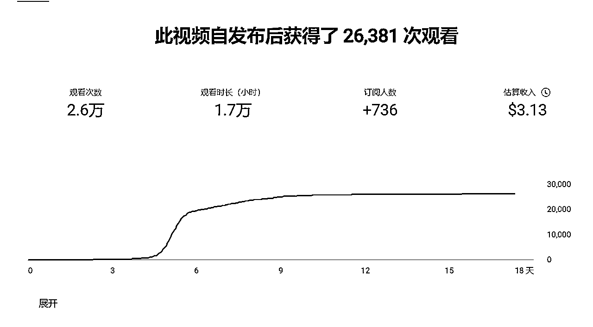
我主攻的方向是讲故事类长视频，题材面很宽，基本任何故事都能套。先丢两个我的案例给你感受下风格。
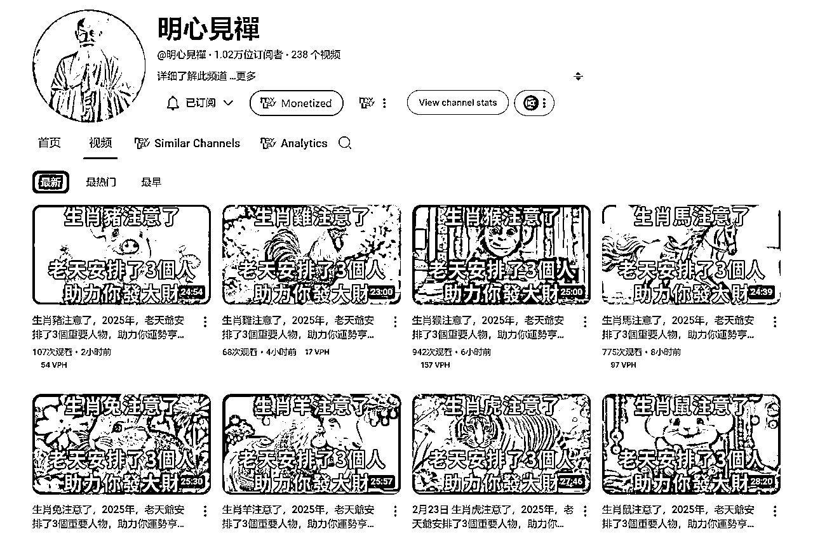
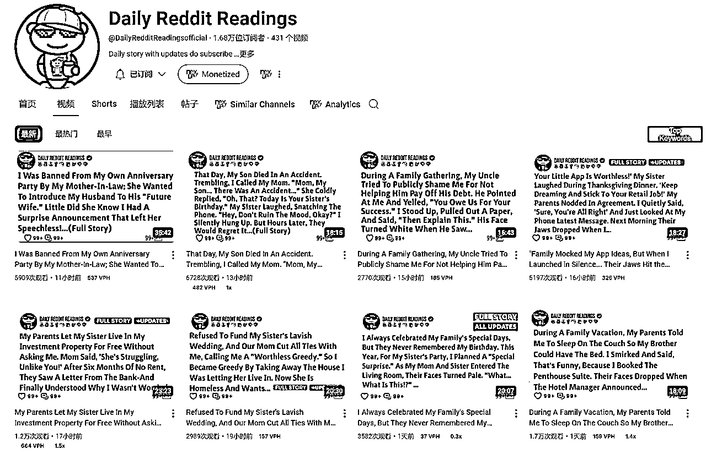
# 先说收益逻辑
我目前了解到的均价：YouTube英文长视频 CPM 大概在3-9美元，中文在2-5美元；AI类 Shorts CPM 只有0.03-0.06美元，相差近百倍。
也就是1万播放的长视频，收益约等于100万播放的Shorts。而1万播放的长视频其实比100万播放的Shorts更容易拿到。AI Shorts还有个致命点：生命周期短，很容易过时，得频繁换跑道。故事类长视频生命周期长，美区用户尤其爱听故事，更容易把流量导到高单价市场。
假设按均价4美元/千播来算，一个月做到100万播放，约合人民币2万9左右。截图里的AI拆解表有详细过程。
拆到每天就是约3.3万播放。单号日均3000播放的话，大概需要11个号。很多人会觉得100万/月很夸张，看完我的流程你会发现门槛没想象中高，回报也对得上，觉得合适就可以开干。
我用4美元和单号日3000播放来做估算，属于偏保守的测算。实际运营中还会叠加会员、超级感谢等收入，达标会更轻松。大家可以基于自己的调研再调整参数。
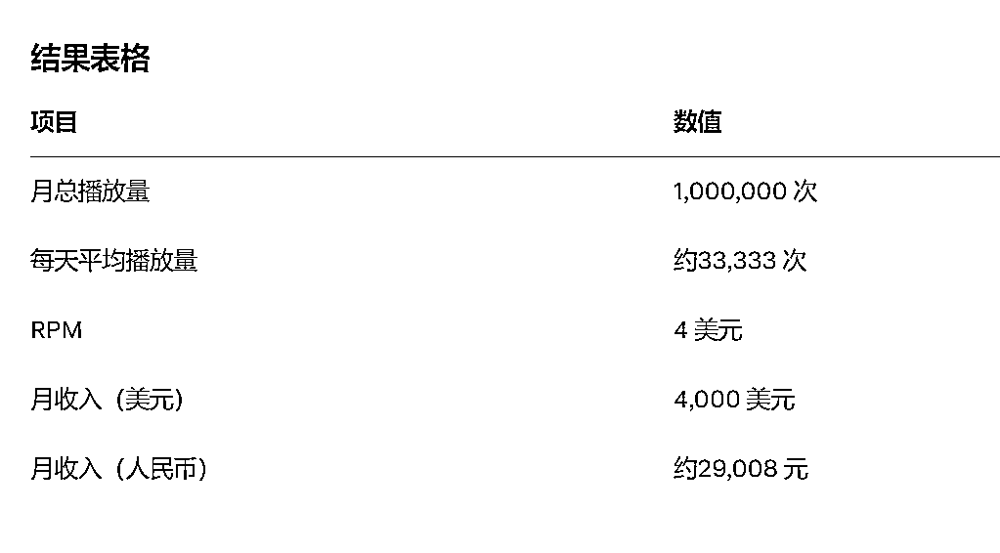
##
从收益模型反推，内容必须能规模化、复制化，一天能稳定出10-20条才有意义。围绕这个目标，我才搭建了下面这套流水线
# 我的工作流拆解
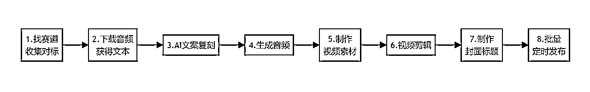
## 1 选赛道 & 找对标
### 1 找对标

对标是整条线最关键的一环，花在筛选上的时间越足，后续爆发的概率越高。长视频制作周期本来就不短，选错赛道后期再努力也费劲。
我的找法很原始：把脑子里冒出的任何关键词都往YouTube搜索栏里扔，看出来结果后立刻用标题裂变再搜。搜得多了，自然会挖出很多意想不到的赛道。关键是把灵感即时搜一遍。
前期别急着上工具，先练手感。我这个半月过YPP的号就是这么找出来的。显而易见的赛道基本卷完了，比如小说推文。YouTube的口味和国内不一样，国内流行的鸡血式励志在YouTube上并不吃香。
一个对标值不值得跟，我看三点：
1.账号是近三个月新起的，最老的视频在三个月内
2.平均播放稳定在5千以上
3.内容形态具备标准化、复刻能力
提醒一点：
对标要分账号来找。一个账号里挖到一个类型，就别再用它去找别的类型了。混着找会扰乱推荐系统，后续回头追踪这个类型的发展也会变得困难。
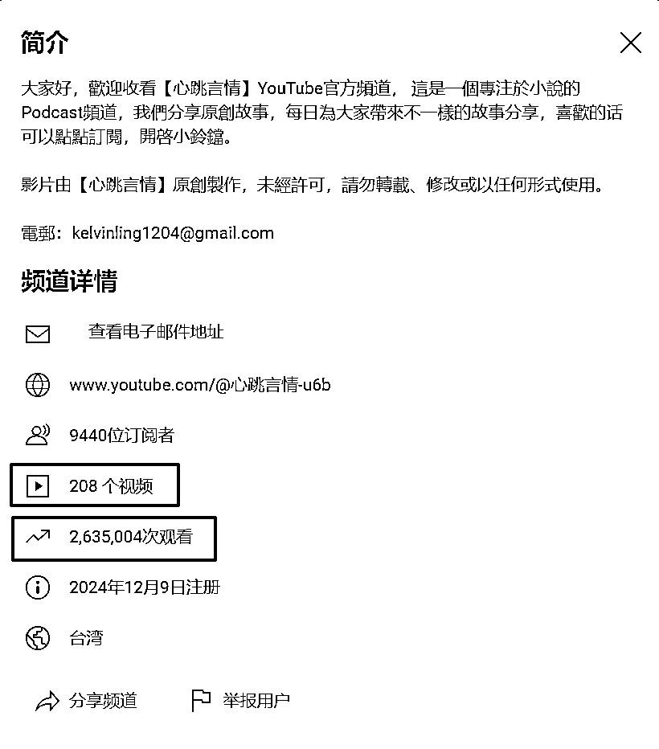

### 2 数据采集
对标名单确定后就开始抓数据。
我用的是改自老马的API抓数脚本，先抓账号层面的整体数据：总观看、订阅量、视频数。隔一个月再跑一次，对比前后变化，就能判断这个赛道是在涨还是在跌，比凭感觉靠谱。
API有调用限制，所以我又写了另一个脚本配合比特流浪器，把对标账号的全部视频拉下来：标题、播放量、链接、发布时间、发布天数等，方便筛选出优质的爆款复刻。
通常我一次备20条左右的素材，因为单次只做十几条，至少要筛出20个爆款，避免偶然性干扰。
## 2 音频获取与转录
音频批量下载可以用马哥推荐的crtubeget或亨亨猫这类工具，只下音频，别下视频，省流量省时间。字幕也不建议直接下，有些中文视频根本没有字幕。
下载完音频后用Videosrt Pro批量转录。中文用funasr模型，英文用whisper。转录完就能得到字幕，再做下一步复刻。
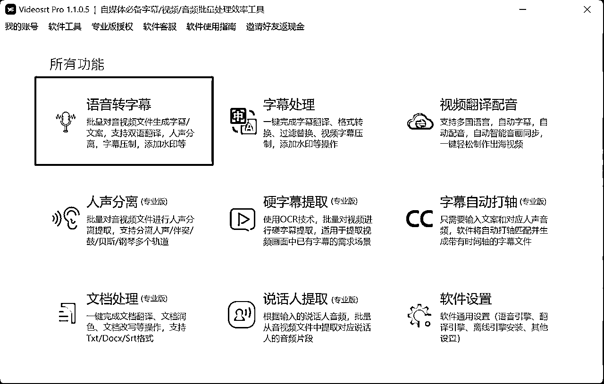
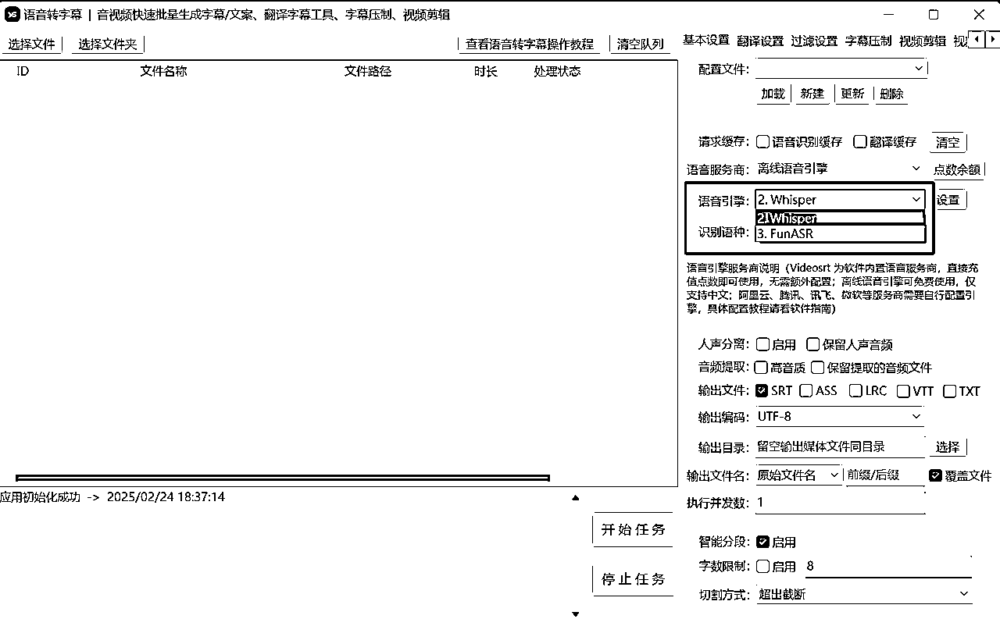
再用一个脚本把字幕批量清洗成纯文本，去掉时间轴，方便丢给AI重写。
## 3 AI文案复刻
大模型迭代很快。我经历过十一月用Gpt、Claude，年前后用Deepseek免费版和gemini免费版，到二月底Grok3上线。Grok3现在基本免费、速度快、能力强，我现在主力是Grok3+Claude组合。
复刻思路参考大家分享的小说AI创作法：先提炼大纲，再扩写。不同赛道提示词要微调。如果某个版本调得不满意，也别死磕，下一轮模型升级大概率会自然解决，先把流程跑通。
## 4 配音生成
我用的是微软TTS https://speech.microsoft.com/portal
信用卡注册后每月有50万字符免费额度。咸鱼上也有大额字符账号在卖，要谨慎，找有售后的，封号风险确实存在。也可以官网用，也可以走API接入。
另外Microsoft Cliphchamp软件本身就自带免费配音功能。
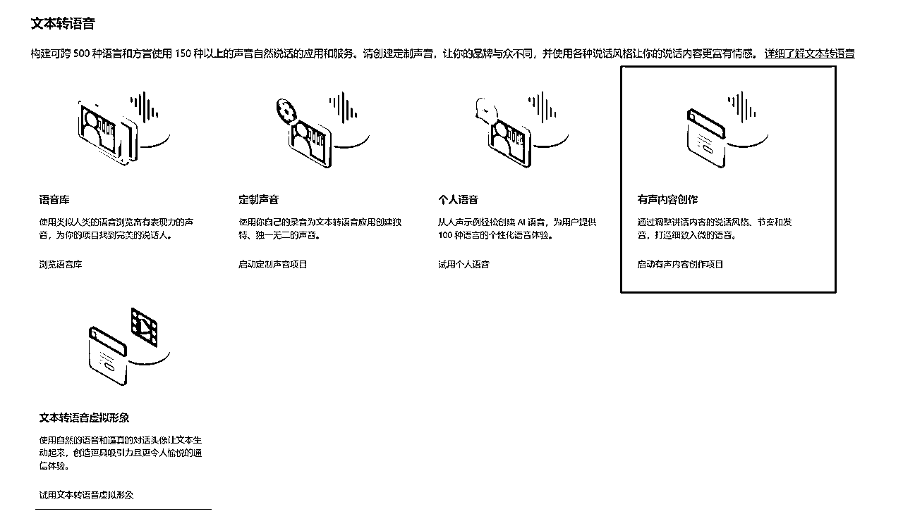
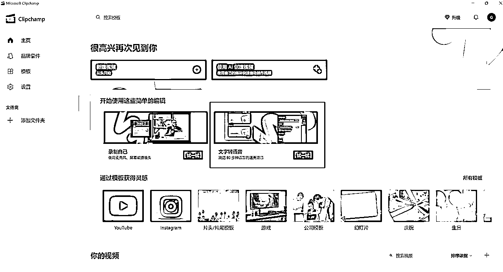
配音时有些工具会同步生成srt，这样后期就不用再跑剪映的字幕识别。长视频识别字幕又慢又容易错，有原文案在手，配好srt能省大量时间。
如果没同步生成srt，可以用字幕自动打轴工具快速生成。
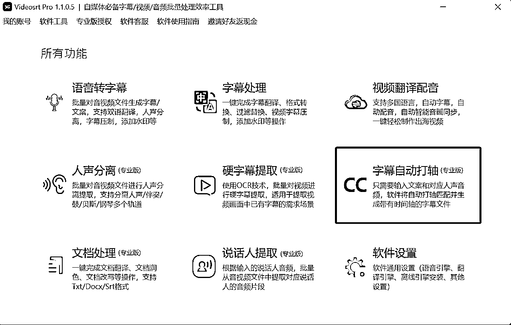
## 5 素材制作
现在讲故事类视频多是单图或几十张图的PPT形式。直接截取对标的图片，用midjourney反推关键词提示词，再用垫图微调，基本就能达到相似质感。
空镜头可以用智谱清影这类性价比高的AI视频工具批量生产：
1.先让ChatGPT批量生成空镜头提示词，丢几个参考给我就能批量产出。
2.用midjourney+autojourney插件自动生成并下载图片。
3.把图片丢给智谱清影生成空镜头。
单图系列参考
https://www.youtube.com/watch?v=BPMm1oDFHbM
多图PPT系列参考
https://www.youtube.com/watch?v=oz3psbsRQXk
空镜头系列参考
https://www.youtube.com/@%E6%98%8E%E5%BF%83%E8%A6%8B%E7%A6%AA/videos
## 6 剪辑合成
1.导入音频，注意文件名按1、2、3排序，方便核对
2.导入视频或图片素材
3.导入字幕
4.导出
单图系列直接拖进去就行。
多图PPT系列，图片拖进轨道后可以用 https://keyframeai.top/ 一键关键帧工具自动做好转场，做出PPT感。打完一次关键帧后，后续直接复用工程，只换图片即可，效率更高。
小技巧：在剪映的设置-全局设置-剪辑里，把单张图片的默认时长调好，拖入轨道就不用反复改时长。重复操作多用复制属性，省时。
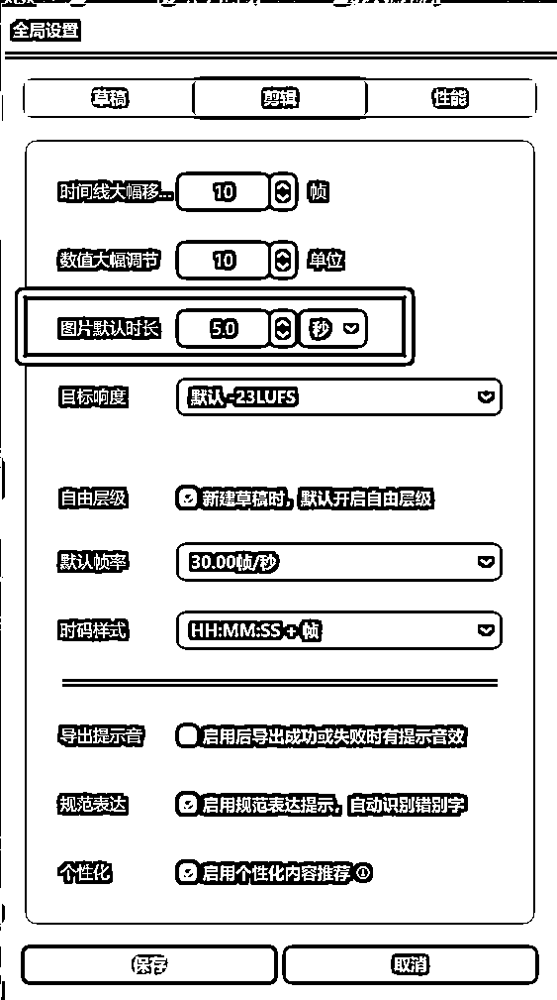
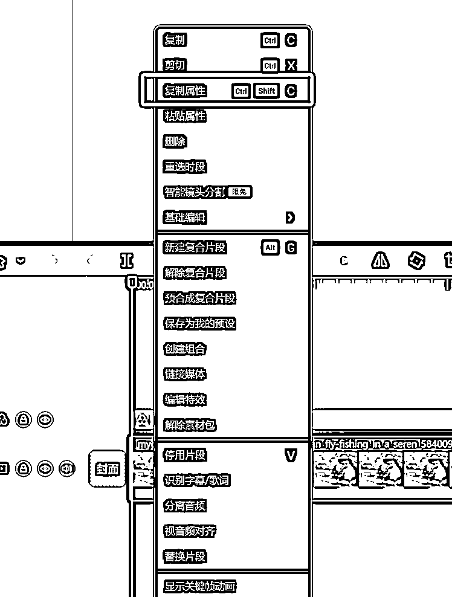
赛道验证完、模板固定后，可以用影刀做自动化衔接。
## 7 封面与标题
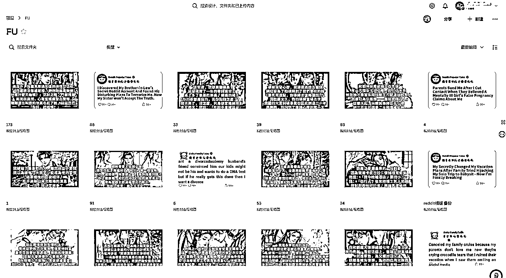
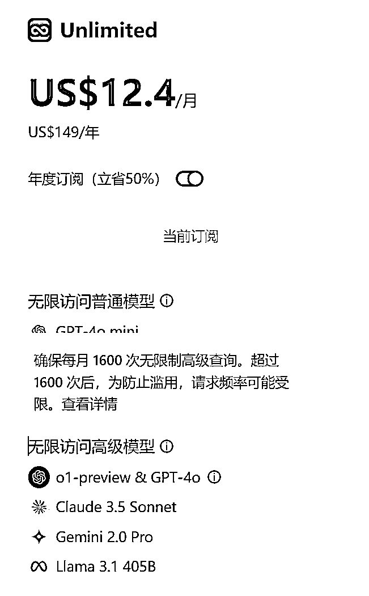
标题封面文案我会同时让ChatGPT、Claude、Grok3各写一版，然后把三版合并让他们投票，我选得票数2票以上的那个。经验上Claude出的往往更优。
我用的是Monica会员，性价比更高且不限制次数。虽然上下文长度不如单独订阅，但写标题封面完全够用。
封面我现在用Canva而不是剪映。Canva可以一键扩图，排版更灵活，网页端也更容易做自动化。
## 8 批量定时发布
新号长视频的流量启动有时比较慢，比如我的某条视频发布第5天才开始有起色。所以我会先一次性做十几二十条，让账号保持日更，隔几天再回看数据，不急于求成。
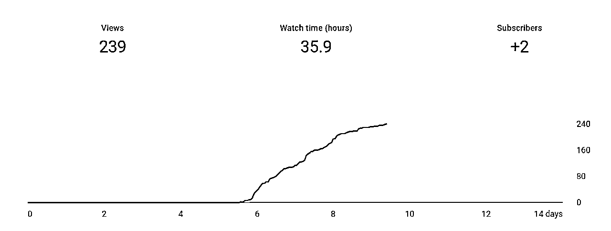
按这套线走下来，每天稳定地产出是可行的。
# 容易踩的坑
新号做长视频最常见的就是0播放。我问过不少人，都有类似经历，有人怀疑IP，有人怀疑赛道，有人觉得新人多、谷歌在限流。
我三个月开了十几个号，大半都出现过0播放。后来我自己搭VPS换IP、买家宽IP、甚至试老号，一个赛道同时起3个号，把可控变量尽量固定，不可控的就只能靠时间。最终还是等来了半个月过YPP的号。

# 尾声
感谢 @七天老师、 、 对本文的指导！
最后用两句话共勉。
为之，则难者亦易矣。
不为，则易者亦难矣。