# 零工龄白手起家，把 AI 代写做到行业前列——掩体不计划2025年3月海南见面会
作者：龙哥

掩体，1996年生，创业八年，AI 代写领域头部玩家

# 八年摸爬滚打，押中三次风口

2023年1月，我正式进入 AI 代写赛道。那段时间 ChatGPT 爆火。彼时我手里攒着一批校园资源，最初的想法是给学生卖 ChatGPT 账号。很快发现，学生群体对新工具的认知成本太高，光是科普是什么就费劲，这条路走不通。

于是我转头去找能立刻变现的场景。AI 代写就是我锁定的一块地。写作服务在淘宝等电商平台上本就属于成熟的虚拟类目，链路完整，只需要把 AI 的文本能力嫁进去。为什么要死磕？老经验告诉我，红利期一定要蹲上去，站在浪头上才能省力。

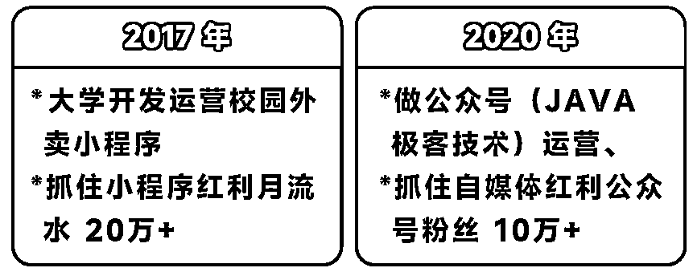

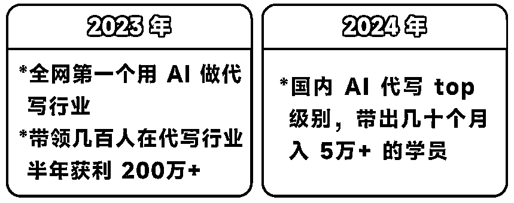

# AI 代写到底指什么

简单说，就是用 AI 的生成能力承接原本就存在的文档写作需求。类似写作业、报告、软文等服务在电商平台早已形成稳定供给和交易习惯，AI 只是把生产效率拉满了。

# 赚钱的底层逻辑

逻辑很直接：有人需要文档，愿意为你用 AI 产出的文档付费。

线上各个平台都在搜文档，这就是市场体量的证明。

AI 代写是大的赛道，里面细分品类繁多，每个细分都藏着机会。

没必要一上来就包揽一个大类，更关键的是找到愿意掏钱的人群。

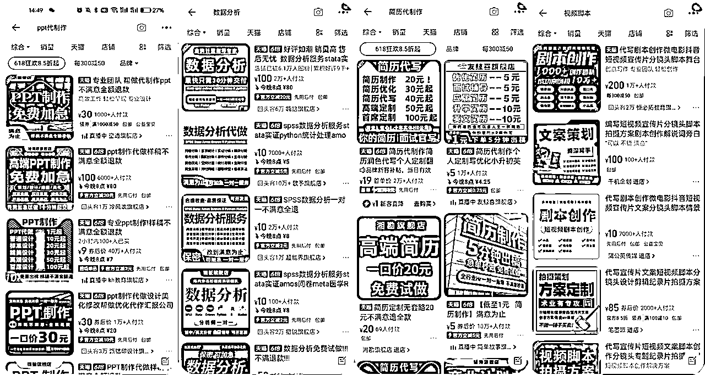

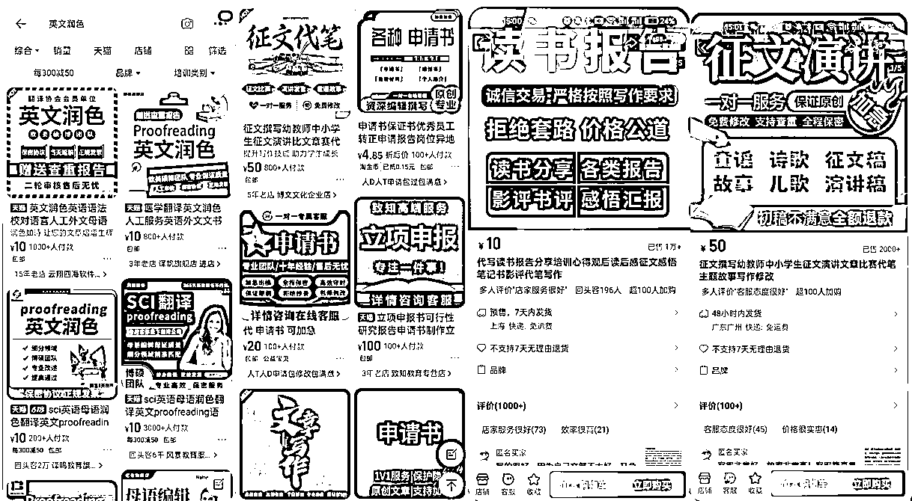

锁定人群后，再去围绕他们打造合适的 AI 工具或服务方案，提高成交转化。

# 掩体1.0：浪潮里捞到项目，就是 AI 代写

过去的创业经历让我认定，机会窗口不等人。

我直接上场，疯狂试错。失败是常态，只要一次成功就够。

## 新手进场的两条路

角色一：写手。只负责用 AI 交付，不碰客户。

起步阶段可以在淘宝接单，用 AI 完成写作。目前淘宝竞争激烈，建议往更垂直的领域钻，比如数据分析报告这类商家短缺的品类。商家通常会在群里发单抢单，单价普遍在10到20元。

刚开始的我一单才25元，兴奋的不是那点钱，而是亲眼看到 AI 能把整个链路闭环起来。

我本身写作底子很差，学生时代从没被夸过，但并不影响我在这个赛道做得不错。原先水平可能只有20到40分，有了 AI 能稳定在60到70分，而客户要的可能只要50分，这就形成了【价值匹配】。

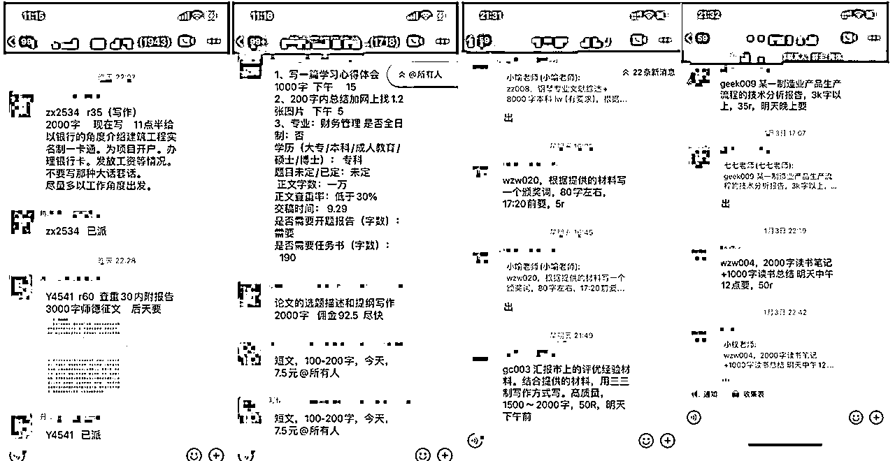

做完市场摸底后我发现，这块蛋糕远不止几块钱的买卖，也就萌生了自己做流量的念头。

角色二：商家。只做店铺运营和客户对接，交付交给 AI 或写手。

从前端截流报价成交，成交后再自己写或派单。模式繁琐，涉及引流报价交付，但利润上限更高。

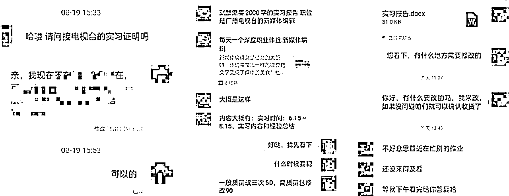

写手路径反馈快、门槛低、收益有限；商家路径反馈慢、操心多、天花板更高。没有绝对优劣，看个人选择。

# 掩体2.0：自营盘成型，月利润十万级别闭环跑通

要做闭环，别只做单一环节。上帝视角很重要。

## 免费引流

先拿免费流量背单，明确需求给出报价。AI 代写属于虚拟商品，没有统一标价，报价过程需要反复探索。

我们发现不同年龄层对价格的承受度差异很大，核心还是要回到人群画像。

免费和付费的本质区别是，付费更稳，免费零成本。

闲鱼：适合新手入门，账号矩阵够多就能触发流量池。一个商品进池后可持续曝光约10天。

小红书：同样是免费流量阵地。

免费模式要承受不确定性，比如账号安全、流量波动。

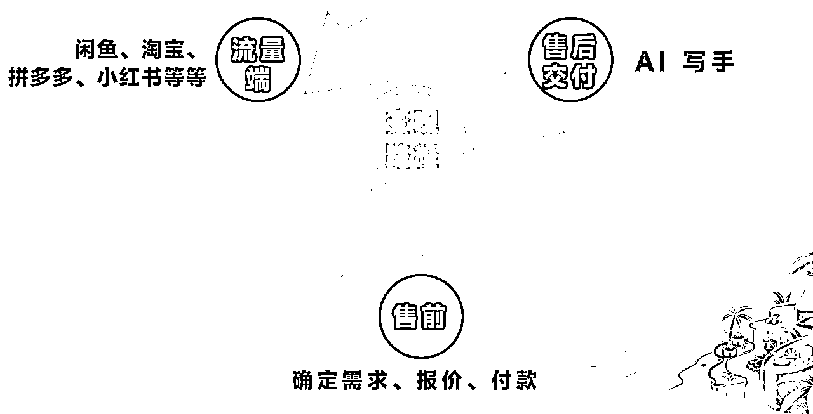

## 付费引流

付费靠投放，难点在于成交价能否覆盖成本。当单笔成交能覆盖投放并实现ROI 10以上，付费就最香。

各平台优劣势：

淘宝：竞争最激烈，店铺等级限制投放权限，市场被头部占据，没有私域积淀或重金砸盘很难破局；

拼多多：竞争相对弱，投放见效快，但违规风险高，一次引流或用词不当就可能封店；

巨量引擎等广告平台：流量相对稳定，会投就会出单。小红书聚光我们日消耗约四五千。

付费的卡点在于定价与ROI的平衡。

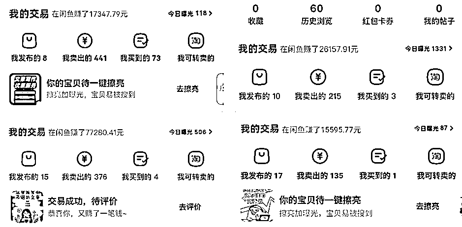

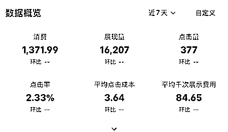

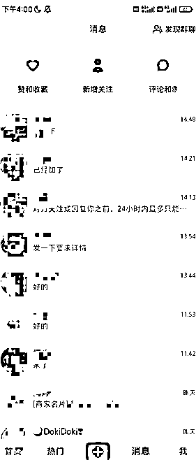

# 掩体3.0：知识付费扩张，带数百人实现两百万变现

AI 代写知识付费的核心价值是：帮学员把写作能力升级，并把流量、报价、交付等环节打通成完整商业闭环。

## 技能提升型变现

学员原本写作能力可能只有20分，通过培训能提升到40分，足以在多个细分赛道变现。

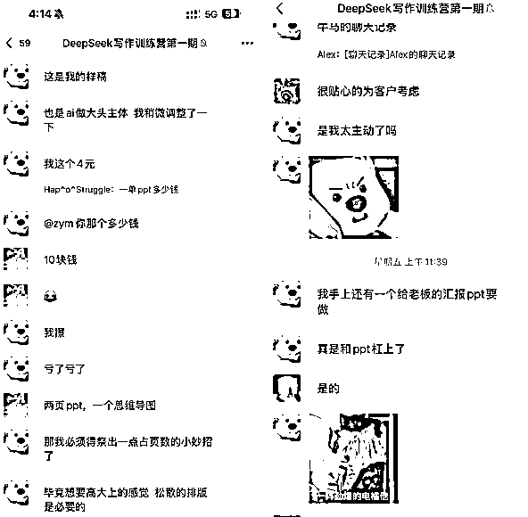

## 闭环打通才是关键

小白做写手，无论免费还是付费流，都会卡在报价。市场上同类成交要四五百，自己只敢收一百，结果拉低整个流池价值。成交价低会损伤复购，前期价格压太低，后续提价客户很难接受。平均复购率在20%左右。

当团队在背后兜底，帮学员完成从拓流到报价的闭环，付费意愿会很高。学员可以只负责拉流，也可以直接交单由团队定价交付。

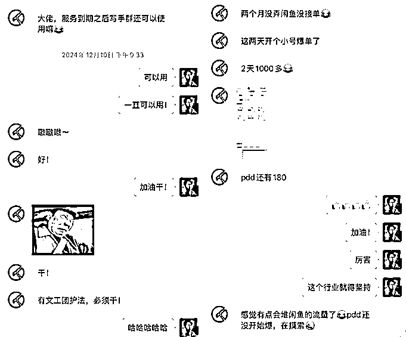

自营与带课的协同关系：互为支撑

自营盘稳定，知识付费后端才稳。

自营订单多，能分派给学员练手，从谈单到交付反复打磨。他们更清楚一线行情，哪些冷门细分类目其实赚钱。

代写赛道虽单价可观，但学术类交付周期长，强季节性，前几个月月入百万，后面几个月可能断流。我们近期测试到一些交付周期两三天的品类，内容是文字稿加PPT，单价600左右，复购很高。

选品关键在于人群：支付能力、购买场景、决策动机、复购率。部分人群消费力惊人，比如家长为孩子付费，客单价能拉很高。所以我们会不断测试不同类目和不同报价，找人群价格锚点。

# 掩体4.0：孵化 AI 代写个人IP

去年不少学员想全职转型，能做到月入过万的寥寥无几。0到1虽然可行，但抗风险弱，1到10的放大效应会放大问题。

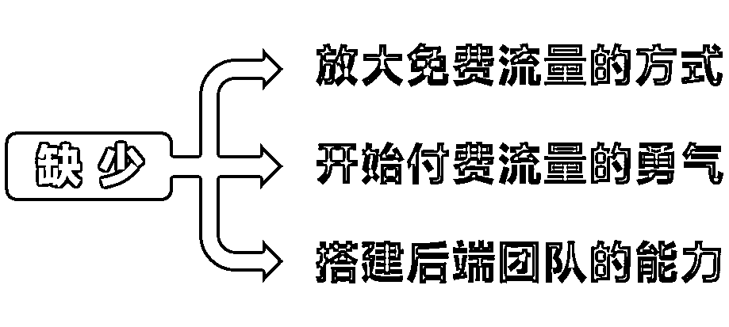

小白想放大，第一题是流量如何规模化，如何批量起号。第二题是付费流量的建模，有学员靠免费平台耗了半年才做到20万，谈恋爱期间还扛着15部手机作业，后来转投付费流，建模后有了确定性。第三题是后端承接能力不足，多为单点承接。有团队支撑后才能敢谈高价，针对不同人群的信息决策能力，对不同类目做差异化定价和测试。