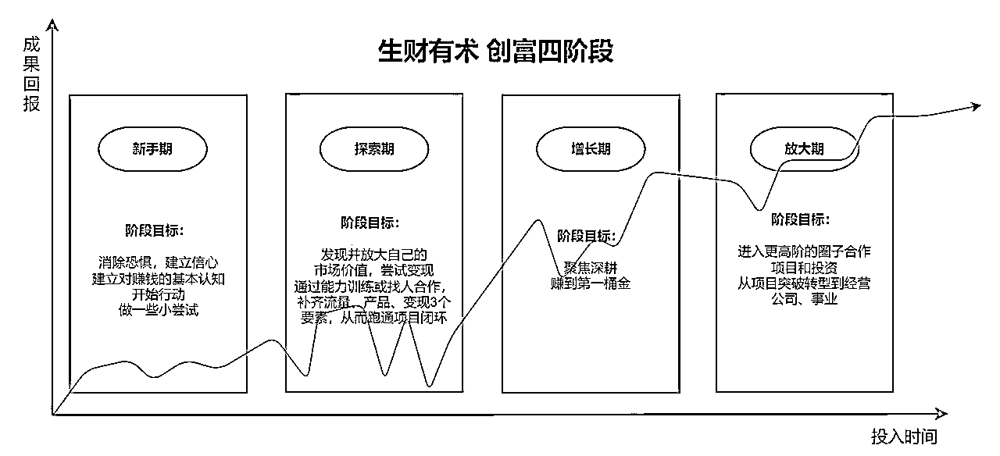

# 新成员行动手册：从入门到放大的完整路径（龙哥盟第七期）
新成员行动手册：从入门到放大的完整路径
整理自官方公开文档｜发布于2023年3月

本手册由兰卡、二三执笔，官方运营组携手多位资深成员共同打磨完成。它存在的目的，是帮你快速熟悉环境、看清方向，少走一些不必要的弯路。

# 01 先认识这个地方
嗨，欢迎来到这个专注“搞钱”的圈子。
它从2017年起步，六年多来服务了四万多位成员。我们不渲染速成神话，只想帮平凡人用省力、简单的方式积累财富，同时提供看得见的信息、方法、机会和人脉。
上一季，圈子里留下了不少实打实的成果：
- 成员共创了四万多条赚钱情报，五百多条深度内容被标记为精选，带出上千个真实机会；
- 八十三场实战共练，累计四万三千多人参与，留下一万份杰出战绩和五千五百多篇成长笔记；
- 四十余个城市组织了九十八次线下茶叙，五百三十四人因此结下深交；年度见面会到场一千多人。
这个圈子能走到今天，离不开三条共同信念。
信念一：创富路径不只一条。真正可持续的收益，来自你自身的特点和喜好，而不是照抄谁的模板。
信念二：成长曲线是波浪形的。每天都进步是幻想，踩坑和停滞才是常态；但每绕一次弯，都会更靠近目标。请多给自己一点时间，大胆试，慢慢等。
信念三：这条路有人同行。思维、渠道、产品、流量、技能、人脉，都能互相补位，这也是圈子存在的意义。欢迎你加入，也欢迎你将来帮到更多人。
只要你想，这里永远有你的位置。

出发前，有两个小热身。
热身一：参照下方的阶段定位图，判断你当下所处的位置，然后跳去对应章节看建议。

点击对应标题直达：
- 第一章｜先有信心，再谈行动
- 第二章｜多试几次，找到价值
- 第三章｜锁定方向，收入向上
- 第四章｜带团队，把盘子做大
热身二：填一份本季成员登记表，方便我们按你的个人实际提供服务。👉 表格入口见后文。信息只用于内部服务，绝不外传，放心提交。
填好之后，挑一个章节开始读吧。

# 02 阶段一：先有信心，再谈行动
使用提醒：文中链接需用微信登录星球App访问，按提示登录即可；建议使用电脑端浏览，体验更好。

刚进圈子的你，大概有这些状态：
- 满脑子想着马上赚钱，仿佛有钱就能解决所有烦恼；情绪却常在高期待和低行动之间拉扯，一会儿觉得能行，一会儿又觉得完了。
- 不知道圈子外还有什么玩法，好奇别人靠什么赚钱，可看到看不懂的信息、听到别人成功的故事，又忍不住焦虑，甚至觉得自己不行。
这个阶段的破局动作，是打开思维、稳住心态。
先清理几个常见的认知卡点：
- 眼高手低：小项目看不上，大项目又接不住；
- 急于求成：付出一点点就想要很大回报，看不到结果就撤；
- 求稳心态：盼着每个项目都稳赚不赔，最好零成本高收益。
如果你正被海量信息压得喘不过气，那就少看，只看自己能理解的少量干货；也可以多读高手的故事，感受他们怎么思考。这比硬啃一堆看不懂的内容更有用。
接着，有四件事可以逐一尝试。
第一件：找回信心
去搜索“新手赚钱经历”，你会看到很多起点和你相似的人，也已经一步一步走出来。你也可以。或者来当志愿者，靠近能量高的人，在合作中交到朋友。
第二件：清掉旧观念
在搜索框输入“赚钱 误区”“商业思维”等词，对照一下，看看自己有没有被类似的想法绊住。
第三件：开眼界
挑一个门槛不高的实战项目，把手册读熟，弄清它从启动到变现的全过程；也可以精读几篇加精内容，学着拆解背后的模式。遇到不懂的，就加入“共读小组”，和大家一起讨论。
第四件：做出第一次行动
别把目标定成“立刻赚钱”，而是“先动起来”。选类似“共读营”“朋友圈运营”这种轻量活动，连续参加两三期，手感和信心都会长出来，第一笔收入自然会来。
以上项目来自2023年2月已经结营的实战活动，后续选项目时可以多留意同类；所有资料都已留档，点开链接就能查看。

# 03 阶段二：多试几次，找到价值
同样的使用提醒：链接需用微信登录星球App后打开，推荐电脑端阅读。

到了这个阶段，你可能符合以下几条：
- 主要收入来自主业或副业，但一直没有大幅提升，于是愿意走出去，把能力用到更大的地方；
- 认可自身的价值，也有想尝试的方向，甚至已经赚到过一点钱，但常被公司或机制限制，很难放开手脚。
破局的关键，是持续试错、打磨长处，并找到愿意为这份价值付费的市场。
给你四条可操作的路径：
路径一：主动破圈
带着真诚分享的心态，在社群里发布情报、心得或想法。参加实战营、线下局、志愿活动时，多介绍自己、多互动，让别人有相关需求时，第一个想到你。
路径二：借高手的力
找到你欣赏的牛人，主动申请帮他们分担事情。能运营，就帮忙管项目；能写，就帮忙整理内容；能执行，就加入团队。边做边学，机会自然来。
路径三：把手里的资源变成钱
有渠道，就和有货源的成员合作分销；有账号，可以帮圈子里的产品带货；有货源，可以成为快手精选联盟、抖音精选联盟或视频号供货商。
“资源对接”入口：在星球底部菜单栏点“#资源对接”，就能看到全部供需信息。
路径四：多开几条试错线
看加精内容、热点情报和实战手册，把感兴趣的方向列出来，逐个尝试；遇到卡点，就去搜索站找答案。在时间允许时，多参加几个实战营，别怕失败——十个尝试里有一两个成功，就已经值了。记得每期写复盘日志，记录想法和结果，慢慢你会看清适合个人的路线。
小提示：找内容可以这样做——
- 星球首页有【精选】【中标】【风向】三个栏目，点开就能看；
- 在置顶导航里找“索引站2.0”，输入关键词，再用“仅看精选”“中标”“风向”筛选；
- 同样的入口里，手机端点底部【实战】，电脑端点顶部【实战活动】，可找到最新训练营资料和报名入口。

# 04 阶段三：锁定方向，收入向上
使用提醒同上：注意先登录星球App，电脑端阅读更清晰。

进入这个阶段，通常意味着你已经有了明确的市场定位，并开始在某条赛道持续出收入，预计年入五十万到一百万，甚至更高。
这个阶段最大的风险，是“什么都想抓”。看到新风口就心动，换了一条又一条赛道，最后哪条都没做出结果。正确的做法，是把已经跑通的事情做深做透。同时，多帮人、多分享，让影响力成为你的杠杆。
三件要紧的事：
第一，把当前项目打透
约领域内有结果的人聊一聊，争取有针对性的辅导；或者组织一场线下聚会，和高手面对面交流，互相充电。
第二，在圈子里建立个人招牌
持续输出对别人有用的信息：项目情报、操作心得、思考总结。内容出众的话，官方可能会邀请你担任训练营教练，参与课程编写和答疑，这是积累作品、连接同频人的好机会。
第三，链接更高层的资源
注重积累平台的荣誉奖励，拿到后进入高阶圈子，和同样有成绩的人交流合作；也可以申请加入高阶共创组织，借助项目孵化和闭门会，参与更大的盘子。

# 05 阶段四：合作共舞，把项目放大
使用提醒照旧：链接需微信登录星球App后打开，电脑端体验更佳。

到了这一步，你手头的单一项目年收入可能已超过五十万甚至上百万，财务上有了不小的空间。这时要完成的转变，是从“单打独斗”变成“带一支队伍”。
具体建议有三条：
第一条：进入更强的圈子
攒够荣誉分，拿到高阶圈子的入场券，和同级别的人做高质量交流；或者加入高阶共创组织，参与项目孵化、深度闭门会，把盘子做得更大。
第二条：搭建多元收入结构
通过项目路演、热点情报和加精内容，发现优质新项目，培育第二增长曲线，别把所有期望押在同一个地方。
第三条：持续放大个人影响力
保持真诚分享，输出情报、心得和判断。当官方看到你的内容能力，你有机会成为训练营教练，参与手册编写、答疑互动，同时打磨作品、链接同路人。

# 06 资源工具：你想找的都在这里
入圈之后，我们会根据你的段位、特点和路线，给到不同的建议。过程中，你可能会需要信息、机会、练习、人脉、交流、激励、反馈——这些支持，平台已经用七年时间准备好了。
你可以按兴趣慢慢逛，但别“贪杯”。资源是来帮你的，不是让你焦虑的。用到的时候再来找，就不会被信息淹没。
注：以下链接同样需要先用微信登录星球App。

## 1）社区公约
一个彼此舒服的圈子，要靠所有人一起遵守规则。
我们约定了几条原则：
1. 谈钱不扭捏；
2. 保持空杯，愿意接受不同；
3. 多帮别人，常怀感恩；
4. 真诚待人。
在社群里，我们鼓励：
- 坦诚分享个人经历，给他人启发；
- 不碰法律红线，网络不是法外之地；
- 在拿到荣誉奖励之前，先贡献内容，别总想着导流。
我们不喜欢：
- 广告、互推、薅流量的行为；
- 一句话水帖、无意义提问；
- 攻击辱骂他人。
盗版是底线问题。作为内容型社群，我们绝不姑息，一旦发现，直接移除。
发帖要点：
- 分享赚钱情报或复盘，直接发帖即可；优质帖会被打上精选标识，作者能获得荣誉奖励，具体规则见《荣誉体系说明》；
- 随手记录小感想，可以带#朋友圈 话题；
- 周末全员休息，暂停发帖；工作日恢复。
愿新伙伴都能遵守公约，一起体面地并肩创富。

## 2）精选内容库：站在前人的肩膀上
这里收集了六年来高手们的实战笔记，比市面上多数信息早半年左右，像一部“奋斗者实录”。目前已有三千九百多篇，全部向成员开放。
怎么用？从你感兴趣的部分入手，多读几遍，边读边想，再对照个人实际去实践。
👉 第六期精选合辑入口
入口就在社群里，等你来挖宝。
*   进来星球后，首页就能看到【精华】专区，直接点进去阅读。也可以切到【列表模式】，按项目或栏目来筛选内容。
*   在首页置顶的导航帖里，找到【龙哥盟索引站 2.0】，输入关键词搜索，并勾选【仅看精华】，就能快速定位到想看的内容。

## 3）风向标：洞察赚钱风口的情报雷达
它是什么
聚焦赚钱领域的最新情报和玩法，讲究短、平、快、准。
第六期共创阶段收集了 13000+ 条风向标，星主龙哥最终甄选出 2000+ 条可落地的赚钱机会，作为中标风向标收录。
怎么用
把这 2000 条风向标逐条读透，搞明白每一笔钱背后是怎么赚回来的。
👉点击这里，查看第六期 | 风向标中标合集
在哪找
*   进入星球后，在首页点开【中标】【风向标】，即可浏览全文。
*   在置顶导航帖打开【龙哥盟索引站 2.0】，搜索关键词【中标】【风向标】，筛选后查看感兴趣的条目。

## 4）航海实战：从听课到实操，避免知易行难
它是什么
一年举办 5 次航海实战，每期开放 20+ 个主题，覆盖项目实操、变现技能、同城链接三大方向。
依托实战资料包、大咖分享和陪伴机制，第六期已有 4.3w 人次参与下场实操。
怎么用
挑一个自己感兴趣或至少不排斥的方向，跟随教练的步骤一步步落地，争取赚到第一笔除工资外的收入。
参与需缴纳保证金，完成上岸后保证金原额退回。
👉点击这里，查看第六期 | 航海实战资料
👉点击这里，查看第六期航海实战 | 高手分享合集
👉点击这里，查看第六期航海实战 | 赚钱好事合集
在哪找
*   在首页置顶导航帖进入【龙哥盟索引站 2.0】。手机端点击底部【实战】，网页端点击顶部【实战活动】，可查看最新航海资料，报名期也可以在此直接报名。
*   平时留意星球发布的航海项目通知，文内附带报名直达链接。

## 5）航海家俱乐部：与头部玩家深度共创项目
它是什么
航海家俱乐部是龙哥盟的高阶圈层，也是项目孵化平台。
成员多为已在实战中取得结果的创业者，核心目标是通过深度协作推动项目从 0 到 1，再从 1 到 N。
怎么用
赚钱会提供优质项目的复制放大机会，并打通人脉、产品、流量等资源，配合孵化支持、社群基金等资源助力。
当前已有孵化意向的项目包括：赚钱风向标、赚钱朋友圈抖音号、抖音 SEO、10w+ 级 ChatGPT 应用中国社区、海外 SaaS 孵化器、深耕版航海计划、各行业垂直交流群、快团团供应链、AI 绘画训练营等。
在哪找
航海家俱乐部目前采用审核制，需要先有实战成果的成员加入，运营稳定后会转为邀请推荐制。有意向可联系龙哥盟服务官鱼丸。
详情阅读：《航海家俱乐部开放报名》

## 6）同城小局：面对面交流比线上更高效
它是什么
星球内会定期发布同城小局的主题与安排，各地会员可自主发起和参与。核心目的就是线下链接，提高交流质量与效率。
2 月航海同城小局内测数据显示：覆盖 40+ 城市，共计举办 98 场，累计参与人数 534 人。
怎么用
保持开放和利他心态，按时参与当地小局，拓宽视野，获取更深度的行业信息。
在哪找
同城小局不定期开放，关注航海实战项目动态及星球通知，按要求完成报名即可参与。

## 7）其他
### 龙珠：圈友专属的感谢与回馈体系
长期以来很多圈友默默支持龙哥盟的成长，我们用龙珠来记录并致谢。
拥有龙珠后可享受多项专属权益，例如参加龙珠专属线下见面会、参与会员日福利抽奖、受邀加入航海家俱乐部、参与社群项目年度收益分红、兑换龙哥盟门票等。
具体权益与获取方式详见：《龙珠体系介绍》

### 问题求助
每个问题都值得被认真对待，每个提问都应该得到解答。为避免个性问题干扰整体信息流，我们专门开设了 #问题求助 专区，并组建了 200 人的互助小分队，尽力解决大家在创业、赚钱、工作和生活中的各类难题。
入口：进入 龙哥盟星球（点击前往）点击菜单栏 #问题求助 即可查看全部内容。
提问方式：进入 龙哥盟星球（点击前往）发布求助帖，添加 #问题求助 标签即可。

### 资源对接
“我能输出什么，我需要什么...”
为了促进价值交换和合作机会，我们在星球内开设了 #资源对接 专栏。无论你有稀缺资源，还是有明确需求，都可以在这里发布。
入口：进入 龙哥盟星球（点击前往）点击菜单栏 #资源对接 即可查看全部。
合适的圈友会主动与你联系。
注意：圈友间涉及资金往来，尤其是投资类行为，请务必谨慎甄别。
